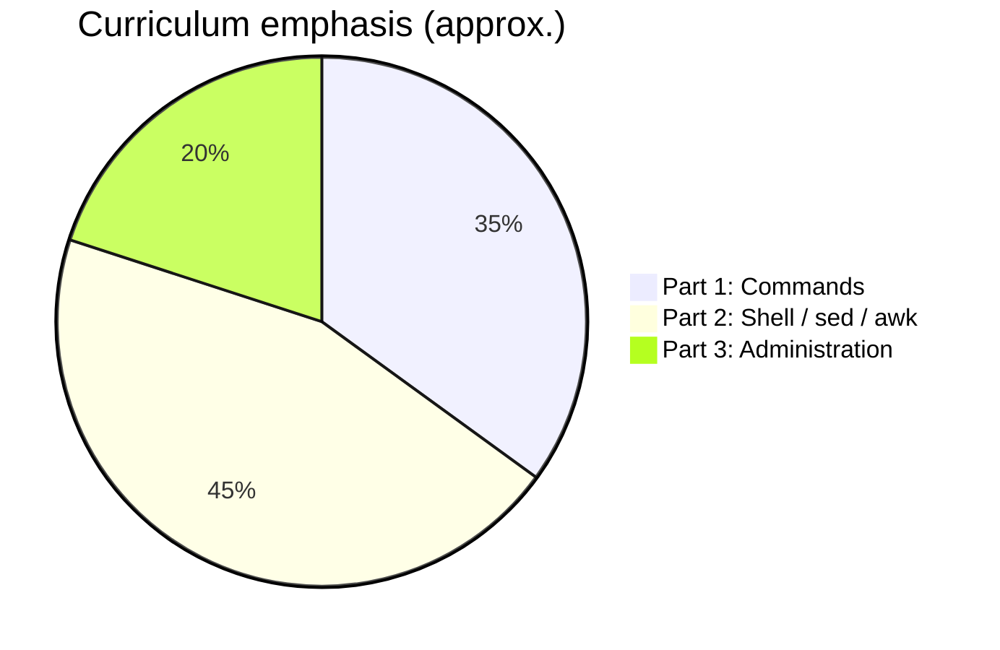
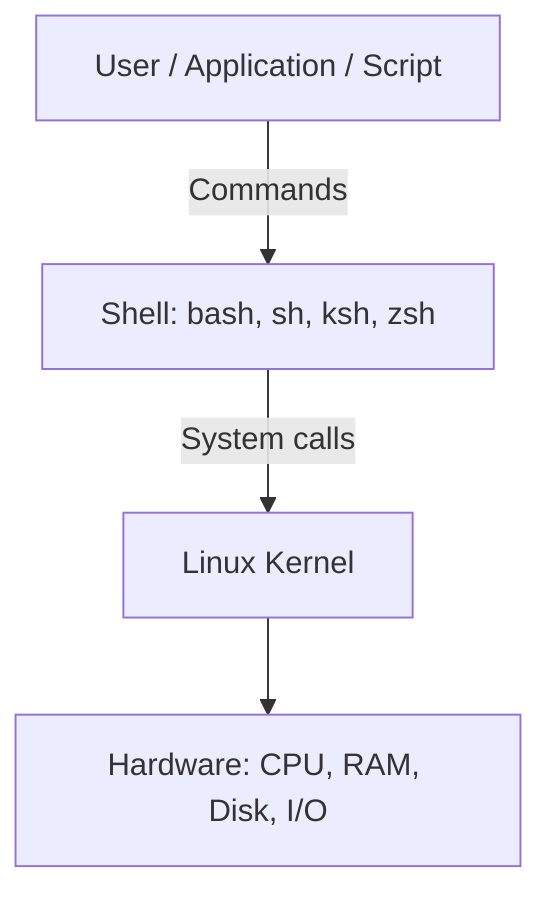
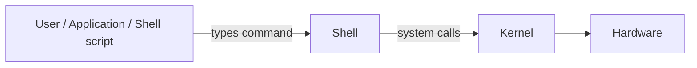
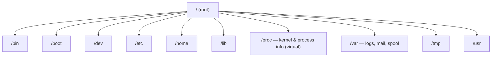

# Linux Basics — Complete Study Guide

*Aligned with **Durga Sir**'s *Linux with Shell Programming, SED, AWK and Many More* course ([YouTube playlist](https://www.youtube.com/watch?v=txRD_bK062Y&list=PLd3UqWTnYXOloH0vWBs4BtSbP84WcC2NY)).*

This guide mirrors the three-part curriculum announced in Session 1: **Part 1 — Unix/Linux commands**, **Part 2 — Shell scripting, SED, AWK**, and **Part 3 — Linux administration basics** (~20% of the course, time permitting).

---

## Course map (Session 1 overview)

| Part | Focus | Representative topics |
| :--- | :--- | :--- |
| **1** | Commands & concepts | File system, install, `ls`/`date`/`cal`, dirs/files, compare/link, `wc`/`sort`/`uniq`, redirection & pipes, regex & wildcards, `alias`, `locate`/`find`, compression, `grep`/`cut`, permissions & editors |
| **2** | Shell programming | Shebang, variables, substitution, arguments, user input, operators, control flow, arrays, functions, projects; **SED**; **AWK** (+ project) |
| **3** | Administration | `crontab`, users/groups/`sudo`, PuTTY/MobaXterm, customizing OSS, processes, `write`/`wall`, packages, optional: MySQL, Java, job control, networking, `vi`, `init` |



---

## Why Linux matters (Session 1)

- Required background for **DevOps**, **Hadoop**, **testing**, **application development** (Java, Python, etc.), **DBA/Oracle**, **cloud**, and **data science/ML** — most production apps and clouds run on Linux.
- Roughly **90%** of real-time applications are hosted on Linux platforms in industry.
- Developers often depend on Linux admins for small commands; knowing basics reduces that friction.

---

## 1. Introduction to UNIX and Linux

### 1.1 What is Unix / Linux?

- **Unix:** Operating system originated in the **1960s** (AT&T Bell Labs — Ken Thompson & Dennis Ritchie).
- **Linux:** Unix-like kernel created by **Linus Torvalds (1991)**; distributions package kernel + tools + apps.
- People use **extended/improved flavors** of the base Unix ideas, not the original 1960s release unchanged.

### 1.2 Operating system role

An **OS** is software that lets users and applications talk to **hardware** (CPU, RAM, disk, network). Without an OS, hardware cannot be used for normal work.

### 1.3 Key features (interview-friendly)

| Feature | Meaning |
| :--- | :--- |
| **Freeware** | No license fee to use (contrast: licensed Windows). |
| **Open source (FOSS)** | Source code is available; organizations can modify and ship their own variant (e.g. company-specific Linux), subject to licenses such as **GNU**. |
| **Multi-user** | Many users can use the system at once (`who`, `whoami`, `finger`). |
| **Multitasking** | Many processes/activities concurrently (foreground & background). |
| **CUI and GUI** | Historically CLI-only; modern distros support **both**. **CUI/CLI** (terminal) is often **more powerful** for bulk/automation work; GUI suits small interactive tasks. |
| **Security** | Strong permission model; often considered more secure than default Windows setups for servers. |

**CUI** = Command Line / Character User Interface. **GUI** = Graphical User Interface.

### 1.4 Unix vs Linux

- **Unix** — family and ideas from the original system.
- **Linux** — kernel and ecosystem built **on Unix concepts**; most courses use “Unix/Linux” together for commands that are largely portable across flavors.

### 1.5 Flavors (distributions)

Examples: **Ubuntu**, **Red Hat Enterprise Linux (RHEL)**, **CentOS**, **Fedora**, **Debian**, **SUSE** / openSUSE, **Slackware**, **Kali**, **Amazon Linux**, **Oracle Linux**, etc.

- **~80–90%** of commands and behavior are the same across flavors (like riding different motorcycle models).
- Explore rankings and variants: [distrowatch.com](https://distrowatch.com).

### 1.6 Architecture



1. **Hardware** — physical devices.
2. **Kernel** — schedules CPU, memory, devices, processes.
3. **Shell** — interprets commands and scripts.
4. **Utilities** — `ls`, `cat`, `grep`, `cp`, editors, etc.

> **Durga Sir (Video 2)** stresses that the **operating system itself** has **two core parts**: **Shell** and **Kernel**. User and hardware sit outside; utilities run under the shell. See [Session 2](#session-2-video-2-unix-components-execution-flow--basic-commands) below.

---

## Session 2 (Video 2): Unix components, execution flow & basic commands

**Video:** [Components of UNIX, Execution Flow, Basic Commands](https://www.youtube.com/watch?v=2zfh8eC7cY0&list=PLd3UqWTnYXOloH0vWBs4BtSbP84WcC2NY&index=2)  
**Recap from Video 1:** Unix = OS from the 1960s; features (freeware, FOSS, multi-user, multitasking); many **flavors** — learn one, work on others easily.

### 2.1 Two important components of Unix/Linux

| Component | Role (Durga Sir) |
| :--- | :--- |
| **Shell** | **Outer layer** of the OS. Only part the **user talks to** directly (terminal). |
| **Kernel** | **Heart** of the OS. Executes work using **hardware**. |



- **Shell** = interface between **user** and **kernel** (like `javac` checking syntax before runtime).
- **Kernel** = interface between **shell** and **hardware**.

#### Shell responsibilities (step by step)

1. **Read** the command the user typed in the terminal.
2. **Check** whether the command **exists** (valid command name).
   - Invalid example: `touch123` → `command not found` (**shell** prints the error).
3. **Check** whether the command is **used correctly** (valid options/arguments).
   - Valid command, wrong usage: e.g. `touch -da` → invalid option; `cal 99999` → invalid year (**shell** reports error).
4. If everything is correct, **interpret** (convert) the command into a form the **kernel** understands and **pass it to the kernel**.

#### Kernel responsibilities

1. **Execute** the command and produce the required result.
2. **Communicate** with hardware (disk, CPU, memory, I/O).
3. **Allocate memory** and **CPU** needed to run the command.

After the kernel finishes, a new **`$` prompt** appears on the terminal — meaning **ready for the next command**.

### 2.2 Command execution flow (summary table)

| Step | What happens |
| :---: | :--- |
| 1 | User types a command (e.g. `touch sunny.txt`) and presses **Enter**. |
| 2 | Command is submitted to the **shell**. |
| 3 | Shell checks: valid command? correct usage? |
| 4 | If not → **error message** on the terminal (shell). |
| 5 | If yes → shell **interprets** and sends to **kernel**. |
| 6 | Kernel **executes** (e.g. creates `sunny.txt` on disk). |
| 7 | **`$` prompt** returns — ready for next command. |

**Demo command from class:**

```bash
touch abcdef.txt
# After success, prompt returns; file is created in current directory
```

If a file with the same name already exists, `touch` updates its timestamp rather than failing (behavior may vary slightly by context; Durga Sir notes you may see errors in other delete/create scenarios).

### 2.3 Shell script — first glimpse (Durga Sir’s `test.sh`)

A **shell script** = a **file containing a group of commands** run together (like a Windows `.bat` batch file). The shell runs it **line by line** (interpreted language).

**Example from the video** — create `test.sh`:

```bash
cal
date
echo "Hello Friends. Welcome to Unix World."
```

Make it executable and run (as shown in class):

```bash
chmod u+x test.sh    # grant execute permission to user (covered in detail later)
./test.sh            # run all three commands in order
```

Same script is in this repo: [`scripts/test.sh`](../scripts/test.sh).

### 2.4 User types and prompts

Linux has **two main user types**:

| User type | Also called | Typical prompt | Meaning |
| :--- | :--- | :--- | :--- |
| **Normal user** | Regular account | **`$`** (dollar prompt) | Limited privileges |
| **Super user** | **root**, admin | **`#`** (hash prompt) | Full system control |

**Examples from class:**

```bash
whoami          # normal user → e.g. durga
sudo -i           # switch to root (enter password); prompt becomes #
whoami          # root
exit            # leave root session; back to $ prompt
```

Prompt text can vary by distro; **`$` ≈ normal**, **`#` ≈ root** is the rule Durga Sir gives.

### 2.5 Practice: online Unix terminal (optional)

For browser practice (commands like `clear`, `date`, `echo`, `exit`), Durga Sir uses the **JS/Linux-style online terminal** (e.g. [masswerk JS/UIX](https://www.masswerk.at/jsuix/)). Log in as **guest**, then use the same commands as on a real system. On your **Ubuntu machine**, use the built-in terminal instead — no website needed.

### 2.6 Basic commands (Video 2 — with class examples)

| Command | Meaning | Durga Sir usage / notes |
| :--- | :--- | :--- |
| **`pwd`** | **P**rint **w**orking **d**irectory | *Not* password. Shows current folder. Guest demo: `/home/guest` |
| **`ls`** | **L**i**s**t files and directories | Empty output until you create files |
| **`mkdir`** | **M**a**k**e **dir**ectory | `mkdir unixclasses` |
| **`cd`** | **C**hange **d**irectory | `cd unixclasses`; `cd ..` = parent directory |
| **`touch`** | Create **empty file** | `touch material.txt` — content needs other tools (later videos) |
| **`rm`** | **R**e**m**ove file | `rm material.txt` — **permanent** (no Recycle Bin) |
| **`rmdir`** | Remove **empty** directory | `rmdir unixclasses` |
| **`cal`** | **Cal**endar (current month by default) | |
| **`date`** | Current system **date and time** | Options later for date-only / time-only |
| **`clear`** | Clear terminal screen | |
| **`exit`** | End session / logout | |
| **`help`** | List commands | Common on **online** emulator; on Ubuntu use `man cmd` |
| **`hello`** | Brief system info | Emulator-specific; on Ubuntu try `uname -a` |

**File vs directory:** **Directory** = folder (`mkdir`); **file** = ordinary file (`touch`, documents, scripts).

**`rm` vs `rmdir`:** `rm` deletes **files** and is very powerful; `rmdir` only removes **empty** directories. Durga Sir warns: **never use `rm` carelessly** — deleted files are usually **not recoverable** at OS level; wrong `rm` can cause serious production incidents.

**Case sensitivity:** Linux commands are **case-sensitive**. `cal` works; `CAL` may not.

### 2.7 File system tree (as taught in Video 2)

Hierarchy starts at **`/`** (root — the leading slash, not a special name beyond “root directory”).

```text
/                          ← root of the whole tree
├── bin/                   ← essential commands (intro level)
├── dev/                   ← device files
├── home/                  ← per-user home folders
│   ├── guest/             ← home for user "guest" (online lab)
│   ├── durga/             ← home for user "durga"
│   └── ravi/              ← /home/ravi
└── ...                    ← other dirs (/etc, /var, … in later sessions)
```

**Class walkthrough (reproduce on Ubuntu):**

```bash
pwd                         # e.g. /home/yourname
ls                          # often empty in a new home dir
mkdir unixclasses           # create folder (video: "unix classes")
ls                          # shows unixclasses
cd unixclasses
pwd                         # /home/yourname/unixclasses
touch material.txt
ls                          # material.txt
rm material.txt
ls                          # empty again
cd ..                       # back to home
pwd                         # /home/yourname
rmdir unixclasses           # remove empty directory
cal
date
clear
```

**Navigation with `cd ..`:**

```bash
cd ..                       # from /home/guest → /home
cd ..                       # from /home → /
```

### 2.8 Invalid command examples (shell errors)

```bash
touch123                    # command not found — invalid command name
touch -da abc.txt             # invalid option — command exists, wrong usage
cal 99999                   # invalid argument — cal exists, year not valid
```

### 2.9 Session 2 checklist

You should be able to explain:

1. The **two OS components**: shell and kernel — and each one’s job.
2. Full **command execution flow** from Enter key to `$` prompt.
3. What a **shell script** is (`test.sh` with `cal`, `date`, `echo`).
4. **`$` vs `#`** prompts and `sudo -i` / `exit`.
5. Basic commands: **pwd, ls, mkdir, cd, touch, rm, rmdir, cal, date, clear, exit**.
6. **`/home/username`** as the user’s home directory and **`/`** as filesystem root.
7. Why **`rm`** is dangerous and commands are **case-sensitive**.

---

## 2. Linux installation (overview)

- Install via ISO on bare metal, dual-boot, or **virtual machine** (VirtualBox, VMware, Hyper-V).
- Common desktop/server choice for learning: **Ubuntu LTS**.
- After install: user account, `sudo`, network, and package manager (`apt` on Debian/Ubuntu, `yum`/`dnf` on RHEL family).

---

## 3. File system hierarchy and navigation

Single directory tree rooted at **`/`**.



### 3.1 Essential commands

| Command | Example | Purpose |
| :--- | :--- | :--- |
| `pwd` | `pwd` | Print working directory |
| `cd` | `cd /var/log` | Change directory |
| `ls` | `ls -lrta` | List files (long, time, all including hidden) |
| `mkdir` | `mkdir -p app/logs` | Create directories; `mkdir dir{1..50}` bulk create |
| `rmdir` | `rmdir emptydir` | Remove empty directory |
| `rm` | `rm -rf path` | Remove files/dirs (careful) |
| `cp` | `cp -r src/ dest/` | Copy |
| `mv` | `mv old new` | Move or rename |

### 3.2 Informational commands (Part 1)

| Command | Purpose |
| :--- | :--- |
| `date` | System date/time |
| `cal` | Calendar |
| `hostname` | Host name |
| `uname -a` | Kernel/system info |
| `who` / `whoami` | Logged-in users / current user |
| `uptime` | How long system has been up |
| `logname` | Login name |
| `history` | Command history |

Hidden files in Linux start with **`.`** (e.g. `.bashrc`).

---

## 4. Working with files

| Command | Purpose |
| :--- | :--- |
| `touch` | Create empty file or update timestamp |
| `cat` | Display / concatenate file contents |
| `cat` vs `touch` | `cat` shows or combines content; `touch` creates/updates metadata without content |
| `head` / `tail` | Start/end of file; `tail -f` follow logs |
| `more` / `less` / `pg` | Paged viewing |
| `wc` | Line, word, character counts |
| `nl` | Number lines |
| `split` | Split large files |

**Bulk example (CLI power):** create many dirs and files in one line using brace expansion and loops (as demonstrated in Session 1).

### 4.1 Comparing files

- `cmp file1 file2` — first difference.
- `comm` — sorted files, common/unique lines.
- `diff file1 file2` — line-by-line differences.

### 4.2 Links

- **Hard link:** `ln source target`
- **Symbolic (soft) link:** `ln -s source linkname`

### 4.3 Sort and unique

```bash
sort names.txt
sort -u names.txt          # sort + unique
uniq sorted.txt            # adjacent duplicate lines only (sort first)
```

---

## 5. Redirection, pipes, and command line

| Concept | Syntax | Effect |
| :--- | :--- | :--- |
| stdout redirect | `cmd > file` | Write output to file (overwrite) |
| append | `cmd >> file` | Append |
| stdin | `cmd < file` | Read input from file |
| stderr | `cmd 2> err.log` | Redirect errors |
| pipe | `cmd1 \| cmd2` | Pass stdout of `cmd1` to `cmd2` |
| combine | `cmd1 ; cmd2` | Run sequentially on one line |
| AND | `cmd1 && cmd2` | Run `cmd2` if `cmd1` succeeds |

---

## 6. Wildcards and regular expressions

- **Wildcards (shell):** `*`, `?`, `[abc]`, `{1..10}`
- **Regex (grep/sed/awk):** `^` start, `$` end, `.` any char, `*` repeat, `[0-9]`, etc.
- **`grep`:** search lines — `-i` ignore case, `-v` invert, `-n` line numbers, `-c` count.
- **`fgrep`:** fixed-string grep (no regex).

### 6.1 `cut`

Extract columns/fields:

```bash
cut -d':' -f1,3 /etc/passwd
```

### 6.2 `find` and `locate`

```bash
find /home -name "*.txt" -type f
locate myfile.conf    # uses database; run updatedb as admin
which ls
whereis bash
```

### 6.3 Command aliasing

```bash
alias ll='ls -l'
unalias ll
```

---

## 7. Compression and archives

| Tool | Use |
| :--- | :--- |
| `gzip` / `gunzip` | Compress/decompress `.gz` |
| `bzip2` / `bunzip2` | `.bz2` |
| `tar` | Archive; often `tar -czvf archive.tar.gz dir/` |
| `zcat` / `zless` | View compressed without full decompress |

---

## 8. Permissions, ownership, editors

### 8.1 Permission model

`-rwxr-xr--` → user (u), group (g), others (o); read **4**, write **2**, execute **1**.

```bash
chmod u+x script.sh
chmod 755 script.sh
chown user:group file
chgrp group file
```

### 8.2 Editors

- **`vi` / `vim`** — modal editor (essential for servers and interviews).
- Practice: insert mode, save (`:w`), quit (`:q`), search (`/pattern`).

---

## 9. Documentation

```bash
man ls
man -k password
apropos copy
info coreutils
command --help
```

---

## 10. Shell scripting (Part 2 summary)

Scripts start with **shebang**: `#!/bin/bash`.

```bash
#!/bin/bash
echo "Script: $0"
echo "Args: $# — first: $1"
```

- **Variables** and **command substitution:** `today=$(date)`
- **Read input:** `read -p "Name: " name`
- **Tests:** `[ -f file ]`, numeric: `-eq`, `-ne`, `-gt`, …
- **Control:** `if/else`, `for`, `while`, `case`
- **Arrays** and **functions**
- Course includes **multiple shell projects**

---

## 11. SED (stream editor)

Non-interactive line editing:

```bash
sed 's/old/new/g' file.txt
sed '2,5d' file.txt
sed -n '1,10p' file.txt
```

Topics in course: print, delete, substitute, multiple commands, editing in place (`-i`).

---

## 12. AWK

Column-oriented reporting; **BEGIN / action / END** blocks.

```bash
awk -F':' '$3 >= 1000 { print $1, $6 }' /etc/passwd
```

Built-ins: `$0`, `$1`, `NF`, `NR`, `FS`, `RS`. Control structures and scripts from files; **AWK project** in course.

---

## 13. Linux administration basics (Part 3)

### 13.1 Job scheduling — cron

```bash
crontab -e
# minute hour day month weekday command
* * * * * /path/to/script.sh
```

### 13.2 User and group management

```bash
sudo adduser alice
sudo deluser alice
sudo groupadd devteam
sudo usermod -aG devteam alice
passwd
groups
su - alice
```

**sudo** and `/etc/sudoers` for delegated admin rights.

### 13.3 Remote access

- **PuTTY**, **MobaXterm**, **Xshell** — SSH clients to reach Linux servers.
- Protocol: **SSH** (`ssh user@host`).

### 13.4 Processes

```bash
ps -ef
top    # or htop
kill PID
kill -9 PID   # SIGKILL — last resort
```

### 13.5 Packages (Debian/Ubuntu example)

```bash
sudo apt update
sudo apt install package-name
apt show package-name
sudo apt remove package-name
```

### 13.6 Job control

- Foreground vs background: `cmd &`, `jobs`, `fg`, `bg`
- **`nohup`** — keep process after logout

### 13.7 Other topics (as time permits in course)

- Customizing open-source packages (download source, patch, build, install)
- Communication: `write`, `wall`, `mesg`
- Memory: `free -m`; disk: `df -h`, `du -sh`
- Networking tools, `init`/run levels, interview Q&A

---

## 15. Quick reference — Session 1 checklist

After the first video you should be able to explain:

1. What Unix/Linux is and why industries use it.
2. Freeware vs open source; multi-user; multitasking; CLI vs GUI.
3. Why CLI is powerful for automation (bulk `mkdir` / `touch` examples).
4. Several **distros** and that commands are mostly portable.
5. The **full course roadmap** (Parts 1–3) and where commands, scripting, sed/awk, and admin fit.

---

## 16. Video index (study order)

| # | Topic | Link |
| :---: | :--- | :--- |
| 1 | Intro, features, flavors, curriculum | [txRD_bK062Y](https://www.youtube.com/watch?v=txRD_bK062Y&list=PLd3UqWTnYXOloH0vWBs4BtSbP84WcC2NY&index=1) |
| 2 | Components, execution flow, basic commands | [2zfh8eC7cY0](https://www.youtube.com/watch?v=2zfh8eC7cY0&list=PLd3UqWTnYXOloH0vWBs4BtSbP84WcC2NY&index=2) — see [Session 2](#session-2-video-2-unix-components-execution-flow--basic-commands) |

---

*Study material structured for use with Durga Sir's video course and hands-on practice in this repository's `exercises/` and `scripts/` folders.*
