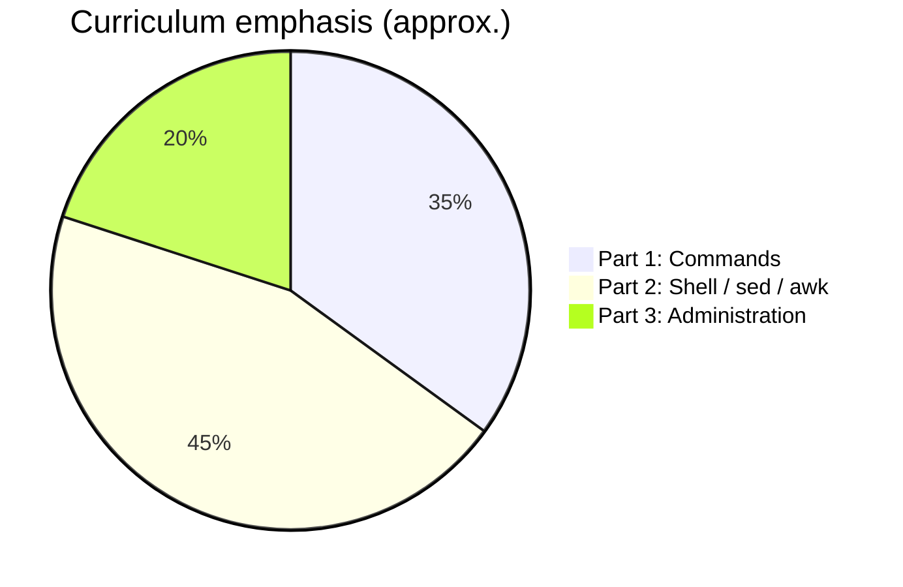
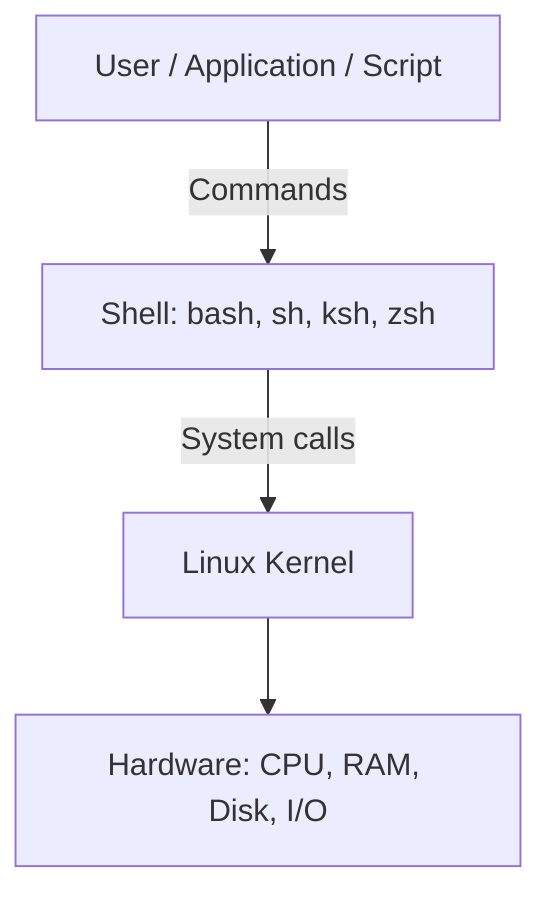
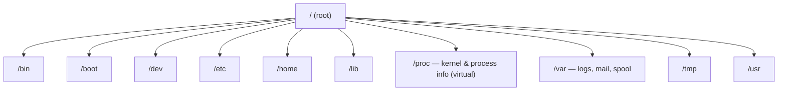

# Linux Basics — Complete Study Guide

*Aligned with **Durga Sir**'s *Linux with Shell Programming, SED, AWK and Many More* course ([YouTube playlist](https://www.youtube.com/watch?v=txRD_bK062Y&list=PLd3UqWTnYXOloH0vWBs4BtSbP84WcC2NY)).*

This guide mirrors the three-part curriculum announced in Session 1: **Part 1 — Unix/Linux commands**, **Part 2 — Shell scripting, SED, AWK**, and **Part 3 — Linux administration basics** (~20% of the course, time permitting).

---

## Course map (Session 1 overview)

| Part | Focus | Representative topics |
| :--- | :--- | :--- |
| **1** | Commands & concepts | File system, install, `ls`/`date`/`cal`, dirs/files, compare/link, `wc`/`sort`/`uniq`, redirection & pipes, regex & wildcards, `alias`, `locate`/`find`, compression, `grep`/`cut`, permissions & editors |
| **2** | Shell programming | Shebang, variables, substitution, arguments, user input, operators, control flow, arrays, functions, projects; **SED**; **AWK** (+ project) |
| **3** | Administration | `crontab`, users/groups/`sudo`, PuTTY/MobaXterm, customizing OSS, processes, `write`/`wall`, packages, optional: MySQL, Java, job control, networking, `vi`, `init` |



---

## Why Linux matters (Session 1)

- Required background for **DevOps**, **Hadoop**, **testing**, **application development** (Java, Python, etc.), **DBA/Oracle**, **cloud**, and **data science/ML** — most production apps and clouds run on Linux.
- Roughly **90%** of real-time applications are hosted on Linux platforms in industry.
- Developers often depend on Linux admins for small commands; knowing basics reduces that friction.

---

## 1. Introduction to UNIX and Linux

### 1.1 What is Unix / Linux?

- **Unix:** Operating system originated in the **1960s** (AT&T Bell Labs — Ken Thompson & Dennis Ritchie).
- **Linux:** Unix-like kernel created by **Linus Torvalds (1991)**; distributions package kernel + tools + apps.
- People use **extended/improved flavors** of the base Unix ideas, not the original 1960s release unchanged.

### 1.2 Operating system role

An **OS** is software that lets users and applications talk to **hardware** (CPU, RAM, disk, network). Without an OS, hardware cannot be used for normal work.

### 1.3 Key features (interview-friendly)

| Feature | Meaning |
| :--- | :--- |
| **Freeware** | No license fee to use (contrast: licensed Windows). |
| **Open source (FOSS)** | Source code is available; organizations can modify and ship their own variant (e.g. company-specific Linux), subject to licenses such as **GNU**. |
| **Multi-user** | Many users can use the system at once (`who`, `whoami`, `finger`). |
| **Multitasking** | Many processes/activities concurrently (foreground & background). |
| **CUI and GUI** | Historically CLI-only; modern distros support **both**. **CUI/CLI** (terminal) is often **more powerful** for bulk/automation work; GUI suits small interactive tasks. |
| **Security** | Strong permission model; often considered more secure than default Windows setups for servers. |

**CUI** = Command Line / Character User Interface. **GUI** = Graphical User Interface.

### 1.4 Unix vs Linux

- **Unix** — family and ideas from the original system.
- **Linux** — kernel and ecosystem built **on Unix concepts**; most courses use “Unix/Linux” together for commands that are largely portable across flavors.

### 1.5 Flavors (distributions)

Examples: **Ubuntu**, **Red Hat Enterprise Linux (RHEL)**, **CentOS**, **Fedora**, **Debian**, **SUSE** / openSUSE, **Slackware**, **Kali**, **Amazon Linux**, **Oracle Linux**, etc.

- **~80–90%** of commands and behavior are the same across flavors (like riding different motorcycle models).
- Explore rankings and variants: [distrowatch.com](https://distrowatch.com).

### 1.6 Architecture



1. **Hardware** — physical devices.
2. **Kernel** — schedules CPU, memory, devices, processes.
3. **Shell** — interprets commands and scripts.
4. **Utilities** — `ls`, `cat`, `grep`, `cp`, editors, etc.

---

## 2. Linux installation (overview)

- Install via ISO on bare metal, dual-boot, or **virtual machine** (VirtualBox, VMware, Hyper-V).
- Common desktop/server choice for learning: **Ubuntu LTS**.
- After install: user account, `sudo`, network, and package manager (`apt` on Debian/Ubuntu, `yum`/`dnf` on RHEL family).

---

## 3. File system hierarchy and navigation

Single directory tree rooted at **`/`**.



### 3.1 Essential commands

| Command | Example | Purpose |
| :--- | :--- | :--- |
| `pwd` | `pwd` | Print working directory |
| `cd` | `cd /var/log` | Change directory |
| `ls` | `ls -lrta` | List files (long, time, all including hidden) |
| `mkdir` | `mkdir -p app/logs` | Create directories; `mkdir dir{1..50}` bulk create |
| `rmdir` | `rmdir emptydir` | Remove empty directory |
| `rm` | `rm -rf path` | Remove files/dirs (careful) |
| `cp` | `cp -r src/ dest/` | Copy |
| `mv` | `mv old new` | Move or rename |

### 3.2 Informational commands (Part 1)

| Command | Purpose |
| :--- | :--- |
| `date` | System date/time |
| `cal` | Calendar |
| `hostname` | Host name |
| `uname -a` | Kernel/system info |
| `who` / `whoami` | Logged-in users / current user |
| `uptime` | How long system has been up |
| `logname` | Login name |
| `history` | Command history |

Hidden files in Linux start with **`.`** (e.g. `.bashrc`).

---

## 4. Working with files

| Command | Purpose |
| :--- | :--- |
| `touch` | Create empty file or update timestamp |
| `cat` | Display / concatenate file contents |
| `cat` vs `touch` | `cat` shows or combines content; `touch` creates/updates metadata without content |
| `head` / `tail` | Start/end of file; `tail -f` follow logs |
| `more` / `less` / `pg` | Paged viewing |
| `wc` | Line, word, character counts |
| `nl` | Number lines |
| `split` | Split large files |

**Bulk example (CLI power):** create many dirs and files in one line using brace expansion and loops (as demonstrated in Session 1).

### 4.1 Comparing files

- `cmp file1 file2` — first difference.
- `comm` — sorted files, common/unique lines.
- `diff file1 file2` — line-by-line differences.

### 4.2 Links

- **Hard link:** `ln source target`
- **Symbolic (soft) link:** `ln -s source linkname`

### 4.3 Sort and unique

```bash
sort names.txt
sort -u names.txt          # sort + unique
uniq sorted.txt            # adjacent duplicate lines only (sort first)
```

---

## 5. Redirection, pipes, and command line

| Concept | Syntax | Effect |
| :--- | :--- | :--- |
| stdout redirect | `cmd > file` | Write output to file (overwrite) |
| append | `cmd >> file` | Append |
| stdin | `cmd < file` | Read input from file |
| stderr | `cmd 2> err.log` | Redirect errors |
| pipe | `cmd1 \| cmd2` | Pass stdout of `cmd1` to `cmd2` |
| combine | `cmd1 ; cmd2` | Run sequentially on one line |
| AND | `cmd1 && cmd2` | Run `cmd2` if `cmd1` succeeds |

---

## 6. Wildcards and regular expressions

- **Wildcards (shell):** `*`, `?`, `[abc]`, `{1..10}`
- **Regex (grep/sed/awk):** `^` start, `$` end, `.` any char, `*` repeat, `[0-9]`, etc.
- **`grep`:** search lines — `-i` ignore case, `-v` invert, `-n` line numbers, `-c` count.
- **`fgrep`:** fixed-string grep (no regex).

### 6.1 `cut`

Extract columns/fields:

```bash
cut -d':' -f1,3 /etc/passwd
```

### 6.2 `find` and `locate`

```bash
find /home -name "*.txt" -type f
locate myfile.conf    # uses database; run updatedb as admin
which ls
whereis bash
```

### 6.3 Command aliasing

```bash
alias ll='ls -l'
unalias ll
```

---

## 7. Compression and archives

| Tool | Use |
| :--- | :--- |
| `gzip` / `gunzip` | Compress/decompress `.gz` |
| `bzip2` / `bunzip2` | `.bz2` |
| `tar` | Archive; often `tar -czvf archive.tar.gz dir/` |
| `zcat` / `zless` | View compressed without full decompress |

---

## 8. Permissions, ownership, editors

### 8.1 Permission model

`-rwxr-xr--` → user (u), group (g), others (o); read **4**, write **2**, execute **1**.

```bash
chmod u+x script.sh
chmod 755 script.sh
chown user:group file
chgrp group file
```

### 8.2 Editors

- **`vi` / `vim`** — modal editor (essential for servers and interviews).
- Practice: insert mode, save (`:w`), quit (`:q`), search (`/pattern`).

---

## 9. Documentation

```bash
man ls
man -k password
apropos copy
info coreutils
command --help
```

---

## 10. Shell scripting (Part 2 summary)

Scripts start with **shebang**: `#!/bin/bash`.

```bash
#!/bin/bash
echo "Script: $0"
echo "Args: $# — first: $1"
```

- **Variables** and **command substitution:** `today=$(date)`
- **Read input:** `read -p "Name: " name`
- **Tests:** `[ -f file ]`, numeric: `-eq`, `-ne`, `-gt`, …
- **Control:** `if/else`, `for`, `while`, `case`
- **Arrays** and **functions**
- Course includes **multiple shell projects**

---

## 11. SED (stream editor)

Non-interactive line editing:

```bash
sed 's/old/new/g' file.txt
sed '2,5d' file.txt
sed -n '1,10p' file.txt
```

Topics in course: print, delete, substitute, multiple commands, editing in place (`-i`).

---

## 12. AWK

Column-oriented reporting; **BEGIN / action / END** blocks.

```bash
awk -F':' '$3 >= 1000 { print $1, $6 }' /etc/passwd
```

Built-ins: `$0`, `$1`, `NF`, `NR`, `FS`, `RS`. Control structures and scripts from files; **AWK project** in course.

---

## 13. Linux administration basics (Part 3)

### 13.1 Job scheduling — cron

```bash
crontab -e
# minute hour day month weekday command
* * * * * /path/to/script.sh
```

### 13.2 User and group management

```bash
sudo adduser alice
sudo deluser alice
sudo groupadd devteam
sudo usermod -aG devteam alice
passwd
groups
su - alice
```

**sudo** and `/etc/sudoers` for delegated admin rights.

### 13.3 Remote access

- **PuTTY**, **MobaXterm**, **Xshell** — SSH clients to reach Linux servers.
- Protocol: **SSH** (`ssh user@host`).

### 13.4 Processes

```bash
ps -ef
top    # or htop
kill PID
kill -9 PID   # SIGKILL — last resort
```

### 13.5 Packages (Debian/Ubuntu example)

```bash
sudo apt update
sudo apt install package-name
apt show package-name
sudo apt remove package-name
```

### 13.6 Job control

- Foreground vs background: `cmd &`, `jobs`, `fg`, `bg`
- **`nohup`** — keep process after logout

### 13.7 Other topics (as time permits in course)

- Customizing open-source packages (download source, patch, build, install)
- Communication: `write`, `wall`, `mesg`
- Memory: `free -m`; disk: `df -h`, `du -sh`
- Networking tools, `init`/run levels, interview Q&A

---

## 14. Quick reference — Session 1 checklist

After the first video you should be able to explain:

1. What Unix/Linux is and why industries use it.
2. Freeware vs open source; multi-user; multitasking; CLI vs GUI.
3. Why CLI is powerful for automation (bulk `mkdir` / `touch` examples).
4. Several **distros** and that commands are mostly portable.
5. The **full course roadmap** (Parts 1–3) and where commands, scripting, sed/awk, and admin fit.

---

*Study material structured for use with Durga Sir's video course and hands-on practice in this repository's `exercises/` and `scripts/` folders.*
