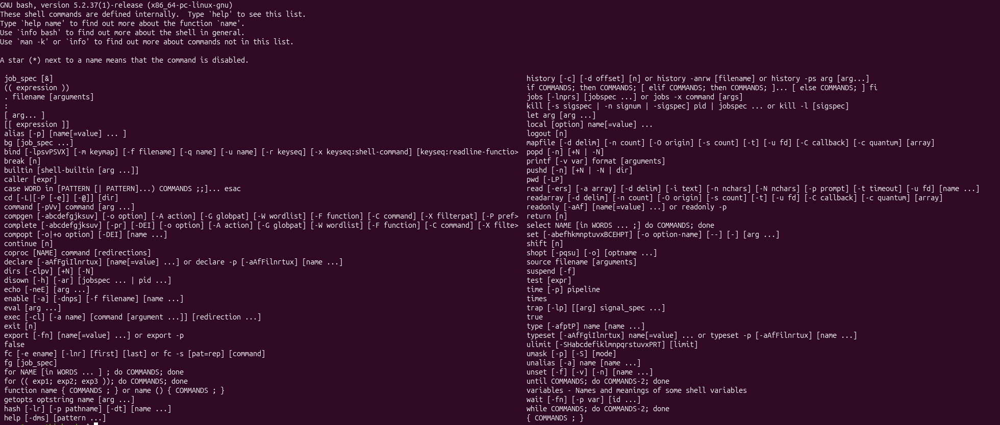
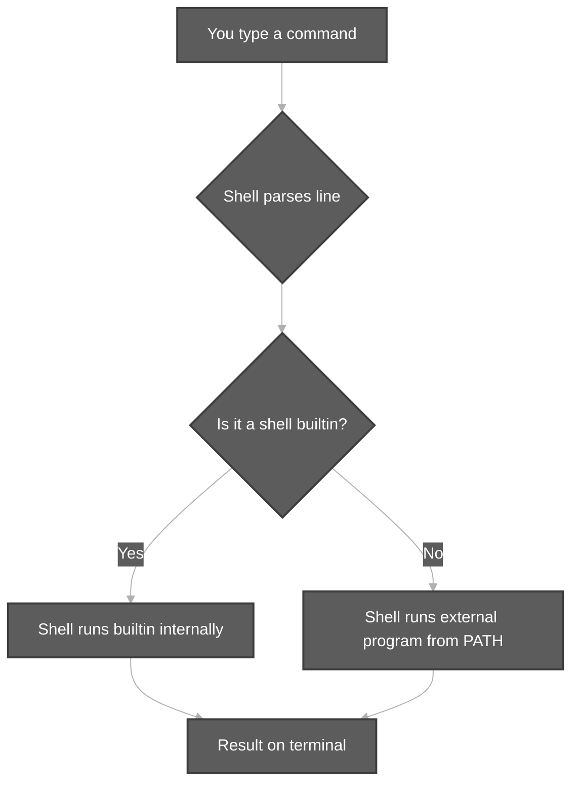
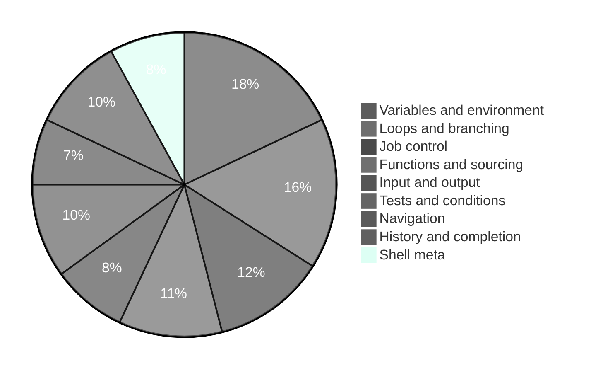

# Bash Built-in Commands

**Context:** When you run `help` in Bash (as in Durga Sir’s class and your screenshot), you see **shell built-in commands** — features implemented **inside the shell**, not separate programs on disk.



**Related:** [Components of Unix.md](Components%20of%20Unix.md) (shell vs kernel flow) · [TypesOfFilesInLinux.md](TypesOfFilesInLinux.md) (file types)  
**Practice script:** [`bash-builtin-examples.sh`](../../scripts/bash-builtin-examples.sh) (Ctrl+click to open)  
**Check file type:** [`file` command](#file-command) · **Demo:** [`file-command-content-demo.sh`](../../scripts/file-command-content-demo.sh)  
**Check file size (bytes):** [`ls -l` with filename](#ls-l-file-size) · **Demo:** [`ls-l-file-size-demo.sh`](../../scripts/ls-l-file-size-demo.sh)  
**Display file contents:** [`cat`](#cat-command) · **Demo:** [`cat-command-demo.sh`](../../scripts/cat-command-demo.sh)  
**Edit file (GUI):** [`gedit`](#gedit-command) · **Demo:** [`gedit-command-demo.sh`](../../scripts/gedit-command-demo.sh)

```bash
help              # full list (like the screenshot)
help cd           # details for one builtin
bash scripts/bash-builtin-examples.sh
```

---

**Table of contents**

- [1. Built-in vs external command](#topic-1)
- [2. Category overview (pie chart)](#topic-2)
- [3. Command reference (from `help` screen)](#topic-3)
- [4. Check file type — `file` command (external)](#file-command)
- [5. Check file size — `ls -l` with filename (external)](#ls-l-file-size)
- [6. Display contents — `cat` (external)](#cat-command)
- [7. Edit file — `gedit` (external, GUI)](#gedit-command)
- [Getting help and command information](#getting-help-and-command-information)
  - [`help`](#help)
  - [`type`](#type)
  - [`command`](#command)
  - [`builtin`](#builtin)
  - [`enable`](#enable)
  - [`hash`](#hash)
- [Directories and navigation](#directories-and-navigation)
  - [`cd`](#cd)
  - [`pwd`](#pwd)
  - [`pushd`](#pushd)
  - [`popd`](#popd)
  - [`dirs`](#dirs)
- [Variables, environment, and names](#variables-environment-and-names)
  - [`export`](#export)
  - [`unset`](#unset)
  - [`declare`](#declare)
  - [`typeset`](#typeset)
  - [`local`](#local)
  - [`readonly`](#readonly)
  - [`set`](#set)
  - [`shift`](#shift)
  - [`getopts`](#getopts)
  - [`shopt`](#shopt)
  - [`umask`](#umask)
  - [`ulimit`](#ulimit)
  - [`alias`](#alias)
  - [`unalias`](#unalias)
- [Input, output, and data](#input-output-and-data)
  - [`echo`](#echo)
  - [`printf`](#printf)
  - [`read`](#read)
  - [`mapfile`](#mapfile)
  - [`readarray`](#readarray)
- [Tests and conditions](#tests-and-conditions)
  - [`[ arg... ]`](#topic-39)
  - [`[[ expression ]]`](#topic-40)
  - [`test`](#test)
  - [`(( expression ))`](#topic-42)
  - [`:`](#topic-43)
  - [`true`](#true)
  - [`false`](#false)
- [Loops and branching](#loops-and-branching)
  - [`if`](#if)
  - [`case`](#case)
  - [`for NAME in WORDS`](#for-name-in-words)
  - [`for (( exp1; exp2; exp3 ))`](#topic-50)
  - [`while`](#while)
  - [`until`](#until)
  - [`select`](#select)
  - [`break`](#break)
  - [`continue`](#continue)
- [Functions, grouping, and sourcing](#functions-grouping-and-sourcing)
  - [`function / name()`](#topic-57)
  - [`return`](#return)
  - [`caller`](#caller)
  - [`. filename [arguments]`](#topic-60)
  - [`source`](#source)
  - [`{ COMMANDS ; }`](#topic-62)
  - [`eval`](#eval)
  - [`exec`](#exec)
- [Job control and processes](#job-control-and-processes)
  - [`job_spec [&]`](#topic-66)
  - [`bg`](#bg)
  - [`fg`](#fg)
  - [`jobs`](#jobs)
  - [`kill`](#kill)
  - [`wait`](#wait)
  - [`disown`](#disown)
  - [`suspend`](#suspend)
  - [`coproc`](#coproc)
- [History and editing](#history-and-editing)
  - [`history`](#history)
  - [`fc`](#fc)
  - [`bind`](#bind)
- [Programmable completion](#programmable-completion)
  - [`compgen`](#compgen)
  - [`complete`](#complete)
  - [`compopt`](#compopt)
- [Timing, signals, and shell control](#timing-signals-and-shell-control)
  - [`exit`](#exit)
  - [`logout`](#logout)
  - [`trap`](#trap)
  - [`times`](#times)
  - [`time`](#time)
  - [`let`](#let)
  - [`variables`](#variables)

---

<a id="topic-1"></a>

## 1. Built-in vs external command



| Type | Example | How to check |
| :--- | :--- | :--- |
| **Builtin** | `cd`, `echo`, `export` | `type cd` → *builtin* |
| **External** | `ls`, `grep`, `touch`, [`file`](#file-command) | `type file` → */usr/bin/file* |
| **Alias** | `ll` → `ls -l` | `type ll` → *alias* |

> A `*` next to a name in `help` means that builtin is **disabled** (`enable -n name`).

---

<a id="topic-2"></a>

## 2. Category overview (pie chart)



---

<a id="topic-3"></a>

## 3. Command reference (from `help` screen)

## Getting help and command information

### `help`

**Explanation:** Show help for shell builtins.

**Example:**
```bash
help cd
```

### `type`

**Explanation:** Show how a name would be interpreted.

**Example:**
```bash
type -a cd
```

### `command`

**Explanation:** Run a command, ignoring shell functions named like it.

**Example:**
```bash
command ls
```

### `builtin`

**Explanation:** Run a shell builtin, bypassing functions with the same name.

**Example:**
```bash
builtin echo hi
```

### `enable`

**Explanation:** Enable/disable shell builtins or load from file.

**Example:**
```bash
enable echo
```

### `hash`

**Explanation:** Remember full path of commands for faster lookup.

**Example:**
```bash
hash -r; hash ls
```

## Directories and navigation

### `cd`

**Explanation:** Change working directory.

**Example:**
```bash
cd /var/log && pwd
```

### `pwd`

**Explanation:** Print working directory.

**Example:**
```bash
pwd -P
```

### `pushd`

**Explanation:** Push directory onto stack and cd to it.

**Example:**
```bash
pushd /tmp; pwd
```

### `popd`

**Explanation:** Remove top directory from stack and cd to it.

**Example:**
```bash
pushd /tmp; popd
```

### `dirs`

**Explanation:** Display directory stack from pushd/popd.

**Example:**
```bash
dirs -p
```

## Variables, environment, and names

### `export`

**Explanation:** Mark variables for child processes.

**Example:**
```bash
export PATH; export MY_APP=1
```

### `unset`

**Explanation:** Remove variables or functions.

**Example:**
```bash
unset MY_VAR
```

### `declare`

**Explanation:** Declare variables and optional attributes (-a array, -i integer, etc.).

**Example:**
```bash
declare -i n=5; echo $((n+2))
```

### `typeset`

**Explanation:** Synonym for declare.

**Example:**
```bash
typeset -i n=2; echo $n
```

### `local`

**Explanation:** Declare function-local variables.

**Example:**
```bash
f(){ local x=1; echo $x; }; f
```

### `readonly`

**Explanation:** Make variables unchangeable.

**Example:**
```bash
readonly R=1; echo $R
```

### `set`

**Explanation:** Set shell options and positional parameters.

**Example:**
```bash
set -e  # exit on error
```

### `shift`

**Explanation:** Shift positional parameters left.

**Example:**
```bash
set -- a b c; shift; echo $1
```

### `getopts`

**Explanation:** Parse script options (flags).

**Example:**
```bash
while getopts ab o; do case $o in a) A=1;; esac; done
```

### `shopt`

**Explanation:** Toggle Bash-specific options.

**Example:**
```bash
shopt -s nocaseglob
```

### `umask`

**Explanation:** Default permission mask for new files.

**Example:**
```bash
umask; umask 022
```

### `ulimit`

**Explanation:** Resource limits (files, memory, etc.).

**Example:**
```bash
ulimit -a | head -5
```

### `alias`

**Explanation:** Define or list command shortcuts.

**Example:**
```bash
alias ll='ls -l'; ll
```

### `unalias`

**Explanation:** Remove alias definitions.

**Example:**
```bash
alias x=1; unalias x
```

## Input, output, and data

### `echo`

**Explanation:** Print arguments to stdout.

**Example:**
```bash
echo Hello Unix
```

### `printf`

**Explanation:** Formatted output (portable).

**Example:**
```bash
printf 'Count=%d\n' 42
```

### `read`

**Explanation:** Read line(s) from stdin into variables.

**Example:**
```bash
read -p 'Name: ' n <<< 'Durga'; echo $n
```

### `mapfile`

**Explanation:** Read lines from stdin into an array.

**Example:**
```bash
mapfile -t a < /etc/hosts; echo ${a[0]}
```

### `readarray`

**Explanation:** Synonym for mapfile.

**Example:**
```bash
readarray -t lines < /etc/os-release; echo ${lines[0]}
```

## Tests and conditions

<a id="topic-39"></a>

### `[ arg... ]`

**Explanation:** POSIX test command built into Bash (same as test).

**Example:**
```bash
[ -f /etc/hosts ] && echo exists
```

<a id="topic-40"></a>

### `[[ expression ]]`

**Explanation:** Extended conditional test with safer parsing than [.

**Example:**
```bash
[[ -n $HOME ]] && echo HOME is set
```

### `test`

**Explanation:** Evaluate conditional expression.

**Example:**
```bash
test -w /tmp && echo writable
```

<a id="topic-42"></a>

### `(( expression ))`

**Explanation:** Evaluate arithmetic in C-style syntax.

**Example:**
```bash
(( total = 5 + 10 )); echo $total
```

<a id="topic-43"></a>

### `:`

**Explanation:** Null command; always succeeds (exit 0). Useful in loops/conditionals.

**Example:**
```bash
: # no-op
```

### `true`

**Explanation:** Return success (0).

**Example:**
```bash
true && echo ok
```

### `false`

**Explanation:** Return non-zero exit status.

**Example:**
```bash
false || echo failed
```

## Loops and branching

### `if`

**Explanation:** Conditional execution.

**Example:**
```bash
if [ -d /tmp ]; then echo ok; fi
```

### `case`

**Explanation:** Multi-branch pattern matching.

**Example:**
```bash
case $HOSTNAME in (*)* ) echo matched;; esac
```

### `for NAME in WORDS`

**Explanation:** Loop over a word list.

**Example:**
```bash
for d in a b; do echo $d; done
```

<a id="topic-50"></a>

### `for (( exp1; exp2; exp3 ))`

**Explanation:** C-style numeric for loop.

**Example:**
```bash
for ((i=1;i<=3;i++)); do echo $i; done
```

### `while`

**Explanation:** Loop while condition is true.

**Example:**
```bash
while [ ! -f /tmp/x ]; do break; done
```

### `until`

**Explanation:** Loop until condition is true.

**Example:**
```bash
n=0; until [ $n -ge 2 ]; do n=$((n+1)); done
```

### `select`

**Explanation:** Interactive menu loop.

**Example:**
```bash
select x in a b; do echo $x; break; done
```

### `break`

**Explanation:** Exit from for/while/until/select loops.

**Example:**
```bash
for i in 1 2; do break; done
```

### `continue`

**Explanation:** Skip to next loop iteration.

**Example:**
```bash
for i in 1 2 3; do [ $i -eq 2 ] && continue; echo $i; done
```

## Functions, grouping, and sourcing

<a id="topic-57"></a>

### `function / name()`

**Explanation:** Define a reusable shell function.

**Example:**
```bash
demo(){ echo fn; }; demo
```

### `return`

**Explanation:** Exit a function with status.

**Example:**
```bash
f(){ return 42; }; f; echo $?
```

### `caller`

**Explanation:** Show line number and source of the current call frame.

**Example:**
```bash
f(){ caller; }; f
```

<a id="topic-60"></a>

### `. filename [arguments]`

**Explanation:** Read and execute commands from a file in the current shell (source).

**Example:**
```bash
. ./scripts/test.sh
```

### `source`

**Explanation:** Same as . ; run script in current shell.

**Example:**
```bash
source ./scripts/test.sh
```

<a id="topic-62"></a>

### `{ COMMANDS ; }`

**Explanation:** Group commands in current shell.

**Example:**
```bash
{ echo one; echo two; }
```

### `eval`

**Explanation:** Parse and execute arguments as shell code.

**Example:**
```bash
eval 'echo eval-demo'
```

### `exec`

**Explanation:** Replace shell with given command (or redirect fds).

**Example:**
```bash
exec 3>&1  # duplicate stdout to fd 3
```

## Job control and processes

<a id="topic-66"></a>

### `job_spec [&]`

**Explanation:** Run a pipeline or command in the background; same as suffixing with &.

**Example:**
```bash
sleep 2 &
```

### `bg`

**Explanation:** Resume a stopped job in the background.

**Example:**
```bash
sleep 100 & J=$!; kill -STOP $J; bg %1
```

### `fg`

**Explanation:** Bring background job to foreground.

**Example:**
```bash
# fg %1  (interactive)
```

### `jobs`

**Explanation:** List active jobs.

**Example:**
```bash
sleep 5 & jobs
```

### `kill`

**Explanation:** Send signal to process or job.

**Example:**
```bash
kill -0 $$ && echo shell alive
```

### `wait`

**Explanation:** Wait for background jobs to finish.

**Example:**
```bash
sleep 1 & wait
```

### `disown`

**Explanation:** Remove jobs from shell job table.

**Example:**
```bash
sleep 60 & disown
```

### `suspend`

**Explanation:** Stop the shell until SIGCONT (login shells).

**Example:**
```bash
# suspend
```

### `coproc`

**Explanation:** Start a coprocess connected by pipes.

**Example:**
```bash
coproc C { echo coproc; }; echo sent
```

## History and editing

### `history`

**Explanation:** Show or manipulate command history.

**Example:**
```bash
history 5
```

### `fc`

**Explanation:** Edit/re-run commands from history.

**Example:**
```bash
fc -l -5
```

### `bind`

**Explanation:** Configure readline key bindings.

**Example:**
```bash
bind -p | head -3
```

## Programmable completion

### `compgen`

**Explanation:** Generate possible completion matches.

**Example:**
```bash
compgen -c | grep '^ls$'
```

### `complete`

**Explanation:** Register programmable completion for a command.

**Example:**
```bash
complete -W 'start stop' mysvc
```

### `compopt`

**Explanation:** Change completion options for a command.

**Example:**
```bash
compopt -o filenames ls
```

## Timing, signals, and shell control

### `exit`

**Explanation:** Exit the shell with optional status code.

**Example:**
```bash
exit 0
```

### `logout`

**Explanation:** Exit a login shell.

**Example:**
```bash
# logout
```

### `trap`

**Explanation:** Run command on signals or shell exit.

**Example:**
```bash
trap 'echo trapped' EXIT
```

### `times`

**Explanation:** Print CPU times for shell and children.

**Example:**
```bash
times
```

### `time`

**Explanation:** Time pipeline/command execution.

**Example:**
```bash
time sleep 0.1
```

### `let`

**Explanation:** Arithmetic evaluation (legacy).

**Example:**
```bash
let x=2*3; echo $x
```

### `variables`

**Explanation:** Help topic listing special shell variables.

**Example:**
```bash
help variables | head -10
```

---

<a id="file-command"></a>

## 4. Check file type — `file` (external command)

> Not in `help` — run with `type file` → `/usr/bin/file`.  
> **Ctrl+click demo:** [`file-command-content-demo.sh`](../../scripts/file-command-content-demo.sh)

### 1. Command name

**`file`**

### 2. Usage and explanation

```text
file [options] <filename> ...
```

- **Purpose:** Check the **type of file** by reading **content**, not the extension (Durga Sir Session 3).
- **When to use:** After `touch`, before/after `mv` rename, or whenever the name (`.jpg`, `.txt`) might lie.
- **Common output:** `empty`, `ASCII text`, `JPEG image data`, `directory`, etc.
- **Verify external command:** `type file`

| Situation | Typical output |
| :--- | :--- |
| `touch sunny.jpg` (empty) | `empty` |
| Text stored inside `sunny.jpg` | `ASCII text` |
| Renamed to `sunny.durga` | Still `ASCII text` if content unchanged |

**Related topic:** [TypesOfFilesInLinux.md](TypesOfFilesInLinux.md#3-extension-vs-content-file-command)

### 3. Example

```bash
touch sunny.jpg
file sunny.jpg

echo "hello friends" > sunny.jpg
file sunny.jpg

mv sunny.jpg sunny.durga
file sunny.durga
```

### 4. Runnable demo (Ctrl+click script)

[`scripts/file-command-content-demo.sh`](../../scripts/file-command-content-demo.sh)

```bash
bash scripts/file-command-content-demo.sh
```

---

<a id="ls-l-file-size"></a>

## 5. Check file size — `ls -l <filename>` (external command)

> **`ls` is not a Bash builtin** (`type ls` → `/usr/bin/ls`).  
> **Ctrl+click demo:** [`ls-l-file-size-demo.sh`](../../scripts/ls-l-file-size-demo.sh)

### 1. Command name

**`ls -l`** (long listing) with a **filename** argument

### 2. Usage and explanation

```text
ls -l <filename>
ls -lh <filename>    # optional: human-readable size (K, M, G)
```

- **Purpose:** Show **permissions**, **owner**, **date**, and **how many bytes** the file uses on disk (5th column). In class this is described as how much data / “memory” the file occupies (file size, not RAM).
- **First character** of the line: file **type** (`-` ordinary, `d` directory, `l` link) — see [TypesOfFilesInLinux.md](TypesOfFilesInLinux.md#6-how-to-check-file-type-standard-way).
- **Size column:** byte count (e.g. `0` after empty `touch`, larger after `echo` writes text).

| Part of `ls -l` output | Meaning |
| :--- | :--- |
| 1st character | File type |
| **5th field (number)** | **Size in bytes** |
| Last field | File name |

Pair with **`file`** when you need content type, not only size.

### 3. Example

```bash
ls -l /etc/hosts
# -rw-r--r-- 1 root root 584 Oct 16 10:00 /etc/hosts
#                              ^^^
#                              size in bytes

touch demo.txt
ls -l demo.txt                  # 0 bytes

echo "hello friends" > demo.txt
ls -l demo.txt                  # e.g. 14 bytes
file demo.txt                   # ASCII text

ls -lh demo.txt                 # same size, easier to read
```

### 4. Runnable demo (Ctrl+click script)

[`scripts/ls-l-file-size-demo.sh`](../../scripts/ls-l-file-size-demo.sh)

```bash
bash scripts/ls-l-file-size-demo.sh
```

**Quick reference**

| Goal | Command |
| :--- | :--- |
| File **type** (content) | `file myname` |
| File **type** (symbol) + **size** | `ls -l myname` |
| Easier size display | `ls -lh myname` |

---

<a id="cat-command"></a>

## 6. Display file contents — `cat` (external command)

> **`cat` is not a Bash builtin** (`type cat` → `/usr/bin/cat`).  
> **Ctrl+click demo:** [`cat-command-demo.sh`](../../scripts/cat-command-demo.sh)

### 1. Command name

**`cat`**

### 2. Usage and explanation

```text
cat [options] <filename> ...
cat file1 file2          # concatenate and print
```

- **Purpose:** **Display** the contents of a file on the terminal (Durga Sir: after editing `sunny.jpg`, use `cat sunny.jpg` to see the text).
- **Name:** **Cat** = concatenate — can print one or many files in order.
- **Difference from `touch`:** `touch` creates an **empty** file; `cat` **shows** what is already inside.
- **Use with `file`:** `cat` shows content; `file` tells you whether that content is ASCII text, binary, etc.

**Verify external command:**

```bash
type cat
```

### 3. Example

```bash
echo "hello friends" > sunny.durga
cat sunny.durga

cat -n /etc/hosts | head -5    # optional: line numbers
```

### 4. Runnable demo (Ctrl+click script)

[`scripts/cat-command-demo.sh`](../../scripts/cat-command-demo.sh)

```bash
bash scripts/cat-command-demo.sh
```

**See also:** [TypesOfFilesInLinux.md](TypesOfFilesInLinux.md#7-command-reference-this-session)

---

<a id="gedit-command"></a>

## 7. Edit file — `gedit` (external command, GUI)

> **`gedit` is not a Bash builtin** — it is the **GNOME text editor** (GUI). Install on Ubuntu: `sudo apt install gedit` if missing.  
> **Ctrl+click demo:** [`gedit-command-demo.sh`](../../scripts/gedit-command-demo.sh)

### 1. Command name

**`gedit`**

### 2. Usage and explanation

```text
gedit [options] <filename>
gedit sunny.jpg &
```

- **Purpose:** Open a file in a **graphical editor** so you can type or change content (Durga Sir demo: open `sunny.jpg`, type `hello friends`, save).
- **When to use:** On **Ubuntu desktop** when you prefer GUI over terminal editors (`nano`, `vim`).
- **After editing:** Use **`cat filename`** to view content in the terminal and **`file filename`** to see the real type (e.g. ASCII text even if the name is `.jpg`).
- **Terminal vs GUI:** `gedit` needs a desktop session (`DISPLAY` set). On servers without GUI, use `nano` or `vim` instead.

**Verify external command:**

```bash
type gedit
which gedit
```

### 3. Example

```bash
touch sunny.jpg
gedit sunny.jpg          # GUI opens — add text and save

cat sunny.jpg            # hello friends
file sunny.jpg           # ASCII text
ls -l sunny.jpg          # size in bytes > 0
```

### 4. Runnable demo (Ctrl+click script)

[`scripts/gedit-command-demo.sh`](../../scripts/gedit-command-demo.sh)

```bash
bash scripts/gedit-command-demo.sh
```

On a full Ubuntu desktop you can also run:

```bash
gedit sunny.jpg
```

**Workflow (Session 3)**

| Step | Command |
| :--- | :--- |
| Create empty file | `touch sunny.jpg` |
| Add content | `gedit sunny.jpg` |
| View content | `cat sunny.jpg` |
| Check type | `file sunny.jpg` |
| Check size | `ls -l sunny.jpg` |

