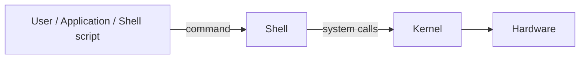
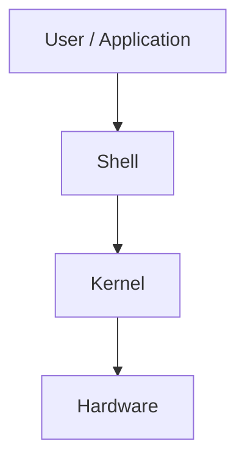

# Components of Unix

**Video:** [Session 2 — Components of UNIX, Execution Flow, Basic Commands](https://www.youtube.com/watch?v=2zfh8eC7cY0&list=PLd3UqWTnYXOloH0vWBs4BtSbP84WcC2NY&index=2)  
**Instructor:** Durga Sir

**Recap (Video 1):** Unix is an OS from the 1960s; features include freeware, open source, multi-user, multitasking; many **flavors** (Ubuntu, RHEL, …) share ~80–90% of the same commands.

---

## 1. Purpose of Unix/Linux

Unix/Linux is an **operating system (OS)** — special software that lets the **user** communicate with **hardware** (CPU, RAM, disk, network). Without an OS, hardware cannot be used for normal work.

---

## 2. Two core components of the OS

Durga Sir teaches that Unix/Linux has **two important OS components**:

| Component | Role |
| :--- | :--- |
| **Shell** | **Outer layer** — the user types commands in the **terminal** here. |
| **Kernel** | **Heart of the OS** — runs commands and talks to **hardware**. |



- **Shell** → interface between **user** and **kernel** (similar idea to `javac` checking syntax before running Java).
- **Kernel** → interface between **shell** and **hardware**.

### 2.1 Shell responsibilities

1. **Read** the command from the terminal.
2. **Validate** the command **name** exists.
3. **Validate** correct **usage** (options and arguments).
4. If valid → **interpret** (convert) the command for the **kernel** and **pass it to the kernel**.

If step 2 or 3 fails, the **shell** prints the error (not the kernel).

**Run:** `bash scripts/invalid-command-demos.sh` — shows invalid command / invalid usage examples.

### 2.2 Kernel responsibilities

1. **Execute** the command and return the result.
2. **Communicate** with hardware.
3. **Allocate memory** and **CPU** for the work.

When the kernel finishes, the **`$` prompt** returns — the terminal is **ready for the next command**.

**Run:** `bash scripts/command-execution-touch-demo.sh` — creates a file via `touch` (full flow: shell → kernel → disk).

---

## 3. Command execution flow

| Step | Action |
| :---: | :--- |
| 1 | User types a command (e.g. `touch sunny.txt`) and presses **Enter**. |
| 2 | Command goes to the **shell**. |
| 3 | Shell checks: valid command? correct usage? |
| 4 | If not → error on terminal. |
| 5 | If yes → shell sends interpreted request to **kernel**. |
| 6 | Kernel performs the action (e.g. create file). |
| 7 | **`$` prompt** appears again. |

**Diagram (full stack):**



Applications and **shell scripts** also submit commands through the **shell** (not only typed lines).

---

## 4. Shell script = group of commands

A **shell script** is a file containing **many commands** executed together (like a Windows `.bat` file). The shell runs it **line by line**.

| Script | What it demonstrates |
| :--- | :--- |
| [`scripts/test.sh`](../../scripts/test.sh) | Durga Sir demo: `cal`, `date`, `echo` |
| [`scripts/run-test-script.sh`](../../scripts/run-test-script.sh) | `chmod u+x` and run `test.sh` |

```bash
chmod +x scripts/test.sh
bash scripts/run-test-script.sh
```

---

## 5. User types and prompts (related to the shell)

| User | Prompt | Meaning |
| :--- | :--- | :--- |
| **Normal user** | **`$`** | Regular account |
| **Super user (root)** | **`#`** | Full admin |

**Run:** `bash scripts/whoami-demo.sh` — shows current user (`whoami`).  
For root: run `sudo -i` and `whoami` manually (password required), then `exit`.

---

## 6. Practice checklist

After this topic you should explain:

1. **Shell** vs **kernel** — who validates, who executes.
2. **Execution flow** from Enter to `$` prompt.
3. Why a **shell script** is just a **group of commands**.
4. **`$`** vs **`#`** prompts.

**Next topics:** see [`docs/linuxBasics.md`](../linuxBasics.md) for other session files and scripts.
