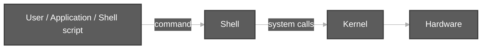
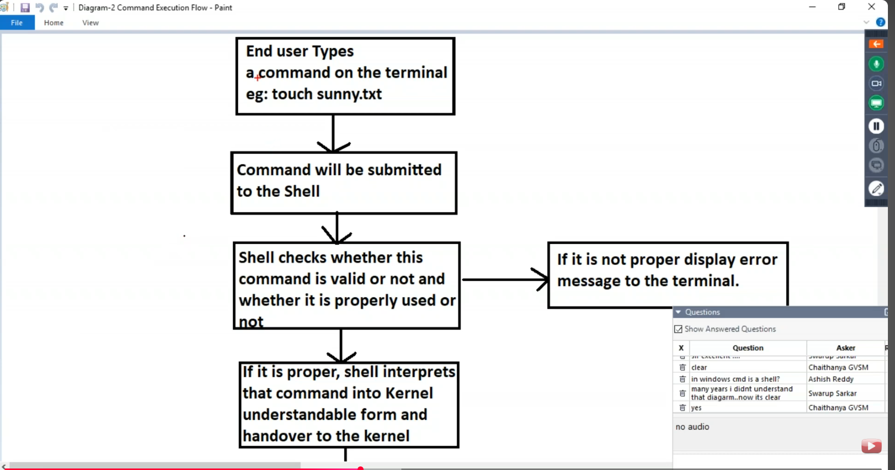
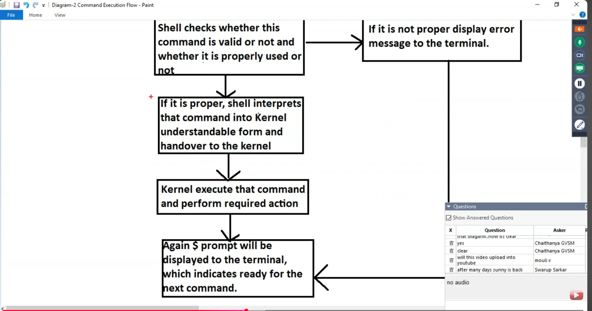
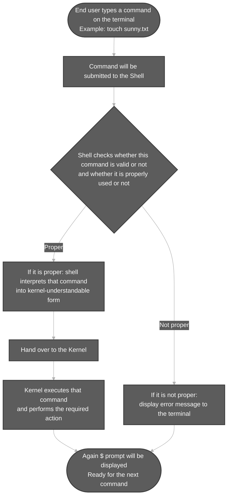
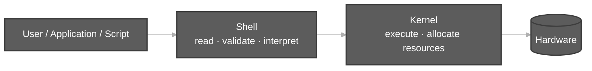

# Components of Unix

**Video:** [Session 2 — Components of UNIX, Execution Flow, Basic Commands](https://www.youtube.com/watch?v=2zfh8eC7cY0&list=PLd3UqWTnYXOloH0vWBs4BtSbP84WcC2NY&index=2)  
**Instructor:** Durga Sir

**Recap (Video 1):** Unix is an OS from the 1960s; features include freeware, open source, multi-user, multitasking; many **flavors** (Ubuntu, RHEL, …) share ~80–90% of the same commands.

**Table of contents**

- [1. Purpose of Unix/Linux](#1-purpose-of-unixlinux)
- [2. Two core components of the OS](#2-two-core-components-of-the-os)
  - [2.1 Shell responsibilities](#21-shell-responsibilities)
  - [2.2 Kernel responsibilities](#22-kernel-responsibilities)
- [3. Command execution flow (Diagram-2)](#3-command-execution-flow-diagram-2)
  - [3.1 Beautiful flowchart — complete path](#31-beautiful-flowchart--complete-path)
  - [3.2 Architecture alongside the flow](#32-architecture-alongside-the-flow)
  - [3.3 Step-by-step explanation (each box in Diagram-2)](#33-step-by-step-explanation-each-box-in-diagram-2)
    - [Box 1 — End user types a command](#box-1--end-user-types-a-command)
    - [Box 2 — Command submitted to the shell](#box-2--command-submitted-to-the-shell)
    - [Box 3 — Shell validation (two checks)](#box-3--shell-validation-two-checks)
    - [Box 4 (right) — Not proper: error message](#box-4-right--not-proper-error-message)
    - [Box 5 (down) — Proper: interpret and hand over](#box-5-down--proper-interpret-and-hand-over)
    - [Box 6 — Kernel executes](#box-6--kernel-executes)
    - [Box 7 — `$` prompt again](#box-7---prompt-again)
  - [3.4 Success vs error](#34-success-vs-error)
  - [3.5 Trace one session in the terminal](#35-trace-one-session-in-the-terminal)
- [4. Shell script = group of commands](#4-shell-script--group-of-commands)
- [5. User types and prompts (related to the shell)](#5-user-types-and-prompts-related-to-the-shell)
- [6. Practice checklist](#6-practice-checklist)

---

## 1. Purpose of Unix/Linux

Unix/Linux is an **operating system (OS)** — special software that lets the **user** communicate with **hardware** (CPU, RAM, disk, network). Without an OS, hardware cannot be used for normal work.

---

## 2. Two core components of the OS

Durga Sir teaches that Unix/Linux has **two important OS components**:

| Component | Role |
| :--- | :--- |
| **Shell** | **Outer layer** — the user types commands in the **terminal** here. |
| **Kernel** | **Heart of the OS** — runs commands and talks to **hardware**. |



- **Shell** → interface between **user** and **kernel** (similar idea to `javac` checking syntax before running Java).
- **Kernel** → interface between **shell** and **hardware**.

### 2.1 Shell responsibilities

1. **Read** the command from the terminal.
2. **Validate** the command **name** exists.
3. **Validate** correct **usage** (options and arguments).
4. If valid → **interpret** (convert) the command for the **kernel** and **pass it to the kernel**.

If step 2 or 3 fails, the **shell** prints the error (not the kernel).

**Run:** `bash scripts/components-of-unix/invalid-command-demos.sh` — shows invalid command / invalid usage examples.

### 2.2 Kernel responsibilities

1. **Execute** the command and return the result.
2. **Communicate** with hardware.
3. **Allocate memory** and **CPU** for the work.

When the kernel finishes, the **`$` prompt** returns — the terminal is **ready for the next command**.

**Run:** `bash scripts/components-of-unix/command-execution-touch-demo.sh` — creates a file via `touch` (full flow: shell → kernel → disk).

---

## 3. Command execution flow (Diagram-2)

Durga Sir’s **Diagram-2 — Command Execution Flow** shows what happens **inside the terminal** from the moment you press **Enter** until the **`$` prompt** comes back. This is the detailed view of how the **shell** and **kernel** work together on every command.

**Class reference slides (from the video):**

| Part | Image |
| :--- | :--- |
| Steps 1–4 (user → shell → validation) |  |
| Validation branches, kernel, `$` prompt |  |

### 3.1 Beautiful flowchart — complete path



### 3.2 Architecture alongside the flow



| Phase | Component | Responsibility |
| :--- | :--- | :--- |
| Typing | **User** | Enters command at the terminal (e.g. `touch sunny.txt`). |
| Submit | **Shell** | Receives the line after **Enter**. |
| Validate | **Shell** | Command exists? Options and arguments correct? |
| Error | **Shell** | Prints message (`command not found`, invalid option, etc.). |
| Interpret | **Shell** | Converts command to form the **kernel** understands. |
| Execute | **Kernel** | Runs the work using **hardware** (disk, CPU, RAM). |
| Ready | **Terminal** | Shows **`$` prompt** — ready for the next command. |

> **Interview line:** The shell is the **interface between user and kernel**. The kernel is the **interface between shell and hardware**.

### 3.3 Step-by-step explanation (each box in Diagram-2)

#### Box 1 — End user types a command

You type at the terminal and press **Enter**. Class example:

```bash
touch sunny.txt
```

Nothing goes to the kernel until the **shell** has finished its checks.

#### Box 2 — Command submitted to the shell

The **shell** (e.g. Bash) reads your input. The same flow applies when:

- You type one command manually.
- A **shell script** runs — the shell reads commands from the file line by line.
- An **application** invokes shell commands.

#### Box 3 — Shell validation (two checks)

1. **Valid command?** — Does this command name exist?
   - `touch123` → **No** → `command not found`.
2. **Properly used?** — Correct options and arguments?
   - `touch -da file` → invalid option.
   - `cal 99999` → invalid year.

**Practice:** `bash scripts/components-of-unix/invalid-command-demos.sh`

#### Box 4 (right) — Not proper: error message

The **shell** prints the error. The **kernel does not execute** the command. Then the flow still returns to the **`$` prompt** so you can try again.

#### Box 5 (down) — Proper: interpret and hand over

If validation passes, the shell **interprets** (converts) the command into **kernel-understandable** form and **hands it to the kernel** — similar to how **`javac`** checks syntax before the JVM runs your program.

#### Box 6 — Kernel executes

The **kernel** performs the required action (e.g. create `sunny.txt`), talks to **hardware**, and handles **memory** and **CPU** allocation.

**Practice:** `bash scripts/components-of-unix/command-execution-touch-demo.sh`  
**Full trace (success + error):** `bash scripts/components-of-unix/command-execution-flow-trace.sh`

#### Box 7 — `$` prompt again

After **success** or after a **shell error**, the **`$` prompt** appears. That means: **ready for the next command**.

| Prompt | User type |
| :--- | :--- |
| **`$`** | Normal user |
| **`#`** | Root / superuser (e.g. after `sudo -i`) |

### 3.4 Success vs error

| | **Success** (`touch sunny.txt`) | **Failure** (`touch123`) |
| :--- | :--- | :--- |
| Shell validates | Valid name and usage | Unknown command |
| Kernel runs? | Yes | No |
| Terminal | Often silent, then `$` | Error text, then `$` |
| Who reported error? | — | **Shell only** |

### 3.5 Trace one session in the terminal

```text
$ touch sunny.txt
$                            ← kernel finished; prompt ready

$ touch123
bash: touch123: command not found
$                            ← shell error; still ready for next command
```

Applications and **shell scripts** use the **same pipeline** — only the source of the command changes (keyboard vs script file).

---

## 4. Shell script = group of commands

A **shell script** is a file containing **many commands** executed together (like a Windows `.bat` file). The shell runs it **line by line**.

**Beginner walkthrough (shebang, `chmod`, run):** [Steps To Write a Shell Script.md](Steps%20To%20Write%20a%20Shell%20Script.md)

| Script | What it demonstrates |
| :--- | :--- |
| [`scripts/components-of-unix/test.sh`](../../scripts/components-of-unix/test.sh) | Durga Sir demo: `cal`, `date`, `echo` |
| [`scripts/run-test-script.sh`](../../scripts/components-of-unix/run-test-script.sh) | `chmod u+x` and run `test.sh` |

```bash
chmod +x scripts/components-of-unix/test.sh
bash scripts/components-of-unix/run-test-script.sh
```

---

## 5. User types and prompts (related to the shell)

| User | Prompt | Meaning |
| :--- | :--- | :--- |
| **Normal user** | **`$`** | Regular account |
| **Super user (root)** | **`#`** | Full admin |

**Run:** `bash scripts/components-of-unix/whoami-demo.sh` — shows current user (`whoami`).  
For root: run `sudo -i` and `whoami` manually (password required), then `exit`.

---

## 6. Practice checklist

After this topic you should explain:

1. **Shell** vs **kernel** — who validates, who executes.
2. **Diagram-2** end to end: type command → shell → validate → kernel OR error → **`$` prompt**.
3. Why a **shell script** is just a **group of commands** (same execution flow per line).
4. **`$`** vs **`#`** prompts.

**Next topics:** see [`docs/linuxBasics.md`](../linuxBasics.md) for other session files and scripts.
