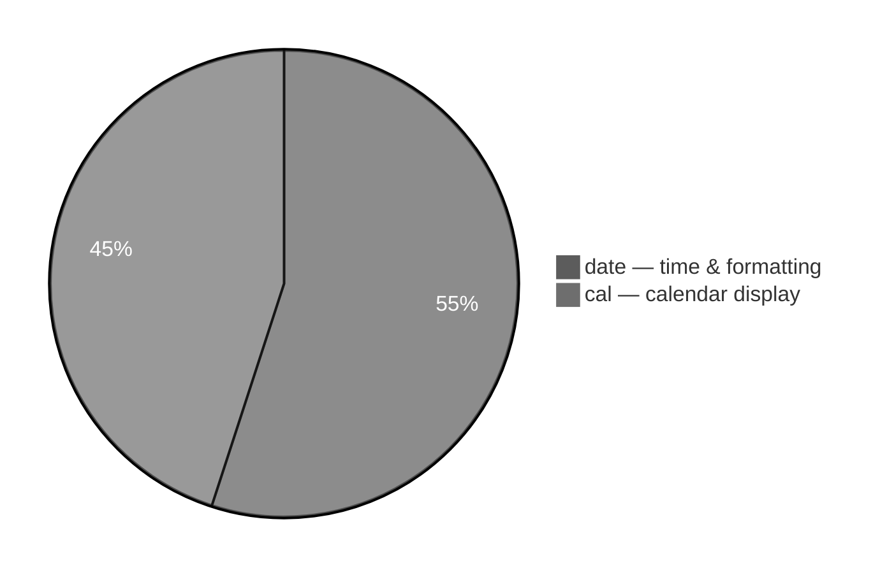
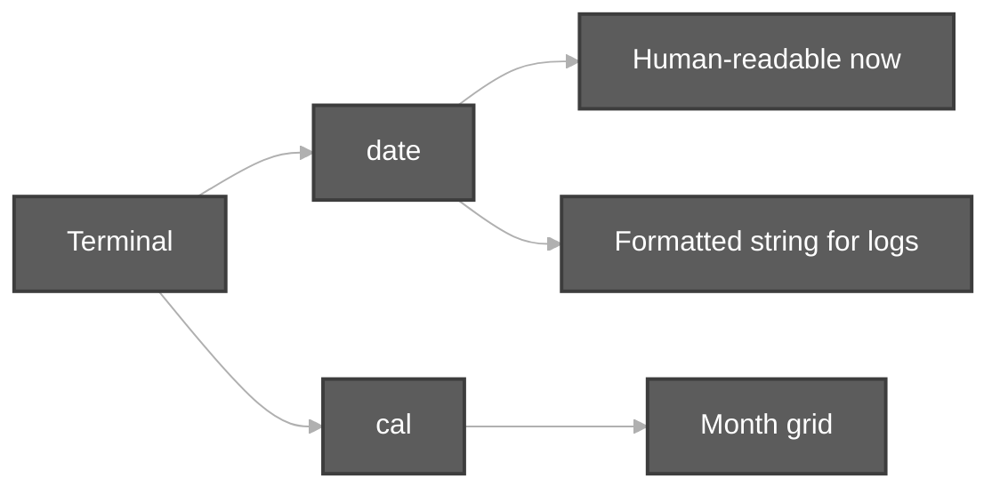
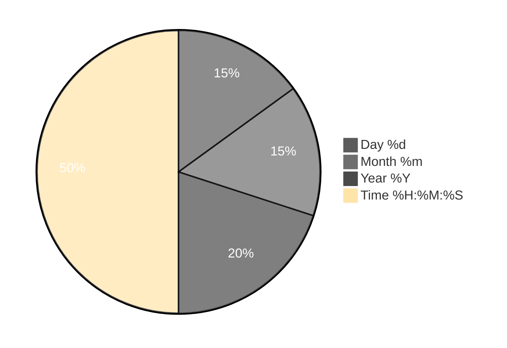

# Date and Cal Commands

**Video:** [Session 8 — Date and Cal Commands](https://www.youtube.com/watch?v=NmJyVY1Mvww&list=PLd3UqWTnYXOloH0vWBs4BtSbP84WcC2NY&index=8)  
**Instructor:** Durga Sir

**Prerequisites:** [Components of Unix.md](Components%20of%20Unix.md) (`cal`, `date` in `test.sh`) · [ls Command and its options.md](ls%20Command%20and%20its%20options.md) (`man` pages habit)

**Practice script:** [`Date and Cal commands.sh`](../../scripts/Date%20and%20Cal%20commands.sh) (Ctrl+click)  
**Execution summary:** [DateandCal Execution summary.md](../../scripts-execution-summary/DateandCal%20Execution%20summary.md)

```bash
cd /path/to/Linux-Basics
bash "scripts/Date and Cal commands.sh"
```

---

**Table of contents**

- [1. Why `date` and `cal`](#1-why-date-and-cal)
- [2. `date` — default output](#2-date--default-output)
- [3. `date +format` — custom date/time](#3-date-format--custom-datetime)
- [4. Common `date` format codes](#4-common-date-format-codes)
- [5. Class demo — timestamp for logs](#5-class-demo--timestamp-for-logs)
- [6. `cal` — calendar](#6-cal--calendar)
- [7. `cal` with month and year](#7-cal-with-month-and-year)
- [8. Useful `cal` options](#8-useful-cal-options)
- [9. `man date` and `man cal`](#9-man-date-and-man-cal)
- [10. Session checklist](#10-session-checklist)
- [11. Script reference](#11-script-reference)

---

## 1. Why `date` and `cal`

| Command | Purpose (Durga Sir / syllabus) |
| :--- | :--- |
| **`date`** | Show **current date and time**; **format** output for scripts and log file names |
| **`cal`** | Display a **calendar** (current month or chosen month/year) |

Part of **basic Unix commands** alongside `pwd`, `ls`, `who`, `uptime` (Durga Soft syllabus).





---

## 2. `date` — default output

```bash
date
```

- Prints **system date and time** (locale/timezone dependent).
- No options → default format chosen by the OS.

**First exposure:** [Components of Unix.md](Components%20of%20Unix.md) — `test.sh` runs `cal`, `date`, and `echo`.

---

## 3. `date +format` — custom date/time

Durga Sir: use **`date`** plus **`+`** and **format specifiers** starting with **`%`**.

```bash
date +%d_%m_%Y_%H_%M_%S
```

| Idea | Detail |
| :--- | :--- |
| **`+`** | Introduces **format string** (not an option letter like `ls -l`) |
| **`%`** | Each code picks **day, month, year, hour, minute, second** |
| **Separators** | `_`, `-`, `/` between codes are **your choice** (class used `_`) |

**Example output shape (class):** `27_03_2020_20_19_56` — day, month, year, hours, minutes, seconds.

```bash
date +"%d/%m/%Y %H:%M:%S"
```

---

## 4. Common `date` format codes

| Code | Meaning |
| :--- | :--- |
| **`%d`** | Day of month (01–31) |
| **`%m`** | Month (01–12) |
| **`%Y`** | Year, 4 digits (e.g. 2026) |
| **`%y`** | Year, 2 digits |
| **`%H`** | Hour (00–23), 24-hour |
| **`%M`** | Minute (00–59) |
| **`%S`** | Second (00–59) |
| **`%T`** | Time as `%H:%M:%S` |
| **`%F`** | Date as `YYYY-MM-DD` |
| **`%D`** | Date as `mm/dd/yy` |

> **Note:** Uppercase **`%M`** = minutes; do not confuse with **`%m`** = month.

**Syllabus topic:** *Different date formats & cal with more options.*



---

## 5. Class demo — timestamp for logs

Durga Sir ties **`date`** to **shell scripting**:

1. Need a **timestamp** (day, month, year, hour, minute, second).
2. Use **`date +...`** (often stored in a variable).
3. Use the string in a **log file name** or with **`touch`** / redirection (full scripting later).

```bash
STAMP=$(date +%Y%m%d-%H%M%S)
echo "Log created at $(date)" > "log_${STAMP}.txt"
```

Same idea as `backup-logs.sh` using `date +%Y%m%d-%H%M%S` in [`shell-scripting/`](../../scripts/shell-scripting/).

---

## 6. `cal` — calendar

```bash
cal
```

- Shows **current month** calendar (today’s month/year).
- **Sunday** as first column by default on typical Linux `cal`.

---

## 7. `cal` with month and year

```bash
cal 10 2026        # October 2026
cal 2 2026         # February 2026
```

| Form | Meaning |
| :--- | :--- |
| **`cal`** | Current month |
| **`cal month year`** | That month (month **1–12**, then **year**) |
| **`cal year`** | Whole year (on GNU cal) |

---

## 8. Useful `cal` options

(GNU `cal` — check with **`man cal`** on your system.)

| Option | Meaning |
| :--- | :--- |
| **`-y`** | Entire **current year** |
| **`-3`** | **Previous**, current, and **next** month |
| **`-m`** | Week starts on **Monday** |
| **`-j`** | Show **Julian day** numbers |

```bash
cal -y
cal -3
cal -m
```

**Syllabus:** *cal with more options.*

---

## 9. `man date` and `man cal`

Same habit as [`ls Command and its options.md`](ls%20Command%20and%20its%20options.md):

```bash
man date    # quit with q
man cal
```

Use **`man`** for every format flag your exam or job needs — do not memorize all codes.

---

## 10. Session checklist

You should be able to:

1. Run **`date`** and **`cal`** with no arguments.  
2. Build **`date +%...`** with day, month, year, time.  
3. Explain **`%d`**, **`%m`**, **`%Y`**, **`%H`**, **`%M`**, **`%S`**.  
4. Show **`cal month year`** and at least one of **`-y`**, **`-3`**, **`-m`**.  
5. Use a formatted **`date`** string for a **log filename** (preview of scripting).

---

## 11. Script reference

| Script | Demonstrates |
| :--- | :--- |
| [`Date and Cal commands.sh`](../../scripts/Date%20and%20Cal%20commands.sh) | All topics above in one runnable demo |

**Related:** [`components-of-unix/test.sh`](../../scripts/components-of-unix/test.sh) — minimal `cal` + `date` + `echo`.

**Next:** Continue playlist from [`linuxBasics.md`](../linuxBasics.md).
