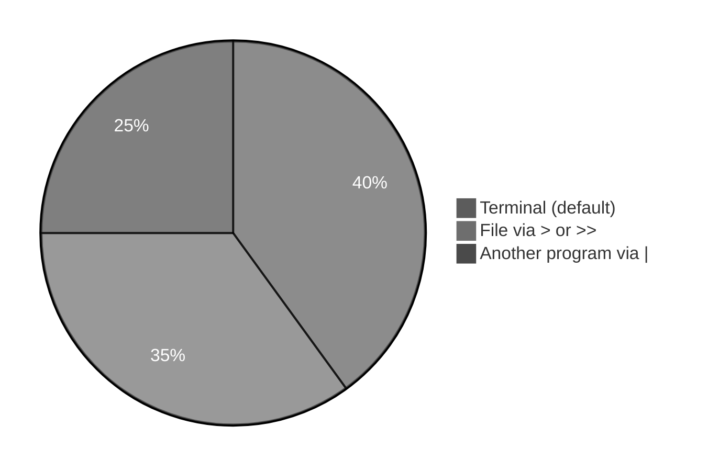
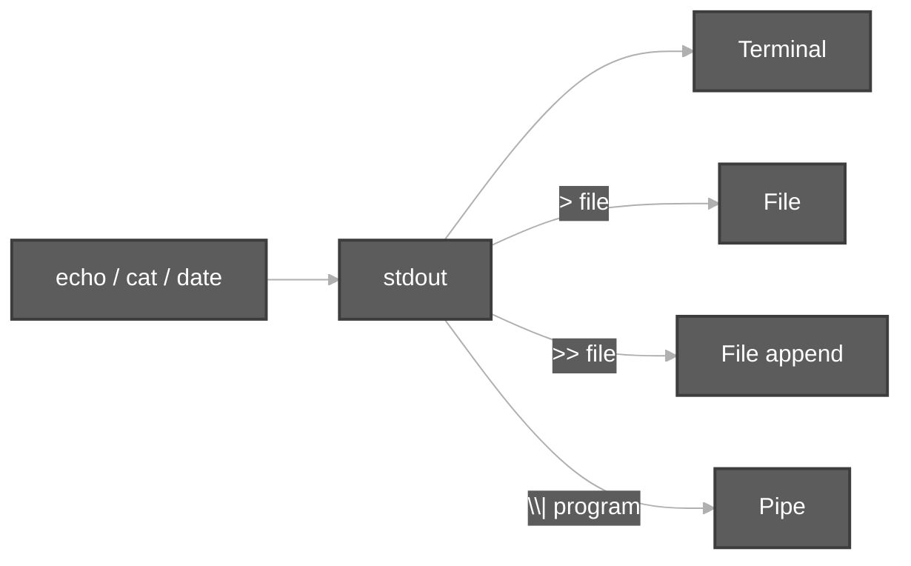
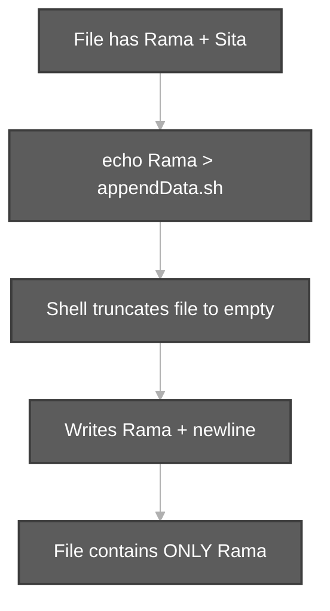
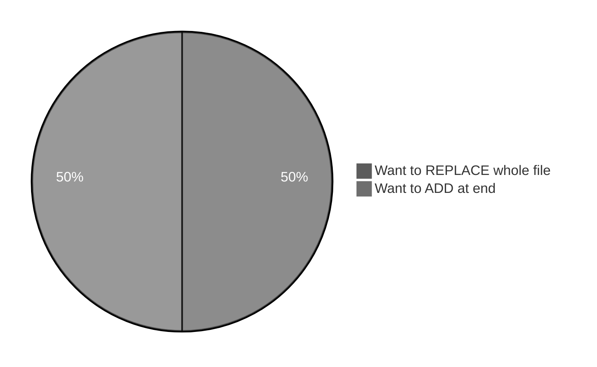
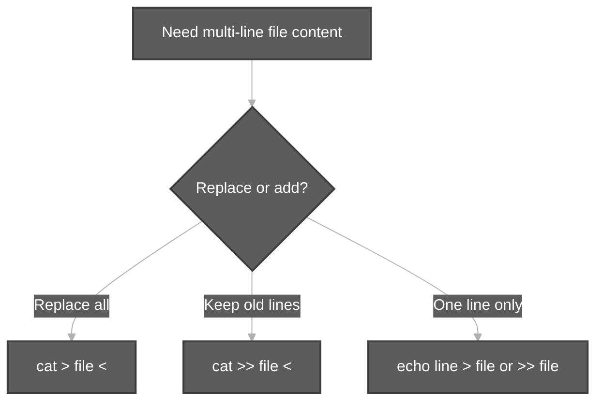

# EOF and Redirection (`>`, `>>`, `<<`)

**Audience:** Beginners (e.g. after `echo`, `cat`, and first `.sh` files) — includes the **Rama / Sita / `appendData.sh`** case and **EOF (heredoc)** for many lines at once.

**Related:** [Steps To Write a Shell Script.md](Steps%20To%20Write%20a%20Shell%20Script.md) · [viewContentOfFiles.md](viewContentOfFiles.md) (`cat < file`) · [pipeCommands.md](pipeCommands.md) (`|` is **not** `>`)

**Practice files in repo:** [`appendData.sh`](../../scripts/linuxbasics/appendData.sh) · [`overrideData.sh`](../../scripts/linuxbasics/overrideData.sh)

```bash
cd ~/Study/Linux-Basics   # or your clone path
cat appendData.sh
```

---

**Table of contents**

- [1. What is redirection?](#1-what-is-redirection)
- [2. `>` overwrite (truncate) — your Rama / Sita question](#2--overwrite-truncate--your-rama--sita-question)
- [3. `>>` append — keep old lines](#3--append--keep-old-lines)
- [4. Compare `>`, `>>`, and no redirect](#4-compare---and-no-redirect)
- [5. Input redirection `<`](#5-input-redirection-)
- [6. EOF and heredoc `<<`](#6-eof-and-heredoc-)
- [7. EOF with `>` vs `>>`](#7-eof-with--vs-)
- [8. Pipe `|` vs redirect `>`](#8-pipe--vs-redirect-)
- [9. Common mistakes](#9-common-mistakes)
- [10. Checklist](#10-checklist)

---

## 1. What is redirection?

Normally a command prints to the **terminal** (called **standard output**, **stdout**). **Redirection** sends that output **somewhere else** — usually a **file**.





| Symbol | Name | One-line meaning |
| :---: | :--- | :--- |
| **`>`** | Output redirect (overwrite) | **Replace** file contents with this output |
| **`>>`** | Output redirect (append) | **Add** output to the **end** of the file |
| **`<`** | Input redirect | Read file as **input** to a command |
| **`<<`** | Here document (heredoc) | Type **many lines** until a marker (often **`EOF`**) |

---

## 2. `>` overwrite (truncate) — your Rama / Sita question

### What you did (real lab)

```bash
echo Sita >> appendData.sh    # file: Rama, Sita
echo Rama > appendData.sh     # file: only Rama  ← Sita gone
```

### Yes — correct for a single `>` (overwrite)

When you use **`>`** on a file that **already has content**:

```bash
echo "new line" > appendData.sh
```

1. The shell **opens** the file and **clears it** (truncates to empty).  
2. Then it writes **only** what that command prints (often **one line** from `echo`).  
3. **Everything that was in the file before is gone** — whether you had **2 lines or 200**.

You do **not** need a special rule for “two lines vs many lines.” **Any** existing data is replaced whenever you use **`>`** on that file.

### Why `Sita` disappeared (same rule)

**`>` does not “add one line and keep the rest.”**  
Every time you use **`>`** on a file, the shell:

1. **Opens** the file  
2. **Truncates** it (empties it — **all old lines removed**)  
3. Writes **only** what this command prints  

So `echo Rama > appendData.sh` writes **one line** (`Rama` + newline). Anything that was there before (**including `Sita`**) is **gone**.

| File before | Command | File after |
| :--- | :--- | :--- |
| `Rama` + `Sita` (2 lines) | `echo Rama > appendData.sh` | **Only** `Rama` (1 line) |
| 100 lines or **200 lines** | `echo X > file` | **Only** `X` (1 line) |

**Rule:** One `>` = **whole file becomes only this command’s output** (often one line from `echo`).



You do **not** need a special trick for “2 lines vs many lines” — **`>` always wipes the full file** first.

---

## 3. `>>` append — keep old lines

```bash
echo Rama > appendData.sh      # start fresh: Rama only
echo Sita >> appendData.sh     # append: Rama + Sita
echo Lakshmana >> appendData.sh
```

| Symbol | Old data in file | Result |
| :---: | :--- | :--- |
| **`>`** | Deleted | Only new output |
| **`>>`** | **Kept** | Old + new at bottom |



---

## 4. Compare `>`, `>>`, and no redirect

| Action | Example | Screen | File |
| :--- | :--- | :---: | :--- |
| Print only | `echo Rama` | Shows `Rama` | Unchanged |
| Overwrite file | `echo Rama > appendData.sh` | Often quiet | **Only** `Rama` |
| Append to file | `echo Sita >> appendData.sh` | Often quiet | Previous + `Sita` |

**Override vs append (repo names):**

- [`overrideData.sh`](../../scripts/linuxbasics/overrideData.sh) — idea: **`>`** replaces content  
- [`appendData.sh`](../../scripts/linuxbasics/appendData.sh) — idea: build file with **`>>`** or heredoc  

---

## 5. Input redirection `<`

Send a **file into** a command (input from disk, not keyboard):

```bash
cat < appendData.sh
cat appendData.sh          # same result for cat
```

Durga Sir: for `cat`, **`cat file`** and **`cat < file`** often look the same; **`<`** is the general “input from file” symbol (used heavily in later topics).

---

## 6. EOF and heredoc `<<`

**Problem:** You want **many lines** in a file without typing `echo` again and again, and you want to control **overwrite vs append**.

**EOF** here means **End Of File marker** for a **here document** (`<<`). It is **not** a special Linux file on disk — it is a **label you choose** (convention: `EOF`).

### Write several lines (overwrite file)

```bash
cat > appendData.sh <<EOF
Rama
Sita
Lakshmana
EOF
```

| Part | Meaning |
| :--- | :--- |
| **`cat > appendData.sh`** | **Overwrite** `appendData.sh` with what follows |
| **`<<EOF`** | Start heredoc; read lines until a line that is **only** `EOF` |
| **Lines in middle** | Become file content |
| **`EOF`** on its own line | End heredoc (no spaces before/after if you use plain `EOF`) |

### Append many lines (keep old + add block)

```bash
cat >> appendData.sh <<EOF
Hanuman
EOF
```

**`>>`** = keep existing lines, add new block at end.



### Delimiter is not always `EOF`

You can use another word (same on start and end):

```bash
cat > notes.txt <<STOP
line one
line two
STOP
```

### Tips

- Closing marker must be **alone on the line** (for basic `<<EOF`).  
- Use **quoted** `<<'EOF'` if the body must be **literal** (no `$VAR` expansion).  
- **`<<-EOF`** (with `-`) can strip leading **tabs** on each line (scripts in Durga advanced notes).

---

## 7. EOF with `>` vs `>>`

| Command | Effect on existing file |
| :--- | :--- |
| **`cat > file <<EOF`** | **Delete** old content; file = only heredoc body |
| **`cat >> file <<EOF`** | **Keep** old content; heredoc body **appended** |

Same rule as **`echo`**: **`>` = truncate then write**, **`>>` = append**.

**Rebuild Rama + Sita after a mistake:**

```bash
cat > appendData.sh <<EOF
Rama
Sita
EOF
```

Or:

```bash
echo Rama > appendData.sh
echo Sita >> appendData.sh
```

---

## 8. Pipe `|` vs redirect `>`

| | **Pipe `\|`** | **Redirect `>`** |
| :--- | :--- | :--- |
| **Connects** | Command → **command** | Command → **file** |
| **Example** | `ls \| head` | `echo Rama > file` |

Details: [pipeCommands.md](pipeCommands.md).

---

## 9. Common mistakes

| Mistake | What happens |
| :--- | :--- |
| Used **`>`** when you meant **`>>`** | Old lines **lost** (Rama/Sita case) |
| **`echo Rama > file`** twice | Second time **replaces** first — only last `Rama` remains |
| Spaces in assignment `length = $(...)` | Bash error (different topic — [Steps To Write a Shell Script.md](Steps%20To%20Write%20a%20Shell%20Script.md)) |
| **`EOF`** indented or with spaces | Heredoc may not end — marker must match |
| Put **data lines** in `.sh` without `echo` | Shell tries to **run** `Rama` as a command — use heredoc or `echo` |

---

## 10. Checklist

1. **`>`** = **replace entire file** with this output (often one `echo` = one line).  
2. **`>>`** = **append**; previous lines stay.  
3. Many lines at once → **`cat > file <<EOF`** or **`cat >> file <<EOF`**.  
4. **`cat < file`** = read file as input (related to viewing — [viewContentOfFiles.md](viewContentOfFiles.md)).  
5. **`|`** sends output to another program; **`>`** sends output to a file.

**Memory line:** *Greater-than once = wipe and write; greater-than twice = keep and add at bottom.*
