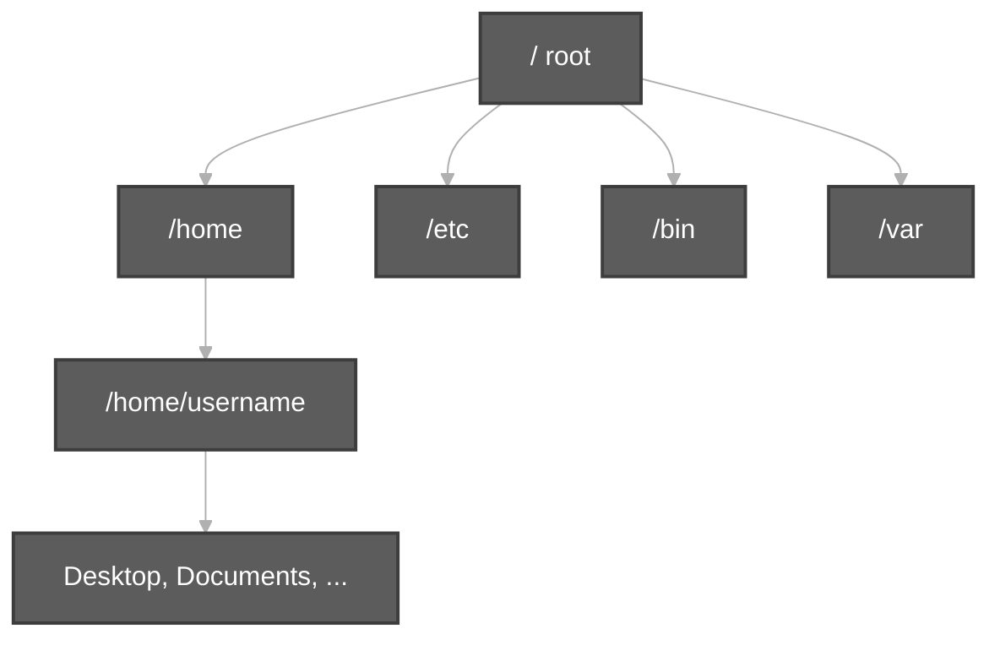
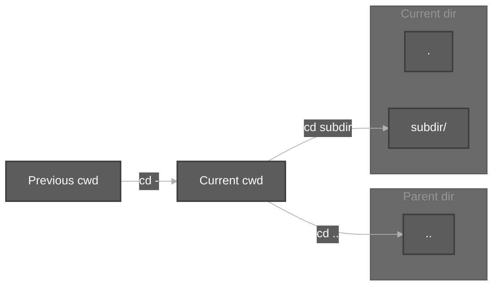
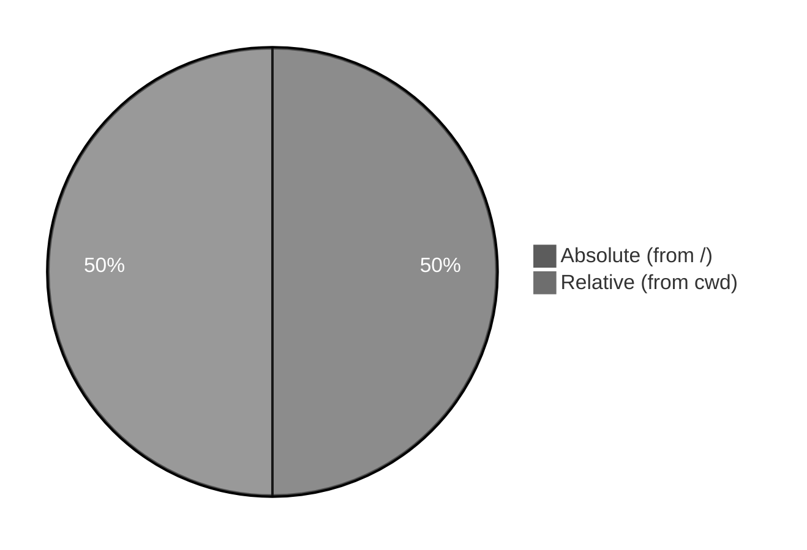
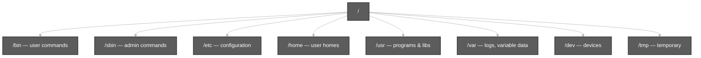

# File System Navigation Commands & LINUX File System Hierarchy

**Video:** [Session 4 — File System Navigation Commands & LINUX File System Hierarchy](https://www.youtube.com/watch?v=Aqx97d4NSbg&list=PLd3UqWTnYXOloH0vWBs4BtSbP84WcC2NY&index=4)  
**Instructor:** Durga Sir

**Prerequisites:** [TypesOfFilesInLinux.md](TypesOfFilesInLinux.md) (directories, `ls -l`) · [Bash Built-in Commands.md](Bash%20Built-in%20Commands.md) (`cd`, `pwd` in `help`)

**Practice folder:** [`scripts/file-system-navigation-and-hierarchy/`](../../scripts/file-system-navigation-and-hierarchy/)

```bash
cd /path/to/Linux-Basics
chmod +x scripts/file-system-navigation-and-hierarchy/*.sh
bash scripts/file-system-navigation-and-hierarchy/pwd-cd-navigation-demo.sh
```

---

**Table of contents**

- [1. Why navigation matters](#1-why-navigation-matters)
- [2. `pwd` — print working directory](#2-pwd--print-working-directory)
- [3. `cd` — change directory](#3-cd--change-directory)
- [4. `.` and `..` (current and parent)](#4--and--current-and-parent)
- [5. `ls -a` and hidden entries](#5-ls--a-and-hidden-entries)
- [6. Absolute vs relative paths](#6-absolute-vs-relative-paths)
- [7. Durga Sir’s directory tree demo](#7-durga-sirs-directory-tree-demo)
- [8. Linux file system hierarchy (FHS overview)](#8-linux-file-system-hierarchy-fhs-overview)
- [9. Important directories under `/`](#9-important-directories-under-)
- [10. Session 4 checklist](#10-session-4-checklist)
- [11. Scripts for this topic](#11-scripts-for-this-topic)

---

## 1. Why navigation matters

In Session 3 you learned that **directories** organize files. Session 4 is about **moving between directories** in the terminal and understanding the **single tree** that starts at **`/`** (root).

| Idea | Meaning |
| :--- | :--- |
| **Working directory** | The folder the shell is “standing in” right now |
| **Path** | A route to a file or directory (`/home/user/docs/report.txt`) |
| **Hierarchy** | One inverted tree: `/` at the top, everything else below |



---

## 2. `pwd` — print working directory

**1. Command name:** `pwd` (shell **builtin**)

**2. Usage / explanation:** Prints the **absolute path** of the **current working directory** (where you are now).

**3. Example:**

```bash
pwd
# /home/student/Desktop
```

**4. Demo:** [`pwd-cd-navigation-demo.sh`](../../scripts/file-system-navigation-and-hierarchy/pwd-cd-navigation-demo.sh)

---

## 3. `cd` — change directory

**1. Command name:** `cd` (shell **builtin**)

**2. Usage / explanation:** Changes the shell’s current directory to the path you give. If you omit the path, `cd` goes to your **home directory** (same idea as `cd ~`).

| Form | Goes to |
| :--- | :--- |
| `cd /absolute/path` | That exact location from `/` |
| `cd relative/path` | Subfolder under **current** directory |
| `cd` or `cd ~` | Your **home** (`/home/yourname` on Ubuntu) |
| `cd .` | **Current** directory (no real move; rarely needed alone) |
| `cd ..` | **Parent** directory (one level **up**) |
| `cd -` | **Previous** working directory (toggle back — **not** the same as parent) |

**3. Examples:**

```bash
cd Documents          # relative: child of current dir
cd /etc               # absolute: system config tree
cd                    # home
cd ~                  # home (explicit)
cd ..                 # parent
cd -                  # last directory you were in before last cd
```

**4. Demo:** [`pwd-cd-navigation-demo.sh`](../../scripts/file-system-navigation-and-hierarchy/pwd-cd-navigation-demo.sh)



> **`cd ..` vs `cd -`:** `..` is always the **parent** in the directory tree. `-` is **memory** of where you were last — useful when you jump far away and want to jump back once.

---

## 4. `.` and `..` (current and parent)

Every directory contains at least two special names:

| Name | Meaning |
| :--- | :--- |
| **`.`** | This directory itself |
| **`..`** | The directory **above** this one |

You do not create these with `mkdir`; they appear in listings such as `ls -a`.

**Demo:** [`ls-dot-parent-demo.sh`](../../scripts/file-system-navigation-and-hierarchy/ls-dot-parent-demo.sh)

---

## 5. `ls -a` and hidden entries

**`ls`** lists names in the current directory. **`ls -a`** shows **all** entries, including:

- **`.`** and **`..`**
- **Hidden** names (often start with `.`, e.g. `.bashrc`)

```bash
ls      # common names only
ls -a   # includes . and .. and dotfiles
```

**Demo:** [`ls-dot-parent-demo.sh`](../../scripts/file-system-navigation-and-hierarchy/ls-dot-parent-demo.sh)

---

## 6. Absolute vs relative paths

| Type | Starts with | Example | Valid from |
| :--- | :--- | :--- | :--- |
| **Absolute** | **`/`** (root) | `/home/user/Desktop` | **Any** working directory |
| **Relative** | Anything else | `Desktop`, `../etc`, `./file.txt` | Depends on **current** directory |

**Rules from class:**

- **`/home`** exists only as an **absolute** path from root — not as a folder named `home` sitting next to you unless you are already under `/`.
- From **`/`**, relative **`cd home`** reaches **`/home`** because **`home`** is a **child of root**. From another cwd (e.g. `/tmp`), **`cd home`** only works if a subdirectory named `home` exists **there** — otherwise use **`/home`** or the correct relative path.

**Demo:** [`absolute-vs-relative-paths-demo.sh`](../../scripts/file-system-navigation-and-hierarchy/absolute-vs-relative-paths-demo.sh)



---

## 7. Durga Sir’s directory tree demo

Typical classroom story (names may vary on your PC):

```text
Desktop/
  D1/
    D2/
      DR1/
        DR2/
```

| Step | Command idea | Result |
| :--- | :--- | :--- |
| Start on Desktop | `pwd` | …/Desktop |
| Enter nested dirs | `cd D1`, `cd D2`, … | deeper path |
| Up one level | `cd ..` | parent (e.g. DR1 → D2) |
| Jump home | `cd` or `cd ~` | `/home/you` |
| Return to last place | `cd -` | previous cwd (e.g. back under Desktop tree) |

**Demo:** [`mkdir-navigation-tree-demo.sh`](../../scripts/file-system-navigation-and-hierarchy/mkdir-navigation-tree-demo.sh)

---

## 8. Linux file system hierarchy (FHS overview)

Linux uses a **standard layout** (Filesystem Hierarchy Standard — **FHS**) so programs and admins know where things live.

- **One root:** **`/`**
- **Branches:** top-level directories (`/bin`, `/home`, `/etc`, …)
- **Not the same as Windows** `C:\` — there is typically **one** unified tree under `/` (other disks **mount** into folders like `/mnt` or `/media`).

**Demo:** [`fhs-root-directories-demo.sh`](../../scripts/file-system-navigation-and-hierarchy/fhs-root-directories-demo.sh)

---

## 9. Important directories under `/`

| Directory | Purpose (Durga Sir / FHS) |
| :--- | :--- |
| **`/`** | Root of the entire file system |
| **`/bin`** | Essential **user** commands (e.g. `ls`, `cp`) for all users |
| **`/sbin`** | Essential **system administration** binaries (often need root) |
| **`/boot`** | Boot loader and kernel-related files |
| **`/dev`** | **Device files** (Session 3 — disks, terminals, …) |
| **`/etc`** | **Host-specific configuration** (not “editable text” spelling — **etc** = et cetera / config) |
| **`/home`** | **Per-user home directories** (`/home/alice`, …) |
| **`/root`** | Home directory for the **root** superuser (not under `/home`) |
| **`/lib`**, **`/lib64`** | Shared **libraries** needed by `/bin` and `/sbin` |
| **`/usr`** | Secondary hierarchy — most user programs (`/usr/bin`, `/usr/lib`, …) |
| **`/var`** | **Variable** data: logs, mail spools, caches (`/var/log`, …) |
| **`/tmp`** | **Temporary** files (often cleared on reboot) |
| **`/opt`** | Optional / third-party software packages |
| **`/mnt`** | Traditional **mount point** for temporarily mounted filesystems |
| **`/media`** | Mount points for **removable** media (USB, CD) on many distros |
| **`/proc`** | Virtual files exposing **kernel / process** information |
| **`/sys`** | Virtual filesystem for **kernel / devices** (modern systems) |
| **`/run`** | Runtime variable data (PID files, sockets) since boot |



**Explore safely (read-only):**

```bash
ls -l /
ls /bin | head
ls /etc | head
```

Do not delete or rename system directories under `/` unless you are doing advanced admin work.

---

## 10. Session 4 checklist

You should be able to explain:

1. **`pwd`** — where am I?  
2. **`cd`** — home, absolute path, relative path, `.`, `..`, and **`cd -`**.  
3. Why **`ls -a`** shows `.` and `..`.  
4. **Absolute** paths start with **`/`**; **relative** paths depend on **cwd**.  
5. **`/home`** is under **root**, not a random relative folder named `home`.  
6. Main **FHS** folders: `/bin`, `/sbin`, `/boot`, `/dev`, `/etc`, `/home`, `/usr`, `/var`, `/tmp`, `/opt`, `/mnt`, `/proc`, …

**Next:** Continue the playlist from [`linuxBasics.md`](../linuxBasics.md).

---

## 11. Scripts for this topic

| Script | Demonstrates |
| :--- | :--- |
| [`pwd-cd-navigation-demo.sh`](../../scripts/file-system-navigation-and-hierarchy/pwd-cd-navigation-demo.sh) | `pwd`, `cd`, `~`, `.`, `..`, `cd -` |
| [`ls-dot-parent-demo.sh`](../../scripts/file-system-navigation-and-hierarchy/ls-dot-parent-demo.sh) | `ls -a`, `.` and `..` |
| [`absolute-vs-relative-paths-demo.sh`](../../scripts/file-system-navigation-and-hierarchy/absolute-vs-relative-paths-demo.sh) | `/` vs relative paths |
| [`mkdir-navigation-tree-demo.sh`](../../scripts/file-system-navigation-and-hierarchy/mkdir-navigation-tree-demo.sh) | Nested dirs + parent vs previous |
| [`fhs-root-directories-demo.sh`](../../scripts/file-system-navigation-and-hierarchy/fhs-root-directories-demo.sh) | `ls` tour of `/` and key dirs |

```bash
cd /path/to/Linux-Basics
bash scripts/file-system-navigation-and-hierarchy/pwd-cd-navigation-demo.sh
bash scripts/file-system-navigation-and-hierarchy/fhs-root-directories-demo.sh
```
