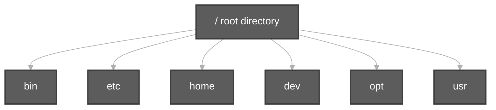
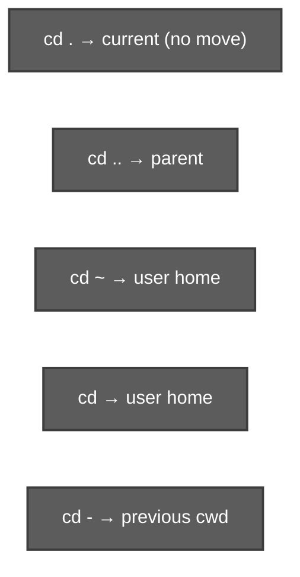
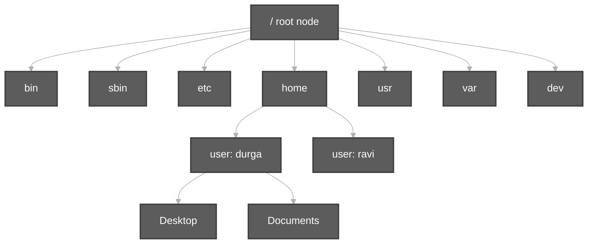

# File System Navigation Commands & LINUX File System Hierarchy

**Video:** [Session 4 — File System Navigation Commands & LINUX File System Hierarchy](https://www.youtube.com/watch?v=Aqx97d4NSbg&list=PLd3UqWTnYXOloH0vWBs4BtSbP84WcC2NY&index=4)  
**Instructor:** Durga Sir

**Prerequisites:** [TypesOfFilesInLinux.md](TypesOfFilesInLinux.md) (three file types, directories) · [Bash Built-in Commands.md](Bash%20Built-in%20Commands.md) (`help` → `cd`, `pwd`)

**Practice folder:** [`scripts/file-system-navigation-and-hierarchy/`](../../scripts/file-system-navigation-and-hierarchy/)

```bash
cd /path/to/Linux-Basics
chmod +x scripts/file-system-navigation-and-hierarchy/*.sh
bash scripts/file-system-navigation-and-hierarchy/pwd-cd-navigation-demo.sh
```

---

**Table of contents**

- [0. Session opening (recap)](#0-session-opening-recap)
- [1. Root of the Linux file system — `/`](#1-root-of-the-linux-file-system--)
- [2. File system navigation commands (before hierarchy)](#2-file-system-navigation-commands-before-hierarchy)
- [3. `pwd` — print working directory](#3-pwd--print-working-directory)
- [4. `mkdir` and moving with `cd`](#4-mkdir-and-moving-with-cd)
- [5. `ls` vs `ls -a` — hidden `.` and `..`](#5-ls-vs-ls-a--hidden--and-)
- [6. Current directory vs parent directory](#6-current-directory-vs-parent-directory)
- [7. `cd` — all forms Durga Sir teaches](#7-cd--all-forms-durga-sir-teaches)
- [8. `cd ..` chains, invalid `...`, and root edge cases](#8-cd--chains-invalid--and-root-edge-cases)
- [9. Multi-user homes and `cd ~` / plain `cd`](#9-multi-user-homes-and-cd--plain-cd)
- [10. `cd -` — previous working directory (not parent)](#10-cd----previous-working-directory-not-parent)
- [11. Navigation summary table](#11-navigation-summary-table)
- [12. `cd home` vs `cd /home`](#12-cd-home-vs-cd-home)
- [13. Linux file system hierarchy — tree structure](#13-linux-file-system-hierarchy--tree-structure)
- [14. `/home` and default user folders](#14-home-and-default-user-folders)
- [15. `/bin` — binary executables (normal user)](#15-bin--binary-executables-normal-user)
- [16. `/sbin` — system bin (super user)](#16-sbin--system-bin-super-user)
- [17. `/etc` — system configuration](#17-etc--system-configuration)
- [18. Other top-level directories (overview)](#18-other-top-level-directories-overview)
- [19. Session 4 checklist](#19-session-4-checklist)
- [20. Scripts for this topic](#20-scripts-for-this-topic)

---

## 0. Session opening (recap)

Durga Sir recaps Session 3 before navigation:

| Type | Meaning |
| :--- | :--- |
| **Normal / ordinary** | Data files |
| **Directory** | Folders that contain files and subdirectories |
| **Device** | Hardware access via files (e.g. under `/dev`) |

**Everything is a file** in Linux. Then he introduces **file system navigation commands** — how to move from one directory to another — **before** the full **Linux file system hierarchy** topic.

---

## 1. Root of the Linux file system — `/`

| Point | Detail |
| :--- | :--- |
| **Root** | The **forward slash** **`/`** is the **root** of the entire Linux file system hierarchy |
| **It is a directory** | Root is a **folder**; inside it there are **many subdirectories** |
| **Examples under `/`** | `dev`, `bin`, `etc`, `opt`, `home`, `lib`, `usr`, `mnt`, `sbin`, … |



> Convention: Linux starts the tree at **`/`**. There is no separate “reason” beyond standard practice — remember **`/`** as the **topmost** directory.

---

## 2. File system navigation commands (before hierarchy)

**Goal:** Move from directory to directory using shell commands.

Typical classroom path (user name may differ on your PC):

```text
/home/durga/desktop   ← example current working directory
```

From there Durga Sir demonstrates **`cd ..`** repeatedly until reaching **`/`**, then **`cd home`**, **`cd durga`**, back to **desktop**, **`mkdir`**, nested **`cd`**, **`pwd`**, **`ls`**, **`ls -a`**, and every **`cd`** variant.

---

## 3. `pwd` — print working directory

**1. Command name:** `pwd` (shell **builtin**)

**2. Usage / explanation:** Prints the **absolute path** of your **current working directory** (where the shell is right now).

**3. Example:**

```bash
pwd
# /home/durga/desktop/dir1/dir2
```

**4. Demo:** [`pwd-cd-navigation-demo.sh`](../../scripts/file-system-navigation-and-hierarchy/pwd-cd-navigation-demo.sh) · [`mkdir-ls-navigation-demo.sh`](../../scripts/file-system-navigation-and-hierarchy/mkdir-ls-navigation-demo.sh)

---

## 4. `mkdir` and moving with `cd`

Durga Sir creates folders live on **desktop**:

```bash
mkdir dir1
cd dir1
mkdir dir2
cd dir2
pwd
```

| Note | Detail |
| :--- | :--- |
| **Trailing `/`** | A name ending with **`/`** means directory, but it is **not required** — `cd desktop` and `cd desktop/` both work |
| **Nested `cd`** | You can `cd` one level at a time or use paths like `cd dir1/dir2` |

**Demo:** [`mkdir-ls-navigation-demo.sh`](../../scripts/file-system-navigation-and-hierarchy/mkdir-ls-navigation-demo.sh) · [`mkdir-navigation-tree-demo.sh`](../../scripts/file-system-navigation-and-hierarchy/mkdir-navigation-tree-demo.sh) (Desktop → D1 → D2 → DR1 → DR2)

---

## 5. `ls` vs `ls -a` — hidden `.` and `..`

Inside **dir2**, if you created **nothing else**:

```bash
ls        # appears empty — no visible files
```

Durga Sir mentions **hidden files and directories** as a **separate topic later**. For now:

| Command | Behavior |
| :--- | :--- |
| **`ls`** (default) | Does **not** show hidden entries |
| **`ls -a`** | **All** — option **`a`** means **“all”**, including hidden |

**Every directory** contains **two special hidden names**:

| Name | Meaning |
| :--- | :--- |
| **`.`** (one dot) | **Current** working directory |
| **`..`** (two dots) | **Parent** directory |

**Demo:** [`ls-dot-parent-demo.sh`](../../scripts/file-system-navigation-and-hierarchy/ls-dot-parent-demo.sh) · [`mkdir-ls-navigation-demo.sh`](../../scripts/file-system-navigation-and-hierarchy/mkdir-ls-navigation-demo.sh)

---

## 6. Current directory vs parent directory

While you are in **dir2**:

| Term | Example in class |
| :--- | :--- |
| **Current directory** | **dir2** (where `pwd` points) |
| **Parent directory** | **dir1** (one level up) |

**Parent chain** (Durga Sir’s ladder):

```text
dir2  → parent dir1
dir1  → parent desktop
desktop → parent /home/durga (user home)
/home/durga → parent /home
/home → parent /  (root)
```

| At **root** `/` | Meaning |
| :--- | :--- |
| **Parent of root?** | **Nothing** — root is the top |
| **`cd ..` at `/`** | You **remain at `/`** (Ubuntu); there is no directory above root |

**Demo:** [`parent-directory-chain-demo.sh`](../../scripts/file-system-navigation-and-hierarchy/parent-directory-chain-demo.sh)

---

## 7. `cd` — all forms Durga Sir teaches

**`cd`** = **change directory** — move from one directory to another.

| Command | Meaning |
| :--- | :--- |
| **`cd .`** | Go to **current** directory — **useless** in practice (you stay where you are) |
| **`cd ..`** | Go to **parent** directory |
| **`cd ~`** | Go to **logged-in user’s home** directory (tilde **`~`**) |
| **`cd`** (no argument) | Same effect as **`cd ~`** — **user home**, not parent, not root, not “only `/home`” |
| **`cd -`** | Go to **previous working directory** (see §10) |

**Important:** **`cd ..`** needs a **space**: use **`cd ..`**, not **`cd..`**.

**Demos:** [`pwd-cd-navigation-demo.sh`](../../scripts/file-system-navigation-and-hierarchy/pwd-cd-navigation-demo.sh) · [`cd-root-edge-cases-demo.sh`](../../scripts/file-system-navigation-and-hierarchy/cd-root-edge-cases-demo.sh)



---

## 8. `cd ..` chains, invalid `...`, and root edge cases

You may move up **multiple levels** in one `cd` using a **single path**:

```bash
cd ..           # one parent
cd ../..        # two parents (Durga Sir: multiple “dot dot” steps)
cd ../../..     # three parents (class demo from deep folder toward home/root)
```

> In **Bash**, write **`cd ../..`** — not **`cd .. ..`** (that gives “too many arguments”). The classroom idea is several **`..`** segments in **one** path.

| Invalid | Result |
| :--- | :--- |
| **`cd ...`** (three dots) | **No such file or directory** — only **`.`** and **`..`** exist |

At **`/`**:

- **`cd ..`** → still **`/`** (no parent above root)
- **`cd .`** → still **`/`**

**Demo:** [`cd-multiple-parent-demo.sh`](../../scripts/file-system-navigation-and-hierarchy/cd-multiple-parent-demo.sh) · [`cd-root-edge-cases-demo.sh`](../../scripts/file-system-navigation-and-hierarchy/cd-root-edge-cases-demo.sh)

---

## 9. Multi-user homes and `cd ~` / plain `cd`

Linux is **multi-user**. For **each user**, a **separate home directory** is created under **`/home`**:

```text
/home/durga
/home/ravi
/home/shiva
```

| Symbol | Meaning |
| :--- | :--- |
| **`~` (tilde)** | **Current user’s home directory** (used heavily in shell scripting too) |
| **`cd ~`** | Jump to your home from **any** location |
| **`cd`** alone | **Same** as **`cd ~`** — goes to **user home**, **not** parent, **not** root |

You do **not** need to type the full path every time:

```bash
cd /home/durga    # works but verbose
cd ~              # shortcut — preferred
cd                # same as cd ~
```

**Demo:** [`pwd-cd-navigation-demo.sh`](../../scripts/file-system-navigation-and-hierarchy/pwd-cd-navigation-demo.sh)

---

## 10. `cd -` — previous working directory (not parent)

Class scenario:

```text
.../desktop/DR1/DR2   ← you are here
cd                    ← go to user home (/home/durga)
cd -                  ← back to .../desktop/DR1/DR2
```

| Concept | Meaning |
| :--- | :--- |
| **Previous working directory** | Where you were **immediately before** the last `cd` |
| **Not the same as parent** | Parent of DR2 is DR1; **previous** after `cd` to home is **DR2** |

**Demo:** [`mkdir-navigation-tree-demo.sh`](../../scripts/file-system-navigation-and-hierarchy/mkdir-navigation-tree-demo.sh) · [`pwd-cd-navigation-demo.sh`](../../scripts/file-system-navigation-and-hierarchy/pwd-cd-navigation-demo.sh)

---

## 11. Navigation summary table

Durga Sir’s end-of-topic recap (prompt **`$`** = ready for command):

| You type | Goes to |
| :--- | :--- |
| **`cd .`** | Current directory (no practical benefit) |
| **`cd ..`** | Parent directory |
| **`cd ../..`** (etc.) | Multiple parents in one path |
| **`cd ~`** | User home directory |
| **`cd`** (no operand) | User home directory |
| **`cd -`** | **Previous** working directory |

---

## 12. `cd home` vs `cd /home`

From a **nested** folder (e.g. **dir2**), **relative**:

```bash
cd home    # FAIL — looks for ./home inside dir2
```

**Absolute** path from root:

```bash
cd /home    # OK — under / there is a directory named home
```

| Path | Starts at |
| :--- | :--- |
| **`home`** | Current directory (relative) |
| **`/home`** | **Root** `/`, then into **`home`** |

**Demo:** [`cd-home-relative-vs-absolute-demo.sh`](../../scripts/file-system-navigation-and-hierarchy/cd-home-relative-vs-absolute-demo.sh) · [`absolute-vs-relative-paths-demo.sh`](../../scripts/file-system-navigation-and-hierarchy/absolute-vs-relative-paths-demo.sh)

---

## 13. Linux file system hierarchy — tree structure

After navigation, Durga Sir teaches **Linux File System Hierarchy**:

| Idea | Detail |
| :--- | :--- |
| **Tree structure** | Like a **tree** — **root node** at top, **sub-nodes** below |
| **Starts at `/`** | Single inverted tree for the whole system |
| **Not Windows `C:\`** | One unified hierarchy; other disks **mount** under folders like `/mnt` |



**Demo:** [`fhs-root-directories-demo.sh`](../../scripts/file-system-navigation-and-hierarchy/fhs-root-directories-demo.sh)

---

## 14. `/home` and default user folders

Under **`/home`**, each user gets a directory. Inside a user home (Ubuntu desktop layout), Durga Sir lists:

| Folder | Typical use |
| :--- | :--- |
| **Desktop** | Desktop files |
| **Documents** | Documents |
| **Downloads** | Downloads |
| **Music** | Music |
| **Pictures** | Pictures |
| **Videos** | Videos |

**`/root`** is the **root (superuser) home** — **not** under `/home`.

---

## 15. `/bin` — binary executables (normal user)

| Term | Meaning |
| :--- | :--- |
| **`bin`** | Short for **binary** |
| **Contents** | **Executable binary files** for **normal user** commands |

When you run **`touch`**, **`ls`**, **`mkdir`**, **`cd`**, etc., the shell runs a **real executable file** (like **`javac.exe`** / **`java.exe`** on Windows).

| Behavior | Detail |
| :--- | :--- |
| **Search order** | Shell looks for commands in **`bin`** (and paths like **`/usr/bin`**) |
| **Missing binary** | Command not found / cannot run |
| **Modern Linux** | Many commands live under **`/usr/bin`**; older systems kept more in **`/bin`** directly — layout evolved, idea is the same |
| **`which` / `command -v`** | Shows **which file** runs for a command (e.g. `touch` → `/usr/bin/touch`) |

In **`ls`** output under **`/bin`** (color may vary):

| Color (typical) | Type |
| :--- | :--- |
| **Green** | Executable files (commands) |
| **Blue** | Directories |
| **Cyan / link style** | **Symbolic links** |

**`ls -l`** on a command (e.g. `date`) — **owner root**, permissions: owner can read/write/execute; group/others often read+execute only. **Modifying `/bin`** needs appropriate permissions (usually **root**).

**Interview tip:** **`/bin`** = binaries for **normal user** commands.

**Demo:** [`bin-sbin-etc-demo.sh`](../../scripts/file-system-navigation-and-hierarchy/bin-sbin-etc-demo.sh)

---

## 16. `/sbin` — system bin (super user)

| Term | Meaning |
| :--- | :--- |
| **`sbin`** | **System bin** (some books say “secondary bin”) |
| **Users** | **Super user (root)** — only **one** root account |
| **Contents** | Binaries for **high-level admin** tasks: disk partition, network admin, shutdown, **fdisk**, **badblocks**, etc. |

| Directory | Who uses those commands |
| :--- | :--- |
| **`/bin`** | **Normal** user day-to-day commands |
| **`/sbin`** | **Root / super user** system administration |

Normal users cannot perform all **`/sbin`** tasks; **`sudo`** grants temporary root privilege to run them.

**Interview tip:** Difference **`/bin`** vs **`/sbin`** — normal user vs super-user command binaries.

**Demo:** [`bin-sbin-etc-demo.sh`](../../scripts/file-system-navigation-and-hierarchy/bin-sbin-etc-demo.sh)

---

## 17. `/etc` — system configuration

| Term | Meaning |
| :--- | :--- |
| **`/etc`** | **System configuration** files used by the OS |

When you **switch user** (`su`) and enter a password, Linux checks configuration — e.g. user/password data lives under **`/etc`**.

| File | Purpose (class examples) |
| :--- | :--- |
| **`/etc/passwd`** | Information about **all users** |
| **`/etc/group`** | **Group** membership information |
| **`/etc/hosts`** | **Hostname**, **IP**, DNS-related settings (admin context) |

- You can **view** many files as a normal user; **editing** usually requires **root**.
- **No special shortcut symbol** for `/etc` (unlike **`~`** for home) — remember the word **“configuration”** → **`/etc`**.

**Demo:** [`bin-sbin-etc-demo.sh`](../../scripts/file-system-navigation-and-hierarchy/bin-sbin-etc-demo.sh)

---

## 18. Other top-level directories (overview)

Durga Sir names these during the hierarchy intro (details in later sessions for some):

| Directory | Short purpose |
| :--- | :--- |
| **`/dev`** | Device files (Session 3) |
| **`/lib`**, **`/lib64`** | Shared **libraries** for binaries |
| **`/usr`** | Programs, libraries, documentation (`/usr/bin`, …) |
| **`/var`** | Variable data — **logs**, mail, caches |
| **`/tmp`** | **Temporary** files — **more in next session** (Video 5 teaser) |
| **`/boot`** | Boot loader / kernel files |
| **`/opt`** | Optional third-party software |
| **`/mnt`** | Mount point for filesystems |
| **`/media`** | Removable media mounts (common on Ubuntu) |
| **`/proc`** | Virtual — process/kernel information |
| **`/run`** | Runtime data since boot |

**Explore read-only:**

```bash
ls -l /
```

Do not delete or rename system directories without admin knowledge.

---

## 19. Session 4 checklist

You should be able to explain:

1. **`/`** is root; many subdirectories (`bin`, `home`, `etc`, …).  
2. **`pwd`**, **`mkdir`**, **`cd`**, **`ls`**, **`ls -a`** ( **`a` = all** ).  
3. **`.`** = current, **`..`** = parent; parent chain up to **`/`**.  
4. **`cd .`**, **`cd ..`**, chained **`cd ..`**, invalid **`cd ...`**.  
5. **`cd ~`** and **`cd`** → **user home**; **`~`** symbol.  
6. **`cd -`** → **previous** directory (not parent).  
7. **`cd home`** vs **`cd /home`**.  
8. Tree hierarchy; user folders under **`/home`**.  
9. **`/bin`** (binary, normal user), **`/sbin`** (system/root), **`/etc`** (configuration, `passwd`, `group`, `hosts`).  

**Next (Video 5):** **`/tmp`** and related topics — see [`linuxBasics.md`](../linuxBasics.md).

---

## 20. Scripts for this topic

| Script | Demonstrates |
| :--- | :--- |
| [`pwd-cd-navigation-demo.sh`](../../scripts/file-system-navigation-and-hierarchy/pwd-cd-navigation-demo.sh) | `pwd`, `cd`, `~`, `.`, `..`, `cd -` |
| [`mkdir-ls-navigation-demo.sh`](../../scripts/file-system-navigation-and-hierarchy/mkdir-ls-navigation-demo.sh) | `mkdir`, empty `ls`, `ls -a` |
| [`mkdir-navigation-tree-demo.sh`](../../scripts/file-system-navigation-and-hierarchy/mkdir-navigation-tree-demo.sh) | DR1/DR2 tree, home, `cd -` |
| [`ls-dot-parent-demo.sh`](../../scripts/file-system-navigation-and-hierarchy/ls-dot-parent-demo.sh) | `.` and `..` |
| [`parent-directory-chain-demo.sh`](../../scripts/file-system-navigation-and-hierarchy/parent-directory-chain-demo.sh) | Parent ladder to `/` |
| [`cd-multiple-parent-demo.sh`](../../scripts/file-system-navigation-and-hierarchy/cd-multiple-parent-demo.sh) | `cd .. ..`, invalid `...` |
| [`cd-root-edge-cases-demo.sh`](../../scripts/file-system-navigation-and-hierarchy/cd-root-edge-cases-demo.sh) | `cd ..` / `cd .` at `/` |
| [`cd-home-relative-vs-absolute-demo.sh`](../../scripts/file-system-navigation-and-hierarchy/cd-home-relative-vs-absolute-demo.sh) | `cd home` vs `cd /home` |
| [`absolute-vs-relative-paths-demo.sh`](../../scripts/file-system-navigation-and-hierarchy/absolute-vs-relative-paths-demo.sh) | Absolute `/` paths |
| [`bin-sbin-etc-demo.sh`](../../scripts/file-system-navigation-and-hierarchy/bin-sbin-etc-demo.sh) | `which`, `/bin`, `/sbin`, `/etc` samples |
| [`fhs-root-directories-demo.sh`](../../scripts/file-system-navigation-and-hierarchy/fhs-root-directories-demo.sh) | `ls -l /` tour |

```bash
cd /path/to/Linux-Basics
bash scripts/file-system-navigation-and-hierarchy/bin-sbin-etc-demo.sh
bash scripts/file-system-navigation-and-hierarchy/cd-home-relative-vs-absolute-demo.sh
```
