# Piping, `tee`, and `xargs` (Session 12)

**Video:** [Session 12 — Piping and importance of `tee` and `xargs`](https://www.youtube.com/watch?v=Ko3VktocAQw&list=PLd3UqWTnYXOloH0vWBs4BtSbP84WcC2NY&index=12)  
**Instructor:** Durga Sir  
**Course title (full syllabus):** Session 25 — *Piping and Importance of tee and xargs commands*

**Prerequisites:** [redirection.md](redirection.md) (streams 0/1/2, `>`, `2>`) · [pipeCommands.md](pipeCommands.md) (first introduction to `|`) · [wordCountCommand.md](wordCountCommand.md) (`wc`) · [viewContentOfFiles.md](viewContentOfFiles.md) (`head`, `tail`, `cat`)

**Scripts:** [`scripts/PipingTeeXargs.sh`](../../scripts/PipingTeeXargs.sh) · [`scripts/PipingTeeXargs/`](../../scripts/PipingTeeXargs/)  
**Execution summary:** [`PipingTeeXargs.md`](../../scripts-execution-summary/PipingTeeXargs.md)

```bash
cd /path/to/Linux-Basics
bash scripts/PipingTeeXargs.sh
```

---

**Table of contents**

- [1. Goal of this session](#1-goal-of-this-session)
- [2. Recap — how a command gets input and sends output](#2-recap--how-a-command-gets-input-and-sends-output)
- [3. Need of piping](#3-need-of-piping)
- [4. What is a pipe (`|`)?](#4-what-is-a-pipe-)
- [5. Filter commands](#5-filter-commands)
- [6. Piping with filters — Durga Sir examples](#6-piping-with-filters--durga-sir-examples)
- [7. Long pipelines and order](#7-long-pipelines-and-order)
- [8. Pipe carries stdout only (not stderr)](#8-pipe-carries-stdout-only-not-stderr)
- [9. When piping “breaks” — `>` before `|`](#9-when-piping-breaks--before-)
- [10. `tee` — write to file and screen](#10-tee--write-to-file-and-screen)
- [11. Tee with multiple files](#11-tee-with-multiple-files)
- [12. Combine two listings — save merged file and reverse-sorted copy (`tee`)](#12-combine-two-listings--save-merged-file-and-reverse-sorted-copy-tee)
- [13. Reason for `xargs`](#13-reason-for-xargs)
- [14. `xargs` — build command lines from stdin](#14-xargs--build-command-lines-from-stdin)
- [15. eg2 — display contents of files named in an input file](#15-eg2--display-contents-of-files-named-in-an-input-file)
- [16. Printing `date` and `cal` with `xargs echo`](#16-printing-date-and-cal-with-xargs-echo)
- [17. Pipe vs redirection vs `tee`](#17-pipe-vs-redirection-vs-tee)
- [18. Session checklist](#18-session-checklist)
- [19. Script index](#19-script-index)
- [20. Questions](#20-questions)

---

## 1. Goal of this session

After [redirection](redirection.md), Durga Sir introduces **piping** — the **operating-system mechanism** to move **output of one command** directly into **input of another command** without creating a temporary file.

In the same session you learn:

| Topic | Command | One-line idea |
| :--- | :--- | :--- |
| **Piping** | **`|`** | Connect **stdout** of left command to **stdin** of right command |
| **tee** | **`tee`** | **Split** output — show on **terminal** **and** save to **file(s)** |
| **xargs** | **`xargs`** | Read **stdin**, build **argument list** for another command |

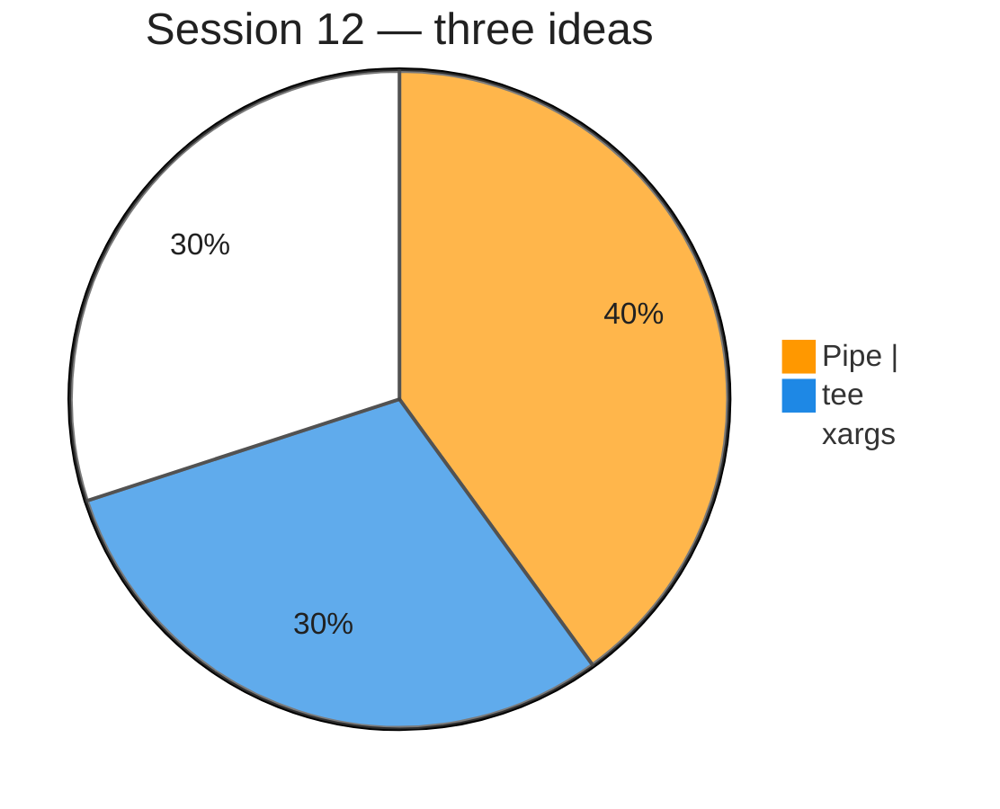

---

## 2. Recap — how a command gets input and sends output

Durga Sir repeats the model from the redirection session:

### Input (how a command gets data)

| # | Source | Example |
| :---: | :--- | :--- |
| 1 | **Command-line arguments** | `cat a.txt`, `ls /etc` |
| 2 | **Standard input** | Keyboard, **`< file`**, or **pipe** from previous command |

### Output (where command results go)

| # | Destination | Mechanism |
| :---: | :--- | :--- |
| 1 | **Terminal** | Default **stdout** / **stderr** |
| 2 | **File** | **Redirection** — `>`, `>>`, `2>`, `&>`, … |
| 3 | **Another command** | **Piping** — **`|`** |

So: **redirection** → file; **pipe** → **next program**.

---

## 3. Need of piping

**Without pipe** (two steps):

```bash
ls -l /etc > etclist.txt
wc -l < etclist.txt
```

**With pipe** (one step, no intermediate file):

```bash
ls -l /etc | wc -l
```

Durga Sir’s point: piping is **efficient** and **common** in real servers — logs, filters, counts, and reports are almost always **chains** of small commands.

---

## 4. What is a pipe (`|`)?

```bash
command1 | command2
```

| Part | Role |
| :--- | :--- |
| **command1** | Writes **normal output** to **stdout (1)** |
| **`|`** | Kernel **pipe** — buffer between processes |
| **command2** | Reads from **stdin (0)** |


**Not** the same as **`>`** — `>` goes to a **file**; **`|`** goes to **another command**. See [pipeCommands.md](pipeCommands.md) for **`Broken pipe`** when the reader (`head`) exits early.

**Lab command:**

```bash
bash scripts/PipingTeeXargs/pipe-ls-head-wc-demo.sh
```

---

## 5. Filter commands

**Filter** = a command that can take **input from stdin** (keyboard **or** pipe), process it, and write **stdout**.

Durga Sir lists examples you will use often with **`|`**:

| Filter | Typical use with pipe |
| :--- | :--- |
| **`wc`** | Count lines, words, bytes |
| **`grep`** | Search for a pattern |
| **`sort`** | Sort lines |
| **`uniq`** | Remove duplicate **adjacent** lines (use after **`sort`**) |
| **`head`** / **`tail`** | First / last lines |
| **`cut`** | Columns (later session) |
| **`tr`** | Translate characters (later session) |

If a command **only** accepts file names and **never** reads stdin, it is a **poor** filter for piping (unless you use **`xargs`**).

---

## 6. Piping with filters — Durga Sir examples

**Filter commands** (`wc`, `head`, `sort`, …) can read input in **two** ways:

| Source | Meaning |
| :--- | :--- |
| **Keyboard (terminal)** | Run the filter **alone**, type lines, end with **Ctrl+D** |
| **Pipe** | Previous command’s **stdout** becomes this command’s **stdin** |

---

### Your lab — `wc` (`scripts/linuxbasics`)

**1) Input from the terminal (keyboard):**

```bash
cd scripts/linuxbasics
wc
```

Type lines (e.g. `This is first line`, `This is second line`), then **Ctrl+D**.  
**`wc`** prints three numbers: **lines**, **words**, **characters** (example: `2  8  41`).

**2) Input from another command’s output (pipe):**

```bash
ls -l /etc | wc
```

Here **`wc`** does **not** read the keyboard — it counts whatever **`ls -l /etc`** printed (example: `246  2223  20956`).

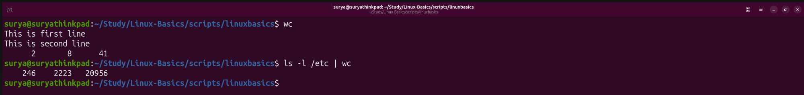

---

### Your lab — `head` (keyboard, then pipe)

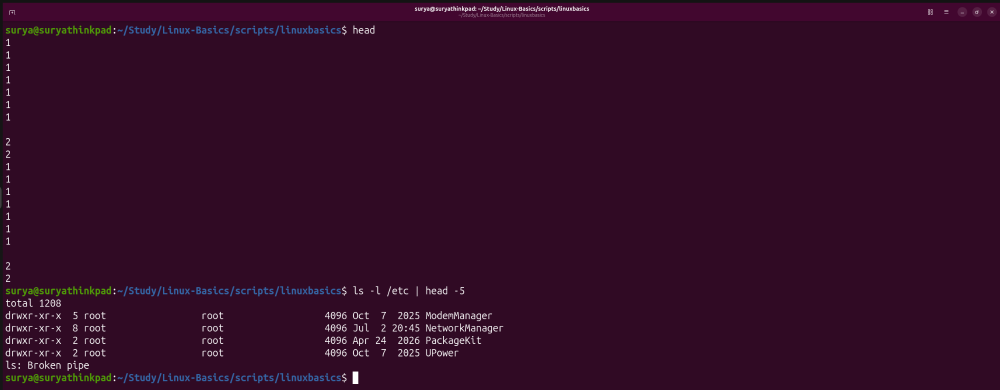

**1) Input from the terminal:**

```bash
head
```

Type lines from the keyboard (Durga Sir lab: up to **10 lines**). When you press **Enter** after the tenth line, or when you press **Ctrl+D**, **`head`** prints only the **first 10 lines** of what you typed.

**2) Input from a pipe:**

```bash
ls -l /etc | head -5
```

**`head`** reads the **`ls`** listing from the pipe and shows the **first 5 lines** on screen (including the **`total`** line) — you do not type the `/etc` listing yourself. You may see **`ls: Broken pipe`** after **`head`** exits; that is normal when the reader stops early (see [pipeCommands.md](pipeCommands.md#5-broken-pipe--what-does-it-mean)).

---

### `ls -l` and the **`total`** line (after pipe examples)

Whenever you run **`ls -l`** on a directory (including **`ls -l /etc | …`**), the **first line** of the listing looks like:

```text
total 1234
```

Durga Sir’s point: **`total`** is **not** the number of files. It is the **total disk blocks** used by the **files and directories** listed for that folder (here, under **`/etc`**). The lines below **`total`** are the individual files and directories.

---

### Example 3 — `who | wc -l`

**How many users** logged in (class wording: count lines of `who` output):

```bash
who | wc -l
```

### Example 4 — `cat` file | `sort` | `uniq`

Remove duplicate lines ( **`uniq` only removes repeats on consecutive lines**, so **`sort` first**):

```bash
cat marks.txt | sort | uniq
```

With counts:

```bash
cat marks.txt | sort | uniq -c
```

**Lab command:**

```bash
bash scripts/PipingTeeXargs/pipe-filters-sort-uniq-demo.sh
```

### Example 5 — `ls` | `grep` (pattern)

List only lines matching a pattern (when `grep` is already introduced):

```bash
ls -l | grep ".sh"
```

---

## 7. Long pipelines and order

Durga Sir stresses: **order matters** — each command reads what the **previous** command produced.

### Your lab — `ls -l | wc` then `ls -l | wc | wc -l` (`scripts/linuxbasics`)

**Short form:** On most Ubuntu/bash setups, **`ll`** is an **alias** for **`ls -l`** (long listing). Check with `type ll` — you often see `ll is aliased to 'ls -l'`. So these are the same idea:

```bash
ll | wc
ls -l | wc
```

See [Bash Built-in Commands.md — `alias`](Bash%20Built-in%20Commands.md) for how aliases are defined.

```bash
cd scripts/linuxbasics
ls -l | wc
ls -l | wc | wc -l
```

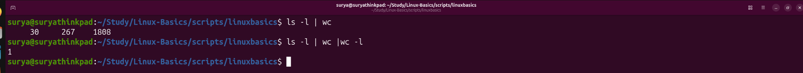

**What you see (from the screenshot):**

| Step | Command | Output | Meaning |
| :---: | :--- | :--- | :--- |
| 1 | `ls -l \| wc` | `30  267  1808` | **`wc`** counted the **whole `ls -l` listing**: **30 lines**, **267 words**, **1808 bytes/characters** |
| 2 | `ls -l \| wc \| wc -l` | `1` | The **middle `wc`** prints **one summary line** (`30 267 1808`). The **last `wc -l`** only counts **lines in that one line** → always **`1`** |

**Point by point:**

1. **`ls -l`** sends a **multi-line** listing to the pipe (one line per file/dir, plus the **`total`** line).
2. **First `wc`** (no flags) reads that listing from **stdin** and prints **three numbers**: lines, words, characters.
3. That **single line** of three numbers becomes the **input** to the **next** command in the chain.
4. **`wc -l`** at the end counts **how many lines** it received — here **one line**, so output is **`1`**.
5. This is **not** “30 files”; it is “**one line** of `wc` statistics.” To count **files**, use something like `ls -l | grep -v '^total' | wc -l` (later topic) or count entries another way.

**Another long pipeline (class pattern):**

```bash
cat data.txt | sort | uniq | wc -l
```

Read left to right: **read file → sort → unique → count lines**.

---

## 8. Pipe carries stdout only (not stderr)

**Pipe connects stdout (1) to stdin (0).**  
**Stderr (2) is not piped** unless you redirect it separately (`2>`) or merge streams (`&>`).

```bash
cal 99999 | wc -l
```

The **error message** still appears on the **terminal**; **`wc`** may get **no** useful calendar output.

**Lab command:**

```bash
bash scripts/PipingTeeXargs/pipe-stdout-only-not-stderr-demo.sh
```

---

## 9. When piping “breaks” — `>` before `|`

**Rule:** For one command, **stdout goes either to a file (`>`) or into a pipe (`|`) — not both at once.**  
If you put **`>`** on the left command, its output is **saved in the file** and **nothing** is left on stdout for the **`|`** to carry forward.

That is why Durga Sir shows **`wc -l`** printing **`0`** on a long-looking pipeline — the count command received **no lines** from the pipe, even though the **file** later has hundreds of lines.

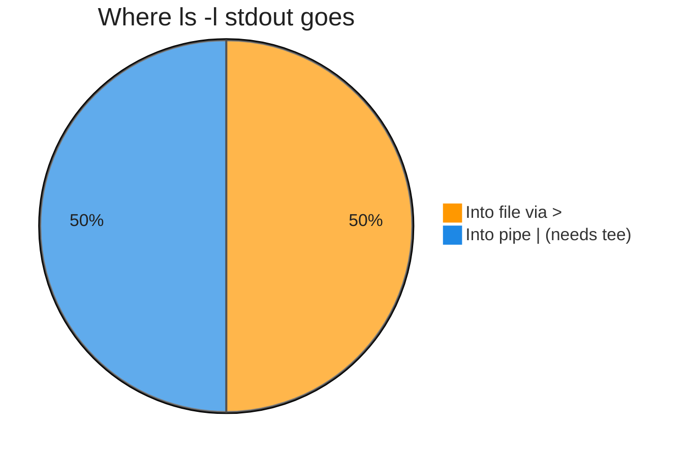

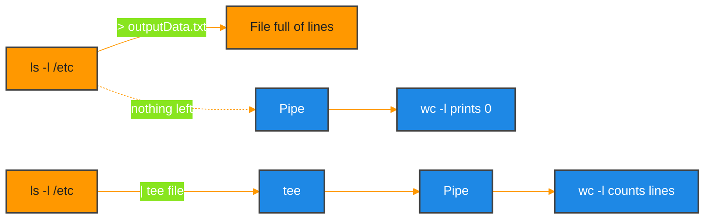

### Your lab — broken pipe vs correct count (`scripts/linuxbasics`)

Use **`outputData.txt`** from [redirection.md §15](redirection.md#15-lab--add-and-remove-data-in-a-file-outputdatatxt).

**Step A — piping looks connected, but count is `0`:**

```bash
cd scripts/linuxbasics
ls -l > outputData.txt | cat outputData.txt | wc -l
ls -l /etc > outputData.txt | cat outputData.txt | wc -l
```

| # | What happens |
| :---: | :--- |
| 1 | **`ls -l`** (or **`ls -l /etc`**) runs with **`> outputData.txt`** |
| 2 | **All listing output** goes **into the file** — stdout is **not** sent to the pipe |
| 3 | The **`|`** still runs the next commands, but they get **empty stdin** from that stage |
| 4 | **`wc -l`** counts lines from the pipe → **`0`** |

**Step B — prove the file is not empty:**

```bash
cat outputData.txt
```

You see the full listing (e.g. **`total 1208`** and many lines under **`/etc`**). The redirect **worked**; only the **pipe** had no data.

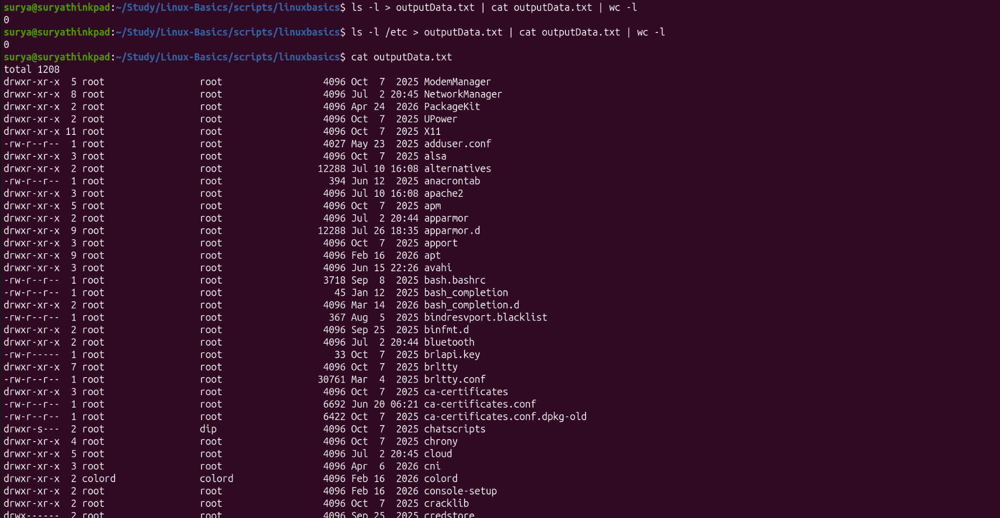

**Step C — run the right steps separately (pipe works):**

```bash
cat outputData.txt | wc -l
```

| # | What happens |
| :---: | :--- |
| 1 | **`cat outputData.txt`** reads the **file** and sends lines to **stdout** |
| 2 | **`|`** connects that stdout to **`wc -l`** |
| 3 | Output is the real line count (example from lab: **`246`**) |

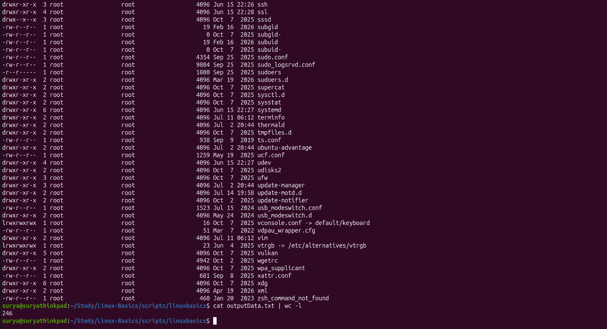

**Step D — when you need both a file and a pipe:**

Do **not** write `cmd > file | other`. Use **`tee`** (next section):

```bash
ls -l /etc | tee outputData.txt | wc -l
```

---

## 10. `tee` — write to file and screen

After [§9](#9-when-piping-breaks--before-), you know **`cmd > file | other`** does **not** pass listing data through the pipe. **`tee`** is Durga Sir’s answer: **save to a file** and **keep the pipeline alive** at the same time.

### Durga Sir — class notes (`tee` command)

**Example from the board:**

```bash
ls -l | tee output.txt | wc
```

**Definition (wording from class):**

> In piping, if we want to **save the output of one command to a file** and we want to **pass that same output as input to the next command simultaneously**, we should use the **`tee`** command.

| Piece | Role |
| :--- | :--- |
| **`ls -l`** | Produces listing on **stdout** |
| **`| tee output.txt`** | **Copies** that stream → **file** **and** → stdout for the rest of the pipe |
| **`| wc`** | Reads the **same** listing lines from stdin (counts lines/words/bytes) |

**Not valid for this goal:** `ls -l > output.txt | wc` — redirect eats stdout; pipe gets nothing ([§9](#9-when-piping-breaks--before-)).

### Continuation — **eg1:** terminal only, file only, or both (`tee`)

Durga Sir compares three cases before putting **`tee`** in the middle of a pipe:

| Case | Command | Where does `ls -l` output go? |
| :---: | :--- | :--- |
| **A** | `ls -l` | **Terminal only** — you see the listing on screen; **no** file |
| **B** | `ls -l > output.txt` | **File only** — saved in **`output.txt`**; **not** shown on the terminal (stdout was redirected) |
| **C** | `ls -l \| tee output.txt \| wc -l` | **File and pipe** — copy in **`output.txt`**, **same** lines also go to **`wc -l`** (and you still see **`wc`**’s result on screen) |

**Class wording for case B:** *“It will save the output to `output.txt` and won’t be displayed to the terminal.”*

**Why `tee` exists:** Case **B** is what you want for **archiving**, but it **cannot** feed **`wc`** in the same line. Case **C** is the fix: **save** and **continue the pipeline** together.

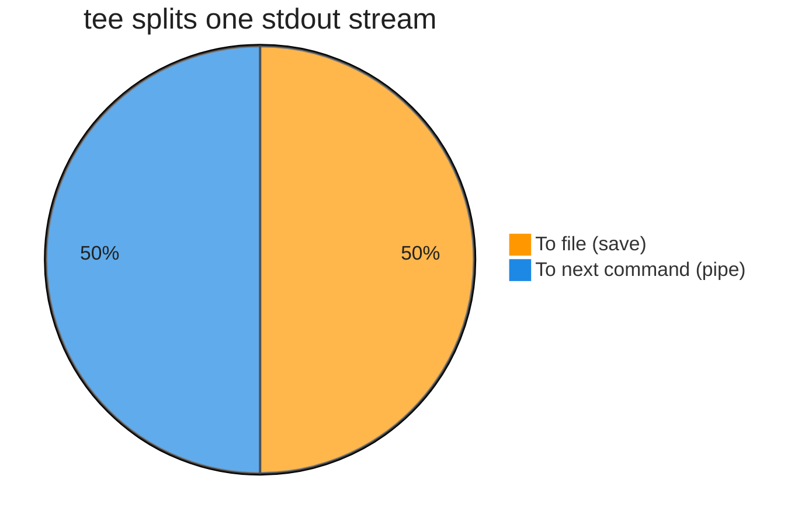

### T-pipe picture (Durga Sir diagram — recreated)

Think of a **T-junction** in plumbing: water enters from the **left**, most continues **straight** to the right, and a branch goes **down** into a **tank** (your file).

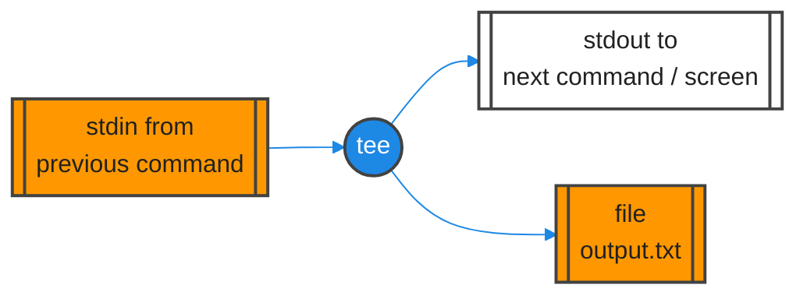

| Arrow in class slide | Meaning |
| :--- | :--- |
| **Into left of pipe** | Output of **`ls`** (or any command) enters **`tee`** |
| **Out to the right** | Same data continues to **`wc`**, **`head`**, etc. |
| **Down the branch** | Same data is **written** to **`output.txt`** |

### Flowchart — `ls | tee abc.txt | wc` (board version)

Durga Sir’s second diagram labels each leg in blue:

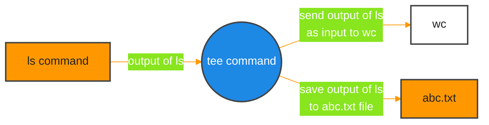

**Point by point:**

1. **`ls`** (or **`ls -l`**) runs once — one stream of text lines.  
2. **`tee abc.txt`** is the **T** — it does **not** consume the data; it **duplicates** it.  
3. **Downward branch** → file **`abc.txt`** holds a **copy** of the listing.  
4. **Rightward branch** → **`wc`** receives a **copy** as **stdin** and prints counts.  
5. Replacing **`tee`** with **`>`** breaks step 4 — that is exactly the **`0`** vs **`246`** lab in [§9](#9-when-piping-breaks--before-).

### Your lab — `ls -l /etc | tee outputData.txt | wc -l` (`scripts/linuxbasics`)

```bash
cd scripts/linuxbasics
ls -l /etc | tee outputData.txt | wc -l
cat outputData.txt
```

| Step | What you should see |
| :--- | :--- |
| **`ls -l /etc \| tee outputData.txt \| wc -l`** | **`246`** on screen — the pipe still works; **`tee`** wrote to the file **and** passed lines to **`wc -l`** |
| **`cat outputData.txt`** | Full **`/etc`** listing in the file (starts with **`total 1208`**, then `ModemManager`, `NetworkManager`, …) — proof the **same** data was saved while the pipeline ran |

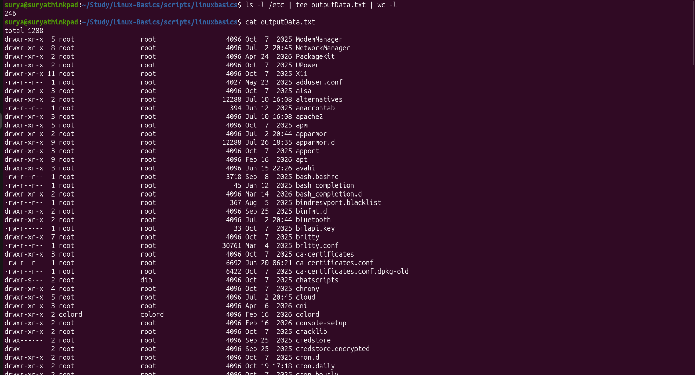

Compare with §9: `ls -l /etc > outputData.txt | wc -l` → **`0`**; with **`tee`** → **`246`**.

### What your lab terminal shows (tee piping — read without re-running)

Walk through the same session as the screenshot above:

1. **`ls -l /etc | tee outputData.txt | wc -l`**  
   - **`ls -l /etc`** produces a long listing (hundreds of lines).  
   - **`tee outputData.txt`** writes **every line** into **`outputData.txt`** **and** forwards the **same** stream to the next stage.  
   - **`wc -l`** counts lines from the pipe → you see **`246`** on the terminal. That number is **not** “zero” like the broken **`>`** lab in §9.

2. **`cat outputData.txt`** (after the pipeline finishes)  
   - Proves the file was filled **during** the pipe, not in a separate step.  
   - First line is **`total 1208`** (blocks for **`/etc`**), then directory entries such as **`ModemManager`**, **`NetworkManager`**, **`PackageKit`**, **`UPower`**, **`X11`**, config files, etc.  
   - The line count from **`wc -l`** and the **`cat`** listing describe the **same** data — one went through the pipe, one sits in the file.

3. **Tee vs redirect in one line**  
   - **`>`** = “send stdout **only** to file” → nothing left for **`| wc`**.  
   - **`tee`** = “**copy** to file **and** keep stdout for **`| wc`**” → **`246`** plus a full **`outputData.txt`**.

### More `tee` options (quick reference)

**Screen + file (default `tee`):**

```bash
ls -l | tee listing.txt
```

**Append — `tee -a`:**

```bash
echo "line 1" | tee log.txt
echo "line 2" | tee -a log.txt
```

**Multiple files:**

```bash
echo "report" | tee file1.txt file2.txt
```

**Repo demo scripts:**

```bash
bash scripts/PipingTeeXargs/tee-screen-and-file-demo.sh
bash scripts/PipingTeeXargs/tee-append-multiple-files-demo.sh
```

---

## 11. Tee with multiple files

After [§10](#10-tee--write-to-file-and-screen), **`tee`** saves the **listing** while the pipe continues. This lab adds a **second file**: redirect **`wc`**’s stdout so you keep **both** the **`ls -l`** copy and the **word-count** result.

### Durga Sir — requirement (class)

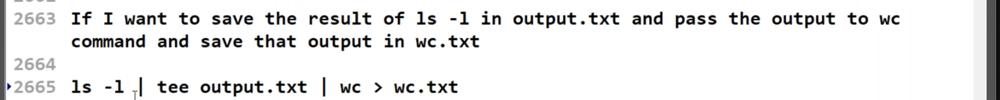

**Requirement (wording from class):**

> If I want to save the result of **`ls -l`** in **`output.txt`** and pass the output to **`wc`** command and save that output in **`wc.txt`**

**Command from the board:**

```bash
ls -l | tee output.txt | wc > wc.txt
```

| Piece | Role |
| :--- | :--- |
| **`ls -l`** | Produces the listing on stdout |
| **`| tee output.txt`** | Writes that listing to **`output.txt`** and passes the **same** lines to **`wc`** |
| **`| wc`** | Reads the listing from the pipe; prints line/word/byte counts on stdout |
| **`> wc.txt`** | Sends **`wc`**’s output **only** to **`wc.txt`** (not to the terminal) |

You end with **two files**: **`output.txt`** (full listing) and **`wc.txt`** (three numbers from **`wc`**). That is different from [§10](#10-tee--write-to-file-and-screen) where **`wc -l`** printed **`246`** on screen — here the **last** stage uses **`>`**, so verify with **`cat wc.txt`**.

### Lab test evidence — `scripts/linuxbasics`

Same pipeline in the repo lab folder (file names match your terminal):

```bash
cd scripts/linuxbasics
ls -l | tee outputData.txt | wc > wordCount.txt
cat wordCount.txt
```

| Step | What you should see |
| :--- | :--- |
| **`ls -l \| tee outputData.txt \| wc > wordCount.txt`** | **No** listing on screen — **`tee`** filled **`outputData.txt`** in the background; **`wc`**’s result went to **`wordCount.txt`** |
| **`cat wordCount.txt`** | One line of counts, e.g. **`33 294 1976`** → **33** lines, **294** words, **1976** bytes for the **`ls -l`** listing in that directory |


Optional check: **`cat outputData.txt`** shows the **`ls -l`** lines that **`tee`** saved while **`wc`** ran on the pipe.

### Concept — multiple `tee` with piping (how it fits together)

**Piping** moves data **left → right**: each command reads **stdin**, writes **stdout**, and **`|`** connects stdout of command *N* to stdin of command *N+1*.

**`tee`** sits **inside** that chain. It does **not** “use up” the stream like **`>`** does. For every line (or byte chunk) it receives, it:

1. **Writes** a copy to one or more **files** (arguments to **`tee`**), and  
2. **Forwards** the **same** data to **stdout** so the **rest of the pipe** still works.

So “multiple tee” in Durga Sir’s session means two related ideas:

| Idea | What it means | Example |
| :--- | :--- | :--- |
| **Several files from one `tee`** | One **`tee`** can open **many** file names; each gets the **same** snapshot of the stream **at that point** | `cmd \| tee a.txt b.txt \| wc` |
| **Several `tee` commands in one pipeline** | Each **`tee`** is at a **different stage** — it logs **whatever output exists there** (listing vs counts vs filtered text) | `ls -l \| tee list.txt \| wc \| tee counts.txt` |

**Mental model — two T-junctions in one line:**

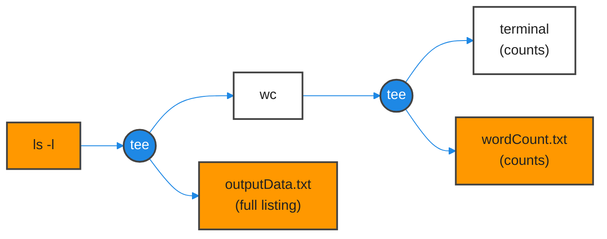

**Rules that stay true no matter how many `tee`s you use:**

- **`tee` only sees upstream output** — the **first** `tee` never sees **`wc`**’s numbers; the **second** `tee` never sees the raw **`ls -l`** lines unless you saved them earlier.
- **Order of commands still matters** — `ls | sort | tee sorted.txt | uniq` saves **sorted** lines, not the original order.
- **`>` at the end** sends **only** to a file (silent screen). **`tee` at the end** sends to **file and screen** ([§10](#10-tee--write-to-file-and-screen) vs this section).
- **Pipe + `tee` + redirect** can mix: `… | tee mid.txt | wc > end.txt` uses **`tee`** for the middle snapshot and **`>`** for the final file.

### Worked examples (multiple `tee` / multiple destinations)

**Example 1 — class board: two files, no screen for `wc`**

```bash
ls -l | tee output.txt | wc > wc.txt
# cat output.txt   → full listing
# cat wc.txt       → one line: lines words bytes
```

**Example 2 — lab: same, different file names**

```bash
ls -l | tee outputData.txt | wc > wordCount.txt
```

**Example 3 — second `tee`: save counts and show them**

```bash
ls -l | tee outputData.txt | wc | tee wordCount.txt
# wordCount.txt and terminal both show e.g. 33 294 1976
```

**Example 4 — one `tee`, two listing files (same stage)**

From [§10](#10-tee--write-to-file-and-screen) — duplicate **without** a second `tee`:

```bash
ls -l | tee copy1.txt copy2.txt | wc -l
```

Both **`copy1.txt`** and **`copy2.txt`** get the **same** `ls -l` output; **`wc -l`** still runs on the pipe.

**Example 4 (lab) — one `tee`, ten files with brace expansion**

**`tee`** accepts **more than two** file operands. Bash **brace expansion** `{1..10}` builds many names in one shot:

```bash
cd scripts/linuxbasics
cat inputData.txt | tee file{1..10}.txt
ls
```

| Piece | Role |
| :--- | :--- |
| **`cat inputData.txt`** | Sends the list file’s contents to stdout (e.g. `filedata.txt`, `fileinfo.txt`, `logfile.sh`) |
| **`tee file{1..10}.txt`** | Expands to **`file1.txt` … `file10.txt`** — **same** text copied into **all ten** files |
| **Terminal** | **`tee`** also prints that stream on screen (three lines in the lab screenshot) |
| **`ls`** | Confirms **`file1.txt`–`file10.txt`** were created alongside existing lab files |

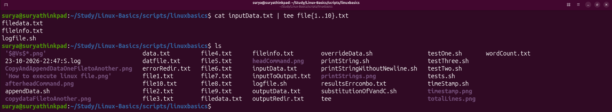

**Caution:** **`tee`** **overwrites** each target file (unless you use **`tee -a`**). Here every **`fileN.txt`** gets an identical copy of **`inputData.txt`**’s contents — useful for demos; in real scripts, pick names you intend to replace.

**Example 5 — `tee` after a filter (snapshot of *processed* data)**

```bash
cat marks.txt | sort | tee sorted-snapshot.txt | uniq -c | tee summary.txt
```

| File | Contents |
| :--- | :--- |
| **`sorted-snapshot.txt`** | Lines **after** **`sort`**, **before** **`uniq -c`** |
| **`summary.txt`** | Final **`uniq -c`** table (and terminal if you omit a final **`>`**) |

**Example 6 — debug a long pipe (log intermediate steps)**

```bash
ls -l /etc | tee step1-listing.txt | head -20 | tee step2-head20.txt | wc -l
```

You keep **full listing**, **first 20 lines**, and still get a **line count** of those 20 on screen — three “checkpoints” in one run.

**Example 7 — append a run log with `tee -a`**

```bash
date | tee -a pipeline.log
ls -l | tee -a pipeline.log listing.txt | wc | tee -a pipeline.log counts.txt
```

**`tee -a`** adds to **`pipeline.log`** without wiping earlier lines ([§10](#10-tee--write-to-file-and-screen) quick reference).

### Using `tee` more than once in the same pipeline

You are **not** limited to a single **`tee`** per command line. Each **`tee`** is another **T-junction**: it can **write a file** at that stage **and** keep stdout flowing to the next command.

**Pattern A — save `wc` with redirect (silent on screen):**

```bash
ls -l | tee outputData.txt | wc > wordCount.txt
cat wordCount.txt    # e.g. 33 294 1976
```

**Pattern B — second `tee` after `wc` (file + screen for the counts):**

```bash
ls -l | tee outputData.txt | wc | tee wordCount.txt
```

| Compare | What happens to **`wc`** output |
| :--- | :--- |
| **`wc > wordCount.txt`** | Goes **only** to the file — **nothing** from **`wc`** on the terminal |
| **`wc \| tee wordCount.txt`** | **Copied** to **`wordCount.txt`** **and** printed on the terminal (**`33 294 1976`**) |

**Points to remember:**

1. **First `tee`** — usually captures **early** pipeline output (here, the full **`ls -l`** listing in **`outputData.txt`**).
2. **Second `tee`** — can capture a **later** stage (here, the **three numbers** from **`wc`** in **`wordCount.txt`**) without breaking the pipe.
3. **`tee`** can appear **multiple times**; order matters — each **`tee`** only sees what reached that point in the chain.
4. Use **`>`** on the **last** step when you want a file **and** no terminal output; use **`tee`** on the last step when you want **file and screen** together.
5. Same lab folder: **`scripts/linuxbasics`** — run both patterns and compare what appears on screen.

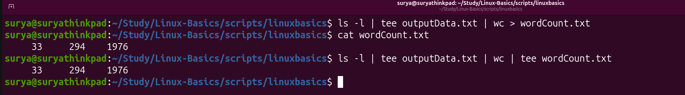

---

## 12. Combine two listings — save merged file and reverse-sorted copy (`tee`)

Durga Sir uses this problem **after** [§11](#11-tee-with-multiple-files): you already have two saved listings; you need a **merged** copy **and** a **reverse-sorted** copy — without losing the unsorted merge on disk.

### Class — question (two-step vs one pipeline)

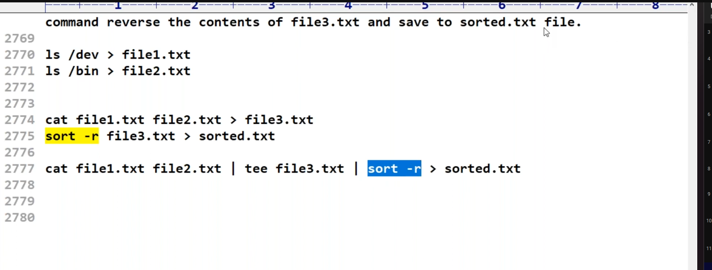

**Step 0 — create the two source files:**

```bash
ls /dev > file1.txt
ls /bin > file2.txt
```

| File | Contents |
| :--- | :--- |
| **`file1.txt`** | One name per line from **`/dev`** |
| **`file2.txt`** | One name per line from **`/bin`** |

**Goal:** Concatenate both lists into **`file3.txt`**, then produce **`sorted.txt`** with names in **reverse** order (**`sort -r`**).

**Method A — two commands, intermediate file read again:**

```bash
cat file1.txt file2.txt > file3.txt
sort -r file3.txt > sorted.txt
```

| Step | What happens |
| :--- | :--- |
| **`cat … > file3.txt`** | **Merged** listing saved; stdout went **only** to **`file3.txt`** (nothing left for a pipe) |
| **`sort -r file3.txt > sorted.txt`** | **`sort`** reads **`file3.txt`** from disk; reverse-sorted result in **`sorted.txt`** |

Works, but you **run two steps** and **`sort`** must **open `file3.txt`** again.

**Method B — one pipeline with `tee` (class answer):**

```bash
cat file1.txt file2.txt | tee file3.txt | sort -r > sorted.txt
```

| Piece | Role |
| :--- | :--- |
| **`cat file1.txt file2.txt`** | Streams **dev names**, then **bin names**, on stdout |
| **`| tee file3.txt`** | Writes that **same** merged stream to **`file3.txt`** **and** passes it on |
| **`| sort -r`** | Sorts the piped lines in **reverse** order |
| **`> sorted.txt`** | Saves sorted output to **`sorted.txt`** (not to the terminal) |

**Why `tee` here:** You need **`file3.txt`** (unsorted merge) **and** **`sorted.txt`** (sorted merge) from **one** run of **`cat`**. Redirect-only **`>`** after **`cat`** would fill **`file3.txt`** but **break** the pipe to **`sort`** — same lesson as [§9](#9-when-piping-breaks--before-).

### Lab test evidence — `scripts/linuxbasics` (answer)

Same pattern with lab file names (your terminal):

```bash
cd scripts/linuxbasics
ls /dev > devfiles.txt
ls /bin > binfiles.txt
cat devfiles.txt binfiles.txt | tee alltypefiles.txt | sort -r > sorted.txt
head -5 alltypefiles.txt
tail -5 alltypefiles.txt
wc alltypefiles.txt
```

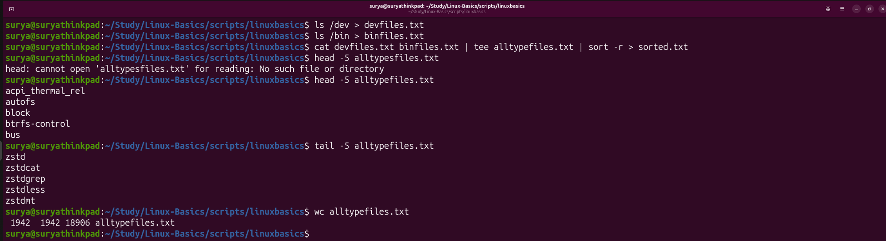

| Check | Expected |
| :--- | :--- |
| **`alltypefiles.txt`** | **Combined** `/dev` + `/bin` names in **cat order** (not sorted) — e.g. **`head`** shows early **`/dev`** entries like `acpi_thermal_rel`, `autofs`, … |
| **`sorted.txt`** | **Same lines**, **reverse-sorted** — not shown in full in the screenshot; created by **`sort -r`** on the pipe |
| **`tail -5 alltypefiles.txt`** | End of **unsorted** merge (lab shows names like `zstd`, `zstdcat`, … from the **`/bin`** side) |
| **`wc alltypefiles.txt`** | Lab example: **`1942` lines** — both directories contributed many entries |
| **Typo note** | `head -5 alltypesfiles.txt` fails (extra **`s`**); correct name is **`alltypefiles.txt`** |

Repo copies (for study without re-running **`ls /dev`**): [`devfiles.txt`](../../scripts/linuxbasics/devfiles.txt), [`binfiles.txt`](../../scripts/linuxbasics/binfiles.txt), [`alltypefiles.txt`](../../scripts/linuxbasics/alltypefiles.txt), [`sorted.txt`](../../scripts/linuxbasics/sorted.txt).

---

## 13. Reason for `xargs`

**Video (Session 12):** [Piping and importance of `tee` and `xargs`](https://www.youtube.com/watch?v=Ko3VktocAQw&list=PLd3UqWTnYXOloH0vWBs4BtSbP84WcC2NY&index=12) — Durga Sir introduces **`xargs`** after **`tee`** because **piping** and **command-line arguments** are not the same thing.

### Durga Sir — class notes (why `xargs` is needed)

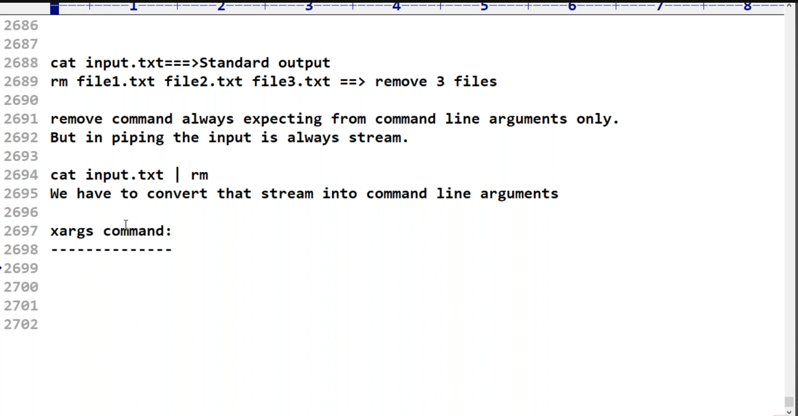

| Example | How input is delivered |
| :--- | :--- |
| **`cat input.txt`** | Reads the file; writes contents to **standard output** (a **stream**) |
| **`rm file1.txt file2.txt file3.txt`** | **`rm`** expects **file names on the command line** — **arguments** (`argv`), not stdin |

**Key lines from class:**

- Commands like **`rm`** are written to take **operands from the command line only** (arguments after the command name).
- In a **pipe**, the next command’s input is always a **stream** on **stdin** — not the same as **`argv`**.

**What does *not* work:**

```bash
cat input.txt | rm
```

You are sending a **stream** into **`rm`**, but **`rm`** does **not** read file names from stdin to delete them. You must **convert that stream into command-line arguments**. That conversion is the job of **`xargs`**.

```bash
cat input.txt | xargs rm
```

(Only use **`rm`** with **`xargs`** when you are sure every line in the file is a file you intend to delete — see [§14](#14-xargs--build-command-lines-from-stdin).)

### Lab test evidence — `cat … | rm` fails (`scripts/linuxbasics`)

In the lab folder, the same idea is shown on a real terminal:

```bash
cd scripts/linuxbasics
ls
cat inputData.txt | rm
```

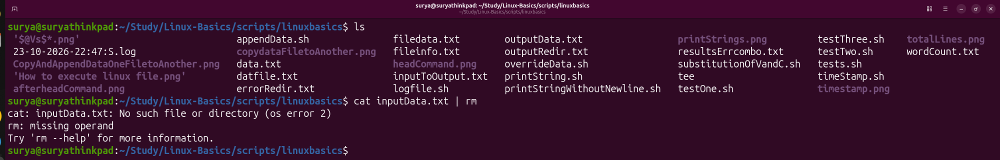

| What the lab shows | Meaning |
| :--- | :--- |
| **`ls`** | Files in **`scripts/linuxbasics`** (scripts, **`outputData.txt`**, **`wordCount.txt`**, etc.) |
| **`cat inputData.txt \| rm`** | **`rm: missing operand`** — **`rm`** got **no** file names as **arguments**; the pipe does **not** turn stream text into **`rm file1 file2`** automatically |
| **`cat: inputData.txt: No such file or directory`** (if shown) | Fix the file name for your lab (e.g. create **`inputData.txt`** with one file name per line) — the **`rm`** error still illustrates the **xargs** lesson |

**Takeaway:** Piping works for commands that **read stdin** (`wc`, `sort`, `head`). Commands that only accept **argv** (`rm`, `touch`, `mv`, …) need **`xargs`** (or similar) to turn **lines from a pipe** into **arguments**.

---

## 14. `xargs` — build command lines from stdin

After [§13](#13-reason-for-xargs), the rule is clear: **`xargs`** reads **stdin** (lines or words) and **builds command-line arguments** for the next command (default command is **`echo`** if you omit one).

**Durga Sir definition:** **`xargs`** is used to **convert the output stream into command-line arguments**.

**Problem (recap):** Some commands want **file names as arguments** (`touch a b c`, `wc file1 file2`), but a pipe gives **stdin**, not **`argv`**.

### Durga Sir — how `xargs` turns a stream into `rm` arguments (class summary)

Board flow (no extra screenshot — same idea as [§13](#13-reason-for-xargs), step 2):

1. **`input.txt`** holds one file name per line, for example:
   ```text
   file1.txt
   file2.txt
   file3.txt
   ```
2. **`cat input.txt |`** sends those lines as a **stream** on the pipe (not as **`rm`** arguments yet).
3. **`xargs`** reads that stream and **builds command-line arguments** for the next command.
4. The shell effectively runs:
   ```bash
   rm file1.txt file2.txt file3.txt
   ```
   — **`rm`** still receives **operands on the command line**; **`xargs`** is only the **adapter** between **pipe (stdin)** and **`argv`**.

**Correct pipeline from class:**

```bash
cat input.txt | xargs rm
```

| Step | What happens |
| :--- | :--- |
| **`cat input.txt`** | Prints the three names to stdout |
| **`| xargs`** | Collects them (by default, whitespace-separated lines/words) |
| **`rm`** | Gets **`file1.txt file2.txt file3.txt`** as **arguments** and deletes those files |

Related class example (limit how many names per **`rm`** invocation): `cat input.txt | head -3 | xargs rm` — only the **first three lines** from the file are passed to **`rm`**.

### Lab test evidence — `inputData.txt` and `xargs rm` (`scripts/linuxbasics`)

**Step 1 — create targets and build the list file**

```bash
cd scripts/linuxbasics
touch file{1..5}.txt
ls
gedit inputData.txt
```

In **`inputData.txt`**, put one name per line (lab screenshot):

```text
file1.txt
file2.txt
file3.txt
file4.txt
file5.txt
```

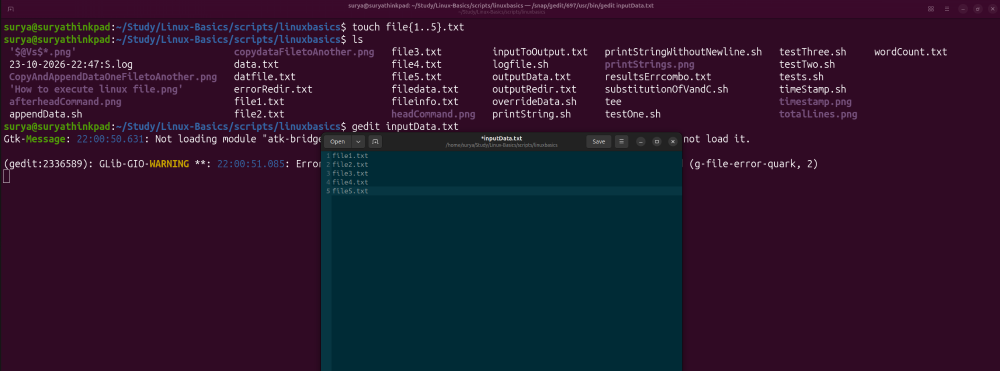

**Step 2 — delete via pipe + `xargs`**

```bash
cat inputData.txt | xargs rm
cat inputData.txt
ls
```

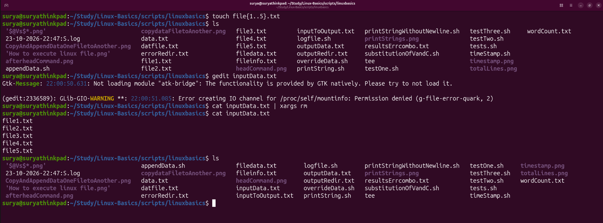

| Check | Expected |
| :--- | :--- |
| **`ls`** after **`xargs rm`** | **`file1.txt` … `file5.txt`** are **gone** from the directory |
| **`cat inputData.txt`** | Still shows **`file1.txt` … `file5.txt`** as **text lines** |

**Discussion (lab screenshot 4):**

**Durga Sir — what `xargs` does (one line):** The **`xargs`** command is to **convert the output stream** (data coming through the pipe on **stdin**) **into command-line arguments** for the next command — here, so **`rm`** receives **`file1.txt file2.txt …`** as **argv**, not as a raw stream.

1. **`cat inputData.txt | xargs rm`** — **`cat`** sends the five lines as an **output stream**; **`xargs`** **converts that stream into command-line arguments**; **`rm`** then deletes **`file1.txt` … `file5.txt`**. Same idea as the board: stream → **`xargs`** → **`rm file1 … file5`**.
2. **`cat inputData.txt` right after `rm`** — you still see all five names printed. **That is correct and expected.** **`inputData.txt`** is only a **text list** (strings in a file). It is **not** tied to whether those files still exist on disk.
3. **`rm` does not update the list file** — deleting files removes **directory entries**; it does **not** remove or edit lines inside **`inputData.txt`**. Nothing in `cat … | xargs rm` writes back to **`inputData.txt`**.
4. **`ls` vs `cat inputData.txt`** — **`ls`** proves the **files are gone**; **`cat inputData.txt`** proves the **saved list is unchanged**. Both results together are normal for this lab.
5. **If you want an empty list after delete** — that is a **separate** step, for example `> inputData.txt`, `gedit inputData.txt`, or `sed -i` to edit the file. **`xargs rm` alone will not do that.**

**FAQ (same point in one line):** After **`rm`**, names still in **`inputData.txt`**? **Yes — normal.** Clear or edit the list file yourself if you no longer want those lines saved.

### Example 1 — create files from a word list

```bash
echo "apple banana cherry" | xargs touch
```

Creates **`apple`**, **`banana`**, **`cherry`**.

### Example 2 — `xargs -n`

Run command with **at most N arguments** per invocation:

```bash
printf 'one two three four\n' | xargs -n 2 echo
```

### Example 3 — pipe file list into `wc`

```bash
ls /path/to/scripts/*.sh | xargs wc -l
```

Each path becomes an argument to **`wc -l`**.

Durga Sir warning: **`find … | xargs rm`** is dangerous — wrong matches delete files. Always test with **`echo`** first.

**Lab commands:**

```bash
bash scripts/PipingTeeXargs/xargs-build-command-line-demo.sh
bash scripts/PipingTeeXargs/xargs-with-find-style-demo.sh
```

---

## 15. eg2 — display contents of files named in an input file

**Durga Sir — class (eg2):**

> Assume **`input.txt`** contains **multiple file names**. Read all these file names from **`input.txt`** and **display the files’ content** to the terminal.

**Setup on the board:**

```bash
cat input.txt
```

Example contents:

```text
a.txt
b.txt
c.txt
```

**Manual way** (type every name as an argument):

```bash
cat a.txt b.txt c.txt
```

**With piping + `xargs`** (names come from the list file; **`xargs`** converts the stream into **`cat`** arguments):

```bash
cat input.txt | xargs cat
```

| Step | Role |
| :--- | :--- |
| **`cat input.txt`** | Prints file names to stdout — a **stream** of lines |
| **`| xargs`** | Converts that stream into **command-line arguments** ([§14](#14-xargs--build-command-lines-from-stdin)) |
| **`cat`** (second) | Runs like **`cat a.txt b.txt c.txt`** — prints **each file’s contents** to the terminal, one after another |

Same pattern as **`cat input.txt | xargs rm`** in [§14](#14-xargs--build-command-lines-from-stdin), but the command after **`xargs`** is **`cat`** (read/display) instead of **`rm`** (delete).

### Lab test evidence — `inputData.txt` and `xargs cat` (`scripts/linuxbasics`)

**Step 1 — put target file names in the list file**

```bash
cd scripts/linuxbasics
cat inputData.txt    # optional: see current list
gedit inputData.txt
```

For this lab, **`inputData.txt`** lists files that **have content** (example from your terminal):

```text
filedata.txt
fileinfo.txt
logfile.sh
```

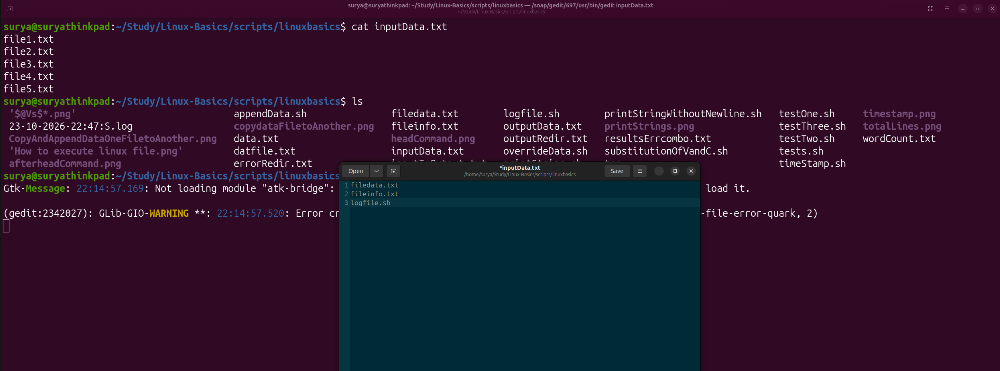

**Step 2 — read every listed file in one command**

```bash
cat inputData.txt | xargs cat
```

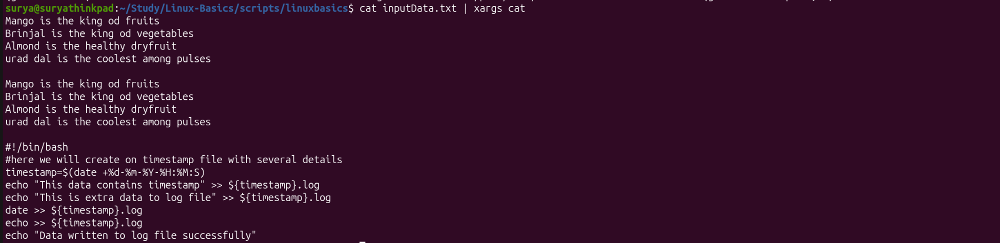

| What you see on screen | Meaning |
| :--- | :--- |
| Repeated lines from **`filedata.txt`** / **`fileinfo.txt`** | **`xargs cat`** passed those paths to **`cat`**; output is **file contents**, not file names |
| **`logfile.sh`** script body (`#!/bin/bash`, `timestamp=…`, etc.) | Third argument from the list — **`cat`** prints the script source like any text file |

**Note:** If a name in **`inputData.txt`** is wrong or the file is missing, **`cat`** reports an error for that operand. Keep **one file name per line** and paths relative to **`scripts/linuxbasics`** (or use full paths in the list).

---

## 16. Printing `date` and `cal` with `xargs echo`

After [§15](#15-eg2--display-contents-of-files-named-in-an-input-file), you have seen **`xargs`** turn a **stream** into **arguments** for **`cat`** and **`rm`**. The same idea works with **`echo`** — useful because **`echo` does not read stdin** from a pipe.

| Command | Why `xargs`? |
| :--- | :--- |
| **`date \| echo`** | **`echo`** ignores the pipe → **no** date on screen |
| **`date \| xargs echo`** | **`xargs`** passes the date string as **arguments** to **`echo`** → date prints |

**Lab — `scripts/linuxbasics`:**

```bash
cd scripts/linuxbasics
date | xargs echo
cal | xargs echo
```

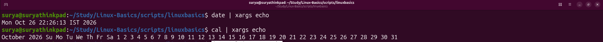

| Command | What you see |
| :--- | :--- |
| **`date \| xargs echo`** | One line, e.g. **`Mon Oct 26 22:26:13 IST 2026`** — same idea as **`date \| xargs`** (default command is **`echo`**) |
| **`cal \| xargs echo`** | **One long line** — month title, weekday headers, and all day numbers in a single row (grid newlines removed) |

**Points:**

1. **`xargs`** reads **stdout** from **`date`** or **`cal`** and builds **`echo`**’s argument list — that is **stream → command-line arguments** again ([§14](#14-xargs--build-command-lines-from-stdin)).
2. For **`date`**, you usually run **`date`** alone; **`xargs echo`** is a **small demo** of the mechanism, not required in daily use.
3. For **`cal`**, **`cal | xargs echo`** **destroys** the calendar layout — use plain **`cal`** when you want the normal grid. The lab shows what **`xargs`** does to **multi-line** input (whitespace and newlines become argument separators).
4. Do **not** write **`date cal | xargs echo`** — the shell does not run two commands like that; run **`date`** and **`cal`** separately, or use **`{ date; cal; } | xargs echo`** only if you intentionally want **both** outputs mashed into one line.

---

## 17. Pipe vs redirection vs `tee`

| Mechanism | Symbol / command | Connects to |
| :--- | :--- | :--- |
| **Pipe** | **`|`** | **Next command’s stdin** |
| **Redirect** | **`>`**, **`>>`**, **`2>`** | **File** |
| **tee** | **`tee file`** | **Terminal and file(s)** at once |

Combine when needed:

```bash
ls -l /etc | tee etclist.txt | wc -l
```

---

## 18. Session checklist

- [ ] Explain **three** output destinations: terminal, file, **pipe**
- [ ] Run `ls -l /etc | head` and `ls -l /etc | wc -l`
- [ ] Run `cat marks.txt | sort | uniq` and `uniq -c`
- [ ] Show `cal 99999 | wc -l` — error on screen, pipe does not carry stderr
- [ ] Run `ls -l | tee listing.txt` and confirm file + screen
- [ ] Run `ls -l | tee output.txt | wc > wc.txt` (or lab: `outputData.txt` / `wordCount.txt`) and `cat` both files
- [ ] Run `ls -l | tee outputData.txt | wc | tee wordCount.txt` and confirm counts on screen **and** in the file
- [ ] Run `cat devfiles.txt binfiles.txt | tee alltypefiles.txt | sort -r > sorted.txt` ([§12](#12-combine-two-listings--save-merged-file-and-reverse-sorted-copy-tee))
- [ ] Explain why `cat file | rm` fails and what `xargs` fixes ([§13](#13-reason-for-xargs))
- [ ] Lab: `touch file{1..5}.txt`, list names in `inputData.txt`, run `cat inputData.txt | xargs rm`, confirm files gone but list file unchanged ([§14](#14-xargs--build-command-lines-from-stdin))
- [ ] Run `cat inputData.txt | xargs cat` (eg2 — [§15](#15-eg2--display-contents-of-files-named-in-an-input-file))
- [ ] Run `date | xargs echo` and `cal | xargs echo`; compare with plain `date` and `cal` ([§16](#16-printing-date-and-cal-with-xargs-echo))
- [ ] Run `echo "a b c" | xargs touch`
- [ ] Run `bash scripts/PipingTeeXargs.sh`
- [ ] Add lab **screenshots** under each block after class (same workflow as `redirection.md`)

---

## 19. Script index

| Script | Topic |
| :--- | :--- |
| [`PipingTeeXargs.sh`](../../scripts/PipingTeeXargs.sh) | Run all Session 12 demos |
| [`pipe-ls-head-wc-demo.sh`](../../scripts/PipingTeeXargs/pipe-ls-head-wc-demo.sh) | `ls \| head`, `ls \| wc -l` |
| [`pipe-filters-sort-uniq-demo.sh`](../../scripts/PipingTeeXargs/pipe-filters-sort-uniq-demo.sh) | `sort \| uniq` |
| [`pipe-stdout-only-not-stderr-demo.sh`](../../scripts/PipingTeeXargs/pipe-stdout-only-not-stderr-demo.sh) | stderr not piped |
| [`tee-screen-and-file-demo.sh`](../../scripts/PipingTeeXargs/tee-screen-and-file-demo.sh) | `tee` to file + screen |
| [`tee-append-multiple-files-demo.sh`](../../scripts/PipingTeeXargs/tee-append-multiple-files-demo.sh) | `tee -a`, multiple files |
| [`xargs-build-command-line-demo.sh`](../../scripts/PipingTeeXargs/xargs-build-command-line-demo.sh) | `xargs touch`, `-n` |
| [`xargs-with-find-style-demo.sh`](../../scripts/PipingTeeXargs/xargs-with-find-style-demo.sh) | `ls *.sh \| xargs wc -l` |

Full command tables: [`scripts-execution-summary/PipingTeeXargs.md`](../../scripts-execution-summary/PipingTeeXargs.md).

---

## 20. Questions

Durga Sir — Session 12 recap (piping, **`tee`**, **`xargs`**). Short answers for revision and exams.

**Q1. What is piping?**

- A way of **connecting commands together**.
- A way of **passing the output of one command as input to another command**.

See [§3](#3-need-of-piping) and [§4](#4-what-is-a-pipe-).

**Q2. How do you pipe the standard output of command **X** to the standard input of command **Y**?**

```bash
X | Y
```

The **`|`** operator connects **stdout** of **X** to **stdin** of **Y** ([§4](#4-what-is-a-pipe-)).

**Q3. How can we use the **`tee`** command when piping commands **A**, **B**, and **C** together, to **save the output of B** in **`results.txt`**?**

```bash
A | B | tee results.txt | C
```

**`B`** runs in the middle of the chain. **`tee results.txt`** writes **B**’s stdout to **`results.txt`** and **still passes** that same stream to **C** ([§10](#10-tee--write-to-file-and-screen), [§11](#11-tee-with-multiple-files)).

**Q4. How do you pipe data from command **A** to command **B** when **B** does not accept standard input and accepts **only command-line arguments**?**

```bash
A | xargs B
```

**`xargs`** converts the **output stream** from **A** into **arguments** for **B** ([§13](#13-reason-for-xargs), [§14](#14-xargs--build-command-lines-from-stdin)).
