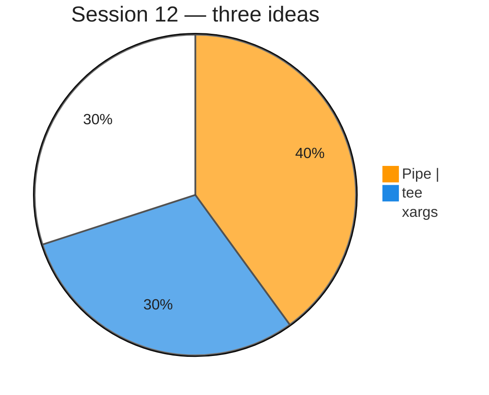

# Piping, `tee`, and `xargs` (Session 12)

**Video:** [Session 12 — Piping and importance of `tee` and `xargs`](https://www.youtube.com/watch?v=Ko3VktocAQw&list=PLd3UqWTnYXOloH0vWBs4BtSbP84WcC2NY&index=12)  
**Instructor:** Durga Sir  
**Course title (full syllabus):** Session 25 — *Piping and Importance of tee and xargs commands*

**Prerequisites:** [redirection.md](redirection.md) (streams 0/1/2, `>`, `2>`) · [pipeCommands.md](pipeCommands.md) (first introduction to `|`) · [wordCountCommand.md](wordCountCommand.md) (`wc`) · [viewContentOfFiles.md](viewContentOfFiles.md) (`head`, `tail`, `cat`)

**Scripts:** [`scripts/PipingTeeXargs.sh`](../../scripts/PipingTeeXargs.sh) · [`scripts/PipingTeeXargs/`](../../scripts/PipingTeeXargs/)  
**Execution summary:** [`PipingTeeXargs.md`](../../scripts-execution-summary/PipingTeeXargs.md)

```bash
cd /path/to/Linux-Basics
bash scripts/PipingTeeXargs.sh
```

---

**Table of contents**

- [1. Goal of this session](#1-goal-of-this-session)
- [2. Recap — how a command gets input and sends output](#2-recap--how-a-command-gets-input-and-sends-output)
- [3. Need of piping](#3-need-of-piping)
- [4. What is a pipe (`|`)?](#4-what-is-a-pipe-)
- [5. Filter commands](#5-filter-commands)
- [6. Piping with filters — Durga Sir examples](#6-piping-with-filters--durga-sir-examples)
- [7. Long pipelines and order](#7-long-pipelines-and-order)
- [8. Pipe carries stdout only (not stderr)](#8-pipe-carries-stdout-only-not-stderr)
- [9. `tee` — write to file and screen](#9-tee--write-to-file-and-screen)
- [10. `xargs` — build command lines from stdin](#10-xargs--build-command-lines-from-stdin)
- [11. Pipe vs redirection vs `tee`](#11-pipe-vs-redirection-vs-tee)
- [12. Session checklist](#12-session-checklist)
- [13. Script index](#13-script-index)

---

## 1. Goal of this session

After [redirection](redirection.md), Durga Sir introduces **piping** — the **operating-system mechanism** to move **output of one command** directly into **input of another command** without creating a temporary file.

In the same session you learn:

| Topic | Command | One-line idea |
| :--- | :--- | :--- |
| **Piping** | **`|`** | Connect **stdout** of left command to **stdin** of right command |
| **tee** | **`tee`** | **Split** output — show on **terminal** **and** save to **file(s)** |
| **xargs** | **`xargs`** | Read **stdin**, build **argument list** for another command |



---

## 2. Recap — how a command gets input and sends output

Durga Sir repeats the model from the redirection session:

### Input (how a command gets data)

| # | Source | Example |
| :---: | :--- | :--- |
| 1 | **Command-line arguments** | `cat a.txt`, `ls /etc` |
| 2 | **Standard input** | Keyboard, **`< file`**, or **pipe** from previous command |

### Output (where command results go)

| # | Destination | Mechanism |
| :---: | :--- | :--- |
| 1 | **Terminal** | Default **stdout** / **stderr** |
| 2 | **File** | **Redirection** — `>`, `>>`, `2>`, `&>`, … |
| 3 | **Another command** | **Piping** — **`|`** |

So: **redirection** → file; **pipe** → **next program**.

---

## 3. Need of piping

**Without pipe** (two steps):

```bash
ls -l /etc > etclist.txt
wc -l < etclist.txt
```

**With pipe** (one step, no intermediate file):

```bash
ls -l /etc | wc -l
```

Durga Sir’s point: piping is **efficient** and **common** in real servers — logs, filters, counts, and reports are almost always **chains** of small commands.

---

## 4. What is a pipe (`|`)?

```bash
command1 | command2
```

| Part | Role |
| :--- | :--- |
| **command1** | Writes **normal output** to **stdout (1)** |
| **`|`** | Kernel **pipe** — buffer between processes |
| **command2** | Reads from **stdin (0)** |


**Not** the same as **`>`** — `>` goes to a **file**; **`|`** goes to **another command**. See [pipeCommands.md](pipeCommands.md) for **`Broken pipe`** when the reader (`head`) exits early.

**Lab command:**

```bash
bash scripts/PipingTeeXargs/pipe-ls-head-wc-demo.sh
```

---

## 5. Filter commands

**Filter** = a command that can take **input from stdin** (keyboard **or** pipe), process it, and write **stdout**.

Durga Sir lists examples you will use often with **`|`**:

| Filter | Typical use with pipe |
| :--- | :--- |
| **`wc`** | Count lines, words, bytes |
| **`grep`** | Search for a pattern |
| **`sort`** | Sort lines |
| **`uniq`** | Remove duplicate **adjacent** lines (use after **`sort`**) |
| **`head`** / **`tail`** | First / last lines |
| **`cut`** | Columns (later session) |
| **`tr`** | Translate characters (later session) |

If a command **only** accepts file names and **never** reads stdin, it is a **poor** filter for piping (unless you use **`xargs`**).

---

## 6. Piping with filters — Durga Sir examples

### Example 1 — `ls -l /etc | head`

Large directory → show only **first 10 lines** (default `head`):

```bash
ls -l /etc | head
```

Same idea as Video 7 — see [pipeCommands.md §2](pipeCommands.md#2-example-ls--l-etc--head).

### Example 2 — `ls -l /etc | wc -l`

**How many lines** in the listing (rough “how many entries” lab):

```bash
ls -l /etc | wc -l
```

### Example 3 — `who | wc -l`

**How many users** logged in (class wording: count lines of `who` output):

```bash
who | wc -l
```

### Example 4 — `cat` file | `sort` | `uniq`

Remove duplicate lines ( **`uniq` only removes repeats on consecutive lines**, so **`sort` first**):

```bash
cat marks.txt | sort | uniq
```

With counts:

```bash
cat marks.txt | sort | uniq -c
```

**Lab command:**

```bash
bash scripts/PipingTeeXargs/pipe-filters-sort-uniq-demo.sh
```

### Example 5 — `ls` | `grep` (pattern)

List only lines matching a pattern (when `grep` is already introduced):

```bash
ls -l | grep ".sh"
```

---

## 7. Long pipelines and order

Durga Sir stresses: **order matters** — each command reads what the **previous** command produced.

```bash
cat data.txt | sort | uniq | wc -l
```

Read left to right: **read file → sort → unique → count lines**.

---

## 8. Pipe carries stdout only (not stderr)

**Pipe connects stdout (1) to stdin (0).**  
**Stderr (2) is not piped** unless you redirect it separately (`2>`) or merge streams (`&>`).

```bash
cal 99999 | wc -l
```

The **error message** still appears on the **terminal**; **`wc`** may get **no** useful calendar output.

**Lab command:**

```bash
bash scripts/PipingTeeXargs/pipe-stdout-only-not-stderr-demo.sh
```

---

## 9. `tee` — write to file and screen

**`tee`** is named like the letter **T** — **split** the stream:

- One copy → **terminal** (you still **see** output)
- One copy → **file** (you **save** output)

### Basic use

```bash
ls -l | tee listing.txt
```

Same output on screen **and** in **`listing.txt`**.

### Append — `tee -a`

```bash
echo "line 1" | tee log.txt
echo "line 2" | tee -a log.txt
```

### Multiple files

```bash
echo "report" | tee file1.txt file2.txt
```

Durga Sir uses **`tee`** when you need **both** human viewing **and** a log file (install logs, long command output).

**Lab commands:**

```bash
bash scripts/PipingTeeXargs/tee-screen-and-file-demo.sh
bash scripts/PipingTeeXargs/tee-append-multiple-files-demo.sh
```

---

## 10. `xargs` — build command lines from stdin

**Problem:** Some commands want **file names as arguments** (`touch a b c`, `wc file1 file2`), but a pipe gives **stdin**, not argv.

**`xargs`** reads **stdin** (often lines or words) and **appends** them as arguments to a command (default command is **`echo`** if you omit one).

### Example 1 — create files from a word list

```bash
echo "apple banana cherry" | xargs touch
```

Creates **`apple`**, **`banana`**, **`cherry`**.

### Example 2 — `xargs -n`

Run command with **at most N arguments** per invocation:

```bash
printf 'one two three four\n' | xargs -n 2 echo
```

### Example 3 — pipe file list into `wc`

```bash
ls /path/to/scripts/*.sh | xargs wc -l
```

Each path becomes an argument to **`wc -l`**.

Durga Sir warning: **`find … | xargs rm`** is dangerous — wrong matches delete files. Always test with **`echo`** first.

**Lab commands:**

```bash
bash scripts/PipingTeeXargs/xargs-build-command-line-demo.sh
bash scripts/PipingTeeXargs/xargs-with-find-style-demo.sh
```

---

## 11. Pipe vs redirection vs `tee`

| Mechanism | Symbol / command | Connects to |
| :--- | :--- | :--- |
| **Pipe** | **`|`** | **Next command’s stdin** |
| **Redirect** | **`>`**, **`>>`**, **`2>`** | **File** |
| **tee** | **`tee file`** | **Terminal and file(s)** at once |

Combine when needed:

```bash
ls -l /etc | tee etclist.txt | wc -l
```

---

## 12. Session checklist

- [ ] Explain **three** output destinations: terminal, file, **pipe**
- [ ] Run `ls -l /etc | head` and `ls -l /etc | wc -l`
- [ ] Run `cat marks.txt | sort | uniq` and `uniq -c`
- [ ] Show `cal 99999 | wc -l` — error on screen, pipe does not carry stderr
- [ ] Run `ls -l | tee listing.txt` and confirm file + screen
- [ ] Run `echo "a b c" | xargs touch`
- [ ] Run `bash scripts/PipingTeeXargs.sh`
- [ ] Add lab **screenshots** under each block after class (same workflow as `redirection.md`)

---

## 13. Script index

| Script | Topic |
| :--- | :--- |
| [`PipingTeeXargs.sh`](../../scripts/PipingTeeXargs.sh) | Run all Session 12 demos |
| [`pipe-ls-head-wc-demo.sh`](../../scripts/PipingTeeXargs/pipe-ls-head-wc-demo.sh) | `ls \| head`, `ls \| wc -l` |
| [`pipe-filters-sort-uniq-demo.sh`](../../scripts/PipingTeeXargs/pipe-filters-sort-uniq-demo.sh) | `sort \| uniq` |
| [`pipe-stdout-only-not-stderr-demo.sh`](../../scripts/PipingTeeXargs/pipe-stdout-only-not-stderr-demo.sh) | stderr not piped |
| [`tee-screen-and-file-demo.sh`](../../scripts/PipingTeeXargs/tee-screen-and-file-demo.sh) | `tee` to file + screen |
| [`tee-append-multiple-files-demo.sh`](../../scripts/PipingTeeXargs/tee-append-multiple-files-demo.sh) | `tee -a`, multiple files |
| [`xargs-build-command-line-demo.sh`](../../scripts/PipingTeeXargs/xargs-build-command-line-demo.sh) | `xargs touch`, `-n` |
| [`xargs-with-find-style-demo.sh`](../../scripts/PipingTeeXargs/xargs-with-find-style-demo.sh) | `ls *.sh \| xargs wc -l` |

Full command tables: [`scripts-execution-summary/PipingTeeXargs.md`](../../scripts-execution-summary/PipingTeeXargs.md).
