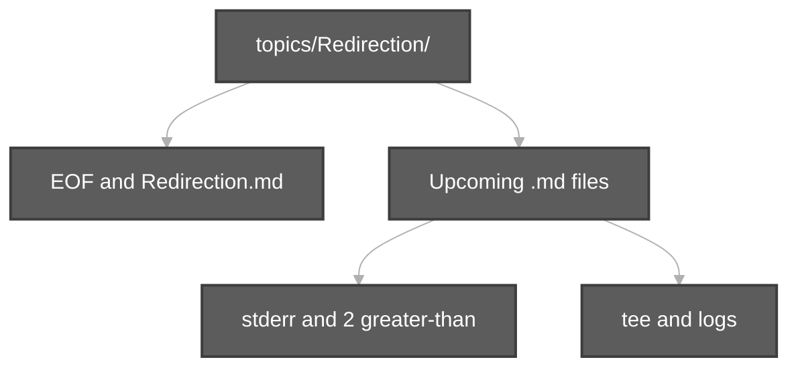

# Redirection — Durga Sir (topic folder)

All **input/output redirection** notes live in this folder. Add new session `.md` files here as Durga Sir covers more (stderr `2>`, `tee`, advanced heredoc, etc.).

**Playlist:** [Linux Basics](https://www.youtube.com/watch?v=txRD_bK062Y&list=PLd3UqWTnYXOloH0vWBs4BtSbP84WcC2NY)

**Related (outside this folder):** [pipeCommands.md](../pipeCommands.md) (`|` is not `>`) · [viewContentOfFiles.md](../viewContentOfFiles.md) (`cat < file`)

---

## Notes in this folder

| File | Subject | Status |
| :--- | :--- | :---: |
| [**EOF and Redirection.md**](EOF%20and%20Redirection.md) | `>`, `>>`, `<`, heredoc `<<EOF`, Rama/Sita lab | Available |

**Scripts:** [`scripts/Redirection/`](../../../scripts/Redirection/) · **Execution summary:** [`scripts-execution-summary/Redirection/Redirection.md`](../../../scripts-execution-summary/Redirection/Redirection.md)

```bash
bash scripts/Redirection/overwrite-greater-than-demo.sh
```
| *(upcoming sessions)* | e.g. `2>&1`, `tee`, log redirection | Add when video notes are ready |

---

## How to add the next session

1. Create `docs/topics/Redirection/<ShortTitle>.md` from Durga Sir’s video.  
2. Add a row to the table above.  
3. Link from [`linuxBasics.md`](../../linuxBasics.md) if it is a main playlist session.  
4. Add demos under [`scripts/Redirection/`](../../../scripts/Redirection/) and regenerate [`scripts-execution-summary/Redirection/`](../../../scripts-execution-summary/Redirection/).


