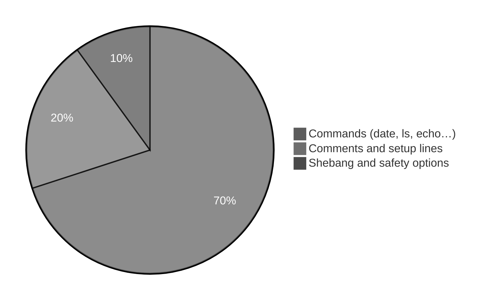
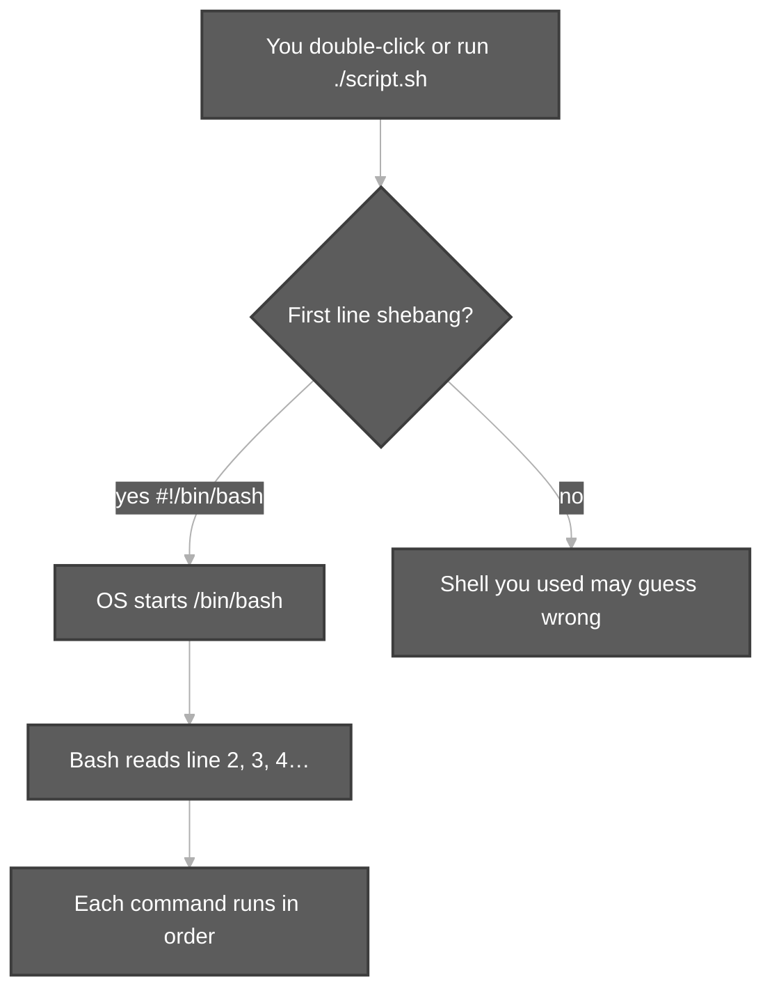
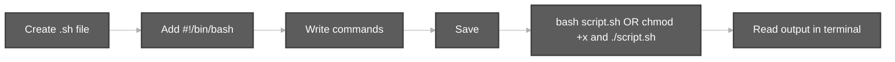
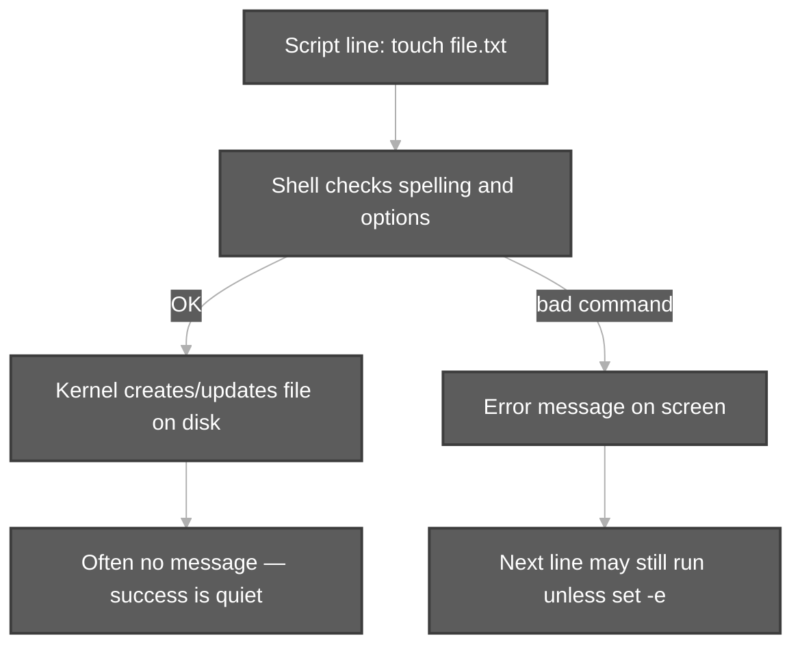
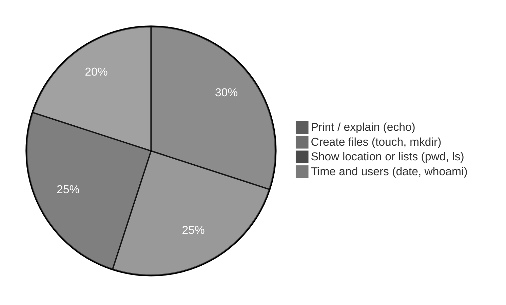

# Steps to Write a Shell Script (`.sh` file)

**Audience:** Beginners — Windows or Mac users new to Linux, students following Durga Sir’s playlist, anyone writing their first `.sh` file.  
**Related:** [Components of Unix.md](Components%20of%20Unix.md) (shell + kernel) · [Bash Built-in Commands.md](Bash%20Built-in%20Commands.md) · [`scripts/shell-scripting/`](../../scripts/shell-scripting/)

**Example scripts in this repo:** [`test.sh`](../../scripts/components-of-unix/test.sh) · [`hello.sh`](../../scripts/shell-scripting/hello.sh)

```bash
cd /path/to/Linux-Basics
bash scripts/shell-scripting/hello.sh "YourName"
```

---

**Table of contents**

- [1. What is a `.sh` file?](#1-what-is-a-sh-file)
- [2. Why the first line is `#!/bin/bash`](#2-why-the-first-line-is-binbash)
- [3. Step-by-step: write your first script](#3-step-by-step-write-your-first-script)
- [4. How Linux runs each line](#4-how-linux-runs-each-line)
- [5. Common commands inside scripts (plain English)](#5-common-commands-inside-scripts-plain-english)
- [6. Comments, variables, and quoting](#6-comments-variables-and-quoting)
- [7. Output: screen, file, and pipeline](#7-output-screen-file-and-pipeline)
- [8. Safe habits (`set -euo pipefail`)](#8-safe-habits-set--euo-pipefail)
- [9. Checklist before you run](#9-checklist-before-you-run)
- [10. Practice in this repository](#10-practice-in-this-repository)

---

## 1. What is a `.sh` file?

A **shell script** is a **text file** that holds **Linux commands** one per line (or several on one line with `;`). You do **not** compile it like C or Java. The **shell** (usually **Bash**) reads the file **top to bottom** and runs each command, the same way you would type commands in the terminal — but automatically.

| Idea | Simple explanation |
| :--- | :--- |
| **Terminal** | Window where you type commands and see results. |
| **Shell** | Program that understands your typing (Bash is the most common on Ubuntu). |
| **Script** | Saved list of commands the shell runs for you. |
| **`.sh`** | File name ending; means “shell script” (convention, not magic). |



---

## 2. Why the first line is `#!/bin/bash`

Almost every script in this repo starts with:

```bash
#!/bin/bash
```

| Part | Meaning for beginners |
| :--- | :--- |
| **`#!`** | Special marker called **shebang** (hash + bang). Tells the OS: “use this program to read the rest of the file.” |
| **`/bin/bash`** | Path to **Bash** on typical Linux. Bash is the “language interpreter” for your script. |

**When it matters**

- If you run: `bash myscript.sh` → Bash is already chosen; shebang is optional but still good practice.
- If you run: `./myscript.sh` (after `chmod +x`) → Linux reads shebang and starts **Bash** automatically.

**Analogy:** Shebang is like writing at the top of a recipe: “A chef who speaks Bash should follow these steps.”



---

## 3. Step-by-step: write your first script

Follow these steps on Ubuntu (or VS Code with a Linux terminal).

### Step 1 — Create the file

- **GUI:** Text editor → Save as `hello-first.sh` (any folder, e.g. `Documents`).
- **Terminal:** `nano hello-first.sh` or create in VS Code.

### Step 2 — Line 1: shebang

```bash
#!/bin/bash
```

### Step 3 — Add commands (one job per line)

```bash
#!/bin/bash
echo "Hello — I am learning shell scripts"
date
pwd
```

| Line | What you are trying to do |
| :--- | :--- |
| `echo "..."` | **Print** text on the screen |
| `date` | **Show** current date and time |
| `pwd` | **Show** which folder you are in (print working directory) |

### Step 4 — Save the file

Save as plain text. Encoding UTF-8 is fine. **Do not** save as `.doc` or `.pdf`.

### Step 5 — Run it (two common ways)

**Way A — always works (recommended while learning):**

```bash
bash hello-first.sh
```

**Way B — “executable” script:**

```bash
chmod u+x hello-first.sh    # allow yourself to run it
./hello-first.sh            # dot + slash = run this file here
```

| Command | Plain English |
| :--- | :--- |
| `chmod u+x` | **Change mode** — add **execute** permission for **u**ser (you) |
| `./hello-first.sh` | Run the program in **this** directory |



---

## 4. How Linux runs each line

Same idea as [Components of Unix.md](Components%20of%20Unix.md): **you** → **shell** → (if valid) **kernel** → result back to terminal.



**For each line in your script, ask:**

1. **What** command is this? (`echo`, `touch`, `ls`, …)
2. **What** am I trying to do? (print, create, list, move, …)
3. **Where** does output go? (screen, file, or pipe to another command)

---

## 5. Common commands inside scripts (plain English)

These appear often in Durga Sir demos and in [`scripts/`](../../scripts/README.md).

| Command | You are trying to… | Typical output |
| :--- | :--- | :--- |
| **`echo`** | **Print** a message | Text on screen (stdout) |
| **`touch`** | **Create** an empty file or update its time | Usually silent |
| **`ls`** | **List** files in a folder | File names on screen |
| **`pwd`** | **Show** current folder path | One path line |
| **`cd`** | **Change** current folder | Silent if success |
| **`mkdir`** | **Make** a new folder | Silent if success |
| **`cat`** | **Display** file contents | File text on screen |
| **`date`** | **Show** date/time | One time line |
| **`cal`** | **Show** calendar | Month grid (if installed) |
| **`whoami`** | **Show** logged-in username | One name |
| **`man`** | **Open** manual (help) for a command | Pager on screen; `q` to quit |



**Example — same ideas as Video 2 `test.sh`:**

```bash
#!/bin/bash
cal          # show calendar (if available)
date         # show date and time
echo "Hello Friends. Welcome to Unix World."   # print welcome line
```

Repo copy: [`test.sh`](../../scripts/components-of-unix/test.sh).

---

## 6. Comments, variables, and quoting

### Comments (`#`)

Lines starting with `#` are **notes for humans**. Bash **ignores** them.

```bash
#!/bin/bash
# This is a comment — not executed
echo "This line runs"
```

### Variables

A **variable** stores text for later use.

```bash
NAME="Durga"
echo "Hello, $NAME"
```

| Symbol | Meaning |
| :--- | :--- |
| `NAME="..."` | **Assign** text to variable `NAME` |
| `$NAME` | **Use** the value when the line runs |

### Quoting

| Form | When to use |
| :--- | :--- |
| `"double quotes"` | Normal text; `$VAR` still expands |
| `'single quotes'` | Literal text; no `$` expansion |
| Spaces in paths | Always quote: `cd "My Folder"` |

---

## 7. Output: screen, file, and pipeline

### On the screen (default)

Most commands print to **standard output (stdout)** — your terminal.

### Into a file (redirection `>`)

```bash
echo "Log line" > mylog.txt    # write (overwrite) file
echo "More" >> mylog.txt       # append to file
```

| Symbol | Intent |
| :--- | :--- |
| `>` | **Send** output into a file (replace file contents) |
| `>>` | **Append** to end of file |

**Full guide (Rama/Sita example, EOF heredoc):** [EOF and Redirection.md](EOF%20and%20Redirection.md)

### Pipeline (`|`)

```bash
ls /bin | head -5
```

| Part | Intent |
| :--- | :--- |
| `ls /bin` | **List** many names |
| `\|` | **Pipe** — pass that list to the next command |
| `head -5` | **Show** only first 5 lines |

See also: [pipeCommands.md](pipeCommands.md).

```mermaid
%%{init: {'theme': 'base', 'themeVariables': {'primaryColor': '#5c5c5c', 'primaryTextColor': '#ffffff', 'primaryBorderColor': '#3d3d3d', 'lineColor': '#b0b0b0'}}}%%
flowchart LR
    CMD[command 1] -->|stdout| PIPE[|]
    PIPE --> CMD2[command 2]
    CMD2 --> T[Terminal shows filtered result]

    classDef darkGrey fill:#5c5c5c,stroke:#3d3d3d,color:#ffffff,stroke-width:2px
    class CMD,PIPE,CMD2,T darkGrey
```

---

## 8. Safe habits (`set -euo pipefail`)

Many repo scripts include:

```bash
set -euo pipefail
```

| Flag | Beginner-friendly meaning |
| :--- | :--- |
| **`-e`** | Stop the script if a command **fails** (non-zero exit). |
| **`-u`** | Stop if you use an **undefined** variable (typo protection). |
| **`-o pipefail`** | If any command in a **pipeline** fails, treat the whole line as failed. |

You can add this on **line 2** after the shebang when you start writing longer scripts. Short demos sometimes use `set +e` to show expected errors — see [`invalid-command-demos.sh`](../../scripts/components-of-unix/invalid-command-demos.sh).

---

## 9. Checklist before you run

1. First line: `#!/bin/bash` (good habit).  
2. File saved as **`.sh`**, plain text.  
3. Know your run method: `bash script.sh` or `chmod +x` + `./script.sh`.  
4. Read each command: **print? create? list? navigate?**  
5. Expect **errors in red/stderr** if a command name or option is wrong.  
6. After editing, **save** before running again.

---

## 10. Practice in this repository

| Goal | Script to open |
| :--- | :--- |
| Minimal three commands | [`components-of-unix/test.sh`](../../scripts/components-of-unix/test.sh) |
| Touch + `ls -l` success path | [`command-execution-touch-demo.sh`](../../scripts/components-of-unix/command-execution-touch-demo.sh) |
| Positional parameters `$1` | [`shell-scripting/hello.sh`](../../scripts/shell-scripting/hello.sh) |
| Line-by-line explanations | [`scripts-execution-summary/README.md`](../../scripts-execution-summary/README.md) |

**Suggested learning path:** read this page → run `test.sh` with `bash` → change one `echo` line → run again → compare output.

**Next topics:** [File System Navigation Commands And Hierarchy.md](File%20System%20Navigation%20Commands%20And%20Hierarchy.md) for `cd`/`pwd` inside scripts · [Date and Cal commands.md](Date%20and%20Cal%20commands.md) for `date` in scripts.
