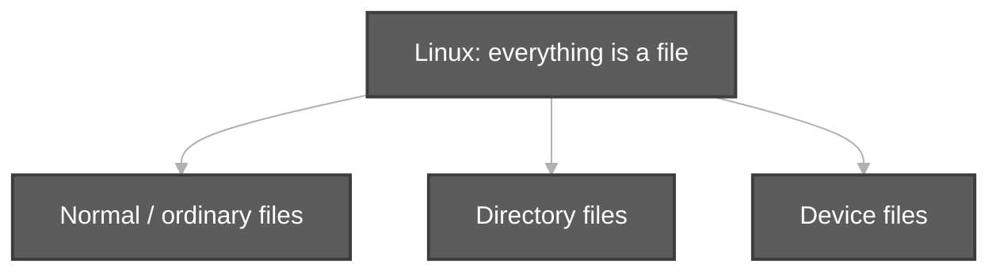
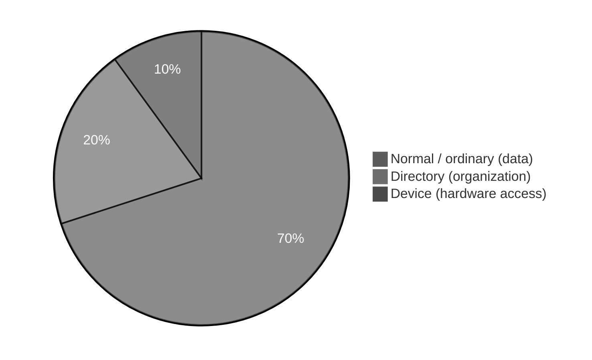
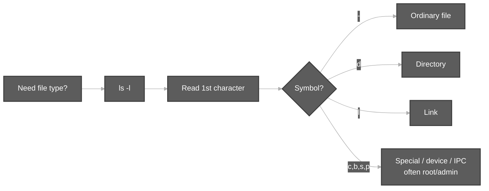
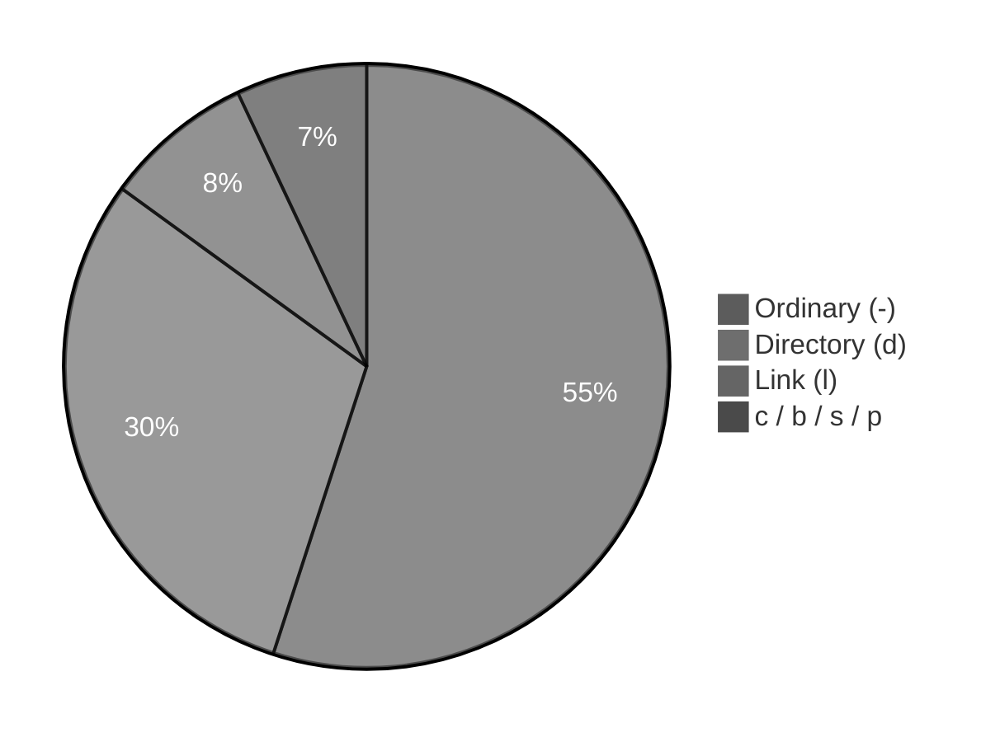

# Types of Files in Linux

**Video:** [Session 3 — Types of Files in LINUX](https://www.youtube.com/watch?v=-Y4bjL-fBMY&list=PLd3UqWTnYXOloH0vWBs4BtSbP84WcC2NY&index=3)  
**Instructor:** Durga Sir

**Prerequisites:** [Components of Unix.md](Components%20of%20Unix.md) (shell, kernel, basic commands)

---

## 1. Golden rules (Session 3)

| Rule | Meaning |
| :--- | :--- |
| **Everything is a file** | In Linux/Unix, directories, devices, and data are all accessed through the **file** abstraction (unlike Python’s “everything is an object”). |
| **Three main categories** | **Normal (ordinary)**, **directory**, and **device** files. |
| **Extension is not decisive** | Linux identifies type from **content** and metadata, not from `.txt` / `.jpg` names (Windows-style extensions are misleading on Linux). |





> Pie shares are for **learning focus**, not disk usage. Most entries you create daily are **normal** and **directory** files.

---

## 2. Type 1 — Normal (ordinary) files

**Definition:** Files that **contain data**.

| Kind | Examples |
| :--- | :--- |
| **Text / character data** | `notes.txt`, `tester.java`, `script.sh`, `app.py` |
| **Binary data** | Images (`sunny.jpg`), video (`baahubali.mp4`), audio, compiled binaries |

- Scripts and source code are still **normal files** (character data).
- Images/video/audio are **binary** normal files (not human-readable text).

**Create empty normal file:** `touch` creates a **zero-byte** file (no content yet).

**Practice:** `bash scripts/types-of-files-touch-file-demo.sh`

---

## 3. Extension vs content (`file` command)

Durga Sir’s demo:

1. `touch sunny.jpg` → empty file → `file sunny.jpg` → cannot guess type from content.
2. Add text inside (e.g. via editor) → `file sunny.jpg` → **ASCII text** (not “JPEG”), because content is text.
3. `mv sunny.jpg sunny.durga` → rename changes **name only**; `file` still reports **ASCII text**.

**Rule:** Do not trust the extension on Linux; use **`file`** to inspect content type.

**Practice:** `bash scripts/file-command-content-demo.sh`

---

## 4. Type 2 — Directory files

- **Windows term:** folder  
- **Linux term:** **directory**
- A directory **contains files and subdirectories**.
- In Linux, a directory is also a **file** that represents a container.

**Practice:** `bash scripts/types-of-files-ls-demo.sh` (see leading `d` in `ls -l`)

---

## 5. Type 3 — Device files

- Every **device** (keyboard, disk, **terminal**, etc.) is represented as a **file**.
- You **communicate with hardware** through that file.
- Device files live under **`/dev`** (e.g. `/dev/pts/0`, `/dev/pts/1` for pseudo-terminals).

### Terminal as a device file

| Command | Purpose |
| :--- | :--- |
| `tty` | Print the device file for **this** terminal |
| Typical path | `/dev/pts/0`, `/dev/pts/1`, … (one per terminal tab/window) |

**Class demo:** Redirect output to another terminal’s device file:

```bash
echo "Hello" > /dev/pts/1    # writes to terminal 1 (path from tty on that terminal)
```

Uses **output redirection** (`>`) — covered in detail in a later session.

**Practice:** `bash scripts/tty-and-dev-demo.sh`

---

## 6. How to check file type (standard way)

### Do not rely only on Ubuntu colors

In **Ubuntu**, `ls` may show:

| Color (typical) | Often means |
| :--- | :--- |
| **Blue** | Directory |
| **White** | Normal text file |
| **Green** | Executable |
| **Red** | Archive / special |

Colors **vary by distro and theme** → **not portable**. Use `ls -l` instead.

### Use `ls -l` — first character = file type

```bash
ls -l
```

| First char | Type | Name |
| :---: | :--- | :--- |
| **`-`** | Normal / ordinary file | Regular file |
| **`d`** | Directory | Directory file |
| **`l`** | Link | Symbolic link |
| **`c`** | Character device | Character special file |
| **`b`** | Block device | Block special file |
| **`s`** | Socket | Socket file |
| **`p`** | Pipe | Named pipe (FIFO) |





- **`c`, `b`, `s`, `p`** — mostly used by **root / superuser** and system services; awareness is enough at this stage.

**Practice:** `bash scripts/types-of-files-ls-demo.sh`

---

## 7. Command reference (this session)

| Command | Purpose | Example |
| :--- | :--- | :--- |
| `touch` | Create **empty** file or update timestamp | `touch sunny.jpg` |
| `file` | Detect file type from **content** | `file sunny.durga` |
| `mv` | Move or **rename** | `mv sunny.jpg sunny.durga` |
| `cat` | Display file contents | `cat sunny.durga` |
| `ls -l` | Long listing; **1st char = type** | `ls -l /dev` |
| `tty` | Device file for current terminal | `tty` |
| `echo … > file` | Redirect output (intro) | `echo hi > /dev/pts/1` |

**Ubuntu shortcuts (from class):**

| Shortcut | Action |
| :--- | :--- |
| **Ctrl + Alt + T** | Open terminal |
| **Ctrl + D** | Close terminal / end shell input |

---

## 8. Session 3 checklist

You should be able to explain:

1. **Everything is a file** in Linux.  
2. Three categories: **normal**, **directory**, **device**.  
3. Why **extension** is not reliable; role of **`file`**.  
4. **`/dev`** and **`tty`** for terminals.  
5. How **`ls -l`** first character identifies type (`-`, `d`, `l`, `c`, `b`, `s`, `p`).  
6. Why **colorized `ls`** is not the standard way to decide type.

**Next (Video 4):** File system navigation and hierarchy — linked from [`linuxBasics.md`](../linuxBasics.md).

---

## 9. Scripts for this topic

| Script | Demonstrates |
| :--- | :--- |
| [`types-of-files-touch-file-demo.sh`](../../scripts/types-of-files-touch-file-demo.sh) | `touch` empty file |
| [`file-command-content-demo.sh`](../../scripts/file-command-content-demo.sh) | `file`, rename with `mv` |
| [`types-of-files-ls-demo.sh`](../../scripts/types-of-files-ls-demo.sh) | `ls -l` type characters |
| [`ls-l-file-size-demo.sh`](../../scripts/ls-l-file-size-demo.sh) | `ls -l filename` — size in bytes |
| [`tty-and-dev-demo.sh`](../../scripts/tty-and-dev-demo.sh) | `tty`, sample `/dev` entries |

```bash
cd /path/to/Linux-Basics
bash scripts/types-of-files-ls-demo.sh
bash scripts/file-command-content-demo.sh
```
