# Absolute Path vs Relative Path

**Course:** [Linux with Shell Programming — Durga Soft online](https://www.durgasoftonline.com/s/courses/5e7ae04f0cf29f148a043786/take)  
**Instructor:** Durga Sir  
**Source recording (repo):** [`ScreenRecordings/Screencast From 2026-11-16 12-52-12.webm`](../../ScreenRecordings/Screencast%20From%202026-11-16%2012-52-12.webm) (~58 min active lesson; screen capture only — no audio)

*(If you pushed an **`.mp4`** locally, Git may store it as **`.webm`** in this repo — use the file above under `ScreenRecordings/`.)*

**Related:** [File System Navigation Commands And Hierarchy.md](File%20System%20Navigation%20Commands%20And%20Hierarchy.md) (`pwd`, `cd`, `.` / `..`) · [creationOfDirectories.md](creationOfDirectories.md) (Diagram4 **x** / **y** tree)

**Practice scripts:** [`absolute-vs-relative-paths-demo.sh`](../../scripts/file-system-navigation-and-hierarchy/absolute-vs-relative-paths-demo.sh) · [`cd-home-relative-vs-absolute-demo.sh`](../../scripts/file-system-navigation-and-hierarchy/cd-home-relative-vs-absolute-demo.sh)

**Your lab notes:** Under each section, fill **My observation** with your terminal screenshot from `~/linuxbasics` (or your VM).

---

**Table of contents**

- [Absolute Path vs Relative Path](#absolute-path-vs-relative-path)
  - [0. What this recording covers](#0-what-this-recording-covers)
  - [1. Why we need two kinds of path — real-world analogy](#1-why-we-need-two-kinds-of-path--real-world-analogy)
  - [2. Definitions — absolute vs relative](#2-definitions--absolute-vs-relative)
  - [3. Small example — run `test.sh` from `/home/durga`](#3-small-example--run-testsh-from-homedurga)
  - [4. Practice tree on Desktop (`x` / `y` branches)](#4-practice-tree-on-desktop-x--y-branches)
  - [5. Example 1 — you are in `x11`, `cd` to `y2`](#5-example-1--you-are-in-x11-cd-to-y2)
  - [6. Example 2 — you are in `y2`, `cd` to `x11`](#6-example-2--you-are-in-y2-cd-to-x11)
  - [](#)
  - [7. Example 3 — stay in `x11`, create `y21` under `y2` without `cd` there](#7-example-3--stay-in-x11-create-y21-under-y2-without-cd-there)
  - [8. Terminal proof — `mkdir` with absolute path does not change `pwd`](#8-terminal-proof--mkdir-with-absolute-path-does-not-change-pwd)
  - [9. One-line summary](#9-one-line-summary)
  - [](#-1)
  - [10. Class Q\&A — paths when you cannot enter a folder](#10-class-qa--paths-when-you-cannot-enter-a-folder)
  - [Appendix — recording time map](#appendix--recording-time-map)

---

## 0. What this recording covers

| Approx. time | Section in this doc                       |
| :----------- | :---------------------------------------- |
| 00:00–06:00  | §1 analogy → §3 `test.sh` paths           |
| 07:30–10:30  | §2 definitions                            |
| 12:00–15:00  | §4 tree + `mkdir -p` one-liner            |
| 16:30–28:30  | §5–§6 `cd` examples                       |
| 30:00–36:00  | §7–§9 `mkdir` relative/absolute + summary |

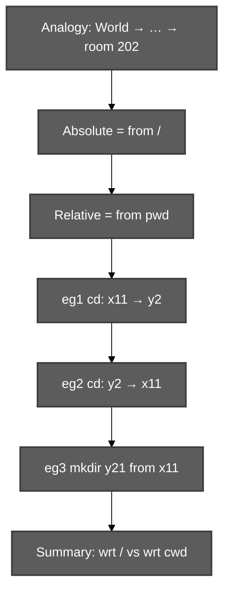

---

## 1. Why we need two kinds of path — real-world analogy

**Class opening (~00:00):** EditPlus heading **Absolute Path vs Relative Path** (notes spell *Absoulte*).

**Analogy (~01:30–04:30):**

- **Relative-style directions:** “From HUDA Maitrivanam building → go to **202** (Durgasoft).” Depends on **where you already are**.
- **Absolute-style address:** **World → Asia → India → TS → Hyderabad → Ameerpet → HUDA Maitrivanam → 202** — complete path from a fixed root.

Linux uses the same idea: **`/`** is the root of the filesystem tree (like “World” in the notes).

**My observation:** *(write your own address analogy — screenshot optional.)*

---

## 2. Definitions — absolute vs relative

**From class notes (~09:00–10:30):**

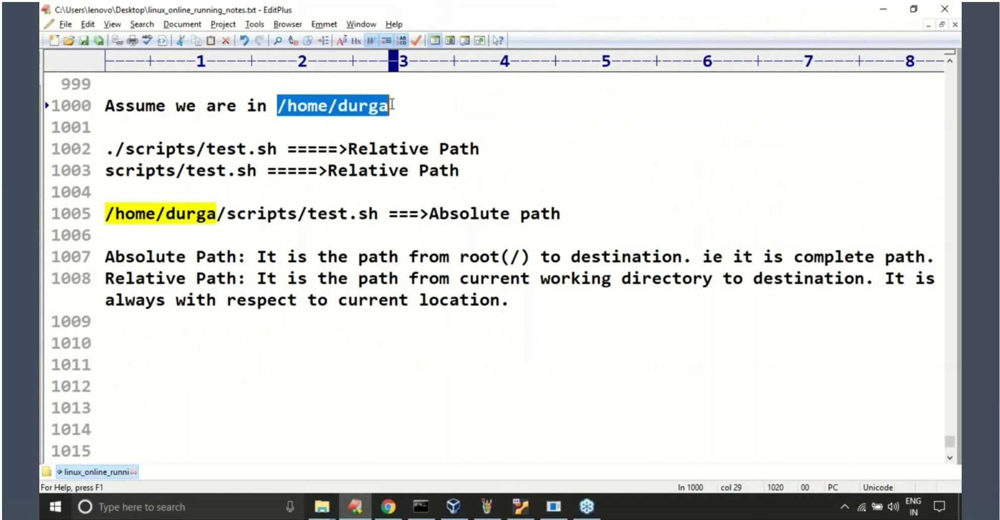

**What the screenshot shows:**

| Kind              | Class wording                                              | Meaning in plain language                                   |
| :---------------- | :--------------------------------------------------------- | :---------------------------------------------------------- |
| **Absolute path** | Path from **root (`/`)** to destination; **complete** path | Same answer no matter which directory you are “standing in” |
| **Relative path** | Path from **current working directory** to destination     | Changes when you **`cd`** somewhere else                    |

**Commands that care:**

- **`pwd`** — prints your **absolute** current path.
- **`cd`** — can take **either** form.

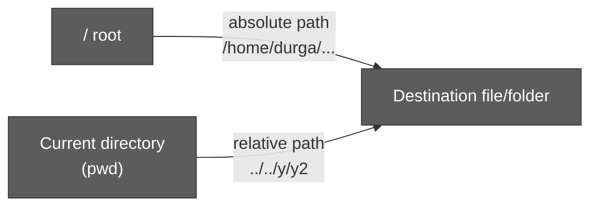

**My observation:** Run `pwd` in three different folders — paste one screenshot with three prompts.

---

## 3. Small example — run `test.sh` from `/home/durga`

**Setup in notes:** File exists at **`/home/durga/scripts/test.sh`**. You are **in** **`/home/durga`** (your **current working directory**).

| Command                       | Path type    | Why                                                                            |
| :---------------------------- | :----------- | :----------------------------------------------------------------------------- |
| `./scripts/test.sh`           | Relative     | **`.`** = current directory; then go into `scripts/`                           |
| `scripts/test.sh`             | Relative     | Many shells resolve this relative to **cwd** (same idea as above without `./`) |
| `/home/durga/scripts/test.sh` | **Absolute** | Starts at **`/`** — full path from root                                        |

**Line-by-line idea:**

1. **`./scripts/test.sh`** — “from **here** (`/home/durga`), enter `scripts`, run `test.sh`.”
2. **`scripts/test.sh`** — shorthand relative form when **cwd** is `/home/durga`.
3. **`/home/durga/scripts/test.sh`** — works even if you later **`cd`** somewhere else (as long as you type the full path).

**My observation:** Create `scripts/test.sh`, `cd` to `$HOME`, run all three forms — screenshot.

---

## 4. Practice tree on Desktop (`x` / `y` branches)

**Diagram (~12:00):** Same **Diagram4** idea as in `creationOfDirectories.md` — two top folders **`x`** and **`y`** under the user’s Desktop.

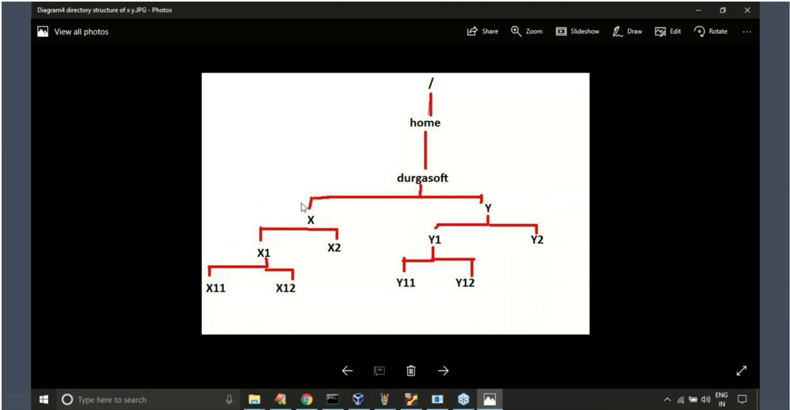

**Create the tree (~15:00):**

```bash
cd ~/Desktop
mkdir -p x/x1/x1{1,2} x/x2 y/y1/y1{1,2} y/y2
```

**GUI check (~13:30):** Files app breadcrumb **`Home > Desktop > x1`** with folders **`x11`**, **`x12`**.

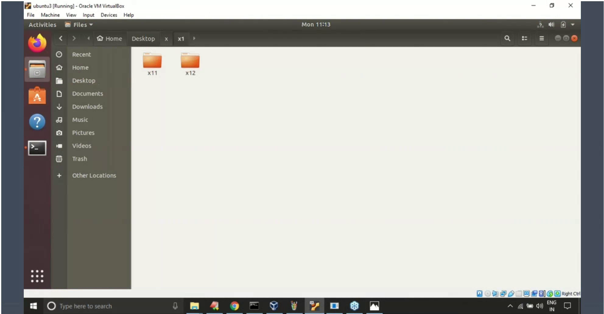

**Target layout (class paths use `durga` on Desktop):**

```text
~/Desktop/
  x/x1/x11/   x12/
  x/x2/
  y/y1/y11/   y12/
  y/y2/       ← eg1 destination
```

**My observation:** `tree ~/Desktop/x ~/Desktop/y` — screenshot.

---

## 5. Example 1 — you are in `x11`, `cd` to `y2`

**Assume:** **`pwd`** = `/home/durga/Desktop/x/x1/x11`

**Absolute ways (class notes ~16:30–19:30):**

```bash
cd /home/durga/Desktop/y/y2
cd ~/Desktop/y/y2
```

- First line: full path from **`/`**.
- Second: **`~`** = your home directory (`/home/durga`), then the rest.

**Relative ways:**

```bash
cd ../../../y/y2
cd ../../../../y/y2    # as written in class notes — verify with pwd
```

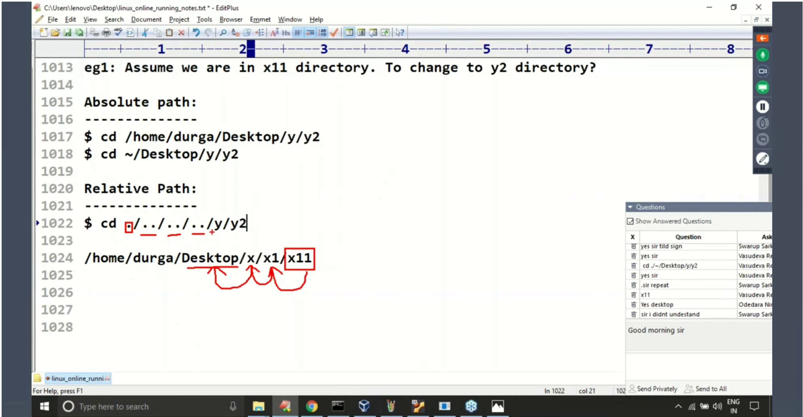

**What the screenshot shows:**

1. **`cd /home/durga/Desktop/y/y2`** — absolute.
2. **`cd ~/Desktop/y/y2`** — absolute using **`~`**.
3. **`cd ./../../../../y/y2`** (and variants) — relative using **`..`** to walk **up** toward **`Desktop`**, then **`y/y2`** **down**.

**Step-up picture (count `..` yourself):**

```text
x11 → .. → x1 → .. → x → .. → Desktop → y/y2
```

So from **`x11`**, **`../../../y/y2`** reaches **`y2`** (three **`..`** to **`Desktop`**). Class sometimes writes **four** `..` in notes — always confirm with **`pwd`** before and after **`cd`**.

**Class also shows three separate `cd ..` commands** — same direction, one parent per command.

**My observation:** From your `x11`, run absolute `cd` once, `cd` back, then relative `cd` — two screenshots.

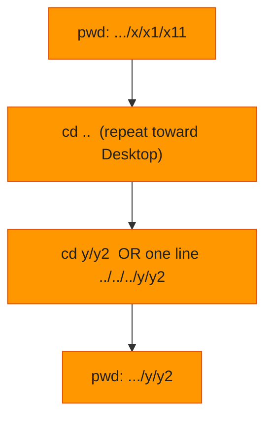

---

## 6. Example 2 — you are in `y2`, `cd` to `x11`

**Assume:** **`pwd`** = `/home/durga/Desktop/y/y2`

**Absolute:**

```bash
cd /home/durga/Desktop/x/x1/x11
cd ~/Desktop/x/x1/x11
```

**Relative:**

```bash
cd ../../x/x1/x11
cd ./../../x/x1/x11
```

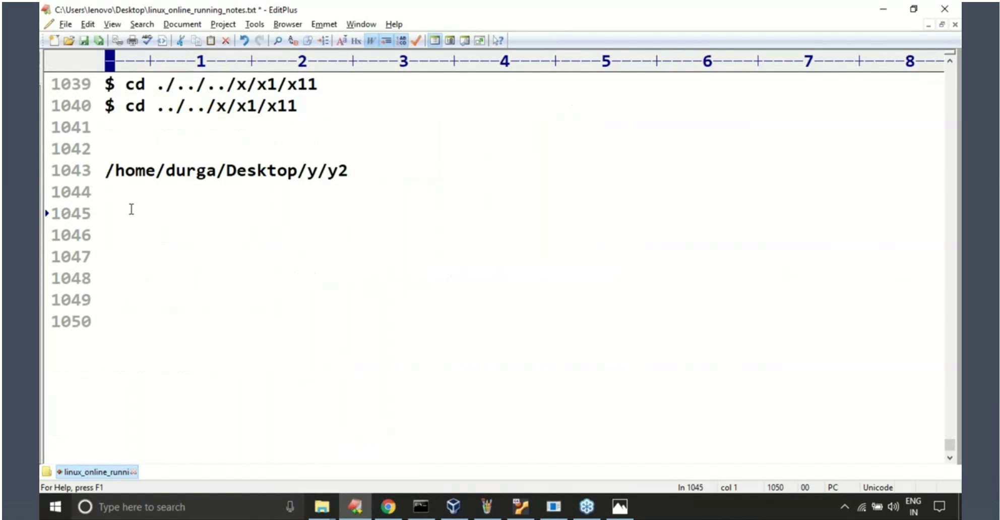

**What the screenshot shows:**

1. Annotation **`/home/durga/Desktop/y/y2`** — starting cwd.
2. **`cd ../../x/x1/x11`** — up to **`Desktop`** (`y` → `..`, `y2` → `..`), then into **`x/x1/x11`**.

**My observation:** Mirror the class paths on your tree — screenshot with `pwd` before/after.

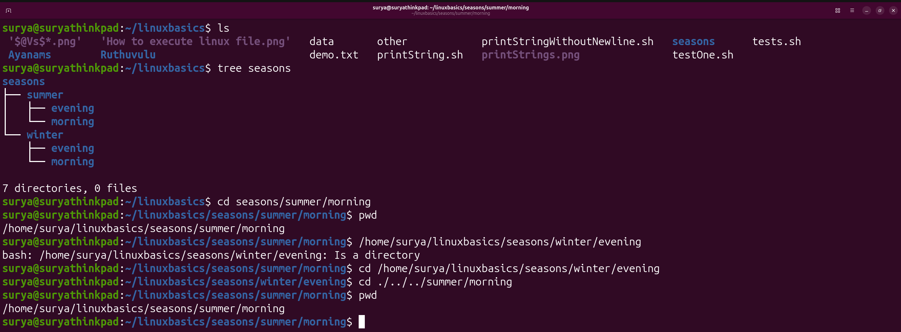
---

## 7. Example 3 — stay in `x11`, create `y21` under `y2` without `cd` there

**Question (~30:00):** You are still in **`x11`**. Create folder **`y21`** inside **`y/y2`** **without** changing directory with **`cd`**.

**Absolute `mkdir`:**

```bash
mkdir /home/durga/Desktop/y/y2/y21
mkdir ~/Desktop/y/y2/y21
```

**Relative `mkdir` (class notes):**

```bash
mkdir ../../../y/y2/y21
mkdir ../../../../y/y2/y21   # variant in notes — check with ls
```

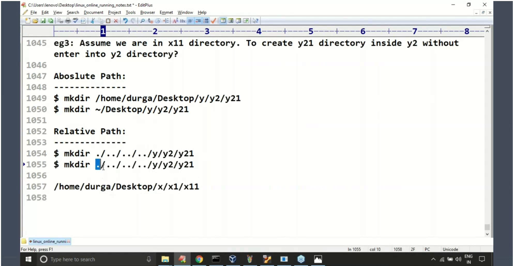

**My observation:** After `mkdir`, run `ls ~/Desktop/y/y2` while `pwd` still shows `x11` — screenshot.

---

## 8. Terminal proof — `mkdir` with absolute path does not change `pwd`

**Class terminal (~31:30):**

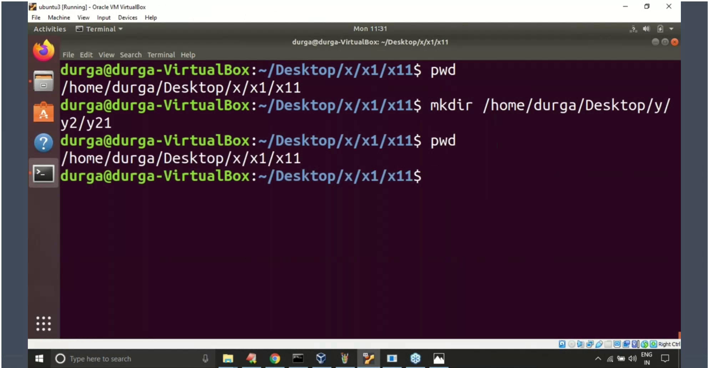

**What the screenshot shows (line by line):**

1. **`pwd`** → `/home/durga/Desktop/x/x1/x11` — you are deep inside **`x`**.
2. **`mkdir /home/durga/Desktop/y/y2/y21`** — absolute target path; shell **does not** `cd` there automatically.
3. **`pwd`** again → still `/home/durga/Desktop/x/x1/x11` — **creating** a directory elsewhere does **not** move your cwd.

**Takeaway:** **`cd`** changes where you stand; **`mkdir /full/path`** only creates — cwd stays unless you **`cd`**.

**My observation:** Repeat with `mkdir ~/Desktop/y/y2/y22` and double `pwd` — screenshot.

---

## 9. One-line summary

**End of lesson (~36:00):**

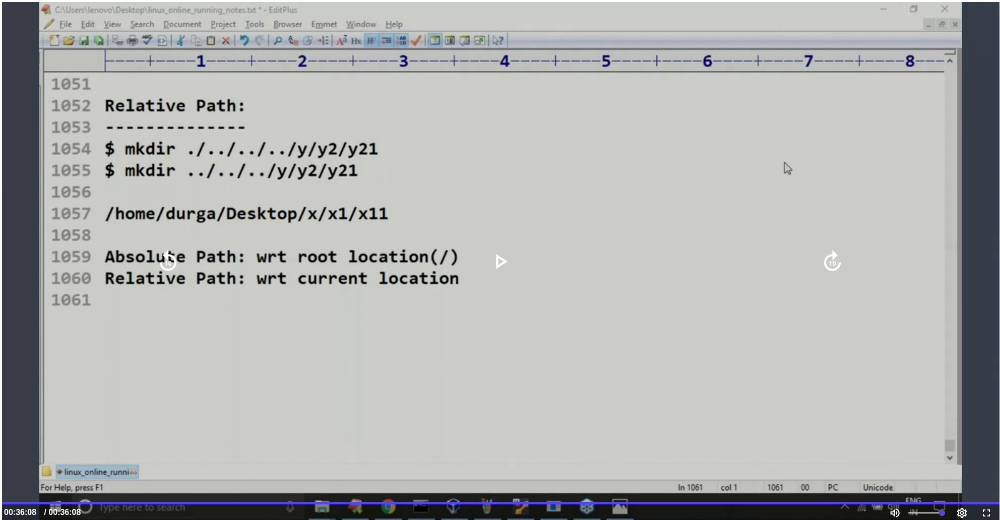

| Term              | Short form in class                     |
| :---------------- | :-------------------------------------- |
| **Absolute path** | **w.r.t.** root location **`/`**        |
| **Relative path** | **w.r.t.** **current location** (`pwd`) |

**My observation:** In your own words, one paragraph — no screenshot required unless you want one.

Here we have the screenshot which contains the command `cd -` which explains the previous working directory used


---

## 10. Class Q&amp;A — paths when you cannot enter a folder

**From chat (~34:30):** If you **cannot `cd` into `y`** (permissions), you may still be allowed to create **`y2/y21`** using a path that **names** the folder without visiting it — e.g. absolute:

```bash
mkdir /home/durga/Desktop/y/y2/y21
```

**My observation:** Only test permission ideas on folders you control.


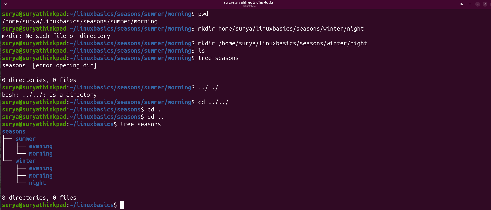

Now same example with relative xpath 

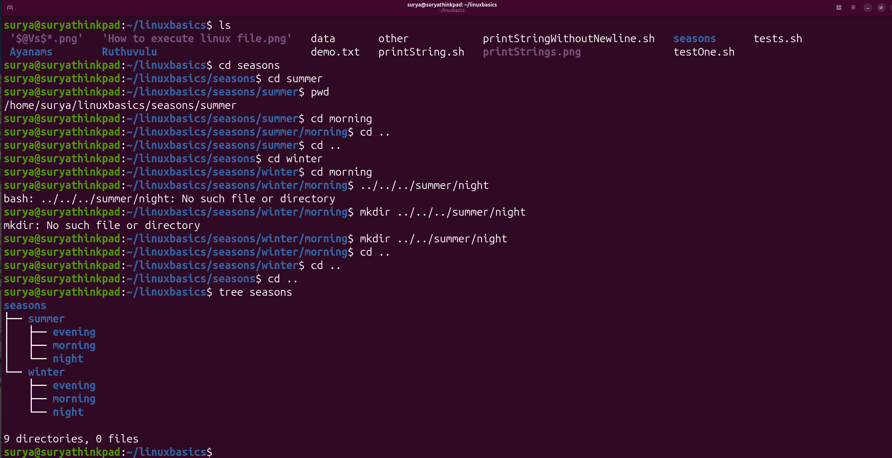


---

## Appendix — recording time map

| Approx. time | Frame (90s spacing) | Topic                         |
| :----------- | :------------------ | :---------------------------- |
| 00:00        | f_0001              | Session title                 |
| 07:30        | f_0006–f_0008       | §3–§2 `test.sh` + definitions |
| 12:00–15:00  | f_0009–f_0011       | §4 tree                       |
| 16:30–22:30  | f_0012–f_0016       | §5 eg1                        |
| 24:00–28:30  | f_0017–f_0020       | §6 eg2                        |
| 30:00–36:00  | f_0021–f_0025       | §7–§9                         |

*Frames after ~36:08 repeat the summary slide in the recording file.*

---

*Class screenshots in `docs/assets/absolute-path-*.png` are extracted from the Nov 16 screencast. Extend with your lab PNGs in **My observation** blocks.*