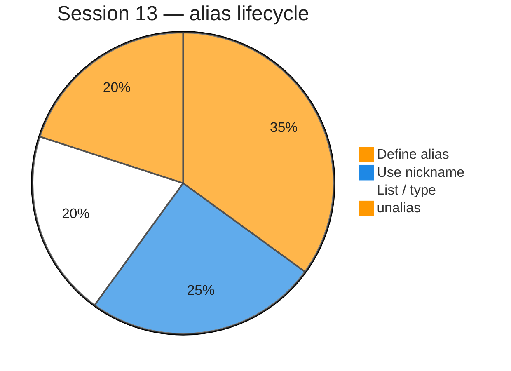

# Command aliasing (Session 13)

**Video:** [Session 13 — Command Aliasing](https://www.youtube.com/watch?v=2I-Qfa0HkBQ&list=PLd3UqWTnYXOloH0vWBs4BtSbP84WcC2NY&index=13)  
**Instructor:** Durga Sir  
**Course title (full syllabus):** Session 27 — *Command Aliasing*

**Prerequisites:** [PipingTeeXargs.md](PipingTeeXargs.md) (pipes, `tee`) · [Bash Built-in Commands.md](Bash%20Built-in%20Commands.md) (`alias`, `unalias`) · [redirection.md](redirection.md)

**Scripts:** [`scripts/commandAliasing.sh`](../../scripts/commandAliasing.sh) · [`scripts/commandAliasing/`](../../scripts/commandAliasing/)  
**Execution summary:** [`commandAliasing.md`](../../scripts-execution-summary/commandAliasing.md)

```bash
cd /path/to/Linux-Basics
bash scripts/commandAliasing.sh
```

---

**Table of contents**

- [1. Goal of this session](#1-goal-of-this-session)
- [2. What is command aliasing?](#2-what-is-command-aliasing)
- [3. `alias` — define a nickname](#3-alias--define-a-nickname)
- [4. List all aliases](#4-list-all-aliases)
- [5. `unalias` — remove aliases](#5-unalias--remove-aliases)
- [6. Original command still works](#6-original-command-still-works)
- [7. `type` — check a name before you define an alias](#7-type--check-a-name-before-you-define-an-alias)
- [8. Overwrite, multiple nicknames, alias of alias](#8-overwrite-multiple-nicknames-alias-of-alias)
- [9. Case sensitivity and `man`](#9-case-sensitivity-and-man)
- [10. Where we use aliases (five use cases)](#10-where-we-use-aliases-five-use-cases)
- [11. Class examples — `d20f` and `current`](#11-class-examples--d20f-and-current)
- [12. Temporary vs permanent aliases](#12-temporary-vs-permanent-aliases)
- [13. `~/.bashrc` and `~/.bash_aliases`](#13-bashrc-and-bash_aliases)
- [14. Exam-style recap](#14-exam-style-recap)
- [15. Session checklist](#15-session-checklist)
- [16. Script index](#16-script-index)

---

## 1. Goal of this session

After [Session 12](PipingTeeXargs.md), Durga Sir covers **command aliasing**: giving **short, comfortable names** to **long or unfamiliar commands**. When you type the nickname, the shell runs the **real command** behind it.

| Idea | Command | One-line role |
| :--- | :--- | :--- |
| **Define / list** | **`alias`** | Create a shortcut **or** print all aliases |
| **Remove** | **`unalias`** | Drop one alias **or** all (`-a`) |
| **Check name** | **`type`** | See if a name is already a command, alias, or file |



**Important:** Aliases apply to **commands**, not to **file names** on disk (Durga Sir closing note).

**In shell scripts:** Bash does **not** expand aliases in scripts unless you run **`shopt -s expand_aliases`** (see demo scripts under [`scripts/commandAliasing/`](../../scripts/commandAliasing/)). At the **interactive prompt**, aliases work as in class.

---

## 2. What is command aliasing?

**Alias** = **alternate name** (nickname) for a Unix/Linux **command**.

| Durga Sir wording | Meaning |
| :--- | :--- |
| Nickname / pet name | You type **`cls`**; shell runs **`clear`** |
| Avoid long commands every time | One short name replaces a long line you repeat |
| Internal execution | The **full original command** still runs — the shell expands the alias first |

Unlike Python (where rebinding a name can hide the original), in Linux **both** the **alias** and the **original command** usually remain available after you define an alias.

---

## 3. `alias` — define a nickname

**Syntax:**

```bash
alias nickname=original_command
```

| Part | Rule |
| :--- | :--- |
| **`nickname`** | What you type at the prompt |
| **`=`** | **No spaces** before or after `=` (most common class mistake) |
| **`original_command`** | The real command (often quoted) |

**Valid (class board):**

```bash
alias cls=clear
alias cls='clear'
alias cls="clear"
alias rename='mv'
```

**Invalid — spaces around `=` or after `alias`:**

```bash
alias cls =clear      # space before =
alias cls= clear      # space after =
alias cls clear=mv    # space after alias name
```

**Windows habit → Linux (class demo):**

```bash
alias cls=clear
cls          # works on Linux after alias; plain cls fails without it
```

Quotes are **optional** for simple commands; use quotes when the replacement contains **spaces**, **pipes**, or **`;`**.

**Multiple commands in one alias (class):** semicolon is allowed:

```bash
alias d20f='mkdir -p dir1 && touch dir1/file{1..20}.txt'
```

---

## 4. List all aliases

```bash
alias
```

With **no arguments**, **`alias`** prints **every** alias in the **current shell** — including defaults such as **`ll`** → **`ls -l`** (Durga Sir points at **`ll`** and **`ls`** on Ubuntu).

**Two purposes of `alias` (exam):**

1. **Define** a nickname: `alias name=command`
2. **List** nicknames: `alias` alone

---

## 5. `unalias` — remove aliases

| Command | Effect |
| :--- | :--- |
| **`unalias cls`** | Remove **only** the **`cls`** alias |
| **`unalias -a`** | Remove **all** aliases in **this shell** (including many **default** ones — use carefully) |

After **`unalias cls`**, **`cls`** fails; **`clear`** still works.

---

## 6. Original command still works

**Q (class):** After `alias cls=clear`, does **`clear`** still work?

**A:** **Yes.** You may use **either** the nickname **or** the original command.

---

## 7. `type` — check a name before you define an alias

Before creating a nickname, check whether the name is free:

```bash
type cls
type cls1
```

| Output | Meaning |
| :--- | :--- |
| **`cls is aliased to 'clear'`** | Name already used as alias |
| **`bash: type: cls1: not found`** | Safe to use **`cls1`** as a new alias (class) |

Durga Sir: use **`type`** + your proposed name — not a separate “alias check” subcommand.

---

## 8. Overwrite, multiple nicknames, alias of alias

| Topic | Durga Sir rule |
| :--- | :--- |
| **Same alias name, new command** | Like **`x=10`** then **`x=20`** — **last definition wins** (`alias cls=clear` then `alias cls=date` → **`cls`** runs **`date`**) |
| **Several aliases, one command** | Allowed — e.g. two nicknames for **`mv`** |
| **One alias name, two commands** | **Not** two targets at once — duplicate name → **conflict**; last wins |
| **Alias of alias** | Allowed: `alias cls=clear` then `alias C=cls` → **`C`** runs **`clear`** (class: **`C`** → **`cls`** → **`date`** in one demo). If **`type C`** fails on your Bash, use **`alias \| grep C`** or a longer nickname like **`cc`**. |

---

## 9. Case sensitivity and `man`

- **Aliases are case-sensitive** — **`CLS`**, **`Cls`**, and **`cls`** are different names.
- **`man current`** or **`man cls`** — **no man page** for a nickname (class). **`man`** documents **real** commands (`clear`, `mv`, `ls`), not your aliases.

---

## 10. Where we use aliases (five use cases)

Durga Sir lists **application areas**:

| # | Use case | Example |
| :---: | :--- | :--- |
| **1** | **Long command repeated often** | Short name for mkdir + many `touch` lines |
| **2** | **Your OS commands on Linux** | `alias cls=clear`, `alias rename=mv` |
| **3** | **Typos / swapped letters** | `alias grp=grep` so **`grp`** still runs **`grep`** |
| **4** | **Language / comfort words** | `alias datm=date`, `alias ky=cp`, `alias jaru=mv` (Telugu/German examples in class) |
| **5** | **Pipelines you run in every folder** | Alias wrapping `ls`, `tee`, `wc` ([§11](#11-class-examples--d20f-and-current)) |

---

## 11. Class examples — `d20f` and `current`

### `d20f` — directory + 20 files in one shot

**Long form (every time):**

```bash
mkdir -p dir1 && touch dir1/file{1..20}.txt
```

**Alias (class nickname `d20f` / `D20F`):**

```bash
alias d20f='mkdir -p dir1 && touch dir1/file{1..20}.txt'
d20f
ls dir1
```

Works from **any** working directory — creates **`dir1`** **here** and 20 files inside.

**Note:** The alias is tied to **`dir1`** in the command text. For **`dir2`** you need a **different** alias (class Q&A).

### `current` — list cwd, save listing, print line count

**Requirement (class):** List files in **current directory**, save to **`output.txt`**, show **line count** on terminal.

```bash
alias current='ls -l | tee output.txt | wc -l'
current
cat output.txt
```

Uses [§10 `tee`](PipingTeeXargs.md#10-tee--write-to-file-and-screen) from Session 12. Count changes per directory (8 on desktop, 72 in home, 17 in scripts folder — class numbers).

---

## 12. Temporary vs permanent aliases

| | Session alias | Permanent alias |
| :--- | :--- | :--- |
| **Lifetime** | **Current terminal / shell only** | Survives **new terminals** and **reboot** |
| **Default** | **`alias` at prompt** | Must add to startup files |
| **After close terminal** | **Gone** (`cls`, `current`, `d20f` lost) | Still there if saved in **`~/.bashrc`** or **`~/.bash_aliases`** |

Durga Sir demo: close terminal → open new → custom aliases missing; built-in defaults like **`ll`** may still exist from system files.

---

## 13. `~/.bashrc` and `~/.bash_aliases`

**Method 1 — edit `~/.bashrc`**

- File lives in **home directory**: **`~/.bashrc`** (hidden — use **`ls -a ~`** or show hidden files in editor).
- Add at **end** (recommended):  
  `alias cls=clear`  
  `alias dd='date; date; date'`
- **New terminal** runs **`~/.bashrc`** automatically → aliases appear.
- Or run: **`source ~/.bashrc`** to reload in the **current** shell (class: sometimes still need a fresh terminal to match class demo).

**Method 2 — `~/.bash_aliases`**

- **File name is fixed:** **`~/.bash_aliases`** in **home** (Durga Sir: kernel/Bash startup looks for this name).
- Put your aliases there; **`~/.bashrc`** usually sources it on login.
- **Wrong file name** → file is **not** auto-loaded.

**Not for all users:** Class mentions **`/etc/profile`** for system-wide setup (advanced; personal labs use **`~`** files).

**Warning:** Do not alias **`date=cal`** in shared **`~/.bashrc`** without thinking — you lose normal **`date`** behavior for that user (class joke example).

---

## 14. Exam-style recap

**Valid alias definitions?**

| Line | Valid? |
| :--- | :---: |
| `alias rename=mv` | Yes |
| `alias rename='mv'` | Yes |
| `alias rename="mv"` | Yes |
| `alias rename =mv` | No (space before `=`) |
| `alias rename= mv` | No (space after `=`) |
| `alias rename mv=mv` | No (space after alias name) |

**`alias` command purposes:** (1) **define** (2) **list**

**Keep aliases permanent in:** **`~/.bashrc`** **or** **`~/.bash_aliases`**

**Piping + tee in alias (Session 12 link):**  
`A | B | tee results.txt | C` saves **B**’s output — see [PipingTeeXargs.md §20 Questions](PipingTeeXargs.md#20-questions).

---

## 15. Session checklist

- [ ] Define `alias cls=clear` and run `cls` and `clear`
- [ ] Run `alias` and find `ll`
- [ ] Run `type cls1` before and after `alias cls1=date`
- [ ] `unalias cls` and confirm `cls` fails
- [ ] Define `alias d20f='mkdir -p dir1 && touch dir1/file{1..20}.txt'` and verify 20 files
- [ ] Define `alias current='ls -l | tee output.txt | wc -l'` in a test folder
- [ ] Explain temporary vs `~/.bashrc` / `~/.bash_aliases`
- [ ] Run `bash scripts/commandAliasing.sh`

---

## 16. Script index

| Script | Topic |
| :--- | :--- |
| [`commandAliasing.sh`](../../scripts/commandAliasing.sh) | Run all Session 13 demos |
| [`alias-define-list-demo.sh`](../../scripts/commandAliasing/alias-define-list-demo.sh) | Define `cls`, list, quoting |
| [`alias-syntax-spacing-demo.sh`](../../scripts/commandAliasing/alias-syntax-spacing-demo.sh) | Valid `=` spacing |
| [`alias-type-unalias-demo.sh`](../../scripts/commandAliasing/alias-type-unalias-demo.sh) | `type`, `unalias`, overwrite |
| [`alias-chain-demo.sh`](../../scripts/commandAliasing/alias-chain-demo.sh) | Alias of alias |
| [`alias-long-d20f-demo.sh`](../../scripts/commandAliasing/alias-long-d20f-demo.sh) | `d20f` lab |
| [`alias-current-pipeline-demo.sh`](../../scripts/commandAliasing/alias-current-pipeline-demo.sh) | `current` + `tee` |
| [`alias-typo-and-os-demo.sh`](../../scripts/commandAliasing/alias-typo-and-os-demo.sh) | `grp=grep`, `rename=mv` |
| [`alias-persistence-hint-demo.sh`](../../scripts/commandAliasing/alias-persistence-hint-demo.sh) | Permanent files hint |

Full command tables: [`scripts-execution-summary/commandAliasing.md`](../../scripts-execution-summary/commandAliasing.md).
