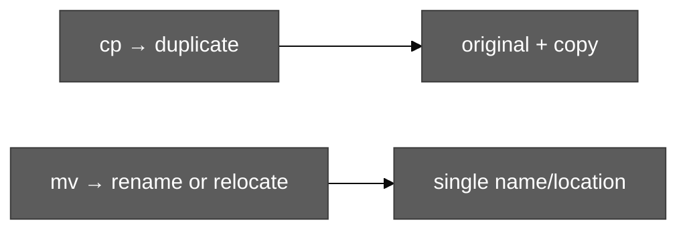
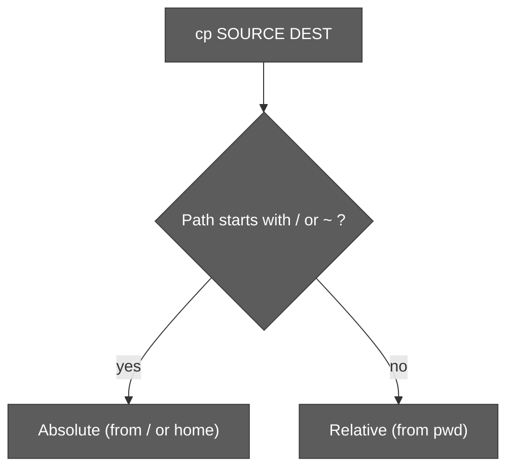
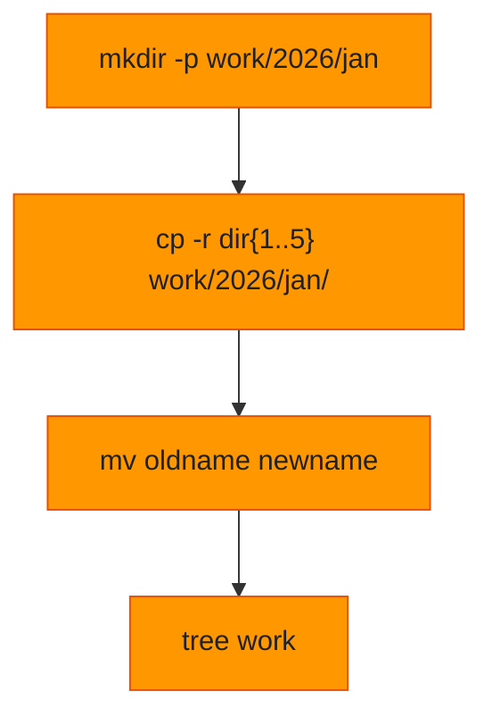

# Copy, Move, and Renaming (`cp`, `mv`)

**Course:** [Linux with Shell Programming — Durga Soft online](https://www.durgasoftonline.com/s/courses/5e7ae04f0cf29f148a043786/take)  
**Instructor:** Durga Sir  

**Source recording (local — not on GitHub):**  
`~/Study/Linux-Basics/ScreenRecordings/Screencast From 2026-11-17 10-13-53.webm`  
*(Keep this file on your PC only; see [`ScreenRecordings/README.md`](../../ScreenRecordings/README.md).)*

**Prior topics:** [removeDirectories.md](removeDirectories.md) · [absolutePathvsRelativePath.md](absolutePathvsRelativePath.md)

**Practice scripts:** [`copy-move-rename-demo.sh`](../../scripts/file-system-navigation-and-hierarchy/copy-move-rename-demo.sh) · [`extract-screencast-frames.sh`](../../scripts/file-system-navigation-and-hierarchy/extract-screencast-frames.sh) (run locally on the `.webm`)

**Your lab notes:** After each section, paste **your** terminal screenshot under *My observation* (same style as [removeDirectories.md](removeDirectories.md)).

---

**Table of contents**

- [0. What this session covers](#0-what-this-session-covers)
- [1. `cp` — copy files (same directory)](#1-cp--copy-files-same-directory)
- [2. `cp` — copy into another directory](#2-cp--copy-into-another-directory)
- [3. Absolute vs relative paths with `cp`](#3-absolute-vs-relative-paths-with-cp)
- [4. `cp -r` — copy directories recursively](#4-cp--r--copy-directories-recursively)
- [5. Useful `cp` options (`-i`, `-v`, `-u`)](#5-useful-cp-options--i--v--u)
- [6. `mv` — rename in the same place](#6-mv--rename-in-the-same-place)
- [7. `mv` — move file or directory](#7-mv--move-file-or-directory)
- [8. `mv` with absolute and relative paths](#8-mv-with-absolute-and-relative-paths)
- [9. `cp` vs `mv` — when to use which](#9-cp-vs-mv--when-to-use-which)
- [10. Case study — reorganise Desktop folders](#10-case-study--reorganise-desktop-folders)
- [11. Common mistakes (class)](#11-common-mistakes-class)
- [Appendix — map frames from your screencast](#appendix--map-frames-from-your-screencast)

---

## 0. What this session covers

Typical Durga Soft order after **create / remove / paths**:

| Topic | Command ideas |
| :---- | :-------------- |
| Copy files | `cp src dest` |
| Copy many files into one folder | `cp f1 f2 f3 targetDir/` |
| Copy trees | `cp -r dir1 dir2` |
| Rename | `mv oldname newname` (same directory) |
| Move | `mv file otherDir/` |
| Paths | Same **absolute** (`/home/...`) and **relative** (`../`, `./`) rules as [absolutePathvsRelativePath.md](absolutePathvsRelativePath.md) |



**Class screenshot:** *(add PNG from `Screencast … 2026-11-17` ~03:00 — EditPlus section **Copying / Moving / Renaming**.)*

**My observation:** *(run `bash scripts/.../copy-move-rename-demo.sh` and screenshot the first block.)*

---

## 1. `cp` — copy files (same directory)

**Idea:** **`cp`** makes a **second file**; the **original stays**.

```bash
cp file1 file2
```

- **`file1`** — source (must exist).
- **`file2`** — new file (created; if it already exists, it is **overwritten** unless you use **`-i`**).

**What happens line by line:**

1. Shell finds **`file1`** in the **current working directory** (unless you give a path).
2. Kernel creates **`file2`** with the **same contents**.
3. Both names appear in **`ls`**.

**My observation:** `touch a.txt; echo one > a.txt; cp a.txt b.txt; cat a.txt b.txt` — screenshot.

---

## 2. `cp` — copy into another directory

When the **destination is a directory**, list several sources:

```bash
cp demo.txt notes.txt Desktop/
```

Rules:

- **`Desktop/`** must exist and be a **directory** (trailing `/` is a good habit).
- Each source file is copied **into** that directory with the **same basename**.

**My observation:** screenshot `ls` before and after.

---

## 3. Absolute vs relative paths with `cp`

From **`/home/durga`** (example cwd in class):

| Style | Example |
| :---- | :------ |
| Relative | `cp scripts/test.sh scripts/test.bak` |
| Relative with `.` | `cp ./scripts/test.sh ./backup/test.sh` |
| Absolute | `cp /home/durga/scripts/test.sh /home/durga/backup/test.sh` |

**My observation:** copy one file using **only** `~/…` and **only** `../…` — two screenshots.



---

## 4. `cp -r` — copy directories recursively

Plain **`cp mydir other`** fails — a directory is not a regular file.

```bash
cp -r dir1 dir2
```

- **`-r`** (recursive): copy **`dir1`** and **everything inside** to **`dir2`**.
- If **`dir2`** does not exist, it is **created** as a copy of the tree.
- If **`dir2`** exists, **`dir1`** often ends up as **`dir2/dir1`** (depends on whether **`dir2`** is a directory — class demos both; verify with **`tree`**).

**Compare with remove session:** [removeDirectories.md](removeDirectories.md) used **`rm -r`** to delete trees; **`cp -r`** duplicates them.

**Class screenshot:** *(frame ~15:00–20:00 from your `.webm` — terminal `cp -r` + `tree`.)*

**My observation:** `mkdir -p src/a; touch src/a/x; cp -r src dst; tree` — screenshot.

---

## 5. Useful `cp` options (`-i`, `-v`, `-u`)

| Option | Class meaning |
| :----- | :-------------- |
| **`-i`** | Interactive — ask before **overwrite** |
| **`-v`** | Verbose — print each file copied |
| **`-u`** | Update — copy only if source is **newer** than destination |

Examples:

```bash
cp -i demo.txt backup/demo.txt
cp -rv src dst
```

**My observation:** run `cp -iv` once and answer `n` — screenshot.

---

## 6. `mv` — rename in the same place

**Same directory, new name — file count unchanged:**

```bash
mv oldname.txt newname.txt
```

This is **rename**, not a second copy. **`ls`** shows only **`newname.txt`**.

**Class tie-in:** [commandAliasing.md](commandAliasing.md) — `alias rename='mv'`.

**My observation:** `mv a.txt alpha.txt; ls` — screenshot.

---

## 7. `mv` — move file or directory

Move into another folder:

```bash
mv report.txt Documents/
```

Move a **directory** (no **`-r`** needed for **`mv`**):

```bash
mv projects archive/
```

**Watch out:** If **`archive/`** already exists, **`mv projects archive/`** puts **`projects`** **inside** `archive/projects`, not rename **`projects`** → **`archive`**. Class uses **`ls`** first to avoid surprises.

**My observation:** demonstrate move vs accidental nest — two screenshots.

---

## 8. `mv` with absolute and relative paths

Same patterns as **`cd`** and **`cp`**:

```bash
mv ~/Desktop/demo.txt ~/Documents/demo.txt
mv ./demo.txt ../Documents/demo.txt
```

**From [creationOfDirectories.md](creationOfDirectories.md):** wrap an existing tree under a new parent:

```bash
mkdir dir0
mv dir1/dir2/dir3 dir0
```

**My observation:** screenshot the `mkdir` + `mv` pair.

---

## 9. `cp` vs `mv` — when to use which

| Goal | Command | Result |
| :--- | :------ | :----- |
| Keep two copies | **`cp`** | Original **and** destination exist |
| One name only | **`mv`** | Source path **gone**, dest has the data |
| Duplicate tree | **`cp -r`** | Two trees |
| Shift tree | **`mv`** | One tree at new location |

**My observation:** `wc -c` on before/after `mv` vs `cp` — screenshot optional.

---

## 10. Case study — reorganise Desktop folders

**Practice pattern (from class notes style):**

1. `mkdir -p work/2026/jan`
2. `cp -r ~/Desktop/dir{1..5} work/2026/jan/` *(backup copies)*
3. `mv ~/Desktop/oldname ~/Desktop/newname`
4. `tree work`

**My observation:** run on a throwaway folder under `/tmp` — full terminal screenshot.



---

## 11. Common mistakes (class)

| Mistake | Fix |
| :------ | :-- |
| `cp` directory without **`-r`** | Use **`cp -r`** |
| `cp` into wrong place (relative path) | Check **`pwd`** first |
| `mv dir existingDir` nests instead of rename | `ls -ld existingDir`; use a **new** name or **`mv dir existingDir/`** intentionally |
| Overwrite without warning | **`cp -i`** / **`mv -i`** |
| Expect undo | No Trash from plain **`rm`**; **`mv`** to Trash folder if you use GUI habits |

**My observation:** paste one mistake you hit in lab.

---

## Appendix — map frames from your screencast

Run on your PC (`~/Study/Linux-Basics`):

```bash
bash scripts/file-system-navigation-and-hierarchy/extract-screencast-frames.sh \
  "ScreenRecordings/Screencast From 2026-11-17 10-13-53.webm" \
  /tmp/copy-move-frames
```

Frame **`f_NNNN`** ≈ **(N − 1) × 90 s** in the video. Drop chosen PNGs into `docs/assets/` (e.g. `copy-cp-r-notes.png`) and link them in the sections above.

| Approx. time | Suggested section |
| :----------- | :---------------- |
| 00:00–05:00 | §0 title / §1 `cp` |
| 05:00–12:00 | §2–§3 paths |
| 12:00–22:00 | §4 `cp -r` |
| 22:00–35:00 | §5 options, §6–§7 `mv` |
| 35:00+ | §8–§11 case study & Q&A |

*(Replace this table after you align frames with EditPlus headings in your recording.)*

---

*Recording path is local only. Commit **this `.md`** and **`docs/assets/*.png`**, not the `.webm`.*