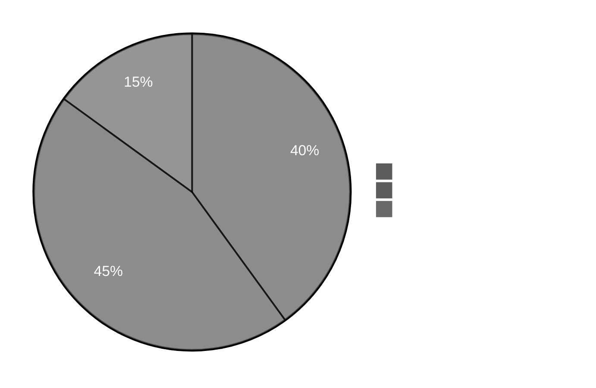
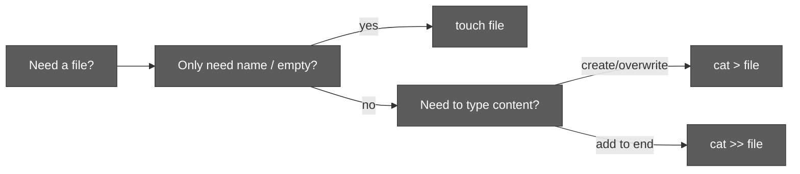
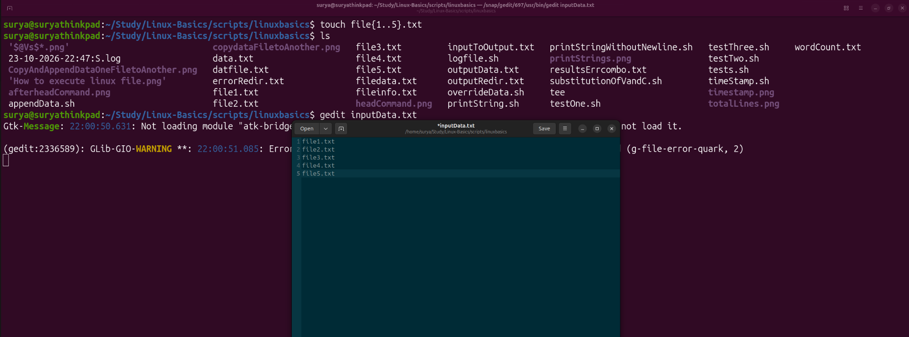
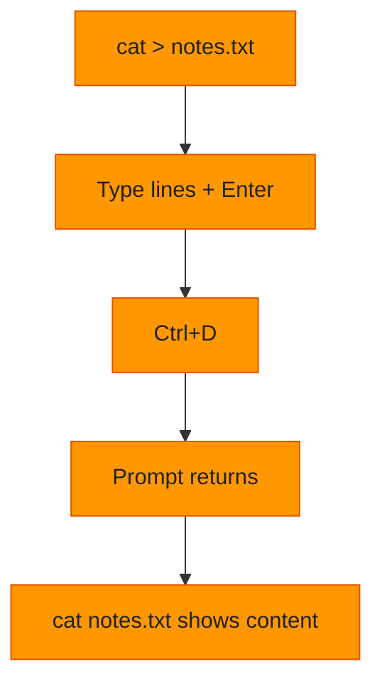
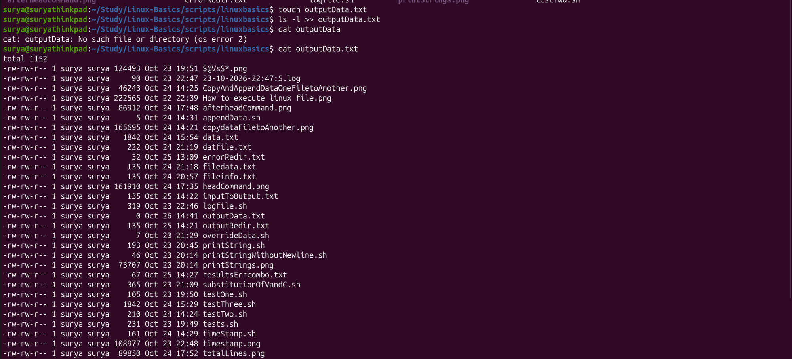
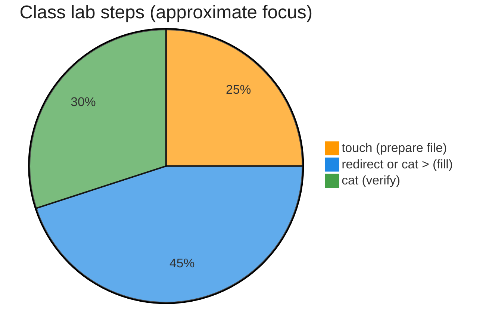

# Create Files by `touch` and `cat`

**Course:** [Linux with Shell Programming — Durga Soft online](https://www.durgasoftonline.com/s/courses/5e7ae04f0cf29f148a043786/take)  
**Instructor:** Durga Sir  

**Source recording (local — not on GitHub):**  
`/home/surya/Videos/Screencasts/` — *use your newest screencast for this session* (e.g. `Screencast From 2026-11-17 ….webm`; update this line with the exact filename from your folder).  

**Policy:** [`screencastWorkflow.md`](screencastWorkflow.md) — push **this `.md` + PNGs**, not the video.

**Related:** [TypesOfFilesInLinux.md](TypesOfFilesInLinux.md) (`touch`, normal files) · [redirection.md](redirection.md) (`cat >`, `>>`) · [viewContentOfFiles.md](viewContentOfFiles.md) (`cat` to display)

**Practice:** [`create-file-cat-touch-demo.sh`](../../scripts/file-system-navigation-and-hierarchy/create-file-cat-touch-demo.sh) · [`command-execution-touch-demo.sh`](../../scripts/components-of-unix/command-execution-touch-demo.sh) · [`cat-view-file-demo.sh`](../../scripts/view-content-of-files/cat-view-file-demo.sh)

Each section has **two** screenshot areas:

1. **Durga Sir class lab screenshot** — from the screencast or [`docs/assets/`](../assets/) PNG you extract from the video.  
2. **My observation** — **your** terminal on `suryathinkpad` / `~/linuxbasics`.

---

**Table of contents**

- [0. What this session covers](#0-what-this-session-covers)
- [1. Why we create files before `cat` and `gedit`](#1-why-we-create-files-before-cat-and-gedit)
- [2. `touch` — zero-byte (empty) file](#2-touch--zero-byte-empty-file)
- [3. `touch` — many files at once](#3-touch--many-files-at-once)
- [4. `touch` — update timestamp on existing file](#4-touch--update-timestamp-on-existing-file)
- [5. `ls -l` after `touch`](#5-ls--l-after-touch)
- [6. `cat > file` — create content from the keyboard](#6-cat--file--create-content-from-the-keyboard)
- [7. `cat >> file` — append without erasing](#7-cat--file--append-without-erasing)
- [8. `touch` then `cat` — typical class lab order](#8-touch-then-cat--typical-class-lab-order)
- [9. `touch` vs `cat` vs editors](#9-touch-vs-cat-vs-editors)
- [10. Practice questions](#10-practice-questions)
- [Appendix — extract class frames from your screencast](#appendix--extract-class-frames-from-your-screencast)

---

## 0. What this session covers

| Topic | Command / idea |
| :---- | :------------- |
| Empty file | `touch name.txt` |
| Many empties | `touch f1 f2 f3` or `touch file{1..5}.txt` |
| Create with text | `cat > file` then type lines, **Ctrl+D** |
| Append | `cat >> file` or `echo line >> file` |
| Verify | `ls -l`, `cat file`, `file file` |





**Durga Sir class lab screenshot:** *(add PNG from screencast ~00:00–02:00 — EditPlus heading for creation of files / touch.)*

**Path after extract:** `../assets/createFile-touch-session-title.png`

**My observation:** *(optional — photo of notes at session start.)*

---

## 1. Why we create files before `cat` and `gedit`

Durga Sir places **file creation** before **viewing** (`cat`, `more`) and **redirection** (`>` / `>>`).

- **`touch`** — fastest way to get a **normal, empty** file the kernel can track.  
- **`cat >`** — create file **and** fill it from the keyboard in one step.

**Durga Sir class lab screenshot:** *(EditPlus rules block — “everything is a file”, normal file contains data.)*

**My observation:** `file` on an empty `touch` file vs after `echo hi > f` — two-line screenshot.

---

## 2. `touch` — zero-byte (empty) file

```bash
touch demo.txt
ls -l demo.txt
```

**What it means:**

| Part | Meaning |
| :--- | :------ |
| `touch demo.txt` | Create **`demo.txt`** if missing; if it exists, update **timestamps** |
| `ls -l` | Size **0** until you add content |

**Durga Sir class lab screenshot:**

> **Pending:** Save a frame from your screencast as `docs/assets/createFile-touch-zero-byte-class.png`, then add:
> ``
>
> Until then, use the command block above in your lab.

**What the class screenshot should show (line by line):**

1. `touch demo.txt` at `durga@…~/Desktop$` — no output on success.  
2. `ls -l demo.txt` — `-rw-r--r--`, size **0**, current date/time.  
3. Optional: `file demo.txt` — **empty** or **ASCII text** when still zero bytes.

**My observation:**

> **Pending:** Add your terminal capture as `docs/assets/createFile-touch-zero-byte-my.png`, then link it here with `../assets/createFile-touch-zero-byte-my.png`.

---

## 3. `touch` — many files at once

```bash
touch a.txt b.txt c.txt
touch file{1..5}.txt
```

**Durga Sir class lab screenshot:**

> **Pending:** `docs/assets/createFile-touch-multiple-class.png` (class terminal: several names from one `touch`).

**What the class screenshot should show:**

1. One `touch` line with **several** filenames separated by spaces.  
2. `ls` listing all new files.

**My observation:** *(run `touch lab{1..3}.txt` and screenshot `ls`.)*

**Related class asset (touch + list for xargs lab):**



---

## 4. `touch` — update timestamp on existing file

```bash
touch demo.txt    # file already exists → times refresh, content unchanged
ls -l demo.txt
```

**Durga Sir class lab screenshot:**

> **Pending:** `docs/assets/createFile-touch-timestamp-class.png` (`ls -l` before/after second `touch`).

**My observation:** `sleep 2; touch demo.txt; ls -l` — compare mtime.

---

## 5. `ls -l` after `touch`

Class ties **`touch`** to **`ls -l`**:

- Leading **`-`** = normal file (not `d` directory).  
- Column **size** = **0** right after `touch`.  
- **Owner / group** = your user.

**Durga Sir class lab screenshot:**

> **Pending:** `docs/assets/createFile-ls-l-after-touch-class.png` (EditPlus + `ls -l`).

**My observation:** Same listing on `~/Study/Linux-Basics/scripts/linuxbasics`.

---

## 6. `cat > file` — create content from the keyboard

```bash
cat > notes.txt
```

Then type lines; press **Enter** after each; finish with **Ctrl+D** (end of input).

```bash
cat notes.txt
```

**Durga Sir class lab screenshot:**

> **Pending:** `docs/assets/createFile-cat-greater-class.png` (`cat >` lines, Ctrl+D).

**What the class screenshot should show (line by line):**

1. `cat > notes.txt` — cursor waits on next lines (no prompt).  
2. Typed text (two or three lines).  
3. **Ctrl+D** — returns to `$` prompt.  
4. `cat notes.txt` — same text printed.

**My observation:** Repeat on `notes.txt` in your practice folder — screenshot.



**See also:** [redirection.md §6](redirection.md#6-cat--file--keyboard-input-file-output)

---

## 7. `cat >> file` — append without erasing

```bash
cat >> notes.txt
# type more lines, Ctrl+D
```

Or:

```bash
echo "fourth line" >> notes.txt
```

**Warning:** **`>`** overwrites; **`>>`** appends.

**Durga Sir class lab screenshot:**

> **Pending:** `docs/assets/createFile-cat-append-class.png` (`cat >>` demo).

**My observation:**



**What this screenshot shows (line by line):**

1. `touch outputData.txt` — empty file ready.  
2. `ls -l >> outputData.txt` — **append** directory listing into the file (not only `cat`).  
3. `cat outputData` — error (missing `.txt`) — class habit: **full filename**.  
4. `cat outputData.txt` — long `ls -l` listing visible.

---

## 8. `touch` then `cat` — typical class lab order

Durga Sir often:

1. **`touch`** — guarantee file exists.  
2. **`>>` or `cat >`** — put data in.  
3. **`cat`** — verify on screen.

```bash
touch outputData.txt
ls -l >> outputData.txt
cat outputData.txt
```

**Durga Sir class lab screenshot:** *(combined terminal from screencast.)*

**My observation:** Same three commands in `~/Study/Linux-Basics/scripts/linuxbasics` — your PNG above or a fresh capture.



---

## 9. `touch` vs `cat` vs editors

| Tool | Creates empty? | Puts text in? | Typical use |
| :--- | :------------- | :------------ | :---------- |
| **`touch`** | Yes (0 bytes) | No | Placeholder, scripts, `>>` target |
| **`cat >`** | Yes + content | Yes (keyboard) | Quick few lines |
| **`gedit` / `nano`** | Yes + GUI | Yes | Longer editing |

**Durga Sir class lab screenshot:** *(comparison table in EditPlus.)*

**My observation:** `which gedit`; if snap missing, use `nano demo.txt` — screenshot (ties to gedit install fix).

---

## 10. Practice questions

**Q1.** Command to create **empty** `a.txt`?

- **Ans:** `touch a.txt`

**Q2.** Create `out.txt` with **three lines** typed at keyboard?

- **Ans:** `cat > out.txt`, type three lines, **Ctrl+D**

**Q3.** Add a fourth line **without** deleting first three?

- **Ans:** `cat >> out.txt` or `echo "fourth" >> out.txt`

**Durga Sir class lab screenshot:** *(MCQ block from screencast end.)*

**My observation:** Answer all three on your VM — one combined terminal screenshot.

---

## Appendix — extract class frames from your screencast

On **`suryathinkpad`**:

```bash
VIDEO="/home/surya/Videos/Screencasts/<exact-new-filename>.webm"
cd ~/Study/Linux-Basics
bash scripts/file-system-navigation-and-hierarchy/extract-screencast-frames.sh \
  "$VIDEO" /tmp/createFile-cat-touch-frames
```

Save frames into `docs/assets/` with the names used in this file (`createFile-touch-zero-byte-class.png`, …), then:

```bash
git add docs/topics/createFileByCatAndTouch.md docs/assets/createFile-*.png
git commit -m "Add cat/touch class screenshots from screencast"
git push origin master
```

| Suggested frame time | Asset name | Section |
| :------------------- | :--------- | :------ |
| ~03:00 | `createFile-touch-zero-byte-class.png` | §2 |
| ~06:00 | `createFile-touch-multiple-class.png` | §3 |
| ~12:00 | `createFile-cat-greater-class.png` | §6 |
| ~18:00 | `createFile-cat-append-class.png` | §7 |

*(Adjust times after you watch once.)*

---

*Durga class PNGs: extract from screencast. My observation PNGs: your `linuxbasics` terminal. Both are required for full practice.*