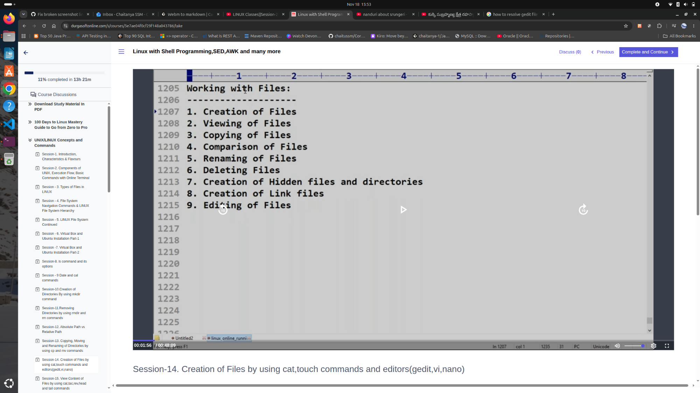
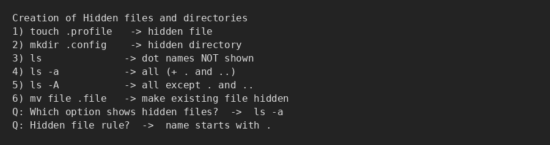
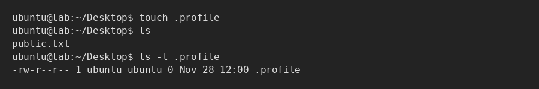
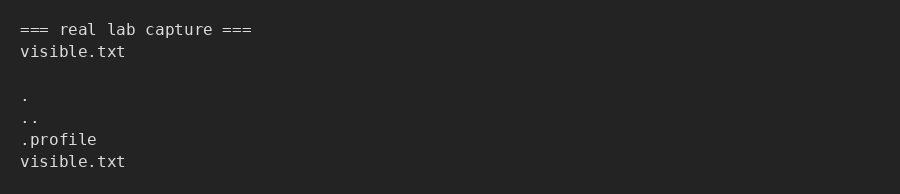
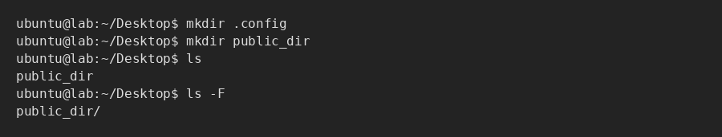
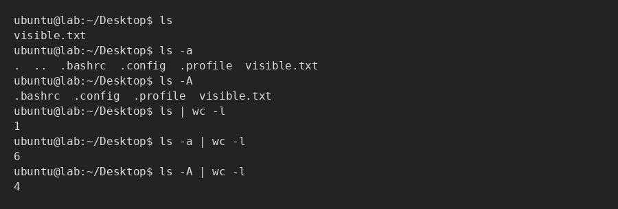
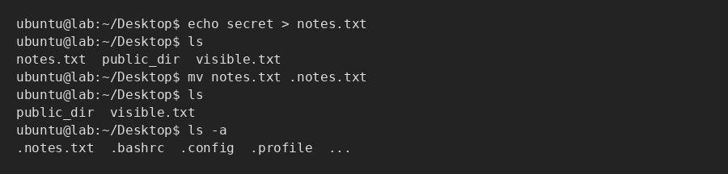

# Creation of Hidden Files and Directories

**Course:** [Linux with Shell Programming — Durga Soft online](https://www.durgasoftonline.com/s/courses/5e7ae04f0cf29f148a043786/take)  
**Instructor:** Durga Sir  
**Syllabus:** **Working with Files** — item **7** (see [`workingWithFiles.md`](workingWithFiles.md) on `master` for the full nine-topic file)  
**Source recording:** your latest screencast under `/home/surya/Videos/Screencasts/` (hidden files session — add filename when you push notes)  
**Related:** [ls Command and its options.md](ls%20Command%20and%20its%20options.md) (`-a`, `-A`) · [creationOfDirectories.md](creationOfDirectories.md) (`mkdir`) · [File System Navigation Commands And Hierarchy.md](File%20System%20Navigation%20Commands%20And%20Hierarchy.md) (`.` / `..`)

**Practice scripts:** [`create-hidden-files-and-dirs-demo.sh`](../../scripts/file-system-navigation-and-hierarchy/create-hidden-files-and-dirs-demo.sh) · [`ls-a-vs-A-hidden-demo.sh`](../../scripts/ls-command-and-its-options/ls-a-vs-A-hidden-demo.sh) · [`ls-dot-parent-demo.sh`](../../scripts/file-system-navigation-and-hierarchy/ls-dot-parent-demo.sh)



```bash
cd /path/to/Linux-Basics
bash scripts/file-system-navigation-and-hierarchy/create-hidden-files-and-dirs-demo.sh
```

---

**Table of contents**

- [0. What “hidden” means](#0-what-hidden-means)
- [1. Create hidden **file** — `touch`](#1-create-hidden-file--touch)
- [2. Create hidden **directory** — `mkdir`](#2-create-hidden-directory--mkdir)
- [3. Plain `ls` does not show hidden names](#3-plain-ls-does-not-show-hidden-names)
- [4. List hidden entries — `ls -a` and `ls -A`](#4-list-hidden-entries--ls--a-and-ls--a)
- [5. Long listing — `ls -la`](#5-long-listing--ls--la)
- [6. Make an existing file hidden — `mv`](#6-make-an-existing-file-hidden--mv)
- [7. Special names `.` and `..`](#7-special-names--and-)
- [8. Examples in `$HOME`](#8-examples-in-home)
- [9. Class practice questions](#9-class-practice-questions)
- [10. Script index](#10-script-index)
- [Appendix — validate assets](#appendix--validate-assets)

---

## 0. What “hidden” means

Durga Sir’s rule (same as Session 7 `ls` notes):

| Idea | Detail |
| :--- | :--- |
| **Hidden file or directory** | Name **starts with a dot** `.` |
| **Examples** | `.profile`, `.bashrc`, `.config/`, `.ssh/` |
| **Not magic** | Hidden only means **default `ls` skips the name** — the file still exists on disk |
| **GUI** | File managers often have **“Show hidden files”** (Ctrl+H in many desktops) |


**Durga Sir class lab screenshot — summary notes:**



---

## 1. Create hidden **file** — `touch`

Put the **dot** in the **filename** when you create the file:

```bash
touch .profile
touch .bashrc
touch .hidden_rc
ls -l .profile
```

| Command | Meaning |
| :--- | :--- |
| `touch .profile` | Create **hidden** empty file `.profile` (or refresh its time if it already exists) |
| `ls -l .profile` | You can still access it **by full name** even when `ls` alone hides it |

**Durga Sir class lab screenshot:**



**Real lab capture (agent VM):**



**My observation:** Run on your `~/Desktop` or `~/linuxbasics` folder; compare `ls` and `ls -a` right after `touch .profile`.

---

## 2. Create hidden **directory** — `mkdir`

```bash
mkdir .config
mkdir .data
mkdir public_dir
ls
ls -F
```

| Command | Meaning |
| :--- | :--- |
| `mkdir .config` | Hidden **directory** (configuration folder pattern used by many apps) |
| `ls` | Shows **`public_dir`** only — not `.config` |
| `ls -F` | Still hidden unless you add **`-a`**; **`/`** suffix marks directories when listed |

**Durga Sir class lab screenshot:**



**Extra examples (class / home):**

```bash
mkdir .ssh          # common in real systems (keys later)
mkdir .local        # user-local data
```

**My observation:** `cd .config` works even when `ls` does not show the name — you must **know** the dot name or use `ls -a`.

---

## 3. Plain `ls` does not show hidden names

```bash
touch visible.txt .profile
ls
```

**What you see:**

- **`visible.txt`** — yes  
- **`.profile`** — **no** (hidden)

This is why Durga Sir revisits **`ls -a`** in the **hidden files** topic and again in **`ls` options**.

---

## 4. List hidden entries — `ls -a` and `ls -A`

```bash
ls
ls -a
ls -A
ls | wc -l
ls -a | wc -l
ls -A | wc -l
```

| Option | Meaning |
| :--- | :--- |
| **`ls -a`** | **All** entries — includes **`.`**, **`..`**, and every dotfile |
| **`ls -A`** | **Almost all** — like **`-a`** but **hides only `.` and `..`** |

**Class count trick (Durga Sir):**

- If **`ls -a | wc -l`** = **6** and plain **`ls | wc -l`** = **1**, difference is **hidden + `.` + `..`** (depends what you created).
- **`ls -A | wc -l`** = **`ls -a | wc -l` − 2** (when `.` and `..` are the only extra dot entries).

**Durga Sir class lab screenshot:**



**Demo:** [`ls-a-vs-A-hidden-demo.sh`](../../scripts/ls-command-and-its-options/ls-a-vs-A-hidden-demo.sh)

```bash
bash scripts/ls-command-and-its-options/ls-a-vs-A-hidden-demo.sh
```

**My observation:** Add one more dotfile and re-run the three `wc -l` lines — watch **`-A`** grow by 1 but **`-a`** grow by 1 too (not always +2).

---

## 5. Long listing — `ls -la`

```bash
ls -la
ls -la ~
ls -lA
```

| Command | Use |
| :--- | :--- |
| **`ls -la`** | Long list **including hidden** (and `.` / `..`) |
| **`ls -lA`** | Long list, hidden, **without** `.` and `..` |

Typical columns: permissions, links, owner, group, size, date, **name** (dot names appear at the top).

**My observation:** In home, `ls -la ~ | head` often shows **`.bashrc`**, **`.profile`**, **`.bash_history`** on a configured account.

---

## 6. Make an existing file hidden — `mv`

You do **not** need to recreate the file — **rename** it so the name starts with `.`:

```bash
echo "secret data" > notes.txt
ls
mv notes.txt .notes.txt
ls
ls -a
```

**Unhide** (remove the dot from the name):

```bash
mv .notes.txt notes.txt
ls
```

**Durga Sir class lab screenshot:**



| Step | Effect |
| :--- | :--- |
| `mv notes.txt .notes.txt` | Same inode/data; **hidden** from plain `ls` |
| `mv .notes.txt notes.txt` | Visible again |

**My observation:** Same idea as renaming any file — only the **first character** `.` changes visibility in default `ls`.

---

## 7. Special names `.` and `..`

Every directory contains two **automatic** hidden entries:

| Name | Meaning |
| :--- | :--- |
| **`.`** | **Current** directory |
| **`..`** | **Parent** directory |

```bash
ls -a
cd .
cd ..
pwd
```

**Demo:** [`ls-dot-parent-demo.sh`](../../scripts/file-system-navigation-and-hierarchy/ls-dot-parent-demo.sh)

**My observation:** `ls` with **no** `-a` on an **empty-looking** folder is misleading — **`ls -a`** still shows **`.`** and **`..`**.

---

## 8. Examples in `$HOME`

Durga Sir points at real dotfiles in the user home directory:

```bash
ls -a ~
ls -a ~ | grep bash
cat ~/.bashrc    # if present — shell startup file (often hidden)
```

| File (typical) | Purpose |
| :--- | :--- |
| **`.bashrc`** | Interactive shell settings, aliases |
| **`.profile`** | Login / environment setup |
| **`.bash_history`** | Command history (hidden file) |

**My observation:** [`commandAliasing.md`](commandAliasing.md) — edit **`~/.bashrc`**; use **`ls -a ~`** to confirm the file exists.

---

## 9. Class practice questions

**Durga Sir class lab screenshot:**


### Q1 — Which command shows hidden files (and `.` / `..`)?

| Choice | Answer |
| :--- | :--- |
| `ls` | No |
| **`ls -a`** | **Yes** |
| `ls -r` | No (reverse **name** order only) |

### Q2 — Which option shows hidden files but **not** `.` and `..`?

| Choice | Answer |
| :--- | :--- |
| `ls -a` | Shows `.` and `..` too |
| **`ls -A`** | **Correct** |
| `ls -l` | Long list only; still hides dot names unless combined with `-a` |

### Q3 — How do you **create** a hidden empty file?

```bash
touch .filename
```

### Q4 — How do you **create** a hidden directory?

```bash
mkdir .dirname
```

### Q5 — `notes.txt` already exists. Make it hidden **without** deleting data.

```bash
mv notes.txt .notes.txt
```

**My observation:** Screenshot your answers in the terminal and save under `docs/assets/` if you want a personal *My observation* PNG.

---

## 10. Script index

| Script | Demonstrates |
| :--- | :--- |
| [`create-hidden-files-and-dirs-demo.sh`](../../scripts/file-system-navigation-and-hierarchy/create-hidden-files-and-dirs-demo.sh) | Full hidden topic lab in one run |
| [`ls-a-vs-A-hidden-demo.sh`](../../scripts/ls-command-and-its-options/ls-a-vs-A-hidden-demo.sh) | `visible.txt` + `.hidden_rc`, counts |
| [`ls-dot-parent-demo.sh`](../../scripts/file-system-navigation-and-hierarchy/ls-dot-parent-demo.sh) | `.` and `..` in parent/child |

---

## Appendix — validate assets

```bash
bash scripts/file-system-navigation-and-hierarchy/validate-docs-assets.sh
```

**Next:** [ls Command and its options.md](ls%20Command%20and%20its%20options.md) (options **`-a`** / **`-A`** in depth) · Working with Files item **8** — link files (on `master` [`workingWithFiles.md`](workingWithFiles.md)).