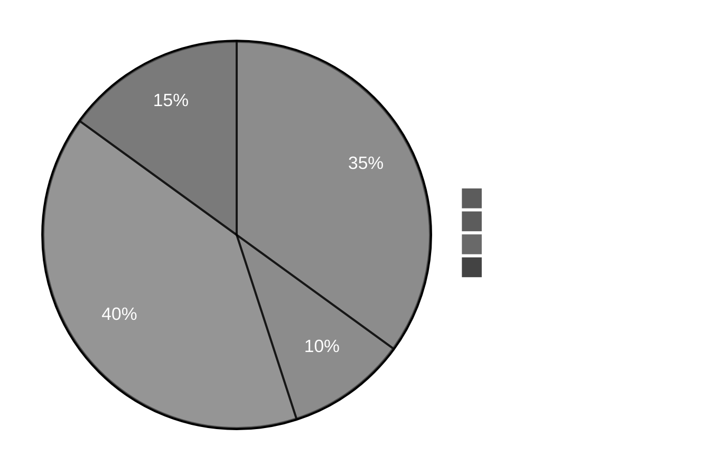
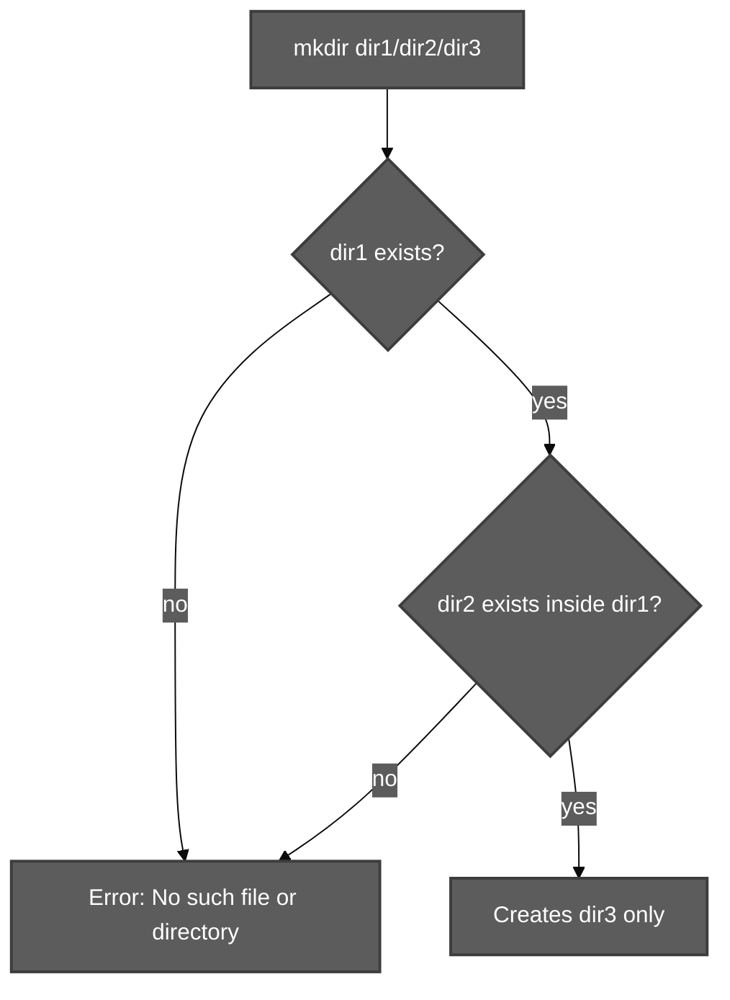
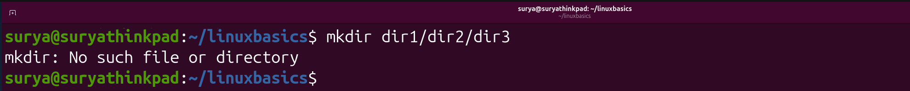
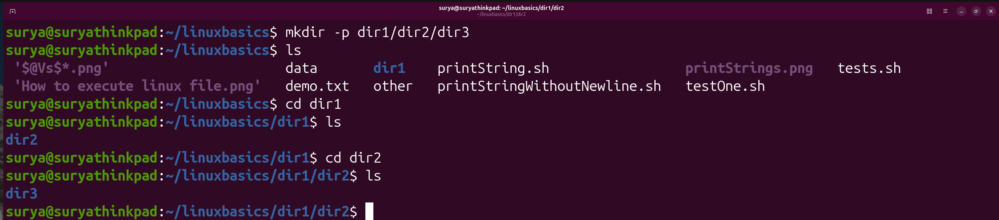
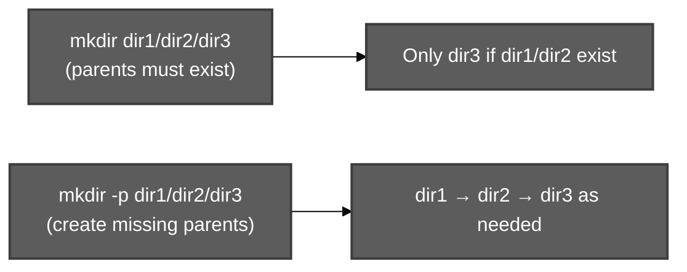
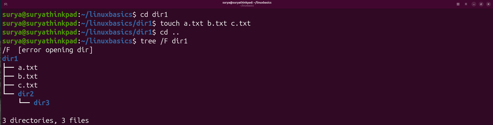
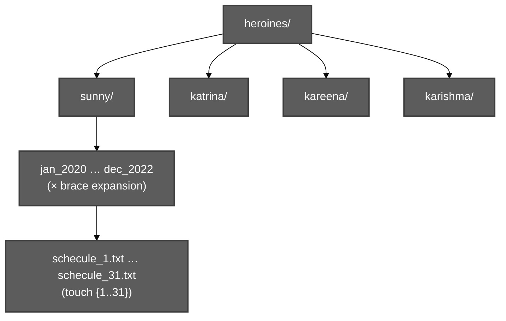

# Creation of Directories (`mkdir`) — Session 10

**Course:** [Linux with Shell Programming — Durga Soft online](https://www.durgasoftonline.com/s/courses/5e7ae04f0cf29f148a043786/take)  
**Instructor:** Durga Sir  
**Source recordings (repo):** [`ScreenRecordings/Screencast From 2026-11-09 17-32-23.webm`](../../ScreenRecordings/Screencast%20From%202026-11-09%2017-32-23.webm) (Part 1, ~39 min) · [`ScreenRecordings/Screencast From 2026-11-09 18-12-23.webm`](../../ScreenRecordings/Screencast%20From%202026-11-09%2018-12-23.webm) (Part 2, ~32 min)  
*(Screen capture only — no audio track; notes follow on-screen `linux_online_running_notes.txt` and live terminal/GUI demos.)*

**Prior class context (end of notes):** `ls`, `date`, `cal` — then **Working with Directories**.

**Practice scripts:** [`scripts/file-system-navigation-and-hierarchy/mkdir-dir1-dir2-demo.sh`](../../scripts/file-system-navigation-and-hierarchy/mkdir-dir1-dir2-demo.sh) · [`mkdir-navigation-tree-demo.sh`](../../scripts/file-system-navigation-and-hierarchy/mkdir-navigation-tree-demo.sh) · [`mkdir-ls-navigation-demo.sh`](../../scripts/file-system-navigation-and-hierarchy/mkdir-ls-navigation-demo.sh)

**Related topics:** [File System Navigation Commands And Hierarchy.md](File%20System%20Navigation%20Commands%20And%20Hierarchy.md) · [ls Command and its options.md](ls%20Command%20and%20its%20options.md) · [Date and Cal commands.md](Date%20and%20Cal%20commands.md)

---

**Table of contents**

- [Creation of Directories (`mkdir`) — Session 10](#creation-of-directories-mkdir--session-10)
  - [0. How the two recordings map to this session](#0-how-the-two-recordings-map-to-this-session)
  - [1. `mkdir` basics (Part 1)](#1-mkdir-basics-part-1)
  - [2. `mkdir -p` and restructuring (Part 1)](#2-mkdir--p-and-restructuring-part-1)
  - [3. `tree` (Part 1)](#3-tree-part-1)
  - [4. Case study — Heroines Schedule Manager (Part 1 → Part 2)](#4-case-study--heroines-schedule-manager-part-1--part-2)
  - [5. Brace expansion practice (Part 2)](#5-brace-expansion-practice-part-2)
  - [6. Case study — Diagram4 X / Y tree (Part 2)](#6-case-study--diagram4-x--y-tree-part-2)
  - [7. Interview Q\&A — `mkdir` vs `mkdir -p`](#7-interview-qa--mkdir-vs-mkdir--p)
  - [8. Chronological outline (full timeline)](#8-chronological-outline-full-timeline)
    - [Part 1 — `Screencast From 2026-11-09 17-32-23.webm`](#part-1--screencast-from-2026-11-09-17-32-23webm)
    - [Part 2 — `Screencast From 2026-11-09 18-12-23.webm`](#part-2--screencast-from-2026-11-09-18-12-23webm)
  - [9. Quick reference table](#9-quick-reference-table)

---

## 0. How the two recordings map to this session

Watch **Part 1 first**, then **Part 2**. Frame references below use **`f_NNNN`** ≈ **(N − 1) × 90 s** from the start of **that** file.

| Recording                        | Approx. length | Main content                                                                                                                                     |
| :------------------------------- | :------------- | :----------------------------------------------------------------------------------------------------------------------------------------------- |
| **`Screencast … 17-32-23.webm`** | ~39 min        | `mkdir` syntax, **`-p`**, **`tree`**, **Heroines** case study through first `mkdir -p` one-liner                                                 |
| **`Screencast … 18-12-23.webm`** | ~32 min        | GUI verify heroines tree, **`touch`** + `{1..31}`, **`tree`** counts, **dir{1..5}**, **X/Y** diagram, **`mkdir -p`** shortcuts, interview answer |




---

## 1. `mkdir` basics (Part 1)

**EditPlus — ~03:00 (f_0003):**

1. `mkdir dir1` — create **one** directory in the **current working directory**.
2. `mkdir dir1 dir2 dir3` — create **multiple sibling** directories (space-separated names).
3. `mkdir dir1/dir2/dir3` — path form: only the **last** name (`dir3`) is created **inside** existing parents.



**~07:30 (f_0006)** — typical failure when parents are missing:

```text
mkdir: cannot create directory 'dir1/dir2/dir3': No such file or directory
```
CMD lab reports with sample screenshots 

If we try to create the directories by providing `mkdir dir1/dir2/dir3` we will get bewlo error 



if we want to create multiple directories we have use below command 

`mkdir -p dir1/dir2/dir3`

-p means path of directories , dir1 created , dir2 will be created inisde dir1, dir3 will be created in dir2



Class Q&amp;A: Linux paths use **forward slash** `/`, not Windows `\`.

---

## 2. `mkdir -p` and restructuring (Part 1)

**~09:00 (f_0007):** `mkdir -p dir1/dir2/dir3` — **`-p` means parent path of directories** — create the **full chain** as needed.



**~10:30 (f_0008)** — terminal on `~/Desktop`: `cd ../../..`, `pwd` → `/home/durga/Desktop`, then `mkdir -p dir1/dir2/dir3`.

**~13:30 (f_0010)** — insert **`dir0`** above an existing `dir1/dir2/dir3`:

- `mkdir -p dir0/dir1/dir2/dir3`, **or**
- `mkdir dir0` then `mv dir1/dir2/dir3 dir0`

---

## 3. `tree` (Part 1)

**~15:00–19:30 (f_0011–f_0014)** — install and use **`tree`** to display a directory hierarchy:

```bash
sudo apt install tree
mkdir -p dir1/dir2/dir3
tree dir1
```
After installing tree we can see the tree diagram



Example output in notes: under `dir1` — `a.txt`, `b.txt`, `c.txt`, and `dir2` → `dir3`.

The `tree` command is useful for checking the nested directories created with `mkdir -p`.

## 4. Case study — Heroines Schedule Manager (Part 1 → Part 2)

**~22:30–27:00 (f_0016–f_0019)** — required layout:

- Top: `heroines/`
- Children: `sunny`, `katrina`, `kareena`, `karishma`
- Under each: month folders for **2020, 2021, 2022** (e.g. `jan2020`, `feb2020`, … or `jan_2020` style in GUI)
- In **every** month folder: `schedule_1.txt` … `schedule_31.txt` (notes use typo **`schecule_{1..31}.txt`**)

**Manual path (tedious):** `mkdir heroines` → `cd heroines` → `mkdir sunny katrina kareena karishma` → per heroine `cd` and long month lists.

**Smart path — ~33:00–37:30 (f_0023–f_0026):**

```bash
mkdir -p heroines/{sunny,katrina,kareena,karishma}/{jan,feb,mar,apr,may,jun,jul,aug,sep,oct,nov,dec}_202{0,1,2}
```

**Class Q:** `mkdir -p heroines/sunny/katrina/...` creates a **nested chain**, not four **sibling** folders under `heroines`.

**Part 2 — ~04:30 (f_0004)** — create all schedule files:

```bash
touch heroines/{sunny,katrina,kareena,karishma}/{jan,feb,mar,apr,may,jun,jul,aug,sep,oct,nov,dec}_202{0,1,2}/schecule_{1..31}.txt
```

**~09:00 (f_0007)** — `tree` summary: **148 directories, 4464 files**.



---

## 5. Brace expansion practice (Part 2)

**~12:00 (f_0009)** — question: create **dir1 … dir5**, each with **a.txt, b.txt, c.txt**.

**Answer (~13:30, f_0010):**

```bash
mkdir dir{1..5}
touch dir{1..5}/{a..c}.txt
```

**~15:00 (f_0011)** — `ls` shows existing `heroines` on Desktop, then `mkdir dir{1..5}`.

---

## 6. Case study — Diagram4 X / Y tree (Part 2)

**~16:30 (f_0012)** — target tree (class **Diagram4**):

```text
x/
  x1/
    x11/
    x12/
  x2/
y/
  y1/
    y11/
    y12/
  y2/
```

**Manual build (~22:30, f_0016):** absolute/relative `cd`, multiple `mkdir` arguments:

```bash
cd /home/durga/Desktop
mkdir x y
cd x && mkdir x1 x2
cd x1 && mkdir x11 x12
cd /home/durga/Desktop
cd y && mkdir y1 y2
cd y1 && mkdir y11 y12
```

**Condensed (~25:30–27:00, f_0018–f_0019):**

```bash
mkdir -p {x,y}
mkdir -p x/x1/x1{1,2}
```

(Analogous patterns apply for the `y` branch in class discussion.)

---

## 7. Interview Q&amp;A — `mkdir` vs `mkdir -p`

**~30:00 (f_0021–f_0022):**

| Command                   | Behavior                                                                      |
| :------------------------ | :---------------------------------------------------------------------------- |
| `mkdir dir1/dir2/dir3`    | Only **`dir3`** is created; **`dir1`** and **`dir2`** must **already exist**. |
| `mkdir -p dir1/dir2/dir3` | The **complete path** of directories is created as needed.                    |

---

## 8. Chronological outline (full timeline)

### Part 1 — `Screencast From 2026-11-09 17-32-23.webm`

| Approx. time | Frame  | Source             | Content                                                                                       | Topic                                |
| :----------- | :----- | :----------------- | :-------------------------------------------------------------------------------------------- | :----------------------------------- |
| 00:00        | f_0001 | EditPlus           | `Working with Directories:` (section header after `ls`, `date`, `cal`)                        | Transition into directory operations |
| 01:30        | f_0002 | VM GUI             | Ubuntu Files on **Desktop** — folder empty                                                    | Demo workspace on `~/Desktop`        |
| 03:00        | f_0003 | EditPlus           | **1.** `mkdir dir1` · **2.** `mkdir dir1 dir2 dir3` · **3.** `mkdir dir1/dir2/dir3` (started) | Basic `mkdir` syntax                 |
| 04:30        | f_0004 | EditPlus           | Continues point 3                                                                             | Nested path syntax                   |
| 06:00        | f_0005 | EditPlus           | Only **dir3** created; parents must exist                                                     | Relative path rule                   |
| 07:30        | f_0006 | EditPlus + Q&amp;A | `mkdir: cannot create directory ... No such file or directory`                                | Missing parents; `/` vs `\`          |
| 09:00        | f_0007 | EditPlus           | `4. mkdir -p dir1/dir2/dir3`                                                                  | **`-p` (parents)**                   |
| 10:30        | f_0008 | Terminal           | `cd ../../..`, `pwd`, `mkdir -p dir1/dir2/dir3`                                               | Live **`-p`** demo                   |
| 12:00        | f_0009 | EditPlus           | Q: insert **dir0** above existing tree                                                        | Restructuring                        |
| 13:30        | f_0010 | EditPlus           | `mkdir -p dir0/...` **or** `mkdir dir0` + `mv`                                                | **`-p` vs `mv`**                     |
| 15:00        | f_0011 | Terminal           | `sudo apt install tree`                                                                       | Install **`tree`**                   |
| 16:30        | f_0012 | Terminal           | Same install                                                                                  |                                      |
| 18:00        | f_0013 | EditPlus           | `tree dir1` example output                                                                    | Notes                                |
| 19:30        | f_0014 | Terminal           | `mkdir -p` + `tree dir1`                                                                      | Demo                                 |
| 21:00        | f_0015 | EditPlus           | `mkdir -p` recap                                                                              |                                      |
| 22:30        | f_0016 | EditPlus           | **Heroines Schedule Manager** intro                                                           | Case study                           |
| 24:00        | f_0017 | EditPlus           | 3 years of month folders per heroine                                                          |                                      |
| 25:30        | f_0018 | EditPlus           | `schedule_1` … `schedule_31` per month                                                        | **`touch`** later                    |
| 27:00        | f_0019 | EditPlus           | Full spec block                                                                               | Requirements                         |
| 28:30        | f_0020 | EditPlus           | `$ mkdir heroines`                                                                            | Step 1                               |
| 30:00        | f_0021 | EditPlus           | Manual heroine dirs; Q on `-p` with slashes                                                   | **Q&amp;A**                          |
| 31:30        | f_0022 | EditPlus           | Long manual month `mkdir` lists                                                               | Tedious path                         |
| 33:00        | f_0023 | EditPlus           | `mkdir -p heroines/{sunny,katrina,kareena,karishma}`                                          | Brace expansion                      |
| 34:30        | f_0024 | EditPlus           | Same (highlighted)                                                                            | Emphasis                             |
| 36:00        | f_0025 | EditPlus           | Full nested brace one-liner                                                                   | All months × years                   |
| 37:30        | f_0026 | EditPlus           | Sample expanded paths                                                                         |                                      |
| 39:00        | f_0027 | Terminal           | Live `mkdir -p heroines/{...}/..._202{0,1,2}`                                                 | Run on Desktop                       |

### Part 2 — `Screencast From 2026-11-09 18-12-23.webm`

| Approx. time | Frame  | Source            | Content                                         | Topic             |
| :----------- | :----- | :---------------- | :---------------------------------------------- | :---------------- |
| 00:00        | f_0001 | Files GUI         | `Desktop/heroines/sunny` — 36 month folders     | Verify **Part 1** |
| 01:30        | f_0002 | EditPlus          | Manual vs `mkdir -p` recap                      |                   |
| 03:00        | f_0003 | EditPlus          | `mkdir -p` one-liner; start `touch schecule_`   | **`touch`**       |
| 04:30        | f_0004 | EditPlus          | Full `touch .../schecule_{1..31}.txt`           | **`{1..31}`**     |
| 06:00        | f_0005 | Files GUI         | Under `may_2020`                                | GUI exploration   |
| 07:30        | f_0006 | EditPlus          | Complete automation lines                       |                   |
| 09:00        | f_0007 | Terminal          | `tree` → 148 dirs, 4464 files                   | Scale proof       |
| 10:30        | f_0008 | EditPlus          | *Linux...smart, powerful, strong*               |                   |
| 12:00        | f_0009 | EditPlus          | Practice **Q:** dir1–dir5 + a/b/c files         | Question          |
| 13:30        | f_0010 | EditPlus          | **A:** `mkdir dir{1..5}`                        | Range brace       |
| 15:00        | f_0011 | Terminal          | `ls`, `mkdir dir{1..5}`                         | Live              |
| 16:30        | f_0012 | Diagram           | **Diagram4** X/Y tree                           | Case study        |
| 18:00        | f_0013 | Diagram + Q&amp;A | Red marks; `tree dir{1..5}` suggestion          | Class chat        |
| 19:30        | f_0014 | EditPlus          | `touch dir{1..5}/{a..c}.txt`; start manual X/Y  | Answers           |
| 21:00        | f_0015 | Terminal          | `touch dir{1..5}/{a..c}.txt`                    | 15 files          |
| 22:30        | f_0016 | Terminal          | Manual `mkdir`/`cd` for X and Y                 | Stepwise build    |
| 24:00        | f_0017 | Terminal          | Empty `~/Desktop` prompt                        | Pause             |
| 25:30        | f_0018 | EditPlus          | `mkdir -p {x,y}`                                | Top-level brace   |
| 27:00        | f_0019 | EditPlus          | `mkdir -p x/x1/x1{1,2}`                         | **`-p` + brace**  |
| 28:30        | f_0020 | Files GUI         | `Desktop/y/y1`                                  | GUI check         |
| 30:00        | f_0021 | EditPlus          | **Q:** `mkdir dir1/dir2/dir3` vs `mkdir -p ...` | Interview         |
| 31:30        | f_0022 | EditPlus          | **A.** parents required vs full path            | Summary           |

---

## 9. Quick reference table

| #    | Syntax / command                                     | Meaning                                 |
| :--- | :--------------------------------------------------- | :-------------------------------------- |
| 1    | `mkdir dir1`                                         | Single directory in CWD                 |
| 2    | `mkdir dir1 dir2 dir3`                               | Multiple **sibling** directories        |
| 3    | `mkdir dir1/dir2/dir3`                               | Create **only** `dir3` if parents exist |
| 4    | `mkdir -p dir1/dir2/dir3`                            | Create **full path** as needed          |
| 5    | `mkdir dir0` + `mv dir1/dir2/dir3 dir0`              | Wrap existing subtree                   |
| 6    | `mkdir dir{1..5}`                                    | Numeric brace — `dir1` … `dir5`         |
| 7    | `mkdir -p heroines/{sunny,katrina,kareena,karishma}` | List brace under one parent             |
| 8    | Nested `{...}` + `_202{0,1,2}`                       | Heroines months × years                 |
| 9    | `mkdir -p x/x1/x1{1,2}`                              | `x11`, `x12` under `x/x1/`              |
| 10   | `touch dir{1..5}/{a..c}.txt`                         | Files inside dirs from `mkdir`          |

**Related commands this session:** `cd`, `pwd`, `cd ..`, `ls`, `mv`, `sudo apt install tree`, `tree`, `touch`.

---

*Outline from PNG frames at 90 s spacing — Part 1: `f_0001`–`f_0027`; Part 2: `f_0001`–`f_0022`.*
