# LINUX File System Continued (Part Two)

**Course:** [Linux with Shell Programming — Session 5 (paid portal)](https://www.durgasoftonline.com/s/courses/5e7ae04f0cf29f148a043786/take)  
**Instructor:** Durga Sir  
**Source recordings (repo):** [`ScreenRecordings/fileSystem1.webm`](../../../ScreenRecordings/fileSystem1.webm) · [`ScreenRecordings/fileSystem2.webm`](../../../ScreenRecordings/fileSystem2.webm)  
*(Screen capture only — no audio track; notes below match on-screen `linux_online_running_notes.txt` and live demos.)*

**Part one (Session 4):** [File System Navigation Commands And Hierarchy.md](../File%20System%20Navigation%20Commands%20And%20Hierarchy.md) — **`/bin`**, **`/sbin`**, **`/etc`**, navigation, FHS intro.

**Prerequisites:** [TypesOfFilesInLinux.md](../TypesOfFilesInLinux.md)

**Practice:** [`scripts/file-system-navigation-and-hierarchy/`](../../../scripts/file-system-navigation-and-hierarchy/)

---

**Table of contents**

- [0. How the two recordings map to this session](#0-how-the-two-recordings-map-to-this-session)
- [1. Diagram — full hierarchy (Diagram-3)](#1-diagram--full-hierarchy-diagram-3)
- [2. `4. tmp` directory](#2-4-tmp-directory)
- [3. `5. dev` directory](#3-5-dev-directory)
- [4. `6. mnt` and `7. media` — mounting](#4-6-mnt-and-7-media--mounting)
- [5. Windows drives vs Linux tree](#5-windows-drives-vs-linux-tree)
- [6. `8. opt` directory](#6-8-opt-directory)
- [7. `9. lib` directory](#7-9-lib-directory)
- [8. `10. var` directory](#8-10-var-directory)
- [9. `11. home` directory](#9-11-home-directory)
- [10. `12. root` directory and Q: `/` vs root](#10-12-root-directory-and-q--vs-root)
- [11. `13. proc` directory and `ps`](#11-13-proc-directory-and-ps)
- [12. `14. boot` directory](#12-14-boot-directory)
- [13. `15. usr` directory and closing notes](#13-15-usr-directory-and-closing-notes)
- [14. Live demos from the recordings](#14-live-demos-from-the-recordings)
- [15. Session checklist & interview Q&amp;A](#15-session-checklist--interview-qa)
- [16. Scripts](#16-scripts)

---

## 0. How the two recordings map to this session

| Recording | Approx. length | Main content in class |
| :--- | :--- | :--- |
| **`fileSystem1.webm`** | ~34 min | **`4. tmp`** notes; **Diagram-3** FHS tree; some terminal recap (home, permissions) |
| **`fileSystem2.webm`** | ~73 min | **`5. dev`** through **`14. boot`** (+ **`15. usr`** & summary); **`/dev`** & **`/proc`** demos; Windows **This PC** comparison |

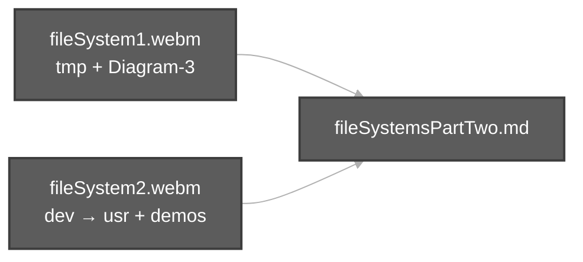

---

## 1. Diagram — full hierarchy (Diagram-3)

Durga Sir draws **Diagram-3 — File System Hierarchy** (see **`fileSystem1.webm`**):

- **`/`** at the top (root of the tree).
- Under **`/`**: **`bin`**, **`sbin`**, **`etc`**, **`dev`**, **`var`**, **`tmp`**, **`home`**, **`opt`**, **`root`**, …
- Under **`home`**: user folders **`durgasoft`**, **`ravi`**, **`shiva`**, **`pavan`**, …
- Under each user (e.g. **`durgasoft`**): **Desktop**, **Documents**, **Downloads**, **Music**, **Pictures**, **Videos**.

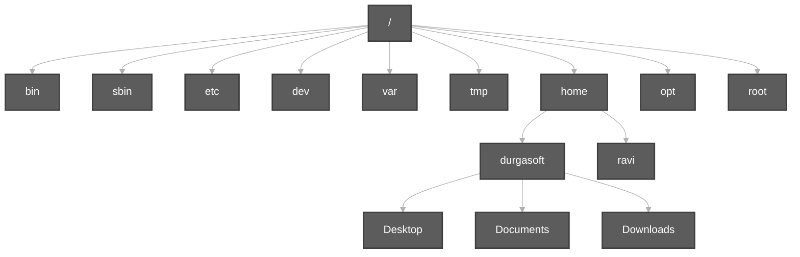

---

## 2. `4. tmp` directory

**From class notes (`fileSystem1.webm`):**

| Point | Durga Sir wording |
| :--- | :--- |
| Meaning | **tmp means temporary.** |
| Use | If any file or directory is required **just for temporary purpose in our current session** … |
| Lifetime | These files will be **deleted automatically at the time of system shutdown.** |
| Contrast | **`Desktop ===> demo.txt`** (normal persistent location) vs **`tmp ===> a.txt b.txt c.txt`** (session scratch files) |

**Permission example shown with the tmp scenario** (same notes): default file triplet **`rw-`**, **`r--`**, **`r--`** (owner read/write; group and others read-only).

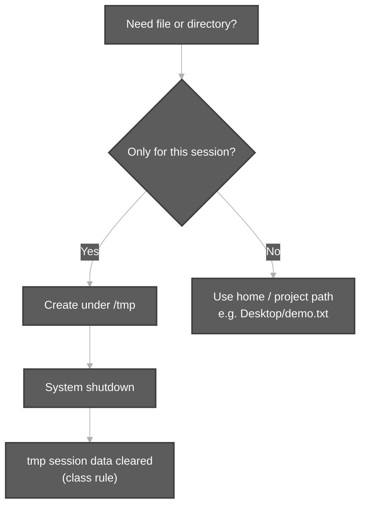

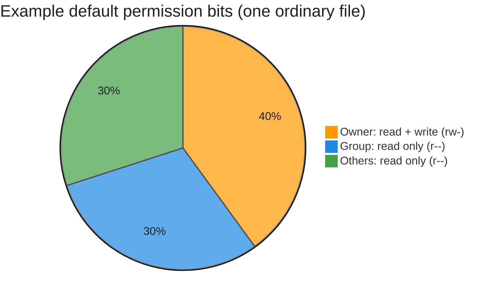

---

## 3. `5. dev` directory

**From class notes (`fileSystem2.webm`):**

| Point | Durga Sir wording |
| :--- | :--- |
| Meaning | **dev means device.** |
| Rule | **Every device in Linux is treated as file.** |
| Location | All device-related files are stored **inside dev directory.** |
| Purpose | **By using these files we can communicate with that device.** |

**Examples listed in notes:**

| Name | Meaning (class) |
| :--- | :--- |
| **`tty`** | Terminal-related file |
| **`fd`** | Floppy drive related file |
| **`hd`** | Hard disk related file |
| **`ram`** | RAM related file |
| **`stdin`** | Standard **input** device file (**keyboard**) |
| **`stdout`** | Standard **output** device file (**terminal/monitor**) |
| **`stderr`** | Standard **error** device file (**terminal/monitor**) |

**Demo:** `ls` under **`/dev`** shows **`stdin`**, **`stdout`**, **`stderr`**, many **`tty`** entries, **`loop*`**, **`sr0`**, etc. Use **`ls -l /dev`** to see **`c`** (character) devices and **`l`** (symlinks) — see [TypesOfFilesInLinux.md](../TypesOfFilesInLinux.md).

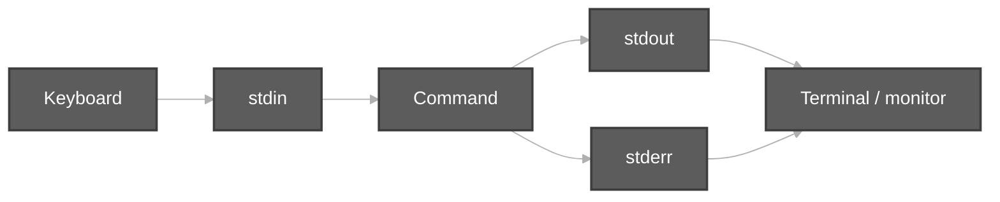

---

## 4. `6. mnt` and `7. media` — mounting

### `6. mnt` directory

| Point | Durga Sir wording |
| :--- | :--- |
| Meaning | **mnt means mounting.** |
| Old OS | In old operating systems, mounting was done **manually**. |
| New OS | In newer operating systems, mounting is performed **automatically**. |
| **`/mnt`** | **mnt directory contains files which are available just because of manual mounting.** |

### `7. media` directory

| Point | Durga Sir wording |
| :--- | :--- |
| **`/media`** | **The files of automatic mounting will be placed inside media directory.** |

### Interview question (class)

**Q. What is the difference between mnt and media directories?**

| Directory | Answer (class) |
| :--- | :--- |
| **`mnt`** | **contains manual mounting files** |
| **`media`** | **contains automatic mounting files** |

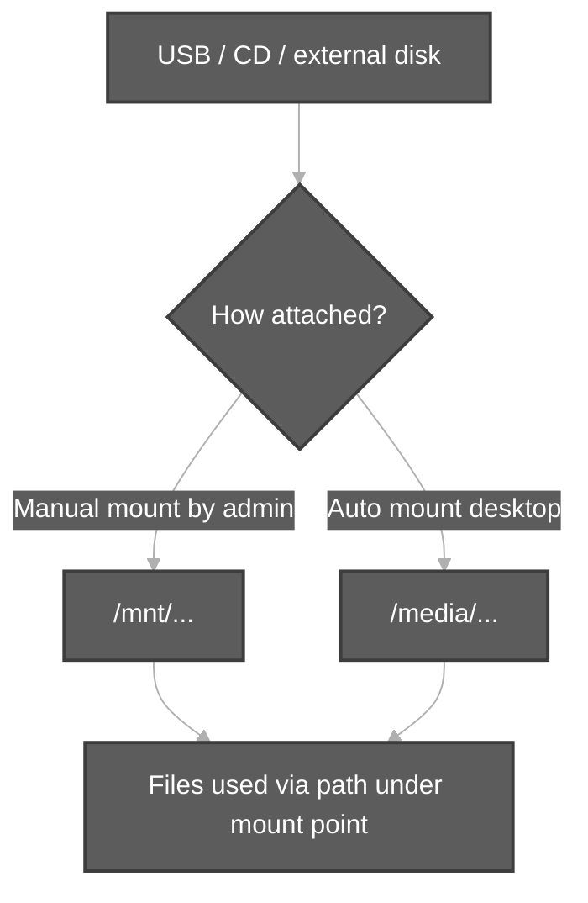

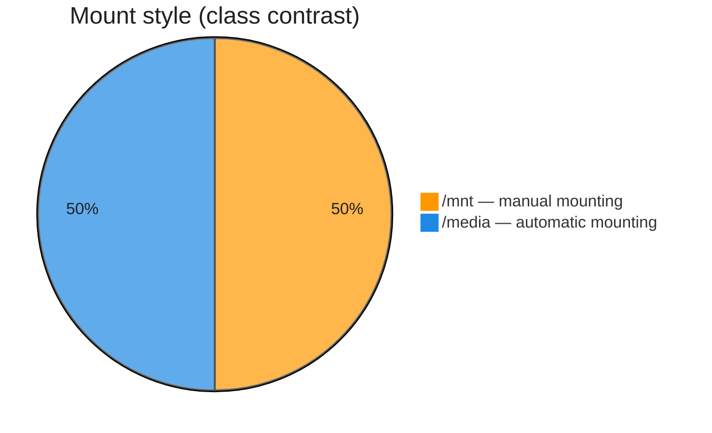

---

## 5. Windows drives vs Linux tree

**Demo (`fileSystem2.webm`):** Windows **This PC** shows **Local Disk (C:)**, **(D:)**, **(E:)**, DVD drive, etc.

Durga Sir’s point: Linux uses **one tree** from **`/`**; extra storage is **mounted as folders** (under **`/media`** or **`/mnt`**), not separate drive letters like **`C:`** / **`D:`**.

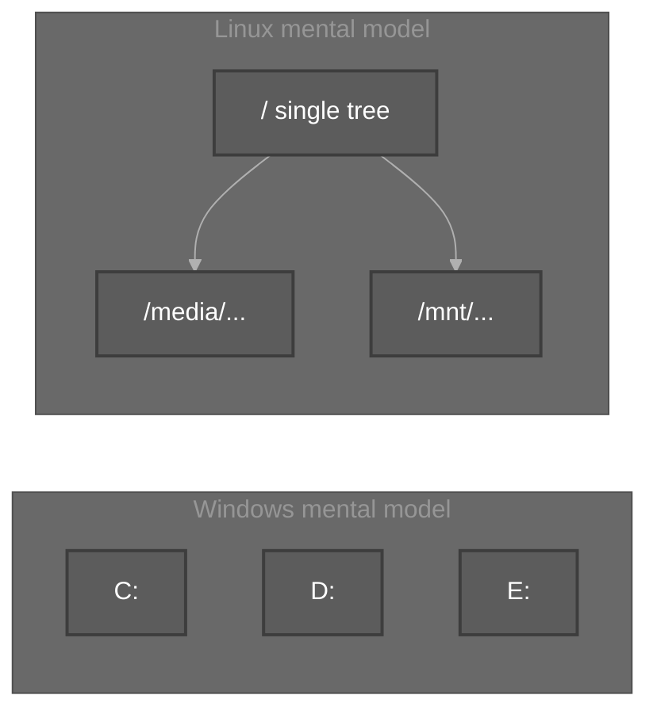

---

## 6. `8. opt` directory

| Point | Durga Sir wording |
| :--- | :--- |
| Meaning | **opt means optional.** |
| Contents | **This directory contains all 3rd party software installation files.** |
| Example | **google chrome** (explicit third-party install) |

---

## 7. `9. lib` directory

| Point | Durga Sir wording |
| :--- | :--- |
| Meaning | **lib means library** |
| Contents | **The libraries which are required by our commands and applications** |

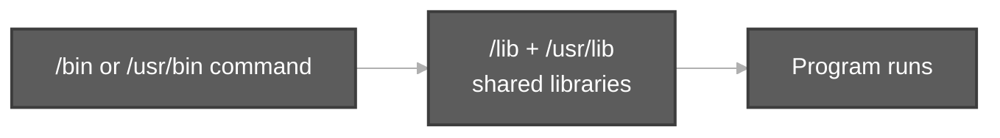

---

## 8. `10. var` directory

| Point | Durga Sir wording |
| :--- | :--- |
| Meaning | **var means variable data.** |
| Rule | If any data **keeps on changing**, such variable data is stored **inside var directory.** |
| Example | **log files** — **eg: log files** |

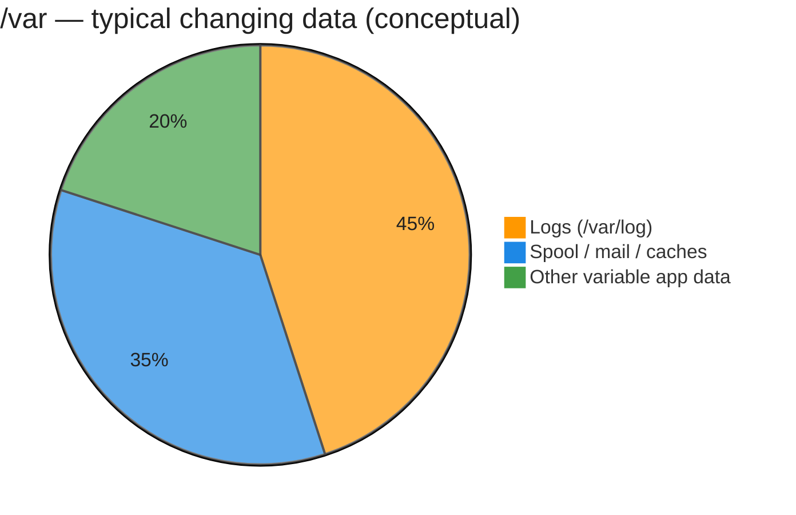

---

## 9. `11. home` directory

| Point | Durga Sir wording |
| :--- | :--- |
| Multi-user | **As linux multi user operating system.** |
| Per user | **For every user a separate directory will be created** to hold his specific data like **videos, images, documents** etc. |
| Location | **All these user directories will be stored inside home directory.** |
| Example | **`/home/durga`** — durga user home; contains **Desktop, Downloads, Movies, Pictures**, etc. (class also shows **`/home/ravi`**, **`ls /home`** with many users) |

**Demo (`fileSystem2.webm`):** File manager under **`/home/durga`** — Desktop, Documents, Downloads, scripts, sample **`.txt`**, **`.sh`**, **`.mp4`**, etc.

---

## 10. `12. root` directory and Q: `/` vs root

**From notes:**

| Path | Meaning (class) |
| :--- | :--- |
| **`/home/durga`** | durga user home directory |
| **`/home/ravi`** | ravi user home directory |
| **`/root`** | **home directory of root user / super user** |

**Q. What is the difference between `/` and root directories?**

| Symbol / path | Answer (class) |
| :--- | :--- |
| **`/`** | **acts as root for Linux file system. It is the topmost directory of linux file system.** |
| **`root`** | **subdirectory of `/`, which acts as home directory for the super user.** |

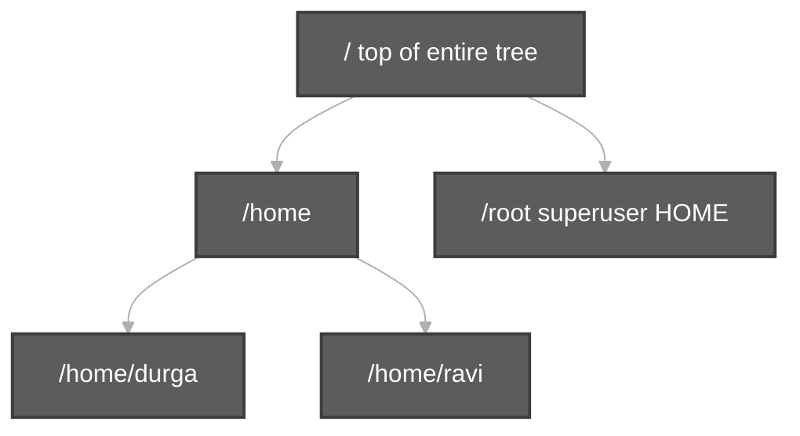

---

## 11. `13. proc` directory and `ps`

| Point | Durga Sir wording |
| :--- | :--- |
| Meaning | **proc ===> means process** |
| Behaviour | **In linux multiple processes running simultaneously.** For each process a **unique id** will be there: **PID** |
| Layout | Process data **inside proc directory** (numeric PID folders) |
| Command | **`ps` command ===> process status** |

**Demo (`fileSystem2.webm`):**

```bash
cd /proc
ls          # many numeric directories (PIDs) + files like cpuinfo, meminfo, uptime
ps -ef      # sample process list (class notes show UID PID PPID … CMD)
```

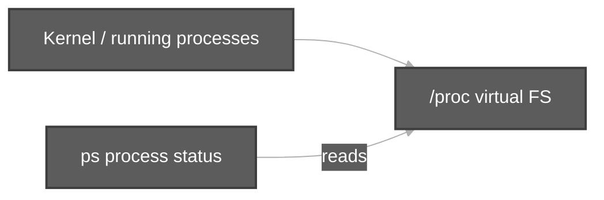

---

## 12. `14. boot` directory

| Point | Durga Sir wording |
| :--- | :--- |
| Heading | **14. boot directory** |
| Purpose | **The files which are required to boot linux os** |

*(Class also shows **`ps -ef`** output above this heading — processes for user **`durga`** before moving to boot.)*

---

## 13. `15. usr` directory and closing notes

**From Durga Soft class material (same session topic block):**

| Point | Wording |
| :--- | :--- |
| **`/usr`** | **usr means user** — contains **user-related software** / programs and related files |
| **Advantage 1** | Linux file system layout helps the OS **locate required files very easily** |
| **Advantage 2** | Every file system has a **type name** |
| **Linux types** | **ext2, ext3, ext4, XFS** |
| **Windows types** | **NTFS, FAT** |

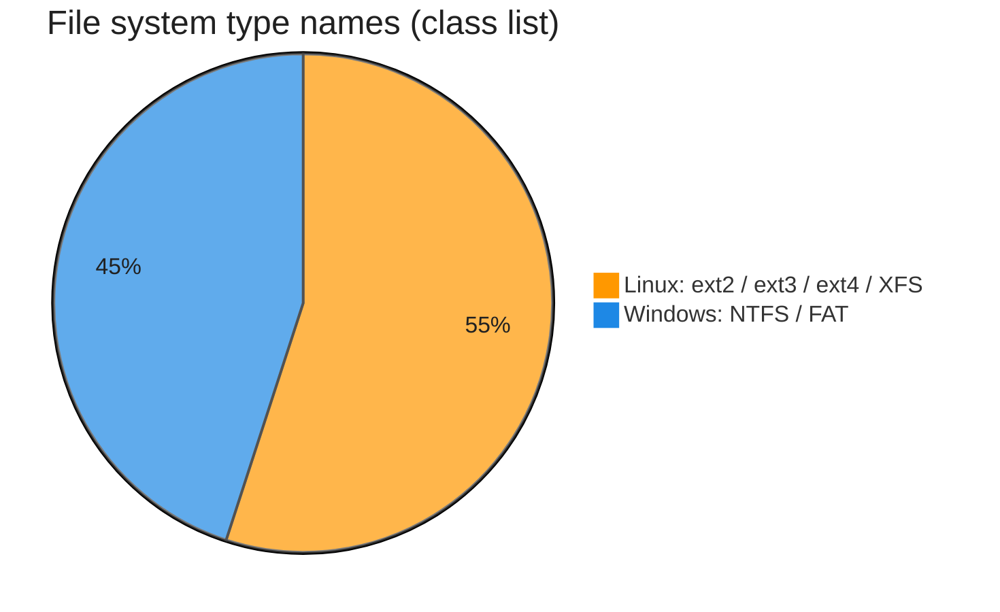

---

## 14. Live demos from the recordings

| Demo | Recording | What Durga Sir shows |
| :--- | :--- | :--- |
| FHS tree diagram | `fileSystem1` | Diagram-3 with **`/` → home → users → Desktop…** |
| **`tmp` vs Desktop** | `fileSystem1` | **`tmp===>a.txt b.txt c.txt`** vs **`Desktop===>demo.txt`** |
| **`ls /home`** | `fileSystem2` | Multiple user directories |
| **`ls` / `ls -l` in `/dev`** | `fileSystem2` | Device files, **`stdin`/`stdout`/`stderr`**, character devices |
| **`ls` in `/proc`** | `fileSystem2` | PID directories and virtual files |
| **`ps -ef`** | `fileSystem2` | Process status listing |
| Windows **This PC** | `fileSystem2` | **C:/D:/E:** vs Linux mount idea |
| **`exit` from root → `who`** | `fileSystem2` | **`/root`** vs normal user **`durga`** (identity before **`/root`** topic) |

---

## 15. Session checklist & interview Q&A

You should explain **items 4–15** above and:

1. **`/tmp`** — temporary; cleared on shutdown (class rule); not for permanent data.  
2. **`/dev`** — devices as files; **`stdin`/`stdout`/`stderr`**.  
3. **`/mnt`** vs **`/media`** — manual vs automatic mounting.  
4. **`/opt`**, **`/lib`**, **`/var`**, **`/home`**, **`/proc`**, **`/root`**, **`/boot`**, **`/usr`**.  
5. **`/`** vs **`/root`**.  
6. **`ps`** — process status; **`/proc`** and **PID**.  
7. **ext2/3/4, XFS** vs **NTFS, FAT**.

| Question | Short answer |
| :--- | :--- |
| **mnt vs media?** | **mnt → manual** · **media → automatic** |
| **`/` vs root?** | **`/` → FS root** · **`/root` → superuser home** |
| **bin vs sbin?** | *(Session 4)* normal user vs superuser command binaries |

**Next on portal:** Session 6 — VirtualBox & Ubuntu installation.

---

## 16. Scripts

| Script | Demonstrates |
| :--- | :--- |
| [`fhs-directories-tour-part2-demo.sh`](../../../scripts/file-system-navigation-and-hierarchy/fhs-directories-tour-part2-demo.sh) | **`/usr`**, **`/var`**, **`/tmp`**, **`/opt`**, **`/mnt`**, **`/proc`**, **`/root`** |
| [`tty-and-dev-demo.sh`](../../../scripts/types-of-files-in-linux/tty-and-dev-demo.sh) | **`tty`**, **`/dev`** |
| [`fhs-root-directories-demo.sh`](../../../scripts/file-system-navigation-and-hierarchy/fhs-root-directories-demo.sh) | **`ls -l /`** |

```bash
cd /path/to/Linux-Basics
bash scripts/file-system-navigation-and-hierarchy/fhs-directories-tour-part2-demo.sh
```
