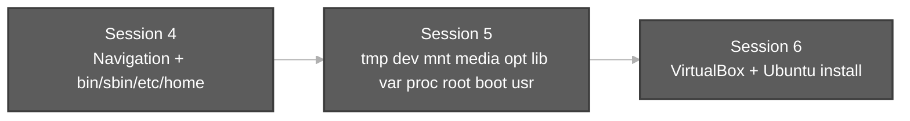
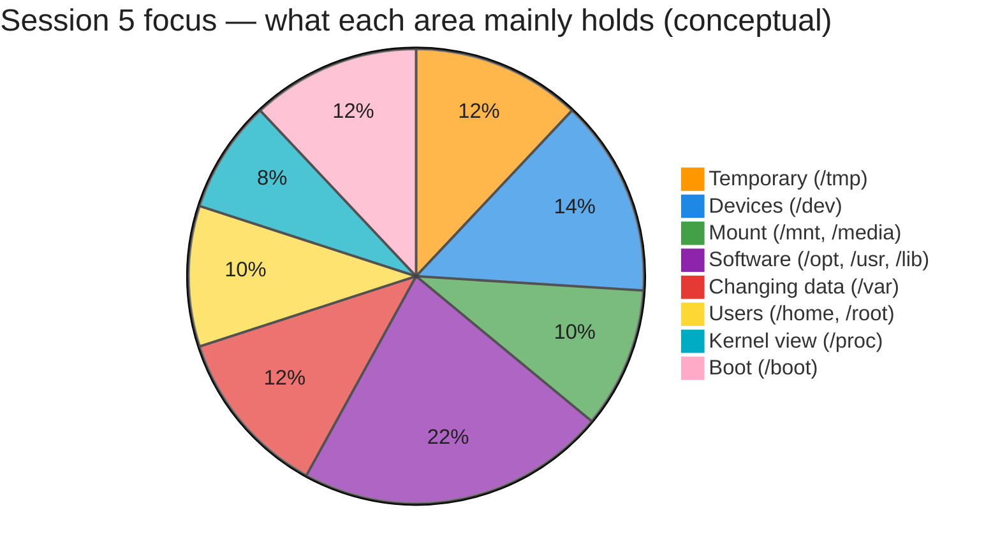
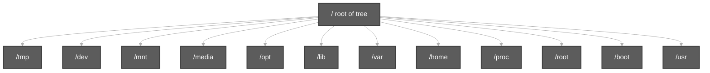
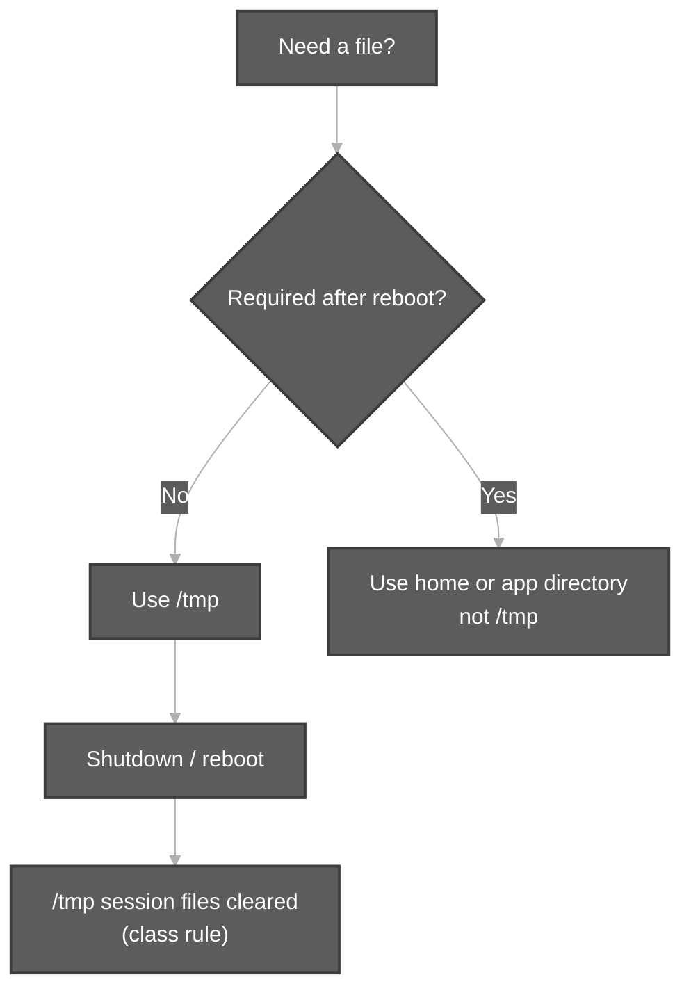
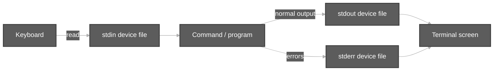
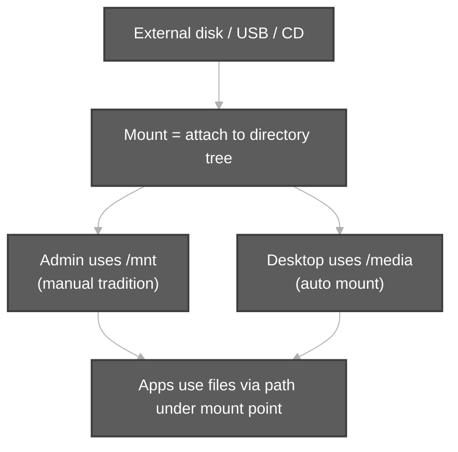
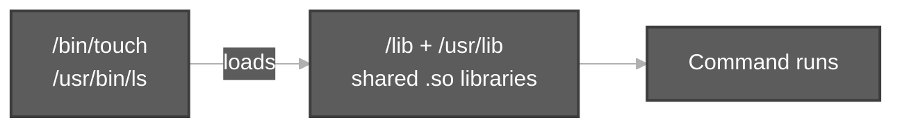
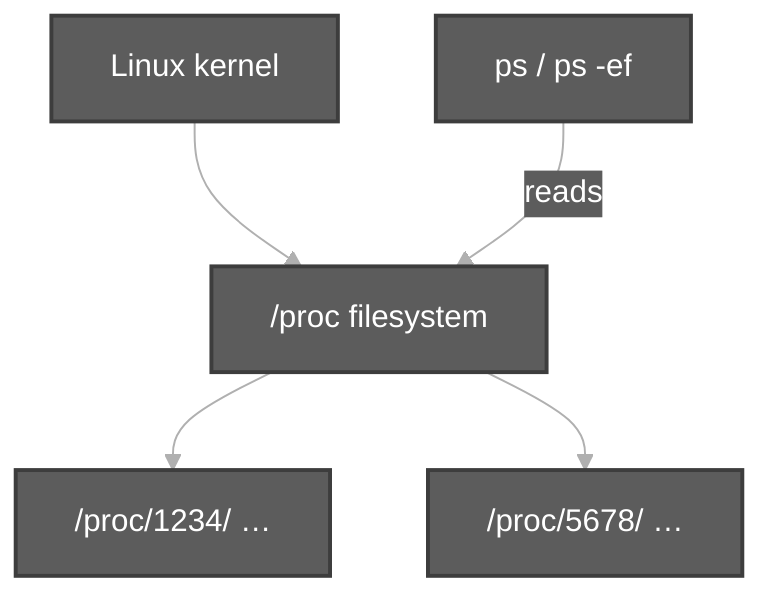
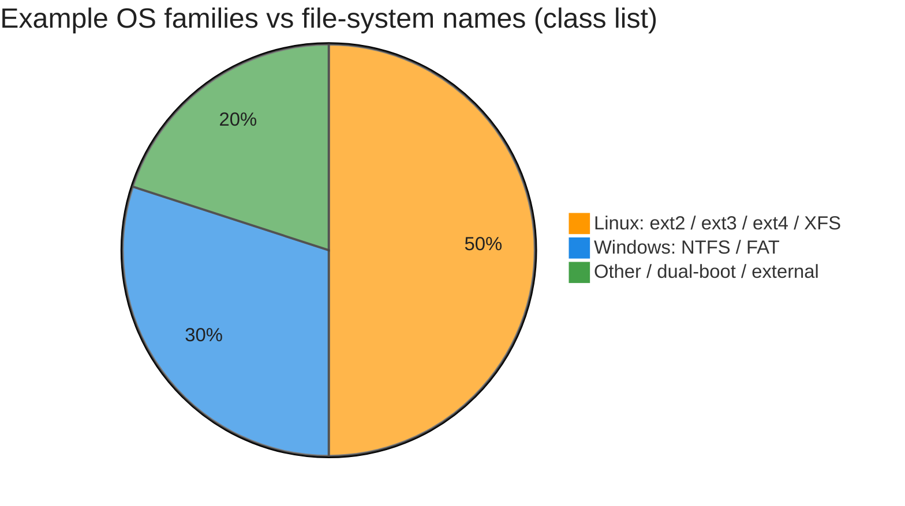

# LINUX File System Continued (Part Two)

**Course:** [Linux with Shell Programming, SED, AWK and many more — Session 5](https://www.durgasoftonline.com/s/courses/5e7ae04f0cf29f148a043786/take) (paid Durga Soft portal)  
**Instructor:** Durga Sir  
**Session:** **Session 5 — LINUX File System Continued**

**Part one (same course, Session 4):** [File System Navigation Commands And Hierarchy.md](../File%20System%20Navigation%20Commands%20And%20Hierarchy.md) — navigation (`pwd`, `cd`, `ls -a`), tree under `/`, **`/bin`**, **`/sbin`**, **`/etc`**, **`/home`** overview.

**Related overview:** [linuxFileSystem.md](linuxFileSystem.md) — short FHS reference in this folder.

**Prerequisites:** [TypesOfFilesInLinux.md](../TypesOfFilesInLinux.md) (device files, `ls -l` first character) · Part one above.

**Practice folder:** [`scripts/file-system-navigation-and-hierarchy/`](../../../scripts/file-system-navigation-and-hierarchy/)

```bash
cd /path/to/Linux-Basics
bash scripts/file-system-navigation-and-hierarchy/fhs-directories-tour-part2-demo.sh
```

---

**Table of contents**

- [0. Where Session 5 fits](#0-where-session-5-fits)
- [1. Big picture — directories in this session](#1-big-picture--directories-in-this-session)
- [2. `/tmp` — temporary files](#2-tmp--temporary-files)
- [3. `/dev` — device files and standard streams](#3-dev--device-files-and-standard-streams)
- [4. Mounting — `/mnt` vs `/media`](#4-mounting--mnt-vs-media)
- [5. `/opt` — optional third-party software](#5-opt--optional-third-party-software)
- [6. `/lib` — shared libraries](#6-lib--shared-libraries)
- [7. `/var` — variable data and logs](#7-var--variable-data-and-logs)
- [8. `/home` — multi-user homes (recap)](#8-home--multi-user-homes-recap)
- [9. `/proc` — process information](#9-proc--process-information)
- [10. `/root` vs `/` — interview favourite](#10-root-vs----interview-favourite)
- [11. `/boot` — boot the OS](#11-boot--boot-the-os)
- [12. `/usr` — user-related software hierarchy](#12-usr--user-related-software-hierarchy)
- [13. File system *types* (ext4, XFS, NTFS, …)](#13-file-system-types-ext4-xfs-ntfs-)
- [14. Advantages of the Linux file system layout](#14-advantages-of-the-linux-file-system-layout)
- [15. Session 5 checklist & interview Q&amp;A](#15-session-5-checklist--interview-qa)
- [16. Scripts for this topic](#16-scripts-for-this-topic)

---

## 0. Where Session 5 fits

Durga Sir **continues the FHS tour** after Session 4. Session 4 already covered **navigation** and deep notes on **`/bin`**, **`/sbin`**, **`/etc`**, and the **tree** starting at **`/`**. Session 5 completes the **remaining top-level directories** and the **mounting** idea, using the same **Durga Soft class PDF** flow (Topic: Linux File System Hierarchy, points 4–15).



---

## 1. Big picture — directories in this session

| # | Directory | Durga Sir keyword | One-line purpose |
| :---: | :--- | :--- | :--- |
| 4 | **`/tmp`** | temporary | Files needed **only for the current session**; not for permanent data |
| 5 | **`/dev`** | device | **Every device is a file**; communicate with hardware through these files |
| 6 | **`/mnt`** | mounting (manual) | Attach **external** file systems **manually** (older style; admin use) |
| 7 | **`/media`** | mounting (auto) | **Automatic** mount points (USB, CD — modern desktops) |
| 8 | **`/opt`** | optional | **Third-party / explicit** software installs (e.g. vendor packages) |
| 9 | **`/lib`** | library | **Shared libraries** required by commands and applications |
| 10 | **`/var`** | variable | Data that **keeps changing** (especially **logs**) |
| 11 | **`/home`** | home | **Per-user** directories in a **multi-user** OS |
| 12 | **`/proc`** | processes | **Running process** information (virtual file system) |
| 13 | **`/root`** | root user home | **Superuser home** — **not** under `/home` |
| 14 | **`/boot`** | boot | Files needed to **boot** Linux |
| 15 | **`/usr`** | user (software) | **User-related software** — programs, docs, libraries |



> Pie slices are for **learning balance**, not disk usage.



---

## 2. `/tmp` — temporary files

| Idea | Durga Sir / class notes |
| :--- | :--- |
| **Meaning** | **tmp** = **temporary** |
| **Use** | Create files here when you need them **only for the current session** |
| **Lifetime** | Such files are **removed automatically at system shutdown** (class wording) |
| **Rule** | If data must exist **permanently**, **do not** put it under **`/tmp`** |

**Scenario — scratch file during lab**

```bash
cd /tmp
touch session5-scratch.txt
echo "intermediate result" > session5-scratch.txt
```

**Scenario — wrong place for important data**

| Choice | Result |
| :--- | :--- |
| Save project under **`~/Documents`** | Survives reboot |
| Save project only under **`/tmp`** | May **disappear** after shutdown — **not recommended** for permanent work |



---

## 3. `/dev` — device files and standard streams

Durga Sir ties this to Session 3: **in Linux, devices are files**. All device-related files live under **`/dev`**. By using these files, programs **communicate with devices**.

### Class examples (names to remember)

| File / name | Device idea |
| :--- | :--- |
| **`tty`** | Terminal-related file (`tty` command shows **your** terminal device) |
| **`fd`** | Floppy drive (legacy name in notes) |
| **`hd`** | Hard disk related |
| **`ram`** | RAM related |
| **`stdin`** | Standard **input** device file (**keyboard**) |
| **`stdout`** | Standard **output** device file (**terminal / monitor**) |
| **`stderr`** | Standard **error** device file (**terminal / monitor**) |

These connect directly to later topics on **redirection** (streams 0, 1, 2): see [redirection.md](../redirection.md).



**Explore safely (read-only):**

```bash
ls -l /dev | head
tty
ls -l /dev/null /dev/zero 2>/dev/null || true
```

**Practice:** [`tty-and-dev-demo.sh`](../../../scripts/types-of-files-in-linux/tty-and-dev-demo.sh)

---

## 4. Mounting — `/mnt` vs `/media`

### Why mounting exists

External storage (pen drive, CD, external disk) has its **own** file system. Linux must **attach** it to the **single tree** under **`/`**. That attachment is **mounting**. Until mounted, you cannot use those files through normal paths.

| Era | Behaviour |
| :--- | :--- |
| **Older systems** | Admin often mounted **manually** |
| **Recent desktops (Ubuntu, etc.)** | Many devices mount **automatically** when plugged in |

### Durga Sir rule — `mnt` vs `media`

| Directory | Mount style | Class definition |
| :--- | :--- | :--- |
| **`/mnt`** | **Manual** mounting | Files from **manual** mount operations |
| **`/media`** | **Automatic** mounting | Files from **automatic** mount (typical USB/CD on desktop) |

**Interview Q2 (from class material):** What is the difference between **`/mnt`** and **`/media`**?

> **`/mnt`** → manual mounting · **`/media`** → automatic mounting.



**Linux vs Windows (class intuition)**

| Windows | Linux |
| :--- | :--- |
| **`C:`**, **`D:`** drive letters | **One tree** from **`/`**; extra disks appear as **folders** (e.g. under **`/media`**) |

---

## 5. `/opt` — optional third-party software

| Term | Meaning |
| :--- | :--- |
| **opt** | **Optional** |
| **Contents** | **Third-party** software you install **explicitly** (class example: installing something like **Google Chrome** — install files under **`/opt`**) |

Use **`/opt`** when a vendor ships a **self-contained** product directory, not for everyday user documents.

---

## 6. `/lib` — shared libraries

| Term | Meaning |
| :--- | :--- |
| **lib** | **Library** |
| **Contents** | **Shared libraries** the OS needs so **`/bin`** / **`/sbin`** commands and applications can run |

Without matching libraries in **`/lib`** (and on modern systems often **`/lib64`**, **`/usr/lib`**), binaries may fail with “library not found” errors.



---

## 7. `/var` — variable data and logs

| Term | Meaning |
| :--- | :--- |
| **var** | **Variable** data — values **change over time** |
| **Classic example** | **Log files** stored under **`/var`** (e.g. **`/var/log`**) |

Mail spools, caches, and application state often live under **`/var`** on real servers. Normal users **read** logs sometimes; **changing** them needs appropriate permissions.

---

## 8. `/home` — multi-user homes (recap)

Linux is a **multi-user** OS. For **each user**, a separate directory holds personal data (videos, images, documents, …). All user home directories sit under **`/home`**.

```bash
ls /home
```

Example from class notes: **`/home/durgasoft`** is **durgasoft** user’s home, containing **Desktop**, **Downloads**, **Movies**, **Pictures**, etc.

| Path | Who |
| :--- | :--- |
| **`/home/durgasoft`** | Normal user **durgasoft** |
| **`/home/demo`**, **`/home/demo1`**, … | Other users on same machine |

---

## 9. `/proc` — process information

| Term | Meaning |
| :--- | :--- |
| **proc** | **Processes** |
| **Model** | Many processes run **simultaneously**; each has a **PID** (Process ID) |
| **Layout** | For **each running process**, a directory named with its **PID** appears under **`/proc`** |

**Class command:** **`ps`** — **process status** — lists running processes.

```bash
ps -ef | head
ls /proc | head
cat /proc/cpuinfo | head -5   # sample: CPU info as a pseudo-file
```



> **`/proc`** is **virtual** — not normal disk files; the kernel exposes live data as files.

---

## 10. `/root` vs `/` — interview favourite

| Path | Meaning |
| :--- | :--- |
| **`/`** | **Root of the file system tree** — topmost directory |
| **`/root`** | **Home directory of the superuser (root)** — a **subdirectory** of **`/`** |

**Interview Q3 (class material):** Difference between **`/`** and **root directory**?

> **`/`** = root **of the entire Linux file system** · **`/root`** = **superuser’s home** folder.

| User | Home path |
| :--- | :--- |
| Normal user **durgasoft** | **`/home/durgasoft`** |
| Superuser **root** | **`/root`** (not under **`/home`**) |

---

## 11. `/boot` — boot the OS

**`/boot`** holds files **required to boot** Linux (boot loader related files, kernel images — details in admin topics later).

Session 5 expectation: **recognise the name and purpose**; do not delete or edit without admin knowledge.

---

## 12. `/usr` — user-related software hierarchy

| Term | Class note |
| :--- | :--- |
| **usr** | Stands for **user** in this lesson |
| **Contents** | **User-related software** — additional programs, libraries, documentation |

On modern distros, many day-to-day commands live in **`/usr/bin`** while **`/bin`** may link to them. The **idea** Durga Sir stresses: **`/usr`** is the large **secondary hierarchy** for software beyond the minimal root set.

```bash
ls /usr
ls /usr/bin | head
```

**Demo:** [`fhs-directories-tour-part2-demo.sh`](../../../scripts/file-system-navigation-and-hierarchy/fhs-directories-tour-part2-demo.sh)

---

## 13. File system *types* (ext4, XFS, NTFS, …)

Closing notes from the same hierarchy topic in Durga Soft material:

| Point | Detail |
| :--- | :--- |
| **Naming** | Each file system has a **type name** |
| **Linux examples** | **ext2**, **ext3**, **ext4**, **XFS** |
| **Windows examples** | **NTFS**, **FAT** |

You format a **partition** with a type; Linux then mounts it **into the tree** (Session 5 **`/mnt`** / **`/media`** context).



---

## 14. Advantages of the Linux file system layout

Durga Sir summarises **why** the FHS matters:

1. The OS can **locate required files easily** (predictable paths).  
2. Each file system **has its own type name** (ext4, XFS, …).  
3. **Separation of roles** — binaries, config (**`/etc`**), variable data (**`/var`**), temp (**`/tmp`**), devices (**`/dev`**), users (**`/home`**, **`/root`**).

Together with Session 4, you can **draw the full tree from memory** for exams and interviews.

---

## 15. Session 5 checklist & interview Q&A

You should be able to explain:

1. **`/tmp`** — temporary, session-oriented; **not** for permanent files.  
2. **`/dev`** — device files; **`stdin` / `stdout` / `stderr`** device meaning.  
3. **`/mnt`** vs **`/media`** — **manual** vs **automatic** mounting.  
4. **`/opt`**, **`/lib`**, **`/var`**, **`/usr`** — optional software, libraries, changing data/logs, user software.  
5. **`/proc`** + **`ps`** — processes and PIDs.  
6. **`/`** vs **`/root`** — file system root vs superuser home.  
7. **`/boot`** — boot-related files.  
8. **ext2/3/4, XFS** vs **NTFS, FAT** — names of file system types.

| Question | Short answer (Durga Sir class) |
| :--- | :--- |
| **Q1** bin vs sbin? | **bin** → normal user commands · **sbin** → superuser/admin commands *(Session 4)* |
| **Q2** mnt vs media? | **mnt** → manual mount · **media** → automatic mount |
| **Q3** `/` vs root? | **`/`** → FS root · **`/root`** → superuser home |

**Next (Session 6 on portal):** VirtualBox and Ubuntu installation — see [`linuxBasics.md`](../../linuxBasics.md).

---

## 16. Scripts for this topic

| Script | Demonstrates |
| :--- | :--- |
| [`fhs-directories-tour-part2-demo.sh`](../../../scripts/file-system-navigation-and-hierarchy/fhs-directories-tour-part2-demo.sh) | **`/usr`**, **`/var`**, **`/tmp`**, **`/opt`**, **`/mnt`**, **`/proc`**, **`/root`** samples |
| [`tty-and-dev-demo.sh`](../../../scripts/types-of-files-in-linux/tty-and-dev-demo.sh) | **`tty`**, **`/dev`** idea |
| [`fhs-root-directories-demo.sh`](../../../scripts/file-system-navigation-and-hierarchy/fhs-root-directories-demo.sh) | **`ls -l /`** tour *(with Part one)* |
| [`bin-sbin-etc-demo.sh`](../../../scripts/file-system-navigation-and-hierarchy/bin-sbin-etc-demo.sh) | **`/bin`**, **`/sbin`**, **`/etc`** *(Part one)* |

```bash
cd /path/to/Linux-Basics
bash scripts/file-system-navigation-and-hierarchy/fhs-directories-tour-part2-demo.sh
bash scripts/types-of-files-in-linux/tty-and-dev-demo.sh
```
