# LINUX File System Continued (Part Two)

**Course:** [Linux with Shell Programming — Session 5 (paid portal)](https://www.durgasoftonline.com/s/courses/5e7ae04f0cf29f148a043786/take)  
**Instructor:** Durga Sir  
**Source recordings (repo):** [`ScreenRecordings/fileSystem1.webm`](../../../ScreenRecordings/fileSystem1.webm) · [`ScreenRecordings/fileSystem2.webm`](../../../ScreenRecordings/fileSystem2.webm) · [`ScreenRecordings/Screencast From 2026-11-04 15-06-45.webm`](../../../ScreenRecordings/Screencast%20From%202026-11-04%2015-06-45.webm)  
*(Screen capture only — no audio track; notes match on-screen `linux_online_running_notes.txt` and live demos.)*

**Part one (Session 4):** [File System Navigation Commands And Hierarchy.md](../File%20System%20Navigation%20Commands%20And%20Hierarchy.md) — **`/bin`**, **`/sbin`**, **`/etc`**, navigation, FHS intro.

**Prerequisites:** [TypesOfFilesInLinux.md](../TypesOfFilesInLinux.md)

**Practice:** [`scripts/file-system-navigation-and-hierarchy/`](../../../scripts/file-system-navigation-and-hierarchy/)

---

**Table of contents**

- [LINUX File System Continued (Part Two)](#linux-file-system-continued-part-two)
  - [0. How the recordings map to this session](#0-how-the-recordings-map-to-this-session)
  - [1. Diagram — full hierarchy (Diagram-3)](#1-diagram--full-hierarchy-diagram-3)
  - [2. `4. tmp` directory](#2-4-tmp-directory)
  - [Changing permissions](#changing-permissions)
  - [3. `5. dev` directory](#3-5-dev-directory)
  - [4. `6. mnt` and `7. media` — mounting](#4-6-mnt-and-7-media--mounting)
    - [`6. mnt` directory](#6-mnt-directory)
    - [`7. media` directory](#7-media-directory)
    - [Interview question (class)](#interview-question-class)
  - [5. Windows drives vs Linux tree](#5-windows-drives-vs-linux-tree)
  - [6. `8. opt` directory](#6-8-opt-directory)
  - [7. `9. lib` directory](#7-9-lib-directory)
  - [8. `10. var` directory](#8-10-var-directory)
  - [9. `11. home` directory](#9-11-home-directory)
  - [10. `12. root` directory and Q: `/` vs root](#10-12-root-directory-and-q--vs-root)
  - [11. `13. proc` directory and `ps`](#11-13-proc-directory-and-ps)
  - [12. `14. boot` directory](#12-14-boot-directory)
    - [Closing `Note:` block (typed live — `Screencast From 2026-11-04 15-06-45.webm`)](#closing-note-block-typed-live--screencast-from-2026-11-04-15-06-45webm)
    - [Live class Q\&A (same screencast)](#live-class-qa-same-screencast)
  - [13. `15. usr` directory and closing notes](#13-15-usr-directory-and-closing-notes)
  - [14. Live demos from the recordings](#14-live-demos-from-the-recordings)
  - [15. Session checklist \& interview Q\&A](#15-session-checklist--interview-qa)
  - [16. Scripts](#16-scripts)

---

## 0. How the recordings map to this session

| Recording                                      | Approx. length | Main content in class                                                                                                                                                                                |
| :--------------------------------------------- | :------------- | :--------------------------------------------------------------------------------------------------------------------------------------------------------------------------------------------------- |
| **`fileSystem1.webm`**                         | ~34 min        | **`4. tmp`** notes; **Diagram-3** FHS tree; some terminal recap (home, permissions)                                                                                                                  |
| **`fileSystem2.webm`**                         | ~73 min        | **`5. dev`** through **`14. boot`** start; **`/dev`** & **`/proc`** demos; Windows **This PC** comparison                                                                                            |
| **`Screencast From 2026-11-04 15-06-45.webm`** | ~7 min         | **End of Session 5:** **`/home`** / **`/root`** recap; **`14. boot`** + **Note** block; **file-system type names**; live **boot diagram**; class Q&amp;A on **`/etc`**, **`/bin`**, **`lost+found`** |

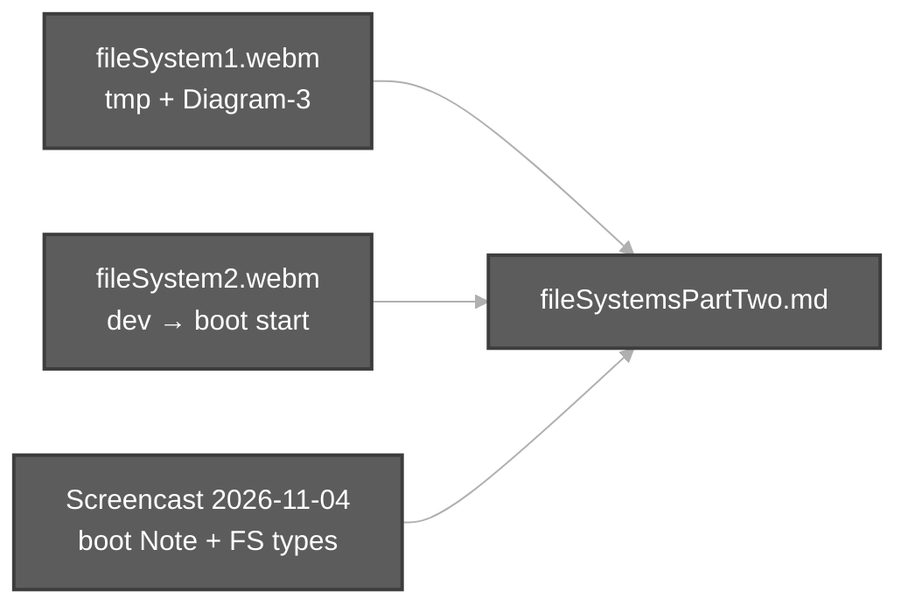

---

## 1. Diagram — full hierarchy (Diagram-3)

Durga Sir draws **Diagram-3 — File System Hierarchy** (see **`fileSystem1.webm`**):

- **`/`** at the top (root of the tree).
- Under **`/`**: **`bin`**, **`sbin`**, **`etc`**, **`dev`**, **`var`**, **`tmp`**, **`home`**, **`opt`**, **`root`**, …
- Under **`home`**: user folders **`durgasoft`**, **`ravi`**, **`shiva`**, **`pavan`**, …
- Under each user (e.g. **`durgasoft`**): **Desktop**, **Documents**, **Downloads**, **Music**, **Pictures**, **Videos**.

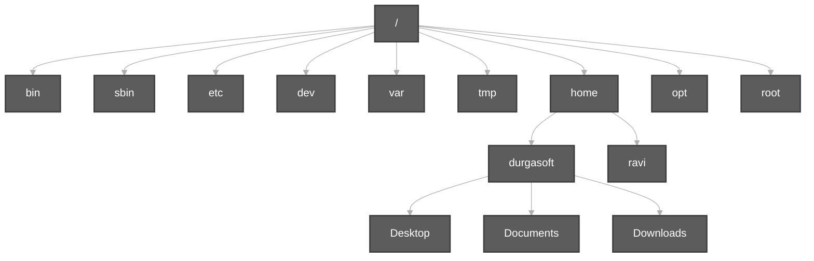

---

## 2. `4. tmp` directory

**From class notes (`fileSystem1.webm`):**

| Point    | Durga Sir wording                                                                                                    |
| :------- | :------------------------------------------------------------------------------------------------------------------- |
| Meaning  | **tmp means temporary.**                                                                                             |
| Use      | If any file or directory is required **just for temporary purpose in our current session** …                         |
| Lifetime | These files will be **deleted automatically at the time of system shutdown.**                                        |
| Contrast | **`Desktop ===> demo.txt`** (normal persistent location) vs **`tmp ===> a.txt b.txt c.txt`** (session scratch files) |

**Permission example shown with the tmp scenario** (same notes): default file triplet **`rw-`**, **`r--`**, **`r--`** (owner read/write; group and others read-only).

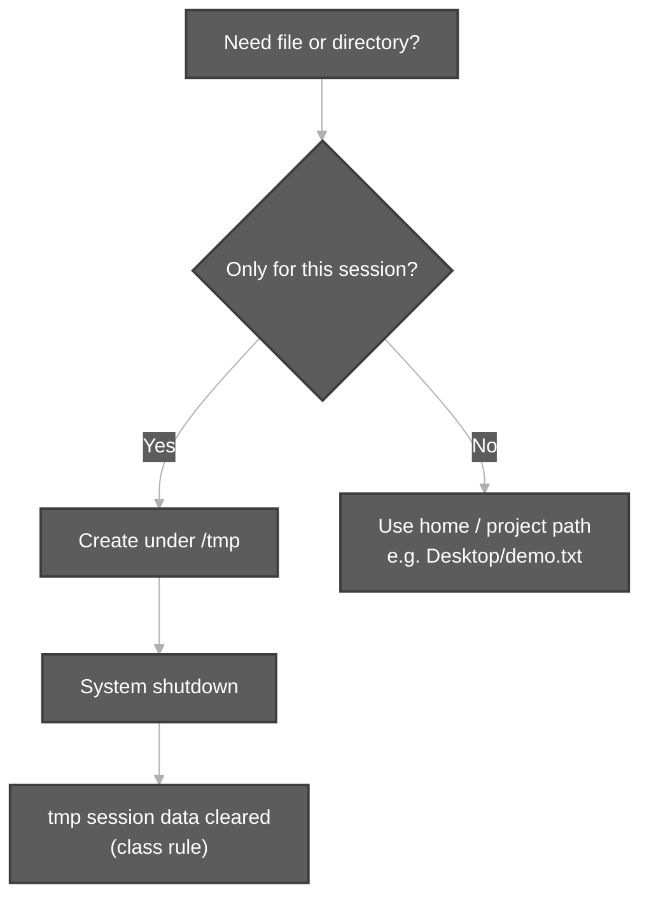

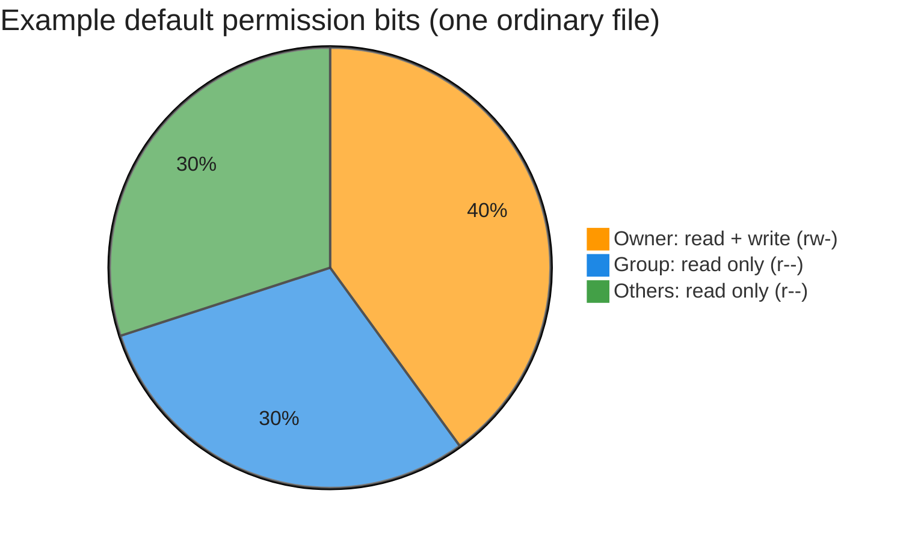

**Lab screenshot:** creating a file inside the `/tmp` folder.

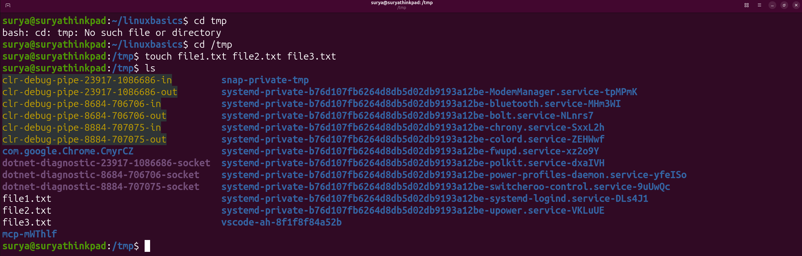

Generally files created in tmp folder will be removed automatically once we restart or log off the machine.I will add one screenshot after logging back again.


**Lab screenshot:** Checking if the ile in the `/tmp` folder after restarting the machine .

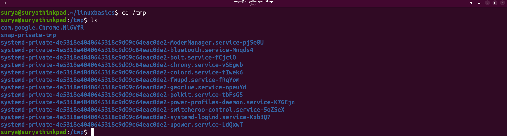

---

## Changing permissions

**Lab screenshot:** removing the owner's read/write permission with `chmod` and seeing the effect.

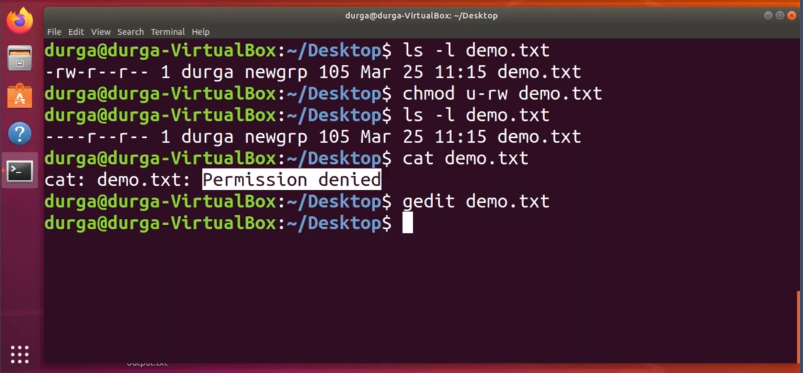

**What the screenshot shows (step by step):**

1. `ls -l demo.txt` → `-rw-r--r-- 1 durga newgrp 105 Mar 25 11:15 demo.txt`
   - `-` : regular file
   - `rw-` : **owner** (`durga`) can read and write
   - `r--` : **group** (`newgrp`) can only read
   - `r--` : **others** can only read
   - `1` = hard-link count, `durga` = owner, `newgrp` = group, `105` = size in bytes, `Mar 25 11:15` = last modified, `demo.txt` = name.
2. `chmod u-rw demo.txt` → `u` = user (owner), `-` = remove, `rw` = read and write. Group and others are untouched.
3. `ls -l demo.txt` again → `----r--r-- ...`: the owner now has **no** permissions (`---`), group and others still have `r--`.
4. `cat demo.txt` → `cat: demo.txt: Permission denied`. Even the owner is blocked, because Linux checks only the owner's bits for the owner (group/other bits are not used as a fallback).
5. `gedit demo.txt` → the GUI editor opens but shows a red banner (second screenshot below): *Could not open the file "/home/durga/Desktop/demo.txt". You do not have the permissions necessary to open the file.* The editor area stays empty and there is a **Retry** button. The GUI app runs as the same user, so it is blocked by the same owner bits.

**`chmod` symbolic syntax:** `chmod [who][operator][permissions] file`

| Part        | Values                | Meaning                      |
| ----------- | --------------------- | ---------------------------- |
| who         | `u` / `g` / `o` / `a` | owner / group / others / all |
| operator    | `+` / `-` / `=`       | add / remove / set exactly   |
| permissions | `r` / `w` / `x`       | read / write / execute       |

To restore: `chmod u+rw demo.txt` (back to `-rw-r--r--`, i.e. `644`).

**Lab screenshot (V2):** `gedit demo.txt` failing after the owner's read/write permission was removed.

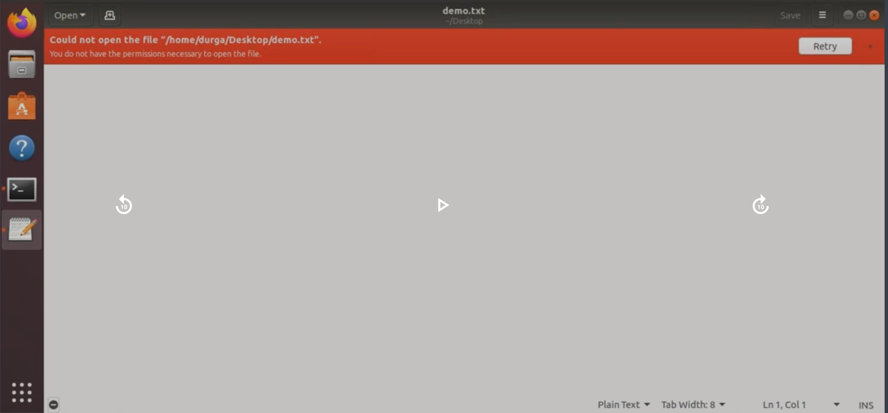

**Lab screenshot (V3):** restoring the owner's permission and proving the file is usable again (prompt `surya@suryathinkpad:~/linuxbasics$`).

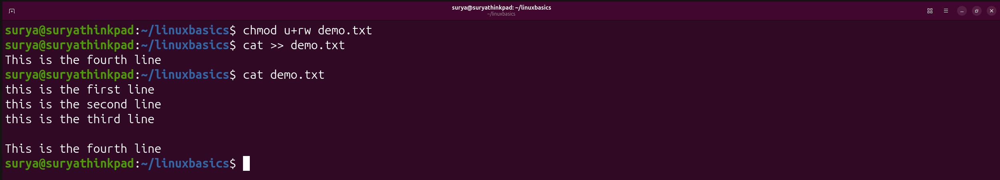

**What the screenshot shows (line by line):**

1. `chmod u+rw demo.txt` → `u` = owner, `+` = add, `rw` = read and write. The owner's bits go from `---` back to `rw-`, so the file is `-rw-r--r--` (`644`) again. The command prints nothing on success.
2. `cat >> demo.txt` → `>>` is the *append* redirection. `cat` with no file argument reads from the keyboard (stdin) and appends what is typed to the end of `demo.txt` (the file is not overwritten, unlike `>`). Appending needs **write** permission, which the owner has again.
3. `This is the fourth line` → the text typed after the command; `Enter` ends the line and `Ctrl+D` ends the input. This is the content appended to the file.
4. `cat demo.txt` → now succeeds, because the owner has **read** permission again (earlier it gave `Permission denied`).
5. `this is the first line`, `this is the second line`, `this is the third line` → the original content of the file.
6. An empty line → a blank line that was already in the file before the append.
7. `This is the fourth line` → the line just appended in step 2. This proves both **write** (append) and **read** work after `chmod u+rw`.
8. The final `$` prompt → the shell is ready for the next command.

**Key takeaway:** `chmod u-rw` removes access and `chmod u+rw` restores it. Read (`cat`) and write (`>>`) are controlled independently by the owner's `r` and `w` bits.

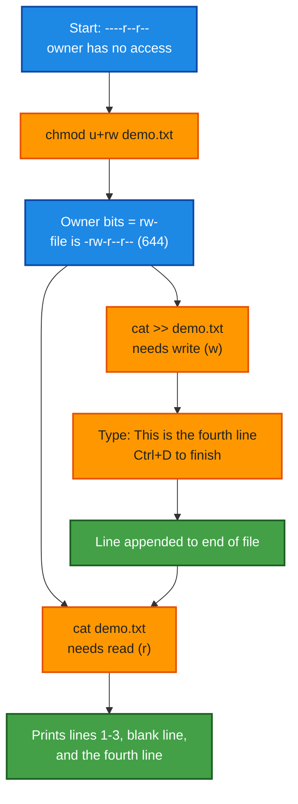

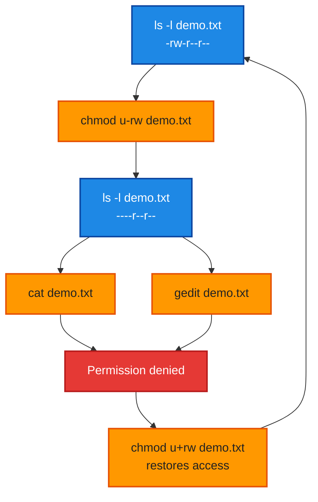

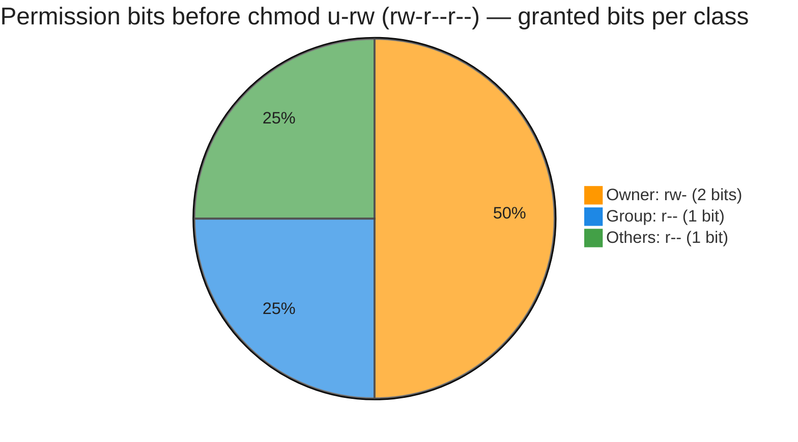

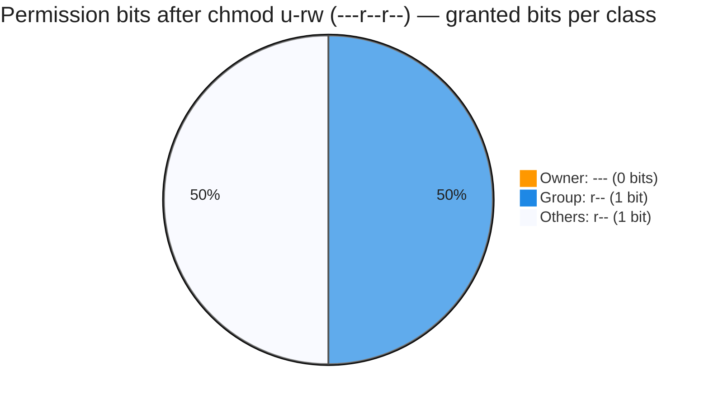

---

## 3. `5. dev` directory

**From class notes (`fileSystem2.webm`):**

| Point    | Durga Sir wording                                             |
| :------- | :------------------------------------------------------------ |
| Meaning  | **dev means device.**                                         |
| Rule     | **Every device in Linux is treated as file.**                 |
| Location | All device-related files are stored **inside dev directory.** |
| Purpose  | **By using these files we can communicate with that device.** |

**Examples listed in notes:**

| Name         | Meaning (class)                                        |
| :----------- | :----------------------------------------------------- |
| **`tty`**    | Terminal-related file                                  |
| **`fd`**     | Floppy drive related file                              |
| **`hd`**     | Hard disk related file                                 |
| **`ram`**    | RAM related file                                       |
| **`stdin`**  | Standard **input** device file (**keyboard**)          |
| **`stdout`** | Standard **output** device file (**terminal/monitor**) |
| **`stderr`** | Standard **error** device file (**terminal/monitor**)  |

**Demo:** `ls` under **`/dev`** shows **`stdin`**, **`stdout`**, **`stderr`**, many **`tty`** entries, **`loop*`**, **`sr0`**, etc. Use **`ls -l /dev`** to see **`c`** (character) devices and **`l`** (symlinks) — see [TypesOfFilesInLinux.md](../TypesOfFilesInLinux.md).

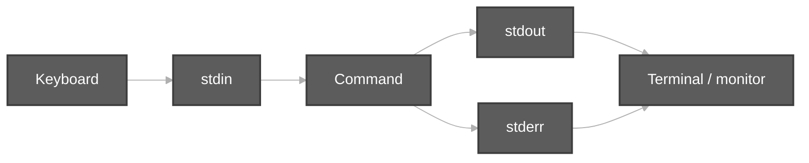

---

## 4. `6. mnt` and `7. media` — mounting

### `6. mnt` directory

| Point      | Durga Sir wording                                                                     |
| :--------- | :------------------------------------------------------------------------------------ |
| Meaning    | **mnt means mounting.**                                                               |
| Old OS     | In old operating systems, mounting was done **manually**.                             |
| New OS     | In newer operating systems, mounting is performed **automatically**.                  |
| **`/mnt`** | **mnt directory contains files which are available just because of manual mounting.** |

### `7. media` directory

| Point        | Durga Sir wording                                                          |
| :----------- | :------------------------------------------------------------------------- |
| **`/media`** | **The files of automatic mounting will be placed inside media directory.** |

### Interview question (class)

**Q. What is the difference between mnt and media directories?**

| Directory   | Answer (class)                        |
| :---------- | :------------------------------------ |
| **`mnt`**   | **contains manual mounting files**    |
| **`media`** | **contains automatic mounting files** |

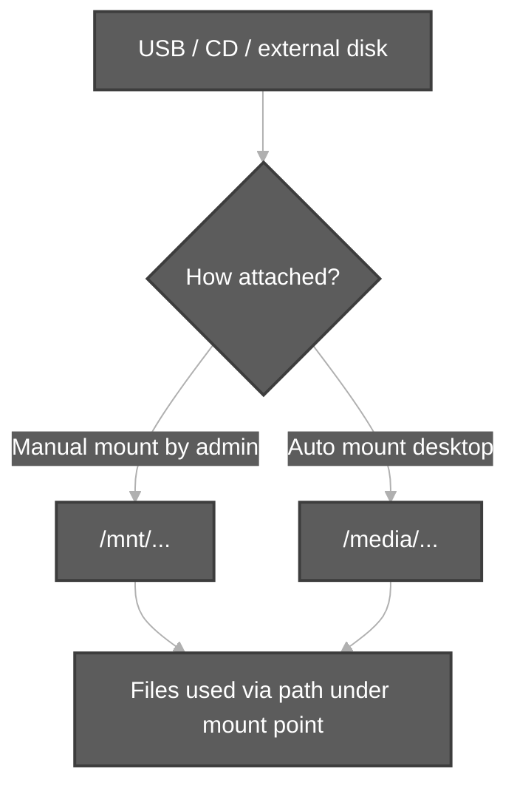

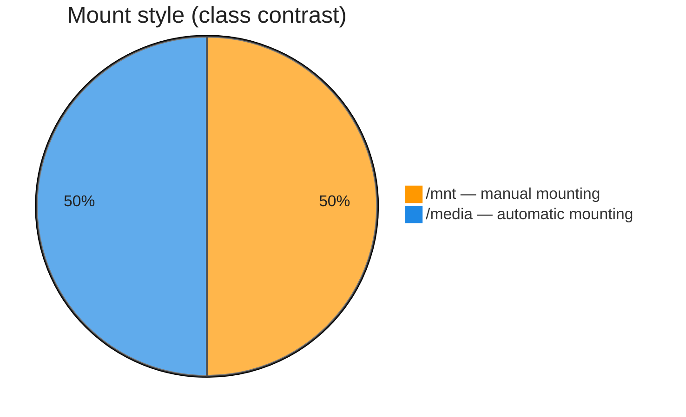

---

## 5. Windows drives vs Linux tree

**Demo (`fileSystem2.webm`):** Windows **This PC** shows **Local Disk (C:)**, **(D:)**, **(E:)**, DVD drive, etc.

Durga Sir’s point: Linux uses **one tree** from **`/`**; extra storage is **mounted as folders** (under **`/media`** or **`/mnt`**), not separate drive letters like **`C:`** / **`D:`**.

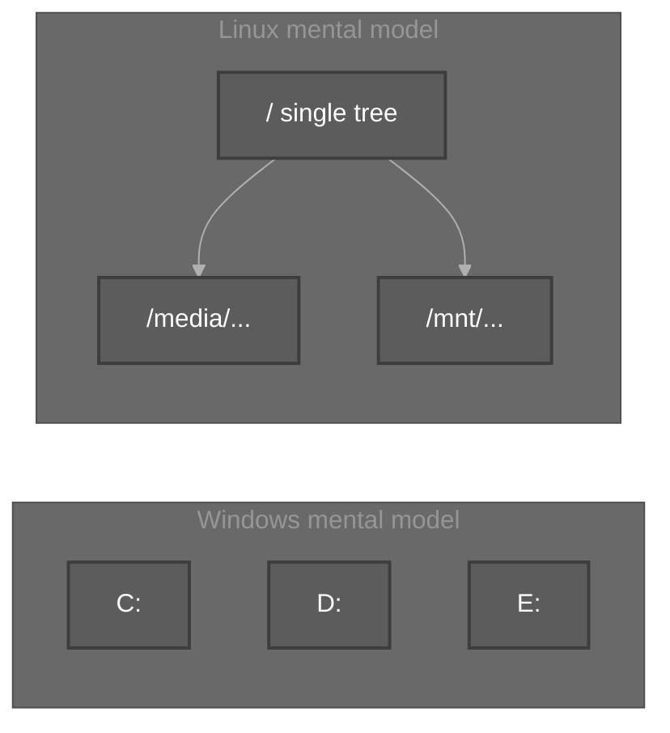

---

## 6. `8. opt` directory

| Point    | Durga Sir wording                                                      |
| :------- | :--------------------------------------------------------------------- |
| Meaning  | **opt means optional.**                                                |
| Contents | **This directory contains all 3rd party software installation files.** |
| Example  | **google chrome** (explicit third-party install)                       |

**Extra example (`Screencast From 2026-11-04 15-06-45.webm`):**

| Package           | Class note                                                                       |
| :---------------- | :------------------------------------------------------------------------------- |
| **OpenJDK**       | **openjdk is available from ubuntu.com** (distro / repo style)                   |
| **Oracle JDK 11** | **oracle jdk 11 ===> 3rd party** (fits under **`/opt`**-style optional installs) |

---

## 7. `9. lib` directory

| Point    | Durga Sir wording                                                     |
| :------- | :-------------------------------------------------------------------- |
| Meaning  | **lib means library**                                                 |
| Contents | **The libraries which are required by our commands and applications** |

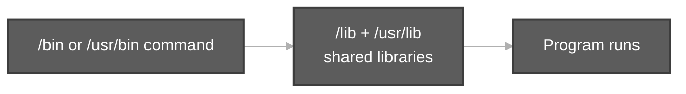

---

## 8. `10. var` directory

| Point   | Durga Sir wording                                                                         |
| :------ | :---------------------------------------------------------------------------------------- |
| Meaning | **var means variable data.**                                                              |
| Rule    | If any data **keeps on changing**, such variable data is stored **inside var directory.** |
| Example | **log files** — **eg: log files**                                                         |

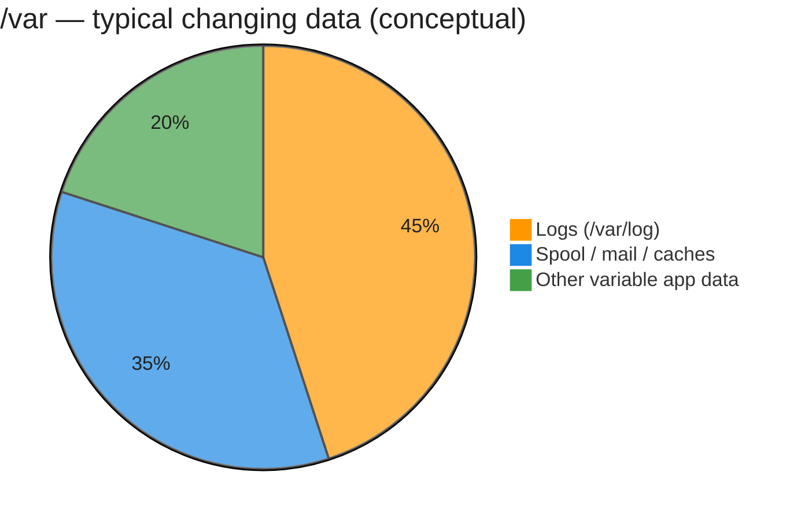

---

## 9. `11. home` directory

| Point      | Durga Sir wording                                                                                                                                                |
| :--------- | :--------------------------------------------------------------------------------------------------------------------------------------------------------------- |
| Multi-user | **As linux multi user operating system.**                                                                                                                        |
| Per user   | **For every user a separate directory will be created** to hold his specific data like **videos, images, documents** etc.                                        |
| Location   | **All these user directories will be stored inside home directory.**                                                                                             |
| Example    | **`/home/durga`** — durga user home; contains **Desktop, Downloads, Movies, Pictures**, etc. (class also shows **`/home/ravi`**, **`ls /home`** with many users) |

**Demo (`fileSystem2.webm`):** File manager under **`/home/durga`** — Desktop, Documents, Downloads, scripts, sample **`.txt`**, **`.sh`**, **`.mp4`**, etc.

---

## 10. `12. root` directory and Q: `/` vs root

**From notes:**

| Path              | Meaning (class)                              |
| :---------------- | :------------------------------------------- |
| **`/home/durga`** | durga user home directory                    |
| **`/home/ravi`**  | ravi user home directory                     |
| **`/root`**       | **home directory of root user / super user** |

**Q. What is the difference between `/` and root directories?**

| Symbol / path | Answer (class)                                                                            |
| :------------ | :---------------------------------------------------------------------------------------- |
| **`/`**       | **acts as root for Linux file system. It is the topmost directory of linux file system.** |
| **`root`**    | **subdirectory of `/`, which acts as home directory for the super user.**                 |

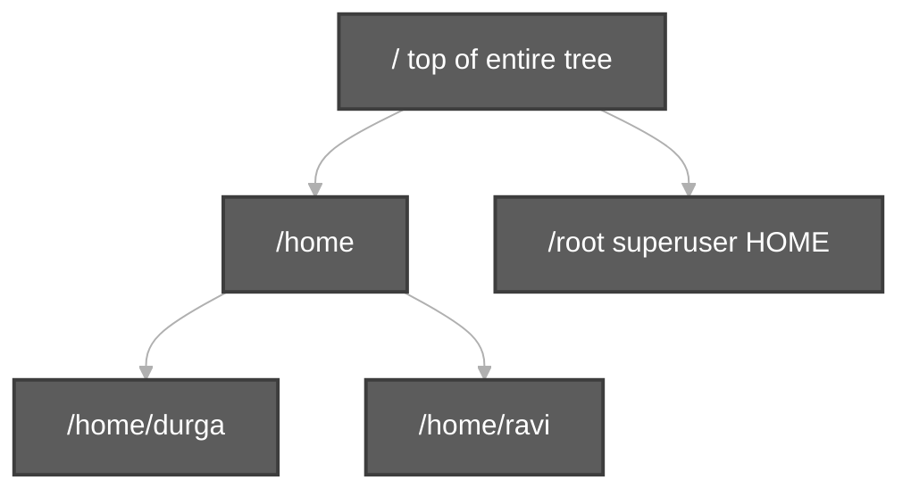

### Screenshot: root user (super user) vs root directory (`/`)

**Lab screenshot:** walking up to the top of the tree with `cd ..`, listing it, then switching to the root user with `sudo -i` (prompt `surya@suryathinkpad`; the title bar changes to `root@suryathinkpad: ~ — sudo -i`).

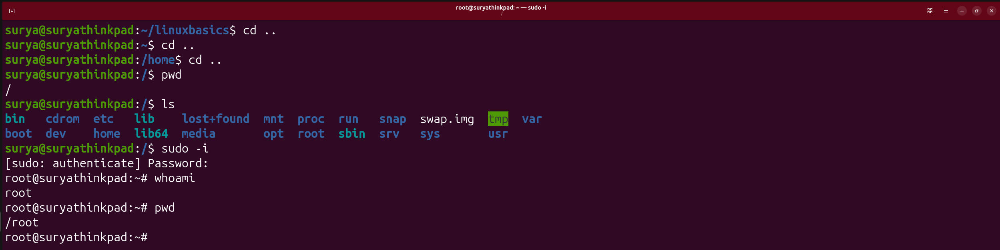

**What the screenshot shows (line by line):**

1. `cd ..` from `~/linuxbasics` → moves up one level to `~` (`/home/surya`).
2. `cd ..` from `~` → moves up to `/home`. The prompt now shows `/home`.
3. `cd ..` from `/home` → moves up to `/`, the **root directory**. The prompt shows `/`.
4. `pwd` → prints `/`, confirming we are at the top of the file system tree. There is no parent above it, so `cd ..` here stays at `/`.
5. `ls` → lists the top-level directories: `bin`, `boot`, `cdrom`, `dev`, `etc`, `home`, `lib`, `lib64`, `lost+found`, `media`, `mnt`, `opt`, `proc`, `root`, `run`, `sbin`, `snap`, `srv`, `swap.img` (a file), `sys`, `tmp` (green background = world-writable with sticky bit), `usr`, `var`.
6. Notice that `root` appears **inside** `/`. That is the home directory of the root user (`/root`), a different thing from `/` itself.
7. `sudo -i` → starts an interactive **login shell as the root (super) user** using your own `sudo` rights.
8. `[sudo: authenticate] Password:` → `sudo` asks for **surya's own password** (not root's). Nothing is echoed while typing.
9. `root@suryathinkpad:~#` → the prompt changed: user is now `root` and the symbol is `#` (super user) instead of `$` (normal user). The terminal title bar also turns red and shows `sudo -i`.
10. `whoami` → prints `root`, confirming the current user is the super user.
11. `pwd` → prints `/root`. A `sudo -i` login shell starts in root's **home directory** (`~` = `/root`), not in `/`.
12. Final `root@suryathinkpad:~#` prompt → ready for the next command, with full privileges.

**Key point:** earlier `pwd` printed `/` (the root *directory*), while after `sudo -i` it prints `/root` (the root *user's home*). Being the root user does not put you in `/`, and standing in `/` does not make you the root user. Use `exit` to return to `surya`.

**Three different things called "root":**

|                  | Root directory `/`                                     | Root user (super user)                       | Root's home `/root`                        |
| ---------------- | ------------------------------------------------------ | -------------------------------------------- | ------------------------------------------ |
| What it is       | Top of the whole directory tree                        | Account with UID `0` and unrestricted power  | Home folder of the root user               |
| Type             | Directory                                              | User account                                 | Directory inside `/`                       |
| Path / name      | `/`                                                    | `root`                                       | `/root`                                    |
| Prompt symbol    | `surya@suryathinkpad:/$` (still `$` for a normal user) | `root@suryathinkpad:~#` (`#` instead of `$`) | `~` = `/root` when logged in as root       |
| How to get there | `cd /` or `cd ..` repeatedly; `pwd` prints `/`         | `sudo -i` (then `whoami` prints `root`)      | `sudo -i` lands here; `pwd` prints `/root` |
| Who can use it   | Everyone can read/traverse it                          | Only via `sudo`, `su` or direct login        | Only root (normally `700`)                 |
| Analogy          | The ground floor of a building                         | The building owner with all keys             | The owner's private room                   |

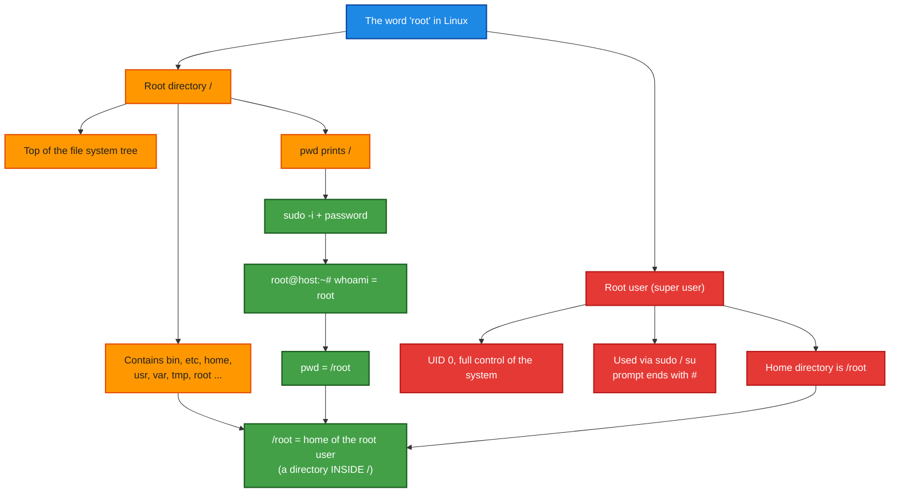

---

## 11. `13. proc` directory and `ps`

| Point     | Durga Sir wording                                                                                               |
| :-------- | :-------------------------------------------------------------------------------------------------------------- |
| Meaning   | **proc ===> means process**                                                                                     |
| Behaviour | **In linux multiple processes running simultaneously.** For each process a **unique id** will be there: **PID** |
| Layout    | Process data **inside proc directory** (numeric PID folders) — **for every process a separate folder is created to maintain information related to that process** |
| Command   | **`ps` command ===> process status**                                                                            |

**Demo (`fileSystem2.webm`):**

```bash
cd /proc
ls          # many numeric directories (PIDs) + files like cpuinfo, meminfo, uptime
ps -ef      # sample process list (class notes show UID PID PPID … CMD)
```

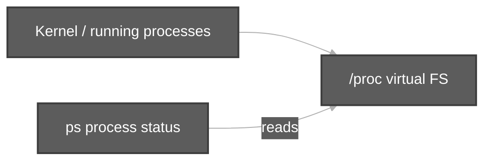

### Screenshot: `ps -ef` output

**Lab screenshot:** the full-format process list on `surya@suryathinkpad` (only the top of the output is visible; the list continues below).

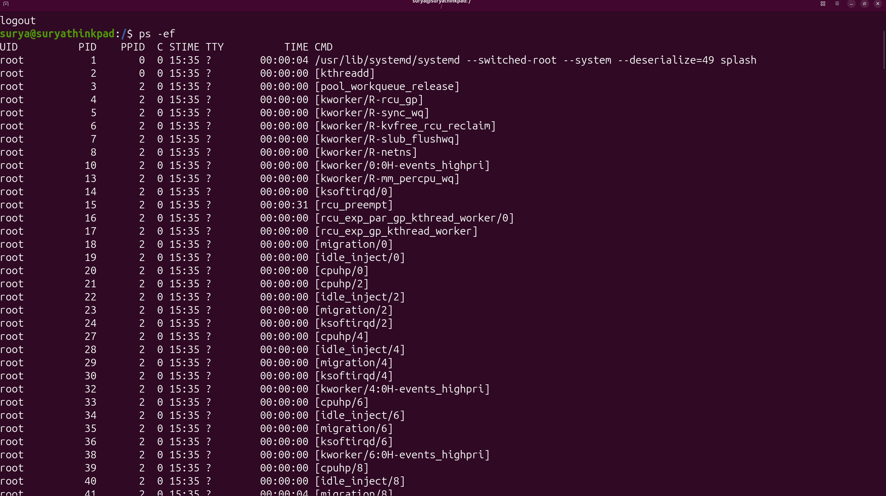

**What the screenshot shows (line by line):**

1. `logout` → the previous root shell (from `sudo -i`) was closed, returning to the normal user.
2. `surya@suryathinkpad:/$ ps -ef` → prompt is back to `$` (normal user) in `/`. `ps -ef` lists **every** process: `-e` = all processes, `-f` = full format.
3. Header row `UID PID PPID C STIME TTY TIME CMD` → the column names (explained in the table below).
4. `root 1 0 0 15:35 ? 00:00:04 /usr/lib/systemd/systemd --switched-root --system --deserialize=49 splash` → **PID 1**, the first process, started at boot (15:35). Its parent is `0` (the kernel itself). It is `systemd`, the init system that starts all other services. `--switched-root` means it took over after the initramfs stage; `splash` is the boot-splash option. It has used 4 seconds of CPU.
5. `root 2 0 0 15:35 ? 00:00:00 [kthreadd]` → **PID 2**, the kernel thread daemon, also a child of `0`. It creates all other kernel threads.
6. `[pool_workqueue_release]` (PID 3) and the `[kworker/R-...]` lines (PIDs 4-8, 13) → kernel worker threads (`rcu_gp`, `sync_wq`, `kvfree_rcu_reclaim`, `slub_flushwq`, `netns`, `mm_percpu_wq`). Their **PPID is `2`**, so they are children of `kthreadd`.
7. `[kworker/0:0H-events_highpri]` (PID 10), `[kworker/4:0H-...]` (PID 32), `[kworker/6:0H-...]` (PID 38) → high-priority worker threads bound to CPUs 0, 4 and 6.
8. `[ksoftirqd/0]`, `/2`, `/4`, `/6` (PIDs 14, 24, 30, 36) → one thread per CPU that handles deferred soft interrupts.
9. `[rcu_preempt]` (PID 15) → the only visible entry with real CPU time (`00:00:31`); it handles RCU (read-copy-update) synchronisation inside the kernel.
10. `[rcu_exp_par_gp_kthread_worker/0]` and `[rcu_exp_gp_kthread_worker]` (PIDs 16, 17) → more RCU helper threads.
11. `[migration/N]`, `[idle_inject/N]`, `[cpuhp/N]` for CPUs 0, 2, 4, 6, 8 → per-CPU threads for moving tasks between CPUs, idle injection (thermal control) and CPU hot-plug.
12. The bottom row (PID 41, `[migration/8]`) is cut off; the full list continues with more kernel threads, then system services and user processes.

**Observations from the data:**

- Every visible row has `UID = root`, `TTY = ?` and `STIME = 15:35`: kernel/system processes started at boot with no controlling terminal.
- Names in **square brackets `[ ]`** are **kernel threads**; `systemd` (no brackets) is a normal user-space program.
- Missing PIDs (9, 11, 12, 25, 26, 31, 37 ...) are threads that do not exist or are not shown.
- Process data for each PID is also available in `/proc/<PID>/` (for example `/proc/1/`).
- **For every process a separate folder is created** (named after its PID) inside `/proc` to maintain the information related to that process, for example `/proc/1/` for `systemd` and `/proc/2/` for `kthreadd`. The folder disappears when the process ends.

**`ps -ef` columns:**

| Column | Meaning | Example in screenshot |
|---|---|---|
| UID | User that owns the process | `root` |
| PID | Unique process ID | `1`, `2`, `15` |
| PPID | Parent process ID | `0` for PID 1/2, `2` for kernel threads |
| C | Recent CPU usage (percent) | `0` |
| STIME | Start time | `15:35` |
| TTY | Controlling terminal (`?` = none) | `?` |
| TIME | Total CPU time used | `00:00:31` for `rcu_preempt` |
| CMD | Command / thread name | `/usr/lib/systemd/systemd ...`, `[kthreadd]` |

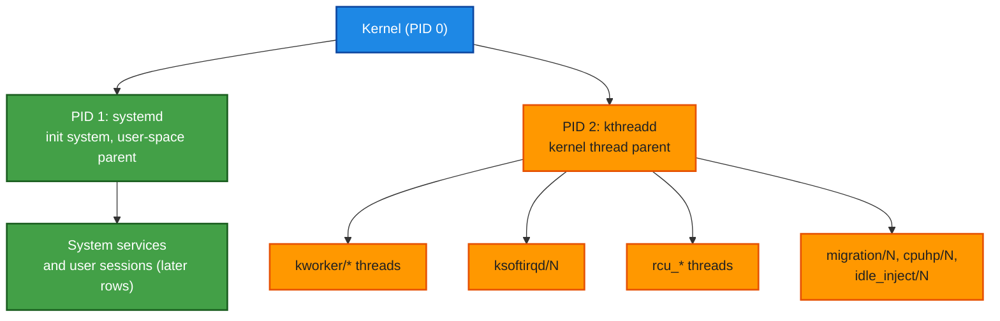

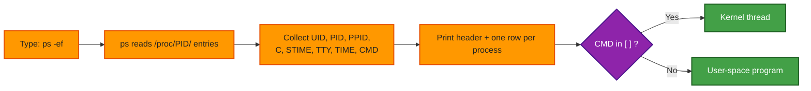

### Screenshot: inside `/proc` (`cd /proc` and `ls`)

**Lab screenshot:** listing the contents of the `/proc` directory.

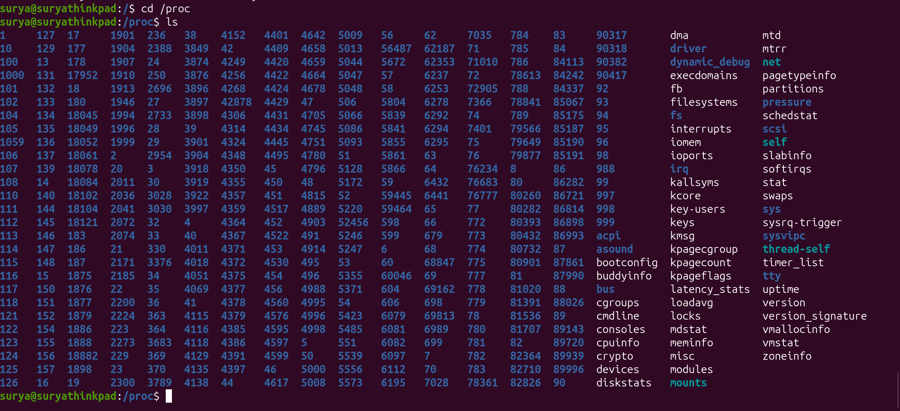

**What the screenshot shows (point by point):**

1. `surya@suryathinkpad:/$ cd /proc` → moves from `/` into the `/proc` directory using an absolute path. The prompt changes to `/proc`.
2. `ls` → lists everything inside `/proc`. The output has two kinds of entries.
3. **Numeric entries (`1`, `2`, `3`, `10`, `100`, `1000`, `1059`, `3789`, `90417` ...)** → one folder per running process; the number is the **PID**. These are the same PIDs seen in `ps -ef` (`1` = systemd, `2` = kthreadd). They are shown in bold blue because they are directories. Because processes start and stop, the list is not continuous and the numbers change over time.
4. **Non-numeric entries** → system-wide information, not tied to one process:

| Entry | What it holds |
|---|---|
| `cmdline` | Command-line options passed to the kernel at boot |
| `cpuinfo` | CPU details (model, cores, speed) |
| `meminfo` | Memory usage (total, free, cached ...) |
| `uptime` | Time since the system booted |
| `version` / `version_signature` | Kernel version information |
| `loadavg` | Load average of the system |
| `devices` | Registered character and block devices |
| `filesystems` | File system types supported by the kernel |
| `partitions`, `diskstats` | Disk partitions and disk I/O statistics |
| `mounts` | Currently mounted file systems (shown in a different colour because it is a symbolic link to `self/mounts`) |
| `interrupts`, `softirqs`, `irq` | Interrupt counters and per-IRQ settings |
| `ioports`, `iomem` | I/O port and memory address ranges in use |
| `swaps` | Swap areas in use (here `swap.img`) |
| `modules` | Loaded kernel modules |
| `stat`, `vmstat`, `schedstat` | Kernel, virtual memory and scheduler statistics |
| `net`, `scsi`, `tty`, `fs`, `sys`, `bus`, `driver`, `acpi`, `asound`, `sysvipc`, `irq`, `pressure` | Sub-directories for networking, SCSI, terminals, file systems, kernel tunables, buses, drivers, power, sound, IPC and pressure-stall info |
| `self` | A link to the `/proc/<PID>` folder of the process that is reading it (for `ls`, that is the `ls` process itself) |
| `thread-self` | Same idea for the current thread |

5. **Colours:** bold blue / cyan names are directories or links, plain white names are regular (virtual) files.
6. The final prompt `surya@suryathinkpad:/proc$` → still inside `/proc`, ready for the next command.

**Key idea:** `/proc` is a **virtual file system**. Nothing is stored on disk; the kernel generates these files on the fly, so they show live process and system information.

### Screenshot: inside one process folder (`cd 3789` and `ls`)

**Lab screenshot:** entering the folder of process **3789** and listing it.

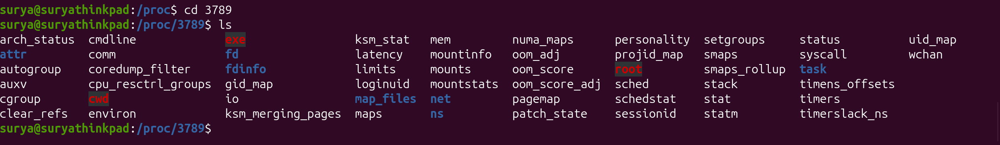

**What the screenshot shows (point by point):**

1. `surya@suryathinkpad:/proc$ cd 3789` → enters the folder of the process with PID `3789`. This proves that **every process has its own separate folder** in `/proc`. The prompt changes to `/proc/3789`.
2. `ls` → lists the files and folders holding the information about that one process.
3. Important entries:

| Entry | What it holds |
|---|---|
| `cmdline` | Full command line that started the process |
| `comm` | Short name of the command |
| `status` | Readable summary: name, state, PID, PPID, UID/GID, memory use |
| `stat`, `statm` | Same data in machine-readable form (process and memory statistics) |
| `environ` | Environment variables of the process |
| `exe` (red) | Symbolic link to the executable file that is running |
| `cwd` (red) | Symbolic link to the process's current working directory |
| `root` (red) | Symbolic link to the root directory the process sees (normally `/`) |
| `fd` | Folder of open file descriptors (files, sockets, pipes the process has open) |
| `fdinfo` | Extra details for each open file descriptor |
| `maps`, `smaps`, `smaps_rollup`, `pagemap` | Memory map of the process: which addresses are used and by what |
| `mem` | Raw memory of the process (access is restricted) |
| `limits` | Resource limits (open files, stack size ...) |
| `io` | Bytes read and written by the process |
| `mounts`, `mountinfo`, `mountstats` | Mounts visible to the process |
| `net` | Network information as seen by the process |
| `ns` | Namespaces the process belongs to |
| `task` | One sub-folder per thread of the process |
| `sched`, `schedstat` | Scheduler information |
| `oom_score`, `oom_adj`, `oom_score_adj` | Out-of-memory killer ranking and tuning |
| `cgroup`, `cpu_resctrl_groups` | Control group membership |
| `attr` | Security attributes (for example AppArmor/SELinux) |
| `syscall`, `stack`, `wchan` | What the process is waiting on or running in the kernel |
| `uid_map`, `gid_map`, `setgroups`, `projid_map` | User/group ID mappings (user namespaces) |
| `timers`, `timerslack_ns`, `timens_offsets` | Timer-related information |
| `personality`, `sessionid`, `loginuid` | Execution domain, login session and login user ID |
| `autogroup`, `auxv`, `coredump_filter`, `clear_refs`, `latency`, `patch_state`, `arch_status`, `ksm_*` | Scheduling group, ELF auxiliary vector, core-dump settings, memory/kernel tuning and diagnostic files |

4. **Colours:** blue names (`attr`, `fd`, `fdinfo`, `map_files`, `net`, `ns`, `task`) are directories; red highlighted names (`exe`, `cwd`, `root`) are symbolic links; the rest are regular virtual files.
5. The final prompt `surya@suryathinkpad:/proc/3789$` → still inside the process folder. Typing `cat status` here would show the details of PID 3789.

**Key idea:** the numeric folder in the first screenshot is exactly this kind of per-process folder; it exists only while process 3789 is running.

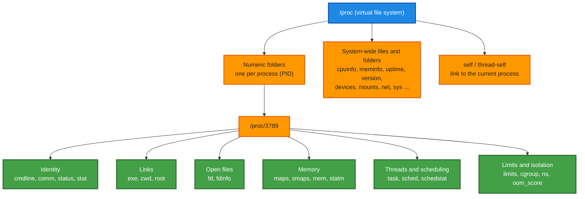

```mermaid
flowchart LR
    A["cd /proc"] --> B["ls<br/>PID folders + system files"]
    B --> C["pick a PID from ps -ef<br/>e.g. 3789"]
    C --> D["cd 3789"]
    D --> E["ls<br/>cmdline, status, exe, cwd, fd, maps ..."]
    E --> F["cat status<br/>read that process's details"]

    classDef cmd fill:#FF9800,stroke:#E65100,color:#212121,stroke-width:2px
    classDef res fill:#43A047,stroke:#1B5E20,color:#ffffff,stroke-width:2px
    class A,B,C,D,E cmd
    class F res
```

---

## 12. `14. boot` directory

| Point   | Durga Sir wording                                 |
| :------ | :------------------------------------------------ |
| Heading | **14. boot directory**                            |
| Purpose | **The files which are required to boot linux os** |

Before this heading, notes often show **`ps -ef`** lines for user **`durga`** (background **`gvfs`** / desktop services) — a bridge from **`/proc`** / **`ps`** to **`/boot`**.

### Closing `Note:` block (typed live — `Screencast From 2026-11-04 15-06-45.webm`)

Durga Sir draws a **red box diagram** on the whiteboard (boot-related layout), then types:

| Line (class) | Text                                                        |
| :----------- | :---------------------------------------------------------- |
| **Note:**    | *(heading)*                                                 |
|              | **operating system can locate files very easily.**          |
|              | **For every file system a separate name will be assigned.** |
|              | **ext2,ext3, ext4 ,XFS are names of Linux File Systems**    |
|              | **NTFS,FAT are names of windows file systems**              |

*(These closing lines also tie to **`/usr`** and the overall FHS advantage — see [§13](#13-15-usr-directory-and-closing-notes).)*

```mermaid
%%{init: {'theme': 'base', 'themeVariables': {'primaryColor': '#5c5c5c', 'primaryTextColor': '#ffffff', 'primaryBorderColor': '#3d3d3d', 'lineColor': '#b0b0b0'}}}%%
flowchart TB
    PWR["Power on"]
    PWR --> BL["Bootloader files in /boot"]
    BL --> KERN["Linux kernel loaded"]
    KERN --> INIT["init / userspace"]
    INIT --> TREE["Rest of FHS: /etc, /bin, /usr, …"]

    classDef darkGrey fill:#5c5c5c,stroke:#3d3d3d,color:#ffffff,stroke-width:2px
    class PWR,BL,KERN,INIT,TREE darkGrey
```

### Live class Q&amp;A (same screencast)

Students repeat directories already covered in Session 4 / earlier in Session 5 — Durga Sir uses this as revision:

| Mentioned in chat     | Reminder                                                       |
| :-------------------- | :------------------------------------------------------------- |
| **`/etc`**, **`etc`** | System **configuration** — Session 4                           |
| **`/bin`**, **`bin`** | Normal-user **command binaries** — Session 4                   |
| **`lost+found`**      | File-system recovery area (admin topic; name appeared in chat) |

---

## 13. `15. usr` directory and closing notes

| Point      | Wording                                                                              |
| :--------- | :----------------------------------------------------------------------------------- |
| **`/usr`** | **usr means user** — contains **user-related software** / programs and related files |

The **Note** lines typed after **`/boot`** in [`Screencast From 2026-11-04 15-06-45.webm`](../../../ScreenRecordings/Screencast%20From%202026-11-04%2015-06-45.webm) are the session summary:

| #    | Wording (on screen)                                         |
| :--- | :---------------------------------------------------------- |
| 1    | **operating system can locate files very easily.**          |
| 2    | **For every file system a separate name will be assigned.** |
| 3    | **ext2,ext3, ext4 ,XFS are names of Linux File Systems**    |
| 4    | **NTFS,FAT are names of windows file systems**              |

```mermaid
%%{init: {'theme': 'base', 'themeVariables': {'pie1': '#FF9800', 'pie2': '#1E88E5', 'pie3': '#43A047', 'pie4': '#8E24AA', 'pieTitleTextColor': '#212121', 'pieSectionTextColor': '#212121', 'pieStrokeColor': '#424242'}}}%%
pie title File system type names (class list)
    "Linux: ext2 / ext3 / ext4 / XFS" : 55
    "Windows: NTFS / FAT" : 45
```

---

## 14. Live demos from the recordings

| Demo                         | Recording               | What Durga Sir shows                                                         |
| :--------------------------- | :---------------------- | :--------------------------------------------------------------------------- |
| FHS tree diagram             | `fileSystem1`           | Diagram-3 with **`/` → home → users → Desktop…**                             |
| **`tmp` vs Desktop**         | `fileSystem1`           | **`tmp===>a.txt b.txt c.txt`** vs **`Desktop===>demo.txt`**                  |
| **`ls /home`**               | `fileSystem2`           | Multiple user directories                                                    |
| **`ls` / `ls -l` in `/dev`** | `fileSystem2`           | Device files, **`stdin`/`stdout`/`stderr`**, character devices               |
| **`ls` in `/proc`**          | `fileSystem2`           | PID directories and virtual files                                            |
| **`ps -ef`**                 | `fileSystem2`           | Process status listing                                                       |
| Windows **This PC**          | `fileSystem2`           | **C:/D:/E:** vs Linux mount idea                                             |
| **`exit` from root → `who`** | `fileSystem2`           | **`/root`** vs normal user **`durga`** (identity before **`/root`** topic)   |
| **`/home` + `/root` recap**  | `Screencast 2026-11-04` | **`/home/durga`**, **`/home/ravi`**, **`/root`**; Q **`/` vs root**          |
| **Boot + Note + FS types**   | `Screencast 2026-11-04` | **`14. boot`**, advantage note, **ext2/3/4/XFS**, **NTFS/FAT**, live diagram |
| **OpenJDK vs Oracle JDK**    | `Screencast 2026-11-04` | Repo vs **3rd party** example for **`/opt`**                                 |

---

## 15. Session checklist & interview Q&A

You should explain **items 4–15** above and:

1. **`/tmp`** — temporary; cleared on shutdown (class rule); not for permanent data.  
2. **`/dev`** — devices as files; **`stdin`/`stdout`/`stderr`**.  
3. **`/mnt`** vs **`/media`** — manual vs automatic mounting.  
4. **`/opt`**, **`/lib`**, **`/var`**, **`/home`**, **`/proc`**, **`/root`**, **`/boot`**, **`/usr`**.  
5. **`/`** vs **`/root`**.  
6. **`ps`** — process status; **`/proc`** and **PID**.  
7. **ext2/3/4, XFS** vs **NTFS, FAT**.

| Question          | Short answer                                            |
| :---------------- | :------------------------------------------------------ |
| **mnt vs media?** | **mnt → manual** · **media → automatic**                |
| **`/` vs root?**  | **`/` → FS root** · **`/root` → superuser home**        |
| **bin vs sbin?**  | *(Session 4)* normal user vs superuser command binaries |

**Next on portal:** Session 6 — VirtualBox & Ubuntu installation.

---

## 16. Scripts

| Script                                                                                                                           | Demonstrates                                                                         |
| :------------------------------------------------------------------------------------------------------------------------------- | :----------------------------------------------------------------------------------- |
| [`fhs-directories-tour-part2-demo.sh`](../../../scripts/file-system-navigation-and-hierarchy/fhs-directories-tour-part2-demo.sh) | **`/usr`**, **`/var`**, **`/tmp`**, **`/opt`**, **`/mnt`**, **`/proc`**, **`/root`** |
| [`tty-and-dev-demo.sh`](../../../scripts/types-of-files-in-linux/tty-and-dev-demo.sh)                                            | **`tty`**, **`/dev`**                                                                |
| [`fhs-root-directories-demo.sh`](../../../scripts/file-system-navigation-and-hierarchy/fhs-root-directories-demo.sh)             | **`ls -l /`**                                                                        |

```bash
cd /path/to/Linux-Basics
bash scripts/file-system-navigation-and-hierarchy/fhs-directories-tour-part2-demo.sh
```
