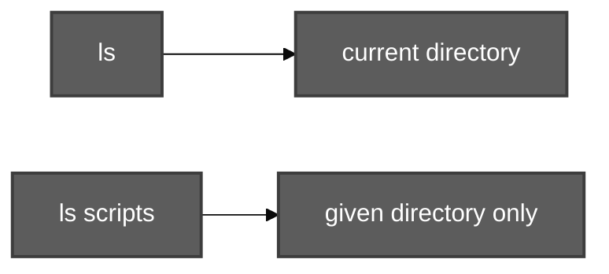
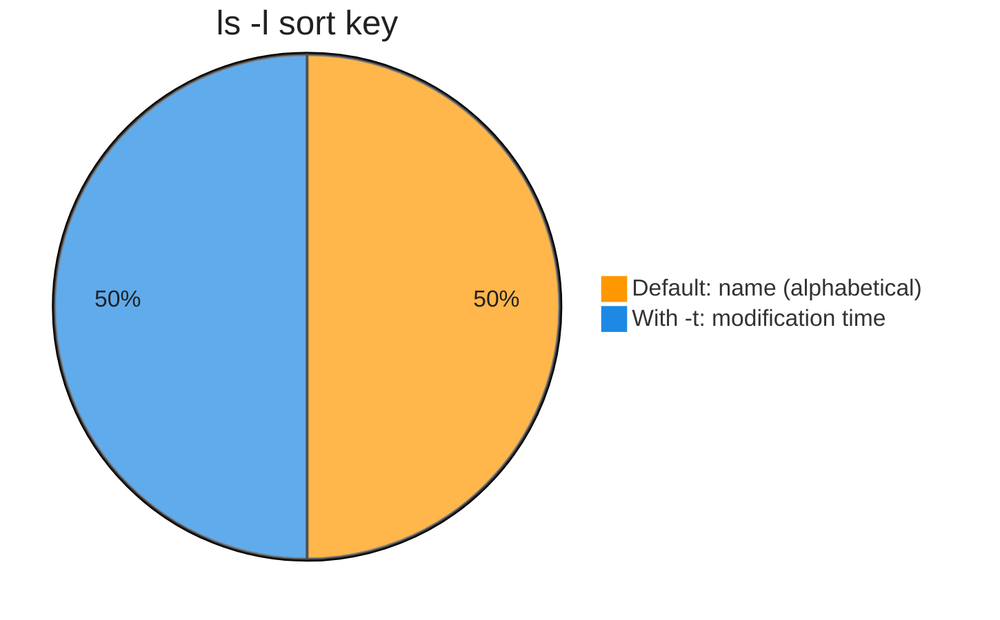
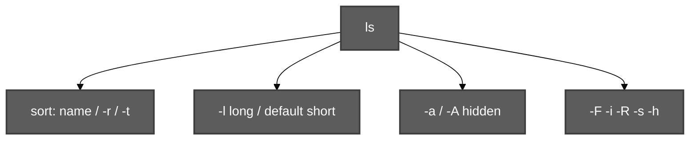

# ls Command and its Options

**Video:** [Session 7 — ls Command and its Options](https://www.youtube.com/watch?v=rpxT2L3t1a8&list=PLd3UqWTnYXOloH0vWBs4BtSbP84WcC2NY&index=7)  
**Instructor:** Durga Sir (Java Durga Soft)

**Prerequisites:** [File System Navigation Commands And Hierarchy.md](File%20System%20Navigation%20Commands%20And%20Hierarchy.md) (`cd`, `pwd`, `ls -a` intro) · [TypesOfFilesInLinux.md](TypesOfFilesInLinux.md) (`ls -l` type column)

**Practice folder:** [`scripts/ls-command-and-its-options/`](../../scripts/ls-command-and-its-options/)  
**Execution summary:** [`ls-command-and-its-options.md`](../../scripts-execution-summary/ls-command-and-its-options.md)

```bash
cd /path/to/Linux-Basics
chmod +x scripts/ls-command-and-its-options/*.sh
bash scripts/ls-command-and-its-options/ls-basic-and-directory-arg-demo.sh
```

---

**Table of contents**

- [1. What is `ls`?](#1-what-is-ls)
- [2. Ubuntu terminal shortcuts](#2-ubuntu-terminal-shortcuts)
- [3. `man` pages and saving documentation](#3-man-pages-and-saving-documentation)
- [4. Default `ls` behavior](#4-default-ls-behavior)
- [5. Option `-r` — reverse alphabetical](#5-option--r--reverse-alphabetical)
- [6. Option `-l` — long listing](#6-option--l--long-listing)
- [7. Options `-t` and `-ltr` — sort by time](#7-options--t-and--ltr--sort-by-time)
- [8. Combining multiple options](#8-combining-multiple-options)
- [9. Option `-a` — all (hidden files)](#9-option--a--all-hidden-files)
- [10. Option `-A` — almost all](#10-option--a--almost-all)
- [11. Option `-F` — classify by type](#11-option--f--classify-by-type)
- [12. Option `-f` — no color](#12-option--f--no-color)
- [13. Option `-i` — inode number](#13-option--i--inode-number)
- [14. Option `-R` — recursive](#14-option--r--recursive)
- [15. Options `-s` and `-h` — size](#15-options--s-and--h--size)
- [16. `ls` with `head` and `tail`](#16-ls-with-head-and-tail)
- [17. `more` and `less` (preview)](#17-more-and-less-preview)
- [18. Case sensitivity: `-r` vs `-R`, `-a` vs `-A`, `-f` vs `-F`](#18-case-sensitivity-r-vs-r-a-vs-a-f-vs-f)
- [19. Practice questions (class)](#19-practice-questions-class)
- [20. Options quick reference](#20-options-quick-reference)
- [21. Scripts for this topic](#21-scripts-for-this-topic)

---

## 1. What is `ls`?

| Point | Detail |
| :--- | :--- |
| **Meaning** | **List** — list files and directories |
| **`ls`** | Lists entries in the **current working directory** |
| **`ls dir1`** | Lists everything **inside** `dir1` |
| **No directory given** | Uses **cwd** (where your shell is now) |

**Demo:** [`ls-basic-and-directory-arg-demo.sh`](../../scripts/ls-command-and-its-options/ls-basic-and-directory-arg-demo.sh)



**Java analogy (Durga Sir):** In Java you use **documentation** for packages/classes/methods. In Linux, use **`man` pages** (manuals) first — full command documentation in the terminal.

---

## 2. Ubuntu terminal shortcuts

| Shortcut | Action |
| :--- | :--- |
| **Ctrl + Alt + T** | Open terminal |
| **Ctrl + Shift + +** | Increase font size |

---

## 3. `man` pages and saving documentation

| Command | Purpose |
| :--- | :--- |
| **`man ls`** | Full manual for `ls` (scroll; **`q`** = quit) |
| **`man ls > lsdoc.txt`** | **Redirection** `>` — save manual to a file |
| **`gedit lsdoc.txt`** | Open saved doc (GUI) |
| **`wc -l lsdoc.txt`** | Count lines in the file |

- Trainers/books show **common** options; **`man`** has **everything**.
- **First** check **`man`**; use **Google** only if you still need examples.
- **Extension** of the saved file does not matter on Linux.

**Demo:** [`man-ls-redirect-wc-demo.sh`](../../scripts/ls-command-and-its-options/man-ls-redirect-wc-demo.sh)

---

## 4. Default `ls` behavior

| Behavior | Detail |
| :--- | :--- |
| **Sort order** | **Alphabetical** (e.g. Desktop → Documents → … → Videos) |
| **Hidden files** | **Not** shown (names starting with `.`) |
| **Subdirectories** | Shows **directory names only** — **not** files inside them |

**Demo:** [`ls-basic-and-directory-arg-demo.sh`](../../scripts/ls-command-and-its-options/ls-basic-and-directory-arg-demo.sh) · [`ls-R-recursive-demo.sh`](../../scripts/ls-command-and-its-options/ls-R-recursive-demo.sh)

---

## 5. Option `-r` — reverse alphabetical

```bash
ls -r
```

| Option | Meaning |
| :--- | :--- |
| **`-r`** | **Reverse** sort — reverse **alphabetical** order |

**Demo:** [`ls-r-reverse-alphabetical-demo.sh`](../../scripts/ls-command-and-its-options/ls-r-reverse-alphabetical-demo.sh)

---

## 6. Option `-l` — long listing

```bash
ls -l
```

**Long list format** — one line per file with metadata (Durga Sir’s important line):

| Column / part | Meaning |
| :--- | :--- |
| **1st character** | **File type** (`-` ordinary, `d` directory, `l` link, …) |
| **Next 9 characters** | **Permissions** (covered in a later session) |
| **Link count** | Number of **hard links** (not “one user”) |
| **Owner** | User who owns the file |
| **Group** | Group for this file |
| **Size** | File size (**bytes** for files in `-l`) |
| **Date/time** | Last modification / metadata time |
| **Name** | File or directory name |

Every user belongs to a **group**; owner/group permissions are detailed later.

**Demo:** [`ls-l-long-listing-demo.sh`](../../scripts/ls-command-and-its-options/ls-l-long-listing-demo.sh)

---

## 7. Options `-t` and `-ltr` — sort by time

With **`ls -l`**, default sort is still **alphabetical** unless you add **`-t`**.

| Command | Sort behavior |
| :--- | :--- |
| **`ls -lt`** | Long list, sort by **time** — **newest at top** |
| **`ls -ltr`** | Long + time + **reverse** — **oldest at top**, newest at bottom |

**Demo:** [`ls-lt-ltr-time-sort-demo.sh`](../../scripts/ls-command-and-its-options/ls-lt-ltr-time-sort-demo.sh)



---

## 8. Combining multiple options

- You may use **many options together**: `ls -ltr`, `ls -l -t -r`, `ls -rtl` → **same output**.
- **Order of letters** after **one** `-` usually **does not matter**.
- Use **one hyphen** once: `ls -ltr` (not required: `ls -l -t -r`).

**Demo:** [`ls-combined-options-quiz-demo.sh`](../../scripts/ls-command-and-its-options/ls-combined-options-quiz-demo.sh)

---

## 9. Option `-a` — all (hidden files)

```bash
ls -a
```

| Option | Meaning |
| :--- | :--- |
| **`-a`** | **All** — including **hidden** files |

- Hidden file rule: name **starts with `.`** (e.g. `.bashrc`, `.bash_history`).
- Every directory contains **`.`** (current) and **`..`** (parent) — shown with **`-a`**.
- Class math: `ls | wc -l` vs `ls -a | wc -l` → difference ≈ hidden entries count.

**Demo:** [`ls-a-vs-A-hidden-demo.sh`](../../scripts/ls-command-and-its-options/ls-a-vs-A-hidden-demo.sh)

---

## 10. Option `-A` — almost all

```bash
ls -A
```

| Option | Meaning |
| :--- | :--- |
| **`-A`** | **Almost all** — like **`-a`** but **hides `.` and `..`** only |

Example counts (class): if **`ls -a | wc -l`** = 27 and plain **`ls`** ≈ 10, then **`ls -A | wc -l`** = **25** (27 − 2 dot entries).

---

## 11. Option `-F` — classify by type

```bash
ls -F
```

Appends a **type marker** to each name:

| Suffix | Meaning |
| :--- | :--- |
| **`/`** | **Directory** |
| **`*`** | **Executable** file (script/command) |
| **`@`** | **Symbolic link** |

**Demo:** [`ls-F-classify-demo.sh`](../../scripts/ls-command-and-its-options/ls-F-classify-demo.sh) · try `ls -F /bin`

---

## 12. Option `-f` — no color

- Colored `ls` (e.g. **blue** = directory) is **not standard** — varies by distro/theme.
- **`ls -f`** — **disable color** (GNU ls); also lists entries without sorting like `-a` in many cases.
- Durga Sir: if colors confuse you, use **`ls -f`** or **`ls -F`** for type.

**Demo:** [`ls-f-no-color-demo.sh`](../../scripts/ls-command-and-its-options/ls-f-no-color-demo.sh)

---

## 13. Option `-i` — inode number

```bash
ls -i
ls -li
```

| Term | Meaning |
| :--- | :--- |
| **Inode** | **Index node** — ID for stored **file metadata** (size, owner, group, times, link count, …) |
| **`-i`** | Show **inode number** before name (used more by **admin/superuser**) |

**Demo:** [`ls-i-inode-demo.sh`](../../scripts/ls-command-and-its-options/ls-i-inode-demo.sh)

---

## 14. Option `-R` — recursive

```bash
ls -R
```

| Letter | Meaning |
| :--- | :--- |
| **`-R`** (capital) | **Recursive** — list **subdirectories** and their contents |
| **`-r`** (small) | **Reverse** alphabetical — **not** recursive |

Example: `ls scripts` shows `a.txt`, `jj/` but not files inside `jj/` until **`ls -R`**.

**Demo:** [`ls-R-recursive-demo.sh`](../../scripts/ls-command-and-its-options/ls-R-recursive-demo.sh)

---

## 15. Options `-s` and `-h` — size

| Option | Meaning |
| :--- | :--- |
| **`-s`** | **Size** in **blocks** (often 1 KB per block on GNU ls; directory entries may show **4096** = 4 blocks) |
| **`-h`** | **Human-readable** sizes with **`-l`** (e.g. `4.0K`, `8.1K`, `M`, `G`) |

```bash
ls -ls    # long + block counts
ls -lh    # human-readable
```

First line **`total`** in `ls -l` / `ls -s` output = **total blocks** used for listed entries (class: e.g. **48** blocks).

**Demo:** [`ls-s-and-lh-size-demo.sh`](../../scripts/ls-command-and-its-options/ls-s-and-lh-size-demo.sh)

---

## 16. `ls` with `head` and `tail`

Large directories (e.g. **`/etc`** ~200+ entries):

```bash
ls -l /etc | wc -l      # how many lines
ls -l /etc | head       # first 10 lines (default)
ls -l /etc | head -20   # first 20
ls -l /etc | tail       # last 10
ls -l /etc | tail -3    # last 3
```

**`head`** / **`tail`** are separate commands (detailed later); combine with **`ls`** using **`|`** (pipe). Full theory: [pipeCommands.md](pipeCommands.md) (includes **`Broken pipe`**).

**Demo:** [`ls-with-head-tail-demo.sh`](../../scripts/ls-command-and-its-options/ls-with-head-tail-demo.sh)

---

## 17. `more` and `less` (preview)

When output is too long for one screen:

```bash
ls -l /etc | more
ls -l /etc | less
```

| Pager | Behavior |
| :--- | :--- |
| **`more`** | Page **forward** only (Space = next page); **`q`** quit |
| **`less`** | Page **forward and backward** (Page Up/Down) — **more powerful** |

**Demo:** [`ls-with-more-less-hint-demo.sh`](../../scripts/ls-command-and-its-options/ls-with-more-less-hint-demo.sh)

---

## 18. Case sensitivity: `-r` vs `-R`, `-a` vs `-A`, `-f` vs `-F`

| Pair | Small | Capital |
| :--- | :--- | :--- |
| **r / R** | **`-r`** reverse alphabetical | **`-R`** recursive |
| **a / A** | **`-a`** all + `.` `..` | **`-A`** almost all (no `.` `..`) |
| **f / F** | **`-f`** no color | **`-F`** classify type suffixes |

---

## 19. Practice questions (class)

| Requirement | Example command |
| :--- | :--- |
| All files **with inode** | `ls -ai` (same as `ls -ia`) |
| Long list, **hidden**, **oldest first** by time | `ls -lAtr` or `ls -lrtA` (order of letters flexible) |
| **`ls -r`** vs **`ls -ltr`** | **Not** the same — `-r` is name reverse; `-ltr` is time + oldest first |

**Identify hidden file:** name **starts with `.`**

---

## 20. Options quick reference

| Option | Purpose |
| :--- | :--- |
| *(none)* | List cwd, alphabetical |
| **`-r`** | Reverse alphabetical |
| **`-l`** | Long listing |
| **`-t`** | Sort by modification time (with `-l`: newest first unless `-r`) |
| **`-a`** | All entries including hidden and `.` / `..` |
| **`-A`** | All except `.` and `..` |
| **`-F`** | Mark type (`/`, `*`, `@`) |
| **`-f`** | No color (GNU) |
| **`-i`** | Inode number |
| **`-R`** | Recursive into subdirs |
| **`-s`** | Size in blocks |
| **`-h`** | Human-readable sizes (with `-l`) |



---

## 21. Scripts for this topic

| Script | Demonstrates |
| :--- | :--- |
| [`ls-basic-and-directory-arg-demo.sh`](../../scripts/ls-command-and-its-options/ls-basic-and-directory-arg-demo.sh) | `ls`, `ls dirname` |
| [`man-ls-redirect-wc-demo.sh`](../../scripts/ls-command-and-its-options/man-ls-redirect-wc-demo.sh) | `man`, `>`, `wc -l` |
| [`ls-r-reverse-alphabetical-demo.sh`](../../scripts/ls-command-and-its-options/ls-r-reverse-alphabetical-demo.sh) | `ls -r` |
| [`ls-l-long-listing-demo.sh`](../../scripts/ls-command-and-its-options/ls-l-long-listing-demo.sh) | `ls -l` columns |
| [`ls-lt-ltr-time-sort-demo.sh`](../../scripts/ls-command-and-its-options/ls-lt-ltr-time-sort-demo.sh) | `ls -lt`, `ls -ltr` |
| [`ls-a-vs-A-hidden-demo.sh`](../../scripts/ls-command-and-its-options/ls-a-vs-A-hidden-demo.sh) | `ls -a`, `ls -A` |
| [`ls-F-classify-demo.sh`](../../scripts/ls-command-and-its-options/ls-F-classify-demo.sh) | `ls -F` |
| [`ls-f-no-color-demo.sh`](../../scripts/ls-command-and-its-options/ls-f-no-color-demo.sh) | `ls -f` |
| [`ls-i-inode-demo.sh`](../../scripts/ls-command-and-its-options/ls-i-inode-demo.sh) | `ls -i`, `ls -li` |
| [`ls-R-recursive-demo.sh`](../../scripts/ls-command-and-its-options/ls-R-recursive-demo.sh) | `ls -R` |
| [`ls-s-and-lh-size-demo.sh`](../../scripts/ls-command-and-its-options/ls-s-and-lh-size-demo.sh) | `ls -s`, `ls -lh` |
| [`ls-combined-options-quiz-demo.sh`](../../scripts/ls-command-and-its-options/ls-combined-options-quiz-demo.sh) | Combined flags, quiz |
| [`ls-with-head-tail-demo.sh`](../../scripts/ls-command-and-its-options/ls-with-head-tail-demo.sh) | `head`, `tail`, `wc -l` |
| [`ls-with-more-less-hint-demo.sh`](../../scripts/ls-command-and-its-options/ls-with-more-less-hint-demo.sh) | `more` / `less` hints |

```bash
bash scripts/ls-command-and-its-options/ls-combined-options-quiz-demo.sh
```

**Next:** Continue playlist from [`linuxBasics.md`](../linuxBasics.md).
