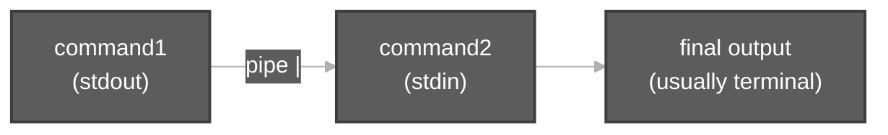
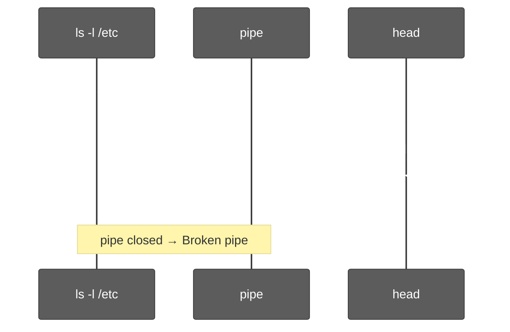

# Pipe (`|`) in Linux

**Context:** Durga Sir — [ls Command and its options.md](ls%20Command%20and%20its%20options.md) (Video 7) uses **`ls -l /etc | head`** when a directory has hundreds of entries. This note explains the **pipe**, a classic example, and **`Broken pipe`**.

**Related:** [File System Navigation Commands And Hierarchy.md](File%20System%20Navigation%20Commands%20And%20Hierarchy.md) (`/etc`) · [ls Command and its options.md](ls%20Command%20and%20its%20options.md) (§16 `head` / `tail`)

---

## 1. What is `|`?

The **pipe** character **`|`** connects **two commands** in one line:

| Idea | Meaning |
| :--- | :--- |
| **Left command** | Writes normal **output** (stdout) |
| **Pipe** | Carries that output as **input** to the next command |
| **Right command** | Reads from that **input** (stdin) |

```bash
command1 | command2
```

**Not the same as redirection `>`:** `>` sends output to a **file**. `|` sends output to **another program**.



---

## 2. Example: `ls -l /etc | head`

```bash
ls -l /etc | head
```

| Part | Role |
| :--- | :--- |
| **`ls -l`** | Long listing of files and directories |
| **`/etc`** | **Absolute path** to the system **configuration** directory (under root `/`) |
| **`|`** | Pipe — feed `ls` output into `head` |
| **`head`** | Show only the **first 10 lines** (default) |

**Why use it?** `/etc` can have **200+** lines of output. You often only need the **top** of the list, not the full scroll.

**Count lines (another pipe):**

```bash
ls -l /etc | wc -l
```

**Practice script:** [`ls-with-head-tail-demo.sh`](../../scripts/ls-command-and-its-options/ls-with-head-tail-demo.sh)

---

## 3. What is `/etc`?

| Point | Detail |
| :--- | :--- |
| **Path** | **`/etc`** — starts with `/`, so it is **absolute** from filesystem root |
| **Purpose** | **System configuration** (e.g. `passwd`, `group`, `hosts`) |
| **Session** | Covered under FHS in [File System Navigation Commands And Hierarchy.md](File%20System%20Navigation%20Commands%20And%20Hierarchy.md) |

---

## 4. What is `head`?

| Command | Behavior |
| :--- | :--- |
| **`head`** | Print the **first 10 lines** of input |
| **`head -20`** | First **20** lines |
| **`head -3`** | First **3** lines |

**`tail`** is the opposite — **last** lines (see ls topic §16).

---

## 5. `Broken pipe` — what does it mean?

You may see:

```text
ls: Broken pipe
```

after:

```bash
ls -l /etc | head
```

### What happened

1. **`ls`** keeps **writing** many lines into the pipe.
2. **`head`** reads **10 lines**, prints them, then **exits** and **closes** the pipe.
3. **`ls`** tries to write **more** → kernel signals **SIGPIPE** → message **`ls: Broken pipe`**.



| Question | Answer |
| :--- | :--- |
| Is `/etc` broken? | **No** — listing worked; only the **pipe** closed early. |
| Did `head` fail? | **No** — you got the lines you wanted. |
| Is it common? | **Yes** with **`big output | head`**. |

### Scripts and `set -o pipefail`

In Bash scripts, **`set -o pipefail`** can make the **whole pipeline** fail when `ls` gets SIGPIPE, even if output looks fine. Demos often use:

```bash
ls -l /etc | head -10 || true
```

to avoid treating SIGPIPE as a script error.

### When you see it less often

**`more`** / **`less`** keep reading until you quit, so the writer usually does not hit a closed pipe as quickly as with **`head`**.

---

## 6. Pipe vs redirection (quick compare)

| Symbol | Name | Connects to |
| :--- | :--- | :--- |
| **`|`** | **Pipe** | **Another command** |
| **`>`** | **Redirect** | **File** (overwrite) |
| **`>>`** | **Append redirect** | **File** (append) |

Example from ls session: **`man ls > lsdoc.txt`** uses **`>`**, not **`|`**.

---

## 7. Checklist

You should be able to explain:

1. **`|`** sends **stdout** of the left command to **stdin** of the right command.  
2. **`ls -l /etc | head`** lists config dir in long form, then shows **first 10 lines**.  
3. **`/etc`** = system **configuration** tree under **`/`**.  
4. **`Broken pipe`** = reader (**`head`**) **closed** the pipe while **`ls`** was still writing — usually **harmless** for this pattern.

**Practice:**

```bash
ls -l /etc | head
ls -l /etc | wc -l
```
