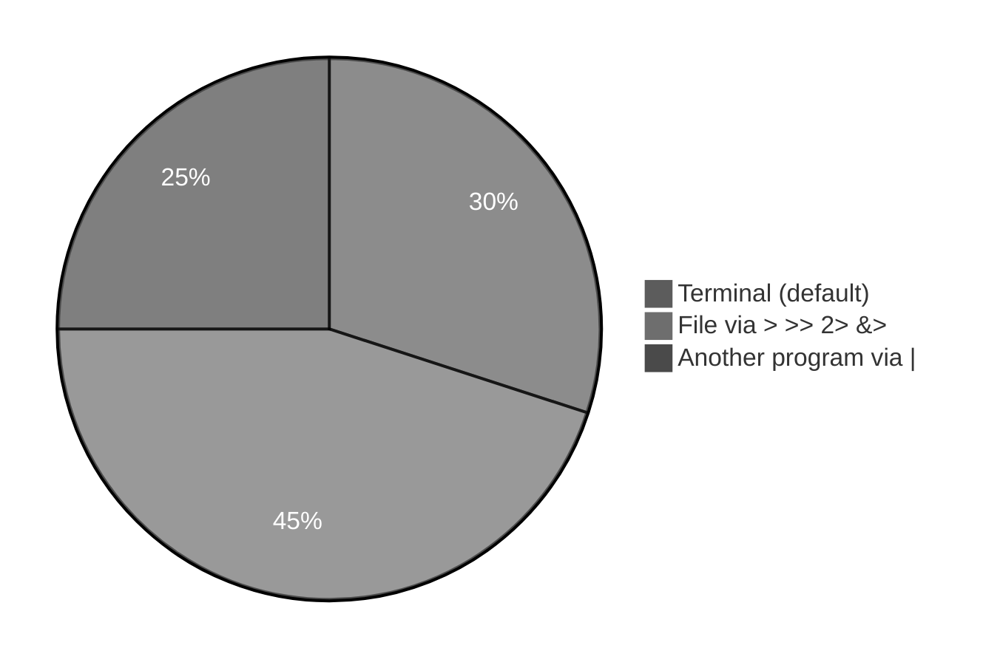
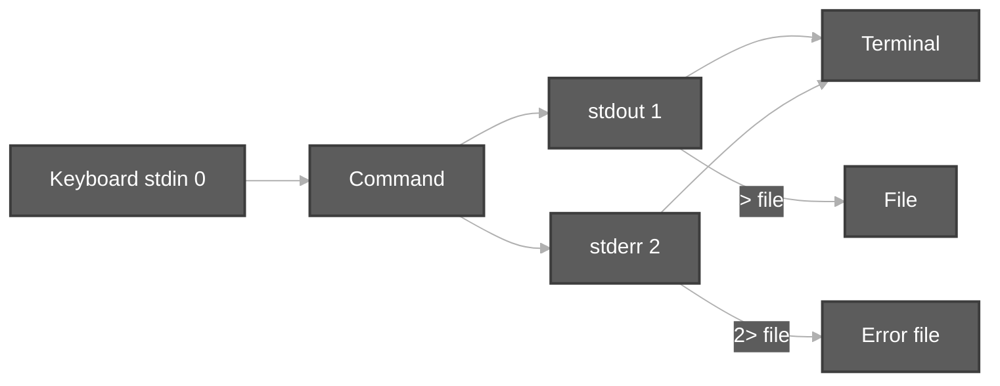
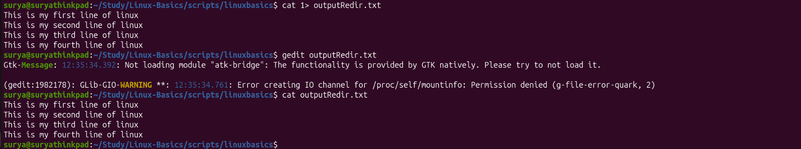

# Redirection — stdin, stdout, stderr (Session 11)

**Video:** [Session 11 — Redirection](https://www.youtube.com/watch?v=f_B6BIxlYFw&list=PLd3UqWTnYXOloH0vWBs4BtSbP84WcC2NY&index=11)  
**Instructor:** Durga Sir

**Prerequisites:** [viewContentOfFiles.md](viewContentOfFiles.md) (`cat`, viewing files) · [wordCountCommand.md](wordCountCommand.md) (`wc`) · [Date and Cal commands.md](Date%20and%20Cal%20commands.md) (`cal` errors in labs) · [pipeCommands.md](pipeCommands.md) (`|` is **not** `>`)

**Related (overwrite, append, heredoc):** [EOF and Redirection.md](EOF%20and%20Redirection.md) — Rama/Sita, `>>`, `<<EOF` in depth

**Scripts:** [`scripts/redirection.sh`](../../scripts/redirection.sh) (orchestrator) · [`scripts/redirection/`](../../scripts/redirection/) (Session 11 demos) · [`scripts/Redirection/`](../../scripts/Redirection/) (`>`, `>>`, EOF)  
**Execution summary:** [`redirectionScriptSummary.md`](../../scripts-execution-summary/redirectionScriptSummary.md)

```bash
cd /path/to/Linux-Basics
bash scripts/redirection.sh
# Or one demo:
bash scripts/redirection/stderr-2-greater-demo.sh
```

---

**Table of contents**

- [1. Goal of this session](#1-goal-of-this-session)
- [2. Data streams — 0, 1, and 2](#2-data-streams--0-1-and-2)
- [3. Default devices (keyboard and terminal)](#3-default-devices-keyboard-and-terminal)
- [4. Output redirection — stdout (`>` and `>>`)](#4-output-redirection--stdout--and-)
- [5. Explicit `1>` and “no space” rule](#5-explicit-1-and-no-space-rule)
- [6. `cat > file` — keyboard input, file output](#6-cat--file--keyboard-input-file-output)
- [7. Error redirection — stderr (`2>` and `2>>`)](#7-error-redirection--stderr-2-and-2)
- [8. Input redirection — stdin (`<` and `0<`)](#8-input-redirection--stdin--and-0)
- [9. Combined redirects on one line](#9-combined-redirects-on-one-line)
- [10. Both streams — `&>` and `&>>`](#10-both-streams--and-)
- [11. Redirect to another terminal (`tty`, `/dev/pts`)](#11-redirect-to-another-terminal-tty-devpts)
- [12. `gedit` is not redirection](#12-gedit-is-not-redirection)
- [13. Exam-style recap](#13-exam-style-recap)
- [14. Session checklist](#14-session-checklist)
- [15. Script index](#15-script-index)

---

## 1. Goal of this session

Durga Sir treats **redirection** as moving **data streams** between **devices** (keyboard, terminal, files) instead of only “save output to a file.”

After this session you should know:

| Idea | Takeaway |
| :--- | :--- |
| **Three streams** | **0** = stdin, **1** = stdout, **2** = stderr |
| **Stdout redirect** | `>` overwrite, `>>` append (default stream is **1**) |
| **Stderr redirect** | **`2>`** or **`2>>`** — required for error text |
| **Stdin redirect** | **`<`** or **`0<`** — read from file |
| **Both at once** | **`&>`** / **`&>>`** — stdout **and** stderr to the **same** file |



---

## 2. Data streams — 0, 1, and 2

| FD | Name | Typical default | What flows |
| :---: | :--- | :--- | :--- |
| **0** | **stdin** | Keyboard | Input **into** the command |
| **1** | **stdout** | Terminal screen | Normal **success** output |
| **2** | **stderr** | Terminal screen | **Error** and diagnostic messages |



**Lab command (see script):**

```bash
bash scripts/redirection/streams-0-1-2-demo.sh
```

---

## 3. Default devices (keyboard and terminal)

- **stdin (0)** — by default the **keyboard** (what you type for `cat` with no file name).
- **stdout (1)** and **stderr (2)** — by default the **terminal** (the window where you run commands).

Errors and normal output can both appear on the **same screen**, but they are **different streams** — that is why `2>` exists.

---

## 4. Output redirection — stdout (`>` and `>>`)

| Operator | Effect |
| :---: | :--- |
| **`>`** | Send **stdout** to a file; **overwrite** (truncate) the file first |
| **`>>`** | Send **stdout** to a file; **append** at the end |

**Class examples:**

```bash
ls > output.txt          # directory listing in file; less clutter on screen
echo "line" >> output.txt
```

Because **`>`** and **`>>`** redirect **stdout** by default, the **`1`** in front is **optional**:

```bash
ls > output.txt
ls 1> output.txt         # same meaning
```

**Your lab — type several lines from the keyboard into a file (`1>` = stdout):**

```bash
cd scripts/linuxbasics
cat 1> outputRedir.txt
```

Type one line, press **Enter**, type the next line (repeat). When finished, press **Ctrl+D**. Then check the file:

```bash
cat outputRedir.txt
gedit outputRedir.txt    # optional — open in editor to see all lines
```



**Repo demo script:**

```bash
bash scripts/redirection/stdout-greater-than-demo.sh
```

For Rama/Sita and **`>` vs `>>`**, see [EOF and Redirection.md §2–§3](EOF%20and%20Redirection.md#2--overwrite-truncate--your-rama--sita-question).

---

## 5. Explicit `1>` and “no space” rule

Durga Sir stresses: after the stream number there must be **no space** before `>`.

| Valid | Invalid (do not use in exam) |
| :--- | :--- |
| `1>file.txt` | `1 > file.txt` |
| `2>error.txt` | `2 > error.txt` |

The digit and `>` act as **one** redirection operator.

---

## 6. `cat > file` — keyboard input, file output

Two ways to give input in many labs:

1. **File name** on the command line — `cat a.txt`
2. **Redirection** — `cat < a.txt` or type at keyboard with `cat > new.txt`

```bash
cat > output.txt
# type lines; Ctrl+D ends input (EOF on keyboard)
```

That is **stdin from keyboard** and **stdout to a file** — not the same as opening a file in **gedit**.

**Lab command:**

```bash
bash scripts/redirection/stdout-greater-than-demo.sh
```

---

## 7. Error redirection — stderr (`2>` and `2>>`)

Commands like **`cal`** with an invalid year print errors on **stderr**, not stdout.

```bash
cal 99999                  # error text on terminal
cal 99999 2> error.txt     # error text in error.txt
```

| Mistake | What happens |
| :--- | :--- |
| `cal 99999 > only.txt` | Only **stdout** goes to the file; **errors still print on screen** |
| `cal 99999 2> error.txt` | **stderr** captured in `error.txt` |

Use **`2>>`** to **append** errors to an existing log file.

**Lab command:**

```bash
bash scripts/redirection/stderr-2-greater-demo.sh
```

---

## 8. Input redirection — stdin (`<` and `0<`)

| Form | Meaning |
| :---: | :--- |
| **`< file`** | Read **stdin** from `file` |
| **`0<file`** | Same; leading **`0`** is optional |

For **`cat`**, these are equivalent in class:

```bash
cat < a.txt
cat a.txt
```

**Lab command:**

```bash
bash scripts/redirection/stdin-combined-redirect-demo.sh
```

Also: [`scripts/Redirection/input-less-than-demo.sh`](../../scripts/Redirection/input-less-than-demo.sh).

---

## 9. Combined redirects on one line

Durga Sir combines all three on one **`cat`** line:

```bash
cat < a.txt > result.txt 2> error.txt
```

| Part | Role |
| :--- | :--- |
| `< a.txt` | Input from `a.txt` |
| `> result.txt` | Normal output to `result.txt` |
| `2> error.txt` | Errors to `error.txt` |

Order and spacing matter for readability; practice on your machine until the three files behave as expected.

---

## 10. Both streams — `&>` and `&>>`

When you want **stdout and stderr in the same file**:

| Operator | Effect |
| :---: | :--- |
| **`&>`** | Send **both** streams to a file (**overwrite**) |
| **`&>>`** | Send **both** streams to a file (**append**) |

**Class-style lab:**

```bash
cal 2024 &> results1.txt
cal 99999 &>> results1.txt    # invalid year — error appended to same file
```

**Lab command:**

```bash
bash scripts/redirection/both-streams-ampersand-greater-demo.sh
```

---

## 11. Redirect to another terminal (`tty`, `/dev/pts`)

In a **two-terminal** lab:

1. On **terminal A**, run **`tty`** — example output: `/dev/pts/1`
2. On **terminal B**, run **`cal > /dev/pts/1`** — the calendar appears on **A’s** screen

Same idea with **`echo`**:

```bash
echo "message" > /dev/pts/1
```

**Lab command (prints instructions if only one pseudo-tty):**

```bash
bash scripts/redirection/tty-devpts-hint-demo.sh
```

---

## 12. `gedit` is not redirection

**`gedit file`** opens a GUI editor — it does **not** replace **`>`**, **`2>`**, or **`<`**. Redirection is done by the **shell** with **`>` / `<` / `2>`** on the command line.

---

## 13. Exam-style recap

| Question | Answer |
| :--- | :--- |
| How many standard streams? | **Three** — 0, 1, 2 |
| Default device for stdin? | **Keyboard** |
| Default for stdout and stderr? | **Terminal** |
| `ls > output.txt` redirects which stream? | **Stdout (1)** |
| Capture `cal` invalid-year message in a file? | **`2> error.txt`** (not plain `>` alone) |
| Difference `<` vs `>` vs `>>`? | **`<`** input from file; **`>`** overwrite output; **`>>`** append output |
| Send both output and errors to one file? | **`&>`** or **`&>>`** |

---

## 14. Session checklist

- [ ] Run `bash scripts/redirection/streams-0-1-2-demo.sh` and name streams **0, 1, 2**
- [ ] Create `output.txt` with `ls > output.txt`
- [ ] Put `cal` errors in a file with `2> error.txt`
- [ ] Run `cat < a.txt > result.txt 2> error.txt`
- [ ] Try `cal 2024 &> results1.txt` and append an error with `&>>`
- [ ] (Two terminals) `tty` then `cal > /dev/pts/N`
- [ ] Read [EOF and Redirection.md](EOF%20and%20Redirection.md) for heredoc and Rama/Sita
- [ ] Add **screenshots** under each command block above after your lab (same style as `wordCountCommand.md`)

---

## 15. Script index

| Script | Topic |
| :--- | :--- |
| [`redirection.sh`](../../scripts/redirection.sh) | Run all Session 11 + `Redirection/` demos |
| [`streams-0-1-2-demo.sh`](../../scripts/redirection/streams-0-1-2-demo.sh) | Streams 0, 1, 2 |
| [`stdout-greater-than-demo.sh`](../../scripts/redirection/stdout-greater-than-demo.sh) | `>`, `>>`, `1>` |
| [`stderr-2-greater-demo.sh`](../../scripts/redirection/stderr-2-greater-demo.sh) | `2>` vs `>` |
| [`stdin-combined-redirect-demo.sh`](../../scripts/redirection/stdin-combined-redirect-demo.sh) | `<`, combined line |
| [`both-streams-ampersand-greater-demo.sh`](../../scripts/redirection/both-streams-ampersand-greater-demo.sh) | `&>`, `&>>` |
| [`tty-devpts-hint-demo.sh`](../../scripts/redirection/tty-devpts-hint-demo.sh) | `tty`, `/dev/pts` |
| [`Redirection/*.sh`](../../scripts/Redirection/) | `>`, `>>`, `<<EOF`, pipe hint |

Full command-by-command tables: [`redirectionScriptSummary.md`](../../scripts-execution-summary/redirectionScriptSummary.md).
