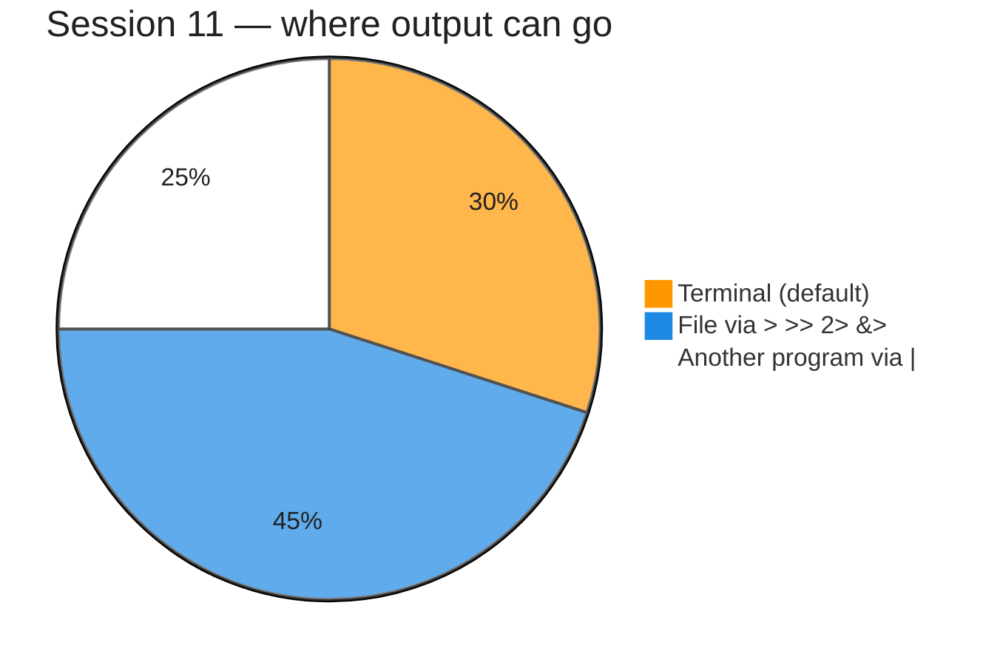
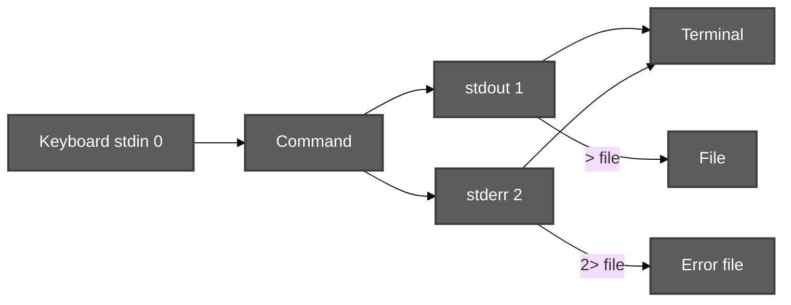
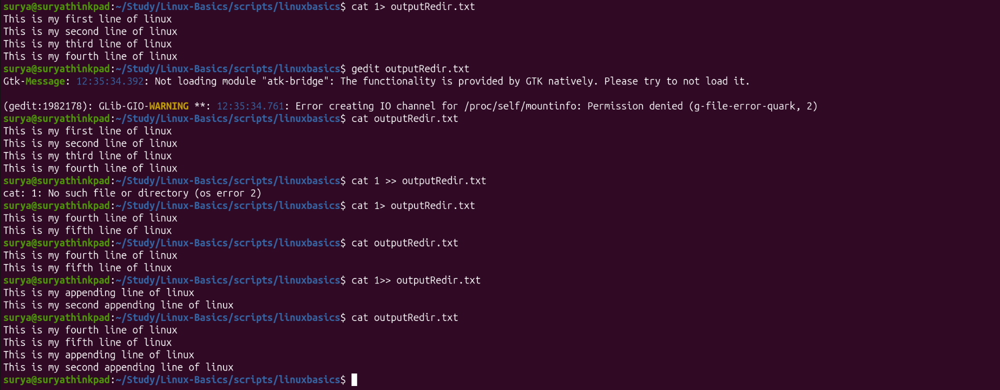
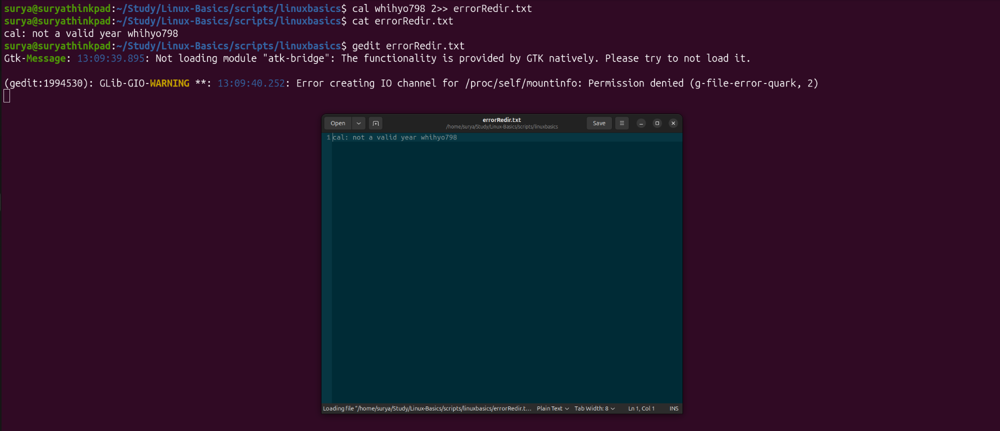
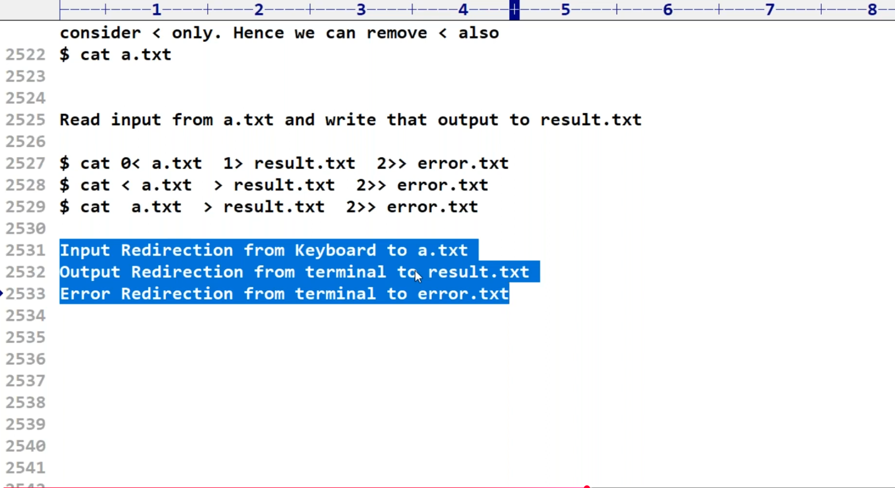
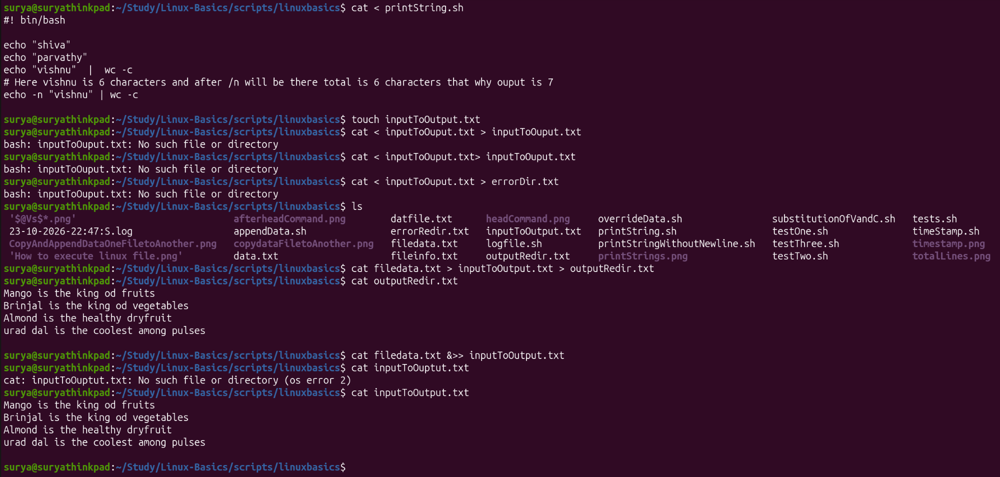
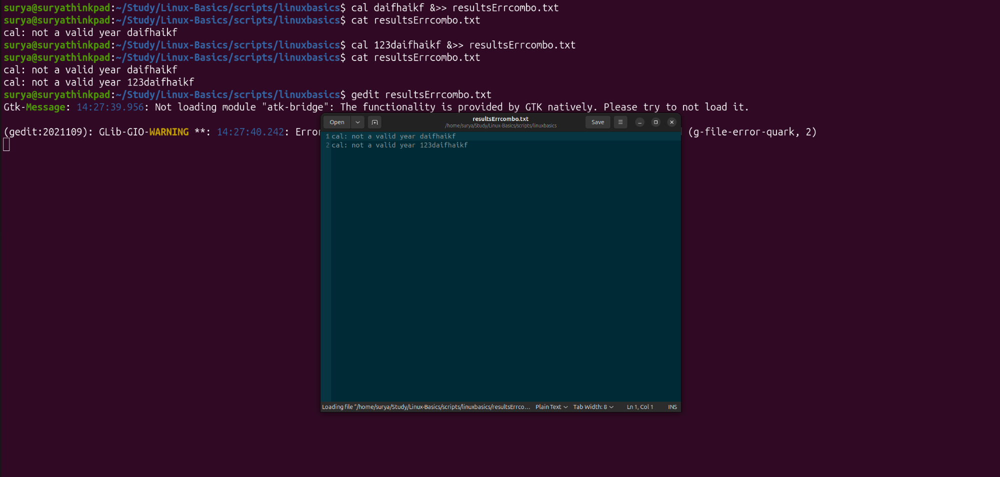
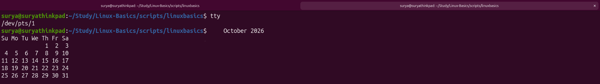

# Redirection — stdin, stdout, stderr (Session 11)

**Video:** [Session 11 — Redirection](https://www.youtube.com/watch?v=f_B6BIxlYFw&list=PLd3UqWTnYXOloH0vWBs4BtSbP84WcC2NY&index=11)  
**Instructor:** Durga Sir

**Prerequisites:** [viewContentOfFiles.md](viewContentOfFiles.md) (`cat`, viewing files) · [wordCountCommand.md](wordCountCommand.md) (`wc`) · [Date and Cal commands.md](Date%20and%20Cal%20commands.md) (`cal` errors in labs) · [pipeCommands.md](pipeCommands.md) (`|` is **not** `>`)

**Next:** [PipingTeeXargs.md](PipingTeeXargs.md) (Session 12 — piping, `tee`, `xargs`)

**Related (overwrite, append, heredoc):** [EOF and Redirection.md](EOF%20and%20Redirection.md) — Rama/Sita, `>>`, `<<EOF` in depth

**Scripts:** [`scripts/redirection.sh`](../../scripts/redirection.sh) (orchestrator) · [`scripts/redirection/`](../../scripts/redirection/) (Session 11 demos) · [`scripts/Redirection/`](../../scripts/Redirection/) (`>`, `>>`, EOF)  
**Execution summary:** [`redirectionScriptSummary.md`](../../scripts-execution-summary/redirectionScriptSummary.md)

```bash
cd /path/to/Linux-Basics
bash scripts/redirection.sh
# Or one demo:
bash scripts/redirection/stderr-2-greater-demo.sh
```

---

**Table of contents**

- [Redirection — stdin, stdout, stderr (Session 11)](#redirection--stdin-stdout-stderr-session-11)
  - [1. Goal of this session](#1-goal-of-this-session)
  - [2. Data streams — 0, 1, and 2](#2-data-streams--0-1-and-2)
  - [3. Default devices (keyboard and terminal)](#3-default-devices-keyboard-and-terminal)
  - [4. Output redirection — stdout (`>` and `>>`)](#4-output-redirection--stdout--and-)
  - [5. Explicit `1>` and “no space” rule](#5-explicit-1-and-no-space-rule)
  - [6. `cat > file` — keyboard input, file output](#6-cat--file--keyboard-input-file-output)
  - [7. Error redirection — stderr (`2>` and `2>>`)](#7-error-redirection--stderr-2-and-2)
  - [8. Input redirection — stdin (`<` and `0<`)](#8-input-redirection--stdin--and-0)
  - [9. Combined redirects on one line](#9-combined-redirects-on-one-line)
  - [10. Both streams — `&>` and `&>>`](#10-both-streams---and-)
  - [11. Redirect to another terminal (`tty`, `/dev/pts`)](#11-redirect-to-another-terminal-tty-devpts)
  - [12. `gedit` is not redirection](#12-gedit-is-not-redirection)
  - [13. Exam-style recap](#13-exam-style-recap)
  - [14. Session checklist](#14-session-checklist)
  - [15. Script index](#15-script-index)

---

## 1. Goal of this session

Durga Sir treats **redirection** as moving **data streams** between **devices** (keyboard, terminal, files) instead of only “save output to a file.”

After this session you should know:

| Idea                | Takeaway                                                          |
| :------------------ | :---------------------------------------------------------------- |
| **Three streams**   | **0** = stdin, **1** = stdout, **2** = stderr                     |
| **Stdout redirect** | `>` overwrite, `>>` append (default stream is **1**)              |
| **Stderr redirect** | **`2>`** or **`2>>`** — required for error text                   |
| **Stdin redirect**  | **`<`** or **`0<`** — read from file                              |
| **Both at once**    | **`&>`** / **`&>>`** — stdout **and** stderr to the **same** file |



---

## 2. Data streams — 0, 1, and 2

|  FD   | Name       | Typical default | What flows                        |
| :---: | :--------- | :-------------- | :-------------------------------- |
| **0** | **stdin**  | Keyboard        | Input **into** the command        |
| **1** | **stdout** | Terminal screen | Normal **success** output         |
| **2** | **stderr** | Terminal screen | **Error** and diagnostic messages |



**Lab command (see script):**

```bash
bash scripts/redirection/streams-0-1-2-demo.sh
```

---

## 3. Default devices (keyboard and terminal)

- **stdin (0)** — by default the **keyboard** (what you type for `cat` with no file name).
- **stdout (1)** and **stderr (2)** — by default the **terminal** (the window where you run commands).

Errors and normal output can both appear on the **same screen**, but they are **different streams** — that is why `2>` exists.

---

## 4. Output redirection — stdout (`>` and `>>`)

| Operator | Effect                                                             |
| :------: | :----------------------------------------------------------------- |
| **`>`**  | Send **stdout** to a file; **overwrite** (truncate) the file first |
| **`>>`** | Send **stdout** to a file; **append** at the end                   |

**Class examples:**

```bash
ls > output.txt          # directory listing in file; less clutter on screen
echo "line" >> output.txt
```

Because **`>`** and **`>>`** redirect **stdout** by default, the **`1`** in front is **optional**:

```bash
ls > output.txt
ls 1> output.txt         # same meaning
```

**Your lab — `1>` overwrite, `1>>` append, and the “space” mistake (`scripts/linuxbasics`):**

```bash
cd scripts/linuxbasics
cat 1> outputRedir.txt
```

Type four lines (press **Enter** after each line). Press **Ctrl+D** when done. Verify:

```bash
cat outputRedir.txt
gedit outputRedir.txt    # optional
```

**Wrong — space between `1` and `>>`** (shell treats `1` as a file name for `cat`):

```bash
cat 1 >> outputRedir.txt
# cat: 1: No such file or directory
```

Use **`1>>`** with **no space** to append stdout.

**Overwrite again** with `1>` (old lines in the file are replaced):

```bash
cat 1> outputRedir.txt
# type two new lines, Ctrl+D
cat outputRedir.txt
```

**Append** without erasing what is already in the file:

```bash
cat 1>> outputRedir.txt
# type two more lines, Ctrl+D
cat outputRedir.txt
```



**Repo demo script:**

```bash
bash scripts/redirection/stdout-greater-than-demo.sh
```

For Rama/Sita and **`>` vs `>>`**, see [EOF and Redirection.md §2–§3](EOF%20and%20Redirection.md#2--overwrite-truncate--your-rama--sita-question).

By default > and >> are meant for output redirection only.

---

## 5. Explicit `1>` and “no space” rule

Durga Sir stresses: after the stream number there must be **no space** before `>`.

| Valid         | Invalid (do not use in exam)                                    |
| :------------ | :-------------------------------------------------------------- |
| `1>file.txt`  | `1 > file.txt`                                                  |
| `1>>file.txt` | `1 >> file.txt` (see §4 lab — `cat` looks for a file named `1`) |
| `2>error.txt` | `2 > error.txt`                                                 |

The digit and `>` / `>>` act as **one** redirection operator.

---

## 6. `cat > file` — keyboard input, file output

Two ways to give input in many labs:

1. **File name** on the command line — `cat a.txt`
2. **Redirection** — `cat < a.txt` or type at keyboard with `cat > new.txt`

```bash
cat > output.txt
# type lines; Ctrl+D ends input (EOF on keyboard)
```

That is **stdin from keyboard** and **stdout to a file** — not the same as opening a file in **gedit**.

**Lab command:**

```bash
bash scripts/redirection/stdout-greater-than-demo.sh
```

---

## 7. Error redirection — stderr (`2>` and `2>>`)

Commands like **`cal`** with an invalid year print errors on **stderr**, not stdout.

```bash
cal 99999                  # error text on terminal
cal 99999 2> error.txt     # error text in error.txt
```

| Mistake                  | What happens                                                       |
| :----------------------- | :----------------------------------------------------------------- |
| `cal 99999 > only.txt`   | Only **stdout** goes to the file; **errors still print on screen** |
| `cal 99999 2> error.txt` | **stderr** captured in `error.txt`                                 |

Use **`2>>`** to **append** errors to an existing log file.

**Your lab — invalid `cal` year, capture stderr with `2>>` (`scripts/linuxbasics`):**

```bash
cd scripts/linuxbasics
cal whihyo798 2>> errorRedir.txt
cat errorRedir.txt
gedit errorRedir.txt    # optional — same error text in the editor
```

The terminal stays quiet for the error line because **stderr** went to the file: `cal: not a valid year whihyo798`.



**Repo demo script:**

```bash
bash scripts/redirection/stderr-2-greater-demo.sh
```

---

## 8. Input redirection — stdin (`<` and `0<`)

|     Form     | Meaning                           |
| :----------: | :-------------------------------- |
| **`< file`** | Read **stdin** from `file`        |
| **`0<file`** | Same; leading **`0`** is optional |

For **`cat`**, these are equivalent in class:

```bash
cat < a.txt
cat a.txt
```

**Lab command:**

```bash
bash scripts/redirection/stdin-combined-redirect-demo.sh
```

Also: [`scripts/Redirection/input-less-than-demo.sh`](../../scripts/Redirection/input-less-than-demo.sh).

---

## 9. Combined redirects on one line

### Durga Sir explanation

**Goal:** Read **input** from **`a.txt`**, send **normal output** to **`result.txt`**, and send **errors** to **`error.txt`** — all on **one** command line.

For **`cat`**, if the file name is already on the command line, **stdin redirection is optional** (same idea as `cat a.txt`):

```bash
cat a.txt
```

So you can drop the leading **`0`** and often drop **`<`** as well — but in exams and labs you should still recognize the **full** form with stream numbers.

**Three equivalent styles (note `2>>` appends errors):**

```bash
cat 0< a.txt  1> result.txt  2>> error.txt
cat  < a.txt  > result.txt  2>> error.txt
cat    a.txt  > result.txt  2>> error.txt
```

| Piece | Stream | Meaning |
| :--- | :---: | :--- |
| `0< a.txt` or `< a.txt` or `a.txt` as argument | **0** | Input from **`a.txt`** |
| `1> result.txt` or `> result.txt` | **1** | **Stdout** → **`result.txt`** (overwrite) |
| `2>> error.txt` | **2** | **Stderr** → **`error.txt`** (**append**) |

**Lab test checklist (what you practice in class):**

1. **Input redirection** — from **keyboard** into **`a.txt`** (e.g. `cat > a.txt`, type lines, **Ctrl+D**).
2. **Output redirection** — from **terminal (stdout)** into **`result.txt`**.
3. **Error redirection** — from **terminal (stderr)** into **`error.txt`** when something fails.



### Your lab — `scripts/linuxbasics`

**View a script using input redirect** (same output as `cat printString.sh`):

```bash
cd scripts/linuxbasics
cat < printString.sh
```

**Prepare input file** (if you do not already have `a.txt`):

```bash
cat > a.txt
# type a few lines, Ctrl+D
```

**Run combined redirect** (pick one form from above), then inspect files:

```bash
cat  < a.txt  > result.txt  2>> error.txt
cat result.txt
cat error.txt
```

**Copy file content to output files** (uses `filedata.txt` from earlier `wc` labs):

```bash
cat filedata.txt > inputToOutput.txt > outputRedir.txt
cat outputRedir.txt
cat filedata.txt &>> inputToOutput.txt
cat inputToOutput.txt
```

Watch **spelling** of file names — a typo gives `No such file or directory` (e.g. `inputToOuput.txt` vs `inputToOutput.txt`).



**Repo demo script:**

```bash
bash scripts/redirection/stdin-combined-redirect-demo.sh
```

---

## 10. Both streams — `&>` and `&>>`

When you want **stdout and stderr in the same file**, use **`&`** before **`>`** or **`>>`**:

| Operator  | Effect                                          |
| :-------: | :---------------------------------------------- |
| **`&>`**  | Send **both** streams to a file (**overwrite**) |
| **`&>>`** | Send **both** streams to a file (**append**)    |

| Symbol | Meaning |
| :--- | :--- |
| **`&`** | **Stdout (1) and stderr (2)** together |
| **`>`** / **`>>`** | Overwrite or **append** that combined output to the file |

If the command **succeeds**, normal output (e.g. a calendar) goes to the file. If it **fails**, the **error message** goes to the file instead — still with **`&>`** / **`&>>`**, not plain **`>`** alone for stderr-only cases when you want one log file for everything.

**Class-style lab:**

```bash
cal 2024 &> results1.txt
cal 99999 &>> results1.txt    # invalid year — error appended to same file
```

**Your lab — two bad `cal` years, append both errors (`scripts/linuxbasics`):**

```bash
cd scripts/linuxbasics
cal daifhaikf &>> resultsErrcombo.txt
cat resultsErrcombo.txt

cal 123daifhaikf &>> resultsErrcombo.txt
cat resultsErrcombo.txt
gedit resultsErrcombo.txt    # optional
```

The terminal stays quiet each time because **stderr** is redirected. The second run **appends** a second line; **`cat`** shows both errors in one file.



**Repo demo script:**

```bash
bash scripts/redirection/both-streams-ampersand-greater-demo.sh
```

---

## 11. Redirect to another terminal (`tty`, `/dev/pts`)

The **terminal window** you type in is also a **device file** under **`/dev/pts/`** (pseudo-terminal). Durga Sir’s lab:

1. Find **this** window’s device with **`tty`**.
2. Open a **second** terminal tab or window and run **`tty`** there too — you get a **different** path (e.g. `/dev/pts/0` vs `/dev/pts/1`).
3. Redirect **stdout** to the **other** window’s path — output appears **there**, not where you typed the command.

| Command | Meaning |
| :--- | :--- |
| **`tty`** | Print the device file for **this** terminal session |
| **`cal > /dev/pts/N`** | Send **`cal`** output to terminal **`N`** (replace with the path from the **other** window’s `tty`) |

**Step 1 — sender terminal (`scripts/linuxbasics`):** see your own device, then redirect to the **other** pts:

```bash
cd scripts/linuxbasics
tty
# example: /dev/pts/0  ← you are here

cal > /dev/pts/1
# no calendar on this screen — stdout went to pts/1
```


**Step 2 — receiver terminal:** open the second window, confirm its device, then run **`cal > /dev/pts/1`** from the **first** window (use the path **`tty`** printed **here**):

```bash
tty
# example: /dev/pts/1  ← calendar from Step 1 appears below
```

The October calendar is **not** typed in this pane — it arrived because the other session used **`> /dev/pts/1`**.



Same idea with **`echo`**:

```bash
echo "message from another terminal" > /dev/pts/1
```

**Repo demo (single-terminal hint only):**

```bash
bash scripts/redirection/tty-devpts-hint-demo.sh
```

---

## 12. `gedit` is not redirection

**`gedit file`** opens a GUI editor — it does **not** replace **`>`**, **`2>`**, or **`<`**. Redirection is done by the **shell** with **`>` / `<` / `2>`** on the command line.

---

## 13. Exam-style recap

Durga Sir’s end-of-session questions (from class material). Use this block for revision before tests.

### Q1. In how many ways can a command get input?

**Two main ways** at this level in the course:

| # | Way | Example |
| :---: | :--- | :--- |
| 1 | **Arguments on the command line** | `cat a.txt`, `ls /etc` — the command reads file names or paths you type after the command name |
| 2 | **Input redirection** | `cat < a.txt` or typing at the keyboard when stdin is not a file (e.g. `cat > new.txt` then you type lines) |

Pipes (`|`) send **another command’s output** as input — related idea, covered in [pipeCommands.md](pipeCommands.md).

### Q2. Which of the following are data streams?

All three are standard **data streams**:

- **Standard Input** (stdin)
- **Standard Output** (stdout)
- **Standard Error** (stderr)

They are **not** files on disk by themselves — they are **channels** the shell connects to devices (keyboard, terminal) or to files when you redirect.

### Q3. By default, the standard input device is connected to:

**Keyboard**

### Q4. By default, where are standard output and standard error connected?

| Stream | Default device |
| :--- | :--- |
| **Standard Output** | **Terminal** (your screen) |
| **Standard Error** | **Terminal** (your screen) |

That is why normal output and error messages both **appear on the same window** until you use **`2>`**, **`&>`**, etc.

### File descriptor numbers (must know)

| FD | Stream |
| :---: | :--- |
| **0** | Standard **Input** stream |
| **1** | Standard **Output** stream |
| **2** | Standard **Error** stream |

Optional digits **`0`**, **`1`**, **`2`** before **`<`**, **`>`**, **`>>`** name **which** stream you redirect. **`1`** and **`0`** are often omitted when the meaning is clear (`>` = stdout, `<` = stdin).

### Q. Redirect **standard output** of `ls` to a file `output.txt`

Either form is correct in exams:

```bash
ls > output.txt
ls 1> output.txt
```

Both send **stdout (1)** to `output.txt` and **overwrite** the file if it already exists.

### Q. Redirect `ls` **stdout** to `output.txt` and **stderr** to `error.txt` at the same time

```bash
ls > output.txt 2> error.txt
```

| Part | Role |
| :--- | :--- |
| `> output.txt` | Normal listing → **stdout** file |
| `2> error.txt` | Error messages (e.g. permission denied on one path) → **stderr** file |

Use **`2>> error.txt`** if errors should **append** to an existing log.

### Q. What is the difference between `<`, `>`, and `>>`?

| Symbol | Durga Sir meaning |
| :---: | :--- |
| **`<`** | **Input redirection** — command reads from a **file** (or device) instead of the default keyboard |
| **`>`** | **Output / error redirection** with **overwrite** — old file contents are **replaced** (`1>` for stdout, `2>` for stderr; plain `>` is stdout) |
| **`>>`** | **Output / error redirection** with **append** — new data is **added at the end** (`1>>` or `2>>`) |

Remember: **`>`** and **`>>`** do **not** read input; **`<`** does **not** write command output to a file.

### Q. Redirect output to **another terminal** (revision)

```bash
tty                  # on receiver — e.g. /dev/pts/1
cal > /dev/pts/1     # on sender — calendar appears on that terminal
```

See [§11](#11-redirect-to-another-terminal-tty-devpts).

### Quick one-line revision table

| Topic | Answer |
| :--- | :--- |
| How many standard streams? | **Three** — stdin, stdout, stderr |
| FD for stdin / stdout / stderr? | **0 / 1 / 2** |
| Default stdin? | **Keyboard** |
| Default stdout and stderr? | **Terminal** |
| `ls > output.txt` — which stream? | **Stdout (1)** |
| `cal` invalid year into a file? | **`2> error.txt`** (or **`2>>`**) — plain `>` alone does not capture stderr |
| Both streams to one file? | **`&>`** (overwrite) or **`&>>`** (append) |
| Space after `1` before `>`? | **Wrong** — use `1>file`, not `1 > file` |

---

## 14. Session checklist

- [ ] Run `bash scripts/redirection/streams-0-1-2-demo.sh` and name streams **0, 1, 2**
- [ ] Create `output.txt` with `ls > output.txt`
- [ ] Put `cal` errors in a file with `2> error.txt`
- [ ] Run `cat < a.txt > result.txt 2> error.txt`
- [ ] Try `cal 2024 &> results1.txt` and append an error with `&>>`
- [ ] (Two terminals) `tty` then `cal > /dev/pts/N`
- [ ] Read [EOF and Redirection.md](EOF%20and%20Redirection.md) for heredoc and Rama/Sita
- [ ] Add **screenshots** under each command block above after your lab (same style as `wordCountCommand.md`)

---

## 15. Script index

| Script                                                                                                       | Topic                                     |
| :----------------------------------------------------------------------------------------------------------- | :---------------------------------------- |
| [`redirection.sh`](../../scripts/redirection.sh)                                                             | Run all Session 11 + `Redirection/` demos |
| [`streams-0-1-2-demo.sh`](../../scripts/redirection/streams-0-1-2-demo.sh)                                   | Streams 0, 1, 2                           |
| [`stdout-greater-than-demo.sh`](../../scripts/redirection/stdout-greater-than-demo.sh)                       | `>`, `>>`, `1>`                           |
| [`stderr-2-greater-demo.sh`](../../scripts/redirection/stderr-2-greater-demo.sh)                             | `2>` vs `>`                               |
| [`stdin-combined-redirect-demo.sh`](../../scripts/redirection/stdin-combined-redirect-demo.sh)               | `<`, combined line                        |
| [`both-streams-ampersand-greater-demo.sh`](../../scripts/redirection/both-streams-ampersand-greater-demo.sh) | `&>`, `&>>`                               |
| [`tty-devpts-hint-demo.sh`](../../scripts/redirection/tty-devpts-hint-demo.sh)                               | `tty`, `/dev/pts`                         |
| [`Redirection/*.sh`](../../scripts/Redirection/)                                                             | `>`, `>>`, `<<EOF`, pipe hint             |

Full command-by-command tables: [`redirectionScriptSummary.md`](../../scripts-execution-summary/redirectionScriptSummary.md).
