# Remove Directories (`rmdir`, `rm -r`)

**Course:** [Linux with Shell Programming — Durga Soft online](https://www.durgasoftonline.com/s/courses/5e7ae04f0cf29f148a043786/take)  
**Instructor:** Durga Sir  
**Source recording (repo):** [`ScreenRecordings/Screencast From 2026-11-10 08-56-09.webm`](../../ScreenRecordings/Screencast%20From%202026-11-10%2008-56-09.webm) (~72 min; screen capture only — no audio; follows `linux_online_running_notes.txt` + live terminal)  
**Prior topic:** [creationOfDirectories.md](creationOfDirectories.md) — the recording opens with a one-line `mkdir -p` recap, then **How to remove directories**.

**Practice script:** [`scripts/file-system-navigation-and-hierarchy/remove-directories-demo.sh`](../../scripts/file-system-navigation-and-hierarchy/remove-directories-demo.sh)

**Your lab notes:** After each section, add your own terminal screenshot from `~/linuxbasics` (or your VM) under *My observation* — same workflow as [fileSystemsPartTwo.md](fileSystem/fileSystemsPartTwo.md).

---

**Table of contents**

- [0. What this recording covers](#0-what-this-recording-covers)
- [1. `rmdir` — remove one or many **empty** directories](#1-rmdir--remove-one-or-many-empty-directories)
- [2. `rmdir` fails when the directory is not empty](#2-rmdir-fails-when-the-directory-is-not-empty)
- [3. Plain `rm` on a directory — *Is a directory*](#3-plain-rm-on-a-directory--is-a-directory)
- [4. `rm -r` / `rm -R` — remove a directory and everything inside](#4-rm--r--rm--r--remove-a-directory-and-everything-inside)
- [5. Why use `rm` instead of `rmdir`?](#5-why-use-rm-instead-of-rmdir)
- [6. Deleted files and directories do not come back](#6-deleted-files-and-directories-do-not-come-back)
- [7. Interactive removal — `rm -i` / `rm -ri`](#7-interactive-removal--rm--i--rm--ri)
- [8. Force removal — `rm -f` / `rm -rf`](#8-force-removal--rm--f--rm--rf)
- [9. Verbose removal — `rm -v` / `rm -rv`](#9-verbose-removal--rm--v--rm--rv)
- [10. Remove only a nested folder (leave parents)](#10-remove-only-a-nested-folder-leave-parents)
- [11. `rm` option summary (flowchart)](#11-rm-option-summary-flowchart)
- [12. Class practice questions (Q1–Q3)](#12-class-practice-questions-q1q3)
- [13. Remove many directories — `{1..10}` and `{2,4,6}`](#13-remove-many-directories--110-and-246)
- [14. `rmdir` with wildcards (`d*`, `d*n`)](#14-rmdir-with-wildcards-d-dn)
- [Appendix — recording time map](#appendix--recording-time-map)

---

## 0. What this recording covers

| Approx. time | Content |
| :----------- | :------ |
| 00:00–02:30 | End of `mkdir` recap → heading **How to remove directories** |
| 03:00–39:00 | `rmdir`, `rm -r`, options `-i` / `-f` / `-v`, safety, MCQ Q1–Q3 |
| 40:30+ | `mkdir` review questions (Q4–Q7) — see `creationOfDirectories.md`, not this file |
| 51:00–55:00 | Bulk `rm -r dir{1..10}`, `rmdir d*`, `rmdir d*n` |

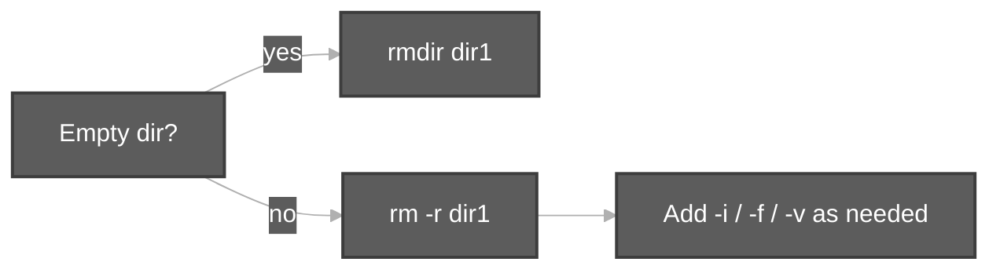

---

## 1. `rmdir` — remove one or many **empty** directories

**From class notes (~03:00):**

1. `rmdir dir1` — remove **one** empty directory.
2. `rmdir dir1 dir2 dir3` — remove **several** empty directories in one command (names separated by spaces).

**My observation:** *(paste your screenshot here after you run `mkdir e1 e2` then `rmdir e1 e2` on an empty pair.)*

---

## 2. `rmdir` fails when the directory is not empty

**Class note:** *`rmdir` works **only** for empty directories.*

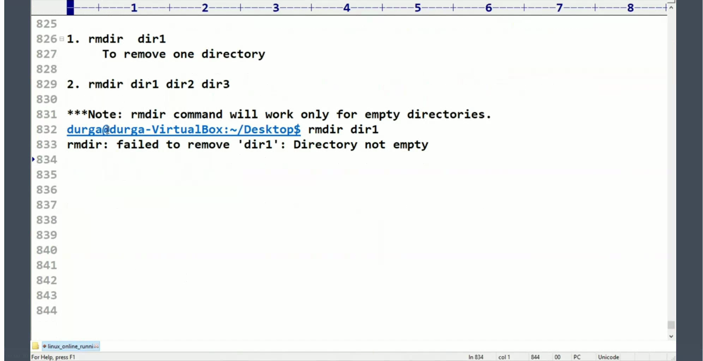

**Lab screenshot (class terminal ~07:30):**

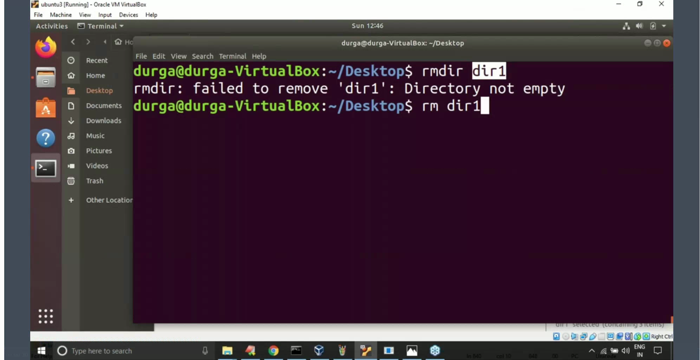

**What the screenshot shows (line by line):**

1. `rmdir dir1` — try to delete folder `dir1` on `~/Desktop`.
2. `rmdir: failed to remove 'dir1': Directory not empty` — something still lives inside `dir1` (files or subfolders), so `rmdir` refuses.
3. `rm dir1` — next step in class: switch to `rm` (typed but not run yet in this frame).

**My observation:** *(re-run: `mkdir dir1 && touch dir1/x.txt && rmdir dir1` — paste screenshot.)*

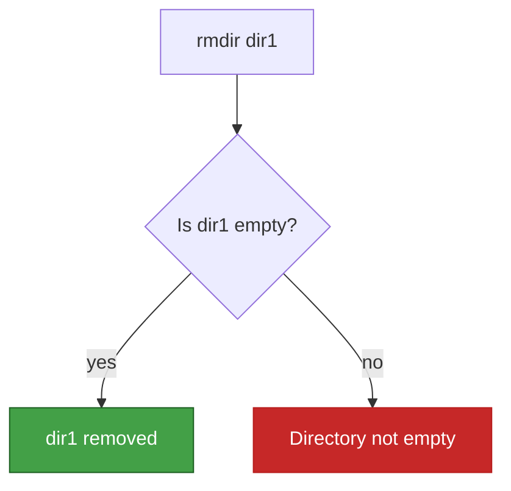

---

## 3. Plain `rm` on a directory — *Is a directory*

**Class rule:** If the directory is **not** empty, use **`rm`**, not only `rmdir`.  
`rm` deletes **files** by default; for a **directory** you need the recursive flag.

**Lab screenshot (class terminal ~10:30):**

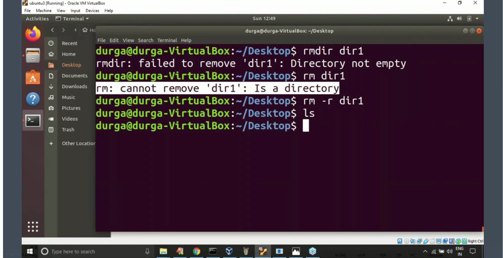

**What the screenshot shows (line by line):**

1. `rmdir dir1` → `Directory not empty` (same as §2).
2. `rm dir1` → `rm: cannot remove 'dir1': Is a directory` — without **`-r`**, `rm` will not delete a directory entry.
3. `rm -r dir1` — **`-r`** = recurse into the directory and delete contents, then the directory. No output means success.
4. `ls` — no names printed → `dir1` is gone from `~/Desktop`.

**My observation:** *(screenshot of `rm dir1` error on your machine.)*

---

## 4. `rm -r` / `rm -R` — remove a directory and everything inside

**Class rule:** Whenever `rm` is used on directories, **`-r` or `-R`** is required (both mean recursive).

Setup in class (~01:30): `mkdir dir1 dir2 dir3 dir4` — some folders hold files so `rmdir` alone is not enough later.

**My observation:** *(optional: `tree dir1` before `rm -r dir1`.)*

---

## 5. Why use `rm` instead of `rmdir`?

**Class Q (~13:30–15:00):**

| Command | Works when |
| :------ | :--------- |
| **`rm -r`** | Directory is **empty or not empty** |
| **`rmdir`** | Directory is **empty only** |

**Answer in one line:** `rm` (with `-r`) can remove a full tree; `rmdir` is only for empty folders.

---

## 6. Deleted files and directories do not come back

**Class note (~16:30–19:30):**

- Once removed from the shell, there is **no undo** like Ctrl+Z for `rm`.
- Be careful with paths — the notes show **`rm -r /`** as a **dangerous** example (would try to wipe the whole system tree). **Do not run this on a real machine.**

Class discussion: GUI **Trash** on Ubuntu still exists, but the lesson focuses on terminal `rm` being permanent.

**My observation:** *(note when you use Trash vs terminal.)*

---

## 7. Interactive removal — `rm -i` / `rm -ri`

**Class:** **`-i`** asks **yes/no** before each remove — safest when you are unsure.

**Setup (~22:00):** `mkdir dir1`, `touch dir1/{a..d}.txt`, `tree dir1` (see screenshot).

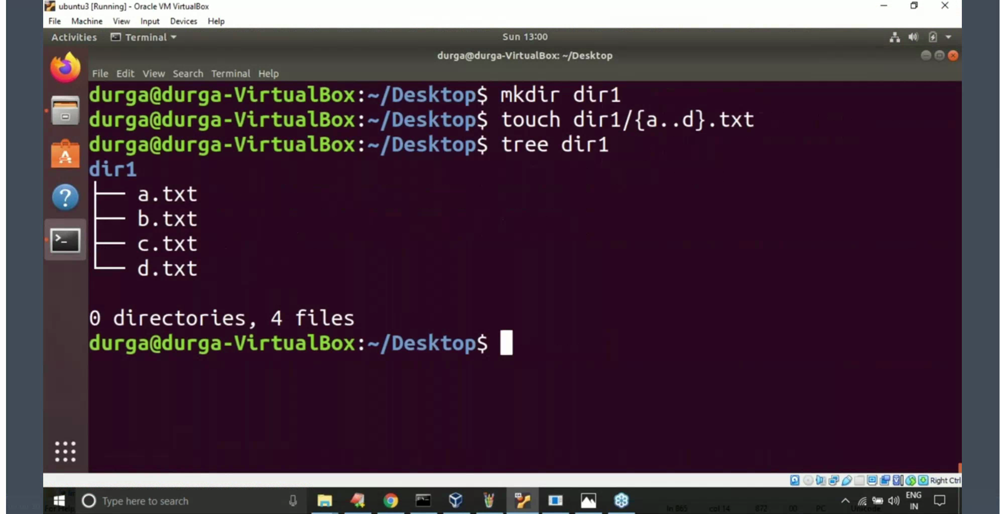

**Lab screenshot (~22:30):**

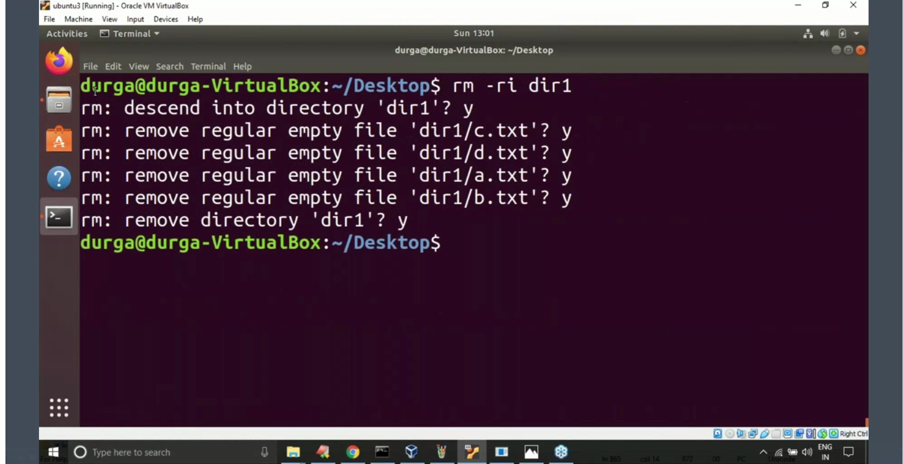

**What the screenshot shows (line by line):**

1. `rm -ri dir1` — recursive + interactive.
2. `rm: descend into directory 'dir1'? y` — enter the folder before deleting inside.
3. `rm: remove regular empty file 'dir1/c.txt'? y` (and `d.txt`, `a.txt`, `b.txt`) — confirm each file.
4. `rm: remove directory 'dir1'? y` — confirm removal of the now-empty directory.

**My observation:** *(try `rm -ri` and answer `n` once — screenshot.)*

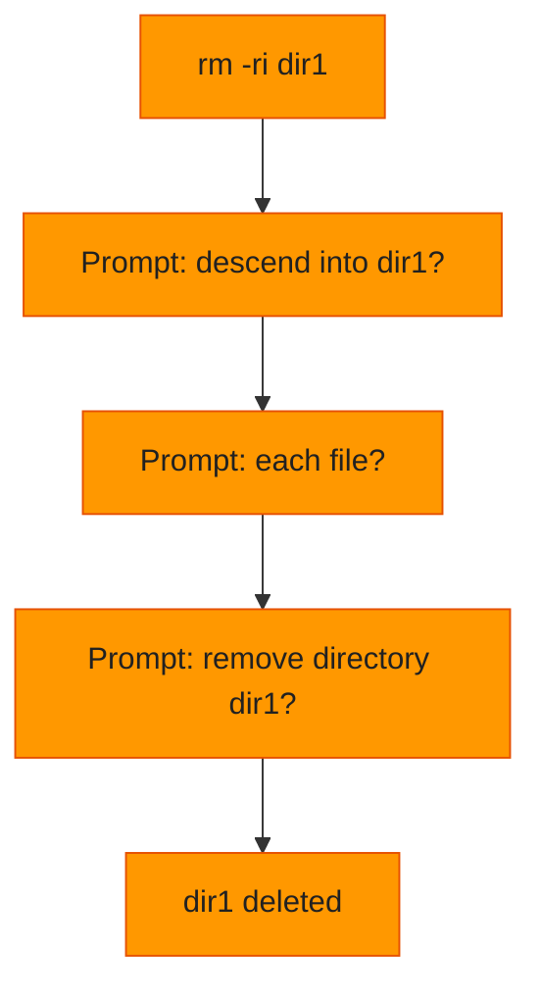

---

## 8. Force removal — `rm -f` / `rm -rf`

**Class note (~25:30):** **`-f`** = force — do not print errors for missing files; no prompts (opposite of **`-i`**).

**Lab screenshot (~25:30):**

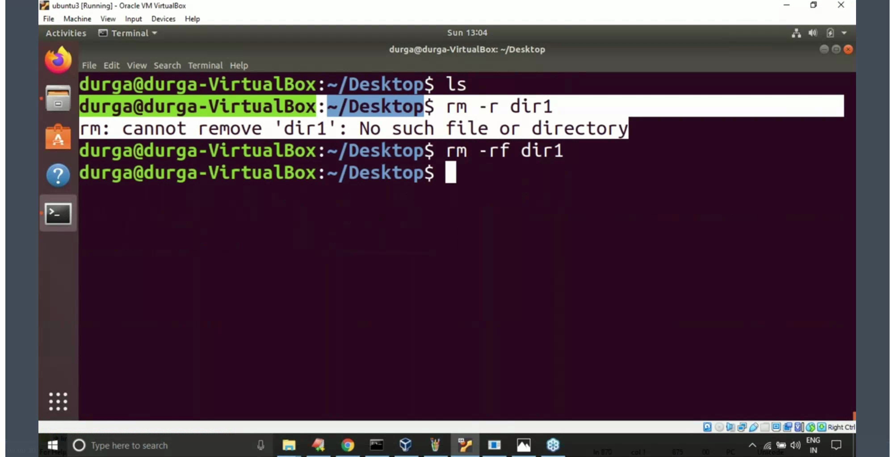

**What the screenshot shows (line by line):**

1. `ls` — empty listing (nothing on Desktop).
2. `rm -r dir1` → `rm: cannot remove 'dir1': No such file or directory` — without **`-f`**, missing target is an error.
3. `rm -rf dir1` — **`-f`** suppresses that message; shell returns quietly even if `dir1` does not exist.

**My observation:** *(screenshot `rm -rf` on a typo path — notice silence.)*

---

## 9. Verbose removal — `rm -v` / `rm -rv`

**Class note (~27:00):** **`-v`** prints **each** path as it is removed — good for watching order of deletion.

**Lab screenshot (~28:30):**

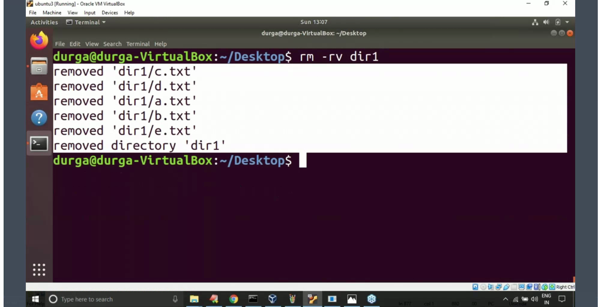

**What the screenshot shows (line by line):**

1. `rm -rv dir1` — recursive + verbose.
2. Lines `removed 'dir1/c.txt'` … `removed 'dir1/e.txt'` — one message per file.
3. `removed directory 'dir1'` — directory removed after contents are gone.

**My observation:** *(compare output with `tree` before/after.)*

---

## 10. Remove only a nested folder (leave parents)

**Class question (~30:00):** Layout `dir1/dir2/dir3` — delete **only** `dir3`, keep `dir1` and `dir2`.

Use the **path to the leaf** (or its parent chain), not `rm -r dir1` (that would remove the whole tree):

```bash
rm -r dir1/dir2/dir3
```

If you need to remove `dir2` but keep `dir1`:

```bash
rm -r dir1/dir2
```

**My observation:** *(build `mkdir -p dir1/dir2/dir3`, `tree`, then `rm -r dir1/dir2/dir3` and `tree dir1` — screenshot.)*

---

## 11. `rm` option summary (flowchart)

| Option | Meaning in class |
| :----- | :--------------- |
| **`-r`** / **`-R`** | Required for directories — delete contents recursively |
| **`-i`** | Interactive — ask before each step |
| **`-f`** | Force — no errors for missing files; no prompts |
| **`-v`** | Verbose — print each removed path |

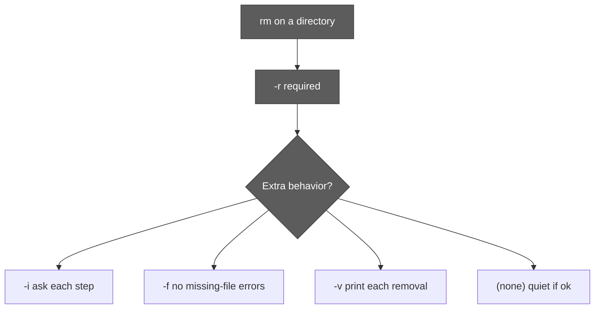

---

## 12. Class practice questions (Q1–Q3)

Each question is its **own** check — do not merge the answers.

### Q1 — `dir1` is **empty**

Which command removes `dir1`?

| Option | Verdict |
| :----- | :------ |
| A) `rm dir1` | Wrong — *Is a directory* |
| B) `remove dir1` | Not a standard Linux command |
| C) **`rmdir dir1`** | **Correct** |
| D) `del dir1` | Not standard on Linux |

**Ans: C**

### Q2 — `dir1` is **not empty**

| Option | Verdict |
| :----- | :------ |
| A) `rmdir dir1` | Fails — not empty |
| B) **`rm -R dir`** | **Correct** (class answer; needs `-r` and correct name `dir1` in real use) |
| C) `rm -i dir` | `-i` alone does not recurse into a non-empty directory |
| D) `rm -f dir` | Same |
| E) `rm -v dir` | Same |

**Ans: B** — use **`rm -r`** / **`rm -R`** for a non-empty directory.

### Q3 — non-empty **`dir1`** and file **`abc.txt`**

Remove **both** in one command:

```bash
rm -r abc.txt dir1
```

**Ans: C** — `-r` applies to the directory; `abc.txt` is removed as a normal file argument.

**My observation:** *(run Q1–Q3 on a test folder — three small screenshots.)*

---

## 13. Remove many directories — `{1..10}` and `{2,4,6}`

**Class Q8 (~51:00):** Suppose `dir1` … `dir10` exist on Desktop.

```bash
rm -r dir{1..10}    # non-empty or empty — recursive rm
rmdir dir{1..10}    # only if every dir1..dir10 is empty
```

Remove **only** `dir2`, `dir4`, `dir6`:

```bash
rm -r dir{2,4,6}
```

**My observation:** *(create `dir{1..5}` with mixed contents — try both forms — screenshot.)*

---

## 14. `rmdir` with wildcards (`d*`, `d*n`)

**Class Q9 (~54:00):** Remove all **empty** directories whose names start with `d`:

```bash
rmdir d*
```

**Class Q10:** Empty directories starting with `d` and ending with `n`:

```bash
rmdir d*n
```

Shell expands `*` to matching names; **every** match must still be **empty** or `rmdir` fails.

**My observation:** *(only safe on a throwaway test folder — screenshot.)*

---

## Appendix — recording time map

Quick jump guide for [`Screencast From 2026-11-10 08-56-09.webm`](../../ScreenRecordings/Screencast%20From%202026-11-10%2008-56-09.webm) (frame ≈ 90s spacing).

| Approx. time | Section in this doc |
| :----------- | :------------------ |
| 03:00 | §1 `rmdir` syntax |
| 06:00–07:30 | §2 not empty |
| 09:00–10:30 | §3–§4 `rm` / `rm -r` |
| 13:30–18:00 | §5–§6 Q&A and safety |
| 22:00–22:30 | §7 `rm -ri` |
| 25:30 | §8 `rm -rf` |
| 28:30 | §9 `rm -rv` |
| 30:00 | §10 nested path |
| 34:30–39:00 | §12 Q1–Q3 |
| 51:00–54:00 | §13–§14 bulk / wildcards |

---

*Terminal frames in `docs/assets/remove-*.png` are cropped from the class screencast. Replace or extend with your own lab PNGs under the same paths or in **My observation** blocks.*
