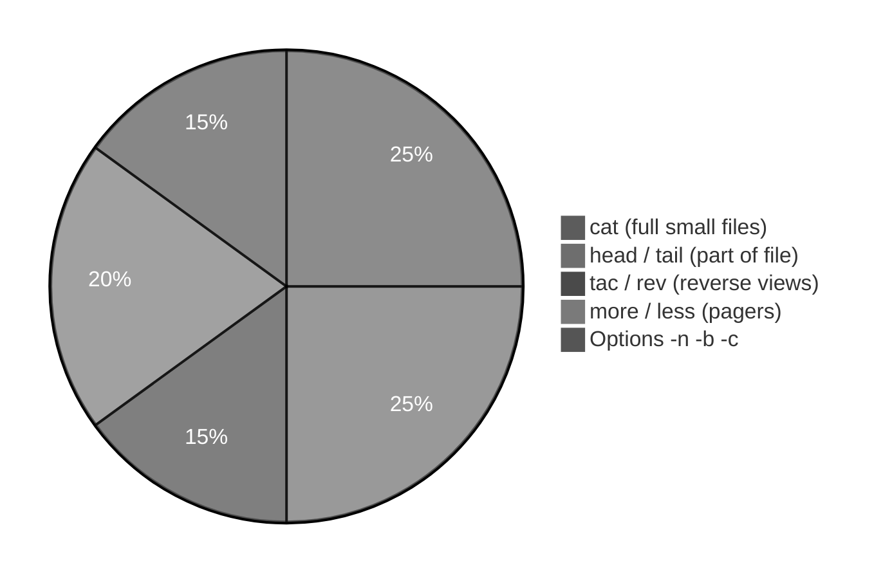
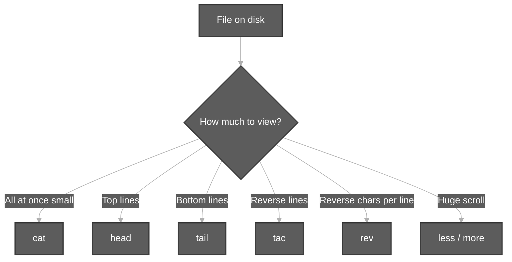
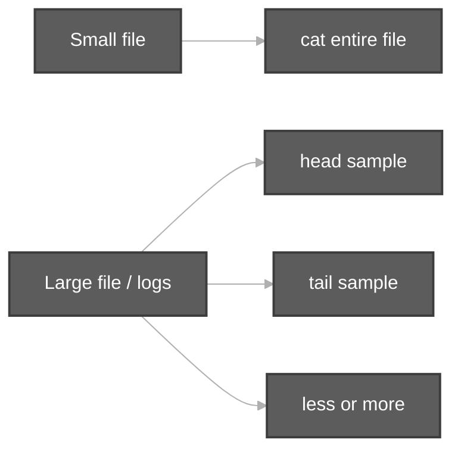

# View Content of Files

**Video:** [Session 9 — View Content of Files](https://www.youtube.com/watch?v=FuzpoZwDcZU&list=PLd3UqWTnYXOloH0vWBs4BtSbP84WcC2NY&index=9)  
**Instructor:** Durga Sir

**Prerequisites:** [TypesOfFilesInLinux.md](TypesOfFilesInLinux.md) (`touch`, create files) · [Bash Built-in Commands.md](Bash%20Built-in%20Commands.md) (`cat`, `gedit`) · [pipeCommands.md](pipeCommands.md) (pipes with `head`/`tail`)

**Scripts folder:** [`viewContentOfFiles/`](../../scripts/viewContentOfFiles/)  
**Execution summary:** [`viewContentOfFiles/viewContentOfFiles.md`](../../scripts-execution-summary/viewContentOfFiles/viewContentOfFiles.md)

```bash
cd /path/to/Linux-Basics
bash scripts/viewContentOfFiles/cat-view-file-demo.sh
```

---

**Table of contents**

- [1. Goal of this session](#1-goal-of-this-session)
- [2. Command map (remember these)](#2-command-map-remember-these)
- [3. cat — print file on screen](#3-cat--print-file-on-screen)
- [4. cat -n and cat -b](#4-cat--n-and-cat--b)
- [5. cat multiple files](#5-cat-multiple-files)
- [6. tac — reverse line order](#6-tac--reverse-line-order)
- [7. rev — reverse each line](#7-rev--reverse-each-line)
- [8. head — top of file](#8-head--top-of-file)
- [9. tail — bottom of file](#9-tail--bottom-of-file)
- [10. more and less — pagers](#10-more-and-less--pagers)
- [11. Small file vs large file](#11-small-file-vs-large-file)
- [12. cat vs cp (Durga Sir)](#12-cat-vs-cp-durga-sir)
- [13. Preview: wc and redirection](#13-preview-wc-and-redirection)
- [14. Session checklist](#14-session-checklist)
- [15. Script index](#15-script-index)

---

## 1. Goal of this session

After creating files (`touch`, editors), you must **view** what is inside. Durga Sir lists **many commands** for the same goal — **display file content** — each with a different **shape** of output (full file, first lines, last lines, reversed, paged).



---

## 2. Command map (remember these)

| Command | Durga Sir idea | Plain English |
| :--- | :--- | :--- |
| **`cat`** | First command to remember | **Print** whole file (concatenate if many files) |
| **`tac`** | **cat** spelled backward | Print lines in **reverse order** (last line first) |
| **`rev`** | Reverse characters | Each line **backwards** (`chini` → `inihc`) |
| **`head`** | Top of file | First **10 lines** by default (configurable) |
| **`tail`** | Bottom of file | Last **10 lines** by default (opposite of `head`) |
| **`more`** | Page forward | View **big** file screen by screen (older pager) |
| **`less`** | More power than `more` | Page **forward and backward** |



---

## 3. cat — print file on screen

**Syntax (Durga Sir):**

```bash
cat file1.txt
cat < file1.txt    # optional < ; redirection chapter later
```

| Point | Detail |
| :--- | :--- |
| **Purpose** | Show **entire** file content on the terminal |
| **`<` optional** | `cat < file` reads from file; `cat file` is the usual form |
| **Empty lines** | `cat` shows **blank lines** too |

**Demo:** [`cat-view-file-demo.sh`](../../scripts/viewContentOfFiles/cat-view-file-demo.sh)

---

## 4. cat -n and cat -b

When you need **line numbers** (Durga demo: fruits + `java`, `python`, blank lines in `abc.txt`):

| Option | Meaning |
| :--- | :--- |
| **`cat -n file`** | Number **every** line (blank lines get a number) |
| **`cat -b file`** | Number **non-empty** lines only (skip numbering pure blank lines) |

```bash
cat -n abc.txt
cat -b abc.txt
```

**Count lines without printing content?** Durga Sir: use **`wc`** (word count) — detailed in a later session; not the same job as `cat`.

**Demo:** [`cat-n-and-b-line-numbers-demo.sh`](../../scripts/viewContentOfFiles/cat-n-and-b-line-numbers-demo.sh)

---

## 5. cat multiple files

```bash
cat file1.txt file2.txt
```

**Concatenation:** output of **file1** then **file2** on the same stream (print together).  
Not the same as **copying** files — see [§12](#12-cat-vs-cp-durga-sir).

**Demo:** [`cat-multiple-files-concat-demo.sh`](../../scripts/viewContentOfFiles/cat-multiple-files-concat-demo.sh)

---

## 6. tac — reverse line order

**Vertical reverse** of `cat` (line order only):

| Normal `cat` (top → bottom) | `tac` (bottom → top) |
| :--- | :--- |
| sunny | pini |
| bunny | vinnie |
| chini | chini |
| vinnie | bunny |
| pini | sunny |

```bash
tac abc.txt
```

Less common in daily work, but **exam/class** topic.

**Demo:** [`tac-reverse-lines-demo.sh`](../../scripts/viewContentOfFiles/tac-reverse-lines-demo.sh)

---

## 7. rev — reverse each line

**Horizontal reverse** — characters on **each line**:

```bash
# line: chini
rev abc.txt
# shows: inihc
```

| Reverse type | Command |
| :--- | :--- |
| **Line order** (vertical) | `tac` |
| **Characters in line** (horizontal) | `rev` |

**Demo:** [`rev-reverse-line-chars-demo.sh`](../../scripts/viewContentOfFiles/rev-reverse-line-chars-demo.sh)

---

## 8. head — top of file

**Default:** first **10 lines**.

```bash
head abc.txt           # 10 lines
head -15 abc.txt       # first 15 lines
head -n 5 abc.txt      # first 5 lines
```

### Important: `head -n -5` (negative n)

| Command | Meaning |
| :--- | :--- |
| **`head -n 5`** | Only **first 5** lines |
| **`head -n -5`** | **All lines except the last 5** (do not confuse!) |

Durga Sir stresses this — easy to mix up in exams.

### Characters from top

```bash
head -c 100 abc.txt    # first 100 bytes/characters
```

**Demo:** [`head-top-lines-demo.sh`](../../scripts/viewContentOfFiles/head-top-lines-demo.sh)

---

## 9. tail — bottom of file

**Opposite of `head`:** view from **end** of file.

| Command | Meaning |
| :--- | :--- |
| **`tail abc.txt`** | Last **10** lines (default) |
| **`tail -n 5`** / **`tail -5`** | Last **5** lines |
| **`tail -c 100`** | Last **100** characters from end |

Durga Sir: **`head` and `tail` are opposites** (top vs bottom).

**Note:** GNU `tail` options like `tail -n +5` (start from line 5) are advanced; class focuses on **last N lines**.

**Demo:** [`tail-bottom-lines-demo.sh`](../../scripts/viewContentOfFiles/tail-bottom-lines-demo.sh)

---

## 10. more and less — pagers

| Pager | Behavior |
| :--- | :--- |
| **`more`** | Move **forward** through a long file (Space / Enter) |
| **`less`** | Forward **and backward** (Page Up / Page Down) — **preferred** today |

```bash
less /var/log/syslog    # q to quit
more /var/log/syslog
```

**Interactive:** in automation/CI, pagers wait for a human; use `head`/`tail` in scripts unless you know you have a TTY.

**Demo:** [`more-less-pager-hint-demo.sh`](../../scripts/viewContentOfFiles/more-less-pager-hint-demo.sh)

---

## 11. Small file vs large file

Durga Sir rule:

| File size | Best command |
| :--- | :--- |
| **Small** | **`cat`** — dump all content once |
| **Very large** | **`head`**, **`tail`**, **`more`**, **`less`** — do **not** flood terminal with full `cat` |



**Demo:** [`small-vs-large-file-view-demo.sh`](../../scripts/viewContentOfFiles/small-vs-large-file-view-demo.sh)

---

## 12. cat vs cp (Durga Sir)

| Task | `cat` | `cp` |
| :--- | :---: | :---: |
| Print contents on screen | Yes | No |
| Create new file with new data alone | No | No (copies existing) |
| Copy files into a folder | No | Yes |

Commands may **look similar** in conversation but each has its **own purpose**.

---

## 13. Preview: wc and redirection

- **`man cat`** — full manual; Durga Sir shows saving man output to a file (redirection `>`).
- **`wc -l file`** — count lines **without** printing file body (when you only need the number).

**Redirection and EOF (`>`, `>>`, `<<EOF`):** [Redirection/EOF and Redirection.md](Redirection/EOF%20and%20Redirection.md) · [folder index](Redirection/README.md)

---

## 14. Session checklist

You should be able to:

1. Display a file with **`cat`** (with and without `<`).  
2. Use **`cat -n`** vs **`cat -b`** on files with blank lines.  
3. Explain **`tac`** vs **`rev`**.  
4. Use **`head`** / **`tail`** defaults and **`-n`**.  
5. Explain **`head -n -5`** vs **`head -n 5`**.  
6. Choose **`cat`** vs **`head`/`tail`/`less`** for small vs large files.  
7. Name **`more`** and **`less`** and when they are used.

---

## 15. Script index

| Script | Topic |
| :--- | :--- |
| [`cat-view-file-demo.sh`](../../scripts/viewContentOfFiles/cat-view-file-demo.sh) | `cat`, optional `<` |
| [`cat-n-and-b-line-numbers-demo.sh`](../../scripts/viewContentOfFiles/cat-n-and-b-line-numbers-demo.sh) | `-n`, `-b`, blank lines |
| [`cat-multiple-files-concat-demo.sh`](../../scripts/viewContentOfFiles/cat-multiple-files-concat-demo.sh) | `cat f1 f2` |
| [`tac-reverse-lines-demo.sh`](../../scripts/viewContentOfFiles/tac-reverse-lines-demo.sh) | `tac` |
| [`rev-reverse-line-chars-demo.sh`](../../scripts/viewContentOfFiles/rev-reverse-line-chars-demo.sh) | `rev` |
| [`head-top-lines-demo.sh`](../../scripts/viewContentOfFiles/head-top-lines-demo.sh) | `head`, `-n`, negative `-n` |
| [`tail-bottom-lines-demo.sh`](../../scripts/viewContentOfFiles/tail-bottom-lines-demo.sh) | `tail` |
| [`small-vs-large-file-view-demo.sh`](../../scripts/viewContentOfFiles/small-vs-large-file-view-demo.sh) | cat vs head/tail |
| [`more-less-pager-hint-demo.sh`](../../scripts/viewContentOfFiles/more-less-pager-hint-demo.sh) | `more` / `less` hints |

**Next in playlist:** continue from [`linuxBasics.md`](../linuxBasics.md).
