# View Content of Files

**Video:** [Session 9 — View Content of Files](https://www.youtube.com/watch?v=FuzpoZwDcZU&list=PLd3UqWTnYXOloH0vWBs4BtSbP84WcC2NY&index=9)  
**Instructor:** Durga Sir

**Prerequisites:** [TypesOfFilesInLinux.md](TypesOfFilesInLinux.md) (`touch`, create files) · [Bash Built-in Commands.md](Bash%20Built-in%20Commands.md) (`cat`, `gedit`) · [pipeCommands.md](pipeCommands.md) (pipes with `head`/`tail`)

**Scripts folder:** [`viewContentOfFiles/`](../../scripts/viewContentOfFiles/)  
**Execution summary:** [Part 2 — below](#part-2--execution-summary-scriptsviewcontentoffiles)

```bash
cd /path/to/Linux-Basics
bash scripts/viewContentOfFiles/cat-view-file-demo.sh
```

---

**Table of contents**

- [1. Goal of this session](#1-goal-of-this-session)
- [2. Command map (remember these)](#2-command-map-remember-these)
- [3. cat — print file on screen](#3-cat--print-file-on-screen)
- [4. cat -n and cat -b](#4-cat--n-and-cat--b)
- [5. cat multiple files](#5-cat-multiple-files)
- [6. tac — reverse line order](#6-tac--reverse-line-order)
- [7. rev — reverse each line](#7-rev--reverse-each-line)
- [7A. Display-only viewing — `cat` / `rev` / `tac` do **not** change the file](#7a-display-only-viewing--cat--rev--tac-do-not-change-the-file)
- [8. head — top of file](#8-head--top-of-file)
- [9. tail — bottom of file](#9-tail--bottom-of-file)
- [10. more and less — pagers](#10-more-and-less--pagers)
- [11. Small file vs large file](#11-small-file-vs-large-file)
- [12. cat vs cp (Durga Sir)](#12-cat-vs-cp-durga-sir)
- [13. Preview: wc and redirection](#13-preview-wc-and-redirection)
- [14. Session checklist](#14-session-checklist)
- [15. Script index](#15-script-index)
- [Part 2 — Execution summary](#part-2--execution-summary-scriptsviewcontentoffiles)

---

## 1. Goal of this session

After creating files (`touch`, editors), you must **view** what is inside. Durga Sir lists **many commands** for the same goal — **display file content** — each with a different **shape** of output (full file, first lines, last lines, reversed, paged).

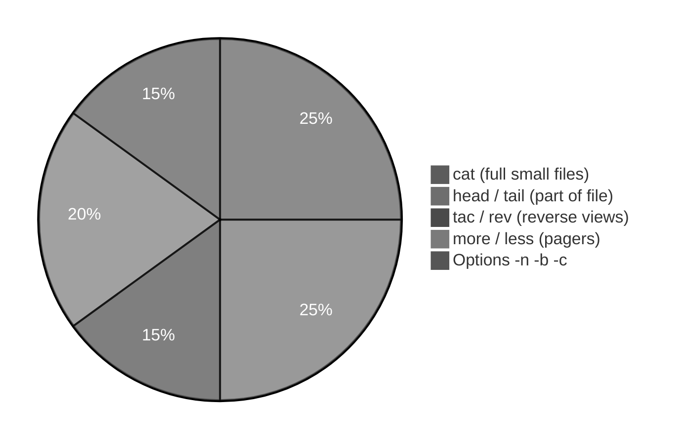

---

## 2. Command map (remember these)

| Command    | Durga Sir idea            | Plain English                                      |
| :--------- | :------------------------ | :------------------------------------------------- |
| **`cat`**  | First command to remember | **Print** whole file (concatenate if many files)   |
| **`tac`**  | **cat** spelled backward  | Print lines in **reverse order** (last line first) |
| **`rev`**  | Reverse characters        | Each line **backwards** (`chini` → `inihc`)        |
| **`head`** | Top of file               | First **10 lines** by default (configurable)       |
| **`tail`** | Bottom of file            | Last **10 lines** by default (opposite of `head`)  |
| **`more`** | Page forward              | View **big** file screen by screen (older pager)   |
| **`less`** | More power than `more`    | Page **forward and backward**                      |

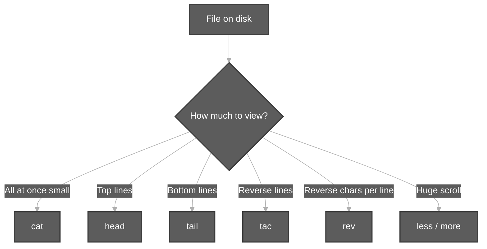

---

## 3. cat — print file on screen

**Syntax (Durga Sir):**

```bash
cat file1.txt
cat < file1.txt    # optional < ; redirection chapter later
```

| Point            | Detail                                                     |
| :--------------- | :--------------------------------------------------------- |
| **Purpose**      | Show **entire** file content on the terminal               |
| **`<` optional** | `cat < file` reads from file; `cat file` is the usual form |
| **Empty lines**  | `cat` shows **blank lines** too                            |

**Demo:** [`cat-view-file-demo.sh`](../../scripts/viewContentOfFiles/cat-view-file-demo.sh)

---

## 4. cat -n and cat -b

When you need **line numbers** (Durga demo: fruits + `java`, `python`, blank lines in `abc.txt`):

| Option            | Meaning                                                           |
| :---------------- | :---------------------------------------------------------------- |
| **`cat -n file`** | Number **every** line (blank lines get a number)                  |
| **`cat -b file`** | Number **non-empty** lines only (skip numbering pure blank lines) |

```bash
cat -n abc.txt
cat -b abc.txt
```

**Count lines without printing content?** Durga Sir: use **`wc`** (word count) — detailed in a later session; not the same job as `cat`.

**Demo:** [`cat-n-and-b-line-numbers-demo.sh`](../../scripts/viewContentOfFiles/cat-n-and-b-line-numbers-demo.sh)

---

## 5. cat multiple files

```bash
cat file1.txt file2.txt
```

**Concatenation:** output of **file1** then **file2** on the same stream (print together).  
Not the same as **copying** files — see [§12](#12-cat-vs-cp-durga-sir).

**Demo:** [`cat-multiple-files-concat-demo.sh`](../../scripts/viewContentOfFiles/cat-multiple-files-concat-demo.sh)

---

## 6. tac — reverse line order

**By default, `tac` does not edit the file** — it only prints reversed line order to the terminal. See [§7A](#7a-display-only-viewing--cat--rev--tac-do-not-change-the-file).

**Vertical reverse** of `cat` (line order only):

| Normal `cat` (top → bottom) | `tac` (bottom → top) |
| :-------------------------- | :------------------- |
| sunny                       | pini                 |
| bunny                       | vinnie               |
| chini                       | chini                |
| vinnie                      | bunny                |
| pini                        | sunny                |

```bash
tac abc.txt
```

Less common in daily work, but **exam/class** topic.

**Demo:** [`tac-reverse-lines-demo.sh`](../../scripts/viewContentOfFiles/tac-reverse-lines-demo.sh)

---

## 7. rev — reverse each line

**By default, `rev` does not edit the file** — it only prints reversed characters to the terminal. See [§7A](#7a-display-only-viewing--cat--rev--tac-do-not-change-the-file).

**Horizontal reverse** — characters on **each line**:

```bash
# line: chini
rev abc.txt
# shows: inihc
```

| Reverse type                        | Command |
| :---------------------------------- | :------ |
| **Line order** (vertical)           | `tac`   |
| **Characters in line** (horizontal) | `rev`   |

**Demo:** [`rev-reverse-line-chars-demo.sh`](../../scripts/viewContentOfFiles/rev-reverse-line-chars-demo.sh)

---

## 7A. Display-only viewing — `cat` / `rev` / `tac` do **not** change the file

This section answers a common lab doubt (e.g. `rev testThree.sh` then `cat testThree.sh`):

> “After `rev`, why does `cat` show the **old order**? Does `rev` or `tac` change the file?”

**Answer:** **`rev`, `tac`, and `cat` (by themselves) only read the file and print to the terminal.** They do **not** rewrite the file on disk. The **original content stays** until you use a **write** operation (`>`, `>>`, editor, etc.).

### Two places to think about

| Place                             | What happens                                                                              |
| :-------------------------------- | :---------------------------------------------------------------------------------------- |
| **File on disk** (`testThree.sh`) | Stored bytes — **unchanged** after `rev` / `tac` / `cat`                                  |
| **Terminal (screen)**             | What you **see** for that command — can be normal, reversed lines, or reversed characters |

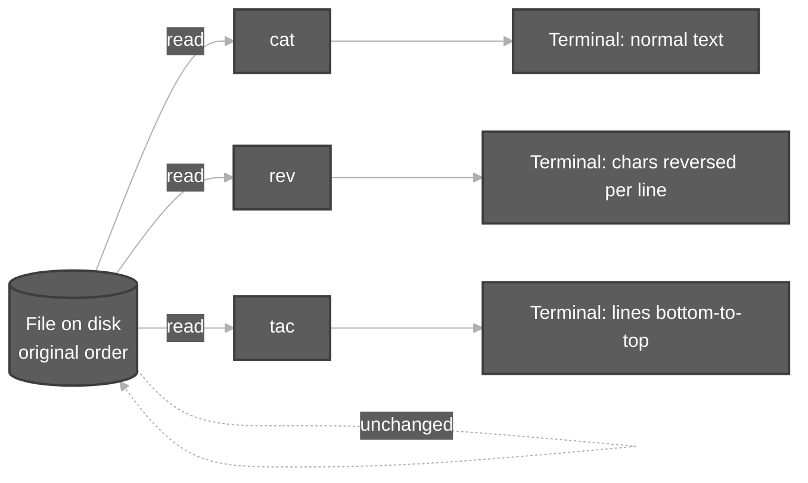

### Your `testThree.sh` example (step by step)

**File on disk (simplified):**

```bash
#! /bin/bash
IFS="_"
echo "All arguments with * : $*"
echo "All arguments with @ one by one  : $@"
```

**Command 1 — `rev testThree.sh`**

- Linux **opens** `testThree.sh` for reading only.
- For **each line**, `rev` prints characters **backwards** to **stdout** (your screen).
- Example: `#! /bin/bash` may look like `hsab/nib/ !#` on the terminal.
- **The file is not saved in reversed form.**

**Command 2 — `cat testThree.sh`**

- `cat` reads the **same file on disk** (still normal order).
- You see `#! /bin/bash`, `IFS="_"`, `echo ...` as originally stored.

So: **`rev` showed a mirror; `cat` showed the real notebook.**

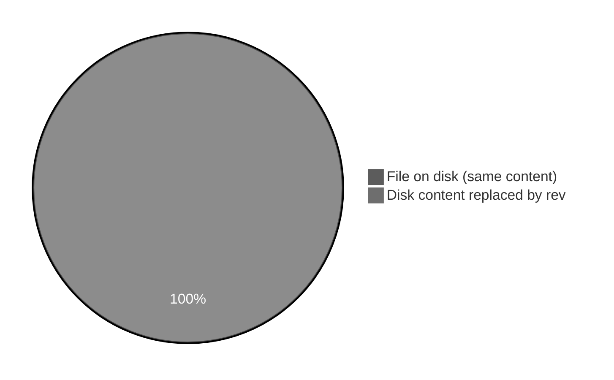

### `rev` vs `tac` — both read-only; different “mirror”

| Command                               | What you see on screen                                | File on disk after command  |
| :------------------------------------ | :---------------------------------------------------- | :-------------------------- |
| **`cat file`**                        | Lines in **normal** order                             | **Unchanged**               |
| **`tac file`**                        | **Line order** reversed (last line printed first)     | **Unchanged**               |
| **`rev file`**                        | Each **line’s characters** reversed (`echo` → `ohce`) | **Unchanged**               |
| **`head` / `tail` / `more` / `less`** | Part or paged view                                    | **Unchanged** (no redirect) |

```mermaid
%%{init: {'theme': 'base', 'themeVariables': {'primaryColor': '#5c5c5c', 'primaryTextColor': '#ffffff', 'primaryBorderColor': '#3d3d3d', 'lineColor': '#b0b0b0'}}}%%
flowchart TB
    subgraph vertical [Vertical reverse — line order]
        TAC[tac] --> V[Last line becomes first on screen]
    end
    subgraph horizontal [Horizontal reverse — characters]
        REV[rev] --> H[Each line spelled backwards on screen]
    end
    F[Same file on disk] --> TAC
    F --> REV
    F --> CAT[cat shows stored order]

    classDef darkGrey fill:#5c5c5c,stroke:#3d3d3d,color:#ffffff,stroke-width:2px
    class F,TAC,REV,CAT,V,H vertical horizontal
```

### When **does** the file content change?

View commands become **writers** only if you **redirect output into a file** (or use an editor):

| Action                         |               Changes file?                |
| :----------------------------- | :----------------------------------------: |
| `rev myfile`                   |             No — display only              |
| `tac myfile`                   |             No — display only              |
| `cat myfile`                   |             No — display only              |
| `echo line > myfile`           |            **Yes** — overwrites            |
| `echo line >> myfile`          |             **Yes** — appends              |
| `rev myfile > myfile`          | **Yes** — **dangerous** (can corrupt file) |
| `gedit myfile` / `nano myfile` |          **Yes** — when you save           |

Full rules: [EOF and Redirection.md](EOF%20and%20Redirection.md) (`>` truncates, `>>` appends).

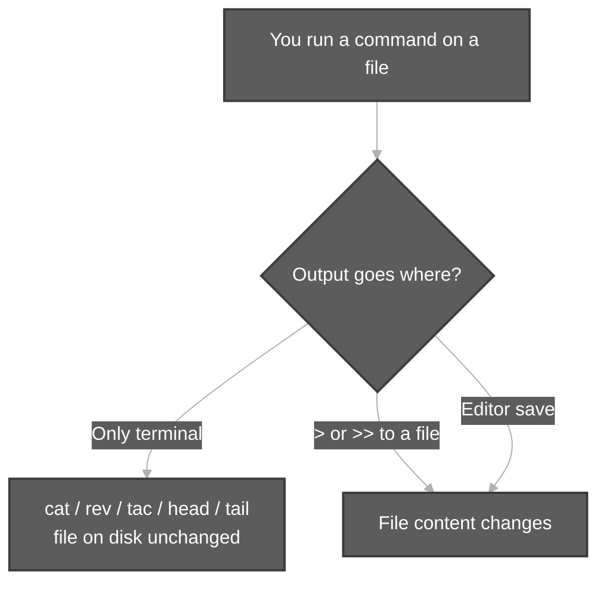

### Why `rev` on a `.sh` file looks scary (but is harmless to the file)

Shell scripts must start with readable `#!/bin/bash` on disk to run. **`rev` on screen** shows gibberish-like lines — that is **only the display**, not the saved script. Running the script still uses the **on-disk** file:

```bash
bash testThree.sh          # uses real file (normal shebang)
rev testThree.sh           # never run this output as a script
```

### If `cat` shows the **same block repeated** many times

That is **not** caused by `rev` or `tac`. It means the file on disk **already contains** those lines repeated (often from **`>>` append**, copy-paste, or merging files). `rev` only prints what is stored — if the block appears three times in the file, reversed output can also look repeated when you run `rev` multiple times.

**Fix:** open the file in an editor and delete duplicates, or recreate with a single heredoc:

```bash
cat > testThree.sh <<'EOF'
#!/bin/bash
IFS="_"
echo "All arguments with * : $*"
echo "All arguments with @ one by one  : $@"
EOF
```

### Memory table (exam + lab)

| Question                                        | Short answer                                                        |
| :---------------------------------------------- | :------------------------------------------------------------------ |
| Does `rev` change the original file?            | **No** (unless you redirect into the file)                          |
| Does `tac` change the original file?            | **No** (unless you redirect)                                        |
| Why does `cat` show normal order after `rev`?   | **`cat` reads the unchanged file**                                  |
| What is the difference between `rev` and `tac`? | **`rev`** = chars per line; **`tac`** = line order                  |
| How do I **save** reversed text?                | `rev file > newfile` (use a **new** name; avoid `> file` same name) |

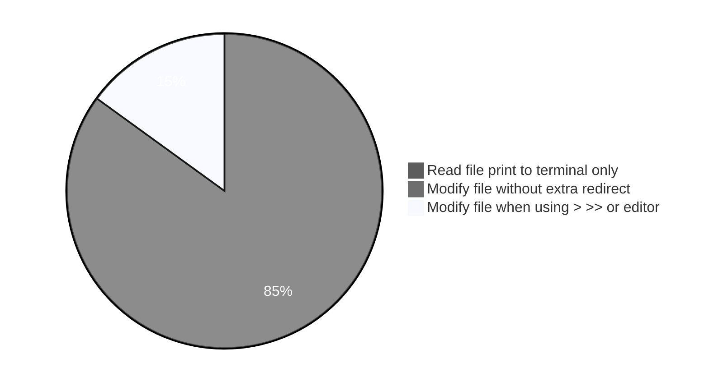

**Demo:** [`rev-tac-display-only-demo.sh`](../../scripts/viewContentOfFiles/rev-tac-display-only-demo.sh)

```bash
bash scripts/viewContentOfFiles/rev-tac-display-only-demo.sh
```

---

## 8. head — top of file

**Default:** first **10 lines**.

```bash
head abc.txt           # 10 lines
head -15 abc.txt       # first 15 lines
head -n 5 abc.txt      # first 5 lines
```

### Important: `head -n -5` (negative n)

| Command         | Meaning                |
| :-------------- | :--------------------- |
| **`head -n 5`** | Only **first 5** lines |
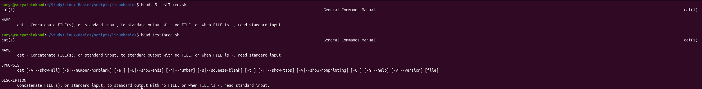
| **`head -n -5`** | **All lines except the last 5** (do not confuse!) |
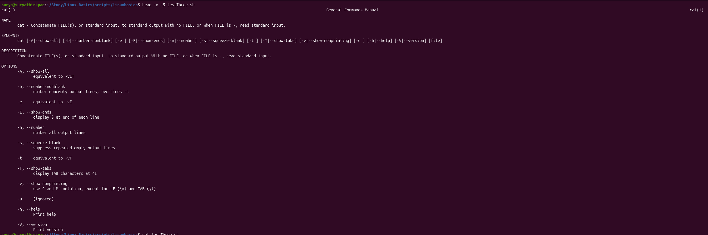
Actual lines in the code 
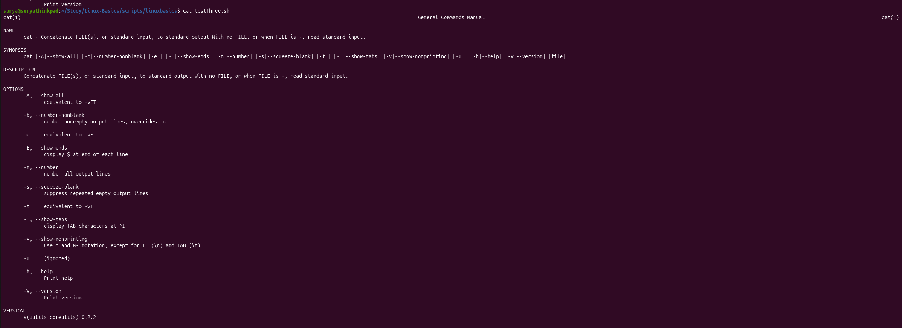
After providng the command at line 


Durga Sir stresses this — easy to mix up in exams.

### Characters from top — `head -c` (Durga Sir)

By default, **`head`** counts **lines**. With **`-c`**, you count **characters** (bytes) from the **start** of the file instead.

**Command (class example):**

```bash
head -c 100 abc.txt
```

**Durga Sir (as in class notes):**

> It will display the first **100 characters** of the file.  
> In Linux every character will take **one byte**. Hence it will display first **100 bytes** of file content.

| Idea | Meaning |
| :--- | :--- |
| **`head abc.txt`** | First **10 lines** (default) |
| **`head -n 5 abc.txt`** | First **5 lines** |
| **`head -c 100 abc.txt`** | First **100 characters** (= **100 bytes** in normal text) |

**Lab (same `-c` idea on a real script):** from `scripts/linuxbasics/`, Durga Sir’s class often uses a file like **`printString.sh`**:

```bash
cd ~/Study/Linux-Basics/scripts/linuxbasics
head -c 100 printString.sh
```

Output stops after **100 bytes** — so you may see only **part** of a line (e.g. cut off mid-comment). Use **`cat printString.sh`** to see the full file.

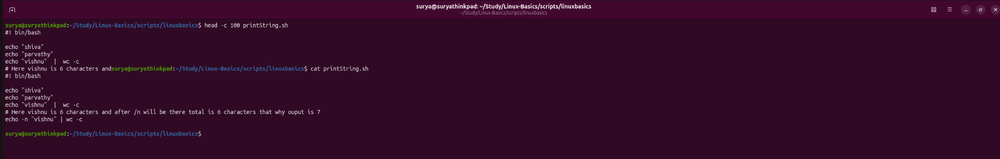

**Demo:** [`head-top-lines-demo.sh`](../../scripts/viewContentOfFiles/head-top-lines-demo.sh)


---

## 9. tail — bottom of file

**Opposite of `head`:** view from the **end** of the file (bottom), not the top.

Durga Sir: **`head` and `tail` are opposites** — `head` from the **start**, `tail` from the **end**.

| Command | Meaning |
| :--- | :--- |
| **`tail abc.txt`** | Last **10 lines** (default) |
| **`tail -n 5 abc.txt`** / **`tail -5 abc.txt`** | Last **5 lines** |
| **`tail -c 100 abc.txt`** | Last **100 characters** from the **end** of the file |

### Default — last 10 lines

```bash
tail abc.txt
tail testThree.sh
```

Same idea as `head`: if you omit **`-n`**, Linux shows the **last 10 lines**.

**Lab (`scripts/linuxbasics/`):** after you know what is in the file (`cat`), use **`tail`** to see only the **bottom** of the file:

```bash
cd ~/Study/Linux-Basics/scripts/linuxbasics
cat testThree.sh      # full file on screen
tail testThree.sh     # last 10 lines only
```

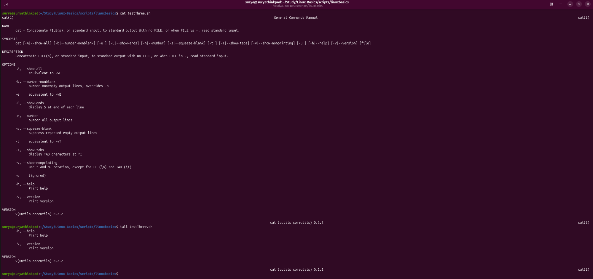

### Last N lines — `tail -n` / `tail -5`

```bash
tail -n 5 abc.txt
tail -5 abc.txt       # same idea: last 5 lines
```

**Lab:**

```bash
tail -5 testThree.sh
cat testThree.sh      # compare: tail shows only the end (VERSION, help, footer)
```

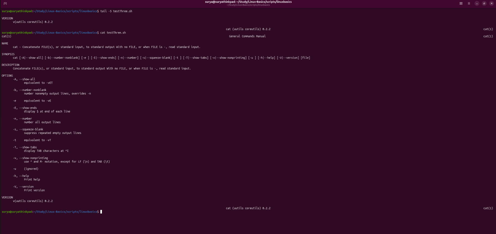

### Last N characters — `tail -c` (Durga Sir)

With **`-c`**, you count **characters** (bytes) from the **end** of the file instead of lines.

**Command (class example):**

```bash
tail -c 100 abc.txt
```

**Durga Sir (same idea as `head -c`, but from the bottom):**

> It will display the last **100 characters** of the file.  
> In Linux every character will take **one byte**. Hence it will display last **100 bytes** of file content.

| Idea | Meaning |
| :--- | :--- |
| **`head -c 100 file`** | First **100 bytes** from the **top** |
| **`tail -c 100 file`** | Last **100 bytes** from the **bottom** |

**Lab (`printString.sh`):**

```bash
cd ~/Study/Linux-Basics/scripts/linuxbasics
tail -c 100 printString.sh
cat printString.sh
```

You often see **only the end** of a comment line plus the last `echo` line — because counting stops after **100 bytes**, not at a line boundary.

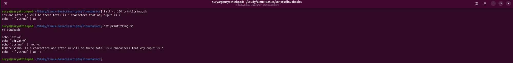

**Note:** GNU `tail` options like `tail -n +5` (start printing from line 5 onward) are advanced; class focuses on **last N lines** and **last N bytes**.

**Demo:** [`tail-bottom-lines-demo.sh`](../../scripts/viewContentOfFiles/tail-bottom-lines-demo.sh)

---

## 10. more and less — pagers

| Pager      | Behavior                                                             |
| :--------- | :------------------------------------------------------------------- |
| **`more`** | Move **forward** through a long file (Space / Enter)                 |
| **`less`** | Forward **and backward** (Page Up / Page Down) — **preferred** today |

```bash
less /var/log/syslog    # q to quit
more /var/log/syslog
```

**Interactive:** in automation/CI, pagers wait for a human; use `head`/`tail` in scripts unless you know you have a TTY.

**Demo:** [`more-less-pager-hint-demo.sh`](../../scripts/viewContentOfFiles/more-less-pager-hint-demo.sh)

---

## 11. Small file vs large file

Durga Sir rule:

| File size      | Best command                                                                               |
| :------------- | :----------------------------------------------------------------------------------------- |
| **Small**      | **`cat`** — dump all content once                                                          |
| **Very large** | **`head`**, **`tail`**, **`more`**, **`less`** — do **not** flood terminal with full `cat` |

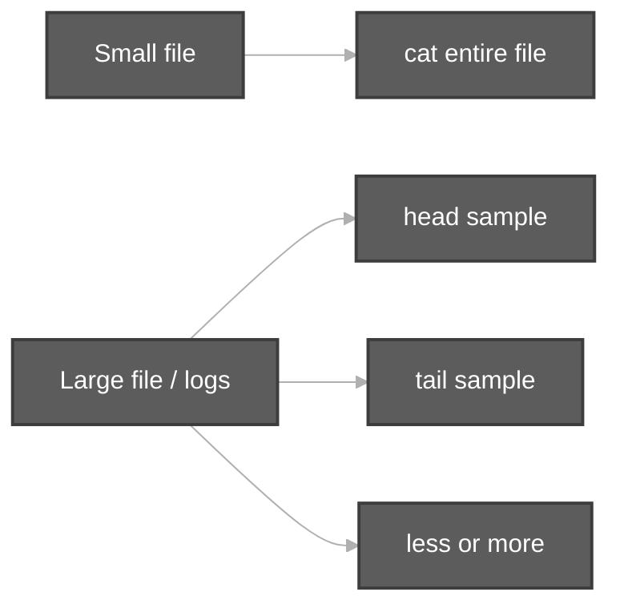

**Demo:** [`small-vs-large-file-view-demo.sh`](../../scripts/viewContentOfFiles/small-vs-large-file-view-demo.sh)

---

## 12. cat vs cp (Durga Sir)

| Task                                | `cat` |         `cp`         |
| :---------------------------------- | :---: | :------------------: |
| Print contents on screen            |  Yes  |          No          |
| Create new file with new data alone |  No   | No (copies existing) |
| Copy files into a folder            |  No   |         Yes          |

Commands may **look similar** in conversation but each has its **own purpose**.

---

## 13. Preview: wc and redirection

- **`man cat`** — full manual; Durga Sir shows saving man output to a file (redirection `>`).
- **`wc -l file`** — count lines **without** printing file body (when you only need the number).

**Redirection and EOF (`>`, `>>`, `<<EOF`):** [EOF and Redirection.md](EOF%20and%20Redirection.md)

---

## 14. Session checklist

You should be able to:

1. Display a file with **`cat`** (with and without `<`).  
2. Use **`cat -n`** vs **`cat -b`** on files with blank lines.  
3. Explain **`tac`** vs **`rev`**.  
4. State that **`cat` / `rev` / `tac` do not change the file** unless you use **`>`**, **`>>`**, or an editor.  
5. Use **`head`** / **`tail`** defaults and **`-n`**.  
6. Explain **`head -n -5`** vs **`head -n 5`**.  
7. Choose **`cat`** vs **`head`/`tail`/`less`** for small vs large files.  
8. Name **`more`** and **`less`** and when they are used.

---

## 15. Script index

| Script                                                                                                    | Topic                                |
| :-------------------------------------------------------------------------------------------------------- | :----------------------------------- |
| [`cat-view-file-demo.sh`](../../scripts/viewContentOfFiles/cat-view-file-demo.sh)                         | `cat`, optional `<`                  |
| [`cat-n-and-b-line-numbers-demo.sh`](../../scripts/viewContentOfFiles/cat-n-and-b-line-numbers-demo.sh)   | `-n`, `-b`, blank lines              |
| [`cat-multiple-files-concat-demo.sh`](../../scripts/viewContentOfFiles/cat-multiple-files-concat-demo.sh) | `cat f1 f2`                          |
| [`tac-reverse-lines-demo.sh`](../../scripts/viewContentOfFiles/tac-reverse-lines-demo.sh)                 | `tac`                                |
| [`rev-reverse-line-chars-demo.sh`](../../scripts/viewContentOfFiles/rev-reverse-line-chars-demo.sh)       | `rev`                                |
| [`rev-tac-display-only-demo.sh`](../../scripts/viewContentOfFiles/rev-tac-display-only-demo.sh)           | `rev`/`tac` vs `cat`; file unchanged |
| [`head-top-lines-demo.sh`](../../scripts/viewContentOfFiles/head-top-lines-demo.sh)                       | `head`, `-n`, negative `-n`          |
| [`tail-bottom-lines-demo.sh`](../../scripts/viewContentOfFiles/tail-bottom-lines-demo.sh)                 | `tail`                               |
| [`small-vs-large-file-view-demo.sh`](../../scripts/viewContentOfFiles/small-vs-large-file-view-demo.sh)   | cat vs head/tail                     |
| [`more-less-pager-hint-demo.sh`](../../scripts/viewContentOfFiles/more-less-pager-hint-demo.sh)           | `more` / `less` hints                |

---

## Part 2 — Execution summary (`scripts/viewContentOfFiles/`)

Command-by-command walkthrough for every demo script (regenerate with `python3 scripts-execution-summary/tools/build_execution_summaries.py`).

<!-- BEGIN EXECUTION_SUMMARY (generated) -->
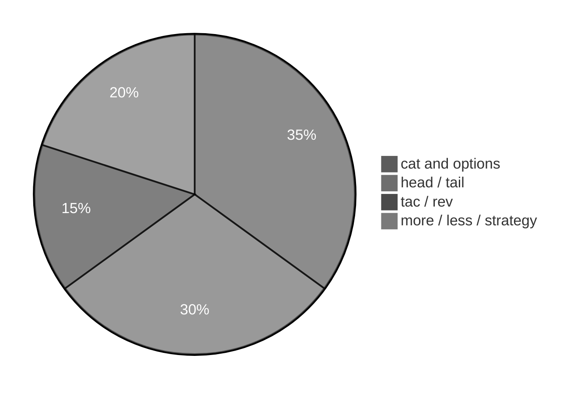

Each script section uses the same **four-part** model:

|   #   | Column in tables       | Meaning                                                                                       |
| :---: | :--------------------- | :-------------------------------------------------------------------------------------------- |
|   1   | **What it is**         | Command or shell feature (e.g. `echo` = print text).                                          |
|   2   | **Added / configured** | How it appears in Linux (PATH, builtin, flag on CLI, variable in script).                     |
|   3   | **Execution intent**   | What you are trying to do when the line runs.                                                 |
|   4   | **Output**             | What you see on the **terminal (stdout/stderr)**, in a **file**, or through a **pipeline** (` | `). |

---

## [`cat-multiple-files-concat-demo.sh`](../../scripts/viewContentOfFiles/cat-multiple-files-concat-demo.sh)

**Run:** `bash scripts/viewContentOfFiles/cat-multiple-files-concat-demo.sh`

### In-depth command walkthrough

| Command (as in script)                                                   | 1. What it is                                              | 2. Added / configured                                                  | 3. Execution intent                                                                                  | 4. Output (terminal / file / pipeline)                                                                   |
| :----------------------------------------------------------------------- | :--------------------------------------------------------- | :--------------------------------------------------------------------- | :--------------------------------------------------------------------------------------------------- | :------------------------------------------------------------------------------------------------------- |
| `set -euo pipefail`                                                      | Bash strict-mode option bundle.                            | Written at top of script; not installed separately.                    | Tell Bash to stop on errors, treat unset variables as errors, and fail pipelines if any stage fails. | No visible output; changes how later commands affect exit status.                                        |
| `WORK="${TMPDIR:-/tmp}/linux-view-content-demo"`                         | Shell variable assignment.                                 | Name=`value` in script; often under `${TMPDIR:-/tmp}`.                 | Store path or stamp for later commands (setup, not a user command).                                  | No output; variable used by `cd`, `rm`, file paths.                                                      |
| `rm -rf "$WORK"`                                                         | Remove files/directories recursively, force.               | Coreutils; `-r` recursive, `-f` no prompt.                             | Clean old demo data under `/tmp` before recreating.                                                  | Silent on success.                                                                                       |
| `mkdir -p "$WORK"`                                                       | Make directories.                                          | Coreutils; `-p` creates parents as needed.                             | Try to **create** folder(s) for the demo tree.                                                       | Silent on success; errors on stderr if path invalid.                                                     |
| `cd "$WORK"`                                                             | Change directory — move shell’s current working directory. | Builtin; takes relative or absolute path, `~`, `-`, or no args (home). | Navigate the tree (trying to **enter** a folder); relative paths start from cwd.                     | Normally silent on success; failure prints `cd: ...: No such file or directory` on **stderr**.           |
| `echo "part-A" > file1.txt`                                              | Bash builtin that prints arguments to standard output.     | Always available in Bash; no package install.                          | Show section titles, tips, or messages to the terminal (trying to **print** text for the user).      | Lines appear on **stdout** in your terminal (or in CI logs). Not used in a pipeline unless followed by ` | `. |
| `echo "part-B" > file2.txt`                                              | Bash builtin that prints arguments to standard output.     | Always available in Bash; no package install.                          | Show section titles, tips, or messages to the terminal (trying to **print** text for the user).      | Lines appear on **stdout** in your terminal (or in CI logs). Not used in a pipeline unless followed by ` | `. |
| `echo "=== cat file1.txt file2.txt ==="`                                 | Section header for humans.                                 | Literal string in script                                               | **Print** section title                                                                              | Title line on **stdout** before commands                                                                 |
| `cat file1.txt file2.txt`                                                | Concatenate and print files.                               | Coreutils.                                                             | Try to **display file contents** on terminal.                                                        | File bytes on stdout.                                                                                    |
| `echo ""`                                                                | Bash builtin that prints arguments to standard output.     | Always available in Bash; no package install.                          | Show section titles, tips, or messages to the terminal (trying to **print** text for the user).      | Lines appear on **stdout** in your terminal (or in CI logs). Not used in a pipeline unless followed by ` | `. |
| `echo "Tip: cat concatenates and displays; cp copies files (different …` | Bash builtin that prints arguments to standard output.     | Always available in Bash; no package install.                          | Show section titles, tips, or messages to the terminal (trying to **print** text for the user).      | Lines appear on **stdout** in your terminal (or in CI logs). Not used in a pipeline unless followed by ` | `. |

---

## [`cat-n-and-b-line-numbers-demo.sh`](../../scripts/viewContentOfFiles/cat-n-and-b-line-numbers-demo.sh)

**Run:** `bash scripts/viewContentOfFiles/cat-n-and-b-line-numbers-demo.sh`

### In-depth command walkthrough

| Command (as in script)                                               | 1. What it is                                              | 2. Added / configured                                                  | 3. Execution intent                                                                                  | 4. Output (terminal / file / pipeline)                                                                   |
| :------------------------------------------------------------------- | :--------------------------------------------------------- | :--------------------------------------------------------------------- | :--------------------------------------------------------------------------------------------------- | :------------------------------------------------------------------------------------------------------- |
| `set -euo pipefail`                                                  | Bash strict-mode option bundle.                            | Written at top of script; not installed separately.                    | Tell Bash to stop on errors, treat unset variables as errors, and fail pipelines if any stage fails. | No visible output; changes how later commands affect exit status.                                        |
| `WORK="${TMPDIR:-/tmp}/linux-view-content-demo"`                     | Shell variable assignment.                                 | Name=`value` in script; often under `${TMPDIR:-/tmp}`.                 | Store path or stamp for later commands (setup, not a user command).                                  | No output; variable used by `cd`, `rm`, file paths.                                                      |
| `rm -rf "$WORK"`                                                     | Remove files/directories recursively, force.               | Coreutils; `-r` recursive, `-f` no prompt.                             | Clean old demo data under `/tmp` before recreating.                                                  | Silent on success.                                                                                       |
| `mkdir -p "$WORK"`                                                   | Make directories.                                          | Coreutils; `-p` creates parents as needed.                             | Try to **create** folder(s) for the demo tree.                                                       | Silent on success; errors on stderr if path invalid.                                                     |
| `cd "$WORK"`                                                         | Change directory — move shell’s current working directory. | Builtin; takes relative or absolute path, `~`, `-`, or no args (home). | Navigate the tree (trying to **enter** a folder); relative paths start from cwd.                     | Normally silent on success; failure prints `cd: ...: No such file or directory` on **stderr**.           |
| `cat > abc.txt <<'EOF'`                                              | Concatenate and print files.                               | Coreutils.                                                             | Try to **display file contents** on terminal.                                                        | File bytes on stdout.                                                                                    |
| `mango`                                                              | Shell syntax (variable, test, subshell, or function).      | Defined in this script only.                                           | Prepare path, branch on failure, or wrap commands.                                                   | Depends on line: may be silent or print via embedded commands.                                           |
| `apple`                                                              | Shell syntax (variable, test, subshell, or function).      | Defined in this script only.                                           | Prepare path, branch on failure, or wrap commands.                                                   | Depends on line: may be silent or print via embedded commands.                                           |
| `orange`                                                             | Shell syntax (variable, test, subshell, or function).      | Defined in this script only.                                           | Prepare path, branch on failure, or wrap commands.                                                   | Depends on line: may be silent or print via embedded commands.                                           |
| `banana`                                                             | Shell syntax (variable, test, subshell, or function).      | Defined in this script only.                                           | Prepare path, branch on failure, or wrap commands.                                                   | Depends on line: may be silent or print via embedded commands.                                           |
| `java`                                                               | Shell syntax (variable, test, subshell, or function).      | Defined in this script only.                                           | Prepare path, branch on failure, or wrap commands.                                                   | Depends on line: may be silent or print via embedded commands.                                           |
| `python`                                                             | Shell syntax (variable, test, subshell, or function).      | Defined in this script only.                                           | Prepare path, branch on failure, or wrap commands.                                                   | Depends on line: may be silent or print via embedded commands.                                           |
| `EOF`                                                                | Shell syntax (variable, test, subshell, or function).      | Defined in this script only.                                           | Prepare path, branch on failure, or wrap commands.                                                   | Depends on line: may be silent or print via embedded commands.                                           |
| `echo "=== cat abc.txt (shows blank lines too) ==="`                 | Section header for humans.                                 | Literal string in script                                               | **Print** section title                                                                              | Title line on **stdout** before commands                                                                 |
| `cat abc.txt`                                                        | Concatenate and print files.                               | Coreutils.                                                             | Try to **display file contents** on terminal.                                                        | File bytes on stdout.                                                                                    |
| `echo ""`                                                            | Bash builtin that prints arguments to standard output.     | Always available in Bash; no package install.                          | Show section titles, tips, or messages to the terminal (trying to **print** text for the user).      | Lines appear on **stdout** in your terminal (or in CI logs). Not used in a pipeline unless followed by ` | `. |
| `echo "=== cat -n abc.txt (number all lines, including blanks) ==="` | Section header for humans.                                 | Literal string in script                                               | **Print** section title                                                                              | Title line on **stdout** before commands                                                                 |
| `cat -n abc.txt`                                                     | Concatenate and print files.                               | Coreutils.                                                             | Try to **display file contents** on terminal.                                                        | File bytes on stdout.                                                                                    |
| `echo ""`                                                            | Bash builtin that prints arguments to standard output.     | Always available in Bash; no package install.                          | Show section titles, tips, or messages to the terminal (trying to **print** text for the user).      | Lines appear on **stdout** in your terminal (or in CI logs). Not used in a pipeline unless followed by ` | `. |
| `echo "=== cat -b abc.txt (number non-blank lines only) ==="`        | Section header for humans.                                 | Literal string in script                                               | **Print** section title                                                                              | Title line on **stdout** before commands                                                                 |
| `cat -b abc.txt`                                                     | Concatenate and print files.                               | Coreutils.                                                             | Try to **display file contents** on terminal.                                                        | File bytes on stdout.                                                                                    |

---

## [`cat-view-file-demo.sh`](../../scripts/viewContentOfFiles/cat-view-file-demo.sh)

**Run:** `bash scripts/viewContentOfFiles/cat-view-file-demo.sh`

### In-depth command walkthrough

| Command (as in script)                                                 | 1. What it is                                              | 2. Added / configured                                                  | 3. Execution intent                                                                                  | 4. Output (terminal / file / pipeline)                                                                   |
| :--------------------------------------------------------------------- | :--------------------------------------------------------- | :--------------------------------------------------------------------- | :--------------------------------------------------------------------------------------------------- | :------------------------------------------------------------------------------------------------------- |
| `set -euo pipefail`                                                    | Bash strict-mode option bundle.                            | Written at top of script; not installed separately.                    | Tell Bash to stop on errors, treat unset variables as errors, and fail pipelines if any stage fails. | No visible output; changes how later commands affect exit status.                                        |
| `WORK="${TMPDIR:-/tmp}/linux-view-content-demo"`                       | Shell variable assignment.                                 | Name=`value` in script; often under `${TMPDIR:-/tmp}`.                 | Store path or stamp for later commands (setup, not a user command).                                  | No output; variable used by `cd`, `rm`, file paths.                                                      |
| `rm -rf "$WORK"`                                                       | Remove files/directories recursively, force.               | Coreutils; `-r` recursive, `-f` no prompt.                             | Clean old demo data under `/tmp` before recreating.                                                  | Silent on success.                                                                                       |
| `mkdir -p "$WORK"`                                                     | Make directories.                                          | Coreutils; `-p` creates parents as needed.                             | Try to **create** folder(s) for the demo tree.                                                       | Silent on success; errors on stderr if path invalid.                                                     |
| `cd "$WORK"`                                                           | Change directory — move shell’s current working directory. | Builtin; takes relative or absolute path, `~`, `-`, or no args (home). | Navigate the tree (trying to **enter** a folder); relative paths start from cwd.                     | Normally silent on success; failure prints `cd: ...: No such file or directory` on **stderr**.           |
| `cat > file1.txt <<'EOF'`                                              | Concatenate and print files.                               | Coreutils.                                                             | Try to **display file contents** on terminal.                                                        | File bytes on stdout.                                                                                    |
| `mango`                                                                | Shell syntax (variable, test, subshell, or function).      | Defined in this script only.                                           | Prepare path, branch on failure, or wrap commands.                                                   | Depends on line: may be silent or print via embedded commands.                                           |
| `apple`                                                                | Shell syntax (variable, test, subshell, or function).      | Defined in this script only.                                           | Prepare path, branch on failure, or wrap commands.                                                   | Depends on line: may be silent or print via embedded commands.                                           |
| `orange`                                                               | Shell syntax (variable, test, subshell, or function).      | Defined in this script only.                                           | Prepare path, branch on failure, or wrap commands.                                                   | Depends on line: may be silent or print via embedded commands.                                           |
| `EOF`                                                                  | Shell syntax (variable, test, subshell, or function).      | Defined in this script only.                                           | Prepare path, branch on failure, or wrap commands.                                                   | Depends on line: may be silent or print via embedded commands.                                           |
| `echo "=== cat file1.txt (view full small file) ==="`                  | Section header for humans.                                 | Literal string in script                                               | **Print** section title                                                                              | Title line on **stdout** before commands                                                                 |
| `cat file1.txt`                                                        | Concatenate and print files.                               | Coreutils.                                                             | Try to **display file contents** on terminal.                                                        | File bytes on stdout.                                                                                    |
| `echo ""`                                                              | Bash builtin that prints arguments to standard output.     | Always available in Bash; no package install.                          | Show section titles, tips, or messages to the terminal (trying to **print** text for the user).      | Lines appear on **stdout** in your terminal (or in CI logs). Not used in a pipeline unless followed by ` | `. |
| `echo "=== cat < file1.txt (optional input redirect — same idea) ==="` | Section header for humans.                                 | Literal string in script                                               | **Print** section title                                                                              | Title line on **stdout** before commands                                                                 |
| `cat < file1.txt`                                                      | Concatenate and print files.                               | Coreutils.                                                             | Try to **display file contents** on terminal.                                                        | File bytes on stdout.                                                                                    |

---

## [`head-top-lines-demo.sh`](../../scripts/viewContentOfFiles/head-top-lines-demo.sh)

**Run:** `bash scripts/viewContentOfFiles/head-top-lines-demo.sh`

### In-depth command walkthrough

| Command (as in script)                                        | 1. What it is                                              | 2. Added / configured                                                  | 3. Execution intent                                                                                  | 4. Output (terminal / file / pipeline)                                                                   |
| :------------------------------------------------------------ | :--------------------------------------------------------- | :--------------------------------------------------------------------- | :--------------------------------------------------------------------------------------------------- | :------------------------------------------------------------------------------------------------------- |
| `set -euo pipefail`                                           | Bash strict-mode option bundle.                            | Written at top of script; not installed separately.                    | Tell Bash to stop on errors, treat unset variables as errors, and fail pipelines if any stage fails. | No visible output; changes how later commands affect exit status.                                        |
| `WORK="${TMPDIR:-/tmp}/linux-view-content-demo"`              | Shell variable assignment.                                 | Name=`value` in script; often under `${TMPDIR:-/tmp}`.                 | Store path or stamp for later commands (setup, not a user command).                                  | No output; variable used by `cd`, `rm`, file paths.                                                      |
| `rm -rf "$WORK"`                                              | Remove files/directories recursively, force.               | Coreutils; `-r` recursive, `-f` no prompt.                             | Clean old demo data under `/tmp` before recreating.                                                  | Silent on success.                                                                                       |
| `mkdir -p "$WORK"`                                            | Make directories.                                          | Coreutils; `-p` creates parents as needed.                             | Try to **create** folder(s) for the demo tree.                                                       | Silent on success; errors on stderr if path invalid.                                                     |
| `cd "$WORK"`                                                  | Change directory — move shell’s current working directory. | Builtin; takes relative or absolute path, `~`, `-`, or no args (home). | Navigate the tree (trying to **enter** a folder); relative paths start from cwd.                     | Normally silent on success; failure prints `cd: ...: No such file or directory` on **stderr**.           |
| `seq 1 20 > abc.txt`                                          | Shell syntax (variable, test, subshell, or function).      | Defined in this script only.                                           | Prepare path, branch on failure, or wrap commands.                                                   | Depends on line: may be silent or print via embedded commands.                                           |
| `echo "=== head abc.txt (default: first 10 lines) ==="`       | Section header for humans.                                 | Literal string in script                                               | **Print** section title                                                                              | Title line on **stdout** before commands                                                                 |
| `head abc.txt`                                                | Print first N lines of file or pipe.                       | Coreutils; often `head -n` or `head -20`.                              | Truncate long output in demos.                                                                       | First lines on stdout; in pipeline: `cal -y                                                              | head -20` only first 20 lines reach terminal. |
| `echo ""`                                                     | Bash builtin that prints arguments to standard output.     | Always available in Bash; no package install.                          | Show section titles, tips, or messages to the terminal (trying to **print** text for the user).      | Lines appear on **stdout** in your terminal (or in CI logs). Not used in a pipeline unless followed by ` | `.                                            |
| `echo "=== head -15 abc.txt (first 15 lines) ==="`            | Section header for humans.                                 | Literal string in script                                               | **Print** section title                                                                              | Title line on **stdout** before commands                                                                 |
| `head -15 abc.txt`                                            | Print first N lines of file or pipe.                       | Coreutils; often `head -n` or `head -20`.                              | Truncate long output in demos.                                                                       | First lines on stdout; in pipeline: `cal -y                                                              | head -20` only first 20 lines reach terminal. |
| `echo ""`                                                     | Bash builtin that prints arguments to standard output.     | Always available in Bash; no package install.                          | Show section titles, tips, or messages to the terminal (trying to **print** text for the user).      | Lines appear on **stdout** in your terminal (or in CI logs). Not used in a pipeline unless followed by ` | `.                                            |
| `echo "=== head -n 5 abc.txt (first 5 lines) ==="`            | Section header for humans.                                 | Literal string in script                                               | **Print** section title                                                                              | Title line on **stdout** before commands                                                                 |
| `head -n 5 abc.txt`                                           | Print first N lines of file or pipe.                       | Coreutils; often `head -n` or `head -20`.                              | Truncate long output in demos.                                                                       | First lines on stdout; in pipeline: `cal -y                                                              | head -20` only first 20 lines reach terminal. |
| `echo ""`                                                     | Bash builtin that prints arguments to standard output.     | Always available in Bash; no package install.                          | Show section titles, tips, or messages to the terminal (trying to **print** text for the user).      | Lines appear on **stdout** in your terminal (or in CI logs). Not used in a pipeline unless followed by ` | `.                                            |
| `echo "=== head -n -5 abc.txt (ALL lines EXCEPT last 5) ==="` | Section header for humans.                                 | Literal string in script                                               | **Print** section title                                                                              | Title line on **stdout** before commands                                                                 |
| `head -n -5 abc.txt`                                          | Print first N lines of file or pipe.                       | Coreutils; often `head -n` or `head -20`.                              | Truncate long output in demos.                                                                       | First lines on stdout; in pipeline: `cal -y                                                              | head -20` only first 20 lines reach terminal. |

---

## [`more-less-pager-hint-demo.sh`](../../scripts/viewContentOfFiles/more-less-pager-hint-demo.sh)

**Run:** `bash scripts/viewContentOfFiles/more-less-pager-hint-demo.sh`

### In-depth command walkthrough

| Command (as in script)                                                    | 1. What it is                                          | 2. Added / configured                               | 3. Execution intent                                                                                  | 4. Output (terminal / file / pipeline)                                                                   |
| :------------------------------------------------------------------------ | :----------------------------------------------------- | :-------------------------------------------------- | :--------------------------------------------------------------------------------------------------- | :------------------------------------------------------------------------------------------------------- |
| `set -euo pipefail`                                                       | Bash strict-mode option bundle.                        | Written at top of script; not installed separately. | Tell Bash to stop on errors, treat unset variables as errors, and fail pipelines if any stage fails. | No visible output; changes how later commands affect exit status.                                        |
| `TARGET="${1:-/etc/passwd}"`                                              | Shell syntax (variable, test, subshell, or function).  | Defined in this script only.                        | Prepare path, branch on failure, or wrap commands.                                                   | Depends on line: may be silent or print via embedded commands.                                           |
| `if [[ ! -f "$TARGET" ]]; then`                                           | Conditional test `[[ ... ]]` or `if`.                  | Bash syntax.                                        | Branch: run block only when directory exists / command succeeds.                                     | Either block runs (messages on stdout) or `else` branch.                                                 |
| `echo "Usage: $0 [file]   (default: /etc/passwd)"`                        | Bash builtin that prints arguments to standard output. | Always available in Bash; no package install.       | Show section titles, tips, or messages to the terminal (trying to **print** text for the user).      | Lines appear on **stdout** in your terminal (or in CI logs). Not used in a pipeline unless followed by ` | `.                                            |
| `exit 0`                                                                  | Shell syntax (variable, test, subshell, or function).  | Defined in this script only.                        | Prepare path, branch on failure, or wrap commands.                                                   | Depends on line: may be silent or print via embedded commands.                                           |
| `echo "=== more and less are INTERACTIVE pagers (q to quit) ==="`         | Section header for humans.                             | Literal string in script                            | **Print** section title                                                                              | Title line on **stdout** before commands                                                                 |
| `echo "On your laptop try:  less $TARGET"`                                | Bash builtin that prints arguments to standard output. | Always available in Bash; no package install.       | Show section titles, tips, or messages to the terminal (trying to **print** text for the user).      | Lines appear on **stdout** in your terminal (or in CI logs). Not used in a pipeline unless followed by ` | `.                                            |
| `echo "                     more $TARGET"`                                | Bash builtin that prints arguments to standard output. | Always available in Bash; no package install.       | Show section titles, tips, or messages to the terminal (trying to **print** text for the user).      | Lines appear on **stdout** in your terminal (or in CI logs). Not used in a pipeline unless followed by ` | `.                                            |
| `echo ""`                                                                 | Bash builtin that prints arguments to standard output. | Always available in Bash; no package install.       | Show section titles, tips, or messages to the terminal (trying to **print** text for the user).      | Lines appear on **stdout** in your terminal (or in CI logs). Not used in a pipeline unless followed by ` | `.                                            |
| `echo "=== Non-interactive preview (first 12 lines, like opening a page…` | Section header for humans.                             | Literal string in script                            | **Print** section title                                                                              | Title line on **stdout** before commands                                                                 |
| `head -12 "$TARGET"`                                                      | Print first N lines of file or pipe.                   | Coreutils; often `head -n` or `head -20`.           | Truncate long output in demos.                                                                       | First lines on stdout; in pipeline: `cal -y                                                              | head -20` only first 20 lines reach terminal. |
| `echo ""`                                                                 | Bash builtin that prints arguments to standard output. | Always available in Bash; no package install.       | Show section titles, tips, or messages to the terminal (trying to **print** text for the user).      | Lines appear on **stdout** in your terminal (or in CI logs). Not used in a pipeline unless followed by ` | `.                                            |
| `echo "less is stronger than more: scroll forward AND backward (Page U…`  | Bash builtin that prints arguments to standard output. | Always available in Bash; no package install.       | Show section titles, tips, or messages to the terminal (trying to **print** text for the user).      | Lines appear on **stdout** in your terminal (or in CI logs). Not used in a pipeline unless followed by ` | `.                                            |

---

## [`rev-reverse-line-chars-demo.sh`](../../scripts/viewContentOfFiles/rev-reverse-line-chars-demo.sh)

**Run:** `bash scripts/viewContentOfFiles/rev-reverse-line-chars-demo.sh`

### In-depth command walkthrough

| Command (as in script)                                                   | 1. What it is                                              | 2. Added / configured                                                  | 3. Execution intent                                                                                  | 4. Output (terminal / file / pipeline)                                                                   |
| :----------------------------------------------------------------------- | :--------------------------------------------------------- | :--------------------------------------------------------------------- | :--------------------------------------------------------------------------------------------------- | :------------------------------------------------------------------------------------------------------- |
| `set -euo pipefail`                                                      | Bash strict-mode option bundle.                            | Written at top of script; not installed separately.                    | Tell Bash to stop on errors, treat unset variables as errors, and fail pipelines if any stage fails. | No visible output; changes how later commands affect exit status.                                        |
| `WORK="${TMPDIR:-/tmp}/linux-view-content-demo"`                         | Shell variable assignment.                                 | Name=`value` in script; often under `${TMPDIR:-/tmp}`.                 | Store path or stamp for later commands (setup, not a user command).                                  | No output; variable used by `cd`, `rm`, file paths.                                                      |
| `rm -rf "$WORK"`                                                         | Remove files/directories recursively, force.               | Coreutils; `-r` recursive, `-f` no prompt.                             | Clean old demo data under `/tmp` before recreating.                                                  | Silent on success.                                                                                       |
| `mkdir -p "$WORK"`                                                       | Make directories.                                          | Coreutils; `-p` creates parents as needed.                             | Try to **create** folder(s) for the demo tree.                                                       | Silent on success; errors on stderr if path invalid.                                                     |
| `cd "$WORK"`                                                             | Change directory — move shell’s current working directory. | Builtin; takes relative or absolute path, `~`, `-`, or no args (home). | Navigate the tree (trying to **enter** a folder); relative paths start from cwd.                     | Normally silent on success; failure prints `cd: ...: No such file or directory` on **stderr**.           |
| `echo "chini" > abc.txt`                                                 | Bash builtin that prints arguments to standard output.     | Always available in Bash; no package install.                          | Show section titles, tips, or messages to the terminal (trying to **print** text for the user).      | Lines appear on **stdout** in your terminal (or in CI logs). Not used in a pipeline unless followed by ` | `. |
| `echo "=== cat abc.txt ==="`                                             | Section header for humans.                                 | Literal string in script                                               | **Print** section title                                                                              | Title line on **stdout** before commands                                                                 |
| `cat abc.txt`                                                            | Concatenate and print files.                               | Coreutils.                                                             | Try to **display file contents** on terminal.                                                        | File bytes on stdout.                                                                                    |
| `echo ""`                                                                | Bash builtin that prints arguments to standard output.     | Always available in Bash; no package install.                          | Show section titles, tips, or messages to the terminal (trying to **print** text for the user).      | Lines appear on **stdout** in your terminal (or in CI logs). Not used in a pipeline unless followed by ` | `. |
| `echo "=== rev abc.txt (chini -> inihc) ==="`                            | Section header for humans.                                 | Literal string in script                                               | **Print** section title                                                                              | Title line on **stdout** before commands                                                                 |
| `rev abc.txt`                                                            | Reverse characters on each line.                           | Coreutils.                                                             | Horizontal reverse per line.                                                                         | Each line mirrored on stdout.                                                                            |
| `echo ""`                                                                | Bash builtin that prints arguments to standard output.     | Always available in Bash; no package install.                          | Show section titles, tips, or messages to the terminal (trying to **print** text for the user).      | Lines appear on **stdout** in your terminal (or in CI logs). Not used in a pipeline unless followed by ` | `. |
| `echo "Tip: tac = reverse line order; rev = reverse each line left-to-…` | Bash builtin that prints arguments to standard output.     | Always available in Bash; no package install.                          | Show section titles, tips, or messages to the terminal (trying to **print** text for the user).      | Lines appear on **stdout** in your terminal (or in CI logs). Not used in a pipeline unless followed by ` | `. |

---

## [`rev-tac-display-only-demo.sh`](../../scripts/viewContentOfFiles/rev-tac-display-only-demo.sh)

**Run:** `bash scripts/viewContentOfFiles/rev-tac-display-only-demo.sh`

### In-depth command walkthrough

| Command (as in script)                                                    | 1. What it is                                          | 2. Added / configured                                  | 3. Execution intent                                                                                  | 4. Output (terminal / file / pipeline)                                                                   |
| :------------------------------------------------------------------------ | :----------------------------------------------------- | :----------------------------------------------------- | :--------------------------------------------------------------------------------------------------- | :------------------------------------------------------------------------------------------------------- |
| `set -euo pipefail`                                                       | Bash strict-mode option bundle.                        | Written at top of script; not installed separately.    | Tell Bash to stop on errors, treat unset variables as errors, and fail pipelines if any stage fails. | No visible output; changes how later commands affect exit status.                                        |
| `WORK="${TMPDIR:-/tmp}/linux-view-readonly-demo"`                         | Shell variable assignment.                             | Name=`value` in script; often under `${TMPDIR:-/tmp}`. | Store path or stamp for later commands (setup, not a user command).                                  | No output; variable used by `cd`, `rm`, file paths.                                                      |
| `rm -rf "$WORK"`                                                          | Remove files/directories recursively, force.           | Coreutils; `-r` recursive, `-f` no prompt.             | Clean old demo data under `/tmp` before recreating.                                                  | Silent on success.                                                                                       |
| `mkdir -p "$WORK"`                                                        | Make directories.                                      | Coreutils; `-p` creates parents as needed.             | Try to **create** folder(s) for the demo tree.                                                       | Silent on success; errors on stderr if path invalid.                                                     |
| `FILE="$WORK/sample.sh"`                                                  | Shell variable assignment.                             | Name=`value` in script; often under `${TMPDIR:-/tmp}`. | Store path or stamp for later commands (setup, not a user command).                                  | No output; variable used by `cd`, `rm`, file paths.                                                      |
| `cat > "$FILE" <<'EOF'`                                                   | Concatenate and print files.                           | Coreutils.                                             | Try to **display file contents** on terminal.                                                        | File bytes on stdout.                                                                                    |
| `echo "All arguments with @ : $@"`                                        | Bash builtin that prints arguments to standard output. | Always available in Bash; no package install.          | Show section titles, tips, or messages to the terminal (trying to **print** text for the user).      | Lines appear on **stdout** in your terminal (or in CI logs). Not used in a pipeline unless followed by ` | `. |
| `EOF`                                                                     | Shell syntax (variable, test, subshell, or function).  | Defined in this script only.                           | Prepare path, branch on failure, or wrap commands.                                                   | Depends on line: may be silent or print via embedded commands.                                           |
| `echo "=== 1) Original file on disk (cat) ==="`                           | Section header for humans.                             | Literal string in script                               | **Print** section title                                                                              | Title line on **stdout** before commands                                                                 |
| `cat "$FILE"`                                                             | Concatenate and print files.                           | Coreutils.                                             | Try to **display file contents** on terminal.                                                        | File bytes on stdout.                                                                                    |
| `echo ""`                                                                 | Bash builtin that prints arguments to standard output. | Always available in Bash; no package install.          | Show section titles, tips, or messages to the terminal (trying to **print** text for the user).      | Lines appear on **stdout** in your terminal (or in CI logs). Not used in a pipeline unless followed by ` | `. |
| `echo "=== 2) rev — reversed CHARACTERS on screen only (file unchanged)…` | Section header for humans.                             | Literal string in script                               | **Print** section title                                                                              | Title line on **stdout** before commands                                                                 |
| `rev "$FILE"`                                                             | Reverse characters on each line.                       | Coreutils.                                             | Horizontal reverse per line.                                                                         | Each line mirrored on stdout.                                                                            |
| `echo ""`                                                                 | Bash builtin that prints arguments to standard output. | Always available in Bash; no package install.          | Show section titles, tips, or messages to the terminal (trying to **print** text for the user).      | Lines appear on **stdout** in your terminal (or in CI logs). Not used in a pipeline unless followed by ` | `. |
| `echo "=== 3) cat again — same original order (proof file not modified)…` | Section header for humans.                             | Literal string in script                               | **Print** section title                                                                              | Title line on **stdout** before commands                                                                 |
| `cat "$FILE"`                                                             | Concatenate and print files.                           | Coreutils.                                             | Try to **display file contents** on terminal.                                                        | File bytes on stdout.                                                                                    |
| `echo ""`                                                                 | Bash builtin that prints arguments to standard output. | Always available in Bash; no package install.          | Show section titles, tips, or messages to the terminal (trying to **print** text for the user).      | Lines appear on **stdout** in your terminal (or in CI logs). Not used in a pipeline unless followed by ` | `. |
| `echo "=== 4) tac — reversed LINE order on screen (add second line firs…` | Section header for humans.                             | Literal string in script                               | **Print** section title                                                                              | Title line on **stdout** before commands                                                                 |
| `printf 'line-one\nline-two\n' > "$WORK/two.txt"`                         | Formatted print (builtin).                             | Bash builtin.                                          | Print with format specifiers like C.                                                                 | Formatted bytes on stdout.                                                                               |
| `tac "$WORK/two.txt"`                                                     | Print file with lines in reverse order.                | Coreutils; cat spelled backward.                       | Vertical reverse: last line first.                                                                   | Lines on stdout in reversed order.                                                                       |
| `echo ""`                                                                 | Bash builtin that prints arguments to standard output. | Always available in Bash; no package install.          | Show section titles, tips, or messages to the terminal (trying to **print** text for the user).      | Lines appear on **stdout** in your terminal (or in CI logs). Not used in a pipeline unless followed by ` | `. |
| `echo "=== 5) cat two.txt — still line-one then line-two on disk ==="`    | Section header for humans.                             | Literal string in script                               | **Print** section title                                                                              | Title line on **stdout** before commands                                                                 |
| `cat "$WORK/two.txt"`                                                     | Concatenate and print files.                           | Coreutils.                                             | Try to **display file contents** on terminal.                                                        | File bytes on stdout.                                                                                    |
| `echo ""`                                                                 | Bash builtin that prints arguments to standard output. | Always available in Bash; no package install.          | Show section titles, tips, or messages to the terminal (trying to **print** text for the user).      | Lines appear on **stdout** in your terminal (or in CI logs). Not used in a pipeline unless followed by ` | `. |
| `echo "Tip: file changes only when you WRITE (>, >>, editor). Not from…`  | Bash builtin that prints arguments to standard output. | Always available in Bash; no package install.          | Show section titles, tips, or messages to the terminal (trying to **print** text for the user).      | Lines appear on **stdout** in your terminal (or in CI logs). Not used in a pipeline unless followed by ` | `. |

---

## [`small-vs-large-file-view-demo.sh`](../../scripts/viewContentOfFiles/small-vs-large-file-view-demo.sh)

**Run:** `bash scripts/viewContentOfFiles/small-vs-large-file-view-demo.sh`

### In-depth command walkthrough

| Command (as in script)                                                   | 1. What it is                                          | 2. Added / configured                                  | 3. Execution intent                                                                                  | 4. Output (terminal / file / pipeline)                                                                   |
| :----------------------------------------------------------------------- | :----------------------------------------------------- | :----------------------------------------------------- | :--------------------------------------------------------------------------------------------------- | :------------------------------------------------------------------------------------------------------- |
| `set -euo pipefail`                                                      | Bash strict-mode option bundle.                        | Written at top of script; not installed separately.    | Tell Bash to stop on errors, treat unset variables as errors, and fail pipelines if any stage fails. | No visible output; changes how later commands affect exit status.                                        |
| `echo "=== Small file: cat is fine (full dump at once) ==="`             | Section header for humans.                             | Literal string in script                               | **Print** section title                                                                              | Title line on **stdout** before commands                                                                 |
| `WORK="${TMPDIR:-/tmp}/linux-view-content-demo"`                         | Shell variable assignment.                             | Name=`value` in script; often under `${TMPDIR:-/tmp}`. | Store path or stamp for later commands (setup, not a user command).                                  | No output; variable used by `cd`, `rm`, file paths.                                                      |
| `rm -rf "$WORK"`                                                         | Remove files/directories recursively, force.           | Coreutils; `-r` recursive, `-f` no prompt.             | Clean old demo data under `/tmp` before recreating.                                                  | Silent on success.                                                                                       |
| `mkdir -p "$WORK"`                                                       | Make directories.                                      | Coreutils; `-p` creates parents as needed.             | Try to **create** folder(s) for the demo tree.                                                       | Silent on success; errors on stderr if path invalid.                                                     |
| `echo "hello friends" > "$WORK/small.txt"`                               | Bash builtin that prints arguments to standard output. | Always available in Bash; no package install.          | Show section titles, tips, or messages to the terminal (trying to **print** text for the user).      | Lines appear on **stdout** in your terminal (or in CI logs). Not used in a pipeline unless followed by ` | `.                                            |
| `cat "$WORK/small.txt"`                                                  | Concatenate and print files.                           | Coreutils.                                             | Try to **display file contents** on terminal.                                                        | File bytes on stdout.                                                                                    |
| `echo ""`                                                                | Bash builtin that prints arguments to standard output. | Always available in Bash; no package install.          | Show section titles, tips, or messages to the terminal (trying to **print** text for the user).      | Lines appear on **stdout** in your terminal (or in CI logs). Not used in a pipeline unless followed by ` | `.                                            |
| `echo "=== Large file: prefer head/tail (not whole cat) ==="`            | Section header for humans.                             | Literal string in script                               | **Print** section title                                                                              | Title line on **stdout** before commands                                                                 |
| `if [[ -f /etc/passwd ]]; then`                                          | Conditional test `[[ ... ]]` or `if`.                  | Bash syntax.                                           | Branch: run block only when directory exists / command succeeds.                                     | Either block runs (messages on stdout) or `else` branch.                                                 |
| `echo "--- head -5 /etc/passwd ---"`                                     | Bash builtin that prints arguments to standard output. | Always available in Bash; no package install.          | Show section titles, tips, or messages to the terminal (trying to **print** text for the user).      | Lines appear on **stdout** in your terminal (or in CI logs). Not used in a pipeline unless followed by ` | `.                                            |
| `head -5 /etc/passwd`                                                    | Print first N lines of file or pipe.                   | Coreutils; often `head -n` or `head -20`.              | Truncate long output in demos.                                                                       | First lines on stdout; in pipeline: `cal -y                                                              | head -20` only first 20 lines reach terminal. |
| `echo "--- tail -3 /etc/passwd ---"`                                     | Bash builtin that prints arguments to standard output. | Always available in Bash; no package install.          | Show section titles, tips, or messages to the terminal (trying to **print** text for the user).      | Lines appear on **stdout** in your terminal (or in CI logs). Not used in a pipeline unless followed by ` | `.                                            |
| `tail -3 /etc/passwd`                                                    | Print last N lines.                                    | Coreutils.                                             | Show end of listing or log.                                                                          | Last lines on stdout; works in pipelines like `ls                                                        | tail`.                                        |
| `echo "/etc/passwd not found on this system"`                            | Bash builtin that prints arguments to standard output. | Always available in Bash; no package install.          | Show section titles, tips, or messages to the terminal (trying to **print** text for the user).      | Lines appear on **stdout** in your terminal (or in CI logs). Not used in a pipeline unless followed by ` | `.                                            |
| `echo ""`                                                                | Bash builtin that prints arguments to standard output. | Always available in Bash; no package install.          | Show section titles, tips, or messages to the terminal (trying to **print** text for the user).      | Lines appear on **stdout** in your terminal (or in CI logs). Not used in a pipeline unless followed by ` | `.                                            |
| `echo "Durga Sir: small file -> cat; huge content -> head, tail, more,…` | Bash builtin that prints arguments to standard output. | Always available in Bash; no package install.          | Show section titles, tips, or messages to the terminal (trying to **print** text for the user).      | Lines appear on **stdout** in your terminal (or in CI logs). Not used in a pipeline unless followed by ` | `.                                            |

---

## [`tac-reverse-lines-demo.sh`](../../scripts/viewContentOfFiles/tac-reverse-lines-demo.sh)

**Run:** `bash scripts/viewContentOfFiles/tac-reverse-lines-demo.sh`

### In-depth command walkthrough

| Command (as in script)                                 | 1. What it is                                              | 2. Added / configured                                                  | 3. Execution intent                                                                                  | 4. Output (terminal / file / pipeline)                                                                   |
| :----------------------------------------------------- | :--------------------------------------------------------- | :--------------------------------------------------------------------- | :--------------------------------------------------------------------------------------------------- | :------------------------------------------------------------------------------------------------------- |
| `set -euo pipefail`                                    | Bash strict-mode option bundle.                            | Written at top of script; not installed separately.                    | Tell Bash to stop on errors, treat unset variables as errors, and fail pipelines if any stage fails. | No visible output; changes how later commands affect exit status.                                        |
| `WORK="${TMPDIR:-/tmp}/linux-view-content-demo"`       | Shell variable assignment.                                 | Name=`value` in script; often under `${TMPDIR:-/tmp}`.                 | Store path or stamp for later commands (setup, not a user command).                                  | No output; variable used by `cd`, `rm`, file paths.                                                      |
| `rm -rf "$WORK"`                                       | Remove files/directories recursively, force.               | Coreutils; `-r` recursive, `-f` no prompt.                             | Clean old demo data under `/tmp` before recreating.                                                  | Silent on success.                                                                                       |
| `mkdir -p "$WORK"`                                     | Make directories.                                          | Coreutils; `-p` creates parents as needed.                             | Try to **create** folder(s) for the demo tree.                                                       | Silent on success; errors on stderr if path invalid.                                                     |
| `cd "$WORK"`                                           | Change directory — move shell’s current working directory. | Builtin; takes relative or absolute path, `~`, `-`, or no args (home). | Navigate the tree (trying to **enter** a folder); relative paths start from cwd.                     | Normally silent on success; failure prints `cd: ...: No such file or directory` on **stderr**.           |
| `cat > abc.txt <<'EOF'`                                | Concatenate and print files.                               | Coreutils.                                                             | Try to **display file contents** on terminal.                                                        | File bytes on stdout.                                                                                    |
| `sunny`                                                | Shell syntax (variable, test, subshell, or function).      | Defined in this script only.                                           | Prepare path, branch on failure, or wrap commands.                                                   | Depends on line: may be silent or print via embedded commands.                                           |
| `bunny`                                                | Shell syntax (variable, test, subshell, or function).      | Defined in this script only.                                           | Prepare path, branch on failure, or wrap commands.                                                   | Depends on line: may be silent or print via embedded commands.                                           |
| `chini`                                                | Shell syntax (variable, test, subshell, or function).      | Defined in this script only.                                           | Prepare path, branch on failure, or wrap commands.                                                   | Depends on line: may be silent or print via embedded commands.                                           |
| `vinnie`                                               | Shell syntax (variable, test, subshell, or function).      | Defined in this script only.                                           | Prepare path, branch on failure, or wrap commands.                                                   | Depends on line: may be silent or print via embedded commands.                                           |
| `pini`                                                 | Shell syntax (variable, test, subshell, or function).      | Defined in this script only.                                           | Prepare path, branch on failure, or wrap commands.                                                   | Depends on line: may be silent or print via embedded commands.                                           |
| `EOF`                                                  | Shell syntax (variable, test, subshell, or function).      | Defined in this script only.                                           | Prepare path, branch on failure, or wrap commands.                                                   | Depends on line: may be silent or print via embedded commands.                                           |
| `echo "=== cat abc.txt (normal top-to-bottom) ==="`    | Section header for humans.                                 | Literal string in script                                               | **Print** section title                                                                              | Title line on **stdout** before commands                                                                 |
| `cat abc.txt`                                          | Concatenate and print files.                               | Coreutils.                                                             | Try to **display file contents** on terminal.                                                        | File bytes on stdout.                                                                                    |
| `echo ""`                                              | Bash builtin that prints arguments to standard output.     | Always available in Bash; no package install.                          | Show section titles, tips, or messages to the terminal (trying to **print** text for the user).      | Lines appear on **stdout** in your terminal (or in CI logs). Not used in a pipeline unless followed by ` | `. |
| `echo "=== tac abc.txt (last line becomes first) ==="` | Section header for humans.                                 | Literal string in script                                               | **Print** section title                                                                              | Title line on **stdout** before commands                                                                 |
| `tac abc.txt`                                          | Print file with lines in reverse order.                    | Coreutils; cat spelled backward.                                       | Vertical reverse: last line first.                                                                   | Lines on stdout in reversed order.                                                                       |

---

## [`tail-bottom-lines-demo.sh`](../../scripts/viewContentOfFiles/tail-bottom-lines-demo.sh)

**Run:** `bash scripts/viewContentOfFiles/tail-bottom-lines-demo.sh`

### In-depth command walkthrough

| Command (as in script)                                 | 1. What it is                                              | 2. Added / configured                                                  | 3. Execution intent                                                                                  | 4. Output (terminal / file / pipeline)                                                                   |
| :----------------------------------------------------- | :--------------------------------------------------------- | :--------------------------------------------------------------------- | :--------------------------------------------------------------------------------------------------- | :------------------------------------------------------------------------------------------------------- |
| `set -euo pipefail`                                    | Bash strict-mode option bundle.                            | Written at top of script; not installed separately.                    | Tell Bash to stop on errors, treat unset variables as errors, and fail pipelines if any stage fails. | No visible output; changes how later commands affect exit status.                                        |
| `WORK="${TMPDIR:-/tmp}/linux-view-content-demo"`       | Shell variable assignment.                                 | Name=`value` in script; often under `${TMPDIR:-/tmp}`.                 | Store path or stamp for later commands (setup, not a user command).                                  | No output; variable used by `cd`, `rm`, file paths.                                                      |
| `rm -rf "$WORK"`                                       | Remove files/directories recursively, force.               | Coreutils; `-r` recursive, `-f` no prompt.                             | Clean old demo data under `/tmp` before recreating.                                                  | Silent on success.                                                                                       |
| `mkdir -p "$WORK"`                                     | Make directories.                                          | Coreutils; `-p` creates parents as needed.                             | Try to **create** folder(s) for the demo tree.                                                       | Silent on success; errors on stderr if path invalid.                                                     |
| `cd "$WORK"`                                           | Change directory — move shell’s current working directory. | Builtin; takes relative or absolute path, `~`, `-`, or no args (home). | Navigate the tree (trying to **enter** a folder); relative paths start from cwd.                     | Normally silent on success; failure prints `cd: ...: No such file or directory` on **stderr**.           |
| `seq 1 20 > abc.txt`                                   | Shell syntax (variable, test, subshell, or function).      | Defined in this script only.                                           | Prepare path, branch on failure, or wrap commands.                                                   | Depends on line: may be silent or print via embedded commands.                                           |
| `echo "=== tail abc.txt (default: last 10 lines) ==="` | Section header for humans.                                 | Literal string in script                                               | **Print** section title                                                                              | Title line on **stdout** before commands                                                                 |
| `tail abc.txt`                                         | Print last N lines.                                        | Coreutils.                                                             | Show end of listing or log.                                                                          | Last lines on stdout; works in pipelines like `ls                                                        | tail`. |
| `echo ""`                                              | Bash builtin that prints arguments to standard output.     | Always available in Bash; no package install.                          | Show section titles, tips, or messages to the terminal (trying to **print** text for the user).      | Lines appear on **stdout** in your terminal (or in CI logs). Not used in a pipeline unless followed by ` | `.     |
| `echo "=== tail -n 5 abc.txt (last 5 lines) ==="`      | Section header for humans.                                 | Literal string in script                                               | **Print** section title                                                                              | Title line on **stdout** before commands                                                                 |
| `tail -n 5 abc.txt`                                    | Print last N lines.                                        | Coreutils.                                                             | Show end of listing or log.                                                                          | Last lines on stdout; works in pipelines like `ls                                                        | tail`. |
| `echo ""`                                              | Bash builtin that prints arguments to standard output.     | Always available in Bash; no package install.                          | Show section titles, tips, or messages to the terminal (trying to **print** text for the user).      | Lines appear on **stdout** in your terminal (or in CI logs). Not used in a pipeline unless followed by ` | `.     |
| `echo "=== tail -5 abc.txt (same idea: last 5) ==="`   | Section header for humans.                                 | Literal string in script                                               | **Print** section title                                                                              | Title line on **stdout** before commands                                                                 |
| `tail -5 abc.txt`                                      | Print last N lines.                                        | Coreutils.                                                             | Show end of listing or log.                                                                          | Last lines on stdout; works in pipelines like `ls                                                        | tail`. |

---

## Script index (all `.sh` in this summary)

| Script                                                                                                    | Run                                                                 |
| :-------------------------------------------------------------------------------------------------------- | :------------------------------------------------------------------ |
| [`cat-multiple-files-concat-demo.sh`](../../scripts/viewContentOfFiles/cat-multiple-files-concat-demo.sh) | `bash scripts/viewContentOfFiles/cat-multiple-files-concat-demo.sh` |
| [`cat-n-and-b-line-numbers-demo.sh`](../../scripts/viewContentOfFiles/cat-n-and-b-line-numbers-demo.sh)   | `bash scripts/viewContentOfFiles/cat-n-and-b-line-numbers-demo.sh`  |
| [`cat-view-file-demo.sh`](../../scripts/viewContentOfFiles/cat-view-file-demo.sh)                         | `bash scripts/viewContentOfFiles/cat-view-file-demo.sh`             |
| [`head-top-lines-demo.sh`](../../scripts/viewContentOfFiles/head-top-lines-demo.sh)                       | `bash scripts/viewContentOfFiles/head-top-lines-demo.sh`            |
| [`more-less-pager-hint-demo.sh`](../../scripts/viewContentOfFiles/more-less-pager-hint-demo.sh)           | `bash scripts/viewContentOfFiles/more-less-pager-hint-demo.sh`      |
| [`rev-reverse-line-chars-demo.sh`](../../scripts/viewContentOfFiles/rev-reverse-line-chars-demo.sh)       | `bash scripts/viewContentOfFiles/rev-reverse-line-chars-demo.sh`    |
| [`rev-tac-display-only-demo.sh`](../../scripts/viewContentOfFiles/rev-tac-display-only-demo.sh)           | `bash scripts/viewContentOfFiles/rev-tac-display-only-demo.sh`      |
| [`small-vs-large-file-view-demo.sh`](../../scripts/viewContentOfFiles/small-vs-large-file-view-demo.sh)   | `bash scripts/viewContentOfFiles/small-vs-large-file-view-demo.sh`  |
| [`tac-reverse-lines-demo.sh`](../../scripts/viewContentOfFiles/tac-reverse-lines-demo.sh)                 | `bash scripts/viewContentOfFiles/tac-reverse-lines-demo.sh`         |
| [`tail-bottom-lines-demo.sh`](../../scripts/viewContentOfFiles/tail-bottom-lines-demo.sh)                 | `bash scripts/viewContentOfFiles/tail-bottom-lines-demo.sh`         |


**Run every script in this topic (from repo root):**

```bash
bash scripts/viewContentOfFiles/cat-multiple-files-concat-demo.sh
bash scripts/viewContentOfFiles/cat-n-and-b-line-numbers-demo.sh
bash scripts/viewContentOfFiles/cat-view-file-demo.sh
bash scripts/viewContentOfFiles/head-top-lines-demo.sh
bash scripts/viewContentOfFiles/more-less-pager-hint-demo.sh
bash scripts/viewContentOfFiles/rev-reverse-line-chars-demo.sh
bash scripts/viewContentOfFiles/rev-tac-display-only-demo.sh
bash scripts/viewContentOfFiles/small-vs-large-file-view-demo.sh
bash scripts/viewContentOfFiles/tac-reverse-lines-demo.sh
bash scripts/viewContentOfFiles/tail-bottom-lines-demo.sh
```
<!-- END EXECUTION_SUMMARY (generated) -->

**Next in playlist:** continue from [`linuxBasics.md`](../linuxBasics.md).
