# View Content of Files

**Video (playlist):** [Session 9 — View Content of Files](https://www.youtube.com/watch?v=FuzpoZwDcZU&list=PLd3UqWTnYXOloH0vWBs4BtSbP84WcC2NY&index=9)  
**Durga Soft online:** **Session 15** — *View Content of Files by using cat, tac, rev, head and tail commands*  
**Local screencast (not in git):** `/home/surya/Videos/Screencasts/<your-Session-15-recording>.webm`  
**Instructor:** Durga Sir  

**How to read this file:** Sections **1–15** = full theory + labs (playlist + class notes). **Part 3** = **continuation** aligned to your **new Session 15 screencast** (formulas, rules, MCQs, screenshot slots). **Part 2** = script execution tables.

**Prerequisites:** [TypesOfFilesInLinux.md](TypesOfFilesInLinux.md) (`touch`, create files) · [Bash Built-in Commands.md](Bash%20Built-in%20Commands.md) (`cat`, `gedit`) · [pipeCommands.md](pipeCommands.md) (pipes with `head`/`tail`)

**Scripts folder:** [`viewContentOfFiles/`](../../scripts/view-content-of-files/)  
**Execution summary:** [Part 2 — below](#part-2--execution-summary-scriptsviewcontentoffiles)

```bash
cd /path/to/Linux-Basics
bash scripts/view-content-of-files/cat-view-file-demo.sh
```

---

**Table of contents**

- [View Content of Files](#view-content-of-files)
  - [1. Goal of this session](#1-goal-of-this-session)
  - [2. Command map (remember these)](#2-command-map-remember-these)
  - [3. cat — print file on screen](#3-cat--print-file-on-screen)
  - [4. cat -n and cat -b](#4-cat--n-and-cat--b)
  - [5. cat multiple files](#5-cat-multiple-files)
  - [6. tac — reverse line order](#6-tac--reverse-line-order)
  - [7. rev — reverse each line](#7-rev--reverse-each-line)
  - [7A. Display-only viewing — `cat` / `rev` / `tac` do **not** change the file](#7a-display-only-viewing--cat--rev--tac-do-not-change-the-file)
    - [Two places to think about](#two-places-to-think-about)
    - [Your `testThree.sh` example (step by step)](#your-testthreesh-example-step-by-step)
    - [`rev` vs `tac` — both read-only; different “mirror”](#rev-vs-tac--both-read-only-different-mirror)
    - [When **does** the file content change?](#when-does-the-file-content-change)
    - [Why `rev` on a `.sh` file looks scary (but is harmless to the file)](#why-rev-on-a-sh-file-looks-scary-but-is-harmless-to-the-file)
    - [If `cat` shows the **same block repeated** many times](#if-cat-shows-the-same-block-repeated-many-times)
    - [Memory table (exam + lab)](#memory-table-exam--lab)
  - [8. head — top of file](#8-head--top-of-file)
    - [Important: `head -n -5` (negative n)](#important-head--n--5-negative-n)
    - [Characters from top — `head -c` (Durga Sir)](#characters-from-top--head--c-durga-sir)
  - [9. tail — bottom of file](#9-tail--bottom-of-file)
    - [Default — last 10 lines](#default--last-10-lines)
    - [Last N lines — `tail -n` / `tail -5`](#last-n-lines--tail--n--tail--5)
    - [Last N characters — `tail -c` (Durga Sir)](#last-n-characters--tail--c-durga-sir)
    - [`head` and `tail` together (pipe) — line selection](#head-and-tail-together-pipe--line-selection)
  - [10. more and less — pagers (Durga Sir)](#10-more-and-less--pagers-durga-sir)
    - [When to use which (summary)](#when-to-use-which-summary)
    - [`more` — syntax (class)](#more--syntax-class)
    - [`less` — syntax (class)](#less--syntax-class)
    - [`more` vs `less` — Durga Sir table](#more-vs-less--durga-sir-table)
    - [Scripts and automation (class warning)](#scripts-and-automation-class-warning)
  - [11. Small file vs large file](#11-small-file-vs-large-file)
  - [12. cat vs cp (Durga Sir)](#12-cat-vs-cp-durga-sir)
  - [13. Preview: wc and redirection](#13-preview-wc-and-redirection)
  - [14. Session checklist](#14-session-checklist)
  - [15. Script index](#15-script-index)
  - [Part 3 — Durga Soft Session 15 (screencast continuation)](#part-3--durga-soft-session-15-screencast-continuation)
    - [P3.1 Master command map \& formulas (Durga Sir)](#p31-master-command-map--formulas-durga-sir)
    - [P3.2 `cat` — Session 15 lab](#p32-cat--session-15-lab)
    - [P3.3 `cat -n` / `cat -b`](#p33-cat--n--cat--b)
    - [P3.4 `cat` — multiple files](#p34-cat--multiple-files)
    - [P3.5 `tac`](#p35-tac)
    - [P3.6 `rev`](#p36-rev)
    - [P3.7 `head` — all forms (Durga formulas)](#p37-head--all-forms-durga-formulas)
    - [P3.8 `tail` — all forms (Durga formulas)](#p38-tail--all-forms-durga-formulas)
    - [P3.9 `head` | `tail` — extract middle lines (formula)](#p39-head--tail--extract-middle-lines-formula)
    - [P3.10 `more` — forward pager (Durga Sir)](#p310-more--forward-pager-durga-sir)
    - [P3.11 `less` — full pager (Durga Sir)](#p311-less--full-pager-durga-sir)
  - [Part 2 — Execution summary (`scripts/view-content-of-files/`)](#part-2--execution-summary-scriptsview-content-of-files)
  - [`cat-multiple-files-concat-demo.sh`](#cat-multiple-files-concat-demosh)
    - [In-depth command walkthrough](#in-depth-command-walkthrough)
  - [`cat-n-and-b-line-numbers-demo.sh`](#cat-n-and-b-line-numbers-demosh)
    - [In-depth command walkthrough](#in-depth-command-walkthrough-1)
  - [`cat-view-file-demo.sh`](#cat-view-file-demosh)
    - [In-depth command walkthrough](#in-depth-command-walkthrough-2)
  - [`head-top-lines-demo.sh`](#head-top-lines-demosh)
    - [In-depth command walkthrough](#in-depth-command-walkthrough-3)
  - [`more-less-pager-hint-demo.sh`](#more-less-pager-hint-demosh)
    - [In-depth command walkthrough](#in-depth-command-walkthrough-4)
  - [`rev-reverse-line-chars-demo.sh`](#rev-reverse-line-chars-demosh)
    - [In-depth command walkthrough](#in-depth-command-walkthrough-5)
  - [`rev-tac-display-only-demo.sh`](#rev-tac-display-only-demosh)
    - [In-depth command walkthrough](#in-depth-command-walkthrough-6)
  - [`small-vs-large-file-view-demo.sh`](#small-vs-large-file-view-demosh)
    - [In-depth command walkthrough](#in-depth-command-walkthrough-7)
  - [`tac-reverse-lines-demo.sh`](#tac-reverse-lines-demosh)
    - [In-depth command walkthrough](#in-depth-command-walkthrough-8)
  - [`tail-bottom-lines-demo.sh`](#tail-bottom-lines-demosh)
    - [In-depth command walkthrough](#in-depth-command-walkthrough-9)
  - [Script index (all `.sh` in this summary)](#script-index-all-sh-in-this-summary)

---

## 1. Goal of this session

After creating files (`touch`, editors), you must **view** what is inside. Durga Sir lists **many commands** for the same goal — **display file content** — each with a different **shape** of output (full file, first lines, last lines, reversed, paged).

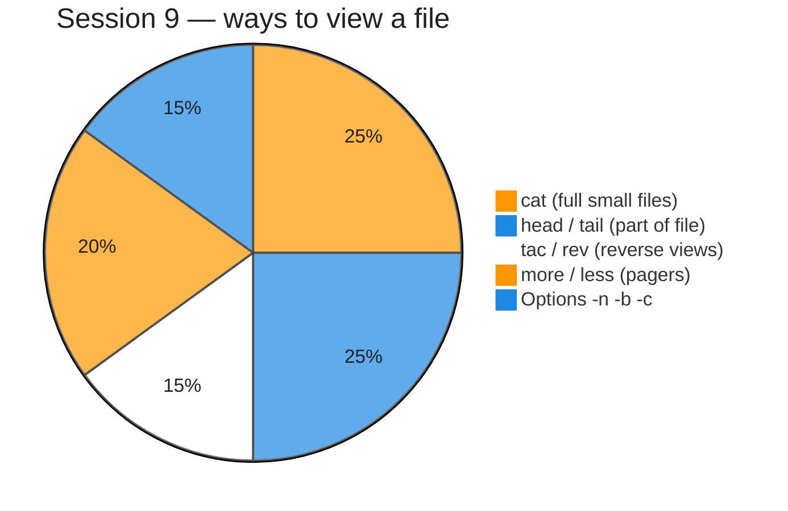

---

## 2. Command map (remember these)

| Command    | Durga Sir idea            | Plain English                                      |
| :--------- | :------------------------ | :------------------------------------------------- |
| **`cat`**  | First command to remember | **Print** whole file (concatenate if many files)   |
| **`tac`**  | **cat** spelled backward  | Print lines in **reverse order** (last line first) |
| **`rev`**  | Reverse characters        | Each line **backwards** (`chini` → `inihc`)        |
| **`head`** | Top of file               | First **10 lines** by default (configurable)       |
| **`tail`** | Bottom of file            | Last **10 lines** by default (opposite of `head`)  |
| **`more`** | Page forward              | View **big** file screen by screen (older pager)   |
| **`less`** | More power than `more`    | Page **forward and backward**                      |

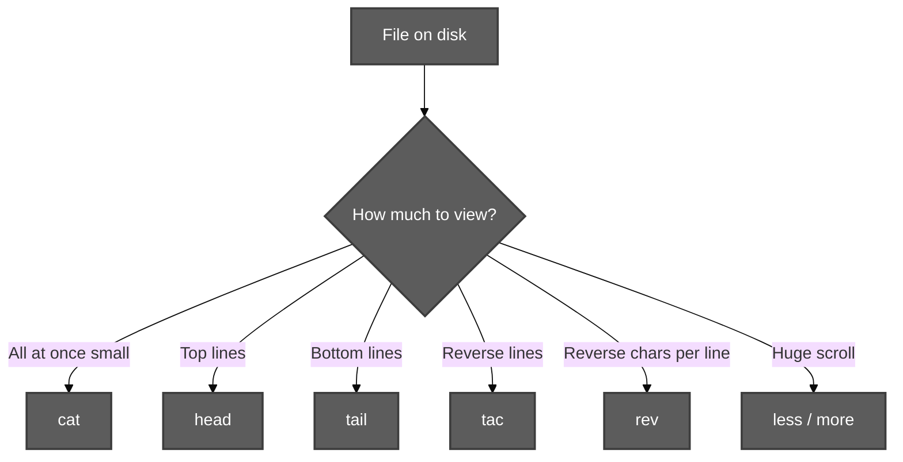

---

## 3. cat — print file on screen

**Syntax (Durga Sir):**

```bash
cat file1.txt
cat < file1.txt    # optional < ; redirection chapter later
```

| Point            | Detail                                                     |
| :--------------- | :--------------------------------------------------------- |
| **Purpose**      | Show **entire** file content on the terminal               |
| **`<` optional** | `cat < file` reads from file; `cat file` is the usual form |
| **Empty lines**  | `cat` shows **blank lines** too                            |

**Demo:** [`cat-view-file-demo.sh`](../../scripts/view-content-of-files/cat-view-file-demo.sh)

---

## 4. cat -n and cat -b

When you need **line numbers** (Durga demo: fruits + `java`, `python`, blank lines in `abc.txt`):

| Option            | Meaning                                                           |
| :---------------- | :---------------------------------------------------------------- |
| **`cat -n file`** | Number **every** line (blank lines get a number)                  |
| **`cat -b file`** | Number **non-empty** lines only (skip numbering pure blank lines) |

```bash
cat -n abc.txt
cat -b abc.txt
```

**Count lines without printing content?** Durga Sir: use **`wc`** (word count) — detailed in a later session; not the same job as `cat`.

**Demo:** [`cat-n-and-b-line-numbers-demo.sh`](../../scripts/view-content-of-files/cat-n-and-b-line-numbers-demo.sh)

---

## 5. cat multiple files

```bash
cat file1.txt file2.txt
```

**Concatenation:** output of **file1** then **file2** on the same stream (print together).  
Not the same as **copying** files — see [§12](#12-cat-vs-cp-durga-sir).

**Demo:** [`cat-multiple-files-concat-demo.sh`](../../scripts/view-content-of-files/cat-multiple-files-concat-demo.sh)

---

## 6. tac — reverse line order

**By default, `tac` does not edit the file** — it only prints reversed line order to the terminal. See [§7A](#7a-display-only-viewing--cat--rev--tac-do-not-change-the-file).

**Vertical reverse** of `cat` (line order only):

| Normal `cat` (top → bottom) | `tac` (bottom → top) |
| :-------------------------- | :------------------- |
| sunny                       | pini                 |
| bunny                       | vinnie               |
| chini                       | chini                |
| vinnie                      | bunny                |
| pini                        | sunny                |

```bash
tac abc.txt
```

Less common in daily work, but **exam/class** topic.

**Demo:** [`tac-reverse-lines-demo.sh`](../../scripts/view-content-of-files/tac-reverse-lines-demo.sh)

---

## 7. rev — reverse each line

**By default, `rev` does not edit the file** — it only prints reversed characters to the terminal. See [§7A](#7a-display-only-viewing--cat--rev--tac-do-not-change-the-file).

**Horizontal reverse** — characters on **each line**:

```bash
# line: chini
rev abc.txt
# shows: inihc
```

| Reverse type                        | Command |
| :---------------------------------- | :------ |
| **Line order** (vertical)           | `tac`   |
| **Characters in line** (horizontal) | `rev`   |

**Demo:** [`rev-reverse-line-chars-demo.sh`](../../scripts/view-content-of-files/rev-reverse-line-chars-demo.sh)

---

## 7A. Display-only viewing — `cat` / `rev` / `tac` do **not** change the file

This section answers a common lab doubt (e.g. `rev testThree.sh` then `cat testThree.sh`):

> “After `rev`, why does `cat` show the **old order**? Does `rev` or `tac` change the file?”

**Answer:** **`rev`, `tac`, and `cat` (by themselves) only read the file and print to the terminal.** They do **not** rewrite the file on disk. The **original content stays** until you use a **write** operation (`>`, `>>`, editor, etc.).

### Two places to think about

| Place                             | What happens                                                                              |
| :-------------------------------- | :---------------------------------------------------------------------------------------- |
| **File on disk** (`testThree.sh`) | Stored bytes — **unchanged** after `rev` / `tac` / `cat`                                  |
| **Terminal (screen)**             | What you **see** for that command — can be normal, reversed lines, or reversed characters |

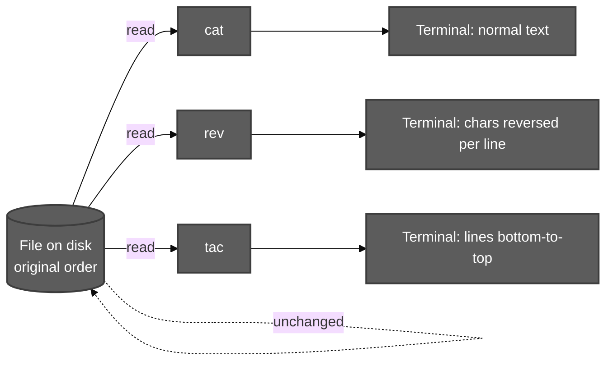

### Your `testThree.sh` example (step by step)

**File on disk (simplified):**

```bash
#! /bin/bash
IFS="_"
echo "All arguments with * : $*"
echo "All arguments with @ one by one  : $@"
```

**Command 1 — `rev testThree.sh`**

- Linux **opens** `testThree.sh` for reading only.
- For **each line**, `rev` prints characters **backwards** to **stdout** (your screen).
- Example: `#! /bin/bash` may look like `hsab/nib/ !#` on the terminal.
- **The file is not saved in reversed form.**

**Command 2 — `cat testThree.sh`**

- `cat` reads the **same file on disk** (still normal order).
- You see `#! /bin/bash`, `IFS="_"`, `echo ...` as originally stored.

So: **`rev` showed a mirror; `cat` showed the real notebook.**

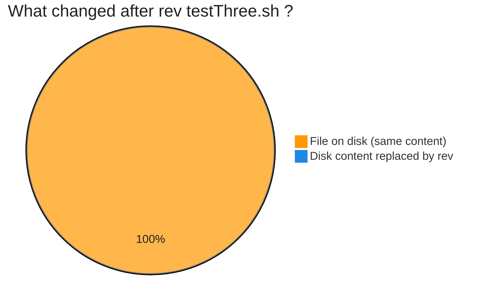

### `rev` vs `tac` — both read-only; different “mirror”

| Command                               | What you see on screen                                | File on disk after command  |
| :------------------------------------ | :---------------------------------------------------- | :-------------------------- |
| **`cat file`**                        | Lines in **normal** order                             | **Unchanged**               |
| **`tac file`**                        | **Line order** reversed (last line printed first)     | **Unchanged**               |
| **`rev file`**                        | Each **line’s characters** reversed (`echo` → `ohce`) | **Unchanged**               |
| **`head` / `tail` / `more` / `less`** | Part or paged view                                    | **Unchanged** (no redirect) |

```mermaid
%%{init: {'theme': 'base', 'themeVariables': {'pie1': '#FF9800', 'pie2': '#1E88E5', 'pie3': '#FFFFFF', 'pie4': '#FF9800', 'pie5': '#1E88E5', 'pieTitleTextColor': '#212121', 'pieSectionTextColor': '#212121', 'pieStrokeColor': '#424242'}}}%%
flowchart TB
    subgraph vertical [Vertical reverse — line order]
        TAC[tac] --> V[Last line becomes first on screen]
    end
    subgraph horizontal [Horizontal reverse — characters]
        REV[rev] --> H[Each line spelled backwards on screen]
    end
    F[Same file on disk] --> TAC
    F --> REV
    F --> CAT[cat shows stored order]

    classDef darkGrey fill:#5c5c5c,stroke:#3d3d3d,color:#ffffff,stroke-width:2px
    class F,TAC,REV,CAT,V,H vertical horizontal
```

### When **does** the file content change?

View commands become **writers** only if you **redirect output into a file** (or use an editor):

| Action                         |               Changes file?                |
| :----------------------------- | :----------------------------------------: |
| `rev myfile`                   |             No — display only              |
| `tac myfile`                   |             No — display only              |
| `cat myfile`                   |             No — display only              |
| `echo line > myfile`           |            **Yes** — overwrites            |
| `echo line >> myfile`          |             **Yes** — appends              |
| `rev myfile > myfile`          | **Yes** — **dangerous** (can corrupt file) |
| `gedit myfile` / `nano myfile` |          **Yes** — when you save           |

Full rules: [EOF and Redirection.md](EOF%20and%20Redirection.md) (`>` truncates, `>>` appends).

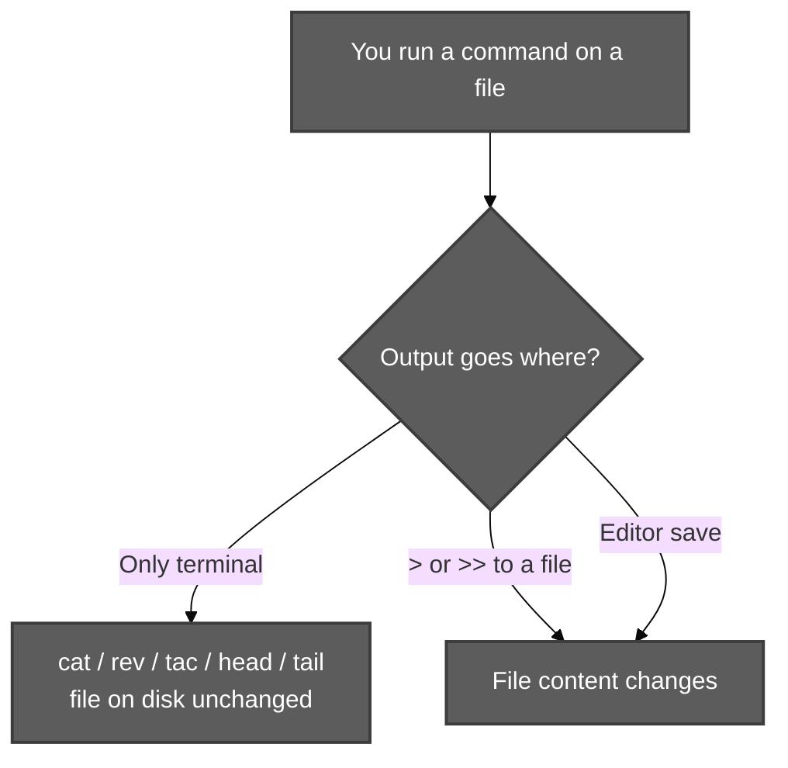

### Why `rev` on a `.sh` file looks scary (but is harmless to the file)

Shell scripts must start with readable `#!/bin/bash` on disk to run. **`rev` on screen** shows gibberish-like lines — that is **only the display**, not the saved script. Running the script still uses the **on-disk** file:

```bash
bash testThree.sh          # uses real file (normal shebang)
rev testThree.sh           # never run this output as a script
```

### If `cat` shows the **same block repeated** many times

That is **not** caused by `rev` or `tac`. It means the file on disk **already contains** those lines repeated (often from **`>>` append**, copy-paste, or merging files). `rev` only prints what is stored — if the block appears three times in the file, reversed output can also look repeated when you run `rev` multiple times.

**Fix:** open the file in an editor and delete duplicates, or recreate with a single heredoc:

```bash
cat > testThree.sh <<'EOF'
#!/bin/bash
IFS="_"
echo "All arguments with * : $*"
echo "All arguments with @ one by one  : $@"
EOF
```

### Memory table (exam + lab)

| Question                                        | Short answer                                                        |
| :---------------------------------------------- | :------------------------------------------------------------------ |
| Does `rev` change the original file?            | **No** (unless you redirect into the file)                          |
| Does `tac` change the original file?            | **No** (unless you redirect)                                        |
| Why does `cat` show normal order after `rev`?   | **`cat` reads the unchanged file**                                  |
| What is the difference between `rev` and `tac`? | **`rev`** = chars per line; **`tac`** = line order                  |
| How do I **save** reversed text?                | `rev file > newfile` (use a **new** name; avoid `> file` same name) |

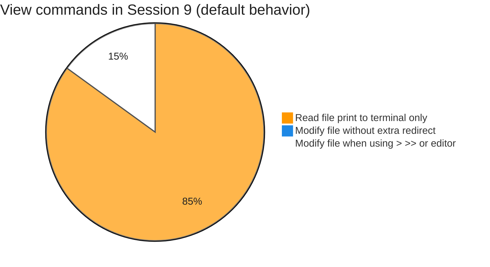

**Demo:** [`rev-tac-display-only-demo.sh`](../../scripts/view-content-of-files/rev-tac-display-only-demo.sh)

```bash
bash scripts/view-content-of-files/rev-tac-display-only-demo.sh
```

---

## 8. head — top of file

**Default:** first **10 lines**.

```bash
head abc.txt           # 10 lines
head -15 abc.txt       # first 15 lines
head -n 5 abc.txt      # first 5 lines
```

### Important: `head -n -5` (negative n)

| Command          | Meaning                                           |
| :--------------- | :------------------------------------------------ |
| **`head -n 5`**  | Only **first 5** lines                            |
| **`head -n -5`** | **All lines except the last 5** (do not confuse!) |

**Formula (negative `n` on `head`):** if the file has **L** lines, `head -n -K` prints the **first (L − K)** lines — everything **except the last K** lines.

```bash
seq 1 20 > abc.txt
head -n 5 abc.txt      # 1 2 3 4 5
head -n -5 abc.txt     # 1 … 15 (drops last five: 16–20)
```

**Durga Sir stresses this — easy to mix up in exams.** Full Session 15 recap: [Part 3 §P3.7](#p37-head--all-forms-durga-formulas).

**Lab (bytes from top):** see [§8 `head -c`](#8-head--top-of-file) and 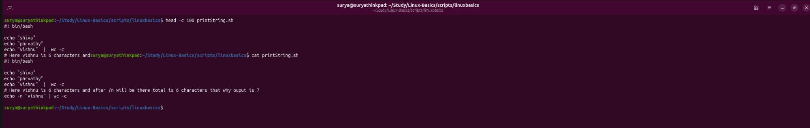.

### Characters from top — `head -c` (Durga Sir)

By default, **`head`** counts **lines**. With **`-c`**, you count **characters** (bytes) from the **start** of the file instead.

**Command (class example):**

```bash
head -c 100 abc.txt
```

**Durga Sir (as in class notes):**

> It will display the first **100 characters** of the file.  
> In Linux every character will take **one byte**. Hence it will display first **100 bytes** of file content.

| Idea                      | Meaning                                                   |
| :------------------------ | :-------------------------------------------------------- |
| **`head abc.txt`**        | First **10 lines** (default)                              |
| **`head -n 5 abc.txt`**   | First **5 lines**                                         |
| **`head -c 100 abc.txt`** | First **100 characters** (= **100 bytes** in normal text) |

**Lab (same `-c` idea on a real script):** from `scripts/linux-basics-practice/`, Durga Sir’s class often uses a file like **`printString.sh`**:

```bash
cd ~/Study/Linux-Basics/scripts/linux-basics-practice
head -c 100 printString.sh
```

Output stops after **100 bytes** — so you may see only **part** of a line (e.g. cut off mid-comment). Use **`cat printString.sh`** to see the full file.


**Demo:** [`head-top-lines-demo.sh`](../../scripts/view-content-of-files/head-top-lines-demo.sh)


---

## 9. tail — bottom of file

**Opposite of `head`:** view from the **end** of the file (bottom), not the top.

Durga Sir: **`head` and `tail` are opposites** — `head` from the **start**, `tail` from the **end**.

| Command                                         | Meaning                                              |
| :---------------------------------------------- | :--------------------------------------------------- |
| **`tail abc.txt`**                              | Last **10 lines** (default)                          |
| **`tail -n 5 abc.txt`** / **`tail -5 abc.txt`** | Last **5 lines**                                     |
| **`tail -c 100 abc.txt`**                       | Last **100 characters** from the **end** of the file |

### Default — last 10 lines

```bash
tail abc.txt
tail testThree.sh
```

Same idea as `head`: if you omit **`-n`**, Linux shows the **last 10 lines**.

**Lab (`scripts/linux-basics-practice/`):** after you know what is in the file (`cat`), use **`tail`** to see only the **bottom** of the file:

```bash
cd ~/Study/Linux-Basics/scripts/linux-basics-practice
cat testThree.sh      # full file on screen
tail testThree.sh     # last 10 lines only
```

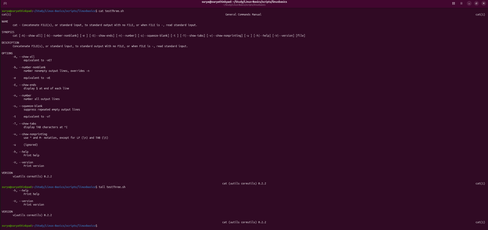

### Last N lines — `tail -n` / `tail -5`

```bash
tail -n 5 abc.txt
tail -5 abc.txt       # same idea: last 5 lines
```

**Lab:**

```bash
tail -5 testThree.sh
cat testThree.sh      # compare: tail shows only the end (VERSION, help, footer)
```

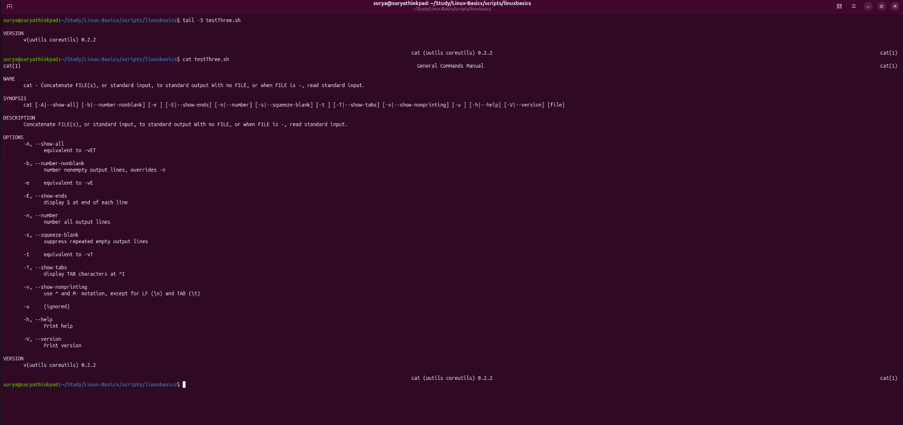

### Last N characters — `tail -c` (Durga Sir)

With **`-c`**, you count **characters** (bytes) from the **end** of the file instead of lines.

**Command (class example):**

```bash
tail -c 100 abc.txt
```

**Durga Sir (same idea as `head -c`, but from the bottom):**

> It will display the last **100 characters** of the file.  
> In Linux every character will take **one byte**. Hence it will display last **100 bytes** of file content.

| Idea                   | Meaning                                |
| :--------------------- | :------------------------------------- |
| **`head -c 100 file`** | First **100 bytes** from the **top**   |
| **`tail -c 100 file`** | Last **100 bytes** from the **bottom** |

**Lab (`printString.sh`):**

```bash
cd ~/Study/Linux-Basics/scripts/linux-basics-practice
tail -c 100 printString.sh
cat printString.sh
```

You often see **only the end** of a comment line plus the last `echo` line — because counting stops after **100 bytes**, not at a line boundary.

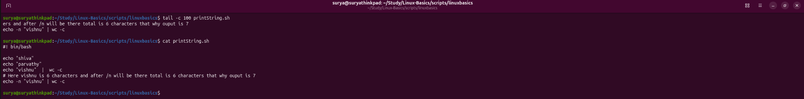

### `head` and `tail` together (pipe) — line selection

Use **`|`** to chain **`head`** then **`tail`**: first cut from the **top**, then keep a part of that result.

```bash
head -5 printString.sh | tail -5
```

| Step               | Meaning                                             |
| :----------------- | :-------------------------------------------------- |
| **`head -5 file`** | First **5 lines** of the file                       |
| **`\| tail -5`**   | From that output, the **last 5 lines** of the chunk |

On a short file, `head -5 | tail -5` often shows the **same first 5 lines**. On a **long** file, increase `head` then use `tail` to grab a **middle window** (example: `head -20 file | tail -5` ≈ lines **16–20**).

```bash
cd ~/Study/Linux-Basics/scripts/linux-basics-practice
head -5 printString.sh | tail -5
cat printString.sh
```

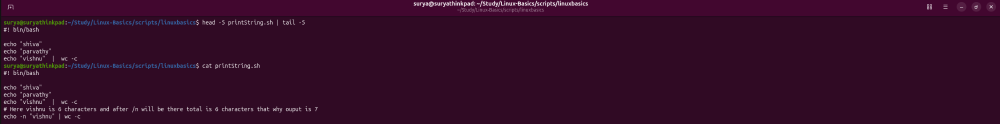

**Note:** GNU `tail` options like `tail -n +5` (start printing from line 5 onward) are advanced; class focuses on **last N lines** and **last N bytes**.

**Demo:** [`tail-bottom-lines-demo.sh`](../../scripts/view-content-of-files/tail-bottom-lines-demo.sh)

---

## 10. more and less — pagers (Durga Sir)

**Why pagers exist:** **`cat`** on a **large** file dumps **everything at once**. The screen **fills** and you only catch the **end**. Durga Sir: for **big** files use a **pager** — show **one screen (page) at a time**.

**Durga Sir wording (memory aid):** *“**less** is **more**”* — **`less`** is the **modern** pager with **more** features than **`more`**.

### When to use which (summary)

| Situation                                       | Durga Sir choice                               |
| :---------------------------------------------- | :--------------------------------------------- |
| Small file (few lines)                          | **`cat`**                                      |
| Large file, only need start/end sample          | **`head`** / **`tail`**                        |
| Large file, **read interactively** page by page | **`less`** (preferred) or **`more`**           |
| Huge command output                             | **`command \| less`** or **`command \| more`** |
| **`man`** pages                                 | Opens **`less`** by default (pager)            |

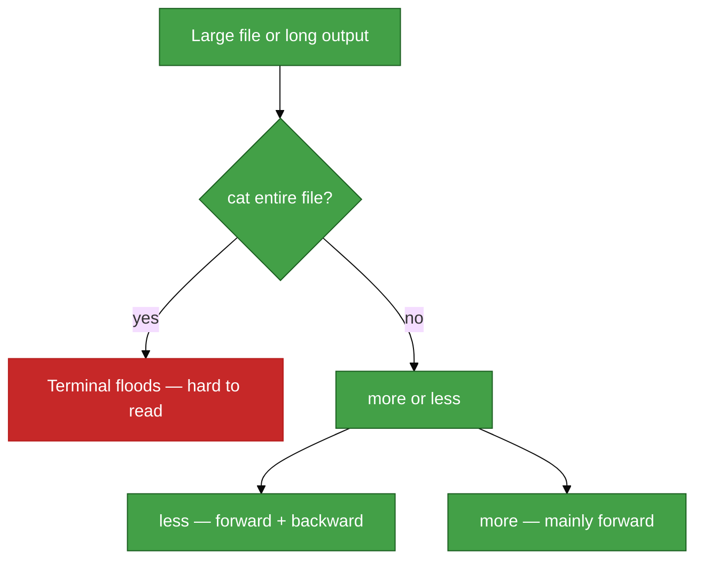

### `more` — syntax (class)

```bash
more filename
more file1 file2 file3          # multiple files; :n next file in some setups
more -5 filename                 # show 5 lines per “page” (GNU more)
more +10 filename                # start display at line 10
more +/pattern filename          # start at first match of pattern
ls -l /etc | more                # pipe long listing through pager
```

| Keys (typical in `more`) | Action                                                              |
| :----------------------- | :------------------------------------------------------------------ |
| **Space**                | Next **page** (screen)                                              |
| **Enter**                | Next **line**                                                       |
| **b**                    | Back one **page** (often **files only**, not always with **pipes**) |
| **q**                    | **Quit** — return to shell prompt                                   |
| **h**                    | Help (if available)                                                 |

**What you see on screen (Durga demo on a big file):**

1. First screen of file content.  
2. Bottom line: **`--More--(46%)`** (or similar) — **not** end of file; **46%** read so far.  
3. **Space** → next page; percentage **increases**.  
4. **`q`** → prompt returns.

**Class file examples (Durga Sir habit):**

```bash
more /etc/passwd
more /etc/services
more outputData.txt              # after redirection labs
cat verylarge.txt                # contrast: everything scrolls — avoid
```

**Pipe example (class):**

```bash
ls -l /usr/bin | more
```

**Limitation (exam):** with **piped** input, **`more`** often cannot scroll **backward** the way **`less`** can.

**My observation:**

> **Pending:** `../assets/viewSession15-more-passwd-class.png`  
> **Pending:** `../assets/viewSession15-more-passwd-my.png`

**Demo (non-interactive hint):** [`more-less-pager-hint-demo.sh`](../../scripts/view-content-of-files/more-less-pager-hint-demo.sh)

---

### `less` — syntax (class)

```bash
less filename
less -N filename                 # show line numbers (GNU less)
less -F filename                 # quit if entire file fits one screen
ls -l /etc | less                # pipe — can scroll back in less
man cat                          # man uses less (or $PAGER)
```

| Keys (Durga Sir teaches — remember for lab) | Action                        |
| :------------------------------------------ | :---------------------------- |
| **Space** / **Page Down** / **f**           | Forward **one page**          |
| **Enter** / **j**                           | Forward **one line**          |
| **b** / **Page Up**                         | Backward **one page**         |
| **k**                                       | Backward **one line**         |
| **g**                                       | Jump to **beginning** of file |
| **G**                                       | Jump to **end** of file       |
| **/** *text* **Enter**                      | **Search forward** for *text* |
| **n**                                       | **Next** search match         |
| **N**                                       | Previous search match         |
| **q**                                       | **Quit**                      |

**Durga Sir points:**

- **`less`** starts quickly on **huge** files — it does **not** load the whole file into memory first.  
- **`less`** can move **backward** through the file (unlike **`more`** in many pipe situations).  
- If content fits **one screen**, **`less`** may still wait at a **colon prompt** — press **`q`** to leave (or use **`-F`** for “quit if one screen”).  
- **`man command`** — when you read manuals, you are already inside **`less`**.

**Class comparison line by line:**

```bash
# Same file — try both on your VM
more /etc/passwd    # forward paging; --More-- at bottom
less /etc/passwd    # forward + backward; filename shown at bottom prompt
```

**My observation:**

> **Pending:** `../assets/viewSession15-less-passwd-class.png`  
> **Pending:** `../assets/viewSession15-less-passwd-my.png`  
> **Pending:** `../assets/viewSession15-man-cat-pager-my.png` (`man cat` then **`q`**)

---

### `more` vs `less` — Durga Sir table

| Feature               | **`more`**                         | **`less`**                             |
| :-------------------- | :--------------------------------- | :------------------------------------- |
| Age                   | Older pager                        | Newer; **replaces** `more` in practice |
| Forward paging        | Yes                                | Yes                                    |
| Backward paging       | Limited; **often no** on **pipes** | Yes (files **and** pipes)              |
| Start at line **N**   | **`more +N file`**                 | **`less +N file`** (GNU)               |
| Search in file        | **`more +/word file`**             | **`/word`** inside less                |
| **`man`**             | —                                  | Default pager on Ubuntu                |
| Changes file on disk? | **No**                             | **No**                                 |


### Scripts and automation (class warning)

**Pagers need a human at the keyboard** (TTY). In a **script** or **Cursor CI**, `less file` may appear to **hang**. Use **`head`**, **`tail`**, or redirect to a file instead:

```bash
head -20 /etc/passwd          # script-safe sample
less /etc/passwd              # interactive lab only
```

**Full Session 15 lab write-up:** [Part 3 §P3.10–P3.12](#p310-more--forward-pager-durga-sir).

**Demo:** [`more-less-pager-hint-demo.sh`](../../scripts/view-content-of-files/more-less-pager-hint-demo.sh)

---

## 11. Small file vs large file

Durga Sir rule:

| File size      | Best command                                                                               |
| :------------- | :----------------------------------------------------------------------------------------- |
| **Small**      | **`cat`** — dump all content once                                                          |
| **Very large** | **`head`**, **`tail`**, **`more`**, **`less`** — do **not** flood terminal with full `cat` |

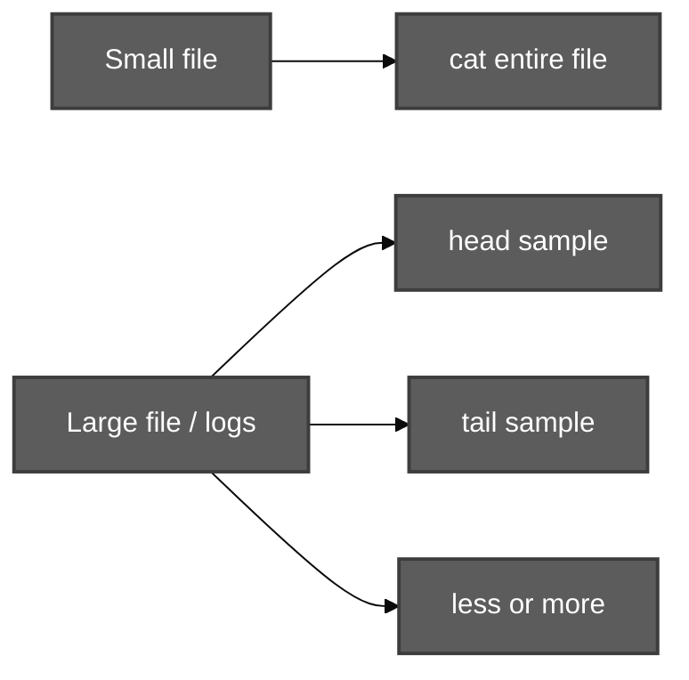

**Demo:** [`small-vs-large-file-view-demo.sh`](../../scripts/view-content-of-files/small-vs-large-file-view-demo.sh)

---

## 12. cat vs cp (Durga Sir)

| Task                                | `cat` |         `cp`         |
| :---------------------------------- | :---: | :------------------: |
| Print contents on screen            |  Yes  |          No          |
| Create new file with new data alone |  No   | No (copies existing) |
| Copy files into a folder            |  No   |         Yes          |

Commands may **look similar** in conversation but each has its **own purpose**.

---

## 13. Preview: wc and redirection

- **`man cat`** — full manual; Durga Sir shows saving man output to a file (redirection `>`).
- **`wc -l file`** — count lines **without** printing file body (when you only need the number).

**Full Session 10 notes:** [wordCountCommand.md](wordCountCommand.md) (`wc`, `-l`, `-w`, `-c`, pipes).

**Full Session 11 notes:** [redirection.md](redirection.md) (streams 0/1/2, `>`, `2>`, `<`, `&>`).

**Redirection and EOF (`>`, `>>`, `<<EOF`):** [EOF and Redirection.md](EOF%20and%20Redirection.md)

---

## 14. Session checklist

You should be able to:

1. Display a file with **`cat`** (with and without `<`).  
2. Use **`cat -n`** vs **`cat -b`** on files with blank lines.  
3. Explain **`tac`** vs **`rev`**.  
4. State that **`cat` / `rev` / `tac` do not change the file** unless you use **`>`**, **`>>`**, or an editor.  
5. Use **`head`** / **`tail`** defaults and **`-n`**.  
6. Explain **`head -n -5`** vs **`head -n 5`**.  
7. Choose **`cat`** vs **`head`/`tail`/`less`** for small vs large files.  
8. Name **`more`** and **`less`**, **`--More--`**, keys **Space / Enter / b / q**, and why **`less`** beats **`more`** on pipes.  
9. Open **`man`** and quit with **`q`** (pager = **`less`**).

---

## 15. Script index

| Script                                                                                                       | Topic                                |
| :----------------------------------------------------------------------------------------------------------- | :----------------------------------- |
| [`cat-view-file-demo.sh`](../../scripts/view-content-of-files/cat-view-file-demo.sh)                         | `cat`, optional `<`                  |
| [`cat-n-and-b-line-numbers-demo.sh`](../../scripts/view-content-of-files/cat-n-and-b-line-numbers-demo.sh)   | `-n`, `-b`, blank lines              |
| [`cat-multiple-files-concat-demo.sh`](../../scripts/view-content-of-files/cat-multiple-files-concat-demo.sh) | `cat f1 f2`                          |
| [`tac-reverse-lines-demo.sh`](../../scripts/view-content-of-files/tac-reverse-lines-demo.sh)                 | `tac`                                |
| [`rev-reverse-line-chars-demo.sh`](../../scripts/view-content-of-files/rev-reverse-line-chars-demo.sh)       | `rev`                                |
| [`rev-tac-display-only-demo.sh`](../../scripts/view-content-of-files/rev-tac-display-only-demo.sh)           | `rev`/`tac` vs `cat`; file unchanged |
| [`head-top-lines-demo.sh`](../../scripts/view-content-of-files/head-top-lines-demo.sh)                       | `head`, `-n`, negative `-n`          |
| [`tail-bottom-lines-demo.sh`](../../scripts/view-content-of-files/tail-bottom-lines-demo.sh)                 | `tail`                               |
| [`small-vs-large-file-view-demo.sh`](../../scripts/view-content-of-files/small-vs-large-file-view-demo.sh)   | cat vs head/tail                     |
| [`more-less-pager-hint-demo.sh`](../../scripts/view-content-of-files/more-less-pager-hint-demo.sh)           | `more` / `less` hints                |

---

## Part 3 — Durga Soft Session 15 (screencast continuation)

**Syllabus block:** *2. Viewing of Files* (after [Creation of Files](workingWithFiles.md#1-creation-of-files--session-14) in [workingWithFiles.md](workingWithFiles.md)).

**Policy:** [screencastWorkflow.md](screencastWorkflow.md) — class PNG + **My observation** PNG per subsection; do **not** push `.webm` to git.

Each **P3.\*** block below matches Durga Sir’s **Session 15** order. Fill **Pending** images from your newest file in `/home/surya/Videos/Screencasts/`.

```bash
VIDEO="/home/surya/Videos/Screencasts/<Session-15>.webm"
bash scripts/file-system-navigation-and-hierarchy/extract-screencast-frames.sh \
  "$VIDEO" /tmp/view-session15-frames
```

---

### P3.1 Master command map & formulas (Durga Sir)

**One-line job:** *Display* what is stored in a normal file — **without** changing the file (unless you redirect or edit).

| Command      | Direction / idea                          | Default if no option                        |
| :----------- | :---------------------------------------- | :------------------------------------------ |
| **`cat`**    | Full file (small files)                   | All lines to stdout                         |
| **`cat -n`** | Line numbers on every line                | —                                           |
| **`cat -b`** | Line numbers on non-blank lines only      | —                                           |
| **`tac`**    | **Line order** reversed (last line first) | —                                           |
| **`rev`**    | **Characters** reversed on each line      | —                                           |
| **`head`**   | From **top** of file                      | **First 10 lines**                          |
| **`tail`**   | From **bottom** of file                   | **Last 10 lines**                           |
| **`more`**   | Pager — mainly **forward**                | One **screen** at a time                    |
| **`less`**   | Pager — forward **and** back              | One **screen** at a time; used by **`man`** |

**Byte vs line (Durga Sir):**

| Option family          | Counts                           | Applies to    |
| :--------------------- | :------------------------------- | :------------ |
| **`-n N`** (head/tail) | **Lines**                        | Top or bottom |
| **`-c N`** (head/tail) | **Bytes** (chars in plain ASCII) | Top or bottom |

**Relationship:**

```text
cat  ←→  tac     (forward vs reverse LINE order)
         rev     (reverse CHARACTERS per line — different from tac)
head ←→  tail     (top vs bottom of file)
```

**Durga Sir class lab screenshot:**

> **Pending:** `../assets/viewSession15-editplus-overview-class.png`

**My observation:**

> **Pending:** `../assets/viewSession15-overview-my.png`

---

### P3.2 `cat` — Session 15 lab

**Syntax:**

```bash
cat file                    # usual form
cat < file                  # optional; same idea (stdin from file)
cat file1 file2 file3       # concatenate onto stdout
```

| Rule              | Detail                                                                            |
| :---------------- | :-------------------------------------------------------------------------------- |
| **Purpose**       | Send file content to **stdout** (screen)                                          |
| **Empty lines**   | Shown as blank lines                                                              |
| **Does not copy** | Printing ≠ `cp` — see [§12](#12-cat-vs-cp-durga-sir) and [P3.12](#p312-cat-vs-cp) |

```bash
cat notes.txt
```

**What the class terminal should show (line by line):**

1. `cat notes.txt` — entire small file scrolls; prompt returns at end.  
2. No change on disk.

**Durga Sir class lab screenshot:**

> **Pending:** `../assets/viewSession15-cat-basic-class.png`

**My observation:** Use `~/Study/Linux-Basics/scripts/linux-basics-practice/printString.sh` or your `viewLab.txt`.

> **Pending:** `../assets/viewSession15-cat-basic-my.png`

**Demo:** [`cat-view-file-demo.sh`](../../scripts/view-content-of-files/cat-view-file-demo.sh)

---

### P3.3 `cat -n` / `cat -b`

| Option            | Formula / rule                                                 |
| :---------------- | :------------------------------------------------------------- |
| **`cat -n file`** | Prefix **every** line with line number (including blank lines) |
| **`cat -b file`** | Number **non-empty** lines only; blank lines **not** numbered  |

```bash
cat -n abc.txt
cat -b abc.txt
```

**Class trick:** same file with `java`, `python`, and **blank** lines — compare `-n` vs `-b` side by side.

**Durga Sir class lab screenshot:**

> **Pending:** `../assets/viewSession15-cat-n-b-class.png`

**My observation:**

> **Pending:** `../assets/viewSession15-cat-n-b-my.png`

**Demo:** [`cat-n-and-b-line-numbers-demo.sh`](../../scripts/view-content-of-files/cat-n-and-b-line-numbers-demo.sh)

**Count lines without printing body?** → **`wc -l file`** ([wordCountCommand.md](wordCountCommand.md)) — not `cat`.

---

### P3.4 `cat` — multiple files

```bash
cat part1.txt part2.txt
```

**Formula:** output = **contents(file1)** immediately followed by **contents(file2)** on **one** stdout stream (concatenation).

**Durga Sir class lab screenshot:**

> **Pending:** `../assets/viewSession15-cat-multi-class.png`

**My observation:**

> **Pending:** `../assets/viewSession15-cat-multi-my.png`

**Demo:** [`cat-multiple-files-concat-demo.sh`](../../scripts/view-content-of-files/cat-multiple-files-concat-demo.sh)

---

### P3.5 `tac`

**Vertical reverse** — **line order** only (not characters within a line).

| `cat` order (top → bottom) | `tac` order (top → bottom on screen) |
| :------------------------- | :----------------------------------- |
| line 1                     | last line of file                    |
| line 2                     | …                                    |
| last line                  | first line of file                   |

```bash
tac abc.txt
```

**Durga Sir class lab screenshot:**

> **Pending:** `../assets/viewSession15-tac-class.png`

**My observation:**

> **Pending:** `../assets/viewSession15-tac-my.png`

**Demo:** [`tac-reverse-lines-demo.sh`](../../scripts/view-content-of-files/tac-reverse-lines-demo.sh)

---

### P3.6 `rev`

**Horizontal reverse** — each **line’s characters** left ↔ right.

```bash
# line on disk: chini
rev abc.txt    # on screen: inihc
```

| Mistake in exam                         | Correct                    |
| :-------------------------------------- | :------------------------- |
| `rev` reverses **line order**           | **No** — that is **`tac`** |
| `tac` reverses **spelling on one line** | **No** — that is **`rev`** |

**Durga Sir class lab screenshot:**

> **Pending:** `../assets/viewSession15-rev-class.png`

**My observation:**

> **Pending:** `../assets/viewSession15-rev-my.png`

**Demo:** [`rev-reverse-line-chars-demo.sh`](../../scripts/view-content-of-files/rev-reverse-line-chars-demo.sh)

**Proof file unchanged:** [§7A](#7a-display-only-viewing--cat--rev--tac-do-not-change-the-file) · [`rev-tac-display-only-demo.sh`](../../scripts/view-content-of-files/rev-tac-display-only-demo.sh)

---

### P3.7 `head` — all forms (Durga formulas)

**Opposite of `tail`** — read from **start** of file.

| Command                                   | Meaning                                      |
| :---------------------------------------- | :------------------------------------------- |
| **`head file`**                           | First **10** lines (default)                 |
| **`head -n N file`** / **`head -N file`** | First **N** lines                            |
| **`head -n -K file`**                     | All lines **except the last K** (negative N) |
| **`head -c N file`**                      | First **N** bytes from **top**               |

**Durga Sir (bytes):**

> Every character in normal text ≈ **one byte**. `head -c 100` = first **100 bytes** (may cut **mid-line**).

```bash
cd ~/Study/Linux-Basics/scripts/linux-basics-practice
head -c 100 printString.sh
cat printString.sh
```


**Negative `n` worked example:**

```bash
seq 1 20 > abc.txt
head -n -5 abc.txt   # lines 1–15 only
```

**Durga Sir class lab screenshot:**

> **Pending:** `../assets/viewSession15-head-n-negative-class.png`

**My observation:**

> **Pending:** `../assets/viewSession15-head-n-negative-my.png`

**Demo:** [`head-top-lines-demo.sh`](../../scripts/view-content-of-files/head-top-lines-demo.sh)

---

### P3.8 `tail` — all forms (Durga formulas)

| Command                                   | Meaning                               |
| :---------------------------------------- | :------------------------------------ |
| **`tail file`**                           | Last **10** lines (default)           |
| **`tail -n N file`** / **`tail -N file`** | Last **N** lines                      |
| **`tail -c N file`**                      | Last **N** bytes from **end** of file |

**Durga Sir (bytes):**

> `tail -c 100` = last **100 bytes** (may start **mid-line**).

```bash
tail -c 100 printString.sh
cat printString.sh
```


**Last N lines lab:**

```bash
tail testThree.sh
tail -5 testThree.sh
cat testThree.sh
```

  


**Durga Sir class lab screenshot:**

> **Pending:** `../assets/viewSession15-tail-class.png`

**My observation:**

> **Pending:** `../assets/viewSession15-tail-my.png`

**Demo:** [`tail-bottom-lines-demo.sh`](../../scripts/view-content-of-files/tail-bottom-lines-demo.sh)

**Advanced (GNU, mention in class):** `tail -n +5 file` prints from **line 5 to EOF** — different from `tail -5` (last 5 lines).

---

### P3.9 `head` \| `tail` — extract middle lines (formula)

**Pattern:** take **first B** lines, then keep **last W** lines of that chunk → approximates a **window** near the top.

| Goal                           | Pipeline                   | When file has ≥ B lines                          |
| :----------------------------- | :------------------------- | :----------------------------------------------- |
| First 5 lines only             | `head -5 file`             | Same as `head -5 file \| tail -5` on short files |
| Lines **16–20** of a long file | `head -20 file \| tail -5` | Last 5 of first 20 = lines 16–20                 |

```bash
head -5 printString.sh | tail -5
cat printString.sh
```


**Pipes with `ls` (class habit):**

```bash
ls -l /etc | head -5
```

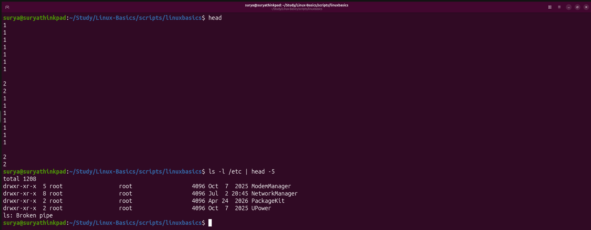

**Durga Sir class lab screenshot:**

> **Pending:** `../assets/viewSession15-head-pipe-tail-class.png`

**My observation:**

> **Pending:** `../assets/viewSession15-head-pipe-tail-my.png`

---

### P3.10 `more` — forward pager (Durga Sir)

**Job:** Display a **large** file **one screen at a time** (older pager).

**Syntax (all class forms):**

```bash
more file
more -5 file              # 5 lines per page (GNU)
more +10 file             # start at line 10
more +/nfs file           # start at first line matching pattern
more f1 f2 f3             # multiple files (class mentions)
ls -l /etc | more         # pipe long output
```

**Durga Sir explanation (what to say in the exam):**

1. **`cat`** on a **big** file → content **runs past**; you miss the top.  
2. **`more file`** → only **one screen** visible; bottom shows **`--More--(xx%)`**.  
3. **`xx%`** = how much of the file you have **already passed**.  
4. **Not** the same as “percentage remaining” in all versions — treat it as **progress indicator**.

| Key       | Durga Sir action                            |
| :-------- | :------------------------------------------ |
| **Space** | Next **page**                               |
| **Enter** | Next **line**                               |
| **b**     | Previous **page** (especially on **files**) |
| **q**     | **Quit** pager                              |

**Class examples (run on VM):**

```bash
more /etc/passwd
more /etc/services
more outputData.txt
ls -l /usr/bin | more
```

**Contrast (Durga shows why not `cat`):**

```bash
cat /etc/services    # entire file — very long scroll
more /etc/services   # controlled paging
```

**What the class terminal should show (line by line):**

1. `more /etc/passwd` — first screen of accounts.  
2. Last line on screen: **`--More--`** or **`--More--(10%)`**.  
3. Press **Space** — next screen; **%** increases.  
4. Press **`q`** — normal `$` prompt returns.

**My observation:**

***Without `more` command **** 
When we try to read the data inside the file without using `more` command then we will get in the below format 

In the below example we are using `man ls > data.txt` 

1. We are sending all the man sheet for the `ls` commands to data.txt file 
2. When we use the `cat data.txt` command we will get like this 
   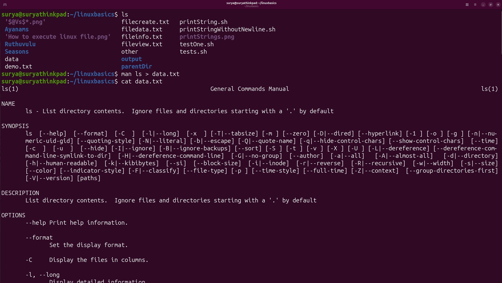
3. which means we don't have any control apart from scroll down and scroll up 
4. By using `more` command we can read the data in the below format 
   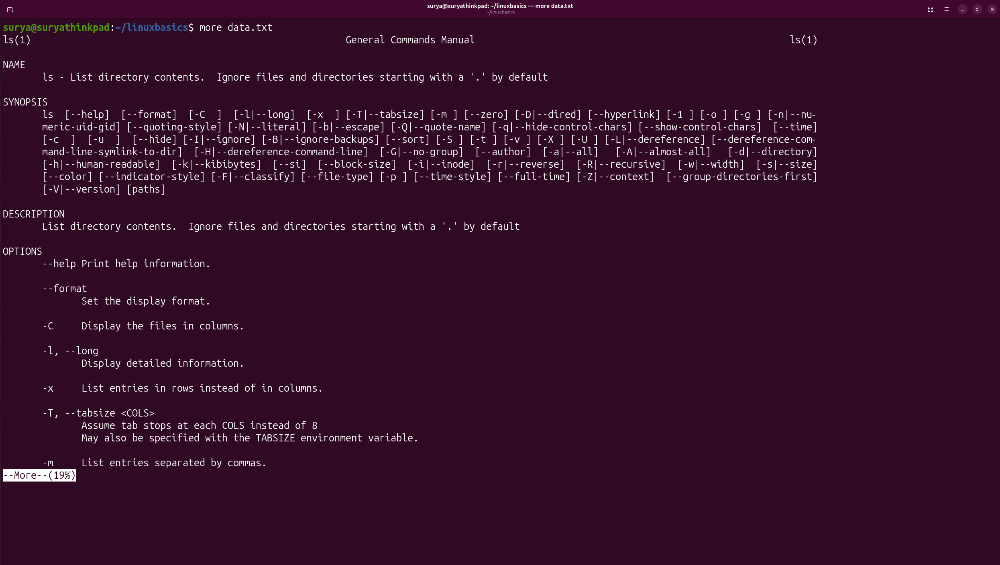
5. By clicking on `Enter` button we can slowly navigate to other pages and we can see how much percentage is completed also i.e`21-22-23...`
   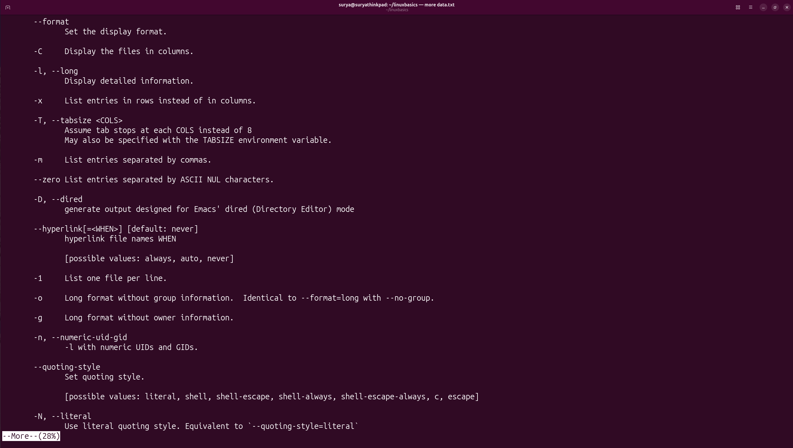
6. By clicking on `Space` button we can directly navigate to other pages and we can see how much percentage is completed also i.e `21-40-60...`
   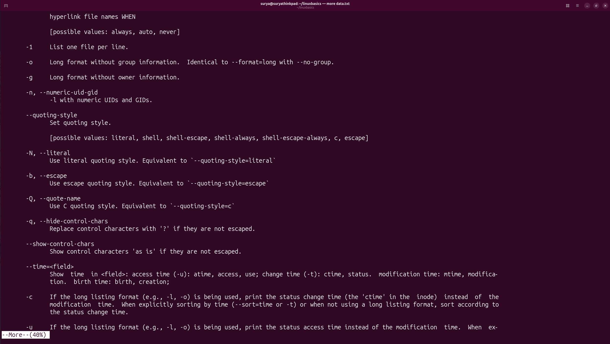
7. By clicking `q` we can quit from more command 
   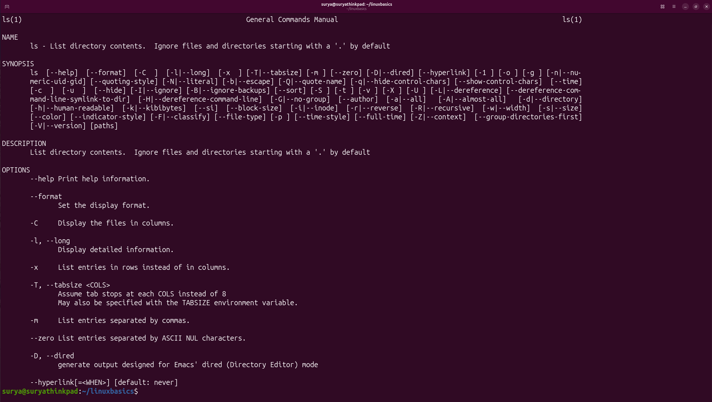
8. If we want to see more detailed info we have provide the below command 
9. `more -d data.txt` .By using this command we can see various options to control while reading the large data.
   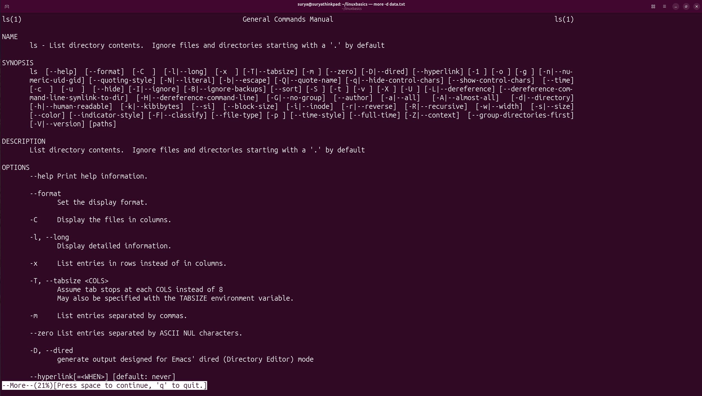

---

### P3.11 `less` — full pager (Durga Sir)

**Job:** Same as **`more`**, but **more powerful** — Durga: *“**less** is **more**”* (more features).

**Syntax:**

By using `more` command we can view file content page only in forward direction but by using `less` command we can view the file content page in both forward and backward 
direction also.

**My observation:**

1. When we try to view the file content by entering this command 
   `less data.txt` and then click on `b` .
2.  we will get the data in the forward direction format 
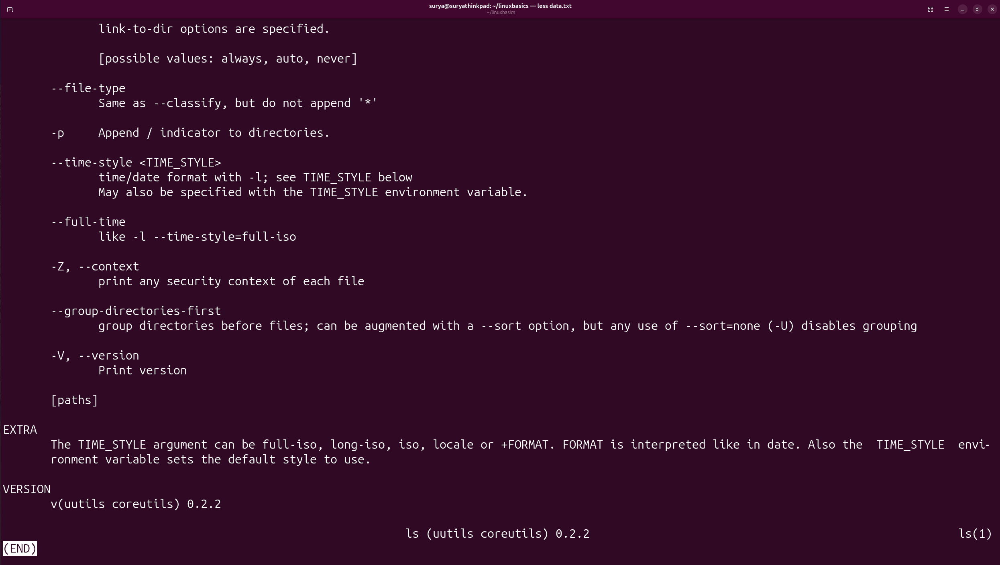
3.  When we click on `d` button we can view the file content in the backward direction
4. we will get the data in the forward direction format 
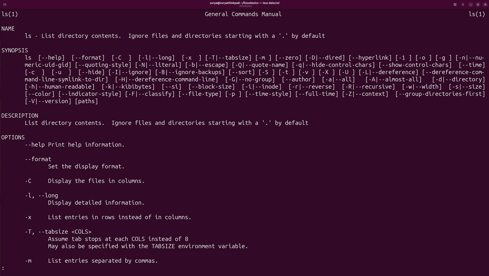


```bash
less file
less -N file              # line numbers on left
less +10 file             # open at line 10 (GNU)
less -F file              # quit if one screen enough
ls -l /etc | less         # pipe; scroll **back** with Page Up / b
man head                  # manual → pager (usually less)
```

**Durga Sir — keys to practice on lab:**

| Key                       | Action                |
| :------------------------ | :-------------------- |
| **Space** / **Page Down** | Forward **page**      |
| **Enter** / **j**         | Forward **line**      |
| **b** / **Page Up**       | Back **page**         |
| **k**                     | Back **line**         |
| **g**                     | Top of file           |
| **G**                     | End of file           |
| **/** *word*              | Search forward        |
| **n** / **N**             | Next / previous match |
| **q**                     | Quit                  |

**Why Durga prefers `less`:**

| Point           | Detail                                               |
| :-------------- | :--------------------------------------------------- |
| **Backward**    | Re-read earlier lines (**`more`** weak on **pipes**) |
| **Large files** | Does not need full file in memory before display     |
| **`man`**       | Student already uses **`less`** daily                |

**Class demo sequence (do in order):**

```bash
less /etc/passwd
# Space few times, then b to go back, then g, then G, then q

man ls
# same keys; q to exit man


---

### P3.12 `more` vs `less` vs `cat` — Durga Sir

| Need                                | Command                 |
| :---------------------------------- | :---------------------- |
| Small file, full dump once          | **`cat file`**          |
| Large file, **interactive** read    | **`less file`** (best)  |
| Large file, **forward-only** paging | **`more file`**         |
| One-shot **sample** in script       | **`head`** / **`tail`** |
| Long **`ls`** listing               | **`ls -l dir \| less`** |

**Memory sentence (class):** *Use **`cat`** for **small**; use **`head`/`tail`** for **ends**; use **`less`** (or **`more`**) when the file is **too big** for one screen.*

**Does pager change the file?** **No** — display only ([P3.13](#p313-read-only-viewing-exam-table)).

**Durga Sir class lab screenshot:**

> **Pending:** `../assets/viewSession15-more-vs-less-class.png`

**My observation:** One screenshot: `wc -l /etc/passwd` then `less /etc/passwd` (first screen).

---

### P3.13 Read-only viewing (exam table)

| Command                                             |              Changes file on disk?              |
| :-------------------------------------------------- | :---------------------------------------------: |
| `cat`, `tac`, `rev`, `head`, `tail`, `more`, `less` |              **No** (display only)              |
| `cat file > other`                                  |           **Yes** — writes **other**            |
| `rev file > file`                                   | **Yes** — **dangerous** (can corrupt same file) |
| `gedit` / `nano` / `vi` save                        |                     **Yes**                     |

**Why `cat` after `rev` shows “normal” text:** `rev` only changed the **screen**; **disk** unchanged ([§7A](#7a-display-only-viewing--cat--rev--tac-do-not-change-the-file)).

**Durga Sir class lab screenshot:**

> **Pending:** `../assets/viewSession15-readonly-class.png`

**My observation:** `rev file; wc -l file; cat file` — one screenshot.

---

### P3.14 Small vs large file — rule

| File size                       | Durga Sir choice                                                          |
| :------------------------------ | :------------------------------------------------------------------------ |
| **Small** (fits one screen)     | **`cat`**                                                                 |
| **Large** (logs, `man`, `/etc`) | **`head`**, **`tail`**, **`less`** / **`more`** — avoid flooding terminal |

**Demo:** [`small-vs-large-file-view-demo.sh`](../../scripts/view-content-of-files/small-vs-large-file-view-demo.sh)

**Durga Sir class lab screenshot:**

> **Pending:** `../assets/viewSession15-small-vs-large-class.png`

**My observation:**

> **Pending:** `../assets/viewSession15-small-vs-large-my.png`

---

### P3.15 `cat` vs `cp`

| Need                                    | Use                            |
| :-------------------------------------- | :----------------------------- |
| **Show** content on terminal            | **`cat`**                      |
| **Duplicate** file to another path/name | **`cp`**                       |
| **Create** empty file                   | **`touch`** (creation session) |

Same spelling in conversation — **different purpose**. See [§12](#12-cat-vs-cp-durga-sir).

---

### P3.16 Class practice questions (Session 15)

*(Add exact wording from your screencast MCQs; starters below match Durga pattern.)*

**Q1.** Command to display **last 5 lines** of `log.txt`?

- **Ans:** `tail -5 log.txt` or `tail -n 5 log.txt`

**Q2.** Command to show **first 100 bytes** of a file?

- **Ans:** `head -c 100 file`

**Q3.** Which command prints **last line first**?

- **Ans:** **`tac`** (not `rev`)

**Q4.** Which command prints **`hello` as `olleh`** on one line?

- **Ans:** **`rev`**

**Q5.** `head -n -3` on a 20-line file prints how many lines?

- **Ans:** **17** (all except last 3)

**Q6.** Does `cat myfile` change `myfile` on disk?

- **Ans:** **No**

**Q7.** Default pager for **`man`** on Ubuntu?

- **Ans:** **`less`** (via `$PAGER` / `man` config)

**Q8.** Which key quits **`more`** and **`less`**?

- **Ans:** **`q`**

**Q9.** Bottom message **`--More--(30%)`** in **`more`** means?

- **Ans:** You are **paging** through a large file; about **30%** of the file has been **displayed** so far (progress), **not** finished.

**Q10.** Command to page through output of **`ls -l /etc`**?

- **Ans:** `ls -l /etc | less` or `ls -l /etc | more` (class accepts both; **`less`** preferred)

**Q11.** Can **`less`** scroll **backward** after **`ls | less`**?

- **Ans:** **Yes** (typical GNU **less** — contrast **`more`** on pipes)

**Durga Sir class lab screenshot:**

> **Pending:** `../assets/viewSession15-mcq-class.png`

**My observation:** Answer Q1–Q4 and Q10 on your VM — one screenshot.

---

### P3.17 Screencast frame map & PNG names

After you watch once, map frames → `docs/assets/` and link here (replace **Pending** above).

| Approx. time | PNG name                                    | Section |
| :----------- | :------------------------------------------ | :------ |
| ~00:00–02:00 | `viewSession15-editplus-overview-class.png` | P3.1    |
| ~05:00       | `viewSession15-cat-basic-class.png`         | P3.2    |
| ~10:00       | `viewSession15-cat-n-b-class.png`           | P3.3    |
| ~15:00       | `viewSession15-tac-class.png`               | P3.5    |
| ~18:00       | `viewSession15-rev-class.png`               | P3.6    |
| ~25:00       | `viewSession15-head-n-negative-class.png`   | P3.7    |
| ~32:00       | `viewSession15-tail-class.png`              | P3.8    |
| ~38:00       | `viewSession15-head-pipe-tail-class.png`    | P3.9    |
| ~40:00       | `viewSession15-more-passwd-class.png`       | P3.10   |
| ~44:00       | `viewSession15-less-passwd-class.png`       | P3.11   |
| ~46:00       | `viewSession15-more-vs-less-class.png`      | P3.12   |
| ~48:00       | `viewSession15-mcq-class.png`               | P3.16   |

```bash
git add docs/topics/viewContentOfFiles.md docs/assets/viewSession15-*.png
git commit -m "Session 15 viewing: class + lab screenshots"
git push origin master
bash scripts/file-system-navigation-and-hierarchy/validate-docs-assets.sh
```

**Session 15 checklist (nothing skipped):**

1. `cat` / `cat -n` / `cat -b` / multiple files  
2. `tac` vs `rev` (vertical vs horizontal)  
3. `head` default, `-n`, **`-n -K`**, `-c`  
4. `tail` default, `-n`, `-c`  
5. `head \| tail` window + pipe with `ls`  
6. **`more`** — `--More--`, Space, Enter, **q**  
7. **`less`** — forward/back, **g**/**G**, **/** search, **q**; **`man`** uses it  
8. **`more` vs `less` vs `cat`** for small/large files  
9. View commands **do not** modify file  
10. Small vs large file rule  
11. `cat` vs `cp`  
12. MCQs (including pagers) on your VM + PNGs pushed  

---

## Part 2 — Execution summary (`scripts/view-content-of-files/`)

Command-by-command walkthrough for every demo script (regenerate with `python3 scripts-execution-summary/tools/build_execution_summaries.py`).

<!-- BEGIN EXECUTION_SUMMARY (generated) -->
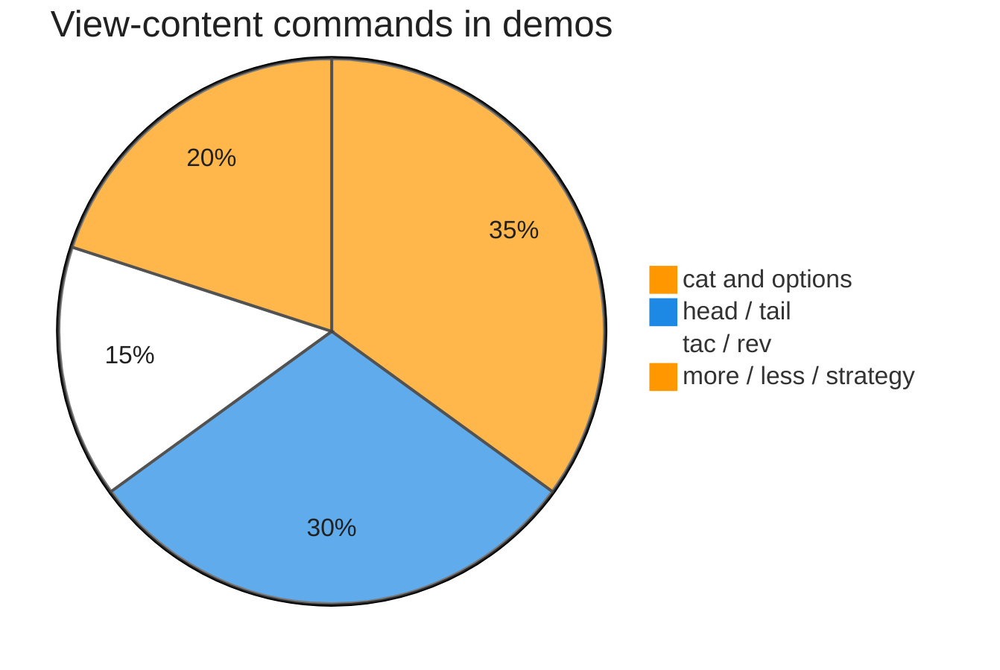

Each script section uses the same **four-part** model:

|   #   | Column in tables       | Meaning                                                                                       |
| :---: | :--------------------- | :-------------------------------------------------------------------------------------------- |
|   1   | **What it is**         | Command or shell feature (e.g. `echo` = print text).                                          |
|   2   | **Added / configured** | How it appears in Linux (PATH, builtin, flag on CLI, variable in script).                     |
|   3   | **Execution intent**   | What you are trying to do when the line runs.                                                 |
|   4   | **Output**             | What you see on the **terminal (stdout/stderr)**, in a **file**, or through a **pipeline** (` | `). |

---

## [`cat-multiple-files-concat-demo.sh`](../../scripts/view-content-of-files/cat-multiple-files-concat-demo.sh)

**Run:** `bash scripts/view-content-of-files/cat-multiple-files-concat-demo.sh`

### In-depth command walkthrough

| Command (as in script)                                                   | 1. What it is                                              | 2. Added / configured                                                  | 3. Execution intent                                                                                  | 4. Output (terminal / file / pipeline)                                                                   |
| :----------------------------------------------------------------------- | :--------------------------------------------------------- | :--------------------------------------------------------------------- | :--------------------------------------------------------------------------------------------------- | :------------------------------------------------------------------------------------------------------- |
| `set -euo pipefail`                                                      | Bash strict-mode option bundle.                            | Written at top of script; not installed separately.                    | Tell Bash to stop on errors, treat unset variables as errors, and fail pipelines if any stage fails. | No visible output; changes how later commands affect exit status.                                        |
| `WORK="${TMPDIR:-/tmp}/linux-view-content-demo"`                         | Shell variable assignment.                                 | Name=`value` in script; often under `${TMPDIR:-/tmp}`.                 | Store path or stamp for later commands (setup, not a user command).                                  | No output; variable used by `cd`, `rm`, file paths.                                                      |
| `rm -rf "$WORK"`                                                         | Remove files/directories recursively, force.               | Coreutils; `-r` recursive, `-f` no prompt.                             | Clean old demo data under `/tmp` before recreating.                                                  | Silent on success.                                                                                       |
| `mkdir -p "$WORK"`                                                       | Make directories.                                          | Coreutils; `-p` creates parents as needed.                             | Try to **create** folder(s) for the demo tree.                                                       | Silent on success; errors on stderr if path invalid.                                                     |
| `cd "$WORK"`                                                             | Change directory — move shell’s current working directory. | Builtin; takes relative or absolute path, `~`, `-`, or no args (home). | Navigate the tree (trying to **enter** a folder); relative paths start from cwd.                     | Normally silent on success; failure prints `cd: ...: No such file or directory` on **stderr**.           |
| `echo "part-A" > file1.txt`                                              | Bash builtin that prints arguments to standard output.     | Always available in Bash; no package install.                          | Show section titles, tips, or messages to the terminal (trying to **print** text for the user).      | Lines appear on **stdout** in your terminal (or in CI logs). Not used in a pipeline unless followed by ` | `. |
| `echo "part-B" > file2.txt`                                              | Bash builtin that prints arguments to standard output.     | Always available in Bash; no package install.                          | Show section titles, tips, or messages to the terminal (trying to **print** text for the user).      | Lines appear on **stdout** in your terminal (or in CI logs). Not used in a pipeline unless followed by ` | `. |
| `echo "=== cat file1.txt file2.txt ==="`                                 | Section header for humans.                                 | Literal string in script                                               | **Print** section title                                                                              | Title line on **stdout** before commands                                                                 |
| `cat file1.txt file2.txt`                                                | Concatenate and print files.                               | Coreutils.                                                             | Try to **display file contents** on terminal.                                                        | File bytes on stdout.                                                                                    |
| `echo ""`                                                                | Bash builtin that prints arguments to standard output.     | Always available in Bash; no package install.                          | Show section titles, tips, or messages to the terminal (trying to **print** text for the user).      | Lines appear on **stdout** in your terminal (or in CI logs). Not used in a pipeline unless followed by ` | `. |
| `echo "Tip: cat concatenates and displays; cp copies files (different …` | Bash builtin that prints arguments to standard output.     | Always available in Bash; no package install.                          | Show section titles, tips, or messages to the terminal (trying to **print** text for the user).      | Lines appear on **stdout** in your terminal (or in CI logs). Not used in a pipeline unless followed by ` | `. |

---

## [`cat-n-and-b-line-numbers-demo.sh`](../../scripts/view-content-of-files/cat-n-and-b-line-numbers-demo.sh)

**Run:** `bash scripts/view-content-of-files/cat-n-and-b-line-numbers-demo.sh`

### In-depth command walkthrough

| Command (as in script)                                               | 1. What it is                                              | 2. Added / configured                                                  | 3. Execution intent                                                                                  | 4. Output (terminal / file / pipeline)                                                                   |
| :------------------------------------------------------------------- | :--------------------------------------------------------- | :--------------------------------------------------------------------- | :--------------------------------------------------------------------------------------------------- | :------------------------------------------------------------------------------------------------------- |
| `set -euo pipefail`                                                  | Bash strict-mode option bundle.                            | Written at top of script; not installed separately.                    | Tell Bash to stop on errors, treat unset variables as errors, and fail pipelines if any stage fails. | No visible output; changes how later commands affect exit status.                                        |
| `WORK="${TMPDIR:-/tmp}/linux-view-content-demo"`                     | Shell variable assignment.                                 | Name=`value` in script; often under `${TMPDIR:-/tmp}`.                 | Store path or stamp for later commands (setup, not a user command).                                  | No output; variable used by `cd`, `rm`, file paths.                                                      |
| `rm -rf "$WORK"`                                                     | Remove files/directories recursively, force.               | Coreutils; `-r` recursive, `-f` no prompt.                             | Clean old demo data under `/tmp` before recreating.                                                  | Silent on success.                                                                                       |
| `mkdir -p "$WORK"`                                                   | Make directories.                                          | Coreutils; `-p` creates parents as needed.                             | Try to **create** folder(s) for the demo tree.                                                       | Silent on success; errors on stderr if path invalid.                                                     |
| `cd "$WORK"`                                                         | Change directory — move shell’s current working directory. | Builtin; takes relative or absolute path, `~`, `-`, or no args (home). | Navigate the tree (trying to **enter** a folder); relative paths start from cwd.                     | Normally silent on success; failure prints `cd: ...: No such file or directory` on **stderr**.           |
| `cat > abc.txt <<'EOF'`                                              | Concatenate and print files.                               | Coreutils.                                                             | Try to **display file contents** on terminal.                                                        | File bytes on stdout.                                                                                    |
| `mango`                                                              | Shell syntax (variable, test, subshell, or function).      | Defined in this script only.                                           | Prepare path, branch on failure, or wrap commands.                                                   | Depends on line: may be silent or print via embedded commands.                                           |
| `apple`                                                              | Shell syntax (variable, test, subshell, or function).      | Defined in this script only.                                           | Prepare path, branch on failure, or wrap commands.                                                   | Depends on line: may be silent or print via embedded commands.                                           |
| `orange`                                                             | Shell syntax (variable, test, subshell, or function).      | Defined in this script only.                                           | Prepare path, branch on failure, or wrap commands.                                                   | Depends on line: may be silent or print via embedded commands.                                           |
| `banana`                                                             | Shell syntax (variable, test, subshell, or function).      | Defined in this script only.                                           | Prepare path, branch on failure, or wrap commands.                                                   | Depends on line: may be silent or print via embedded commands.                                           |
| `java`                                                               | Shell syntax (variable, test, subshell, or function).      | Defined in this script only.                                           | Prepare path, branch on failure, or wrap commands.                                                   | Depends on line: may be silent or print via embedded commands.                                           |
| `python`                                                             | Shell syntax (variable, test, subshell, or function).      | Defined in this script only.                                           | Prepare path, branch on failure, or wrap commands.                                                   | Depends on line: may be silent or print via embedded commands.                                           |
| `EOF`                                                                | Shell syntax (variable, test, subshell, or function).      | Defined in this script only.                                           | Prepare path, branch on failure, or wrap commands.                                                   | Depends on line: may be silent or print via embedded commands.                                           |
| `echo "=== cat abc.txt (shows blank lines too) ==="`                 | Section header for humans.                                 | Literal string in script                                               | **Print** section title                                                                              | Title line on **stdout** before commands                                                                 |
| `cat abc.txt`                                                        | Concatenate and print files.                               | Coreutils.                                                             | Try to **display file contents** on terminal.                                                        | File bytes on stdout.                                                                                    |
| `echo ""`                                                            | Bash builtin that prints arguments to standard output.     | Always available in Bash; no package install.                          | Show section titles, tips, or messages to the terminal (trying to **print** text for the user).      | Lines appear on **stdout** in your terminal (or in CI logs). Not used in a pipeline unless followed by ` | `. |
| `echo "=== cat -n abc.txt (number all lines, including blanks) ==="` | Section header for humans.                                 | Literal string in script                                               | **Print** section title                                                                              | Title line on **stdout** before commands                                                                 |
| `cat -n abc.txt`                                                     | Concatenate and print files.                               | Coreutils.                                                             | Try to **display file contents** on terminal.                                                        | File bytes on stdout.                                                                                    |
| `echo ""`                                                            | Bash builtin that prints arguments to standard output.     | Always available in Bash; no package install.                          | Show section titles, tips, or messages to the terminal (trying to **print** text for the user).      | Lines appear on **stdout** in your terminal (or in CI logs). Not used in a pipeline unless followed by ` | `. |
| `echo "=== cat -b abc.txt (number non-blank lines only) ==="`        | Section header for humans.                                 | Literal string in script                                               | **Print** section title                                                                              | Title line on **stdout** before commands                                                                 |
| `cat -b abc.txt`                                                     | Concatenate and print files.                               | Coreutils.                                                             | Try to **display file contents** on terminal.                                                        | File bytes on stdout.                                                                                    |

---

## [`cat-view-file-demo.sh`](../../scripts/view-content-of-files/cat-view-file-demo.sh)

**Run:** `bash scripts/view-content-of-files/cat-view-file-demo.sh`

### In-depth command walkthrough

| Command (as in script)                                                 | 1. What it is                                              | 2. Added / configured                                                  | 3. Execution intent                                                                                  | 4. Output (terminal / file / pipeline)                                                                   |
| :--------------------------------------------------------------------- | :--------------------------------------------------------- | :--------------------------------------------------------------------- | :--------------------------------------------------------------------------------------------------- | :------------------------------------------------------------------------------------------------------- |
| `set -euo pipefail`                                                    | Bash strict-mode option bundle.                            | Written at top of script; not installed separately.                    | Tell Bash to stop on errors, treat unset variables as errors, and fail pipelines if any stage fails. | No visible output; changes how later commands affect exit status.                                        |
| `WORK="${TMPDIR:-/tmp}/linux-view-content-demo"`                       | Shell variable assignment.                                 | Name=`value` in script; often under `${TMPDIR:-/tmp}`.                 | Store path or stamp for later commands (setup, not a user command).                                  | No output; variable used by `cd`, `rm`, file paths.                                                      |
| `rm -rf "$WORK"`                                                       | Remove files/directories recursively, force.               | Coreutils; `-r` recursive, `-f` no prompt.                             | Clean old demo data under `/tmp` before recreating.                                                  | Silent on success.                                                                                       |
| `mkdir -p "$WORK"`                                                     | Make directories.                                          | Coreutils; `-p` creates parents as needed.                             | Try to **create** folder(s) for the demo tree.                                                       | Silent on success; errors on stderr if path invalid.                                                     |
| `cd "$WORK"`                                                           | Change directory — move shell’s current working directory. | Builtin; takes relative or absolute path, `~`, `-`, or no args (home). | Navigate the tree (trying to **enter** a folder); relative paths start from cwd.                     | Normally silent on success; failure prints `cd: ...: No such file or directory` on **stderr**.           |
| `cat > file1.txt <<'EOF'`                                              | Concatenate and print files.                               | Coreutils.                                                             | Try to **display file contents** on terminal.                                                        | File bytes on stdout.                                                                                    |
| `mango`                                                                | Shell syntax (variable, test, subshell, or function).      | Defined in this script only.                                           | Prepare path, branch on failure, or wrap commands.                                                   | Depends on line: may be silent or print via embedded commands.                                           |
| `apple`                                                                | Shell syntax (variable, test, subshell, or function).      | Defined in this script only.                                           | Prepare path, branch on failure, or wrap commands.                                                   | Depends on line: may be silent or print via embedded commands.                                           |
| `orange`                                                               | Shell syntax (variable, test, subshell, or function).      | Defined in this script only.                                           | Prepare path, branch on failure, or wrap commands.                                                   | Depends on line: may be silent or print via embedded commands.                                           |
| `EOF`                                                                  | Shell syntax (variable, test, subshell, or function).      | Defined in this script only.                                           | Prepare path, branch on failure, or wrap commands.                                                   | Depends on line: may be silent or print via embedded commands.                                           |
| `echo "=== cat file1.txt (view full small file) ==="`                  | Section header for humans.                                 | Literal string in script                                               | **Print** section title                                                                              | Title line on **stdout** before commands                                                                 |
| `cat file1.txt`                                                        | Concatenate and print files.                               | Coreutils.                                                             | Try to **display file contents** on terminal.                                                        | File bytes on stdout.                                                                                    |
| `echo ""`                                                              | Bash builtin that prints arguments to standard output.     | Always available in Bash; no package install.                          | Show section titles, tips, or messages to the terminal (trying to **print** text for the user).      | Lines appear on **stdout** in your terminal (or in CI logs). Not used in a pipeline unless followed by ` | `. |
| `echo "=== cat < file1.txt (optional input redirect — same idea) ==="` | Section header for humans.                                 | Literal string in script                                               | **Print** section title                                                                              | Title line on **stdout** before commands                                                                 |
| `cat < file1.txt`                                                      | Concatenate and print files.                               | Coreutils.                                                             | Try to **display file contents** on terminal.                                                        | File bytes on stdout.                                                                                    |

---

## [`head-top-lines-demo.sh`](../../scripts/view-content-of-files/head-top-lines-demo.sh)

**Run:** `bash scripts/view-content-of-files/head-top-lines-demo.sh`

### In-depth command walkthrough

| Command (as in script)                                        | 1. What it is                                              | 2. Added / configured                                                  | 3. Execution intent                                                                                  | 4. Output (terminal / file / pipeline)                                                                   |
| :------------------------------------------------------------ | :--------------------------------------------------------- | :--------------------------------------------------------------------- | :--------------------------------------------------------------------------------------------------- | :------------------------------------------------------------------------------------------------------- |
| `set -euo pipefail`                                           | Bash strict-mode option bundle.                            | Written at top of script; not installed separately.                    | Tell Bash to stop on errors, treat unset variables as errors, and fail pipelines if any stage fails. | No visible output; changes how later commands affect exit status.                                        |
| `WORK="${TMPDIR:-/tmp}/linux-view-content-demo"`              | Shell variable assignment.                                 | Name=`value` in script; often under `${TMPDIR:-/tmp}`.                 | Store path or stamp for later commands (setup, not a user command).                                  | No output; variable used by `cd`, `rm`, file paths.                                                      |
| `rm -rf "$WORK"`                                              | Remove files/directories recursively, force.               | Coreutils; `-r` recursive, `-f` no prompt.                             | Clean old demo data under `/tmp` before recreating.                                                  | Silent on success.                                                                                       |
| `mkdir -p "$WORK"`                                            | Make directories.                                          | Coreutils; `-p` creates parents as needed.                             | Try to **create** folder(s) for the demo tree.                                                       | Silent on success; errors on stderr if path invalid.                                                     |
| `cd "$WORK"`                                                  | Change directory — move shell’s current working directory. | Builtin; takes relative or absolute path, `~`, `-`, or no args (home). | Navigate the tree (trying to **enter** a folder); relative paths start from cwd.                     | Normally silent on success; failure prints `cd: ...: No such file or directory` on **stderr**.           |
| `seq 1 20 > abc.txt`                                          | Shell syntax (variable, test, subshell, or function).      | Defined in this script only.                                           | Prepare path, branch on failure, or wrap commands.                                                   | Depends on line: may be silent or print via embedded commands.                                           |
| `echo "=== head abc.txt (default: first 10 lines) ==="`       | Section header for humans.                                 | Literal string in script                                               | **Print** section title                                                                              | Title line on **stdout** before commands                                                                 |
| `head abc.txt`                                                | Print first N lines of file or pipe.                       | Coreutils; often `head -n` or `head -20`.                              | Truncate long output in demos.                                                                       | First lines on stdout; in pipeline: `cal -y                                                              | head -20` only first 20 lines reach terminal. |
| `echo ""`                                                     | Bash builtin that prints arguments to standard output.     | Always available in Bash; no package install.                          | Show section titles, tips, or messages to the terminal (trying to **print** text for the user).      | Lines appear on **stdout** in your terminal (or in CI logs). Not used in a pipeline unless followed by ` | `.                                            |
| `echo "=== head -15 abc.txt (first 15 lines) ==="`            | Section header for humans.                                 | Literal string in script                                               | **Print** section title                                                                              | Title line on **stdout** before commands                                                                 |
| `head -15 abc.txt`                                            | Print first N lines of file or pipe.                       | Coreutils; often `head -n` or `head -20`.                              | Truncate long output in demos.                                                                       | First lines on stdout; in pipeline: `cal -y                                                              | head -20` only first 20 lines reach terminal. |
| `echo ""`                                                     | Bash builtin that prints arguments to standard output.     | Always available in Bash; no package install.                          | Show section titles, tips, or messages to the terminal (trying to **print** text for the user).      | Lines appear on **stdout** in your terminal (or in CI logs). Not used in a pipeline unless followed by ` | `.                                            |
| `echo "=== head -n 5 abc.txt (first 5 lines) ==="`            | Section header for humans.                                 | Literal string in script                                               | **Print** section title                                                                              | Title line on **stdout** before commands                                                                 |
| `head -n 5 abc.txt`                                           | Print first N lines of file or pipe.                       | Coreutils; often `head -n` or `head -20`.                              | Truncate long output in demos.                                                                       | First lines on stdout; in pipeline: `cal -y                                                              | head -20` only first 20 lines reach terminal. |
| `echo ""`                                                     | Bash builtin that prints arguments to standard output.     | Always available in Bash; no package install.                          | Show section titles, tips, or messages to the terminal (trying to **print** text for the user).      | Lines appear on **stdout** in your terminal (or in CI logs). Not used in a pipeline unless followed by ` | `.                                            |
| `echo "=== head -n -5 abc.txt (ALL lines EXCEPT last 5) ==="` | Section header for humans.                                 | Literal string in script                                               | **Print** section title                                                                              | Title line on **stdout** before commands                                                                 |
| `head -n -5 abc.txt`                                          | Print first N lines of file or pipe.                       | Coreutils; often `head -n` or `head -20`.                              | Truncate long output in demos.                                                                       | First lines on stdout; in pipeline: `cal -y                                                              | head -20` only first 20 lines reach terminal. |

---

## [`more-less-pager-hint-demo.sh`](../../scripts/view-content-of-files/more-less-pager-hint-demo.sh)

**Run:** `bash scripts/view-content-of-files/more-less-pager-hint-demo.sh`

### In-depth command walkthrough

| Command (as in script)                                                    | 1. What it is                                          | 2. Added / configured                               | 3. Execution intent                                                                                  | 4. Output (terminal / file / pipeline)                                                                   |
| :------------------------------------------------------------------------ | :----------------------------------------------------- | :-------------------------------------------------- | :--------------------------------------------------------------------------------------------------- | :------------------------------------------------------------------------------------------------------- |
| `set -euo pipefail`                                                       | Bash strict-mode option bundle.                        | Written at top of script; not installed separately. | Tell Bash to stop on errors, treat unset variables as errors, and fail pipelines if any stage fails. | No visible output; changes how later commands affect exit status.                                        |
| `TARGET="${1:-/etc/passwd}"`                                              | Shell syntax (variable, test, subshell, or function).  | Defined in this script only.                        | Prepare path, branch on failure, or wrap commands.                                                   | Depends on line: may be silent or print via embedded commands.                                           |
| `if [[ ! -f "$TARGET" ]]; then`                                           | Conditional test `[[ ... ]]` or `if`.                  | Bash syntax.                                        | Branch: run block only when directory exists / command succeeds.                                     | Either block runs (messages on stdout) or `else` branch.                                                 |
| `echo "Usage: $0 [file]   (default: /etc/passwd)"`                        | Bash builtin that prints arguments to standard output. | Always available in Bash; no package install.       | Show section titles, tips, or messages to the terminal (trying to **print** text for the user).      | Lines appear on **stdout** in your terminal (or in CI logs). Not used in a pipeline unless followed by ` | `.                                            |
| `exit 0`                                                                  | Shell syntax (variable, test, subshell, or function).  | Defined in this script only.                        | Prepare path, branch on failure, or wrap commands.                                                   | Depends on line: may be silent or print via embedded commands.                                           |
| `echo "=== more and less are INTERACTIVE pagers (q to quit) ==="`         | Section header for humans.                             | Literal string in script                            | **Print** section title                                                                              | Title line on **stdout** before commands                                                                 |
| `echo "On your laptop try:  less $TARGET"`                                | Bash builtin that prints arguments to standard output. | Always available in Bash; no package install.       | Show section titles, tips, or messages to the terminal (trying to **print** text for the user).      | Lines appear on **stdout** in your terminal (or in CI logs). Not used in a pipeline unless followed by ` | `.                                            |
| `echo "                     more $TARGET"`                                | Bash builtin that prints arguments to standard output. | Always available in Bash; no package install.       | Show section titles, tips, or messages to the terminal (trying to **print** text for the user).      | Lines appear on **stdout** in your terminal (or in CI logs). Not used in a pipeline unless followed by ` | `.                                            |
| `echo ""`                                                                 | Bash builtin that prints arguments to standard output. | Always available in Bash; no package install.       | Show section titles, tips, or messages to the terminal (trying to **print** text for the user).      | Lines appear on **stdout** in your terminal (or in CI logs). Not used in a pipeline unless followed by ` | `.                                            |
| `echo "=== Non-interactive preview (first 12 lines, like opening a page…` | Section header for humans.                             | Literal string in script                            | **Print** section title                                                                              | Title line on **stdout** before commands                                                                 |
| `head -12 "$TARGET"`                                                      | Print first N lines of file or pipe.                   | Coreutils; often `head -n` or `head -20`.           | Truncate long output in demos.                                                                       | First lines on stdout; in pipeline: `cal -y                                                              | head -20` only first 20 lines reach terminal. |
| `echo ""`                                                                 | Bash builtin that prints arguments to standard output. | Always available in Bash; no package install.       | Show section titles, tips, or messages to the terminal (trying to **print** text for the user).      | Lines appear on **stdout** in your terminal (or in CI logs). Not used in a pipeline unless followed by ` | `.                                            |
| `echo "less is stronger than more: scroll forward AND backward (Page U…`  | Bash builtin that prints arguments to standard output. | Always available in Bash; no package install.       | Show section titles, tips, or messages to the terminal (trying to **print** text for the user).      | Lines appear on **stdout** in your terminal (or in CI logs). Not used in a pipeline unless followed by ` | `.                                            |

---

## [`rev-reverse-line-chars-demo.sh`](../../scripts/view-content-of-files/rev-reverse-line-chars-demo.sh)

**Run:** `bash scripts/view-content-of-files/rev-reverse-line-chars-demo.sh`

### In-depth command walkthrough

| Command (as in script)                                                   | 1. What it is                                              | 2. Added / configured                                                  | 3. Execution intent                                                                                  | 4. Output (terminal / file / pipeline)                                                                   |
| :----------------------------------------------------------------------- | :--------------------------------------------------------- | :--------------------------------------------------------------------- | :--------------------------------------------------------------------------------------------------- | :------------------------------------------------------------------------------------------------------- |
| `set -euo pipefail`                                                      | Bash strict-mode option bundle.                            | Written at top of script; not installed separately.                    | Tell Bash to stop on errors, treat unset variables as errors, and fail pipelines if any stage fails. | No visible output; changes how later commands affect exit status.                                        |
| `WORK="${TMPDIR:-/tmp}/linux-view-content-demo"`                         | Shell variable assignment.                                 | Name=`value` in script; often under `${TMPDIR:-/tmp}`.                 | Store path or stamp for later commands (setup, not a user command).                                  | No output; variable used by `cd`, `rm`, file paths.                                                      |
| `rm -rf "$WORK"`                                                         | Remove files/directories recursively, force.               | Coreutils; `-r` recursive, `-f` no prompt.                             | Clean old demo data under `/tmp` before recreating.                                                  | Silent on success.                                                                                       |
| `mkdir -p "$WORK"`                                                       | Make directories.                                          | Coreutils; `-p` creates parents as needed.                             | Try to **create** folder(s) for the demo tree.                                                       | Silent on success; errors on stderr if path invalid.                                                     |
| `cd "$WORK"`                                                             | Change directory — move shell’s current working directory. | Builtin; takes relative or absolute path, `~`, `-`, or no args (home). | Navigate the tree (trying to **enter** a folder); relative paths start from cwd.                     | Normally silent on success; failure prints `cd: ...: No such file or directory` on **stderr**.           |
| `echo "chini" > abc.txt`                                                 | Bash builtin that prints arguments to standard output.     | Always available in Bash; no package install.                          | Show section titles, tips, or messages to the terminal (trying to **print** text for the user).      | Lines appear on **stdout** in your terminal (or in CI logs). Not used in a pipeline unless followed by ` | `. |
| `echo "=== cat abc.txt ==="`                                             | Section header for humans.                                 | Literal string in script                                               | **Print** section title                                                                              | Title line on **stdout** before commands                                                                 |
| `cat abc.txt`                                                            | Concatenate and print files.                               | Coreutils.                                                             | Try to **display file contents** on terminal.                                                        | File bytes on stdout.                                                                                    |
| `echo ""`                                                                | Bash builtin that prints arguments to standard output.     | Always available in Bash; no package install.                          | Show section titles, tips, or messages to the terminal (trying to **print** text for the user).      | Lines appear on **stdout** in your terminal (or in CI logs). Not used in a pipeline unless followed by ` | `. |
| `echo "=== rev abc.txt (chini -> inihc) ==="`                            | Section header for humans.                                 | Literal string in script                                               | **Print** section title                                                                              | Title line on **stdout** before commands                                                                 |
| `rev abc.txt`                                                            | Reverse characters on each line.                           | Coreutils.                                                             | Horizontal reverse per line.                                                                         | Each line mirrored on stdout.                                                                            |
| `echo ""`                                                                | Bash builtin that prints arguments to standard output.     | Always available in Bash; no package install.                          | Show section titles, tips, or messages to the terminal (trying to **print** text for the user).      | Lines appear on **stdout** in your terminal (or in CI logs). Not used in a pipeline unless followed by ` | `. |
| `echo "Tip: tac = reverse line order; rev = reverse each line left-to-…` | Bash builtin that prints arguments to standard output.     | Always available in Bash; no package install.                          | Show section titles, tips, or messages to the terminal (trying to **print** text for the user).      | Lines appear on **stdout** in your terminal (or in CI logs). Not used in a pipeline unless followed by ` | `. |

---

## [`rev-tac-display-only-demo.sh`](../../scripts/view-content-of-files/rev-tac-display-only-demo.sh)

**Run:** `bash scripts/view-content-of-files/rev-tac-display-only-demo.sh`

### In-depth command walkthrough

| Command (as in script)                                                    | 1. What it is                                          | 2. Added / configured                                  | 3. Execution intent                                                                                  | 4. Output (terminal / file / pipeline)                                                                   |
| :------------------------------------------------------------------------ | :----------------------------------------------------- | :----------------------------------------------------- | :--------------------------------------------------------------------------------------------------- | :------------------------------------------------------------------------------------------------------- |
| `set -euo pipefail`                                                       | Bash strict-mode option bundle.                        | Written at top of script; not installed separately.    | Tell Bash to stop on errors, treat unset variables as errors, and fail pipelines if any stage fails. | No visible output; changes how later commands affect exit status.                                        |
| `WORK="${TMPDIR:-/tmp}/linux-view-readonly-demo"`                         | Shell variable assignment.                             | Name=`value` in script; often under `${TMPDIR:-/tmp}`. | Store path or stamp for later commands (setup, not a user command).                                  | No output; variable used by `cd`, `rm`, file paths.                                                      |
| `rm -rf "$WORK"`                                                          | Remove files/directories recursively, force.           | Coreutils; `-r` recursive, `-f` no prompt.             | Clean old demo data under `/tmp` before recreating.                                                  | Silent on success.                                                                                       |
| `mkdir -p "$WORK"`                                                        | Make directories.                                      | Coreutils; `-p` creates parents as needed.             | Try to **create** folder(s) for the demo tree.                                                       | Silent on success; errors on stderr if path invalid.                                                     |
| `FILE="$WORK/sample.sh"`                                                  | Shell variable assignment.                             | Name=`value` in script; often under `${TMPDIR:-/tmp}`. | Store path or stamp for later commands (setup, not a user command).                                  | No output; variable used by `cd`, `rm`, file paths.                                                      |
| `cat > "$FILE" <<'EOF'`                                                   | Concatenate and print files.                           | Coreutils.                                             | Try to **display file contents** on terminal.                                                        | File bytes on stdout.                                                                                    |
| `echo "All arguments with @ : $@"`                                        | Bash builtin that prints arguments to standard output. | Always available in Bash; no package install.          | Show section titles, tips, or messages to the terminal (trying to **print** text for the user).      | Lines appear on **stdout** in your terminal (or in CI logs). Not used in a pipeline unless followed by ` | `. |
| `EOF`                                                                     | Shell syntax (variable, test, subshell, or function).  | Defined in this script only.                           | Prepare path, branch on failure, or wrap commands.                                                   | Depends on line: may be silent or print via embedded commands.                                           |
| `echo "=== 1) Original file on disk (cat) ==="`                           | Section header for humans.                             | Literal string in script                               | **Print** section title                                                                              | Title line on **stdout** before commands                                                                 |
| `cat "$FILE"`                                                             | Concatenate and print files.                           | Coreutils.                                             | Try to **display file contents** on terminal.                                                        | File bytes on stdout.                                                                                    |
| `echo ""`                                                                 | Bash builtin that prints arguments to standard output. | Always available in Bash; no package install.          | Show section titles, tips, or messages to the terminal (trying to **print** text for the user).      | Lines appear on **stdout** in your terminal (or in CI logs). Not used in a pipeline unless followed by ` | `. |
| `echo "=== 2) rev — reversed CHARACTERS on screen only (file unchanged)…` | Section header for humans.                             | Literal string in script                               | **Print** section title                                                                              | Title line on **stdout** before commands                                                                 |
| `rev "$FILE"`                                                             | Reverse characters on each line.                       | Coreutils.                                             | Horizontal reverse per line.                                                                         | Each line mirrored on stdout.                                                                            |
| `echo ""`                                                                 | Bash builtin that prints arguments to standard output. | Always available in Bash; no package install.          | Show section titles, tips, or messages to the terminal (trying to **print** text for the user).      | Lines appear on **stdout** in your terminal (or in CI logs). Not used in a pipeline unless followed by ` | `. |
| `echo "=== 3) cat again — same original order (proof file not modified)…` | Section header for humans.                             | Literal string in script                               | **Print** section title                                                                              | Title line on **stdout** before commands                                                                 |
| `cat "$FILE"`                                                             | Concatenate and print files.                           | Coreutils.                                             | Try to **display file contents** on terminal.                                                        | File bytes on stdout.                                                                                    |
| `echo ""`                                                                 | Bash builtin that prints arguments to standard output. | Always available in Bash; no package install.          | Show section titles, tips, or messages to the terminal (trying to **print** text for the user).      | Lines appear on **stdout** in your terminal (or in CI logs). Not used in a pipeline unless followed by ` | `. |
| `echo "=== 4) tac — reversed LINE order on screen (add second line firs…` | Section header for humans.                             | Literal string in script                               | **Print** section title                                                                              | Title line on **stdout** before commands                                                                 |
| `printf 'line-one\nline-two\n' > "$WORK/two.txt"`                         | Formatted print (builtin).                             | Bash builtin.                                          | Print with format specifiers like C.                                                                 | Formatted bytes on stdout.                                                                               |
| `tac "$WORK/two.txt"`                                                     | Print file with lines in reverse order.                | Coreutils; cat spelled backward.                       | Vertical reverse: last line first.                                                                   | Lines on stdout in reversed order.                                                                       |
| `echo ""`                                                                 | Bash builtin that prints arguments to standard output. | Always available in Bash; no package install.          | Show section titles, tips, or messages to the terminal (trying to **print** text for the user).      | Lines appear on **stdout** in your terminal (or in CI logs). Not used in a pipeline unless followed by ` | `. |
| `echo "=== 5) cat two.txt — still line-one then line-two on disk ==="`    | Section header for humans.                             | Literal string in script                               | **Print** section title                                                                              | Title line on **stdout** before commands                                                                 |
| `cat "$WORK/two.txt"`                                                     | Concatenate and print files.                           | Coreutils.                                             | Try to **display file contents** on terminal.                                                        | File bytes on stdout.                                                                                    |
| `echo ""`                                                                 | Bash builtin that prints arguments to standard output. | Always available in Bash; no package install.          | Show section titles, tips, or messages to the terminal (trying to **print** text for the user).      | Lines appear on **stdout** in your terminal (or in CI logs). Not used in a pipeline unless followed by ` | `. |
| `echo "Tip: file changes only when you WRITE (>, >>, editor). Not from…`  | Bash builtin that prints arguments to standard output. | Always available in Bash; no package install.          | Show section titles, tips, or messages to the terminal (trying to **print** text for the user).      | Lines appear on **stdout** in your terminal (or in CI logs). Not used in a pipeline unless followed by ` | `. |

---

## [`small-vs-large-file-view-demo.sh`](../../scripts/view-content-of-files/small-vs-large-file-view-demo.sh)

**Run:** `bash scripts/view-content-of-files/small-vs-large-file-view-demo.sh`

### In-depth command walkthrough

| Command (as in script)                                                   | 1. What it is                                          | 2. Added / configured                                  | 3. Execution intent                                                                                  | 4. Output (terminal / file / pipeline)                                                                   |
| :----------------------------------------------------------------------- | :----------------------------------------------------- | :----------------------------------------------------- | :--------------------------------------------------------------------------------------------------- | :------------------------------------------------------------------------------------------------------- |
| `set -euo pipefail`                                                      | Bash strict-mode option bundle.                        | Written at top of script; not installed separately.    | Tell Bash to stop on errors, treat unset variables as errors, and fail pipelines if any stage fails. | No visible output; changes how later commands affect exit status.                                        |
| `echo "=== Small file: cat is fine (full dump at once) ==="`             | Section header for humans.                             | Literal string in script                               | **Print** section title                                                                              | Title line on **stdout** before commands                                                                 |
| `WORK="${TMPDIR:-/tmp}/linux-view-content-demo"`                         | Shell variable assignment.                             | Name=`value` in script; often under `${TMPDIR:-/tmp}`. | Store path or stamp for later commands (setup, not a user command).                                  | No output; variable used by `cd`, `rm`, file paths.                                                      |
| `rm -rf "$WORK"`                                                         | Remove files/directories recursively, force.           | Coreutils; `-r` recursive, `-f` no prompt.             | Clean old demo data under `/tmp` before recreating.                                                  | Silent on success.                                                                                       |
| `mkdir -p "$WORK"`                                                       | Make directories.                                      | Coreutils; `-p` creates parents as needed.             | Try to **create** folder(s) for the demo tree.                                                       | Silent on success; errors on stderr if path invalid.                                                     |
| `echo "hello friends" > "$WORK/small.txt"`                               | Bash builtin that prints arguments to standard output. | Always available in Bash; no package install.          | Show section titles, tips, or messages to the terminal (trying to **print** text for the user).      | Lines appear on **stdout** in your terminal (or in CI logs). Not used in a pipeline unless followed by ` | `.                                            |
| `cat "$WORK/small.txt"`                                                  | Concatenate and print files.                           | Coreutils.                                             | Try to **display file contents** on terminal.                                                        | File bytes on stdout.                                                                                    |
| `echo ""`                                                                | Bash builtin that prints arguments to standard output. | Always available in Bash; no package install.          | Show section titles, tips, or messages to the terminal (trying to **print** text for the user).      | Lines appear on **stdout** in your terminal (or in CI logs). Not used in a pipeline unless followed by ` | `.                                            |
| `echo "=== Large file: prefer head/tail (not whole cat) ==="`            | Section header for humans.                             | Literal string in script                               | **Print** section title                                                                              | Title line on **stdout** before commands                                                                 |
| `if [[ -f /etc/passwd ]]; then`                                          | Conditional test `[[ ... ]]` or `if`.                  | Bash syntax.                                           | Branch: run block only when directory exists / command succeeds.                                     | Either block runs (messages on stdout) or `else` branch.                                                 |
| `echo "--- head -5 /etc/passwd ---"`                                     | Bash builtin that prints arguments to standard output. | Always available in Bash; no package install.          | Show section titles, tips, or messages to the terminal (trying to **print** text for the user).      | Lines appear on **stdout** in your terminal (or in CI logs). Not used in a pipeline unless followed by ` | `.                                            |
| `head -5 /etc/passwd`                                                    | Print first N lines of file or pipe.                   | Coreutils; often `head -n` or `head -20`.              | Truncate long output in demos.                                                                       | First lines on stdout; in pipeline: `cal -y                                                              | head -20` only first 20 lines reach terminal. |
| `echo "--- tail -3 /etc/passwd ---"`                                     | Bash builtin that prints arguments to standard output. | Always available in Bash; no package install.          | Show section titles, tips, or messages to the terminal (trying to **print** text for the user).      | Lines appear on **stdout** in your terminal (or in CI logs). Not used in a pipeline unless followed by ` | `.                                            |
| `tail -3 /etc/passwd`                                                    | Print last N lines.                                    | Coreutils.                                             | Show end of listing or log.                                                                          | Last lines on stdout; works in pipelines like `ls                                                        | tail`.                                        |
| `echo "/etc/passwd not found on this system"`                            | Bash builtin that prints arguments to standard output. | Always available in Bash; no package install.          | Show section titles, tips, or messages to the terminal (trying to **print** text for the user).      | Lines appear on **stdout** in your terminal (or in CI logs). Not used in a pipeline unless followed by ` | `.                                            |
| `echo ""`                                                                | Bash builtin that prints arguments to standard output. | Always available in Bash; no package install.          | Show section titles, tips, or messages to the terminal (trying to **print** text for the user).      | Lines appear on **stdout** in your terminal (or in CI logs). Not used in a pipeline unless followed by ` | `.                                            |
| `echo "Durga Sir: small file -> cat; huge content -> head, tail, more,…` | Bash builtin that prints arguments to standard output. | Always available in Bash; no package install.          | Show section titles, tips, or messages to the terminal (trying to **print** text for the user).      | Lines appear on **stdout** in your terminal (or in CI logs). Not used in a pipeline unless followed by ` | `.                                            |

---

## [`tac-reverse-lines-demo.sh`](../../scripts/view-content-of-files/tac-reverse-lines-demo.sh)

**Run:** `bash scripts/view-content-of-files/tac-reverse-lines-demo.sh`

### In-depth command walkthrough

| Command (as in script)                                 | 1. What it is                                              | 2. Added / configured                                                  | 3. Execution intent                                                                                  | 4. Output (terminal / file / pipeline)                                                                   |
| :----------------------------------------------------- | :--------------------------------------------------------- | :--------------------------------------------------------------------- | :--------------------------------------------------------------------------------------------------- | :------------------------------------------------------------------------------------------------------- |
| `set -euo pipefail`                                    | Bash strict-mode option bundle.                            | Written at top of script; not installed separately.                    | Tell Bash to stop on errors, treat unset variables as errors, and fail pipelines if any stage fails. | No visible output; changes how later commands affect exit status.                                        |
| `WORK="${TMPDIR:-/tmp}/linux-view-content-demo"`       | Shell variable assignment.                                 | Name=`value` in script; often under `${TMPDIR:-/tmp}`.                 | Store path or stamp for later commands (setup, not a user command).                                  | No output; variable used by `cd`, `rm`, file paths.                                                      |
| `rm -rf "$WORK"`                                       | Remove files/directories recursively, force.               | Coreutils; `-r` recursive, `-f` no prompt.                             | Clean old demo data under `/tmp` before recreating.                                                  | Silent on success.                                                                                       |
| `mkdir -p "$WORK"`                                     | Make directories.                                          | Coreutils; `-p` creates parents as needed.                             | Try to **create** folder(s) for the demo tree.                                                       | Silent on success; errors on stderr if path invalid.                                                     |
| `cd "$WORK"`                                           | Change directory — move shell’s current working directory. | Builtin; takes relative or absolute path, `~`, `-`, or no args (home). | Navigate the tree (trying to **enter** a folder); relative paths start from cwd.                     | Normally silent on success; failure prints `cd: ...: No such file or directory` on **stderr**.           |
| `cat > abc.txt <<'EOF'`                                | Concatenate and print files.                               | Coreutils.                                                             | Try to **display file contents** on terminal.                                                        | File bytes on stdout.                                                                                    |
| `sunny`                                                | Shell syntax (variable, test, subshell, or function).      | Defined in this script only.                                           | Prepare path, branch on failure, or wrap commands.                                                   | Depends on line: may be silent or print via embedded commands.                                           |
| `bunny`                                                | Shell syntax (variable, test, subshell, or function).      | Defined in this script only.                                           | Prepare path, branch on failure, or wrap commands.                                                   | Depends on line: may be silent or print via embedded commands.                                           |
| `chini`                                                | Shell syntax (variable, test, subshell, or function).      | Defined in this script only.                                           | Prepare path, branch on failure, or wrap commands.                                                   | Depends on line: may be silent or print via embedded commands.                                           |
| `vinnie`                                               | Shell syntax (variable, test, subshell, or function).      | Defined in this script only.                                           | Prepare path, branch on failure, or wrap commands.                                                   | Depends on line: may be silent or print via embedded commands.                                           |
| `pini`                                                 | Shell syntax (variable, test, subshell, or function).      | Defined in this script only.                                           | Prepare path, branch on failure, or wrap commands.                                                   | Depends on line: may be silent or print via embedded commands.                                           |
| `EOF`                                                  | Shell syntax (variable, test, subshell, or function).      | Defined in this script only.                                           | Prepare path, branch on failure, or wrap commands.                                                   | Depends on line: may be silent or print via embedded commands.                                           |
| `echo "=== cat abc.txt (normal top-to-bottom) ==="`    | Section header for humans.                                 | Literal string in script                                               | **Print** section title                                                                              | Title line on **stdout** before commands                                                                 |
| `cat abc.txt`                                          | Concatenate and print files.                               | Coreutils.                                                             | Try to **display file contents** on terminal.                                                        | File bytes on stdout.                                                                                    |
| `echo ""`                                              | Bash builtin that prints arguments to standard output.     | Always available in Bash; no package install.                          | Show section titles, tips, or messages to the terminal (trying to **print** text for the user).      | Lines appear on **stdout** in your terminal (or in CI logs). Not used in a pipeline unless followed by ` | `. |
| `echo "=== tac abc.txt (last line becomes first) ==="` | Section header for humans.                                 | Literal string in script                                               | **Print** section title                                                                              | Title line on **stdout** before commands                                                                 |
| `tac abc.txt`                                          | Print file with lines in reverse order.                    | Coreutils; cat spelled backward.                                       | Vertical reverse: last line first.                                                                   | Lines on stdout in reversed order.                                                                       |

---

## [`tail-bottom-lines-demo.sh`](../../scripts/view-content-of-files/tail-bottom-lines-demo.sh)

**Run:** `bash scripts/view-content-of-files/tail-bottom-lines-demo.sh`

### In-depth command walkthrough

| Command (as in script)                                 | 1. What it is                                              | 2. Added / configured                                                  | 3. Execution intent                                                                                  | 4. Output (terminal / file / pipeline)                                                                   |
| :----------------------------------------------------- | :--------------------------------------------------------- | :--------------------------------------------------------------------- | :--------------------------------------------------------------------------------------------------- | :------------------------------------------------------------------------------------------------------- |
| `set -euo pipefail`                                    | Bash strict-mode option bundle.                            | Written at top of script; not installed separately.                    | Tell Bash to stop on errors, treat unset variables as errors, and fail pipelines if any stage fails. | No visible output; changes how later commands affect exit status.                                        |
| `WORK="${TMPDIR:-/tmp}/linux-view-content-demo"`       | Shell variable assignment.                                 | Name=`value` in script; often under `${TMPDIR:-/tmp}`.                 | Store path or stamp for later commands (setup, not a user command).                                  | No output; variable used by `cd`, `rm`, file paths.                                                      |
| `rm -rf "$WORK"`                                       | Remove files/directories recursively, force.               | Coreutils; `-r` recursive, `-f` no prompt.                             | Clean old demo data under `/tmp` before recreating.                                                  | Silent on success.                                                                                       |
| `mkdir -p "$WORK"`                                     | Make directories.                                          | Coreutils; `-p` creates parents as needed.                             | Try to **create** folder(s) for the demo tree.                                                       | Silent on success; errors on stderr if path invalid.                                                     |
| `cd "$WORK"`                                           | Change directory — move shell’s current working directory. | Builtin; takes relative or absolute path, `~`, `-`, or no args (home). | Navigate the tree (trying to **enter** a folder); relative paths start from cwd.                     | Normally silent on success; failure prints `cd: ...: No such file or directory` on **stderr**.           |
| `seq 1 20 > abc.txt`                                   | Shell syntax (variable, test, subshell, or function).      | Defined in this script only.                                           | Prepare path, branch on failure, or wrap commands.                                                   | Depends on line: may be silent or print via embedded commands.                                           |
| `echo "=== tail abc.txt (default: last 10 lines) ==="` | Section header for humans.                                 | Literal string in script                                               | **Print** section title                                                                              | Title line on **stdout** before commands                                                                 |
| `tail abc.txt`                                         | Print last N lines.                                        | Coreutils.                                                             | Show end of listing or log.                                                                          | Last lines on stdout; works in pipelines like `ls                                                        | tail`. |
| `echo ""`                                              | Bash builtin that prints arguments to standard output.     | Always available in Bash; no package install.                          | Show section titles, tips, or messages to the terminal (trying to **print** text for the user).      | Lines appear on **stdout** in your terminal (or in CI logs). Not used in a pipeline unless followed by ` | `.     |
| `echo "=== tail -n 5 abc.txt (last 5 lines) ==="`      | Section header for humans.                                 | Literal string in script                                               | **Print** section title                                                                              | Title line on **stdout** before commands                                                                 |
| `tail -n 5 abc.txt`                                    | Print last N lines.                                        | Coreutils.                                                             | Show end of listing or log.                                                                          | Last lines on stdout; works in pipelines like `ls                                                        | tail`. |
| `echo ""`                                              | Bash builtin that prints arguments to standard output.     | Always available in Bash; no package install.                          | Show section titles, tips, or messages to the terminal (trying to **print** text for the user).      | Lines appear on **stdout** in your terminal (or in CI logs). Not used in a pipeline unless followed by ` | `.     |
| `echo "=== tail -5 abc.txt (same idea: last 5) ==="`   | Section header for humans.                                 | Literal string in script                                               | **Print** section title                                                                              | Title line on **stdout** before commands                                                                 |
| `tail -5 abc.txt`                                      | Print last N lines.                                        | Coreutils.                                                             | Show end of listing or log.                                                                          | Last lines on stdout; works in pipelines like `ls                                                        | tail`. |

---

## Script index (all `.sh` in this summary)

| Script                                                                                                       | Run                                                                    |
| :----------------------------------------------------------------------------------------------------------- | :--------------------------------------------------------------------- |
| [`cat-multiple-files-concat-demo.sh`](../../scripts/view-content-of-files/cat-multiple-files-concat-demo.sh) | `bash scripts/view-content-of-files/cat-multiple-files-concat-demo.sh` |
| [`cat-n-and-b-line-numbers-demo.sh`](../../scripts/view-content-of-files/cat-n-and-b-line-numbers-demo.sh)   | `bash scripts/view-content-of-files/cat-n-and-b-line-numbers-demo.sh`  |
| [`cat-view-file-demo.sh`](../../scripts/view-content-of-files/cat-view-file-demo.sh)                         | `bash scripts/view-content-of-files/cat-view-file-demo.sh`             |
| [`head-top-lines-demo.sh`](../../scripts/view-content-of-files/head-top-lines-demo.sh)                       | `bash scripts/view-content-of-files/head-top-lines-demo.sh`            |
| [`more-less-pager-hint-demo.sh`](../../scripts/view-content-of-files/more-less-pager-hint-demo.sh)           | `bash scripts/view-content-of-files/more-less-pager-hint-demo.sh`      |
| [`rev-reverse-line-chars-demo.sh`](../../scripts/view-content-of-files/rev-reverse-line-chars-demo.sh)       | `bash scripts/view-content-of-files/rev-reverse-line-chars-demo.sh`    |
| [`rev-tac-display-only-demo.sh`](../../scripts/view-content-of-files/rev-tac-display-only-demo.sh)           | `bash scripts/view-content-of-files/rev-tac-display-only-demo.sh`      |
| [`small-vs-large-file-view-demo.sh`](../../scripts/view-content-of-files/small-vs-large-file-view-demo.sh)   | `bash scripts/view-content-of-files/small-vs-large-file-view-demo.sh`  |
| [`tac-reverse-lines-demo.sh`](../../scripts/view-content-of-files/tac-reverse-lines-demo.sh)                 | `bash scripts/view-content-of-files/tac-reverse-lines-demo.sh`         |
| [`tail-bottom-lines-demo.sh`](../../scripts/view-content-of-files/tail-bottom-lines-demo.sh)                 | `bash scripts/view-content-of-files/tail-bottom-lines-demo.sh`         |


**Run every script in this topic (from repo root):**

```bash
bash scripts/view-content-of-files/cat-multiple-files-concat-demo.sh
bash scripts/view-content-of-files/cat-n-and-b-line-numbers-demo.sh
bash scripts/view-content-of-files/cat-view-file-demo.sh
bash scripts/view-content-of-files/head-top-lines-demo.sh
bash scripts/view-content-of-files/more-less-pager-hint-demo.sh
bash scripts/view-content-of-files/rev-reverse-line-chars-demo.sh
bash scripts/view-content-of-files/rev-tac-display-only-demo.sh
bash scripts/view-content-of-files/small-vs-large-file-view-demo.sh
bash scripts/view-content-of-files/tac-reverse-lines-demo.sh
bash scripts/view-content-of-files/tail-bottom-lines-demo.sh
```
<!-- END EXECUTION_SUMMARY (generated) -->

**Next in playlist:** continue from [`linuxBasics.md`](../linuxBasics.md).
