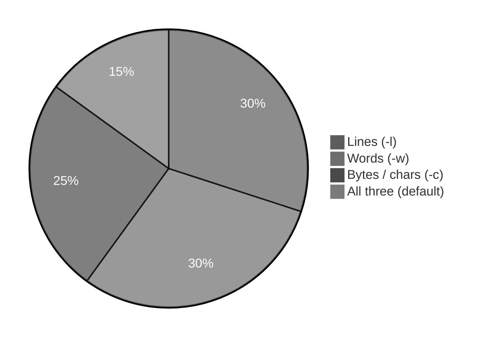
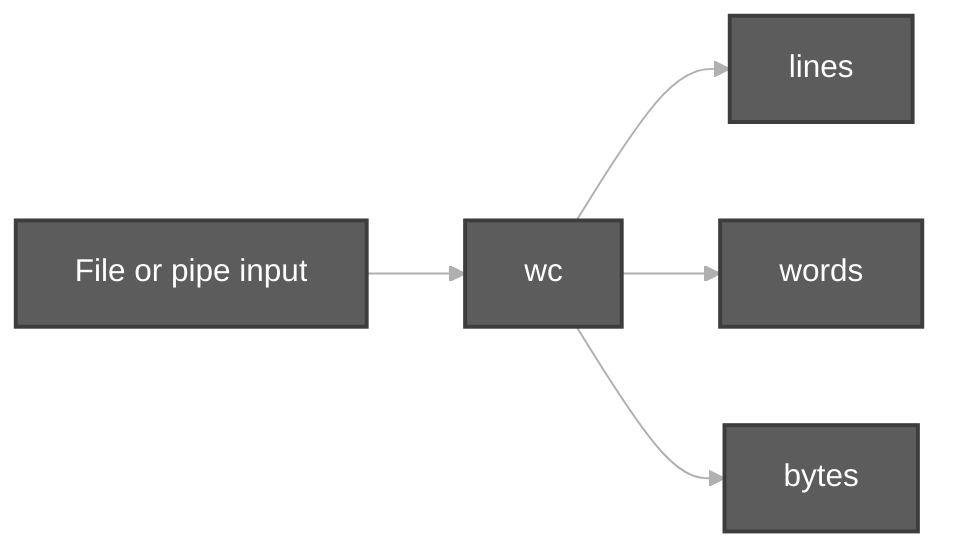
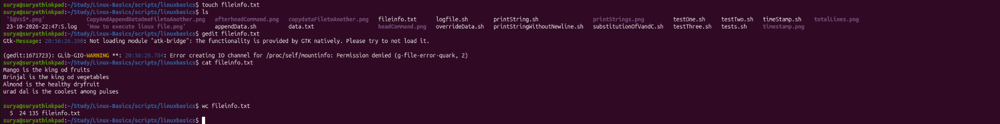
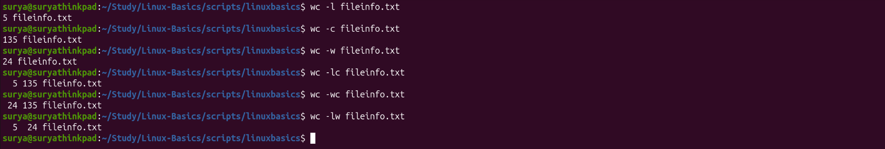
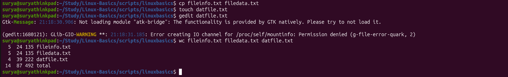
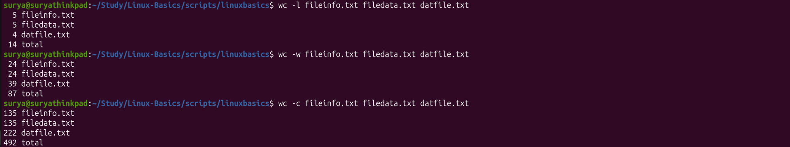

# Word Count Command (`wc`)

**Video:** [Session 10 — `wc` (word count)](https://www.youtube.com/watch?v=hmPHZBR-9Wk&list=PLd3UqWTnYXOloH0vWBs4BtSbP84WcC2NY&index=10)  
**Instructor:** Durga Sir

**Prerequisites:** [viewContentOfFiles.md](viewContentOfFiles.md) (`cat`, `head`, `tail` — you already **view** files) · [pipeCommands.md](pipeCommands.md) (`|` sends output to another command) · [EOF and Redirection.md](EOF%20and%20Redirection.md) (`echo`, `>`)

**Scripts folder:** [`wordCountCommand/`](../../scripts/wordCountCommand/)  
**Execution summary:** [`wordCountCommand.md`](../../scripts-execution-summary/wordCountCommand.md)

```bash
cd /path/to/Linux-Basics
bash scripts/wordCountCommand/wc-default-four-columns-demo.sh
```

---

**Table of contents**

- [1. Goal of this session](#1-goal-of-this-session)
- [2. What is `wc`](#2-what-is-wc)
- [3. Basic syntax — `wc` file name](#3-basic-syntax--wc-file-name)
- [4. Default output — four columns](#4-default-output--four-columns)
- [5. `wc -l` — number of lines only](#5-wc--l--number-of-lines-only)
- [6. `wc -w` — number of words only](#6-wc--w--number-of-words-only)
- [7. `wc -c` — bytes / characters](#7-wc--c--bytes--characters)
- [8. `wc -L` — longest line length (capital **L**)](#8-wc--l--longest-line-length-capital-l)
- [9. Newline and `echo -n` (Durga Sir lab)](#9-newline-and-echo--n-durga-sir-lab)
- [10. Multiple files and the **total** line](#10-multiple-files-and-the-total-line)
- [11. Multiple files — `-l`, `-w`, `-c` only (still shows **total**)](#11-multiple-files--l-w-c-only-still-shows-total)
- [12. `wc` with a pipe](#12-wc-with-a-pipe)
- [13. `wc` vs viewing the whole file](#13-wc-vs-viewing-the-whole-file)
- [14. Session checklist](#14-session-checklist)
- [15. Script index](#15-script-index)

---

## 1. Goal of this session

After you can **open and read** files (`cat`, `head`, `tail`), Durga Sir introduces **`wc`** — **word count** — to answer **how much** is in a file **without** printing every line on screen:

- **Number of lines**
- **Number of words**
- **Number of characters / bytes** (class level: **one character = one byte** for normal English text)



---

## 2. What is `wc`

| Point | Durga Sir idea |
| :--- | :--- |
| **Full form** | **W**ord **c**ount command |
| **Purpose** | Count **lines**, **words**, and **bytes** in a **file** (or in **piped** input) |
| **When to use** | Reports, logs, assignments: “how many lines in this file?” without `cat` the whole file |



---

## 3. Basic syntax — `wc` file name

Durga Sir: syntax is very simple — **`wc`** then **file name**.

```bash
wc fruits.txt
wc /path/to/myfile.txt
```

**Demo:** [`wc-default-four-columns-demo.sh`](../../scripts/wordCountCommand/wc-default-four-columns-demo.sh)

---

## 4. Default output — four columns

When you run **`wc`** with **no options**, the terminal shows **four** pieces of information (remember this order):

| Column | Meaning |
| :---: | :--- |
| **1** | **Number of lines** in the file |
| **2** | **Number of words** in the file |
| **3** | **Number of bytes** (characters at this level) |
| **4** | **File name** |

**Example file (`fruits.txt`):**

```text
mango
apple
orange
```

```bash
wc fruits.txt
```

Typical output shape:

```text
  3  3 19 fruits.txt
```

Read as: **3 lines**, **3 words**, **19 bytes**, file **`fruits.txt`** (exact byte count depends on newlines; run `wc fruits.txt` on your machine to verify).

**Lab (`fileinfo.txt` — Durga Sir class):**

```bash
cd ~/Study/Linux-Basics/scripts/linuxbasics
touch fileinfo.txt
gedit fileinfo.txt          # add text, save, close
cat fileinfo.txt
wc fileinfo.txt
```

Sample content (your file may match this shape):

```text
Mango is the king od fruits
Brinjal is the king od vegetables
Almond is the healthy dryfruit
urad dal is the coolest among pulses
```

Example **`wc`** line from the lab:

```text
  5  24 135 fileinfo.txt
```

→ **5 lines**, **24 words**, **135 bytes**, **`fileinfo.txt`**.



Durga Sir: remember — **lines**, **words**, **characters (bytes)**, and **file name** are all shown together by default.

---

## 5. `wc -l` — number of lines only

If you want **only** the **line count**, use **`-l`** (lowercase **l** = **lines**).

Do **not** confuse **`wc -l`** with **`wc -L`** (capital **L**) — that is the **longest line** length ([§8](#8-wc--l--longest-line-length-capital-l)).

```bash
wc -l fruits.txt
wc -l abc.txt
```

| Command | Prints |
| :--- | :--- |
| **`wc file`** | Lines + words + bytes + name |
| **`wc -l file`** | **Only** lines (+ file name) |

**Demo:** [`wc-lines-only-demo.sh`](../../scripts/wordCountCommand/wc-lines-only-demo.sh)

---

## 6. `wc -w` — number of words only

**`-w`** → **w**ords only.

```bash
wc -w fruits.txt
```

A **word** is text separated by **spaces** (whitespace). Durga Sir uses this when the question is “how many words?” not “how many lines?”.

**Demo:** [`wc-words-only-demo.sh`](../../scripts/wordCountCommand/wc-words-only-demo.sh)

---

## 7. `wc -c` — bytes / characters

**`-c`** → count **bytes** (Durga Sir: in Linux, **each character is normally one byte** for simple text).

```bash
wc -c fruits.txt
```

Use this when the requirement is **number of characters / bytes** in the **given file**.

### Single options and combinations (`-l`, `-w`, `-c`) — Durga Sir lab

On the same **`fileinfo.txt`** from [§4](#4-default-output--four-columns), Durga Sir runs **`wc`** with **one flag** or **two flags together**. You can **combine** **`-l`**, **`-w`**, and **`-c`**; the terminal prints **only** the counts you asked for (in a fixed order), then the **file name**.

**Order when combined:** **lines** → **words** → **bytes** (same order as default `wc` without options).

```bash
cd ~/Study/Linux-Basics/scripts/linuxbasics
wc -l fileinfo.txt
wc -c fileinfo.txt
wc -w fileinfo.txt
wc -lc fileinfo.txt
wc -wc fileinfo.txt
wc -lw fileinfo.txt
```

| Command | What it prints (before file name) | Example output |
| :--- | :--- | :--- |
| **`wc -l fileinfo.txt`** | **Lines** only | `5 fileinfo.txt` |
| **`wc -w fileinfo.txt`** | **Words** only | `24 fileinfo.txt` |
| **`wc -c fileinfo.txt`** | **Bytes** only | `135 fileinfo.txt` |
| **`wc -lw fileinfo.txt`** | **Lines**, then **words** | `5 24 fileinfo.txt` |
| **`wc -lc fileinfo.txt`** | **Lines**, then **bytes** | `5 135 fileinfo.txt` |
| **`wc -wc fileinfo.txt`** | **Words**, then **bytes** | `24 135 fileinfo.txt` |
| **`wc` (no options)** | **Lines**, **words**, **bytes** | `5 24 135 fileinfo.txt` |

Flag letters can be written together (**`-lw`**) or separately (**`-l -w`**); the result is the same.



**Note:** GNU `wc` also has **`-m`** (characters, multibyte-aware). Durga Sir’s class examples at this stage focus on **`-c`** and **pipes with `echo`**.

**Demo:** [`wc-bytes-chars-newline-demo.sh`](../../scripts/wordCountCommand/wc-bytes-chars-newline-demo.sh)

---

## 8. `wc -L` — longest line length (capital **L**)

Durga Sir: **`wc -L`** answers a different question — not “how many lines?” but **how long is the longest line** (in **characters / bytes** on that line)?

| Flag | Letter | Meaning |
| :---: | :---: | :--- |
| **`-l`** | lowercase **l** | **Count** of lines |
| **`-L`** | capital **L** | **Length** of the **longest** line (including spaces between words on that line) |

**Syntax:**

```bash
wc -L fileinfo.txt
```

**Durga Sir lab (`fileinfo.txt`):**

```bash
cd ~/Study/Linux-Basics/scripts/linuxbasics
wc -L fileinfo.txt
```

Example output:

```text
37 fileinfo.txt
```

→ The **longest line** in the file has **37** characters (bytes). Other lines may be shorter; **`-L`** scans the whole file and reports the **maximum** line length only.

To see **which** line is longest, use **`cat -n fileinfo.txt`** and compare — **`wc -L`** gives you the **number** without manual counting.


**Demo:** [`wc-longest-line-capital-L-demo.sh`](../../scripts/wordCountCommand/wc-longest-line-capital-L-demo.sh)

---

## 9. Newline and `echo -n` (Durga Sir lab)

Same idea as [`printString.sh`](../../scripts/linuxbasics/printString.sh) in **`scripts/linuxbasics/`**:

```bash
echo "vishnu" | wc -c
echo -n "vishnu" | wc -c
```

| Command | Typical count | Why |
| :--- | :---: | :--- |
| **`echo "vishnu" \| wc -c`** | **7** | Letters **v-i-s-h-n-u** (6) + **newline** `\n` (1) |
| **`echo -n "vishnu" \| wc -c`** | **6** | **`-n`** = do **not** add the trailing newline |

Durga Sir: the **newline** after `echo` is also **one character** (one byte). That is why output is **7**, not 6.

**Demo:** [`wc-bytes-chars-newline-demo.sh`](../../scripts/wordCountCommand/wc-bytes-chars-newline-demo.sh)

---

## 10. Multiple files and the **total** line

Durga Sir: you can pass **more than one file name** to **`wc`**. It prints **one row per file** (lines, words, bytes, name), then a final **`total`** row that **adds** those three counts across **all** files.

### Syntax

```bash
wc file1.txt file2.txt file3.txt
```

| Row type | Meaning |
| :--- | :--- |
| **Per file** | Lines, words, bytes for **that** file only |
| **`total`** | **Sum** of lines, **sum** of words, **sum** of bytes for **every** file you listed |

The **`total`** line does **not** include a fourth file name — the word **`total`** is the label in the last column.

### Lab — `fileinfo.txt`, `filedata.txt`, `datfile.txt` (Durga Sir)

Prepare three files under **`scripts/linuxbasics/`**:

```bash
cd ~/Study/Linux-Basics/scripts/linuxbasics
cp fileinfo.txt filedata.txt    # copy — same counts as fileinfo.txt
touch datfile.txt
gedit datfile.txt               # add your own lines, save, close
```

Then run **`wc`** on **all three** at once:

```bash
wc fileinfo.txt filedata.txt datfile.txt
```

**Example output (from class terminal):**

```text
  5  24 135 fileinfo.txt
  5  24 135 filedata.txt
  4  39 222 datfile.txt
 14  87 492 total
```

**How to read it:**

| File | Lines | Words | Bytes | Note |
| :--- | ---: | ---: | ---: | :--- |
| **fileinfo.txt** | 5 | 24 | 135 | Original lab file ([§4](#4-default-output--four-columns)) |
| **filedata.txt** | 5 | 24 | 135 | **Copy** of `fileinfo.txt` — same three numbers |
| **datfile.txt** | 4 | 39 | 222 | Different content you typed in `gedit` |
| **`total`** | **14** | **87** | **492** | **5+5+4** lines, **24+24+39** words, **135+135+222** bytes |

Durga Sir: the **`total`** row is the **grand total** for the whole command — useful when you need **overall** size of several files in one shot.



**Demo (minimal two-file example in `/tmp`):** [`wc-multiple-files-total-demo.sh`](../../scripts/wordCountCommand/wc-multiple-files-total-demo.sh)

---

## 11. Multiple files — `-l`, `-w`, `-c` only (still shows **total**)

Same three files as [§10](#10-multiple-files-and-the-total-line). Durga Sir: when you list **several files**, you can add **one flag** (`-l`, `-w`, or `-c`). **`wc`** still prints **each file** on its own line, then a **`total`** row that **adds only that column** across all files.

```bash
cd ~/Study/Linux-Basics/scripts/linuxbasics
wc -l fileinfo.txt filedata.txt datfile.txt
wc -w fileinfo.txt filedata.txt datfile.txt
wc -c fileinfo.txt filedata.txt datfile.txt
```

### `wc -l` — total **lines** across files

```text
  5 fileinfo.txt
  5 filedata.txt
  4 datfile.txt
 14 total
```

→ **5 + 5 + 4 = 14** lines in all three files together.

### `wc -w` — total **words** across files

```text
 24 fileinfo.txt
 24 filedata.txt
 39 datfile.txt
 87 total
```

→ **24 + 24 + 39 = 87** words.

### `wc -c` — total **bytes** across files

```text
135 fileinfo.txt
135 filedata.txt
222 datfile.txt
492 total
```

→ **135 + 135 + 222 = 492** bytes.

| Flag | Each row shows | **`total`** row |
| :---: | :--- | :--- |
| **`-l`** | Line count for that file | Sum of **lines** |
| **`-w`** | Word count for that file | Sum of **words** |
| **`-c`** | Byte count for that file | Sum of **bytes** |

Same idea as default **`wc`** on multiple files ([§10](#10-multiple-files-and-the-total-line)), but you ask for **one kind** of count per command instead of all three columns at once.



**Demo:** [`wc-multiple-files-lwc-flags-demo.sh`](../../scripts/wordCountCommand/wc-multiple-files-lwc-flags-demo.sh)

---

## 12. `wc` with a pipe

You can count **command output** without saving to a file:

```bash
ls /etc | wc -l
printf 'one\ntwo\nthree\n' | wc -l
```

| Pattern | Meaning |
| :--- | :--- |
| **`command \| wc -l`** | How many **lines** of output |
| **`command \| wc -w`** | How many **words** |
| **`command \| wc -c`** | How many **bytes** |

Durga Sir: **`wc`** is very often used **after** **`|`** in real scripts and exams.

**Demo:** [`wc-pipe-count-demo.sh`](../../scripts/wordCountCommand/wc-pipe-count-demo.sh)

---

## 13. `wc` vs viewing the whole file

| Need | Use |
| :--- | :--- |
| See **all** content on screen | **`cat`**, **`less`** ([viewContentOfFiles.md](viewContentOfFiles.md)) |
| Only **how many lines** | **`wc -l file`** |
| Lines + words + bytes summary | **`wc file`** |

Preview from Session 9: **`man cat`** saved to a file — here **`wc -l`** answers “how long is this file?” without scrolling.

---

## 14. Session checklist

You should be able to:

1. Say what **`wc`** stands for and why Durga Sir teaches it after viewing files.  
2. Run **`wc filename`** and read **lines, words, bytes, name**.  
3. Use **`wc -l`**, **`wc -w`**, **`wc -c`** when only one count is needed (and combos **`-lw`**, **`-lc`**, **`-wc`**).  
4. Distinguish **`wc -l`** (line **count**) from **`wc -L`** (longest line **length**).  
5. Explain **`echo "vishnu" | wc -c`** vs **`echo -n "vishnu" | wc -c`**.  
6. Run **`wc`** on **two or more files** and read the **`total`** row.  
7. Run **`wc -l` / `-w` / `-c`** on **multiple files** and read the matching **`total`** sum.  
8. Use **`something | wc -l`** for line counts from a command.

---

## 15. Script index

| Script | Topic |
| :--- | :--- |
| [`wc-default-four-columns-demo.sh`](../../scripts/wordCountCommand/wc-default-four-columns-demo.sh) | Default `wc` — four columns |
| [`wc-lines-only-demo.sh`](../../scripts/wordCountCommand/wc-lines-only-demo.sh) | `wc -l` |
| [`wc-words-only-demo.sh`](../../scripts/wordCountCommand/wc-words-only-demo.sh) | `wc -w` |
| [`wc-bytes-chars-newline-demo.sh`](../../scripts/wordCountCommand/wc-bytes-chars-newline-demo.sh) | `wc -c`, `echo` vs `echo -n` |
| [`wc-longest-line-capital-L-demo.sh`](../../scripts/wordCountCommand/wc-longest-line-capital-L-demo.sh) | `wc -L` longest line |
| [`wc-multiple-files-total-demo.sh`](../../scripts/wordCountCommand/wc-multiple-files-total-demo.sh) | Multiple files + `total` |
| [`wc-multiple-files-lwc-flags-demo.sh`](../../scripts/wordCountCommand/wc-multiple-files-lwc-flags-demo.sh) | Multi-file `-l` / `-w` / `-c` + `total` |
| [`wc-pipe-count-demo.sh`](../../scripts/wordCountCommand/wc-pipe-count-demo.sh) | `wc` after `\|` |

**Next in playlist:** continue from [`linuxBasics.md`](../linuxBasics.md).
