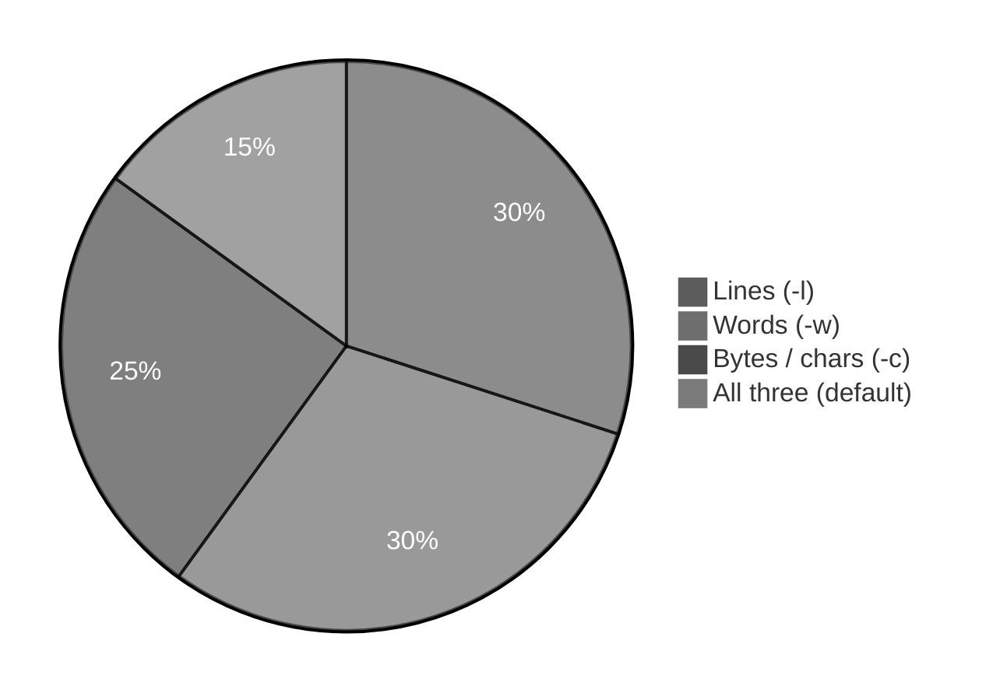
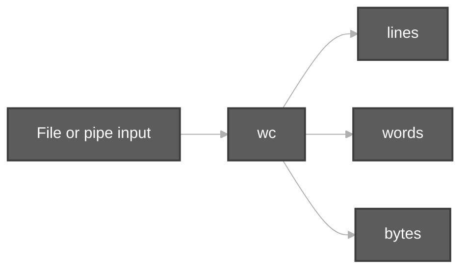

# Word Count Command (`wc`)

**Video:** [Session 10 — `wc` (word count)](https://www.youtube.com/watch?v=hmPHZBR-9Wk&list=PLd3UqWTnYXOloH0vWBs4BtSbP84WcC2NY&index=10)  
**Instructor:** Durga Sir

**Prerequisites:** [viewContentOfFiles.md](viewContentOfFiles.md) (`cat`, `head`, `tail` — you already **view** files) · [pipeCommands.md](pipeCommands.md) (`|` sends output to another command) · [EOF and Redirection.md](EOF%20and%20Redirection.md) (`echo`, `>`)

**Scripts folder:** [`wordCountCommand/`](../../scripts/wordCountCommand/)  
**Execution summary:** [`wordCountCommand.md`](../../scripts-execution-summary/wordCountCommand.md)

```bash
cd /path/to/Linux-Basics
bash scripts/wordCountCommand/wc-default-four-columns-demo.sh
```

---

**Table of contents**

- [1. Goal of this session](#1-goal-of-this-session)
- [2. What is `wc`](#2-what-is-wc)
- [3. Basic syntax — `wc` file name](#3-basic-syntax--wc-file-name)
- [4. Default output — four columns](#4-default-output--four-columns)
- [5. `wc -l` — number of lines only](#5-wc--l--number-of-lines-only)
- [6. `wc -w` — number of words only](#6-wc--w--number-of-words-only)
- [7. `wc -c` — bytes / characters](#7-wc--c--bytes--characters)
- [8. Newline and `echo -n` (Durga Sir lab)](#8-newline-and-echo--n-durga-sir-lab)
- [9. Multiple files and the **total** line](#9-multiple-files-and-the-total-line)
- [10. `wc` with a pipe](#10-wc-with-a-pipe)
- [11. `wc` vs viewing the whole file](#11-wc-vs-viewing-the-whole-file)
- [12. Session checklist](#12-session-checklist)
- [13. Script index](#13-script-index)

---

## 1. Goal of this session

After you can **open and read** files (`cat`, `head`, `tail`), Durga Sir introduces **`wc`** — **word count** — to answer **how much** is in a file **without** printing every line on screen:

- **Number of lines**
- **Number of words**
- **Number of characters / bytes** (class level: **one character = one byte** for normal English text)



---

## 2. What is `wc`

| Point | Durga Sir idea |
| :--- | :--- |
| **Full form** | **W**ord **c**ount command |
| **Purpose** | Count **lines**, **words**, and **bytes** in a **file** (or in **piped** input) |
| **When to use** | Reports, logs, assignments: “how many lines in this file?” without `cat` the whole file |



---

## 3. Basic syntax — `wc` file name

Durga Sir: syntax is very simple — **`wc`** then **file name**.

```bash
wc fruits.txt
wc /path/to/myfile.txt
```

**Demo:** [`wc-default-four-columns-demo.sh`](../../scripts/wordCountCommand/wc-default-four-columns-demo.sh)

---

## 4. Default output — four columns

When you run **`wc`** with **no options**, the terminal shows **four** pieces of information (remember this order):

| Column | Meaning |
| :---: | :--- |
| **1** | **Number of lines** in the file |
| **2** | **Number of words** in the file |
| **3** | **Number of bytes** (characters at this level) |
| **4** | **File name** |

**Example file (`fruits.txt`):**

```text
mango
apple
orange
```

```bash
wc fruits.txt
```

Typical output shape:

```text
  3  3 19 fruits.txt
```

Read as: **3 lines**, **3 words**, **19 bytes**, file **`fruits.txt`** (exact byte count depends on newlines; run `wc fruits.txt` on your machine to verify).

**Lab (`fileinfo.txt` — Durga Sir class):**

```bash
cd ~/Study/Linux-Basics/scripts/linuxbasics
touch fileinfo.txt
gedit fileinfo.txt          # add text, save, close
cat fileinfo.txt
wc fileinfo.txt
```

Sample content (your file may match this shape):

```text
Mango is the king od fruits
Brinjal is the king od vegetables
Almond is the healthy dryfruit
urad dal is the coolest among pulses
```

Example **`wc`** line from the lab:

```text
  5  24 135 fileinfo.txt
```

→ **5 lines**, **24 words**, **135 bytes**, **`fileinfo.txt`**.


Durga Sir: remember — **lines**, **words**, **characters (bytes)**, and **file name** are all shown together by default.

---

## 5. `wc -l` — number of lines only

If you want **only** the **line count**, use **`-l`** (letter **l** = **lines**).

```bash
wc -l fruits.txt
wc -l abc.txt
```

| Command | Prints |
| :--- | :--- |
| **`wc file`** | Lines + words + bytes + name |
| **`wc -l file`** | **Only** lines (+ file name) |

**Demo:** [`wc-lines-only-demo.sh`](../../scripts/wordCountCommand/wc-lines-only-demo.sh)

---

## 6. `wc -w` — number of words only

**`-w`** → **w**ords only.

```bash
wc -w fruits.txt
```

A **word** is text separated by **spaces** (whitespace). Durga Sir uses this when the question is “how many words?” not “how many lines?”.

**Demo:** [`wc-words-only-demo.sh`](../../scripts/wordCountCommand/wc-words-only-demo.sh)

---

## 7. `wc -c` — bytes / characters

**`-c`** → count **bytes** (Durga Sir: in Linux, **each character is normally one byte** for simple text).

```bash
wc -c fruits.txt
```

Use this when the requirement is **number of characters / bytes** in the **given file**.

**Note:** GNU `wc` also has **`-m`** (characters, multibyte-aware). Durga Sir’s class examples at this stage focus on **`-c`** and **pipes with `echo`**.

**Demo:** [`wc-bytes-chars-newline-demo.sh`](../../scripts/wordCountCommand/wc-bytes-chars-newline-demo.sh)

---

## 8. Newline and `echo -n` (Durga Sir lab)

Same idea as [`printString.sh`](../../scripts/linuxbasics/printString.sh) in **`scripts/linuxbasics/`**:

```bash
echo "vishnu" | wc -c
echo -n "vishnu" | wc -c
```

| Command | Typical count | Why |
| :--- | :---: | :--- |
| **`echo "vishnu" \| wc -c`** | **7** | Letters **v-i-s-h-n-u** (6) + **newline** `\n` (1) |
| **`echo -n "vishnu" \| wc -c`** | **6** | **`-n`** = do **not** add the trailing newline |

Durga Sir: the **newline** after `echo` is also **one character** (one byte). That is why output is **7**, not 6.

**Demo:** [`wc-bytes-chars-newline-demo.sh`](../../scripts/wordCountCommand/wc-bytes-chars-newline-demo.sh)

---

## 9. Multiple files and the **total** line

```bash
wc file1.txt file2.txt
```

- **`wc`** prints one row **per file**.
- Last row **`total`** — combined lines, words, and bytes for **all** files listed.

**Demo:** [`wc-multiple-files-total-demo.sh`](../../scripts/wordCountCommand/wc-multiple-files-total-demo.sh)

---

## 10. `wc` with a pipe

You can count **command output** without saving to a file:

```bash
ls /etc | wc -l
printf 'one\ntwo\nthree\n' | wc -l
```

| Pattern | Meaning |
| :--- | :--- |
| **`command \| wc -l`** | How many **lines** of output |
| **`command \| wc -w`** | How many **words** |
| **`command \| wc -c`** | How many **bytes** |

Durga Sir: **`wc`** is very often used **after** **`|`** in real scripts and exams.

**Demo:** [`wc-pipe-count-demo.sh`](../../scripts/wordCountCommand/wc-pipe-count-demo.sh)

---

## 11. `wc` vs viewing the whole file

| Need | Use |
| :--- | :--- |
| See **all** content on screen | **`cat`**, **`less`** ([viewContentOfFiles.md](viewContentOfFiles.md)) |
| Only **how many lines** | **`wc -l file`** |
| Lines + words + bytes summary | **`wc file`** |

Preview from Session 9: **`man cat`** saved to a file — here **`wc -l`** answers “how long is this file?” without scrolling.

---

## 12. Session checklist

You should be able to:

1. Say what **`wc`** stands for and why Durga Sir teaches it after viewing files.  
2. Run **`wc filename`** and read **lines, words, bytes, name**.  
3. Use **`wc -l`**, **`wc -w`**, **`wc -c`** when only one count is needed.  
4. Explain **`echo "vishnu" | wc -c`** vs **`echo -n "vishnu" | wc -c`**.  
5. Run **`wc`** on **two or more files** and read the **`total`** row.  
6. Use **`something | wc -l`** for line counts from a command.

---

## 13. Script index

| Script | Topic |
| :--- | :--- |
| [`wc-default-four-columns-demo.sh`](../../scripts/wordCountCommand/wc-default-four-columns-demo.sh) | Default `wc` — four columns |
| [`wc-lines-only-demo.sh`](../../scripts/wordCountCommand/wc-lines-only-demo.sh) | `wc -l` |
| [`wc-words-only-demo.sh`](../../scripts/wordCountCommand/wc-words-only-demo.sh) | `wc -w` |
| [`wc-bytes-chars-newline-demo.sh`](../../scripts/wordCountCommand/wc-bytes-chars-newline-demo.sh) | `wc -c`, `echo` vs `echo -n` |
| [`wc-multiple-files-total-demo.sh`](../../scripts/wordCountCommand/wc-multiple-files-total-demo.sh) | Multiple files + `total` |
| [`wc-pipe-count-demo.sh`](../../scripts/wordCountCommand/wc-pipe-count-demo.sh) | `wc` after `\|` |

**Next in playlist:** continue from [`linuxBasics.md`](../linuxBasics.md).
