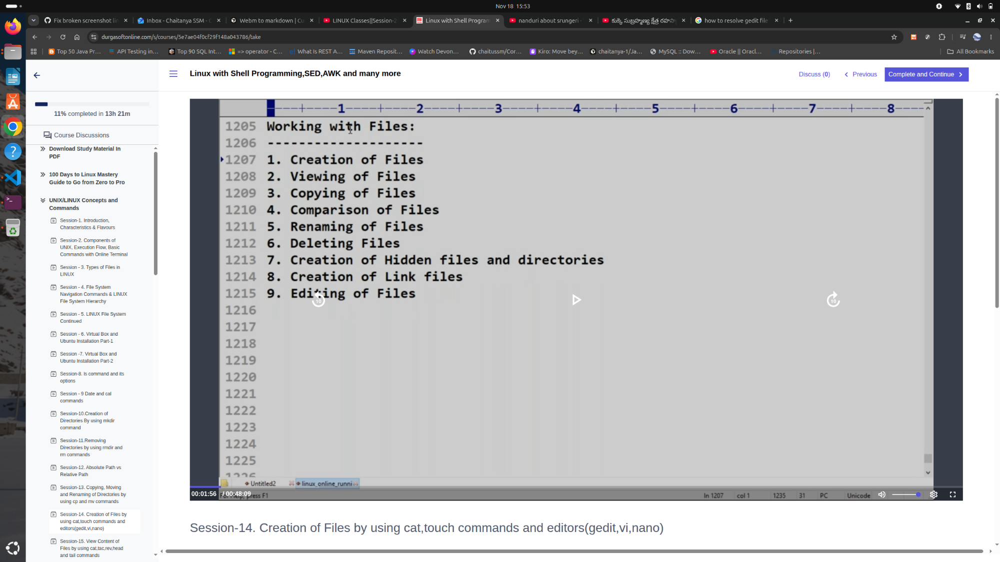

# Working with Files — topic map (Durga Sir)

**Course:** [Linux with Shell Programming — Durga Soft online](https://www.durgasoftonline.com/s/courses/5e7ae04f0cf29f148a043786/take)  
**Instructor:** Durga Sir  

This page matches the **EditPlus syllabus** block **“Working with Files”** in the class video. Each numbered item is **one learning topic** — **one markdown file** — **one session** (or one clear unit). Do **not** merge Session 14 and Session 15 into a single notes file.



---

## Syllabus (9 topics) → your notes file

| # | Syllabus topic (class) | Durga Soft session (sidebar) | Notes file | Status |
| :-: | :--------------------- | :--------------------------- | :--------- | :----- |
| — | *(directories first)* | Session 10 · `mkdir` | [creationOfDirectories.md](creationOfDirectories.md) | Done |
| — | *(remove directories)* | Session 11 · `rmdir` / `rm` | [removeDirectories.md](removeDirectories.md) | Done |
| — | *(paths)* | Session 12 | [absolutePathvsRelativePath.md](absolutePathvsRelativePath.md) | Done |
| — | *(cp/mv on **directories**)* | Session 13 | [copyMoveRenamingDirectories.md](copyMoveRenamingDirectories.md) | Done |
| **1** | **Creation of Files** | **Session 14** · `touch`, `cat`, `gedit`, `vi`, `nano` | [**createFileByCatAndTouch.md**](createFileByCatAndTouch.md) | **Current — complete § by §** |
| **2** | **Viewing of Files** | **Session 15** · `cat`, `tac`, `rev`, `head`, `tail` | [**viewingOfFiles.md**](viewingOfFiles.md) | Next after Session 14 |
| **3** | **Copying of Files** | *(session in course — watch sidebar)* | [copyingOfFiles.md](copyingOfFiles.md) | Stub — your screencast |
| **4** | **Comparison of Files** | *(session in course)* | [comparisonOfFiles.md](comparisonOfFiles.md) | Stub |
| **5** | **Renaming of Files** | *(session in course)* | [renamingOfFiles.md](renamingOfFiles.md) | Stub *(Session 13 was **directories** only)* |
| **6** | **Deleting Files** | *(session in course)* | [deletingFiles.md](deletingOfFiles.md) | Stub |
| **7** | **Hidden files and directories** | *(session in course)* | [hiddenFilesAndDirectories.md](hiddenFilesAndDirectories.md) | Stub |
| **8** | **Link files** | *(session in course)* | [creationOfLinkFiles.md](creationOfLinkFiles.md) | Stub |
| **9** | **Editing of Files** | *(session in course)* | [editingOfFiles.md](editingOfFiles.md) | Stub |

**Older YouTube-based notes** (same ideas, wider scope): [viewContentOfFiles.md](viewContentOfFiles.md) · [redirection.md](redirection.md) — use for extra detail; **Session 15+ online class** notes live in the table rows above.

---

## Rule for every topic file (from now on)

Copy this pattern from [removeDirectories.md](removeDirectories.md) and [createFileByCatAndTouch.md](createFileByCatAndTouch.md):

1. **One session = one `.md`** filename you choose (camelCase).
2. **One `##` section = one sub-topic** inside that session only.
3. Every section has **two** screenshot areas:
   - **Durga Sir class lab screenshot** — PNG from `/home/surya/Videos/Screencasts/` → `docs/assets/`.
   - **My observation** — your terminal on `~/linuxbasics` or `~/Study/Linux-Basics`.
4. Under each image: **“What the screenshot shows (line by line)”** when it helps.
5. Push **`.md` + `.png` only** — [screencastWorkflow.md](screencastWorkflow.md).

```bash
bash scripts/file-system-navigation-and-hierarchy/validate-docs-assets.sh
```

---

## What to send the agent for the next topic

Example (Session 15):

> Topic file: **`viewingOfFiles.md`**.  
> Screencast: newest file in `/home/surya/Videos/Screencasts/`.  
> Build one `##` section per command (`cat`, `tac`, `rev`, `head`, `tail`).  
> Class PNG + My observation PNG per section.

---

*Index also linked from [linuxBasics.md](linuxBasics.md).*