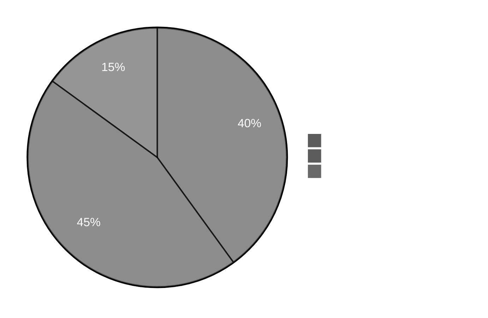
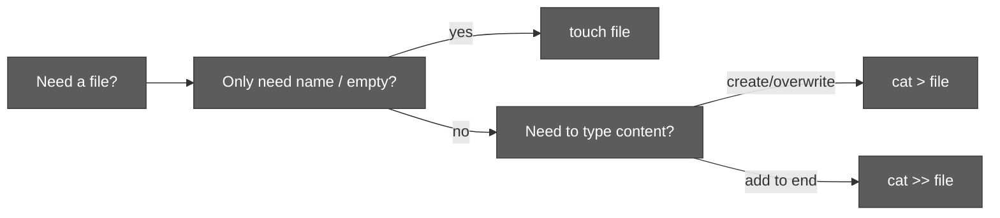
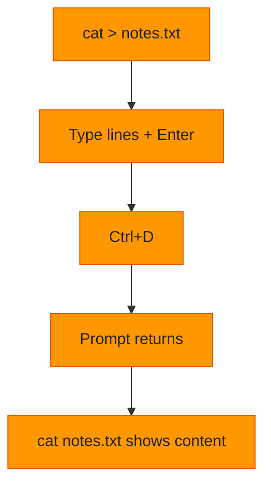
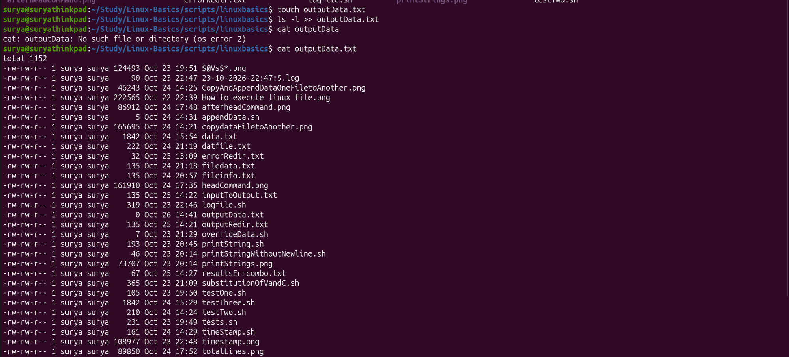
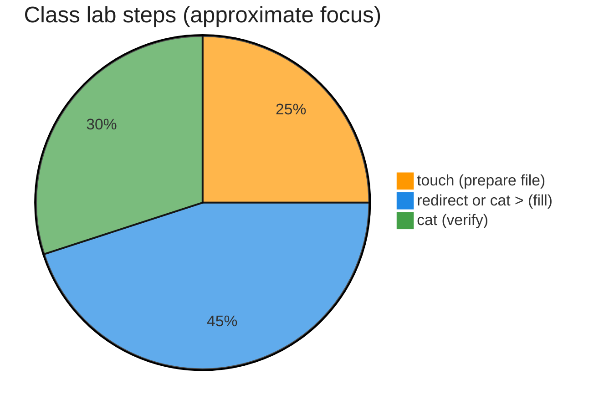

# Working with Files

**Course:** [Linux with Shell Programming — Durga Soft online](https://www.durgasoftonline.com/s/courses/5e7ae04f0cf29f148a043786/take)  
**Instructor:** Durga Sir  

**One notes file** — Durga Sir’s **“Working with Files”** syllabus (9 topics). Each syllabus item is a **separate `##` section** below; **commands** use **`###`** subsections. **Do not** split into nine different `.md` files.

**Screencasts (local):** `/home/surya/Videos/Screencasts/` — push **this file + PNGs** only. [screencastWorkflow.md](screencastWorkflow.md)

**Related (other sessions):** [creationOfDirectories.md](creationOfDirectories.md) · [removeDirectories.md](removeDirectories.md) · [absolutePathvsRelativePath.md](absolutePathvsRelativePath.md) · [copyMoveRenamingDirectories.md](copyMoveRenamingDirectories.md) (Session 13 — **directories**)


**Practice scripts:** [`create-file-cat-touch-demo.sh`](../../scripts/file-system-navigation-and-hierarchy/create-file-cat-touch-demo.sh) · [`view-content-of-files/`](../../scripts/view-content-of-files/) · [`copy-move-rename-demo.sh`](../../scripts/file-system-navigation-and-hierarchy/copy-move-rename-demo.sh)

Each **`###`** subsection: **Durga Sir class lab screenshot** + **My observation**.

---

**Table of contents**

- [1. Creation of Files (Session 14)](#1-creation-of-files--session-14)
- [2. Viewing of Files (Session 15)](#2-viewing-of-files--session-15)
- [3. Copying of Files](#3-copying-of-files)
- [4. Comparison of Files](#4-comparison-of-files)
- [5. Renaming of Files](#5-renaming-of-files)
- [6. Deleting Files](#6-deleting-files)
- [7. Hidden files and directories](#7-creation-of-hidden-files-and-directories)
- [8. Link files](#8-creation-of-link-files)
- [9. Editing of Files](#9-editing-of-files)
- [Appendix — validate assets](#appendix--validate-assets)

---

## 1. Creation of Files (Session 14)

**Session 14:** *Creation of Files by using cat, touch commands and editors (gedit, vi, nano).*

**Recording:** `/home/surya/Videos/Screencasts/<Session-14>.webm`

### 0. What this session covers

| Topic | Command / idea |
| :---- | :------------- |
| Empty file | `touch name.txt` |
| Many empties | `touch f1 f2 f3` or `touch file{1..5}.txt` |
| Create with text | `cat > file` then type lines, **Ctrl+D** |
| Append | `cat >> file` or `echo line >> file` |
| Verify | `ls -l`, `cat file`, `file file` |





**Durga Sir class lab screenshot:** *(add PNG from screencast ~00:00–02:00 — EditPlus heading for creation of files / touch.)*

**Path after extract:** `../assets/createFile-touch-session-title.png`

**My observation:** *(optional — photo of notes at session start.)*

---

### 1. Why we create files before `cat` and `gedit`

Durga Sir places **file creation** before **viewing** (`cat`, `more`) and **redirection** (`>` / `>>`).

- **`touch`** — fastest way to get a **normal, empty** file the kernel can track.  
- **`cat >`** — create file **and** fill it from the keyboard in one step.

**Durga Sir class lab screenshot:** *(EditPlus rules block — “everything is a file”, normal file contains data.)*

**My observation:** `file` on an empty `touch` file vs after `echo hi > f` — two-line screenshot.

---

### 2. `touch` — zero-byte (empty) file

```bash
touch demo.txt
ls -l demo.txt
```

**What it means:**

| Part | Meaning |
| :--- | :------ |
| `touch demo.txt` | Create **`demo.txt`** if missing; if it exists, update **timestamps** |
| `ls -l` | Size **0** until you add content |

**Durga Sir class lab screenshot:**

> **Pending:** Save a frame from your screencast as `docs/assets/createFile-touch-zero-byte-class.png`, then add:
> ``
>
> Until then, use the command block above in your lab.

**What the class screenshot should show (line by line):**

1. `touch demo.txt` at `durga@…~/Desktop$` — no output on success.  
2. `ls -l demo.txt` — `-rw-r--r--`, size **0**, current date/time.  
3. Optional: `file demo.txt` — **empty** or **ASCII text** when still zero bytes.

**My observation:**

> **Pending:** Add your terminal capture as `docs/assets/createFile-touch-zero-byte-my.png`, then link it here with `../assets/createFile-touch-zero-byte-my.png`.

---

### 3. `touch` — many files at once

```bash
touch a.txt b.txt c.txt
touch file{1..5}.txt
```

**Durga Sir class lab screenshot:**

> **Pending:** `docs/assets/createFile-touch-multiple-class.png` (class terminal: several names from one `touch`).

**What the class screenshot should show:**

1. One `touch` line with **several** filenames separated by spaces.  
2. `ls` listing all new files.

**My observation:** *(run `touch lab{1..3}.txt` and screenshot `ls`.)*

**Related class asset (touch + list for xargs lab):**


---

### 4. `touch` — update timestamp on existing file

```bash
touch demo.txt    # file already exists → times refresh, content unchanged
ls -l demo.txt
```

**Durga Sir class lab screenshot:**

> **Pending:** `docs/assets/createFile-touch-timestamp-class.png` (`ls -l` before/after second `touch`).

**My observation:** `sleep 2; touch demo.txt; ls -l` — compare mtime.

---

### 5. `ls -l` after `touch`

Class ties **`touch`** to **`ls -l`**:

- Leading **`-`** = normal file (not `d` directory).  
- Column **size** = **0** right after `touch`.  
- **Owner / group** = your user.

**Durga Sir class lab screenshot:**

> **Pending:** `docs/assets/createFile-ls-l-after-touch-class.png` (EditPlus + `ls -l`).

**My observation:** Same listing on `~/Study/Linux-Basics/scripts/linuxbasics`.

---

### 6. `cat > file` — create content from the keyboard

```bash
cat > notes.txt
```

Then type lines; press **Enter** after each; finish with **Ctrl+D** (end of input).

```bash
cat notes.txt
```

**Durga Sir class lab screenshot:**

> **Pending:** `docs/assets/createFile-cat-greater-class.png` (`cat >` lines, Ctrl+D).

**What the class screenshot should show (line by line):**

1. `cat > notes.txt` — cursor waits on next lines (no prompt).  
2. Typed text (two or three lines).  
3. **Ctrl+D** — returns to `$` prompt.  
4. `cat notes.txt` — same text printed.

**My observation:** Repeat on `notes.txt` in your practice folder — screenshot.



**See also:** [redirection.md §6](redirection.md#6-cat--file--keyboard-input-file-output)

---

### 7. `cat >> file` — append without erasing

```bash
cat >> notes.txt
# type more lines, Ctrl+D
```

Or:

```bash
echo "fourth line" >> notes.txt
```

**Warning:** **`>`** overwrites; **`>>`** appends.

**Durga Sir class lab screenshot:**

> **Pending:** `docs/assets/createFile-cat-append-class.png` (`cat >>` demo).

**My observation:**



**What this screenshot shows (line by line):**

1. `touch outputData.txt` — empty file ready.  
2. `ls -l >> outputData.txt` — **append** directory listing into the file (not only `cat`).  
3. `cat outputData` — error (missing `.txt`) — class habit: **full filename**.  
4. `cat outputData.txt` — long `ls -l` listing visible.

---

### 8. `touch` then `cat` — typical class lab order

Durga Sir often:

1. **`touch`** — guarantee file exists.  
2. **`>>` or `cat >`** — put data in.  
3. **`cat`** — verify on screen.

```bash
touch outputData.txt
ls -l >> outputData.txt
cat outputData.txt
```

**Durga Sir class lab screenshot:** *(combined terminal from screencast.)*

**My observation:** Same three commands in `~/Study/Linux-Basics/scripts/linuxbasics` — your PNG above or a fresh capture.



---

### 9. Quick compare — `touch` vs `cat`

| Tool | Creates empty? | Puts text in? | Typical use |
| :--- | :------------- | :------------ | :---------- |
| **`touch`** | Yes (0 bytes) | No | Placeholder, scripts, `>>` target |
| **`cat >`** | Yes + content | Yes (keyboard) | Quick few lines |

**Durga Sir class lab screenshot:**

> **Pending:** `../assets/createFile-touch-vs-cat-class.png` (EditPlus table).

**My observation:** One terminal with `touch empty.txt` and `cat > filled.txt` — screenshot.

---

### 10. `gedit` — GUI create/edit

```bash
gedit demo.txt &
```

**Class rule:** Editor opens a window; **Save** writes bytes to disk (file need not exist before first save).

**Durga Sir class lab screenshot:**

> **Pending:** `../assets/createFile-gedit-class.png` (EditPlus + VM with gedit open).

**What the screenshot should show (line by line):**

1. `gedit demo.txt` or icon launch.  
2. Text typed in window.  
3. After save, `ls -l demo.txt` shows **non-zero** size.

**My observation:**

> **Pending:** `../assets/createFile-gedit-my.png`  
> *(If `gedit` missing: `sudo apt install gedit` — not snap path.)*

---

### 11. `nano` — simple terminal editor

```bash
nano demo.txt
```

**Class rule:** On-screen shortcuts (^O save, ^X exit) at bottom.

**Durga Sir class lab screenshot:**

> **Pending:** `../assets/createFile-nano-class.png`

**My observation:**

> **Pending:** `../assets/createFile-nano-my.png`

---

### 12. `vi` / `vim` — intro from class

**Class rule:** **Command mode** vs **insert mode** — `i` to insert, `Esc` then `:wq` to save and quit (wording as Durga Sir gives).

```bash
vi demo.txt
```

**Durga Sir class lab screenshot:**

> **Pending:** `../assets/createFile-vi-class.png`

**My observation:**

> **Pending:** `../assets/createFile-vi-my.png` (minimal open → insert one line → save).

**Deeper editing (syllabus #9):** [§9 — Editing of Files](#9-editing-of-files) when that session is recorded.

---

### 13. Practice questions

**Q1.** Command to create **empty** `a.txt`?

- **Ans:** `touch a.txt`

**Q2.** Create `out.txt` with **three lines** typed at keyboard?

- **Ans:** `cat > out.txt`, type three lines, **Ctrl+D**

**Q3.** Add a fourth line **without** deleting first three?

- **Ans:** `cat >> out.txt` or `echo "fourth" >> out.txt`

**Durga Sir class lab screenshot:** *(MCQ block from screencast end.)*

**My observation:** Answer all three on your VM — one combined terminal screenshot.

---

### Appendix — extract class frames from your screencast

On **`suryathinkpad`**:

```bash
VIDEO="/home/surya/Videos/Screencasts/<exact-new-filename>.webm"
cd ~/Study/Linux-Basics
bash scripts/file-system-navigation-and-hierarchy/extract-screencast-frames.sh \
  "$VIDEO" /tmp/createFile-cat-touch-frames
```

Save frames into `docs/assets/` with the names used in this file (`createFile-touch-zero-byte-class.png`, …), then:

```bash
git add docs/topics/workingWithFiles.md docs/assets/createFile-*.png
git commit -m "Add cat/touch class screenshots from screencast"
git push origin master
```

| Suggested frame time | Asset name | Section |
| :------------------- | :--------- | :------ |
| ~03:00 | `createFile-touch-zero-byte-class.png` | §2 |
| ~06:00 | `createFile-touch-multiple-class.png` | §3 |
| ~12:00 | `createFile-cat-greater-class.png` | §6 |
| ~18:00 | `createFile-cat-append-class.png` | §7 |
| ~22:00 | `createFile-gedit-class.png` | §10 |
| ~30:00 | `createFile-nano-class.png` | §11 |
| ~36:00 | `createFile-vi-class.png` | §12 |

*(Adjust times after you watch once.)*

---

---

## 2. Viewing of Files (Session 15)

**Session 15:** *View Content of Files by using cat, tac, rev, head and tail commands.*

**Recording:** `/home/surya/Videos/Screencasts/<Session-15>.webm`

**Extra depth:** [viewContentOfFiles.md](viewContentOfFiles.md)

### Overview — what Session 15 covers

| Idea | Commands |
| :--- | :------- |
| Show all lines | `cat file` |
| Show many files in order | `cat f1 f2` |
| Number lines | `cat -n`, `cat -b` |
| Last line on top | `tac` |
| Each line backwards | `rev` |
| Top of file | `head`, `head -n` |
| Bottom of file | `tail`, `tail -n` |

**Durga Sir class lab screenshot:**

> **Pending:** `docs/assets/viewingOfFiles-session15-title-class.png` (EditPlus **Viewing of Files** heading).

**My observation:** Run `touch viewLab.txt; echo -e "line1\nline2\nline3" > viewLab.txt` — screenshot `cat viewLab.txt`.

---

### `cat` — print whole file

```bash
cat notes.txt
```

**Class rule:** `cat` reads file(s) and writes to **stdout** — good for **small** files you can read in one screen.

**Durga Sir class lab screenshot:**

> **Pending:** `docs/assets/viewingOfFiles-cat-basic-class.png`

**What the screenshot should show (line by line):**

1. `cat notes.txt` — file content streams to terminal.  
2. Prompt returns when file ends.

**My observation:**

> **Pending:** `../assets/viewingOfFiles-cat-basic-my.png`

---

### `cat` — multiple files

```bash
cat part1.txt part2.txt
```

**Class rule:** Output is **concatenated** in argument order (name **cat** = concatenate).

**Durga Sir class lab screenshot:**

> **Pending:** `../assets/viewingOfFiles-cat-multiple-class.png`

**My observation:**

> **Pending:** `../assets/viewingOfFiles-cat-multiple-my.png`

---

### `cat -n` / `cat -b` — line numbers

```bash
cat -n file.txt    # all lines numbered
cat -b file.txt    # number non-blank lines only
```

**Durga Sir class lab screenshot:**

> **Pending:** `../assets/viewingOfFiles-cat-n-b-class.png`

**My observation:** Same file with `-n` and `-b` — two commands, one screenshot.

---

### `tac` — reverse line order

```bash
tac file.txt
```

**Durga Sir class lab screenshot:**

> **Pending:** `../assets/viewingOfFiles-tac-class.png`

**What the screenshot should show:** Last line of file printed **first**.

**My observation:**

> **Pending:** `../assets/viewingOfFiles-tac-my.png`

---

### `rev` — reverse characters per line

```bash
rev file.txt
```

**Durga Sir class lab screenshot:**

> **Pending:** `../assets/viewingOfFiles-rev-class.png`

**My observation:**

> **Pending:** `../assets/viewingOfFiles-rev-my.png`

---

### `head` — first lines

```bash
head file.txt
head -5 file.txt
```

**Default:** first **10** lines.

**Durga Sir class lab screenshot:**

> **Pending:** `../assets/viewingOfFiles-head-class.png`

**My observation:**

> **Pending:** `../assets/viewingOfFiles-head-my.png`

---

### `tail` — last lines

```bash
tail file.txt
tail -3 file.txt
```

**Default:** last **10** lines.

**Durga Sir class lab screenshot:**

> **Pending:** `../assets/viewingOfFiles-tail-class.png`

**My observation:**

> **Pending:** `../assets/viewingOfFiles-tail-my.png`

---

### Viewing does not change the file on disk

**Class rule:** `cat` / `tac` / `rev` / `head` / `tail` are **read-only** for file content (unlike `>` / `>>`).

**Durga Sir class lab screenshot:**

> **Pending:** `../assets/viewingOfFiles-readonly-class.png`

**My observation:** `cat file; wc -l file` — line count unchanged — screenshot.

---

### Practice questions (Session 15)

*(Fill from Session 15 MCQs in screencast.)*

**Q1.** Command to show **last 5** lines?

- **Ans:** `tail -5 file`

**Durga Sir class lab screenshot:**

> **Pending:** `../assets/viewingOfFiles-mcq-class.png`

**My observation:** Answer Q1 on your VM — screenshot.

---

---

## 3. Copying of Files

**Syllabus #3** — normal **files** with `cp` (not Session 13 directory trees).

### `cp` — duplicate a file in the same directory

```bash
cp file1 file2
```

**Durga Sir class lab screenshot:**

> **Pending:** `../assets/copyingOfFiles-cp-same-dir-class.png`

**My observation:**

> **Pending:** `../assets/copyingOfFiles-cp-same-dir-my.png`

---

### `cp` — copy into another directory

```bash
cp notes.txt ~/backup/
```

**Durga Sir class lab screenshot:**

> **Pending:** `../assets/copyingOfFiles-cp-to-dir-class.png`

**My observation:**

> **Pending:** `../assets/copyingOfFiles-cp-to-dir-my.png`

---

### `cp` — multiple sources into one directory

```bash
cp a.txt b.txt c.txt targetDir/
```

**Durga Sir class lab screenshot:**

> **Pending:** `../assets/copyingOfFiles-cp-multi-class.png`

**My observation:**

> **Pending:** `../assets/copyingOfFiles-cp-multi-my.png`

---

### Options `-i`, `-v`, `-u` on **files**

**Durga Sir class lab screenshot:**

> **Pending:** `../assets/copyingOfFiles-cp-options-class.png`

**My observation:**

> **Pending:** `../assets/copyingOfFiles-cp-options-my.png`

---

### Common mistakes (`cp` on files)

| Mistake | Result |
| :------ | :----- |
| `cp file.txt` (no dest) | Usage error |
| Overwrite without `-i` | Silent replace |

**Durga Sir class lab screenshot:**

> **Pending:** `../assets/copyingOfFiles-mistakes-class.png`

**My observation:** Screenshot one mistake on purpose, then fix with `-i`.

---

### Appendix — PNG names

After screencast: extract frames, `git add docs/topics/workingWithFiles.md docs/assets/copyingOfFiles-*.png`, run `validate-docs-assets.sh`.

---

## 4. Comparison of Files

### Why compare files

**Durga Sir class lab screenshot:**

> **Pending:** `../assets/comparisonOfFiles-intro-class.png`

**My observation:**

> **Pending:** `../assets/comparisonOfFiles-intro-my.png`

---

### `cmp` — byte-by-byte compare

```bash
cmp file1 file2
```

**Durga Sir class lab screenshot:**

> **Pending:** `../assets/comparisonOfFiles-cmp-class.png`

**What the screenshot should show (line by line):** *(fill from video)*

**My observation:**

> **Pending:** `../assets/comparisonOfFiles-cmp-my.png`

---

### `diff` — line-by-line differences

```bash
diff file1 file2
```

**Durga Sir class lab screenshot:**

> **Pending:** `../assets/comparisonOfFiles-diff-class.png`

**My observation:**

> **Pending:** `../assets/comparisonOfFiles-diff-my.png`

---

### Practice questions (comparison)

**Durga Sir class lab screenshot:**

> **Pending:** `../assets/comparisonOfFiles-mcq-class.png`

**My observation:** Answer on VM — one screenshot.

---

## 5. Renaming of Files

### Rename many files (class patterns)

*(Brace expansion / loops — fill from screencast.)*

**Durga Sir class lab screenshot:**

> **Pending:** `../assets/renamingOfFiles-bulk-class.png`

**My observation:**

> **Pending:** `../assets/renamingOfFiles-bulk-my.png`

---

### `mv` vs `cp` — one inode vs two files

**Durga Sir class lab screenshot:**

> **Pending:** `../assets/renamingOfFiles-mv-vs-cp-class.png`

**My observation:**

> **Pending:** `../assets/renamingOfFiles-mv-vs-cp-my.png`

---

### Practice questions

**Durga Sir class lab screenshot:**

> **Pending:** `../assets/renamingOfFiles-mcq-class.png`

**My observation:** One terminal screenshot with answers.

---

## 6. Deleting Files

### Remove multiple files

```bash
rm a.txt b.txt c.txt
rm *.tmp
```

**Durga Sir class lab screenshot:**

> **Pending:** `../assets/deletingFiles-rm-multi-class.png`

**My observation:**

> **Pending:** `../assets/deletingFiles-rm-multi-my.png`

---

### `rm -i` / `rm -f` / `rm -v` on files

**Durga Sir class lab screenshot:**

> **Pending:** `../assets/deletingFiles-rm-options-class.png`

**My observation:**

> **Pending:** `../assets/deletingFiles-rm-options-my.png`

---

### Safety — no undo in terminal

**Durga Sir class lab screenshot:**

> **Pending:** `../assets/deletingFiles-safety-class.png`

**My observation:** Note Trash vs `rm` — short screenshot or comment.

---

### Practice questions

**Durga Sir class lab screenshot:**

> **Pending:** `../assets/deletingFiles-mcq-class.png`

**My observation:** One screenshot.

---

## 7. Creation of Hidden files and directories

### Create hidden file with `touch`

```bash
touch .profile
```

**Durga Sir class lab screenshot:**

> **Pending:** `../assets/hiddenFiles-touch-class.png`

**My observation:**

> **Pending:** `../assets/hiddenFiles-touch-my.png`

---

### Create hidden directory with `mkdir`

```bash
mkdir .config
```

**Durga Sir class lab screenshot:**

> **Pending:** `../assets/hiddenFiles-mkdir-class.png`

**My observation:**

> **Pending:** `../assets/hiddenFiles-mkdir-my.png`

---

### List hidden entries with `ls`

```bash
ls -a
ls -A
```

**Durga Sir class lab screenshot:**

> **Pending:** `../assets/hiddenFiles-ls-a-class.png`

**My observation:**

> **Pending:** `../assets/hiddenFiles-ls-a-my.png`

---

### Practice questions

**Durga Sir class lab screenshot:**

> **Pending:** `../assets/hiddenFiles-mcq-class.png`

**My observation:** One screenshot.

---

## 8. Creation of Link files

### Hard link — `ln target linkname`

```bash
ln original.txt hardlink.txt
ls -li original.txt hardlink.txt
```

**Durga Sir class lab screenshot:**

> **Pending:** `../assets/creationOfLinkFiles-hard-class.png`

**My observation:**

> **Pending:** `../assets/creationOfLinkFiles-hard-my.png`

---

### Symbolic (soft) link — `ln -s target linkname`

```bash
ln -s /path/to/file shortcut
ls -l shortcut
```

**Durga Sir class lab screenshot:**

> **Pending:** `../assets/creationOfLinkFiles-soft-class.png`

**My observation:**

> **Pending:** `../assets/creationOfLinkFiles-soft-my.png`

---

### Compare hard vs soft (class table)

**Durga Sir class lab screenshot:**

> **Pending:** `../assets/creationOfLinkFiles-compare-class.png`

**My observation:**

> **Pending:** `../assets/creationOfLinkFiles-compare-my.png`

---

### Practice questions

**Durga Sir class lab screenshot:**

> **Pending:** `../assets/creationOfLinkFiles-mcq-class.png`

**My observation:** One screenshot.

---

## 9. Editing of Files

### Terminal edit — `nano`

```bash
nano notes.txt
```

**Durga Sir class lab screenshot:**

> **Pending:** `../assets/editingOfFiles-nano-class.png`

**My observation:**

> **Pending:** `../assets/editingOfFiles-nano-my.png`

---

### `vi` / `vim` — modes (class intro)

**Durga Sir class lab screenshot:**

> **Pending:** `../assets/editingOfFiles-vi-class.png`

**My observation:**

> **Pending:** `../assets/editingOfFiles-vi-my.png`

---

### Save, quit, and file on disk

**Durga Sir class lab screenshot:**

> **Pending:** `../assets/editingOfFiles-save-quit-class.png`

**My observation:** `cat notes.txt` after edit — screenshot.

---

### Practice questions

**Durga Sir class lab screenshot:**

> **Pending:** `../assets/editingOfFiles-mcq-class.png`

**My observation:** One screenshot.
---

## Appendix — validate assets

```bash
bash scripts/file-system-navigation-and-hierarchy/validate-docs-assets.sh
```

See also [docs/assets/README.md](../assets/README.md).
