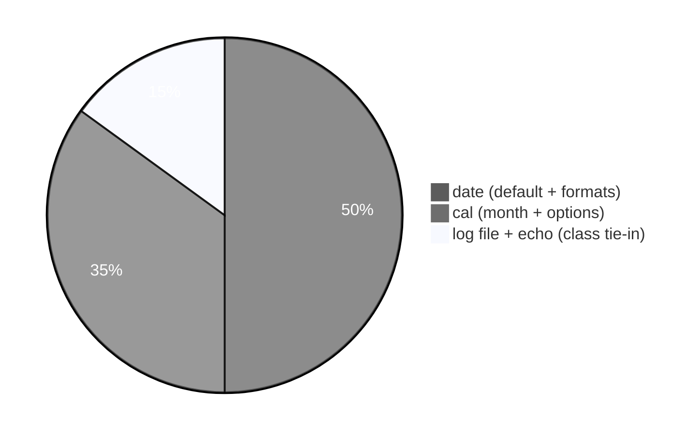
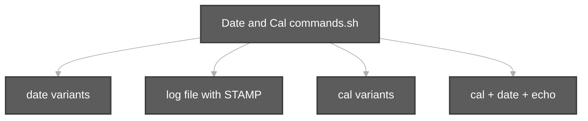

# DateandCal Execution summary

**Topic:** [Date and Cal commands.md](../docs/topics/Date%20and%20Cal%20commands.md) (Video 8)  
**Script:** [`Date and Cal commands.sh`](../scripts/Date%20and%20Cal%20commands.sh)



---

## [`Date and Cal commands.sh`](../scripts/Date%20and%20Cal%20commands.sh)

**Run from repo root:**

```bash
bash "scripts/Date and Cal commands.sh"
```

| Section | Commands | Meaning |
| :--- | :--- | :--- |
| Default date | `date` | Current date/time |
| Class format | `date +%d_%m_%Y_%H_%M_%S` | Custom timestamp with `%` codes |
| Readable format | `date +%d/%m/%Y %H:%M:%S` | Slash/colon separators |
| Log demo | `STAMP=$(date +%Y%m%d-%H%M%S)` | Variable for unique filename |
| Log demo | `echo ... > "$LOG"` | Write line to timestamped file |
| Log demo | `ls -l "$LOG"` | Verify file |
| Calendar | `cal` | Current month |
| Month/year | `cal 10 2026` | October 2026 |
| Options | `cal -y`, `cal -3`, `cal -m` | Year, three months, Monday week |
| Video 2 echo | `cal`, `date`, `echo` | Same trio as `test.sh` |
| Help hint | `man date`, `man cal` | Documented in echo tip |



### Shell features used (not `date`/`cal` themselves)

| Feature | Where |
| :--- | :--- |
| `set -euo pipefail` | Strict mode |
| `command -v cal` | Skip if `cal` missing (minimal images) |
| `$(date ...)` | Command substitution |
| `${TMPDIR:-/tmp}` | Temp directory default |
| `2>/dev/null \|\| true` | Optional `cal` flags without failing script |
| `head` | Truncate long `cal -y` output for demo |

### Related script

| Script | Link |
| :--- | :--- |
| `components-of-unix/test.sh` | [`test.sh`](../scripts/components-of-unix/test.sh) — short `cal` + `date` |
