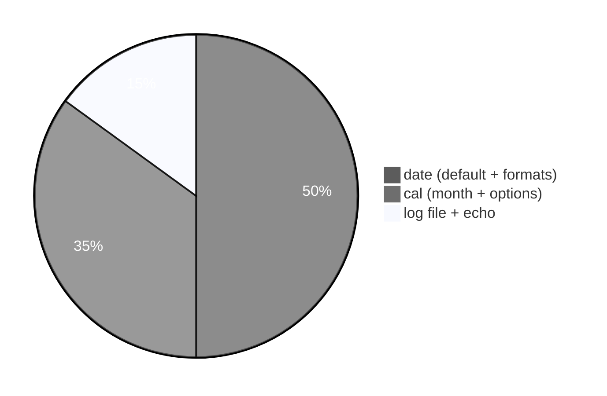
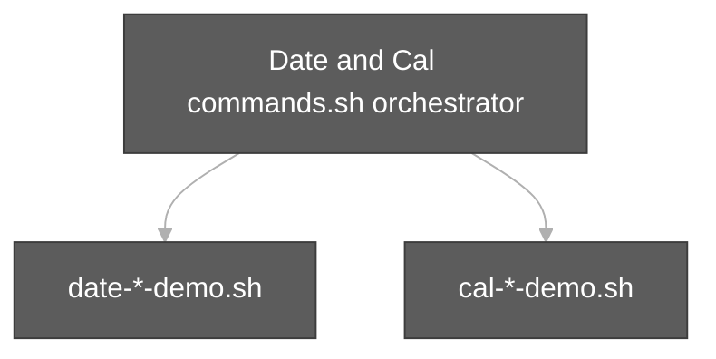

# DateandCal Execution summary

**Topic:** [Date and Cal commands.md](../docs/topics/Date%20and%20Cal%20commands.md) (Video 8)  
**Scripts directory:** [`../scripts/date-cal-commands/`](../scripts/date-cal-commands/) (orchestrator + split demos)





Each script section uses the same **four-part** model:

| # | Column in tables | Meaning |
| :---: | :--- | :--- |
| 1 | **What it is** | Command or shell feature (e.g. `echo` = print text). |
| 2 | **Added / configured** | How it appears in Linux (PATH, builtin, flag on CLI, variable in script). |
| 3 | **Execution intent** | What you are trying to do when the line runs. |
| 4 | **Output** | What you see on the **terminal (stdout/stderr)**, in a **file**, or through a **pipeline** (`|`). |

---

## [`Date and Cal commands.sh`](../scripts/date-cal-commands/Date%20and%20Cal%20commands.sh)

**Run:** `bash "scripts/date-cal-commands/Date and Cal commands.sh"`

### In-depth command walkthrough

| Command (as in script) | 1. What it is | 2. Added / configured | 3. Execution intent | 4. Output (terminal / file / pipeline) |
| :--- | :--- | :--- | :--- | :--- |
| `set -euo pipefail` | Bash strict-mode option bundle. | Written at top of script; not installed separately. | Tell Bash to stop on errors, treat unset variables as errors, and fail pipelines if any stage fails. | No visible output; changes how later commands affect exit status. |
| `DIR="$(cd "$(dirname "${BASH_SOURCE[0]}")" && pwd)"` | Shell variable assignment. | Name=`value` in script; often under `${TMPDIR:-/tmp}`. | Store path or stamp for later commands (setup, not a user command). | No output; variable used by `cd`, `rm`, file paths. |
| `echo ""` | Bash builtin that prints arguments to standard output. | Always available in Bash; no package install. | Show section titles, tips, or messages to the terminal (trying to **print** text for the user). | Lines appear on **stdout** in your terminal (or in CI logs). Not used in a pipeline unless followed by `|`. |
| `echo "############################################"` | Bash builtin that prints arguments to standard output. | Always available in Bash; no package install. | Show section titles, tips, or messages to the terminal (trying to **print** text for the user). | Lines appear on **stdout** in your terminal (or in CI logs). Not used in a pipeline unless followed by `|`. |
| `echo "# $name"` | Bash builtin that prints arguments to standard output. | Always available in Bash; no package install. | Show section titles, tips, or messages to the terminal (trying to **print** text for the user). | Lines appear on **stdout** in your terminal (or in CI logs). Not used in a pipeline unless followed by `|`. |
| `echo "############################################"` | Bash builtin that prints arguments to standard output. | Always available in Bash; no package install. | Show section titles, tips, or messages to the terminal (trying to **print** text for the user). | Lines appear on **stdout** in your terminal (or in CI logs). Not used in a pipeline unless followed by `|`. |
| `bash "$DIR/$name"` | Invoke another script with Bash. | Child path built from `HERE` / `DIR` next to orchestrator. | Run one focused demo file so output maps to that file’s commands. | Child script’s stdout/stderr appear in your terminal in order; orchestrator prints `#####` banner first. |
| `run_demo date-default-demo.sh` | Orchestrator helper call. | Function `run_demo` in same script; takes child `.sh` filename. | Run the next focused demo so its output is grouped under a banner. | Banner on stdout, then child script output. |
| `run_demo date-format-class-and-readable-demo.sh` | Orchestrator helper call. | Function `run_demo` in same script; takes child `.sh` filename. | Run the next focused demo so its output is grouped under a banner. | Banner on stdout, then child script output. |
| `run_demo date-log-timestamp-filename-demo.sh` | Orchestrator helper call. | Function `run_demo` in same script; takes child `.sh` filename. | Run the next focused demo so its output is grouped under a banner. | Banner on stdout, then child script output. |
| `run_demo cal-basic-month-and-options-demo.sh` | Orchestrator helper call. | Function `run_demo` in same script; takes child `.sh` filename. | Run the next focused demo so its output is grouped under a banner. | Banner on stdout, then child script output. |
| `run_demo cal-date-echo-group-demo.sh` | Orchestrator helper call. | Function `run_demo` in same script; takes child `.sh` filename. | Run the next focused demo so its output is grouped under a banner. | Banner on stdout, then child script output. |

---

## [`cal-basic-month-and-options-demo.sh`](../scripts/date-cal-commands/cal-basic-month-and-options-demo.sh)

**Run:** `bash scripts/date-cal-commands/cal-basic-month-and-options-demo.sh`

### In-depth command walkthrough

| Command (as in script) | 1. What it is | 2. Added / configured | 3. Execution intent | 4. Output (terminal / file / pipeline) |
| :--- | :--- | :--- | :--- | :--- |
| `set -euo pipefail` | Bash strict-mode option bundle. | Written at top of script; not installed separately. | Tell Bash to stop on errors, treat unset variables as errors, and fail pipelines if any stage fails. | No visible output; changes how later commands affect exit status. |
| `echo "=== cal (current month) ==="` | Section header for humans. | Literal string in script | **Print** section title | Title line on **stdout** before commands |
| `if command -v cal >/dev/null 2>&1; then` | Conditional test `[[ ... ]]` or `if`. | Bash syntax. | Branch: run block only when directory exists / command succeeds. | Either block runs (messages on stdout) or `else` branch. |
| `cal` | Print ASCII calendar. | Optional package `cal` / `ncal` on some minimal images. | Display month grid (current or given month/year). | Calendar grid on stdout; missing binary → “command not found”. |
| `echo "cal not installed on this system"` | Bash builtin that prints arguments to standard output. | Always available in Bash; no package install. | Show section titles, tips, or messages to the terminal (trying to **print** text for the user). | Lines appear on **stdout** in your terminal (or in CI logs). Not used in a pipeline unless followed by `|`. |
| `echo ""` | Bash builtin that prints arguments to standard output. | Always available in Bash; no package install. | Show section titles, tips, or messages to the terminal (trying to **print** text for the user). | Lines appear on **stdout** in your terminal (or in CI logs). Not used in a pipeline unless followed by `|`. |
| `echo "=== cal 10 2026 (month year) ==="` | Section header for humans. | Literal string in script | **Print** section title | Title line on **stdout** before commands |
| `cal 10 2026 2>/dev/null \|\| true` | Print ASCII calendar. | Optional package `cal` / `ncal` on some minimal images. | Display month grid (current or given month/year). | Calendar grid on stdout; missing binary → “command not found”. |
| `echo ""` | Bash builtin that prints arguments to standard output. | Always available in Bash; no package install. | Show section titles, tips, or messages to the terminal (trying to **print** text for the user). | Lines appear on **stdout** in your terminal (or in CI logs). Not used in a pipeline unless followed by `|`. |
| `echo "=== cal -y (full year) ==="` | Section header for humans. | Literal string in script | **Print** section title | Title line on **stdout** before commands |
| `cal -y 2>/dev/null \| head -20 \|\| true` | Print ASCII calendar. | Optional package `cal` / `ncal` on some minimal images. | Display month grid (current or given month/year). | Calendar grid on stdout; missing binary → “command not found”. |
| `echo ""` | Bash builtin that prints arguments to standard output. | Always available in Bash; no package install. | Show section titles, tips, or messages to the terminal (trying to **print** text for the user). | Lines appear on **stdout** in your terminal (or in CI logs). Not used in a pipeline unless followed by `|`. |
| `echo "=== cal -3 (prev, current, next month) ==="` | Section header for humans. | Literal string in script | **Print** section title | Title line on **stdout** before commands |
| `cal -3 2>/dev/null \|\| true` | Print ASCII calendar. | Optional package `cal` / `ncal` on some minimal images. | Display month grid (current or given month/year). | Calendar grid on stdout; missing binary → “command not found”. |
| `echo ""` | Bash builtin that prints arguments to standard output. | Always available in Bash; no package install. | Show section titles, tips, or messages to the terminal (trying to **print** text for the user). | Lines appear on **stdout** in your terminal (or in CI logs). Not used in a pipeline unless followed by `|`. |
| `echo "=== cal -m (Monday as first day) — sample line ==="` | Section header for humans. | Literal string in script | **Print** section title | Title line on **stdout** before commands |
| `cal -m 2>/dev/null \| head -8 \|\| true` | Print ASCII calendar. | Optional package `cal` / `ncal` on some minimal images. | Display month grid (current or given month/year). | Calendar grid on stdout; missing binary → “command not found”. |

---

## [`cal-date-echo-group-demo.sh`](../scripts/date-cal-commands/cal-date-echo-group-demo.sh)

**Run:** `bash scripts/date-cal-commands/cal-date-echo-group-demo.sh`

### In-depth command walkthrough

| Command (as in script) | 1. What it is | 2. Added / configured | 3. Execution intent | 4. Output (terminal / file / pipeline) |
| :--- | :--- | :--- | :--- | :--- |
| `set -euo pipefail` | Bash strict-mode option bundle. | Written at top of script; not installed separately. | Tell Bash to stop on errors, treat unset variables as errors, and fail pipelines if any stage fails. | No visible output; changes how later commands affect exit status. |
| `echo "=== Group like Video 2 test.sh ==="` | Section header for humans. | Literal string in script | **Print** section title | Title line on **stdout** before commands |
| `cal 2>/dev/null \|\| true` | Print ASCII calendar. | Optional package `cal` / `ncal` on some minimal images. | Display month grid (current or given month/year). | Calendar grid on stdout; missing binary → “command not found”. |
| `date` | Print or set system date/time. | `date` from coreutils; `+format` uses `%` codes. | Show **current time** or build a formatted string for logs. | Human-readable line on stdout, or custom format string only. |
| `echo "Hello Friends. Welcome to Unix World."` | Bash builtin that prints arguments to standard output. | Always available in Bash; no package install. | Show section titles, tips, or messages to the terminal (trying to **print** text for the user). | Lines appear on **stdout** in your terminal (or in CI logs). Not used in a pipeline unless followed by `|`. |
| `echo ""` | Bash builtin that prints arguments to standard output. | Always available in Bash; no package install. | Show section titles, tips, or messages to the terminal (trying to **print** text for the user). | Lines appear on **stdout** in your terminal (or in CI logs). Not used in a pipeline unless followed by `|`. |
| `echo "Tip: man date && man cal"` | Bash builtin that prints arguments to standard output. | Always available in Bash; no package install. | Show section titles, tips, or messages to the terminal (trying to **print** text for the user). | Lines appear on **stdout** in your terminal (or in CI logs). Not used in a pipeline unless followed by `|`. |

---

## [`date-default-demo.sh`](../scripts/date-cal-commands/date-default-demo.sh)

**Run:** `bash scripts/date-cal-commands/date-default-demo.sh`

### In-depth command walkthrough

| Command (as in script) | 1. What it is | 2. Added / configured | 3. Execution intent | 4. Output (terminal / file / pipeline) |
| :--- | :--- | :--- | :--- | :--- |
| `set -euo pipefail` | Bash strict-mode option bundle. | Written at top of script; not installed separately. | Tell Bash to stop on errors, treat unset variables as errors, and fail pipelines if any stage fails. | No visible output; changes how later commands affect exit status. |
| `echo "=== date (default) ==="` | Section header for humans. | Literal string in script | **Print** section title | Title line on **stdout** before commands |
| `date` | Print or set system date/time. | `date` from coreutils; `+format` uses `%` codes. | Show **current time** or build a formatted string for logs. | Human-readable line on stdout, or custom format string only. |

---

## [`date-format-class-and-readable-demo.sh`](../scripts/date-cal-commands/date-format-class-and-readable-demo.sh)

**Run:** `bash scripts/date-cal-commands/date-format-class-and-readable-demo.sh`

### In-depth command walkthrough

| Command (as in script) | 1. What it is | 2. Added / configured | 3. Execution intent | 4. Output (terminal / file / pipeline) |
| :--- | :--- | :--- | :--- | :--- |
| `set -euo pipefail` | Bash strict-mode option bundle. | Written at top of script; not installed separately. | Tell Bash to stop on errors, treat unset variables as errors, and fail pipelines if any stage fails. | No visible output; changes how later commands affect exit status. |
| `echo "=== date + custom format (class style: day_month_year_hour_min_s…` | Section header for humans. | Literal string in script | **Print** section title | Title line on **stdout** before commands |
| `date +%d_%m_%Y_%H_%M_%S` | Print or set system date/time. | `date` from coreutils; `+format` uses `%` codes. | Show **current time** or build a formatted string for logs. | Human-readable line on stdout, or custom format string only. |
| `echo ""` | Bash builtin that prints arguments to standard output. | Always available in Bash; no package install. | Show section titles, tips, or messages to the terminal (trying to **print** text for the user). | Lines appear on **stdout** in your terminal (or in CI logs). Not used in a pipeline unless followed by `|`. |
| `echo "=== date + readable format ==="` | Section header for humans. | Literal string in script | **Print** section title | Title line on **stdout** before commands |
| `date +"%d/%m/%Y %H:%M:%S"` | Print or set system date/time. | `date` from coreutils; `+format` uses `%` codes. | Show **current time** or build a formatted string for logs. | Human-readable line on stdout, or custom format string only. |

---

## [`date-log-timestamp-filename-demo.sh`](../scripts/date-cal-commands/date-log-timestamp-filename-demo.sh)

**Run:** `bash scripts/date-cal-commands/date-log-timestamp-filename-demo.sh`

### In-depth command walkthrough

| Command (as in script) | 1. What it is | 2. Added / configured | 3. Execution intent | 4. Output (terminal / file / pipeline) |
| :--- | :--- | :--- | :--- | :--- |
| `set -euo pipefail` | Bash strict-mode option bundle. | Written at top of script; not installed separately. | Tell Bash to stop on errors, treat unset variables as errors, and fail pipelines if any stage fails. | No visible output; changes how later commands affect exit status. |
| `echo "=== timestamp variable for log file name ==="` | Section header for humans. | Literal string in script | **Print** section title | Title line on **stdout** before commands |
| `STAMP=$(date +%Y%m%d-%H%M%S)` | Shell variable assignment. | Name=`value` in script; often under `${TMPDIR:-/tmp}`. | Store path or stamp for later commands (setup, not a user command). | No output; variable used by `cd`, `rm`, file paths. |
| `LOG="${TMPDIR:-/tmp}/linux-basics-log-${STAMP}.txt"` | Shell variable assignment. | Name=`value` in script; often under `${TMPDIR:-/tmp}`. | Store path or stamp for later commands (setup, not a user command). | No output; variable used by `cd`, `rm`, file paths. |
| `echo "Sample log line at $(date)" > "$LOG"` | Bash builtin that prints arguments to standard output. | Always available in Bash; no package install. | Show section titles, tips, or messages to the terminal (trying to **print** text for the user). | Lines appear on **stdout** in your terminal (or in CI logs). Not used in a pipeline unless followed by `|`. |
| `echo "Created: $LOG"` | Bash builtin that prints arguments to standard output. | Always available in Bash; no package install. | Show section titles, tips, or messages to the terminal (trying to **print** text for the user). | Lines appear on **stdout** in your terminal (or in CI logs). Not used in a pipeline unless followed by `|`. |
| `ls -l "$LOG"` | `ls` long format. | Flag `-l` passed on command line. | Show type, permissions, owner, size, date, name. | Multiple lines on stdout. |

---

## Script index (all `.sh` in this summary)

| Script | Run |
| :--- | :--- |
| [`Date and Cal commands.sh`](../scripts/date-cal-commands/Date%20and%20Cal%20commands.sh) | `bash "scripts/date-cal-commands/Date and Cal commands.sh"` |
| [`cal-basic-month-and-options-demo.sh`](../scripts/date-cal-commands/cal-basic-month-and-options-demo.sh) | `bash scripts/date-cal-commands/cal-basic-month-and-options-demo.sh` |
| [`cal-date-echo-group-demo.sh`](../scripts/date-cal-commands/cal-date-echo-group-demo.sh) | `bash scripts/date-cal-commands/cal-date-echo-group-demo.sh` |
| [`date-default-demo.sh`](../scripts/date-cal-commands/date-default-demo.sh) | `bash scripts/date-cal-commands/date-default-demo.sh` |
| [`date-format-class-and-readable-demo.sh`](../scripts/date-cal-commands/date-format-class-and-readable-demo.sh) | `bash scripts/date-cal-commands/date-format-class-and-readable-demo.sh` |
| [`date-log-timestamp-filename-demo.sh`](../scripts/date-cal-commands/date-log-timestamp-filename-demo.sh) | `bash scripts/date-cal-commands/date-log-timestamp-filename-demo.sh` |


**Run every script in this topic (from repo root):**

```bash
bash "scripts/date-cal-commands/Date and Cal commands.sh"
bash scripts/date-cal-commands/cal-basic-month-and-options-demo.sh
bash scripts/date-cal-commands/cal-date-echo-group-demo.sh
bash scripts/date-cal-commands/date-default-demo.sh
bash scripts/date-cal-commands/date-format-class-and-readable-demo.sh
bash scripts/date-cal-commands/date-log-timestamp-filename-demo.sh
```
