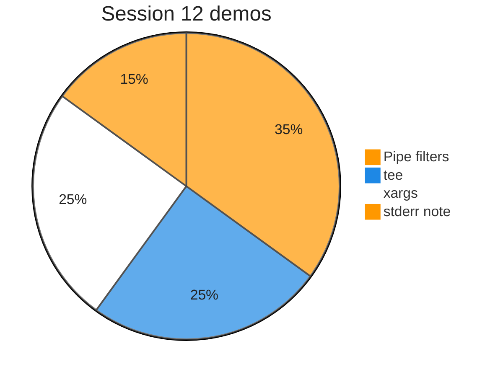
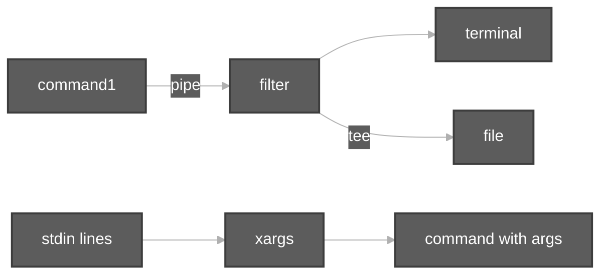

# Execution summary — Session 12 piping, tee, xargs

**Topic:** [PipingTeeXargs.md](../docs/topics/PipingTeeXargs.md) (Video 12)  
**Scripts:** [`../scripts/PipingTeeXargs.sh`](../scripts/PipingTeeXargs.sh) · [`../scripts/PipingTeeXargs/`](../scripts/PipingTeeXargs/)





Each script section uses the same **four-part** model:

| # | Column in tables | Meaning |
| :---: | :--- | :--- |
| 1 | **What it is** | Command or shell feature (e.g. `echo` = print text). |
| 2 | **Added / configured** | How it appears in Linux (PATH, builtin, flag on CLI, variable in script). |
| 3 | **Execution intent** | What you are trying to do when the line runs. |
| 4 | **Output** | What you see on the **terminal (stdout/stderr)**, in a **file**, or through a **pipeline** (`|`). |

---

## [`PipingTeeXargs.sh`](../scripts/PipingTeeXargs.sh)

**Run:** `bash scripts/PipingTeeXargs.sh`

### In-depth command walkthrough

| Command (as in script) | 1. What it is | 2. Added / configured | 3. Execution intent | 4. Output (terminal / file / pipeline) |
| :--- | :--- | :--- | :--- | :--- |
| `set -euo pipefail` | Bash strict-mode option bundle. | Written at top of script; not installed separately. | Tell Bash to stop on errors, treat unset variables as errors, and fail pipelines if any stage fails. | No visible output; changes how later commands affect exit status. |
| `DIR="$(cd "$(dirname "${BASH_SOURCE[0]}")/PipingTeeXargs" && pwd)"` | Shell variable assignment. | Name=`value` in script; often under `${TMPDIR:-/tmp}`. | Store path or stamp for later commands (setup, not a user command). | No output; variable used by `cd`, `rm`, file paths. |
| `echo ""` | Bash builtin that prints arguments to standard output. | Always available in Bash; no package install. | Show section titles, tips, or messages to the terminal (trying to **print** text for the user). | Lines appear on **stdout** in your terminal (or in CI logs). Not used in a pipeline unless followed by `|`. |
| `echo "############################################"` | Bash builtin that prints arguments to standard output. | Always available in Bash; no package install. | Show section titles, tips, or messages to the terminal (trying to **print** text for the user). | Lines appear on **stdout** in your terminal (or in CI logs). Not used in a pipeline unless followed by `|`. |
| `echo "# $name"` | Bash builtin that prints arguments to standard output. | Always available in Bash; no package install. | Show section titles, tips, or messages to the terminal (trying to **print** text for the user). | Lines appear on **stdout** in your terminal (or in CI logs). Not used in a pipeline unless followed by `|`. |
| `echo "############################################"` | Bash builtin that prints arguments to standard output. | Always available in Bash; no package install. | Show section titles, tips, or messages to the terminal (trying to **print** text for the user). | Lines appear on **stdout** in your terminal (or in CI logs). Not used in a pipeline unless followed by `|`. |
| `bash "$DIR/$name"` | Invoke another script with Bash. | Child path built from `HERE` / `DIR` next to orchestrator. | Run one focused demo file so output maps to that file’s commands. | Child script’s stdout/stderr appear in your terminal in order; orchestrator prints `#####` banner first. |
| `for script in "$DIR"/*-demo.sh; do` | `for` loop over words. | Bash syntax; list after `in`. | Repeat command for each item (e.g. each utility name). | One output line per iteration on stdout. |
| `[[ -f "$script" ]] \|\| continue` | Conditional test `[[ ... ]]` or `if`. | Bash syntax. | Branch: run block only when directory exists / command succeeds. | Either block runs (messages on stdout) or `else` branch. |
| `run_demo "$(basename "$script")"` | Orchestrator helper call. | Function `run_demo` in same script; takes child `.sh` filename. | Run the next focused demo so its output is grouped under a banner. | Banner on stdout, then child script output. |

---

## [`pipe-filters-sort-uniq-demo.sh`](../scripts/PipingTeeXargs/pipe-filters-sort-uniq-demo.sh)

**Run:** `bash scripts/PipingTeeXargs/pipe-filters-sort-uniq-demo.sh`

### In-depth command walkthrough

| Command (as in script) | 1. What it is | 2. Added / configured | 3. Execution intent | 4. Output (terminal / file / pipeline) |
| :--- | :--- | :--- | :--- | :--- |
| `set -euo pipefail` | Bash strict-mode option bundle. | Written at top of script; not installed separately. | Tell Bash to stop on errors, treat unset variables as errors, and fail pipelines if any stage fails. | No visible output; changes how later commands affect exit status. |
| `WORK="${TMPDIR:-/tmp}/linux-pipe-filters"` | Shell variable assignment. | Name=`value` in script; often under `${TMPDIR:-/tmp}`. | Store path or stamp for later commands (setup, not a user command). | No output; variable used by `cd`, `rm`, file paths. |
| `rm -rf "$WORK"` | Remove files/directories recursively, force. | Coreutils; `-r` recursive, `-f` no prompt. | Clean old demo data under `/tmp` before recreating. | Silent on success. |
| `mkdir -p "$WORK"` | Make directories. | Coreutils; `-p` creates parents as needed. | Try to **create** folder(s) for the demo tree. | Silent on success; errors on stderr if path invalid. |
| `cd "$WORK"` | Change directory — move shell’s current working directory. | Builtin; takes relative or absolute path, `~`, `-`, or no args (home). | Navigate the tree (trying to **enter** a folder); relative paths start from cwd. | Normally silent on success; failure prints `cd: ...: No such file or directory` on **stderr**. |
| `cat > marks.txt << 'EOF'` | Concatenate and print files. | Coreutils. | Try to **display file contents** on terminal. | File bytes on stdout. |
| `ravi 90` | Shell syntax (variable, test, subshell, or function). | Defined in this script only. | Prepare path, branch on failure, or wrap commands. | Depends on line: may be silent or print via embedded commands. |
| `sita 85` | Shell syntax (variable, test, subshell, or function). | Defined in this script only. | Prepare path, branch on failure, or wrap commands. | Depends on line: may be silent or print via embedded commands. |
| `ravi 90` | Shell syntax (variable, test, subshell, or function). | Defined in this script only. | Prepare path, branch on failure, or wrap commands. | Depends on line: may be silent or print via embedded commands. |
| `amit 78` | Shell syntax (variable, test, subshell, or function). | Defined in this script only. | Prepare path, branch on failure, or wrap commands. | Depends on line: may be silent or print via embedded commands. |
| `sita 85` | Shell syntax (variable, test, subshell, or function). | Defined in this script only. | Prepare path, branch on failure, or wrap commands. | Depends on line: may be silent or print via embedded commands. |
| `EOF` | Shell syntax (variable, test, subshell, or function). | Defined in this script only. | Prepare path, branch on failure, or wrap commands. | Depends on line: may be silent or print via embedded commands. |
| `echo "=== cat marks.txt \| sort \| uniq (sorted unique lines) ==="` | Section header for humans. | Literal string in script | **Print** section title | Title line on **stdout** before commands |
| `cat marks.txt \| sort \| uniq` | Concatenate and print files. | Coreutils. | Try to **display file contents** on terminal. | File bytes on stdout. |
| `echo ""` | Bash builtin that prints arguments to standard output. | Always available in Bash; no package install. | Show section titles, tips, or messages to the terminal (trying to **print** text for the user). | Lines appear on **stdout** in your terminal (or in CI logs). Not used in a pipeline unless followed by `|`. |
| `echo "=== cat marks.txt \| sort \| uniq -c (count duplicates) ==="` | Section header for humans. | Literal string in script | **Print** section title | Title line on **stdout** before commands |
| `cat marks.txt \| sort \| uniq -c` | Concatenate and print files. | Coreutils. | Try to **display file contents** on terminal. | File bytes on stdout. |

---

## [`pipe-ls-head-wc-demo.sh`](../scripts/PipingTeeXargs/pipe-ls-head-wc-demo.sh)

**Run:** `bash scripts/PipingTeeXargs/pipe-ls-head-wc-demo.sh`

### In-depth command walkthrough

| Command (as in script) | 1. What it is | 2. Added / configured | 3. Execution intent | 4. Output (terminal / file / pipeline) |
| :--- | :--- | :--- | :--- | :--- |
| `set -euo pipefail` | Bash strict-mode option bundle. | Written at top of script; not installed separately. | Tell Bash to stop on errors, treat unset variables as errors, and fail pipelines if any stage fails. | No visible output; changes how later commands affect exit status. |
| `echo "=== ls -l /etc \| head (first 10 lines only) ==="` | Section header for humans. | Literal string in script | **Print** section title | Title line on **stdout** before commands |
| `ls -l /etc \| head \|\| true` | `ls` long format. | Flag `-l` passed on command line. | Show type, permissions, owner, size, date, name. | Multiple lines on stdout. |
| `echo ""` | Bash builtin that prints arguments to standard output. | Always available in Bash; no package install. | Show section titles, tips, or messages to the terminal (trying to **print** text for the user). | Lines appear on **stdout** in your terminal (or in CI logs). Not used in a pipeline unless followed by `|`. |
| `echo "=== ls -l /etc \| wc -l (count lines — includes total line from …` | Section header for humans. | Literal string in script | **Print** section title | Title line on **stdout** before commands |
| `ls -l /etc \| wc -l` | `ls` long format. | Flag `-l` passed on command line. | Show type, permissions, owner, size, date, name. | Multiple lines on stdout. |

---

## [`pipe-stdout-only-not-stderr-demo.sh`](../scripts/PipingTeeXargs/pipe-stdout-only-not-stderr-demo.sh)

**Run:** `bash scripts/PipingTeeXargs/pipe-stdout-only-not-stderr-demo.sh`

### In-depth command walkthrough

| Command (as in script) | 1. What it is | 2. Added / configured | 3. Execution intent | 4. Output (terminal / file / pipeline) |
| :--- | :--- | :--- | :--- | :--- |
| `set -euo pipefail` | Bash strict-mode option bundle. | Written at top of script; not installed separately. | Tell Bash to stop on errors, treat unset variables as errors, and fail pipelines if any stage fails. | No visible output; changes how later commands affect exit status. |
| `echo "=== cal 99999 \| wc -l — error still on terminal; wc gets little…` | Section header for humans. | Literal string in script | **Print** section title | Title line on **stdout** before commands |
| `set +e` | Bash option: do not exit on command failure. | Shell builtin toggled inside the script. | Allow demo commands that are expected to fail without stopping the whole script. | No output; failed commands still print their error text to stderr. |
| `cal 99999 \| wc -l` | Print ASCII calendar. | Optional package `cal` / `ncal` on some minimal images. | Display month grid (current or given month/year). | Calendar grid on stdout; missing binary → “command not found”. |
| `set -e` | Bash option: exit immediately on failure. | Re-enabled after demos that expect errors. | Restore strict behavior for the rest of the script. | No direct output. |
| `echo "(Durga Sir point: redirect stderr with 2> if you need errors in…` | Bash builtin that prints arguments to standard output. | Always available in Bash; no package install. | Show section titles, tips, or messages to the terminal (trying to **print** text for the user). | Lines appear on **stdout** in your terminal (or in CI logs). Not used in a pipeline unless followed by `|`. |

---

## [`tee-append-multiple-files-demo.sh`](../scripts/PipingTeeXargs/tee-append-multiple-files-demo.sh)

**Run:** `bash scripts/PipingTeeXargs/tee-append-multiple-files-demo.sh`

### In-depth command walkthrough

| Command (as in script) | 1. What it is | 2. Added / configured | 3. Execution intent | 4. Output (terminal / file / pipeline) |
| :--- | :--- | :--- | :--- | :--- |
| `set -euo pipefail` | Bash strict-mode option bundle. | Written at top of script; not installed separately. | Tell Bash to stop on errors, treat unset variables as errors, and fail pipelines if any stage fails. | No visible output; changes how later commands affect exit status. |
| `WORK="${TMPDIR:-/tmp}/linux-tee-demo"` | Shell variable assignment. | Name=`value` in script; often under `${TMPDIR:-/tmp}`. | Store path or stamp for later commands (setup, not a user command). | No output; variable used by `cd`, `rm`, file paths. |
| `rm -rf "$WORK"` | Remove files/directories recursively, force. | Coreutils; `-r` recursive, `-f` no prompt. | Clean old demo data under `/tmp` before recreating. | Silent on success. |
| `mkdir -p "$WORK"` | Make directories. | Coreutils; `-p` creates parents as needed. | Try to **create** folder(s) for the demo tree. | Silent on success; errors on stderr if path invalid. |
| `cd "$WORK"` | Change directory — move shell’s current working directory. | Builtin; takes relative or absolute path, `~`, `-`, or no args (home). | Navigate the tree (trying to **enter** a folder); relative paths start from cwd. | Normally silent on success; failure prints `cd: ...: No such file or directory` on **stderr**. |
| `echo "first block" \| tee log1.txt log2.txt` | Bash builtin that prints arguments to standard output. | Always available in Bash; no package install. | Show section titles, tips, or messages to the terminal (trying to **print** text for the user). | Lines appear on **stdout** in your terminal (or in CI logs). Not used in a pipeline unless followed by `|`. |
| `echo "second block" \| tee -a log1.txt log2.txt` | Bash builtin that prints arguments to standard output. | Always available in Bash; no package install. | Show section titles, tips, or messages to the terminal (trying to **print** text for the user). | Lines appear on **stdout** in your terminal (or in CI logs). Not used in a pipeline unless followed by `|`. |
| `echo "=== log1.txt ==="` | Section header for humans. | Literal string in script | **Print** section title | Title line on **stdout** before commands |
| `cat log1.txt` | Concatenate and print files. | Coreutils. | Try to **display file contents** on terminal. | File bytes on stdout. |
| `echo "=== log2.txt ==="` | Section header for humans. | Literal string in script | **Print** section title | Title line on **stdout** before commands |
| `cat log2.txt` | Concatenate and print files. | Coreutils. | Try to **display file contents** on terminal. | File bytes on stdout. |

---

## [`tee-screen-and-file-demo.sh`](../scripts/PipingTeeXargs/tee-screen-and-file-demo.sh)

**Run:** `bash scripts/PipingTeeXargs/tee-screen-and-file-demo.sh`

### In-depth command walkthrough

| Command (as in script) | 1. What it is | 2. Added / configured | 3. Execution intent | 4. Output (terminal / file / pipeline) |
| :--- | :--- | :--- | :--- | :--- |
| `set -euo pipefail` | Bash strict-mode option bundle. | Written at top of script; not installed separately. | Tell Bash to stop on errors, treat unset variables as errors, and fail pipelines if any stage fails. | No visible output; changes how later commands affect exit status. |
| `WORK="${TMPDIR:-/tmp}/linux-tee-demo"` | Shell variable assignment. | Name=`value` in script; often under `${TMPDIR:-/tmp}`. | Store path or stamp for later commands (setup, not a user command). | No output; variable used by `cd`, `rm`, file paths. |
| `rm -rf "$WORK"` | Remove files/directories recursively, force. | Coreutils; `-r` recursive, `-f` no prompt. | Clean old demo data under `/tmp` before recreating. | Silent on success. |
| `mkdir -p "$WORK"` | Make directories. | Coreutils; `-p` creates parents as needed. | Try to **create** folder(s) for the demo tree. | Silent on success; errors on stderr if path invalid. |
| `cd "$WORK"` | Change directory — move shell’s current working directory. | Builtin; takes relative or absolute path, `~`, `-`, or no args (home). | Navigate the tree (trying to **enter** a folder); relative paths start from cwd. | Normally silent on success; failure prints `cd: ...: No such file or directory` on **stderr**. |
| `echo "=== ls -l \| tee listing.txt (see screen + file) ==="` | Section header for humans. | Literal string in script | **Print** section title | Title line on **stdout** before commands |
| `ls -l \| tee listing.txt` | `ls` long format. | Flag `-l` passed on command line. | Show type, permissions, owner, size, date, name. | Multiple lines on stdout. |
| `echo "--- file contents ---"` | Bash builtin that prints arguments to standard output. | Always available in Bash; no package install. | Show section titles, tips, or messages to the terminal (trying to **print** text for the user). | Lines appear on **stdout** in your terminal (or in CI logs). Not used in a pipeline unless followed by `|`. |
| `wc -l listing.txt` | Word/line/byte count. | Coreutils; `-l` lines, `-c` bytes. | Count entries or file size. | Number on stdout; `wc -l < file` reads file via stdin redirect. |

---

## [`xargs-build-command-line-demo.sh`](../scripts/PipingTeeXargs/xargs-build-command-line-demo.sh)

**Run:** `bash scripts/PipingTeeXargs/xargs-build-command-line-demo.sh`

### In-depth command walkthrough

| Command (as in script) | 1. What it is | 2. Added / configured | 3. Execution intent | 4. Output (terminal / file / pipeline) |
| :--- | :--- | :--- | :--- | :--- |
| `set -euo pipefail` | Bash strict-mode option bundle. | Written at top of script; not installed separately. | Tell Bash to stop on errors, treat unset variables as errors, and fail pipelines if any stage fails. | No visible output; changes how later commands affect exit status. |
| `WORK="${TMPDIR:-/tmp}/linux-xargs-demo"` | Shell variable assignment. | Name=`value` in script; often under `${TMPDIR:-/tmp}`. | Store path or stamp for later commands (setup, not a user command). | No output; variable used by `cd`, `rm`, file paths. |
| `rm -rf "$WORK"` | Remove files/directories recursively, force. | Coreutils; `-r` recursive, `-f` no prompt. | Clean old demo data under `/tmp` before recreating. | Silent on success. |
| `mkdir -p "$WORK"` | Make directories. | Coreutils; `-p` creates parents as needed. | Try to **create** folder(s) for the demo tree. | Silent on success; errors on stderr if path invalid. |
| `cd "$WORK"` | Change directory — move shell’s current working directory. | Builtin; takes relative or absolute path, `~`, `-`, or no args (home). | Navigate the tree (trying to **enter** a folder); relative paths start from cwd. | Normally silent on success; failure prints `cd: ...: No such file or directory` on **stderr**. |
| `echo "=== echo names \| xargs touch (create three files) ==="` | Section header for humans. | Literal string in script | **Print** section title | Title line on **stdout** before commands |
| `echo "apple banana cherry" \| xargs touch` | Bash builtin that prints arguments to standard output. | Always available in Bash; no package install. | Show section titles, tips, or messages to the terminal (trying to **print** text for the user). | Lines appear on **stdout** in your terminal (or in CI logs). Not used in a pipeline unless followed by `|`. |
| `ls -1 apple banana cherry` | List directory contents. | Coreutils; options change columns, hidden files, sort. | Try to **show names** in cwd or given path. | Names on stdout; options add permissions, sizes, inodes. |
| `echo ""` | Bash builtin that prints arguments to standard output. | Always available in Bash; no package install. | Show section titles, tips, or messages to the terminal (trying to **print** text for the user). | Lines appear on **stdout** in your terminal (or in CI logs). Not used in a pipeline unless followed by `|`. |
| `echo "=== printf lines \| xargs -n 2 echo (two words per echo) ==="` | Section header for humans. | Literal string in script | **Print** section title | Title line on **stdout** before commands |
| `printf 'one two three four\n' \| xargs -n 2 echo` | Formatted print (builtin). | Bash builtin. | Print with format specifiers like C. | Formatted bytes on stdout. |

---

## [`xargs-with-find-style-demo.sh`](../scripts/PipingTeeXargs/xargs-with-find-style-demo.sh)

**Run:** `bash scripts/PipingTeeXargs/xargs-with-find-style-demo.sh`

### In-depth command walkthrough

| Command (as in script) | 1. What it is | 2. Added / configured | 3. Execution intent | 4. Output (terminal / file / pipeline) |
| :--- | :--- | :--- | :--- | :--- |
| `set -euo pipefail` | Bash strict-mode option bundle. | Written at top of script; not installed separately. | Tell Bash to stop on errors, treat unset variables as errors, and fail pipelines if any stage fails. | No visible output; changes how later commands affect exit status. |
| `ROOT="$(cd "$(dirname "${BASH_SOURCE[0]}")/../linuxbasics" && pwd)"` | Shell syntax (variable, test, subshell, or function). | Defined in this script only. | Prepare path, branch on failure, or wrap commands. | Depends on line: may be silent or print via embedded commands. |
| `echo "=== ls *.sh in linuxbasics \| xargs wc -l ==="` | Section header for humans. | Literal string in script | **Print** section title | Title line on **stdout** before commands |
| `ls "$ROOT"/*.sh \| xargs wc -l` | List directory contents. | Coreutils; options change columns, hidden files, sort. | Try to **show names** in cwd or given path. | Names on stdout; options add permissions, sizes, inodes. |

---

## Script index (all `.sh` in this summary)

| Script | Run |
| :--- | :--- |
| [`PipingTeeXargs.sh`](../scripts/PipingTeeXargs.sh) | `bash scripts/PipingTeeXargs.sh` |
| [`pipe-filters-sort-uniq-demo.sh`](../scripts/PipingTeeXargs/pipe-filters-sort-uniq-demo.sh) | `bash scripts/PipingTeeXargs/pipe-filters-sort-uniq-demo.sh` |
| [`pipe-ls-head-wc-demo.sh`](../scripts/PipingTeeXargs/pipe-ls-head-wc-demo.sh) | `bash scripts/PipingTeeXargs/pipe-ls-head-wc-demo.sh` |
| [`pipe-stdout-only-not-stderr-demo.sh`](../scripts/PipingTeeXargs/pipe-stdout-only-not-stderr-demo.sh) | `bash scripts/PipingTeeXargs/pipe-stdout-only-not-stderr-demo.sh` |
| [`tee-append-multiple-files-demo.sh`](../scripts/PipingTeeXargs/tee-append-multiple-files-demo.sh) | `bash scripts/PipingTeeXargs/tee-append-multiple-files-demo.sh` |
| [`tee-screen-and-file-demo.sh`](../scripts/PipingTeeXargs/tee-screen-and-file-demo.sh) | `bash scripts/PipingTeeXargs/tee-screen-and-file-demo.sh` |
| [`xargs-build-command-line-demo.sh`](../scripts/PipingTeeXargs/xargs-build-command-line-demo.sh) | `bash scripts/PipingTeeXargs/xargs-build-command-line-demo.sh` |
| [`xargs-with-find-style-demo.sh`](../scripts/PipingTeeXargs/xargs-with-find-style-demo.sh) | `bash scripts/PipingTeeXargs/xargs-with-find-style-demo.sh` |


**Run every script in this topic (from repo root):**

```bash
bash scripts/PipingTeeXargs.sh
bash scripts/PipingTeeXargs/pipe-filters-sort-uniq-demo.sh
bash scripts/PipingTeeXargs/pipe-ls-head-wc-demo.sh
bash scripts/PipingTeeXargs/pipe-stdout-only-not-stderr-demo.sh
bash scripts/PipingTeeXargs/tee-append-multiple-files-demo.sh
bash scripts/PipingTeeXargs/tee-screen-and-file-demo.sh
bash scripts/PipingTeeXargs/xargs-build-command-line-demo.sh
bash scripts/PipingTeeXargs/xargs-with-find-style-demo.sh
```
