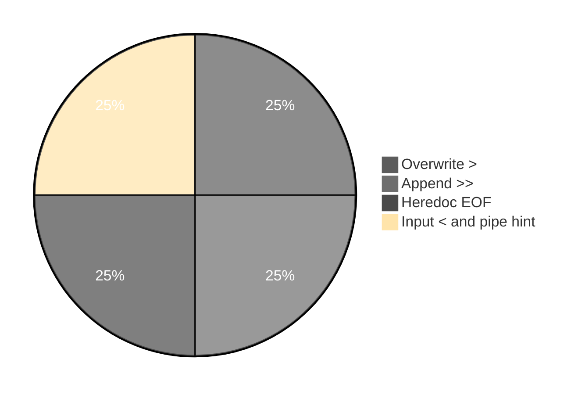

# Execution summary — `Redirection/`

**Topic:** [EOF and Redirection.md](../../docs/topics/EOF%20and%20Redirection.md)  
**Scripts directory:** [`../../scripts/Redirection/`](../../scripts/Redirection/)



Each script section uses the same **four-part** model:

| # | Column in tables | Meaning |
| :---: | :--- | :--- |
| 1 | **What it is** | Command or shell feature (e.g. `echo` = print text). |
| 2 | **Added / configured** | How it appears in Linux (PATH, builtin, flag on CLI, variable in script). |
| 3 | **Execution intent** | What you are trying to do when the line runs. |
| 4 | **Output** | What you see on the **terminal (stdout/stderr)**, in a **file**, or through a **pipeline** (`|`). |

---

## [`append-greater-greater-demo.sh`](../scripts/Redirection/append-greater-greater-demo.sh)

**Run:** `bash scripts/Redirection/append-greater-greater-demo.sh`

### In-depth command walkthrough

| Command (as in script) | 1. What it is | 2. Added / configured | 3. Execution intent | 4. Output (terminal / file / pipeline) |
| :--- | :--- | :--- | :--- | :--- |
| `set -euo pipefail` | Bash strict-mode option bundle. | Written at top of script; not installed separately. | Tell Bash to stop on errors, treat unset variables as errors, and fail pipelines if any stage fails. | No visible output; changes how later commands affect exit status. |
| `WORK="${TMPDIR:-/tmp}/linux-redirection-demo"` | Shell variable assignment. | Name=`value` in script; often under `${TMPDIR:-/tmp}`. | Store path or stamp for later commands (setup, not a user command). | No output; variable used by `cd`, `rm`, file paths. |
| `rm -rf "$WORK"` | Remove files/directories recursively, force. | Coreutils; `-r` recursive, `-f` no prompt. | Clean old demo data under `/tmp` before recreating. | Silent on success. |
| `mkdir -p "$WORK"` | Make directories. | Coreutils; `-p` creates parents as needed. | Try to **create** folder(s) for the demo tree. | Silent on success; errors on stderr if path invalid. |
| `FILE="$WORK/appendData.sh"` | Shell variable assignment. | Name=`value` in script; often under `${TMPDIR:-/tmp}`. | Store path or stamp for later commands (setup, not a user command). | No output; variable used by `cd`, `rm`, file paths. |
| `echo Rama > "$FILE"` | Bash builtin that prints arguments to standard output. | Always available in Bash; no package install. | Show section titles, tips, or messages to the terminal (trying to **print** text for the user). | Lines appear on **stdout** in your terminal (or in CI logs). Not used in a pipeline unless followed by `|`. |
| `echo Sita >> "$FILE"` | Bash builtin that prints arguments to standard output. | Always available in Bash; no package install. | Show section titles, tips, or messages to the terminal (trying to **print** text for the user). | Lines appear on **stdout** in your terminal (or in CI logs). Not used in a pipeline unless followed by `|`. |
| `echo Lakshmana >> "$FILE"` | Bash builtin that prints arguments to standard output. | Always available in Bash; no package install. | Show section titles, tips, or messages to the terminal (trying to **print** text for the user). | Lines appear on **stdout** in your terminal (or in CI logs). Not used in a pipeline unless followed by `|`. |
| `echo "=== File built with > then >> ==="` | Section header for humans. | Literal string in script | **Print** section title | Title line on **stdout** before commands |
| `cat -n "$FILE"` | Concatenate and print files. | Coreutils. | Try to **display file contents** on terminal. | File bytes on stdout. |

---

## [`heredoc-eof-demo.sh`](../scripts/Redirection/heredoc-eof-demo.sh)

**Run:** `bash scripts/Redirection/heredoc-eof-demo.sh`

### In-depth command walkthrough

| Command (as in script) | 1. What it is | 2. Added / configured | 3. Execution intent | 4. Output (terminal / file / pipeline) |
| :--- | :--- | :--- | :--- | :--- |
| `set -euo pipefail` | Bash strict-mode option bundle. | Written at top of script; not installed separately. | Tell Bash to stop on errors, treat unset variables as errors, and fail pipelines if any stage fails. | No visible output; changes how later commands affect exit status. |
| `WORK="${TMPDIR:-/tmp}/linux-redirection-demo"` | Shell variable assignment. | Name=`value` in script; often under `${TMPDIR:-/tmp}`. | Store path or stamp for later commands (setup, not a user command). | No output; variable used by `cd`, `rm`, file paths. |
| `rm -rf "$WORK"` | Remove files/directories recursively, force. | Coreutils; `-r` recursive, `-f` no prompt. | Clean old demo data under `/tmp` before recreating. | Silent on success. |
| `mkdir -p "$WORK"` | Make directories. | Coreutils; `-p` creates parents as needed. | Try to **create** folder(s) for the demo tree. | Silent on success; errors on stderr if path invalid. |
| `FILE="$WORK/appendData.sh"` | Shell variable assignment. | Name=`value` in script; often under `${TMPDIR:-/tmp}`. | Store path or stamp for later commands (setup, not a user command). | No output; variable used by `cd`, `rm`, file paths. |
| `cat > "$FILE" <<EOF` | Concatenate and print files. | Coreutils. | Try to **display file contents** on terminal. | File bytes on stdout. |
| `Rama` | Shell syntax (variable, test, subshell, or function). | Defined in this script only. | Prepare path, branch on failure, or wrap commands. | Depends on line: may be silent or print via embedded commands. |
| `Sita` | Shell syntax (variable, test, subshell, or function). | Defined in this script only. | Prepare path, branch on failure, or wrap commands. | Depends on line: may be silent or print via embedded commands. |
| `EOF` | Shell syntax (variable, test, subshell, or function). | Defined in this script only. | Prepare path, branch on failure, or wrap commands. | Depends on line: may be silent or print via embedded commands. |
| `echo "=== cat > file <<EOF (overwrite with two lines) ==="` | Section header for humans. | Literal string in script | **Print** section title | Title line on **stdout** before commands |
| `cat "$FILE"` | Concatenate and print files. | Coreutils. | Try to **display file contents** on terminal. | File bytes on stdout. |
| `echo ""` | Bash builtin that prints arguments to standard output. | Always available in Bash; no package install. | Show section titles, tips, or messages to the terminal (trying to **print** text for the user). | Lines appear on **stdout** in your terminal (or in CI logs). Not used in a pipeline unless followed by `|`. |
| `cat >> "$FILE" <<EOF` | Concatenate and print files. | Coreutils. | Try to **display file contents** on terminal. | File bytes on stdout. |
| `Hanuman` | Shell syntax (variable, test, subshell, or function). | Defined in this script only. | Prepare path, branch on failure, or wrap commands. | Depends on line: may be silent or print via embedded commands. |
| `EOF` | Shell syntax (variable, test, subshell, or function). | Defined in this script only. | Prepare path, branch on failure, or wrap commands. | Depends on line: may be silent or print via embedded commands. |
| `echo "=== after cat >> file <<EOF (append block) ==="` | Section header for humans. | Literal string in script | **Print** section title | Title line on **stdout** before commands |
| `cat "$FILE"` | Concatenate and print files. | Coreutils. | Try to **display file contents** on terminal. | File bytes on stdout. |

---

## [`input-less-than-demo.sh`](../scripts/Redirection/input-less-than-demo.sh)

**Run:** `bash scripts/Redirection/input-less-than-demo.sh`

### In-depth command walkthrough

| Command (as in script) | 1. What it is | 2. Added / configured | 3. Execution intent | 4. Output (terminal / file / pipeline) |
| :--- | :--- | :--- | :--- | :--- |
| `set -euo pipefail` | Bash strict-mode option bundle. | Written at top of script; not installed separately. | Tell Bash to stop on errors, treat unset variables as errors, and fail pipelines if any stage fails. | No visible output; changes how later commands affect exit status. |
| `WORK="${TMPDIR:-/tmp}/linux-redirection-demo"` | Shell variable assignment. | Name=`value` in script; often under `${TMPDIR:-/tmp}`. | Store path or stamp for later commands (setup, not a user command). | No output; variable used by `cd`, `rm`, file paths. |
| `rm -rf "$WORK"` | Remove files/directories recursively, force. | Coreutils; `-r` recursive, `-f` no prompt. | Clean old demo data under `/tmp` before recreating. | Silent on success. |
| `mkdir -p "$WORK"` | Make directories. | Coreutils; `-p` creates parents as needed. | Try to **create** folder(s) for the demo tree. | Silent on success; errors on stderr if path invalid. |
| `FILE="$WORK/sample.txt"` | Shell variable assignment. | Name=`value` in script; often under `${TMPDIR:-/tmp}`. | Store path or stamp for later commands (setup, not a user command). | No output; variable used by `cd`, `rm`, file paths. |
| `echo "line from file" > "$FILE"` | Bash builtin that prints arguments to standard output. | Always available in Bash; no package install. | Show section titles, tips, or messages to the terminal (trying to **print** text for the user). | Lines appear on **stdout** in your terminal (or in CI logs). Not used in a pipeline unless followed by `|`. |
| `echo "=== cat < sample.txt ==="` | Section header for humans. | Literal string in script | **Print** section title | Title line on **stdout** before commands |
| `cat < "$FILE"` | Concatenate and print files. | Coreutils. | Try to **display file contents** on terminal. | File bytes on stdout. |
| `echo ""` | Bash builtin that prints arguments to standard output. | Always available in Bash; no package install. | Show section titles, tips, or messages to the terminal (trying to **print** text for the user). | Lines appear on **stdout** in your terminal (or in CI logs). Not used in a pipeline unless followed by `|`. |
| `echo "=== cat sample.txt (same idea for cat) ==="` | Section header for humans. | Literal string in script | **Print** section title | Title line on **stdout** before commands |
| `cat "$FILE"` | Concatenate and print files. | Coreutils. | Try to **display file contents** on terminal. | File bytes on stdout. |

---

## [`overwrite-greater-than-demo.sh`](../scripts/Redirection/overwrite-greater-than-demo.sh)

**Run:** `bash scripts/Redirection/overwrite-greater-than-demo.sh`

### In-depth command walkthrough

| Command (as in script) | 1. What it is | 2. Added / configured | 3. Execution intent | 4. Output (terminal / file / pipeline) |
| :--- | :--- | :--- | :--- | :--- |
| `set -euo pipefail` | Bash strict-mode option bundle. | Written at top of script; not installed separately. | Tell Bash to stop on errors, treat unset variables as errors, and fail pipelines if any stage fails. | No visible output; changes how later commands affect exit status. |
| `WORK="${TMPDIR:-/tmp}/linux-redirection-demo"` | Shell variable assignment. | Name=`value` in script; often under `${TMPDIR:-/tmp}`. | Store path or stamp for later commands (setup, not a user command). | No output; variable used by `cd`, `rm`, file paths. |
| `rm -rf "$WORK"` | Remove files/directories recursively, force. | Coreutils; `-r` recursive, `-f` no prompt. | Clean old demo data under `/tmp` before recreating. | Silent on success. |
| `mkdir -p "$WORK"` | Make directories. | Coreutils; `-p` creates parents as needed. | Try to **create** folder(s) for the demo tree. | Silent on success; errors on stderr if path invalid. |
| `FILE="$WORK/appendData.sh"` | Shell variable assignment. | Name=`value` in script; often under `${TMPDIR:-/tmp}`. | Store path or stamp for later commands (setup, not a user command). | No output; variable used by `cd`, `rm`, file paths. |
| `echo Rama > "$FILE"` | Bash builtin that prints arguments to standard output. | Always available in Bash; no package install. | Show section titles, tips, or messages to the terminal (trying to **print** text for the user). | Lines appear on **stdout** in your terminal (or in CI logs). Not used in a pipeline unless followed by `|`. |
| `echo Sita >> "$FILE"` | Bash builtin that prints arguments to standard output. | Always available in Bash; no package install. | Show section titles, tips, or messages to the terminal (trying to **print** text for the user). | Lines appear on **stdout** in your terminal (or in CI logs). Not used in a pipeline unless followed by `|`. |
| `echo "=== After Rama > and Sita >> ==="` | Section header for humans. | Literal string in script | **Print** section title | Title line on **stdout** before commands |
| `cat "$FILE"` | Concatenate and print files. | Coreutils. | Try to **display file contents** on terminal. | File bytes on stdout. |
| `echo ""` | Bash builtin that prints arguments to standard output. | Always available in Bash; no package install. | Show section titles, tips, or messages to the terminal (trying to **print** text for the user). | Lines appear on **stdout** in your terminal (or in CI logs). Not used in a pipeline unless followed by `|`. |
| `echo "=== echo Rama > file (Sita is removed) ==="` | Section header for humans. | Literal string in script | **Print** section title | Title line on **stdout** before commands |
| `echo Rama > "$FILE"` | Bash builtin that prints arguments to standard output. | Always available in Bash; no package install. | Show section titles, tips, or messages to the terminal (trying to **print** text for the user). | Lines appear on **stdout** in your terminal (or in CI logs). Not used in a pipeline unless followed by `|`. |
| `cat "$FILE"` | Concatenate and print files. | Coreutils. | Try to **display file contents** on terminal. | File bytes on stdout. |

---

## [`pipe-vs-redirect-hint-demo.sh`](../scripts/Redirection/pipe-vs-redirect-hint-demo.sh)

**Run:** `bash scripts/Redirection/pipe-vs-redirect-hint-demo.sh`

### In-depth command walkthrough

| Command (as in script) | 1. What it is | 2. Added / configured | 3. Execution intent | 4. Output (terminal / file / pipeline) |
| :--- | :--- | :--- | :--- | :--- |
| `set -euo pipefail` | Bash strict-mode option bundle. | Written at top of script; not installed separately. | Tell Bash to stop on errors, treat unset variables as errors, and fail pipelines if any stage fails. | No visible output; changes how later commands affect exit status. |
| `WORK="${TMPDIR:-/tmp}/linux-redirection-demo"` | Shell variable assignment. | Name=`value` in script; often under `${TMPDIR:-/tmp}`. | Store path or stamp for later commands (setup, not a user command). | No output; variable used by `cd`, `rm`, file paths. |
| `rm -rf "$WORK"` | Remove files/directories recursively, force. | Coreutils; `-r` recursive, `-f` no prompt. | Clean old demo data under `/tmp` before recreating. | Silent on success. |
| `mkdir -p "$WORK"` | Make directories. | Coreutils; `-p` creates parents as needed. | Try to **create** folder(s) for the demo tree. | Silent on success; errors on stderr if path invalid. |
| `OUT="$WORK/out.txt"` | Shell syntax (variable, test, subshell, or function). | Defined in this script only. | Prepare path, branch on failure, or wrap commands. | Depends on line: may be silent or print via embedded commands. |
| `echo "=== Pipe: ls \| head -3 (program to program) ==="` | Section header for humans. | Literal string in script | **Print** section title | Title line on **stdout** before commands |
| `ls /bin \| head -3` | List directory contents. | Coreutils; options change columns, hidden files, sort. | Try to **show names** in cwd or given path. | Names on stdout; options add permissions, sizes, inodes. |
| `echo ""` | Bash builtin that prints arguments to standard output. | Always available in Bash; no package install. | Show section titles, tips, or messages to the terminal (trying to **print** text for the user). | Lines appear on **stdout** in your terminal (or in CI logs). Not used in a pipeline unless followed by `|`. |
| `echo "=== Redirect: echo hello > out.txt (program to file) ==="` | Section header for humans. | Literal string in script | **Print** section title | Title line on **stdout** before commands |
| `echo hello > "$OUT"` | Bash builtin that prints arguments to standard output. | Always available in Bash; no package install. | Show section titles, tips, or messages to the terminal (trying to **print** text for the user). | Lines appear on **stdout** in your terminal (or in CI logs). Not used in a pipeline unless followed by `|`. |
| `cat "$OUT"` | Concatenate and print files. | Coreutils. | Try to **display file contents** on terminal. | File bytes on stdout. |

---

## Script index (all `.sh` in this summary)

| Script | Run |
| :--- | :--- |
| [`append-greater-greater-demo.sh`](../scripts/Redirection/append-greater-greater-demo.sh) | `bash scripts/Redirection/append-greater-greater-demo.sh` |
| [`heredoc-eof-demo.sh`](../scripts/Redirection/heredoc-eof-demo.sh) | `bash scripts/Redirection/heredoc-eof-demo.sh` |
| [`input-less-than-demo.sh`](../scripts/Redirection/input-less-than-demo.sh) | `bash scripts/Redirection/input-less-than-demo.sh` |
| [`overwrite-greater-than-demo.sh`](../scripts/Redirection/overwrite-greater-than-demo.sh) | `bash scripts/Redirection/overwrite-greater-than-demo.sh` |
| [`pipe-vs-redirect-hint-demo.sh`](../scripts/Redirection/pipe-vs-redirect-hint-demo.sh) | `bash scripts/Redirection/pipe-vs-redirect-hint-demo.sh` |


**Run every script in this topic (from repo root):**

```bash
bash scripts/Redirection/append-greater-greater-demo.sh
bash scripts/Redirection/heredoc-eof-demo.sh
bash scripts/Redirection/input-less-than-demo.sh
bash scripts/Redirection/overwrite-greater-than-demo.sh
bash scripts/Redirection/pipe-vs-redirect-hint-demo.sh
```
