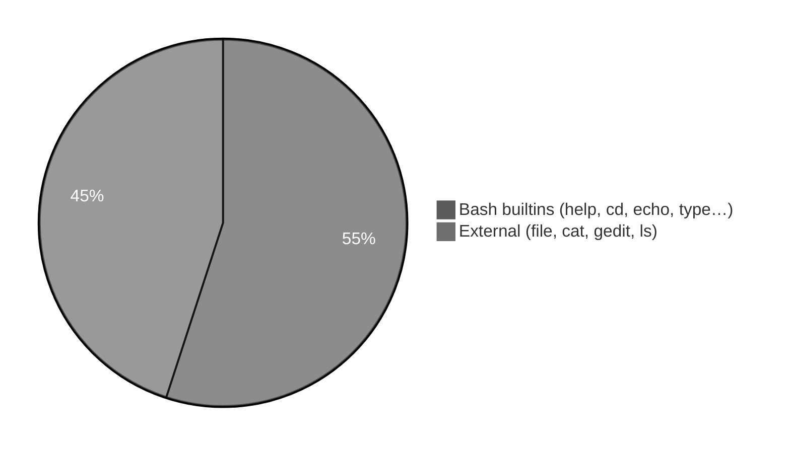
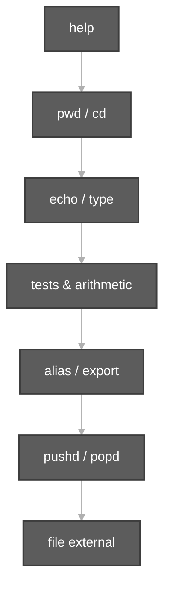

# Execution summary — `bash-built-in-commands/`

**Topic:** [Bash Built-in Commands.md](../../docs/topics/Bash%20Built-in%20Commands.md)  
**Scripts directory:** [`../bash-built-in-commands/`](../bash-built-in-commands/)

---

## [`bash-builtin-examples.sh`](../bash-built-in-commands/bash-builtin-examples.sh)

**Purpose:** Sample **builtins** from `help` plus related patterns.

**Run:** `bash scripts/bash-built-in-commands/bash-builtin-examples.sh`

| Command | Builtin? | Meaning |
| :--- | :---: | :--- |
| `help` | Yes | List internal shell commands |
| `pwd`, `cd` | Yes | Working directory navigation |
| `echo` | Yes | Print text |
| `type echo` | Yes | Show how `echo` is resolved |
| `[[ -d /tmp ]]` | Yes | Test if path is directory |
| `(( x = 3 + 4 ))` | Yes | Arithmetic |
| `alias demo_ls=...` | Yes | Temporary command shortcut |
| `export` / `unset` | Yes | Environment variable |
| `pushd` / `popd` / `dirs` | Yes | Directory stack |
| `printf` | Yes | Formatted output |
| `mapfile` | Yes | Read lines into array |
| `file` | **No** | External — file type by content |
| `whoami` | **No** | External — current user |

---

## [`cat-command-demo.sh`](../bash-built-in-commands/cat-command-demo.sh)

**Purpose:** Display file contents (Session 3 follow-up).

| Command | Meaning |
| :--- | :--- |
| `echo "hello friends" > sunny.durga` | Create file with text |
| `cat sunny.durga` | Print entire file to stdout |
| `cat -n sunny.durga` | Same with line numbers |

---

## [`gedit-command-demo.sh`](../bash-built-in-commands/gedit-command-demo.sh)

**Purpose:** GUI edit workflow (fallback to shell on headless systems).

| Command | Meaning |
| :--- | :--- |
| `touch "$FILE"` | Empty file first |
| `command -v gedit` | Check if `gedit` exists |
| `[[ -n "${DISPLAY:-}" ]]` | GUI available? |
| `gedit "$FILE" &` | Open editor in background |
| `sleep 1` | Brief wait |
| `echo "hello friends" > "$FILE"` | Headless fallback |
| `cat`, `file` | Verify content and type |

---

## [`ls-l-file-size-demo.sh`](../bash-built-in-commands/ls-l-file-size-demo.sh)

**Purpose:** **5th column** of `ls -l` = size in **bytes**.

| Command | Meaning |
| :--- | :--- |
| `touch demo.txt` | Empty file |
| `ls -l demo.txt` | Size 0 |
| `wc -c < demo.txt` | Byte count |
| `echo "hello friends" > demo.txt` | Add content |
| `ls -lh demo.txt` | Human-readable size (`-h`) |
| `file demo.txt` | Content type |

---

## Quick reference

| Script | Main commands |
| :--- | :--- |
| [`bash-builtin-examples.sh`](../bash-built-in-commands/bash-builtin-examples.sh) | `help`, `pwd`, `cd`, `echo`, `type`, `[[ ]]`, `(( ))`, `alias`, `export`, `pushd`, `file` |
| [`cat-command-demo.sh`](../bash-built-in-commands/cat-command-demo.sh) | `echo >`, `cat`, `cat -n` |
| [`gedit-command-demo.sh`](../bash-built-in-commands/gedit-command-demo.sh) | `touch`, `gedit`, `cat`, `file` |
| [`ls-l-file-size-demo.sh`](../bash-built-in-commands/ls-l-file-size-demo.sh) | `touch`, `ls -l`, `ls -lh`, `wc -c`, `file` |
