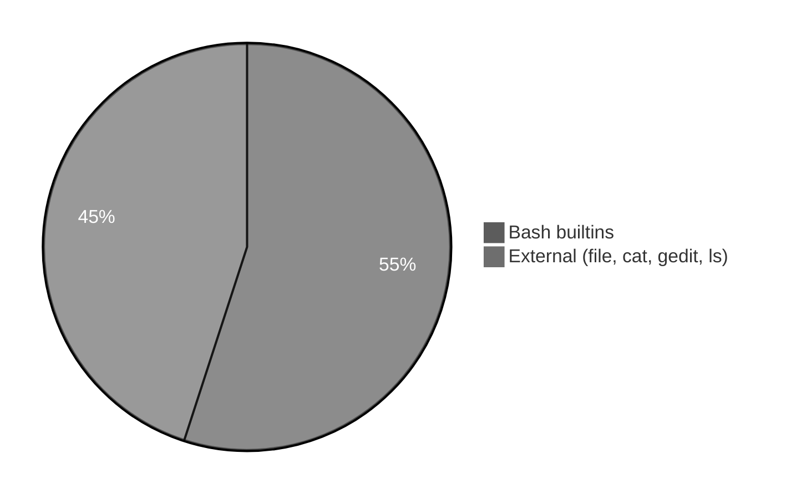

# Execution summary — `bash-built-in-commands/`

**Topic:** [Bash Built-in Commands.md](../docs/topics/Bash%20Built-in%20Commands.md)  
**Scripts directory:** [`../scripts/bash-built-in-commands/`](../scripts/bash-built-in-commands/)



Each script section uses the same **four-part** model:

| # | Column in tables | Meaning |
| :---: | :--- | :--- |
| 1 | **What it is** | Command or shell feature (e.g. `echo` = print text). |
| 2 | **Added / configured** | How it appears in Linux (PATH, builtin, flag on CLI, variable in script). |
| 3 | **Execution intent** | What you are trying to do when the line runs. |
| 4 | **Output** | What you see on the **terminal (stdout/stderr)**, in a **file**, or through a **pipeline** (`|`). |

---

## [`bash-alias-export-unset-demo.sh`](../scripts/bash-built-in-commands/bash-alias-export-unset-demo.sh)

**Run:** `bash scripts/bash-built-in-commands/bash-alias-export-unset-demo.sh`

### In-depth command walkthrough

| Command (as in script) | 1. What it is | 2. Added / configured | 3. Execution intent | 4. Output (terminal / file / pipeline) |
| :--- | :--- | :--- | :--- | :--- |
| `set -euo pipefail` | Bash strict-mode option bundle. | Written at top of script; not installed separately. | Tell Bash to stop on errors, treat unset variables as errors, and fail pipelines if any stage fails. | No visible output; changes how later commands affect exit status. |
| `echo "=== alias, export, unset ==="` | Section header for humans. | Literal string in script | **Print** section title | Title line on **stdout** before commands |
| `shopt -s expand_aliases` | Shell option setter (`shopt -s` / `-u`). | Bash builtin; e.g. `expand_aliases` for scripts. | Enable behavior needed for next lines (aliases in non-interactive scripts). | Silent; changes parsing of following commands. |
| `alias demo_ls='ls --color=auto'` | Bash builtin: temporary command shortcut. | Defined in script; needs `shopt -s expand_aliases` in scripts. | Create nickname for longer command. | No output when defined; invoking alias runs substituted command. |
| `eval "demo_ls /tmp" \| head -3` | Execute string as shell code. | Bash builtin. | Run alias or dynamic command after `alias` definition. | Output of evaluated command on stdout/stderr. |
| `export DEMO_VAR=linux` | Bash builtin: mark variable for child processes. | Name=value in script. | Put variable in **environment** for subprocesses. | Silent; `echo $VAR` shows value. |
| `echo "DEMO_VAR=$DEMO_VAR"` | Bash builtin that prints arguments to standard output. | Always available in Bash; no package install. | Show section titles, tips, or messages to the terminal (trying to **print** text for the user). | Lines appear on **stdout** in your terminal (or in CI logs). Not used in a pipeline unless followed by `|`. |
| `unset DEMO_VAR` | Bash builtin: remove variable. | Variable name in script. | Clear demo variable after `export`. | Silent. |

---

## [`bash-builtin-examples.sh`](../scripts/bash-built-in-commands/bash-builtin-examples.sh)

**Run:** `bash scripts/bash-built-in-commands/bash-builtin-examples.sh`

### In-depth command walkthrough

| Command (as in script) | 1. What it is | 2. Added / configured | 3. Execution intent | 4. Output (terminal / file / pipeline) |
| :--- | :--- | :--- | :--- | :--- |
| `set -euo pipefail` | Bash strict-mode option bundle. | Written at top of script; not installed separately. | Tell Bash to stop on errors, treat unset variables as errors, and fail pipelines if any stage fails. | No visible output; changes how later commands affect exit status. |
| `HERE="$(cd "$(dirname "${BASH_SOURCE[0]}")" && pwd)"` | Shell variable assignment. | Name=`value` in script; often under `${TMPDIR:-/tmp}`. | Store path or stamp for later commands (setup, not a user command). | No output; variable used by `cd`, `rm`, file paths. |
| `echo ""` | Bash builtin that prints arguments to standard output. | Always available in Bash; no package install. | Show section titles, tips, or messages to the terminal (trying to **print** text for the user). | Lines appear on **stdout** in your terminal (or in CI logs). Not used in a pipeline unless followed by `|`. |
| `echo "############################################"` | Bash builtin that prints arguments to standard output. | Always available in Bash; no package install. | Show section titles, tips, or messages to the terminal (trying to **print** text for the user). | Lines appear on **stdout** in your terminal (or in CI logs). Not used in a pipeline unless followed by `|`. |
| `echo "# $name"` | Bash builtin that prints arguments to standard output. | Always available in Bash; no package install. | Show section titles, tips, or messages to the terminal (trying to **print** text for the user). | Lines appear on **stdout** in your terminal (or in CI logs). Not used in a pipeline unless followed by `|`. |
| `echo "############################################"` | Bash builtin that prints arguments to standard output. | Always available in Bash; no package install. | Show section titles, tips, or messages to the terminal (trying to **print** text for the user). | Lines appear on **stdout** in your terminal (or in CI logs). Not used in a pipeline unless followed by `|`. |
| `bash "$HERE/$name"` | Invoke another script with Bash. | Child path built from `HERE` / `DIR` next to orchestrator. | Run one focused demo file so output maps to that file’s commands. | Child script’s stdout/stderr appear in your terminal in order; orchestrator prints `#####` banner first. |
| `run_demo bash-help-list-demo.sh` | Orchestrator helper call. | Function `run_demo` in same script; takes child `.sh` filename. | Run the next focused demo so its output is grouped under a banner. | Banner on stdout, then child script output. |
| `run_demo bash-pwd-cd-echo-type-demo.sh` | Orchestrator helper call. | Function `run_demo` in same script; takes child `.sh` filename. | Run the next focused demo so its output is grouped under a banner. | Banner on stdout, then child script output. |
| `run_demo bash-conditional-arithmetic-demo.sh` | Orchestrator helper call. | Function `run_demo` in same script; takes child `.sh` filename. | Run the next focused demo so its output is grouped under a banner. | Banner on stdout, then child script output. |
| `run_demo bash-alias-export-unset-demo.sh` | Orchestrator helper call. | Function `run_demo` in same script; takes child `.sh` filename. | Run the next focused demo so its output is grouped under a banner. | Banner on stdout, then child script output. |
| `run_demo bash-pushd-popd-dirs-demo.sh` | Orchestrator helper call. | Function `run_demo` in same script; takes child `.sh` filename. | Run the next focused demo so its output is grouped under a banner. | Banner on stdout, then child script output. |
| `run_demo bash-external-file-command-demo.sh` | Orchestrator helper call. | Function `run_demo` in same script; takes child `.sh` filename. | Run the next focused demo so its output is grouped under a banner. | Banner on stdout, then child script output. |
| `run_demo bash-printf-mapfile-demo.sh` | Orchestrator helper call. | Function `run_demo` in same script; takes child `.sh` filename. | Run the next focused demo so its output is grouped under a banner. | Banner on stdout, then child script output. |

---

## [`bash-conditional-arithmetic-demo.sh`](../scripts/bash-built-in-commands/bash-conditional-arithmetic-demo.sh)

**Run:** `bash scripts/bash-built-in-commands/bash-conditional-arithmetic-demo.sh`

### In-depth command walkthrough

| Command (as in script) | 1. What it is | 2. Added / configured | 3. Execution intent | 4. Output (terminal / file / pipeline) |
| :--- | :--- | :--- | :--- | :--- |
| `set -euo pipefail` | Bash strict-mode option bundle. | Written at top of script; not installed separately. | Tell Bash to stop on errors, treat unset variables as errors, and fail pipelines if any stage fails. | No visible output; changes how later commands affect exit status. |
| `echo "=== test / [[ / (( arithmetic )) ==="` | Section header for humans. | Literal string in script | **Print** section title | Title line on **stdout** before commands |
| `[[ -d /tmp ]] && echo "/tmp is a directory"` | Conditional test `[[ ... ]]` or `if`. | Bash syntax. | Branch: run block only when directory exists / command succeeds. | Either block runs (messages on stdout) or `else` branch. |
| `(( x = 3 + 4 )) && echo "(( )) result: x=$x"` | Bash arithmetic `(( ))`. | Built into Bash. | Compute numbers in shell (trying to **calculate**). | Result often printed via following `echo` on stdout. |

---

## [`bash-external-file-command-demo.sh`](../scripts/bash-built-in-commands/bash-external-file-command-demo.sh)

**Run:** `bash scripts/bash-built-in-commands/bash-external-file-command-demo.sh`

### In-depth command walkthrough

| Command (as in script) | 1. What it is | 2. Added / configured | 3. Execution intent | 4. Output (terminal / file / pipeline) |
| :--- | :--- | :--- | :--- | :--- |
| `set -euo pipefail` | Bash strict-mode option bundle. | Written at top of script; not installed separately. | Tell Bash to stop on errors, treat unset variables as errors, and fail pipelines if any stage fails. | No visible output; changes how later commands affect exit status. |
| `echo "=== file (external — check file type by content) ==="` | Section header for humans. | Literal string in script | **Print** section title | Title line on **stdout** before commands |
| `WORK_FILE="${TMPDIR:-/tmp}/bash-builtin-file-demo.txt"` | Shell syntax (variable, test, subshell, or function). | Defined in this script only. | Prepare path, branch on failure, or wrap commands. | Depends on line: may be silent or print via embedded commands. |
| `echo "sample text" > "$WORK_FILE"` | Bash builtin that prints arguments to standard output. | Always available in Bash; no package install. | Show section titles, tips, or messages to the terminal (trying to **print** text for the user). | Lines appear on **stdout** in your terminal (or in CI logs). Not used in a pipeline unless followed by `|`. |
| `type file` | Bash builtin: how name is resolved. | Built into Bash. | See if `echo` is builtin or external. | Line like `echo is a shell builtin` on stdout. |
| `file "$WORK_FILE"` | Guess file type from content. | External `file` package. | Inspect type despite extension. | One descriptive line on stdout. |

---

## [`bash-help-list-demo.sh`](../scripts/bash-built-in-commands/bash-help-list-demo.sh)

**Run:** `bash scripts/bash-built-in-commands/bash-help-list-demo.sh`

### In-depth command walkthrough

| Command (as in script) | 1. What it is | 2. Added / configured | 3. Execution intent | 4. Output (terminal / file / pipeline) |
| :--- | :--- | :--- | :--- | :--- |
| `set -euo pipefail` | Bash strict-mode option bundle. | Written at top of script; not installed separately. | Tell Bash to stop on errors, treat unset variables as errors, and fail pipelines if any stage fails. | No visible output; changes how later commands affect exit status. |
| `echo "=== help (list internal commands) ==="` | Section header for humans. | Literal string in script | **Print** section title | Title line on **stdout** before commands |
| `help \| head -8` | Bash builtin: list internal commands. | Built into Bash. | Discover shell builtins for study. | Many lines on stdout; demos pipe to `head -8`. |

---

## [`bash-printf-mapfile-demo.sh`](../scripts/bash-built-in-commands/bash-printf-mapfile-demo.sh)

**Run:** `bash scripts/bash-built-in-commands/bash-printf-mapfile-demo.sh`

### In-depth command walkthrough

| Command (as in script) | 1. What it is | 2. Added / configured | 3. Execution intent | 4. Output (terminal / file / pipeline) |
| :--- | :--- | :--- | :--- | :--- |
| `set -euo pipefail` | Bash strict-mode option bundle. | Written at top of script; not installed separately. | Tell Bash to stop on errors, treat unset variables as errors, and fail pipelines if any stage fails. | No visible output; changes how later commands affect exit status. |
| `echo "=== printf, read (here-string), mapfile ==="` | Section header for humans. | Literal string in script | **Print** section title | Title line on **stdout** before commands |
| `printf "User: %s\n" "$(whoami)"` | Formatted print (builtin). | Bash builtin. | Print with format specifiers like C. | Formatted bytes on stdout. |
| `mapfile -t lines <<< $'one\ntwo'` | Read lines into array. | Bash builtin. | Load here-string into `lines` array. | Silent; later `printf` shows element. |
| `printf 'mapfile[0]=%s\n' "${lines[0]}"` | Formatted print (builtin). | Bash builtin. | Print with format specifiers like C. | Formatted bytes on stdout. |
| `echo ""` | Bash builtin that prints arguments to standard output. | Always available in Bash; no package install. | Show section titles, tips, or messages to the terminal (trying to **print** text for the user). | Lines appear on **stdout** in your terminal (or in CI logs). Not used in a pipeline unless followed by `|`. |
| `echo "Done. See: docs/topics/Bash Built-in Commands.md"` | Bash builtin that prints arguments to standard output. | Always available in Bash; no package install. | Show section titles, tips, or messages to the terminal (trying to **print** text for the user). | Lines appear on **stdout** in your terminal (or in CI logs). Not used in a pipeline unless followed by `|`. |

---

## [`bash-pushd-popd-dirs-demo.sh`](../scripts/bash-built-in-commands/bash-pushd-popd-dirs-demo.sh)

**Run:** `bash scripts/bash-built-in-commands/bash-pushd-popd-dirs-demo.sh`

### In-depth command walkthrough

| Command (as in script) | 1. What it is | 2. Added / configured | 3. Execution intent | 4. Output (terminal / file / pipeline) |
| :--- | :--- | :--- | :--- | :--- |
| `set -euo pipefail` | Bash strict-mode option bundle. | Written at top of script; not installed separately. | Tell Bash to stop on errors, treat unset variables as errors, and fail pipelines if any stage fails. | No visible output; changes how later commands affect exit status. |
| `echo "=== pushd / popd / dirs ==="` | Section header for humans. | Literal string in script | **Print** section title | Title line on **stdout** before commands |
| `pushd /tmp >/dev/null` | Push directory onto stack and cd. | Bash builtin. | Save cwd and jump to new dir. | Often silent with `/dev/null` redirect in demos. |
| `dirs -p` | Show directory stack. | Bash builtin; `-p` one per line. | Display stack after `pushd`. | Paths on stdout. |
| `popd >/dev/null` | Pop directory from stack and cd. | Bash builtin. | Return to previous stacked directory. | Silent in demos. |

---

## [`bash-pwd-cd-echo-type-demo.sh`](../scripts/bash-built-in-commands/bash-pwd-cd-echo-type-demo.sh)

**Run:** `bash scripts/bash-built-in-commands/bash-pwd-cd-echo-type-demo.sh`

### In-depth command walkthrough

| Command (as in script) | 1. What it is | 2. Added / configured | 3. Execution intent | 4. Output (terminal / file / pipeline) |
| :--- | :--- | :--- | :--- | :--- |
| `set -euo pipefail` | Bash strict-mode option bundle. | Written at top of script; not installed separately. | Tell Bash to stop on errors, treat unset variables as errors, and fail pipelines if any stage fails. | No visible output; changes how later commands affect exit status. |
| `echo "=== pwd, cd, echo, type ==="` | Section header for humans. | Literal string in script | **Print** section title | Title line on **stdout** before commands |
| `pwd` | Print working directory — shows full path of current folder. | Usually `/bin/pwd` or Bash builtin; on PATH by default. | Answer “where am I in the filesystem?” before/after `cd`. | One line path on **stdout**, e.g. `/tmp/linux-pwd-cd-demo/nested/deep`. |
| `cd /tmp` | Change directory — move shell’s current working directory. | Builtin; takes relative or absolute path, `~`, `-`, or no args (home). | Navigate the tree (trying to **enter** a folder); relative paths start from cwd. | Normally silent on success; failure prints `cd: ...: No such file or directory` on **stderr**. |
| `pwd` | Print working directory — shows full path of current folder. | Usually `/bin/pwd` or Bash builtin; on PATH by default. | Answer “where am I in the filesystem?” before/after `cd`. | One line path on **stdout**, e.g. `/tmp/linux-pwd-cd-demo/nested/deep`. |
| `echo "Hello from echo builtin"` | Bash builtin that prints arguments to standard output. | Always available in Bash; no package install. | Show section titles, tips, or messages to the terminal (trying to **print** text for the user). | Lines appear on **stdout** in your terminal (or in CI logs). Not used in a pipeline unless followed by `|`. |
| `type echo` | Bash builtin: how name is resolved. | Built into Bash. | See if `echo` is builtin or external. | Line like `echo is a shell builtin` on stdout. |

---

## [`cat-command-demo.sh`](../scripts/bash-built-in-commands/cat-command-demo.sh)

**Run:** `bash scripts/bash-built-in-commands/cat-command-demo.sh`

### In-depth command walkthrough

| Command (as in script) | 1. What it is | 2. Added / configured | 3. Execution intent | 4. Output (terminal / file / pipeline) |
| :--- | :--- | :--- | :--- | :--- |
| `set -euo pipefail` | Bash strict-mode option bundle. | Written at top of script; not installed separately. | Tell Bash to stop on errors, treat unset variables as errors, and fail pipelines if any stage fails. | No visible output; changes how later commands affect exit status. |
| `WORK="${TMPDIR:-/tmp}/linux-cat-demo"` | Shell variable assignment. | Name=`value` in script; often under `${TMPDIR:-/tmp}`. | Store path or stamp for later commands (setup, not a user command). | No output; variable used by `cd`, `rm`, file paths. |
| `rm -rf "$WORK"` | Remove files/directories recursively, force. | Coreutils; `-r` recursive, `-f` no prompt. | Clean old demo data under `/tmp` before recreating. | Silent on success. |
| `mkdir -p "$WORK"` | Make directories. | Coreutils; `-p` creates parents as needed. | Try to **create** folder(s) for the demo tree. | Silent on success; errors on stderr if path invalid. |
| `cd "$WORK"` | Change directory — move shell’s current working directory. | Builtin; takes relative or absolute path, `~`, `-`, or no args (home). | Navigate the tree (trying to **enter** a folder); relative paths start from cwd. | Normally silent on success; failure prints `cd: ...: No such file or directory` on **stderr**. |
| `echo "hello friends" > sunny.durga` | Bash builtin that prints arguments to standard output. | Always available in Bash; no package install. | Show section titles, tips, or messages to the terminal (trying to **print** text for the user). | Lines appear on **stdout** in your terminal (or in CI logs). Not used in a pipeline unless followed by `|`. |
| `echo "=== cat sunny.durga ==="` | Section header for humans. | Literal string in script | **Print** section title | Title line on **stdout** before commands |
| `cat sunny.durga` | Concatenate and print files. | Coreutils. | Try to **display file contents** on terminal. | File bytes on stdout. |
| `echo ""` | Bash builtin that prints arguments to standard output. | Always available in Bash; no package install. | Show section titles, tips, or messages to the terminal (trying to **print** text for the user). | Lines appear on **stdout** in your terminal (or in CI logs). Not used in a pipeline unless followed by `|`. |
| `echo "=== cat with line numbers (optional) ==="` | Section header for humans. | Literal string in script | **Print** section title | Title line on **stdout** before commands |
| `cat -n sunny.durga` | Concatenate and print files. | Coreutils. | Try to **display file contents** on terminal. | File bytes on stdout. |

---

## [`gedit-command-demo.sh`](../scripts/bash-built-in-commands/gedit-command-demo.sh)

**Run:** `bash scripts/bash-built-in-commands/gedit-command-demo.sh`

### In-depth command walkthrough

| Command (as in script) | 1. What it is | 2. Added / configured | 3. Execution intent | 4. Output (terminal / file / pipeline) |
| :--- | :--- | :--- | :--- | :--- |
| `set -euo pipefail` | Bash strict-mode option bundle. | Written at top of script; not installed separately. | Tell Bash to stop on errors, treat unset variables as errors, and fail pipelines if any stage fails. | No visible output; changes how later commands affect exit status. |
| `WORK="${TMPDIR:-/tmp}/linux-gedit-demo"` | Shell variable assignment. | Name=`value` in script; often under `${TMPDIR:-/tmp}`. | Store path or stamp for later commands (setup, not a user command). | No output; variable used by `cd`, `rm`, file paths. |
| `rm -rf "$WORK"` | Remove files/directories recursively, force. | Coreutils; `-r` recursive, `-f` no prompt. | Clean old demo data under `/tmp` before recreating. | Silent on success. |
| `mkdir -p "$WORK"` | Make directories. | Coreutils; `-p` creates parents as needed. | Try to **create** folder(s) for the demo tree. | Silent on success; errors on stderr if path invalid. |
| `cd "$WORK"` | Change directory — move shell’s current working directory. | Builtin; takes relative or absolute path, `~`, `-`, or no args (home). | Navigate the tree (trying to **enter** a folder); relative paths start from cwd. | Normally silent on success; failure prints `cd: ...: No such file or directory` on **stderr**. |
| `FILE="sunny.jpg"` | Shell variable assignment. | Name=`value` in script; often under `${TMPDIR:-/tmp}`. | Store path or stamp for later commands (setup, not a user command). | No output; variable used by `cd`, `rm`, file paths. |
| `touch "$FILE"` | Create empty file or update timestamps. | Coreutils on PATH. | Try to **create** a zero-byte file or refresh mtime (Durga Sir first step). | Silent; then `ls -l` shows new file with size 0. |
| `if command -v gedit >/dev/null 2>&1 && [[ -n "${DISPLAY:-}" ]]; then` | Conditional test `[[ ... ]]` or `if`. | Bash syntax. | Branch: run block only when directory exists / command succeeds. | Either block runs (messages on stdout) or `else` branch. |
| `echo "Opening gedit (close the editor window when done)..."` | Bash builtin that prints arguments to standard output. | Always available in Bash; no package install. | Show section titles, tips, or messages to the terminal (trying to **print** text for the user). | Lines appear on **stdout** in your terminal (or in CI logs). Not used in a pipeline unless followed by `|`. |
| `gedit "$FILE" &` | Shell syntax (variable, test, subshell, or function). | Defined in this script only. | Prepare path, branch on failure, or wrap commands. | Depends on line: may be silent or print via embedded commands. |
| `sleep 1` | Pause execution for N seconds. | Usually `/usr/bin/sleep` on PATH. | Wait briefly (e.g. after starting GUI editor). | No output; delays script. |
| `echo "Terminal-only demo: writing text as Durga Sir did after gedit..."` | Bash builtin that prints arguments to standard output. | Always available in Bash; no package install. | Show section titles, tips, or messages to the terminal (trying to **print** text for the user). | Lines appear on **stdout** in your terminal (or in CI logs). Not used in a pipeline unless followed by `|`. |
| `echo "hello friends" > "$FILE"` | Bash builtin that prints arguments to standard output. | Always available in Bash; no package install. | Show section titles, tips, or messages to the terminal (trying to **print** text for the user). | Lines appear on **stdout** in your terminal (or in CI logs). Not used in a pipeline unless followed by `|`. |
| `echo "On Ubuntu desktop, use: gedit $FILE"` | Bash builtin that prints arguments to standard output. | Always available in Bash; no package install. | Show section titles, tips, or messages to the terminal (trying to **print** text for the user). | Lines appear on **stdout** in your terminal (or in CI logs). Not used in a pipeline unless followed by `|`. |
| `echo ""` | Bash builtin that prints arguments to standard output. | Always available in Bash; no package install. | Show section titles, tips, or messages to the terminal (trying to **print** text for the user). | Lines appear on **stdout** in your terminal (or in CI logs). Not used in a pipeline unless followed by `|`. |
| `echo "=== Verify with cat and file ==="` | Section header for humans. | Literal string in script | **Print** section title | Title line on **stdout** before commands |
| `cat "$FILE"` | Concatenate and print files. | Coreutils. | Try to **display file contents** on terminal. | File bytes on stdout. |
| `file "$FILE"` | Guess file type from content. | External `file` package. | Inspect type despite extension. | One descriptive line on stdout. |

---

## [`ls-l-file-size-demo.sh`](../scripts/bash-built-in-commands/ls-l-file-size-demo.sh)

**Run:** `bash scripts/bash-built-in-commands/ls-l-file-size-demo.sh`

### In-depth command walkthrough

| Command (as in script) | 1. What it is | 2. Added / configured | 3. Execution intent | 4. Output (terminal / file / pipeline) |
| :--- | :--- | :--- | :--- | :--- |
| `set -euo pipefail` | Bash strict-mode option bundle. | Written at top of script; not installed separately. | Tell Bash to stop on errors, treat unset variables as errors, and fail pipelines if any stage fails. | No visible output; changes how later commands affect exit status. |
| `WORK="${TMPDIR:-/tmp}/linux-ls-size-demo"` | Shell variable assignment. | Name=`value` in script; often under `${TMPDIR:-/tmp}`. | Store path or stamp for later commands (setup, not a user command). | No output; variable used by `cd`, `rm`, file paths. |
| `rm -rf "$WORK"` | Remove files/directories recursively, force. | Coreutils; `-r` recursive, `-f` no prompt. | Clean old demo data under `/tmp` before recreating. | Silent on success. |
| `mkdir -p "$WORK"` | Make directories. | Coreutils; `-p` creates parents as needed. | Try to **create** folder(s) for the demo tree. | Silent on success; errors on stderr if path invalid. |
| `cd "$WORK"` | Change directory — move shell’s current working directory. | Builtin; takes relative or absolute path, `~`, `-`, or no args (home). | Navigate the tree (trying to **enter** a folder); relative paths start from cwd. | Normally silent on success; failure prints `cd: ...: No such file or directory` on **stderr**. |
| `touch demo.txt` | Create empty file or update timestamps. | Coreutils on PATH. | Try to **create** a zero-byte file or refresh mtime (Durga Sir first step). | Silent; then `ls -l` shows new file with size 0. |
| `echo "=== Empty file ==="` | Section header for humans. | Literal string in script | **Print** section title | Title line on **stdout** before commands |
| `ls -l demo.txt` | `ls` long format. | Flag `-l` passed on command line. | Show type, permissions, owner, size, date, name. | Multiple lines on stdout. |
| `echo "Size (bytes): $(wc -c < demo.txt)"` | Bash builtin that prints arguments to standard output. | Always available in Bash; no package install. | Show section titles, tips, or messages to the terminal (trying to **print** text for the user). | Lines appear on **stdout** in your terminal (or in CI logs). Not used in a pipeline unless followed by `|`. |
| `echo ""` | Bash builtin that prints arguments to standard output. | Always available in Bash; no package install. | Show section titles, tips, or messages to the terminal (trying to **print** text for the user). | Lines appear on **stdout** in your terminal (or in CI logs). Not used in a pipeline unless followed by `|`. |
| `echo "hello friends" > demo.txt` | Bash builtin that prints arguments to standard output. | Always available in Bash; no package install. | Show section titles, tips, or messages to the terminal (trying to **print** text for the user). | Lines appear on **stdout** in your terminal (or in CI logs). Not used in a pipeline unless followed by `|`. |
| `echo "=== After writing text ==="` | Section header for humans. | Literal string in script | **Print** section title | Title line on **stdout** before commands |
| `ls -l demo.txt` | `ls` long format. | Flag `-l` passed on command line. | Show type, permissions, owner, size, date, name. | Multiple lines on stdout. |
| `ls -lh demo.txt` | List directory contents. | Coreutils; options change columns, hidden files, sort. | Try to **show names** in cwd or given path. | Names on stdout; options add permissions, sizes, inodes. |
| `file demo.txt` | Guess file type from content. | External `file` package. | Inspect type despite extension. | One descriptive line on stdout. |
| `echo ""` | Bash builtin that prints arguments to standard output. | Always available in Bash; no package install. | Show section titles, tips, or messages to the terminal (trying to **print** text for the user). | Lines appear on **stdout** in your terminal (or in CI logs). Not used in a pipeline unless followed by `|`. |
| `echo "5th column of ls -l is size in bytes (not RAM — disk file size)."` | Bash builtin that prints arguments to standard output. | Always available in Bash; no package install. | Show section titles, tips, or messages to the terminal (trying to **print** text for the user). | Lines appear on **stdout** in your terminal (or in CI logs). Not used in a pipeline unless followed by `|`. |

---

## Script index (all `.sh` in this summary)

| Script | Run |
| :--- | :--- |
| [`bash-alias-export-unset-demo.sh`](../scripts/bash-built-in-commands/bash-alias-export-unset-demo.sh) | `bash scripts/bash-built-in-commands/bash-alias-export-unset-demo.sh` |
| [`bash-builtin-examples.sh`](../scripts/bash-built-in-commands/bash-builtin-examples.sh) | `bash scripts/bash-built-in-commands/bash-builtin-examples.sh` |
| [`bash-conditional-arithmetic-demo.sh`](../scripts/bash-built-in-commands/bash-conditional-arithmetic-demo.sh) | `bash scripts/bash-built-in-commands/bash-conditional-arithmetic-demo.sh` |
| [`bash-external-file-command-demo.sh`](../scripts/bash-built-in-commands/bash-external-file-command-demo.sh) | `bash scripts/bash-built-in-commands/bash-external-file-command-demo.sh` |
| [`bash-help-list-demo.sh`](../scripts/bash-built-in-commands/bash-help-list-demo.sh) | `bash scripts/bash-built-in-commands/bash-help-list-demo.sh` |
| [`bash-printf-mapfile-demo.sh`](../scripts/bash-built-in-commands/bash-printf-mapfile-demo.sh) | `bash scripts/bash-built-in-commands/bash-printf-mapfile-demo.sh` |
| [`bash-pushd-popd-dirs-demo.sh`](../scripts/bash-built-in-commands/bash-pushd-popd-dirs-demo.sh) | `bash scripts/bash-built-in-commands/bash-pushd-popd-dirs-demo.sh` |
| [`bash-pwd-cd-echo-type-demo.sh`](../scripts/bash-built-in-commands/bash-pwd-cd-echo-type-demo.sh) | `bash scripts/bash-built-in-commands/bash-pwd-cd-echo-type-demo.sh` |
| [`cat-command-demo.sh`](../scripts/bash-built-in-commands/cat-command-demo.sh) | `bash scripts/bash-built-in-commands/cat-command-demo.sh` |
| [`gedit-command-demo.sh`](../scripts/bash-built-in-commands/gedit-command-demo.sh) | `bash scripts/bash-built-in-commands/gedit-command-demo.sh` |
| [`ls-l-file-size-demo.sh`](../scripts/bash-built-in-commands/ls-l-file-size-demo.sh) | `bash scripts/bash-built-in-commands/ls-l-file-size-demo.sh` |


**Run every script in this topic (from repo root):**

```bash
bash scripts/bash-built-in-commands/bash-alias-export-unset-demo.sh
bash scripts/bash-built-in-commands/bash-builtin-examples.sh
bash scripts/bash-built-in-commands/bash-conditional-arithmetic-demo.sh
bash scripts/bash-built-in-commands/bash-external-file-command-demo.sh
bash scripts/bash-built-in-commands/bash-help-list-demo.sh
bash scripts/bash-built-in-commands/bash-printf-mapfile-demo.sh
bash scripts/bash-built-in-commands/bash-pushd-popd-dirs-demo.sh
bash scripts/bash-built-in-commands/bash-pwd-cd-echo-type-demo.sh
bash scripts/bash-built-in-commands/cat-command-demo.sh
bash scripts/bash-built-in-commands/gedit-command-demo.sh
bash scripts/bash-built-in-commands/ls-l-file-size-demo.sh
```
