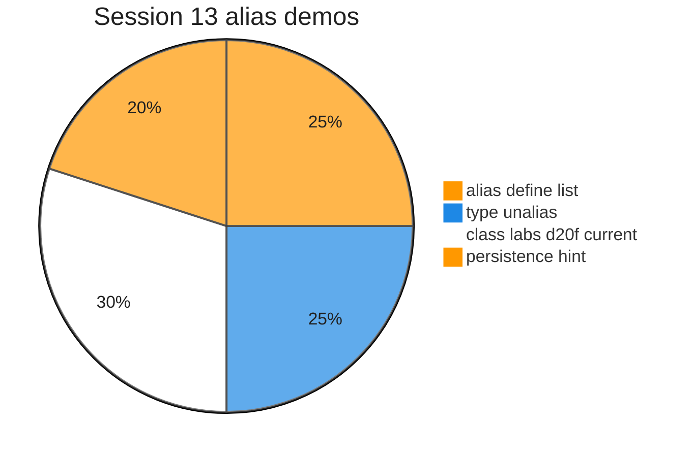
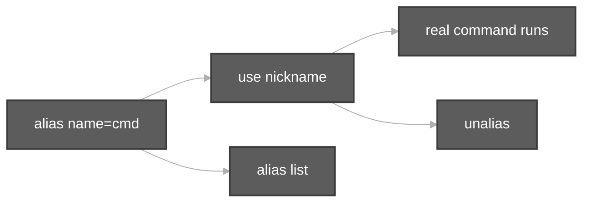

# Execution summary — Session 13 command aliasing

**Topic:** [commandAliasing.md](../docs/topics/commandAliasing.md) (Video 13)  
**Scripts:** [`../scripts/commandAliasing.sh`](../scripts/commandAliasing.sh) · [`../scripts/commandAliasing/`](../scripts/commandAliasing/)





Each script section uses the same **four-part** model:

| # | Column in tables | Meaning |
| :---: | :--- | :--- |
| 1 | **What it is** | Command or shell feature (e.g. `echo` = print text). |
| 2 | **Added / configured** | How it appears in Linux (PATH, builtin, flag on CLI, variable in script). |
| 3 | **Execution intent** | What you are trying to do when the line runs. |
| 4 | **Output** | What you see on the **terminal (stdout/stderr)**, in a **file**, or through a **pipeline** (`|`). |

---

## [`commandAliasing.sh`](../scripts/commandAliasing.sh)

**Run:** `bash scripts/commandAliasing.sh`

### In-depth command walkthrough

| Command (as in script) | 1. What it is | 2. Added / configured | 3. Execution intent | 4. Output (terminal / file / pipeline) |
| :--- | :--- | :--- | :--- | :--- |
| `set -euo pipefail` | Bash strict-mode option bundle. | Written at top of script; not installed separately. | Tell Bash to stop on errors, treat unset variables as errors, and fail pipelines if any stage fails. | No visible output; changes how later commands affect exit status. |
| `DIR="$(cd "$(dirname "${BASH_SOURCE[0]}")/commandAliasing" && pwd)"` | Shell variable assignment. | Name=`value` in script; often under `${TMPDIR:-/tmp}`. | Store path or stamp for later commands (setup, not a user command). | No output; variable used by `cd`, `rm`, file paths. |
| `echo ""` | Bash builtin that prints arguments to standard output. | Always available in Bash; no package install. | Show section titles, tips, or messages to the terminal (trying to **print** text for the user). | Lines appear on **stdout** in your terminal (or in CI logs). Not used in a pipeline unless followed by `|`. |
| `echo "############################################"` | Bash builtin that prints arguments to standard output. | Always available in Bash; no package install. | Show section titles, tips, or messages to the terminal (trying to **print** text for the user). | Lines appear on **stdout** in your terminal (or in CI logs). Not used in a pipeline unless followed by `|`. |
| `echo "# $name"` | Bash builtin that prints arguments to standard output. | Always available in Bash; no package install. | Show section titles, tips, or messages to the terminal (trying to **print** text for the user). | Lines appear on **stdout** in your terminal (or in CI logs). Not used in a pipeline unless followed by `|`. |
| `echo "############################################"` | Bash builtin that prints arguments to standard output. | Always available in Bash; no package install. | Show section titles, tips, or messages to the terminal (trying to **print** text for the user). | Lines appear on **stdout** in your terminal (or in CI logs). Not used in a pipeline unless followed by `|`. |
| `bash "$DIR/$name"` | Invoke another script with Bash. | Child path built from `HERE` / `DIR` next to orchestrator. | Run one focused demo file so output maps to that file’s commands. | Child script’s stdout/stderr appear in your terminal in order; orchestrator prints `#####` banner first. |
| `for script in "$DIR"/*-demo.sh; do` | `for` loop over words. | Bash syntax; list after `in`. | Repeat command for each item (e.g. each utility name). | One output line per iteration on stdout. |
| `[[ -f "$script" ]] \|\| continue` | Conditional test `[[ ... ]]` or `if`. | Bash syntax. | Branch: run block only when directory exists / command succeeds. | Either block runs (messages on stdout) or `else` branch. |
| `run_demo "$(basename "$script")"` | Orchestrator helper call. | Function `run_demo` in same script; takes child `.sh` filename. | Run the next focused demo so its output is grouped under a banner. | Banner on stdout, then child script output. |

---

## [`alias-chain-demo.sh`](../scripts/commandAliasing/alias-chain-demo.sh)

**Run:** `bash scripts/commandAliasing/alias-chain-demo.sh`

### In-depth command walkthrough

| Command (as in script) | 1. What it is | 2. Added / configured | 3. Execution intent | 4. Output (terminal / file / pipeline) |
| :--- | :--- | :--- | :--- | :--- |
| `set -euo pipefail` | Bash strict-mode option bundle. | Written at top of script; not installed separately. | Tell Bash to stop on errors, treat unset variables as errors, and fail pipelines if any stage fails. | No visible output; changes how later commands affect exit status. |
| `shopt -s expand_aliases` | Shell option setter (`shopt -s` / `-u`). | Bash builtin; e.g. `expand_aliases` for scripts. | Enable behavior needed for next lines (aliases in non-interactive scripts). | Silent; changes parsing of following commands. |
| `alias cls=clear` | Bash builtin: temporary command shortcut. | Defined in script; needs `shopt -s expand_aliases` in scripts. | Create nickname for longer command. | No output when defined; invoking alias runs substituted command. |
| `alias C=cls` | Bash builtin: temporary command shortcut. | Defined in script; needs `shopt -s expand_aliases` in scripts. | Create nickname for longer command. | No output when defined; invoking alias runs substituted command. |
| `type C` | Bash builtin: how name is resolved. | Built into Bash. | See if `echo` is builtin or external. | Line like `echo is a shell builtin` on stdout. |
| `type cls` | Bash builtin: how name is resolved. | Built into Bash. | See if `echo` is builtin or external. | Line like `echo is a shell builtin` on stdout. |
| `echo "C runs clear via cls (class chain):"` | Bash builtin that prints arguments to standard output. | Always available in Bash; no package install. | Show section titles, tips, or messages to the terminal (trying to **print** text for the user). | Lines appear on **stdout** in your terminal (or in CI logs). Not used in a pipeline unless followed by `|`. |
| `C` | Shell syntax (variable, test, subshell, or function). | Defined in this script only. | Prepare path, branch on failure, or wrap commands. | Depends on line: may be silent or print via embedded commands. |

---

## [`alias-current-pipeline-demo.sh`](../scripts/commandAliasing/alias-current-pipeline-demo.sh)

**Run:** `bash scripts/commandAliasing/alias-current-pipeline-demo.sh`

### In-depth command walkthrough

| Command (as in script) | 1. What it is | 2. Added / configured | 3. Execution intent | 4. Output (terminal / file / pipeline) |
| :--- | :--- | :--- | :--- | :--- |
| `set -euo pipefail` | Bash strict-mode option bundle. | Written at top of script; not installed separately. | Tell Bash to stop on errors, treat unset variables as errors, and fail pipelines if any stage fails. | No visible output; changes how later commands affect exit status. |
| `shopt -s expand_aliases` | Shell option setter (`shopt -s` / `-u`). | Bash builtin; e.g. `expand_aliases` for scripts. | Enable behavior needed for next lines (aliases in non-interactive scripts). | Silent; changes parsing of following commands. |
| `WORK="${TMPDIR:-/tmp}/linux-alias-current-$$"` | Shell variable assignment. | Name=`value` in script; often under `${TMPDIR:-/tmp}`. | Store path or stamp for later commands (setup, not a user command). | No output; variable used by `cd`, `rm`, file paths. |
| `rm -rf "$WORK"` | Remove files/directories recursively, force. | Coreutils; `-r` recursive, `-f` no prompt. | Clean old demo data under `/tmp` before recreating. | Silent on success. |
| `mkdir -p "$WORK"` | Make directories. | Coreutils; `-p` creates parents as needed. | Try to **create** folder(s) for the demo tree. | Silent on success; errors on stderr if path invalid. |
| `cd "$WORK"` | Change directory — move shell’s current working directory. | Builtin; takes relative or absolute path, `~`, `-`, or no args (home). | Navigate the tree (trying to **enter** a folder); relative paths start from cwd. | Normally silent on success; failure prints `cd: ...: No such file or directory` on **stderr**. |
| `touch f1.txt f2.txt f3.txt` | Create empty file or update timestamps. | Coreutils on PATH. | Try to **create** a zero-byte file or refresh mtime (Durga Sir first step). | Silent; then `ls -l` shows new file with size 0. |
| `alias current='ls -l \| tee output.txt \| wc -l'` | Bash builtin: temporary command shortcut. | Defined in script; needs `shopt -s expand_aliases` in scripts. | Create nickname for longer command. | No output when defined; invoking alias runs substituted command. |
| `echo "=== alias current (pipeline with tee) ==="` | Section header for humans. | Literal string in script | **Print** section title | Title line on **stdout** before commands |
| `type current` | Bash builtin: how name is resolved. | Built into Bash. | See if `echo` is builtin or external. | Line like `echo is a shell builtin` on stdout. |
| `current` | Shell syntax (variable, test, subshell, or function). | Defined in this script only. | Prepare path, branch on failure, or wrap commands. | Depends on line: may be silent or print via embedded commands. |
| `echo "output.txt line count from wc:"` | Bash builtin that prints arguments to standard output. | Always available in Bash; no package install. | Show section titles, tips, or messages to the terminal (trying to **print** text for the user). | Lines appear on **stdout** in your terminal (or in CI logs). Not used in a pipeline unless followed by `|`. |
| `wc -l output.txt` | Word/line/byte count. | Coreutils; `-l` lines, `-c` bytes. | Count entries or file size. | Number on stdout; `wc -l < file` reads file via stdin redirect. |
| `cat output.txt` | Concatenate and print files. | Coreutils. | Try to **display file contents** on terminal. | File bytes on stdout. |
| `rm -rf "$WORK"` | Remove files/directories recursively, force. | Coreutils; `-r` recursive, `-f` no prompt. | Clean old demo data under `/tmp` before recreating. | Silent on success. |

---

## [`alias-define-list-demo.sh`](../scripts/commandAliasing/alias-define-list-demo.sh)

**Run:** `bash scripts/commandAliasing/alias-define-list-demo.sh`

### In-depth command walkthrough

| Command (as in script) | 1. What it is | 2. Added / configured | 3. Execution intent | 4. Output (terminal / file / pipeline) |
| :--- | :--- | :--- | :--- | :--- |
| `set -euo pipefail` | Bash strict-mode option bundle. | Written at top of script; not installed separately. | Tell Bash to stop on errors, treat unset variables as errors, and fail pipelines if any stage fails. | No visible output; changes how later commands affect exit status. |
| `shopt -s expand_aliases` | Shell option setter (`shopt -s` / `-u`). | Bash builtin; e.g. `expand_aliases` for scripts. | Enable behavior needed for next lines (aliases in non-interactive scripts). | Silent; changes parsing of following commands. |
| `echo "=== alias cls=clear (Windows-style clear screen) ==="` | Section header for humans. | Literal string in script | **Print** section title | Title line on **stdout** before commands |
| `alias cls=clear` | Bash builtin: temporary command shortcut. | Defined in script; needs `shopt -s expand_aliases` in scripts. | Create nickname for longer command. | No output when defined; invoking alias runs substituted command. |
| `type cls` | Bash builtin: how name is resolved. | Built into Bash. | See if `echo` is builtin or external. | Line like `echo is a shell builtin` on stdout. |
| `cls` | Shell syntax (variable, test, subshell, or function). | Defined in this script only. | Prepare path, branch on failure, or wrap commands. | Depends on line: may be silent or print via embedded commands. |
| `echo "(screen cleared above)"` | Bash builtin that prints arguments to standard output. | Always available in Bash; no package install. | Show section titles, tips, or messages to the terminal (trying to **print** text for the user). | Lines appear on **stdout** in your terminal (or in CI logs). Not used in a pipeline unless followed by `|`. |
| `echo ""` | Bash builtin that prints arguments to standard output. | Always available in Bash; no package install. | Show section titles, tips, or messages to the terminal (trying to **print** text for the user). | Lines appear on **stdout** in your terminal (or in CI logs). Not used in a pipeline unless followed by `|`. |
| `echo "=== original command clear still works ==="` | Section header for humans. | Literal string in script | **Print** section title | Title line on **stdout** before commands |
| `echo "After alias, both cls and clear are valid (Durga Sir)."` | Bash builtin that prints arguments to standard output. | Always available in Bash; no package install. | Show section titles, tips, or messages to the terminal (trying to **print** text for the user). | Lines appear on **stdout** in your terminal (or in CI logs). Not used in a pipeline unless followed by `|`. |
| `echo ""` | Bash builtin that prints arguments to standard output. | Always available in Bash; no package install. | Show section titles, tips, or messages to the terminal (trying to **print** text for the user). | Lines appear on **stdout** in your terminal (or in CI logs). Not used in a pipeline unless followed by `|`. |
| `echo "=== alias with no arguments — list aliases (grep cls) ==="` | Section header for humans. | Literal string in script | **Print** section title | Title line on **stdout** before commands |
| `alias \| grep -E '^alias cls=' \|\| true` | Bash builtin: temporary command shortcut. | Defined in script; needs `shopt -s expand_aliases` in scripts. | Create nickname for longer command. | No output when defined; invoking alias runs substituted command. |
| `echo ""` | Bash builtin that prints arguments to standard output. | Always available in Bash; no package install. | Show section titles, tips, or messages to the terminal (trying to **print** text for the user). | Lines appear on **stdout** in your terminal (or in CI logs). Not used in a pipeline unless followed by `|`. |
| `echo "=== valid quoting: alias c1='clear' and alias c2=\"clear\" ==="` | Section header for humans. | Literal string in script | **Print** section title | Title line on **stdout** before commands |
| `alias c1='clear'` | Bash builtin: temporary command shortcut. | Defined in script; needs `shopt -s expand_aliases` in scripts. | Create nickname for longer command. | No output when defined; invoking alias runs substituted command. |
| `alias c2="clear"` | Bash builtin: temporary command shortcut. | Defined in script; needs `shopt -s expand_aliases` in scripts. | Create nickname for longer command. | No output when defined; invoking alias runs substituted command. |
| `type c1` | Bash builtin: how name is resolved. | Built into Bash. | See if `echo` is builtin or external. | Line like `echo is a shell builtin` on stdout. |
| `type c2` | Bash builtin: how name is resolved. | Built into Bash. | See if `echo` is builtin or external. | Line like `echo is a shell builtin` on stdout. |

---

## [`alias-long-d20f-demo.sh`](../scripts/commandAliasing/alias-long-d20f-demo.sh)

**Run:** `bash scripts/commandAliasing/alias-long-d20f-demo.sh`

### In-depth command walkthrough

| Command (as in script) | 1. What it is | 2. Added / configured | 3. Execution intent | 4. Output (terminal / file / pipeline) |
| :--- | :--- | :--- | :--- | :--- |
| `set -euo pipefail` | Bash strict-mode option bundle. | Written at top of script; not installed separately. | Tell Bash to stop on errors, treat unset variables as errors, and fail pipelines if any stage fails. | No visible output; changes how later commands affect exit status. |
| `shopt -s expand_aliases` | Shell option setter (`shopt -s` / `-u`). | Bash builtin; e.g. `expand_aliases` for scripts. | Enable behavior needed for next lines (aliases in non-interactive scripts). | Silent; changes parsing of following commands. |
| `WORK="${TMPDIR:-/tmp}/linux-alias-d20f-$$"` | Shell variable assignment. | Name=`value` in script; often under `${TMPDIR:-/tmp}`. | Store path or stamp for later commands (setup, not a user command). | No output; variable used by `cd`, `rm`, file paths. |
| `rm -rf "$WORK"` | Remove files/directories recursively, force. | Coreutils; `-r` recursive, `-f` no prompt. | Clean old demo data under `/tmp` before recreating. | Silent on success. |
| `mkdir -p "$WORK"` | Make directories. | Coreutils; `-p` creates parents as needed. | Try to **create** folder(s) for the demo tree. | Silent on success; errors on stderr if path invalid. |
| `cd "$WORK"` | Change directory — move shell’s current working directory. | Builtin; takes relative or absolute path, `~`, `-`, or no args (home). | Navigate the tree (trying to **enter** a folder); relative paths start from cwd. | Normally silent on success; failure prints `cd: ...: No such file or directory` on **stderr**. |
| `echo "=== long command (run once manually) ==="` | Section header for humans. | Literal string in script | **Print** section title | Title line on **stdout** before commands |
| `echo 'mkdir -p dir1 && touch dir1/file{1..20}.txt'` | Bash builtin that prints arguments to standard output. | Always available in Bash; no package install. | Show section titles, tips, or messages to the terminal (trying to **print** text for the user). | Lines appear on **stdout** in your terminal (or in CI logs). Not used in a pipeline unless followed by `|`. |
| `echo ""` | Bash builtin that prints arguments to standard output. | Always available in Bash; no package install. | Show section titles, tips, or messages to the terminal (trying to **print** text for the user). | Lines appear on **stdout** in your terminal (or in CI logs). Not used in a pipeline unless followed by `|`. |
| `echo "=== alias d20f — same work in one nickname ==="` | Section header for humans. | Literal string in script | **Print** section title | Title line on **stdout** before commands |
| `alias d20f='mkdir -p dir1 && touch dir1/file{1..20}.txt'` | Bash builtin: temporary command shortcut. | Defined in script; needs `shopt -s expand_aliases` in scripts. | Create nickname for longer command. | No output when defined; invoking alias runs substituted command. |
| `d20f` | Shell syntax (variable, test, subshell, or function). | Defined in this script only. | Prepare path, branch on failure, or wrap commands. | Depends on line: may be silent or print via embedded commands. |
| `ls dir1 \| wc -l` | List directory contents. | Coreutils; options change columns, hidden files, sort. | Try to **show names** in cwd or given path. | Names on stdout; options add permissions, sizes, inodes. |
| `echo "files in dir1 (expect 20):"` | Bash builtin that prints arguments to standard output. | Always available in Bash; no package install. | Show section titles, tips, or messages to the terminal (trying to **print** text for the user). | Lines appear on **stdout** in your terminal (or in CI logs). Not used in a pipeline unless followed by `|`. |
| `ls dir1 \| head -5` | List directory contents. | Coreutils; options change columns, hidden files, sort. | Try to **show names** in cwd or given path. | Names on stdout; options add permissions, sizes, inodes. |
| `echo "..."` | Bash builtin that prints arguments to standard output. | Always available in Bash; no package install. | Show section titles, tips, or messages to the terminal (trying to **print** text for the user). | Lines appear on **stdout** in your terminal (or in CI logs). Not used in a pipeline unless followed by `|`. |
| `rm -rf "$WORK"` | Remove files/directories recursively, force. | Coreutils; `-r` recursive, `-f` no prompt. | Clean old demo data under `/tmp` before recreating. | Silent on success. |

---

## [`alias-persistence-hint-demo.sh`](../scripts/commandAliasing/alias-persistence-hint-demo.sh)

**Run:** `bash scripts/commandAliasing/alias-persistence-hint-demo.sh`

### In-depth command walkthrough

| Command (as in script) | 1. What it is | 2. Added / configured | 3. Execution intent | 4. Output (terminal / file / pipeline) |
| :--- | :--- | :--- | :--- | :--- |
| `set -euo pipefail` | Bash strict-mode option bundle. | Written at top of script; not installed separately. | Tell Bash to stop on errors, treat unset variables as errors, and fail pipelines if any stage fails. | No visible output; changes how later commands affect exit status. |
| `echo "=== session aliases are TEMPORARY ==="` | Section header for humans. | Literal string in script | **Print** section title | Title line on **stdout** before commands |
| `echo "They disappear when you close the terminal (Durga Sir)."` | Bash builtin that prints arguments to standard output. | Always available in Bash; no package install. | Show section titles, tips, or messages to the terminal (trying to **print** text for the user). | Lines appear on **stdout** in your terminal (or in CI logs). Not used in a pipeline unless followed by `|`. |
| `echo ""` | Bash builtin that prints arguments to standard output. | Always available in Bash; no package install. | Show section titles, tips, or messages to the terminal (trying to **print** text for the user). | Lines appear on **stdout** in your terminal (or in CI logs). Not used in a pipeline unless followed by `|`. |
| `echo "=== make aliases PERMANENT (two ways) ==="` | Section header for humans. | Literal string in script | **Print** section title | Title line on **stdout** before commands |
| `echo "1) Add alias lines to:  ~/.bashrc"` | Bash builtin that prints arguments to standard output. | Always available in Bash; no package install. | Show section titles, tips, or messages to the terminal (trying to **print** text for the user). | Lines appear on **stdout** in your terminal (or in CI logs). Not used in a pipeline unless followed by `|`. |
| `echo "2) Or create:           ~/.bash_aliases  (in your HOME — name i…` | Bash builtin that prints arguments to standard output. | Always available in Bash; no package install. | Show section titles, tips, or messages to the terminal (trying to **print** text for the user). | Lines appear on **stdout** in your terminal (or in CI logs). Not used in a pipeline unless followed by `|`. |
| `echo ""` | Bash builtin that prints arguments to standard output. | Always available in Bash; no package install. | Show section titles, tips, or messages to the terminal (trying to **print** text for the user). | Lines appear on **stdout** in your terminal (or in CI logs). Not used in a pipeline unless followed by `|`. |
| `echo "After editing, open a NEW terminal OR run:"` | Bash builtin that prints arguments to standard output. | Always available in Bash; no package install. | Show section titles, tips, or messages to the terminal (trying to **print** text for the user). | Lines appear on **stdout** in your terminal (or in CI logs). Not used in a pipeline unless followed by `|`. |
| `echo "  source ~/.bashrc"` | Bash builtin that prints arguments to standard output. | Always available in Bash; no package install. | Show section titles, tips, or messages to the terminal (trying to **print** text for the user). | Lines appear on **stdout** in your terminal (or in CI logs). Not used in a pipeline unless followed by `|`. |
| `echo ""` | Bash builtin that prints arguments to standard output. | Always available in Bash; no package install. | Show section titles, tips, or messages to the terminal (trying to **print** text for the user). | Lines appear on **stdout** in your terminal (or in CI logs). Not used in a pipeline unless followed by `|`. |
| `echo "Show hidden file in home (class): ls -a ~ \| grep bash"` | Bash builtin that prints arguments to standard output. | Always available in Bash; no package install. | Show section titles, tips, or messages to the terminal (trying to **print** text for the user). | Lines appear on **stdout** in your terminal (or in CI logs). Not used in a pipeline unless followed by `|`. |
| `ls -a ~ 2>/dev/null \| grep -E 'bashrc\|bash_aliases' \|\| echo "(hom…` | `ls` including hidden dotfiles. | Flag `-a`. | Reveal `.` and `..` and dotfiles. | Extra lines on stdout vs plain `ls`. |

---

## [`alias-syntax-spacing-demo.sh`](../scripts/commandAliasing/alias-syntax-spacing-demo.sh)

**Run:** `bash scripts/commandAliasing/alias-syntax-spacing-demo.sh`

### In-depth command walkthrough

| Command (as in script) | 1. What it is | 2. Added / configured | 3. Execution intent | 4. Output (terminal / file / pipeline) |
| :--- | :--- | :--- | :--- | :--- |
| `set -euo pipefail` | Bash strict-mode option bundle. | Written at top of script; not installed separately. | Tell Bash to stop on errors, treat unset variables as errors, and fail pipelines if any stage fails. | No visible output; changes how later commands affect exit status. |
| `shopt -s expand_aliases` | Shell option setter (`shopt -s` / `-u`). | Bash builtin; e.g. `expand_aliases` for scripts. | Enable behavior needed for next lines (aliases in non-interactive scripts). | Silent; changes parsing of following commands. |
| `echo "=== VALID: alias rename=mv (no spaces around =) ==="` | Section header for humans. | Literal string in script | **Print** section title | Title line on **stdout** before commands |
| `alias rename=mv` | Bash builtin: temporary command shortcut. | Defined in script; needs `shopt -s expand_aliases` in scripts. | Create nickname for longer command. | No output when defined; invoking alias runs substituted command. |
| `type rename` | Bash builtin: how name is resolved. | Built into Bash. | See if `echo` is builtin or external. | Line like `echo is a shell builtin` on stdout. |
| `echo ""` | Bash builtin that prints arguments to standard output. | Always available in Bash; no package install. | Show section titles, tips, or messages to the terminal (trying to **print** text for the user). | Lines appear on **stdout** in your terminal (or in CI logs). Not used in a pipeline unless followed by `|`. |
| `echo "=== INVALID examples (Durga Sir) — shown as comments only ==="` | Section header for humans. | Literal string in script | **Print** section title | Title line on **stdout** before commands |
| `echo "# alias bad1 =mv          # space before =  → error"` | Bash builtin that prints arguments to standard output. | Always available in Bash; no package install. | Show section titles, tips, or messages to the terminal (trying to **print** text for the user). | Lines appear on **stdout** in your terminal (or in CI logs). Not used in a pipeline unless followed by `|`. |
| `echo "# alias bad2= mv          # space after =   → error"` | Bash builtin that prints arguments to standard output. | Always available in Bash; no package install. | Show section titles, tips, or messages to the terminal (trying to **print** text for the user). | Lines appear on **stdout** in your terminal (or in CI logs). Not used in a pipeline unless followed by `|`. |
| `echo "# alias bad3 rename=mv    # space after alias name → error"` | Bash builtin that prints arguments to standard output. | Always available in Bash; no package install. | Show section titles, tips, or messages to the terminal (trying to **print** text for the user). | Lines appear on **stdout** in your terminal (or in CI logs). Not used in a pipeline unless followed by `|`. |
| `echo "Quotes around the command are optional: alias x=mv or alias x='…` | Bash builtin that prints arguments to standard output. | Always available in Bash; no package install. | Show section titles, tips, or messages to the terminal (trying to **print** text for the user). | Lines appear on **stdout** in your terminal (or in CI logs). Not used in a pipeline unless followed by `|`. |

---

## [`alias-type-unalias-demo.sh`](../scripts/commandAliasing/alias-type-unalias-demo.sh)

**Run:** `bash scripts/commandAliasing/alias-type-unalias-demo.sh`

### In-depth command walkthrough

| Command (as in script) | 1. What it is | 2. Added / configured | 3. Execution intent | 4. Output (terminal / file / pipeline) |
| :--- | :--- | :--- | :--- | :--- |
| `set -euo pipefail` | Bash strict-mode option bundle. | Written at top of script; not installed separately. | Tell Bash to stop on errors, treat unset variables as errors, and fail pipelines if any stage fails. | No visible output; changes how later commands affect exit status. |
| `shopt -s expand_aliases` | Shell option setter (`shopt -s` / `-u`). | Bash builtin; e.g. `expand_aliases` for scripts. | Enable behavior needed for next lines (aliases in non-interactive scripts). | Silent; changes parsing of following commands. |
| `echo "=== type cls1 — name not used yet ==="` | Section header for humans. | Literal string in script | **Print** section title | Title line on **stdout** before commands |
| `if type cls1 2>/dev/null; then` | Conditional test `[[ ... ]]` or `if`. | Bash syntax. | Branch: run block only when directory exists / command succeeds. | Either block runs (messages on stdout) or `else` branch. |
| `type cls1` | Bash builtin: how name is resolved. | Built into Bash. | See if `echo` is builtin or external. | Line like `echo is a shell builtin` on stdout. |
| `echo "bash: type: cls1: not found   # safe to use cls1 as alias name"` | Bash builtin that prints arguments to standard output. | Always available in Bash; no package install. | Show section titles, tips, or messages to the terminal (trying to **print** text for the user). | Lines appear on **stdout** in your terminal (or in CI logs). Not used in a pipeline unless followed by `|`. |
| `alias cls1=date` | Bash builtin: temporary command shortcut. | Defined in script; needs `shopt -s expand_aliases` in scripts. | Create nickname for longer command. | No output when defined; invoking alias runs substituted command. |
| `echo ""` | Bash builtin that prints arguments to standard output. | Always available in Bash; no package install. | Show section titles, tips, or messages to the terminal (trying to **print** text for the user). | Lines appear on **stdout** in your terminal (or in CI logs). Not used in a pipeline unless followed by `|`. |
| `echo "=== type cls1 — now an alias ==="` | Section header for humans. | Literal string in script | **Print** section title | Title line on **stdout** before commands |
| `type cls1` | Bash builtin: how name is resolved. | Built into Bash. | See if `echo` is builtin or external. | Line like `echo is a shell builtin` on stdout. |
| `echo ""` | Bash builtin that prints arguments to standard output. | Always available in Bash; no package install. | Show section titles, tips, or messages to the terminal (trying to **print** text for the user). | Lines appear on **stdout** in your terminal (or in CI logs). Not used in a pipeline unless followed by `|`. |
| `echo "=== unalias cls1 — remove this alias ==="` | Section header for humans. | Literal string in script | **Print** section title | Title line on **stdout** before commands |
| `unalias cls1` | Shell syntax (variable, test, subshell, or function). | Defined in this script only. | Prepare path, branch on failure, or wrap commands. | Depends on line: may be silent or print via embedded commands. |
| `if type cls1 2>/dev/null; then` | Conditional test `[[ ... ]]` or `if`. | Bash syntax. | Branch: run block only when directory exists / command succeeds. | Either block runs (messages on stdout) or `else` branch. |
| `type cls1` | Bash builtin: how name is resolved. | Built into Bash. | See if `echo` is builtin or external. | Line like `echo is a shell builtin` on stdout. |
| `echo "cls1 no longer defined"` | Bash builtin that prints arguments to standard output. | Always available in Bash; no package install. | Show section titles, tips, or messages to the terminal (trying to **print** text for the user). | Lines appear on **stdout** in your terminal (or in CI logs). Not used in a pipeline unless followed by `|`. |
| `echo ""` | Bash builtin that prints arguments to standard output. | Always available in Bash; no package install. | Show section titles, tips, or messages to the terminal (trying to **print** text for the user). | Lines appear on **stdout** in your terminal (or in CI logs). Not used in a pipeline unless followed by `|`. |
| `echo "=== overwrite alias (like x=10 then x=20) ==="` | Section header for humans. | Literal string in script | **Print** section title | Title line on **stdout** before commands |
| `alias demo=date` | Bash builtin: temporary command shortcut. | Defined in script; needs `shopt -s expand_aliases` in scripts. | Create nickname for longer command. | No output when defined; invoking alias runs substituted command. |
| `type demo` | Bash builtin: how name is resolved. | Built into Bash. | See if `echo` is builtin or external. | Line like `echo is a shell builtin` on stdout. |
| `alias demo=cal` | Bash builtin: temporary command shortcut. | Defined in script; needs `shopt -s expand_aliases` in scripts. | Create nickname for longer command. | No output when defined; invoking alias runs substituted command. |
| `type demo` | Bash builtin: how name is resolved. | Built into Bash. | See if `echo` is builtin or external. | Line like `echo is a shell builtin` on stdout. |
| `echo "Running demo (should show calendar month, not date line):"` | Bash builtin that prints arguments to standard output. | Always available in Bash; no package install. | Show section titles, tips, or messages to the terminal (trying to **print** text for the user). | Lines appear on **stdout** in your terminal (or in CI logs). Not used in a pipeline unless followed by `|`. |
| `demo \| head -3…` | Pipeline: connect stdout of left command to stdin of right. | Uses `|` between commands. | Send partial output to filter (e.g. only first lines). | You see only filtered output on terminal; left command may get SIGPIPE if right exits early. |

---

## [`alias-typo-and-os-demo.sh`](../scripts/commandAliasing/alias-typo-and-os-demo.sh)

**Run:** `bash scripts/commandAliasing/alias-typo-and-os-demo.sh`

### In-depth command walkthrough

| Command (as in script) | 1. What it is | 2. Added / configured | 3. Execution intent | 4. Output (terminal / file / pipeline) |
| :--- | :--- | :--- | :--- | :--- |
| `set -euo pipefail` | Bash strict-mode option bundle. | Written at top of script; not installed separately. | Tell Bash to stop on errors, treat unset variables as errors, and fail pipelines if any stage fails. | No visible output; changes how later commands affect exit status. |
| `shopt -s expand_aliases` | Shell option setter (`shopt -s` / `-u`). | Bash builtin; e.g. `expand_aliases` for scripts. | Enable behavior needed for next lines (aliases in non-interactive scripts). | Silent; changes parsing of following commands. |
| `WORK="${TMPDIR:-/tmp}/linux-alias-typo-$$"` | Shell variable assignment. | Name=`value` in script; often under `${TMPDIR:-/tmp}`. | Store path or stamp for later commands (setup, not a user command). | No output; variable used by `cd`, `rm`, file paths. |
| `rm -rf "$WORK"` | Remove files/directories recursively, force. | Coreutils; `-r` recursive, `-f` no prompt. | Clean old demo data under `/tmp` before recreating. | Silent on success. |
| `mkdir -p "$WORK"` | Make directories. | Coreutils; `-p` creates parents as needed. | Try to **create** folder(s) for the demo tree. | Silent on success; errors on stderr if path invalid. |
| `cd "$WORK"` | Change directory — move shell’s current working directory. | Builtin; takes relative or absolute path, `~`, `-`, or no args (home). | Navigate the tree (trying to **enter** a folder); relative paths start from cwd. | Normally silent on success; failure prints `cd: ...: No such file or directory` on **stderr**. |
| `echo "hello grep me" > sample.txt` | Bash builtin that prints arguments to standard output. | Always available in Bash; no package install. | Show section titles, tips, or messages to the terminal (trying to **print** text for the user). | Lines appear on **stdout** in your terminal (or in CI logs). Not used in a pipeline unless followed by `|`. |
| `alias grp=grep` | Bash builtin: temporary command shortcut. | Defined in script; needs `shopt -s expand_aliases` in scripts. | Create nickname for longer command. | No output when defined; invoking alias runs substituted command. |
| `echo "=== typo alias grp=grep ==="` | Section header for humans. | Literal string in script | **Print** section title | Title line on **stdout** before commands |
| `grp hello sample.txt` | Shell syntax (variable, test, subshell, or function). | Defined in this script only. | Prepare path, branch on failure, or wrap commands. | Depends on line: may be silent or print via embedded commands. |
| `alias rename=mv` | Bash builtin: temporary command shortcut. | Defined in script; needs `shopt -s expand_aliases` in scripts. | Create nickname for longer command. | No output when defined; invoking alias runs substituted command. |
| `echo ""` | Bash builtin that prints arguments to standard output. | Always available in Bash; no package install. | Show section titles, tips, or messages to the terminal (trying to **print** text for the user). | Lines appear on **stdout** in your terminal (or in CI logs). Not used in a pipeline unless followed by `|`. |
| `echo "=== rename=mv (Windows habit) ==="` | Section header for humans. | Literal string in script | **Print** section title | Title line on **stdout** before commands |
| `echo "new" > a.txt` | Bash builtin that prints arguments to standard output. | Always available in Bash; no package install. | Show section titles, tips, or messages to the terminal (trying to **print** text for the user). | Lines appear on **stdout** in your terminal (or in CI logs). Not used in a pipeline unless followed by `|`. |
| `rename a.txt b.txt` | Shell syntax (variable, test, subshell, or function). | Defined in this script only. | Prepare path, branch on failure, or wrap commands. | Depends on line: may be silent or print via embedded commands. |
| `ls -1` | List directory contents. | Coreutils; options change columns, hidden files, sort. | Try to **show names** in cwd or given path. | Names on stdout; options add permissions, sizes, inodes. |
| `rm -rf "$WORK"` | Remove files/directories recursively, force. | Coreutils; `-r` recursive, `-f` no prompt. | Clean old demo data under `/tmp` before recreating. | Silent on success. |

---

## Script index (all `.sh` in this summary)

| Script | Run |
| :--- | :--- |
| [`commandAliasing.sh`](../scripts/commandAliasing.sh) | `bash scripts/commandAliasing.sh` |
| [`alias-chain-demo.sh`](../scripts/commandAliasing/alias-chain-demo.sh) | `bash scripts/commandAliasing/alias-chain-demo.sh` |
| [`alias-current-pipeline-demo.sh`](../scripts/commandAliasing/alias-current-pipeline-demo.sh) | `bash scripts/commandAliasing/alias-current-pipeline-demo.sh` |
| [`alias-define-list-demo.sh`](../scripts/commandAliasing/alias-define-list-demo.sh) | `bash scripts/commandAliasing/alias-define-list-demo.sh` |
| [`alias-long-d20f-demo.sh`](../scripts/commandAliasing/alias-long-d20f-demo.sh) | `bash scripts/commandAliasing/alias-long-d20f-demo.sh` |
| [`alias-persistence-hint-demo.sh`](../scripts/commandAliasing/alias-persistence-hint-demo.sh) | `bash scripts/commandAliasing/alias-persistence-hint-demo.sh` |
| [`alias-syntax-spacing-demo.sh`](../scripts/commandAliasing/alias-syntax-spacing-demo.sh) | `bash scripts/commandAliasing/alias-syntax-spacing-demo.sh` |
| [`alias-type-unalias-demo.sh`](../scripts/commandAliasing/alias-type-unalias-demo.sh) | `bash scripts/commandAliasing/alias-type-unalias-demo.sh` |
| [`alias-typo-and-os-demo.sh`](../scripts/commandAliasing/alias-typo-and-os-demo.sh) | `bash scripts/commandAliasing/alias-typo-and-os-demo.sh` |


**Run every script in this topic (from repo root):**

```bash
bash scripts/commandAliasing.sh
bash scripts/commandAliasing/alias-chain-demo.sh
bash scripts/commandAliasing/alias-current-pipeline-demo.sh
bash scripts/commandAliasing/alias-define-list-demo.sh
bash scripts/commandAliasing/alias-long-d20f-demo.sh
bash scripts/commandAliasing/alias-persistence-hint-demo.sh
bash scripts/commandAliasing/alias-syntax-spacing-demo.sh
bash scripts/commandAliasing/alias-type-unalias-demo.sh
bash scripts/commandAliasing/alias-typo-and-os-demo.sh
```
