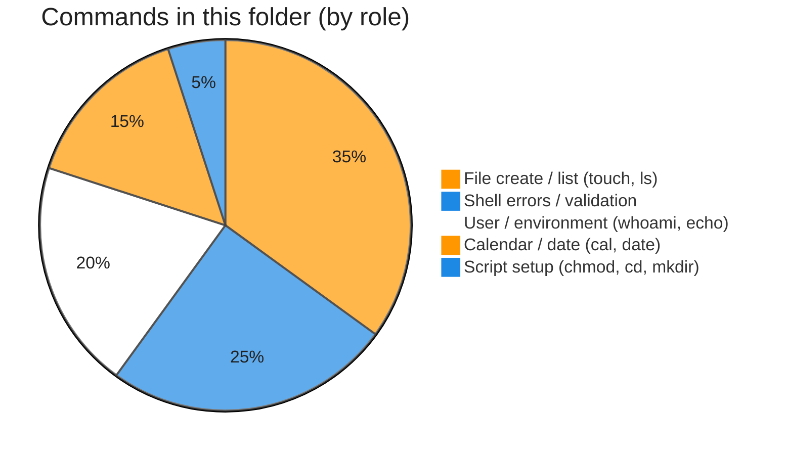

# Execution summary — `components-of-unix/`

**Topic:** [Components of Unix.md](../docs/topics/Components%20of%20Unix.md) (Video 2)  
**Scripts directory:** [`../scripts/components-of-unix/`](../scripts/components-of-unix/)




Each script section uses the same **four-part** model:

| # | Column in tables | Meaning |
| :---: | :--- | :--- |
| 1 | **What it is** | Command or shell feature (e.g. `echo` = print text). |
| 2 | **Added / configured** | How it appears in Linux (PATH, builtin, flag on CLI, variable in script). |
| 3 | **Execution intent** | What you are trying to do when the line runs. |
| 4 | **Output** | What you see on the **terminal (stdout/stderr)**, in a **file**, or through a **pipeline** (`|`). |

---

## [`command-execution-flow-trace.sh`](../scripts/components-of-unix/command-execution-flow-trace.sh)

**Run:** `bash scripts/components-of-unix/command-execution-flow-trace.sh`

### In-depth command walkthrough

| Command (as in script) | 1. What it is | 2. Added / configured | 3. Execution intent | 4. Output (terminal / file / pipeline) |
| :--- | :--- | :--- | :--- | :--- |
| `set -euo pipefail` | Bash strict-mode option bundle. | Written at top of script; not installed separately. | Tell Bash to stop on errors, treat unset variables as errors, and fail pipelines if any stage fails. | No visible output; changes how later commands affect exit status. |
| `WORK="${TMPDIR:-/tmp}/linux-basics-flow-trace"` | Shell variable assignment. | Name=`value` in script; often under `${TMPDIR:-/tmp}`. | Store path or stamp for later commands (setup, not a user command). | No output; variable used by `cd`, `rm`, file paths. |
| `rm -rf "$WORK"` | Remove files/directories recursively, force. | Coreutils; `-r` recursive, `-f` no prompt. | Clean old demo data under `/tmp` before recreating. | Silent on success. |
| `mkdir -p "$WORK"` | Make directories. | Coreutils; `-p` creates parents as needed. | Try to **create** folder(s) for the demo tree. | Silent on success; errors on stderr if path invalid. |
| `cd "$WORK"` | Change directory — move shell’s current working directory. | Builtin; takes relative or absolute path, `~`, `-`, or no args (home). | Navigate the tree (trying to **enter** a folder); relative paths start from cwd. | Normally silent on success; failure prints `cd: ...: No such file or directory` on **stderr**. |
| `echo "=== SUCCESS PATH: touch sunny.txt (shell validates → kernel crea…` | Section header for humans. | Literal string in script | **Print** section title | Title line on **stdout** before commands |
| `touch sunny.txt` | Create empty file or update timestamps. | Coreutils on PATH. | Try to **create** a zero-byte file or refresh mtime (Durga Sir first step). | Silent; then `ls -l` shows new file with size 0. |
| `ls -l sunny.txt` | `ls` long format. | Flag `-l` passed on command line. | Show type, permissions, owner, size, date, name. | Multiple lines on stdout. |
| `echo ""` | Bash builtin that prints arguments to standard output. | Always available in Bash; no package install. | Show section titles, tips, or messages to the terminal (trying to **print** text for the user). | Lines appear on **stdout** in your terminal (or in CI logs). Not used in a pipeline unless followed by `|`. |
| `echo "=== ERROR PATH: invalid command (shell only — kernel not involve…` | Section header for humans. | Literal string in script | **Print** section title | Title line on **stdout** before commands |
| `set +e` | Bash option: do not exit on command failure. | Shell builtin toggled inside the script. | Allow demo commands that are expected to fail without stopping the whole script. | No output; failed commands still print their error text to stderr. |
| `touch123 2>&1` | Create empty file or update timestamps. | Coreutils on PATH. | Try to **create** a zero-byte file or refresh mtime (Durga Sir first step). | Silent; then `ls -l` shows new file with size 0. |
| `set -e` | Bash option: exit immediately on failure. | Re-enabled after demos that expect errors. | Restore strict behavior for the rest of the script. | No direct output. |
| `echo ""` | Bash builtin that prints arguments to standard output. | Always available in Bash; no package install. | Show section titles, tips, or messages to the terminal (trying to **print** text for the user). | Lines appear on **stdout** in your terminal (or in CI logs). Not used in a pipeline unless followed by `|`. |
| `echo "=== Done: in an interactive terminal you would see the \$ prompt…` | Section header for humans. | Literal string in script | **Print** section title | Title line on **stdout** before commands |

---

## [`command-execution-touch-demo.sh`](../scripts/components-of-unix/command-execution-touch-demo.sh)

**Run:** `bash scripts/components-of-unix/command-execution-touch-demo.sh`

### In-depth command walkthrough

| Command (as in script) | 1. What it is | 2. Added / configured | 3. Execution intent | 4. Output (terminal / file / pipeline) |
| :--- | :--- | :--- | :--- | :--- |
| `set -euo pipefail` | Bash strict-mode option bundle. | Written at top of script; not installed separately. | Tell Bash to stop on errors, treat unset variables as errors, and fail pipelines if any stage fails. | No visible output; changes how later commands affect exit status. |
| `WORK_DIR="${TMPDIR:-/tmp}/linux-basics-touch-demo"` | Shell syntax (variable, test, subshell, or function). | Defined in this script only. | Prepare path, branch on failure, or wrap commands. | Depends on line: may be silent or print via embedded commands. |
| `mkdir -p "$WORK_DIR"` | Make directories. | Coreutils; `-p` creates parents as needed. | Try to **create** folder(s) for the demo tree. | Silent on success; errors on stderr if path invalid. |
| `cd "$WORK_DIR"` | Change directory — move shell’s current working directory. | Builtin; takes relative or absolute path, `~`, `-`, or no args (home). | Navigate the tree (trying to **enter** a folder); relative paths start from cwd. | Normally silent on success; failure prints `cd: ...: No such file or directory` on **stderr**. |
| `FILE="sunny.txt"` | Shell variable assignment. | Name=`value` in script; often under `${TMPDIR:-/tmp}`. | Store path or stamp for later commands (setup, not a user command). | No output; variable used by `cd`, `rm`, file paths. |
| `echo "Working in: $WORK_DIR"` | Bash builtin that prints arguments to standard output. | Always available in Bash; no package install. | Show section titles, tips, or messages to the terminal (trying to **print** text for the user). | Lines appear on **stdout** in your terminal (or in CI logs). Not used in a pipeline unless followed by `|`. |
| `touch "$FILE"` | Create empty file or update timestamps. | Coreutils on PATH. | Try to **create** a zero-byte file or refresh mtime (Durga Sir first step). | Silent; then `ls -l` shows new file with size 0. |
| `ls -l "$FILE"` | `ls` long format. | Flag `-l` passed on command line. | Show type, permissions, owner, size, date, name. | Multiple lines on stdout. |
| `echo "Done: kernel created/updated $FILE; shell shows new $ prompt wh…` | Bash builtin that prints arguments to standard output. | Always available in Bash; no package install. | Show section titles, tips, or messages to the terminal (trying to **print** text for the user). | Lines appear on **stdout** in your terminal (or in CI logs). Not used in a pipeline unless followed by `|`. |

---

## [`invalid-command-demos.sh`](../scripts/components-of-unix/invalid-command-demos.sh)

**Run:** `bash scripts/components-of-unix/invalid-command-demos.sh`

### In-depth command walkthrough

| Command (as in script) | 1. What it is | 2. Added / configured | 3. Execution intent | 4. Output (terminal / file / pipeline) |
| :--- | :--- | :--- | :--- | :--- |
| `set +e` | Bash option: do not exit on command failure. | Shell builtin toggled inside the script. | Allow demo commands that are expected to fail without stopping the whole script. | No output; failed commands still print their error text to stderr. |
| `echo "=== Invalid command name (expect: command not found) ==="` | Section header for humans. | Literal string in script | **Print** section title | Title line on **stdout** before commands |
| `touch123 2>&1` | Create empty file or update timestamps. | Coreutils on PATH. | Try to **create** a zero-byte file or refresh mtime (Durga Sir first step). | Silent; then `ls -l` shows new file with size 0. |
| `echo ""` | Bash builtin that prints arguments to standard output. | Always available in Bash; no package install. | Show section titles, tips, or messages to the terminal (trying to **print** text for the user). | Lines appear on **stdout** in your terminal (or in CI logs). Not used in a pipeline unless followed by `|`. |
| `echo "=== Invalid option (expect: error from touch) ==="` | Section header for humans. | Literal string in script | **Print** section title | Title line on **stdout** before commands |
| `touch -da abc.txt 2>&1` | Create empty file or update timestamps. | Coreutils on PATH. | Try to **create** a zero-byte file or refresh mtime (Durga Sir first step). | Silent; then `ls -l` shows new file with size 0. |
| `echo ""` | Bash builtin that prints arguments to standard output. | Always available in Bash; no package install. | Show section titles, tips, or messages to the terminal (trying to **print** text for the user). | Lines appear on **stdout** in your terminal (or in CI logs). Not used in a pipeline unless followed by `|`. |
| `echo "=== Invalid argument (expect: cal error) ==="` | Section header for humans. | Literal string in script | **Print** section title | Title line on **stdout** before commands |
| `cal 99999 2>&1` | Print ASCII calendar. | Optional package `cal` / `ncal` on some minimal images. | Display month grid (current or given month/year). | Calendar grid on stdout; missing binary → “command not found”. |
| `set -e` | Bash option: exit immediately on failure. | Re-enabled after demos that expect errors. | Restore strict behavior for the rest of the script. | No direct output. |
| `echo ""` | Bash builtin that prints arguments to standard output. | Always available in Bash; no package install. | Show section titles, tips, or messages to the terminal (trying to **print** text for the user). | Lines appear on **stdout** in your terminal (or in CI logs). Not used in a pipeline unless followed by `|`. |
| `echo "These failures are handled by the shell before the kernel runs …` | Bash builtin that prints arguments to standard output. | Always available in Bash; no package install. | Show section titles, tips, or messages to the terminal (trying to **print** text for the user). | Lines appear on **stdout** in your terminal (or in CI logs). Not used in a pipeline unless followed by `|`. |

---

## [`run-test-script.sh`](../scripts/components-of-unix/run-test-script.sh)

**Run:** `bash scripts/components-of-unix/run-test-script.sh`

### In-depth command walkthrough

| Command (as in script) | 1. What it is | 2. Added / configured | 3. Execution intent | 4. Output (terminal / file / pipeline) |
| :--- | :--- | :--- | :--- | :--- |
| `set -euo pipefail` | Bash strict-mode option bundle. | Written at top of script; not installed separately. | Tell Bash to stop on errors, treat unset variables as errors, and fail pipelines if any stage fails. | No visible output; changes how later commands affect exit status. |
| `DIR="$(cd "$(dirname "$0")" && pwd)"` | Shell variable assignment. | Name=`value` in script; often under `${TMPDIR:-/tmp}`. | Store path or stamp for later commands (setup, not a user command). | No output; variable used by `cd`, `rm`, file paths. |
| `chmod u+x "$DIR/test.sh"` | Change file mode (permissions). | Coreutils; e.g. `chmod u+x` adds execute for user. | Make script **executable** so `./script.sh` works. | Silent; `ls -l` then shows `x` in permission bits. |
| `"$DIR/test.sh"` | Shell syntax (variable, test, subshell, or function). | Defined in this script only. | Prepare path, branch on failure, or wrap commands. | Depends on line: may be silent or print via embedded commands. |

---

## [`test.sh`](../scripts/components-of-unix/test.sh)

**Run:** `bash scripts/components-of-unix/test.sh`

### In-depth command walkthrough

| Command (as in script) | 1. What it is | 2. Added / configured | 3. Execution intent | 4. Output (terminal / file / pipeline) |
| :--- | :--- | :--- | :--- | :--- |
| `cal` | Print ASCII calendar. | Optional package `cal` / `ncal` on some minimal images. | Display month grid (current or given month/year). | Calendar grid on stdout; missing binary → “command not found”. |
| `date` | Print or set system date/time. | `date` from coreutils; `+format` uses `%` codes. | Show **current time** or build a formatted string for logs. | Human-readable line on stdout, or custom format string only. |
| `echo "Hello Friends. Welcome to Unix World."` | Bash builtin that prints arguments to standard output. | Always available in Bash; no package install. | Show section titles, tips, or messages to the terminal (trying to **print** text for the user). | Lines appear on **stdout** in your terminal (or in CI logs). Not used in a pipeline unless followed by `|`. |

---

## [`whoami-demo.sh`](../scripts/components-of-unix/whoami-demo.sh)

**Run:** `bash scripts/components-of-unix/whoami-demo.sh`

### In-depth command walkthrough

| Command (as in script) | 1. What it is | 2. Added / configured | 3. Execution intent | 4. Output (terminal / file / pipeline) |
| :--- | :--- | :--- | :--- | :--- |
| `echo "Current user (whoami): $(whoami)"` | Bash builtin that prints arguments to standard output. | Always available in Bash; no package install. | Show section titles, tips, or messages to the terminal (trying to **print** text for the user). | Lines appear on **stdout** in your terminal (or in CI logs). Not used in a pipeline unless followed by `|`. |
| `echo "Home directory: $HOME"` | Bash builtin that prints arguments to standard output. | Always available in Bash; no package install. | Show section titles, tips, or messages to the terminal (trying to **print** text for the user). | Lines appear on **stdout** in your terminal (or in CI logs). Not used in a pipeline unless followed by `|`. |
| `echo "Interactive tip: normal users see \$ prompt; root sees # after …` | Bash builtin that prints arguments to standard output. | Always available in Bash; no package install. | Show section titles, tips, or messages to the terminal (trying to **print** text for the user). | Lines appear on **stdout** in your terminal (or in CI logs). Not used in a pipeline unless followed by `|`. |

---

## Script index (all `.sh` in this summary)

| Script | Run |
| :--- | :--- |
| [`command-execution-flow-trace.sh`](../scripts/components-of-unix/command-execution-flow-trace.sh) | `bash scripts/components-of-unix/command-execution-flow-trace.sh` |
| [`command-execution-touch-demo.sh`](../scripts/components-of-unix/command-execution-touch-demo.sh) | `bash scripts/components-of-unix/command-execution-touch-demo.sh` |
| [`invalid-command-demos.sh`](../scripts/components-of-unix/invalid-command-demos.sh) | `bash scripts/components-of-unix/invalid-command-demos.sh` |
| [`run-test-script.sh`](../scripts/components-of-unix/run-test-script.sh) | `bash scripts/components-of-unix/run-test-script.sh` |
| [`test.sh`](../scripts/components-of-unix/test.sh) | `bash scripts/components-of-unix/test.sh` |
| [`whoami-demo.sh`](../scripts/components-of-unix/whoami-demo.sh) | `bash scripts/components-of-unix/whoami-demo.sh` |


**Run every script in this topic (from repo root):**

```bash
bash scripts/components-of-unix/command-execution-flow-trace.sh
bash scripts/components-of-unix/command-execution-touch-demo.sh
bash scripts/components-of-unix/invalid-command-demos.sh
bash scripts/components-of-unix/run-test-script.sh
bash scripts/components-of-unix/test.sh
bash scripts/components-of-unix/whoami-demo.sh
```
