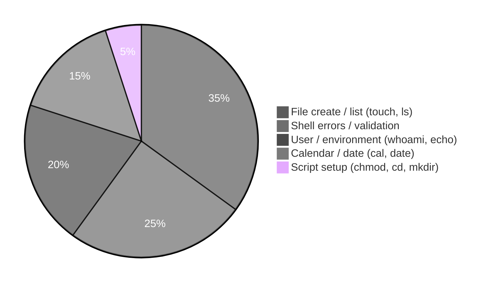
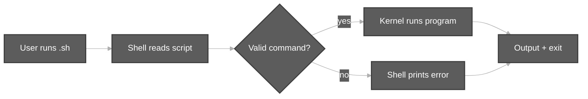
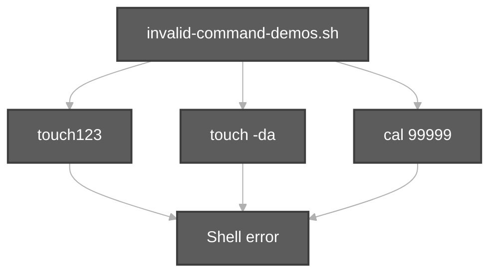

# Execution summary — `components-of-unix/`

**Topic:** [Components of Unix.md](../../docs/topics/Components%20of%20Unix.md) (Video 2)  
**Scripts directory:** [`../components-of-unix/`](../components-of-unix/)

---

## [`invalid-command-demos.sh`](../components-of-unix/invalid-command-demos.sh)

**Purpose:** Show errors caught by the **shell** (invalid name, option, argument) — kernel not involved.

**Run:** `bash scripts/components-of-unix/invalid-command-demos.sh`

| Line / command | Type | Meaning |
| :--- | :--- | :--- |
| `set +e` | Shell option | Do not exit script on first failing command |
| `echo "..."` | Builtin | Print message to terminal |
| `touch123` | Invalid name | Not a real command → “command not found” |
| `2>&1` | Redirection | Merge stderr into stdout for display |
| `touch -da abc.txt` | External | Invalid **option** to `touch` |
| `cal 99999` | External | Invalid **argument** (bad month/year) |
| `set -e` | Shell option | Re-enable exit on error |

---

## [`command-execution-touch-demo.sh`](../components-of-unix/command-execution-touch-demo.sh)

**Purpose:** Successful path — shell validates `touch`, **kernel** creates/updates file.

| Command | Meaning |
| :--- | :--- |
| `set -euo pipefail` | Strict mode: exit on error, unset vars, pipe failures |
| `mkdir -p "$WORK_DIR"` | Create demo directory tree |
| `cd "$WORK_DIR"` | Change working directory |
| `touch "$FILE"` | Create empty file or update timestamps |
| `ls -l "$FILE"` | Long listing — permissions, size, name |

**Flow:** `mkdir` → `cd` → `touch` → `ls -l` → success message.

---

## [`command-execution-flow-trace.sh`](../components-of-unix/command-execution-flow-trace.sh)

**Purpose:** Diagram-2 — one **success** path and one **error** path in one script.

| Command | Meaning |
| :--- | :--- |
| `rm -rf "$WORK"` | Remove old demo dir |
| `mkdir -p "$WORK"` | Fresh workspace |
| `touch sunny.txt` | Success path |
| `ls -l sunny.txt` | Verify file |
| `touch123` | Error path (invalid command) |
| `set +e` / `set -e` | Allow error demo without stopping script |

---

## [`test.sh`](../components-of-unix/test.sh)

**Purpose:** Durga Sir — a script is a **group of commands**.

| Command | Meaning |
| :--- | :--- |
| `cal` | Print calendar (may be missing in minimal images) |
| `date` | Print current date/time |
| `echo "..."` | Print welcome text |

---

## [`run-test-script.sh`](../components-of-unix/run-test-script.sh)

**Purpose:** `chmod u+x` then execute `test.sh` (same folder).

| Command | Meaning |
| :--- | :--- |
| `DIR="$(cd "$(dirname "$0")" && pwd)"` | Resolve script’s directory |
| `chmod u+x "$DIR/test.sh"` | Add **execute** permission for user |
| `"$DIR/test.sh"` | Run `test.sh` as a program |

---

## [`whoami-demo.sh`](../components-of-unix/whoami-demo.sh)

**Purpose:** Normal user identity and prompts.

| Command | Meaning |
| :--- | :--- |
| `whoami` | Print logged-in username |
| `$HOME` | Shell variable — home directory path |
| `echo` | Display user and home; tip about `$` vs `#` prompt |

---

## Quick reference — all scripts

| Script | Main commands |
| :--- | :--- |
| [`invalid-command-demos.sh`](../components-of-unix/invalid-command-demos.sh) | `touch123`, `touch -da`, `cal`, `set +e` |
| [`command-execution-touch-demo.sh`](../components-of-unix/command-execution-touch-demo.sh) | `mkdir`, `cd`, `touch`, `ls -l` |
| [`command-execution-flow-trace.sh`](../components-of-unix/command-execution-flow-trace.sh) | `rm`, `mkdir`, `touch`, `ls -l`, `touch123` |
| [`test.sh`](../components-of-unix/test.sh) | `cal`, `date`, `echo` |
| [`run-test-script.sh`](../components-of-unix/run-test-script.sh) | `chmod`, `pwd`, execute `test.sh` |
| [`whoami-demo.sh`](../components-of-unix/whoami-demo.sh) | `whoami`, `echo`, `$HOME` |
