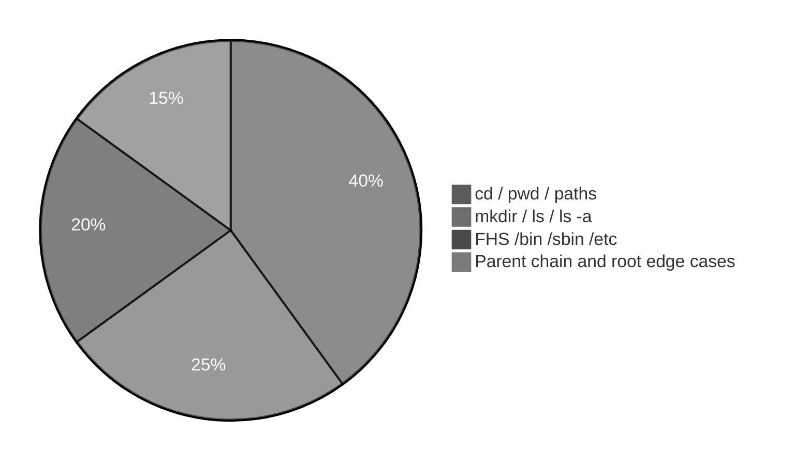

# Execution summary — `file-system-navigation-and-hierarchy/`

**Topic:** [File System Navigation Commands And Hierarchy.md](../docs/topics/File%20System%20Navigation%20Commands%20And%20Hierarchy.md) (Video 4)  
**Scripts directory:** [`../scripts/file-system-navigation-and-hierarchy/`](../scripts/file-system-navigation-and-hierarchy/)



Each script section uses the same **four-part** model:

| # | Column in tables | Meaning |
| :---: | :--- | :--- |
| 1 | **What it is** | Command or shell feature (e.g. `echo` = print text). |
| 2 | **Added / configured** | How it appears in Linux (PATH, builtin, flag on CLI, variable in script). |
| 3 | **Execution intent** | What you are trying to do when the line runs. |
| 4 | **Output** | What you see on the **terminal (stdout/stderr)**, in a **file**, or through a **pipeline** (`|`). |

---

## [`absolute-cd-work-and-home-demo.sh`](../scripts/file-system-navigation-and-hierarchy/absolute-cd-work-and-home-demo.sh)

**Run:** `bash scripts/file-system-navigation-and-hierarchy/absolute-cd-work-and-home-demo.sh`

### In-depth command walkthrough

| Command (as in script) | 1. What it is | 2. Added / configured | 3. Execution intent | 4. Output (terminal / file / pipeline) |
| :--- | :--- | :--- | :--- | :--- |
| `set -euo pipefail` | Bash strict-mode option bundle. | Written at top of script; not installed separately. | Tell Bash to stop on errors, treat unset variables as errors, and fail pipelines if any stage fails. | No visible output; changes how later commands affect exit status. |
| `WORK="${TMPDIR:-/tmp}/linux-path-demo"` | Shell variable assignment. | Name=`value` in script; often under `${TMPDIR:-/tmp}`. | Store path or stamp for later commands (setup, not a user command). | No output; variable used by `cd`, `rm`, file paths. |
| `rm -rf "$WORK"` | Remove files/directories recursively, force. | Coreutils; `-r` recursive, `-f` no prompt. | Clean old demo data under `/tmp` before recreating. | Silent on success. |
| `mkdir -p "$WORK/mydir"` | Make directories. | Coreutils; `-p` creates parents as needed. | Try to **create** folder(s) for the demo tree. | Silent on success; errors on stderr if path invalid. |
| `cd "$WORK/mydir"` | Change directory — move shell’s current working directory. | Builtin; takes relative or absolute path, `~`, `-`, or no args (home). | Navigate the tree (trying to **enter** a folder); relative paths start from cwd. | Normally silent on success; failure prints `cd: ...: No such file or directory` on **stderr**. |
| `echo "=== Absolute: cd $WORK (from anywhere under tree) ==="` | Section header for humans. | Literal string in script | **Print** section title | Title line on **stdout** before commands |
| `cd "$WORK"` | Change directory — move shell’s current working directory. | Builtin; takes relative or absolute path, `~`, `-`, or no args (home). | Navigate the tree (trying to **enter** a folder); relative paths start from cwd. | Normally silent on success; failure prints `cd: ...: No such file or directory` on **stderr**. |
| `pwd` | Print working directory — shows full path of current folder. | Usually `/bin/pwd` or Bash builtin; on PATH by default. | Answer “where am I in the filesystem?” before/after `cd`. | One line path on **stdout**, e.g. `/tmp/linux-pwd-cd-demo/nested/deep`. |
| `echo ""` | Bash builtin that prints arguments to standard output. | Always available in Bash; no package install. | Show section titles, tips, or messages to the terminal (trying to **print** text for the user). | Lines appear on **stdout** in your terminal (or in CI logs). Not used in a pipeline unless followed by `|`. |
| `echo "=== /home is absolute (exists on typical Linux) ==="` | Section header for humans. | Literal string in script | **Print** section title | Title line on **stdout** before commands |
| `if [[ -d /home ]]; then` | Conditional test `[[ ... ]]` or `if`. | Bash syntax. | Branch: run block only when directory exists / command succeeds. | Either block runs (messages on stdout) or `else` branch. |
| `ls -ld /home` | List directory contents. | Coreutils; options change columns, hidden files, sort. | Try to **show names** in cwd or given path. | Names on stdout; options add permissions, sizes, inodes. |
| `echo "/home not present on this system (unusual)"` | Bash builtin that prints arguments to standard output. | Always available in Bash; no package install. | Show section titles, tips, or messages to the terminal (trying to **print** text for the user). | Lines appear on **stdout** in your terminal (or in CI logs). Not used in a pipeline unless followed by `|`. |
| `echo ""` | Bash builtin that prints arguments to standard output. | Always available in Bash; no package install. | Show section titles, tips, or messages to the terminal (trying to **print** text for the user). | Lines appear on **stdout** in your terminal (or in CI logs). Not used in a pipeline unless followed by `|`. |
| `echo "=== Absolute path works from any cwd ==="` | Section header for humans. | Literal string in script | **Print** section title | Title line on **stdout** before commands |
| `ls -ld /home 2>/dev/null \| head -1 \|\| true` | List directory contents. | Coreutils; options change columns, hidden files, sort. | Try to **show names** in cwd or given path. | Names on stdout; options add permissions, sizes, inodes. |

---

## [`absolute-vs-relative-paths-demo.sh`](../scripts/file-system-navigation-and-hierarchy/absolute-vs-relative-paths-demo.sh)

**Run:** `bash scripts/file-system-navigation-and-hierarchy/absolute-vs-relative-paths-demo.sh`

### In-depth command walkthrough

| Command (as in script) | 1. What it is | 2. Added / configured | 3. Execution intent | 4. Output (terminal / file / pipeline) |
| :--- | :--- | :--- | :--- | :--- |
| `set -euo pipefail` | Bash strict-mode option bundle. | Written at top of script; not installed separately. | Tell Bash to stop on errors, treat unset variables as errors, and fail pipelines if any stage fails. | No visible output; changes how later commands affect exit status. |
| `HERE="$(cd "$(dirname "${BASH_SOURCE[0]}")" && pwd)"` | Shell variable assignment. | Name=`value` in script; often under `${TMPDIR:-/tmp}`. | Store path or stamp for later commands (setup, not a user command). | No output; variable used by `cd`, `rm`, file paths. |
| `echo ""` | Bash builtin that prints arguments to standard output. | Always available in Bash; no package install. | Show section titles, tips, or messages to the terminal (trying to **print** text for the user). | Lines appear on **stdout** in your terminal (or in CI logs). Not used in a pipeline unless followed by `|`. |
| `echo "############################################"` | Bash builtin that prints arguments to standard output. | Always available in Bash; no package install. | Show section titles, tips, or messages to the terminal (trying to **print** text for the user). | Lines appear on **stdout** in your terminal (or in CI logs). Not used in a pipeline unless followed by `|`. |
| `echo "# $name"` | Bash builtin that prints arguments to standard output. | Always available in Bash; no package install. | Show section titles, tips, or messages to the terminal (trying to **print** text for the user). | Lines appear on **stdout** in your terminal (or in CI logs). Not used in a pipeline unless followed by `|`. |
| `echo "############################################"` | Bash builtin that prints arguments to standard output. | Always available in Bash; no package install. | Show section titles, tips, or messages to the terminal (trying to **print** text for the user). | Lines appear on **stdout** in your terminal (or in CI logs). Not used in a pipeline unless followed by `|`. |
| `bash "$HERE/$name"` | Invoke another script with Bash. | Child path built from `HERE` / `DIR` next to orchestrator. | Run one focused demo file so output maps to that file’s commands. | Child script’s stdout/stderr appear in your terminal in order; orchestrator prints `#####` banner first. |
| `run_demo relative-cd-mydir-demo.sh` | Orchestrator helper call. | Function `run_demo` in same script; takes child `.sh` filename. | Run the next focused demo so its output is grouped under a banner. | Banner on stdout, then child script output. |
| `run_demo absolute-cd-work-and-home-demo.sh` | Orchestrator helper call. | Function `run_demo` in same script; takes child `.sh` filename. | Run the next focused demo so its output is grouped under a banner. | Banner on stdout, then child script output. |
| `run_demo cd-home-from-root-vs-tmp-demo.sh` | Orchestrator helper call. | Function `run_demo` in same script; takes child `.sh` filename. | Run the next focused demo so its output is grouped under a banner. | Banner on stdout, then child script output. |

---

## [`bin-and-sbin-ls-sample-demo.sh`](../scripts/file-system-navigation-and-hierarchy/bin-and-sbin-ls-sample-demo.sh)

**Run:** `bash scripts/file-system-navigation-and-hierarchy/bin-and-sbin-ls-sample-demo.sh`

### In-depth command walkthrough

| Command (as in script) | 1. What it is | 2. Added / configured | 3. Execution intent | 4. Output (terminal / file / pipeline) |
| :--- | :--- | :--- | :--- | :--- |
| `set -euo pipefail` | Bash strict-mode option bundle. | Written at top of script; not installed separately. | Tell Bash to stop on errors, treat unset variables as errors, and fail pipelines if any stage fails. | No visible output; changes how later commands affect exit status. |
| `echo "=== /bin (binary executables for normal-user commands; may symli…` | Section header for humans. | Literal string in script | **Print** section title | Title line on **stdout** before commands |
| `ls -ld /bin 2>/dev/null \|\| true` | List directory contents. | Coreutils; options change columns, hidden files, sort. | Try to **show names** in cwd or given path. | Names on stdout; options add permissions, sizes, inodes. |
| `ls /bin 2>/dev/null \| head -12 \|\| true` | List directory contents. | Coreutils; options change columns, hidden files, sort. | Try to **show names** in cwd or given path. | Names on stdout; options add permissions, sizes, inodes. |
| `echo ""` | Bash builtin that prints arguments to standard output. | Always available in Bash; no package install. | Show section titles, tips, or messages to the terminal (trying to **print** text for the user). | Lines appear on **stdout** in your terminal (or in CI logs). Not used in a pipeline unless followed by `|`. |
| `echo "=== /sbin (system bin — super-user / admin binaries) ==="` | Section header for humans. | Literal string in script | **Print** section title | Title line on **stdout** before commands |
| `ls -ld /sbin 2>/dev/null \|\| true` | List directory contents. | Coreutils; options change columns, hidden files, sort. | Try to **show names** in cwd or given path. | Names on stdout; options add permissions, sizes, inodes. |
| `ls /sbin 2>/dev/null \| head -12 \|\| true` | List directory contents. | Coreutils; options change columns, hidden files, sort. | Try to **show names** in cwd or given path. | Names on stdout; options add permissions, sizes, inodes. |

---

## [`bin-sbin-etc-demo.sh`](../scripts/file-system-navigation-and-hierarchy/bin-sbin-etc-demo.sh)

**Run:** `bash scripts/file-system-navigation-and-hierarchy/bin-sbin-etc-demo.sh`

### In-depth command walkthrough

| Command (as in script) | 1. What it is | 2. Added / configured | 3. Execution intent | 4. Output (terminal / file / pipeline) |
| :--- | :--- | :--- | :--- | :--- |
| `set -euo pipefail` | Bash strict-mode option bundle. | Written at top of script; not installed separately. | Tell Bash to stop on errors, treat unset variables as errors, and fail pipelines if any stage fails. | No visible output; changes how later commands affect exit status. |
| `HERE="$(cd "$(dirname "${BASH_SOURCE[0]}")" && pwd)"` | Shell variable assignment. | Name=`value` in script; often under `${TMPDIR:-/tmp}`. | Store path or stamp for later commands (setup, not a user command). | No output; variable used by `cd`, `rm`, file paths. |
| `echo ""` | Bash builtin that prints arguments to standard output. | Always available in Bash; no package install. | Show section titles, tips, or messages to the terminal (trying to **print** text for the user). | Lines appear on **stdout** in your terminal (or in CI logs). Not used in a pipeline unless followed by `|`. |
| `echo "############################################"` | Bash builtin that prints arguments to standard output. | Always available in Bash; no package install. | Show section titles, tips, or messages to the terminal (trying to **print** text for the user). | Lines appear on **stdout** in your terminal (or in CI logs). Not used in a pipeline unless followed by `|`. |
| `echo "# $name"` | Bash builtin that prints arguments to standard output. | Always available in Bash; no package install. | Show section titles, tips, or messages to the terminal (trying to **print** text for the user). | Lines appear on **stdout** in your terminal (or in CI logs). Not used in a pipeline unless followed by `|`. |
| `echo "############################################"` | Bash builtin that prints arguments to standard output. | Always available in Bash; no package install. | Show section titles, tips, or messages to the terminal (trying to **print** text for the user). | Lines appear on **stdout** in your terminal (or in CI logs). Not used in a pipeline unless followed by `|`. |
| `bash "$HERE/$name"` | Invoke another script with Bash. | Child path built from `HERE` / `DIR` next to orchestrator. | Run one focused demo file so output maps to that file’s commands. | Child script’s stdout/stderr appear in your terminal in order; orchestrator prints `#####` banner first. |
| `run_demo which-command-paths-demo.sh` | Orchestrator helper call. | Function `run_demo` in same script; takes child `.sh` filename. | Run the next focused demo so its output is grouped under a banner. | Banner on stdout, then child script output. |
| `run_demo bin-and-sbin-ls-sample-demo.sh` | Orchestrator helper call. | Function `run_demo` in same script; takes child `.sh` filename. | Run the next focused demo so its output is grouped under a banner. | Banner on stdout, then child script output. |
| `run_demo etc-config-files-head-demo.sh` | Orchestrator helper call. | Function `run_demo` in same script; takes child `.sh` filename. | Run the next focused demo so its output is grouped under a banner. | Banner on stdout, then child script output. |

---

## [`cd-chained-parent-paths-demo.sh`](../scripts/file-system-navigation-and-hierarchy/cd-chained-parent-paths-demo.sh)

**Run:** `bash scripts/file-system-navigation-and-hierarchy/cd-chained-parent-paths-demo.sh`

### In-depth command walkthrough

| Command (as in script) | 1. What it is | 2. Added / configured | 3. Execution intent | 4. Output (terminal / file / pipeline) |
| :--- | :--- | :--- | :--- | :--- |
| `set -euo pipefail` | Bash strict-mode option bundle. | Written at top of script; not installed separately. | Tell Bash to stop on errors, treat unset variables as errors, and fail pipelines if any stage fails. | No visible output; changes how later commands affect exit status. |
| `BASE="${TMPDIR:-/tmp}/linux-multi-parent-demo"` | Shell variable assignment. | Name=`value` in script; often under `${TMPDIR:-/tmp}`. | Store path or stamp for later commands (setup, not a user command). | No output; variable used by `cd`, `rm`, file paths. |
| `rm -rf "$BASE"` | Remove files/directories recursively, force. | Coreutils; `-r` recursive, `-f` no prompt. | Clean old demo data under `/tmp` before recreating. | Silent on success. |
| `mkdir -p "$BASE/desktop/d1/d2"` | Make directories. | Coreutils; `-p` creates parents as needed. | Try to **create** folder(s) for the demo tree. | Silent on success; errors on stderr if path invalid. |
| `cd "$BASE/desktop/d1/d2"` | Change directory — move shell’s current working directory. | Builtin; takes relative or absolute path, `~`, `-`, or no args (home). | Navigate the tree (trying to **enter** a folder); relative paths start from cwd. | Normally silent on success; failure prints `cd: ...: No such file or directory` on **stderr**. |
| `echo "=== Start in d2 ==="` | Section header for humans. | Literal string in script | **Print** section title | Title line on **stdout** before commands |
| `pwd` | Print working directory — shows full path of current folder. | Usually `/bin/pwd` or Bash builtin; on PATH by default. | Answer “where am I in the filesystem?” before/after `cd`. | One line path on **stdout**, e.g. `/tmp/linux-pwd-cd-demo/nested/deep`. |
| `echo ""` | Bash builtin that prints arguments to standard output. | Always available in Bash; no package install. | Show section titles, tips, or messages to the terminal (trying to **print** text for the user). | Lines appear on **stdout** in your terminal (or in CI logs). Not used in a pipeline unless followed by `|`. |
| `echo "=== cd ..  -> parent d1 ==="` | Section header for humans. | Literal string in script | **Print** section title | Title line on **stdout** before commands |
| `cd ..` | Change directory — move shell’s current working directory. | Builtin; takes relative or absolute path, `~`, `-`, or no args (home). | Navigate the tree (trying to **enter** a folder); relative paths start from cwd. | Normally silent on success; failure prints `cd: ...: No such file or directory` on **stderr**. |
| `pwd` | Print working directory — shows full path of current folder. | Usually `/bin/pwd` or Bash builtin; on PATH by default. | Answer “where am I in the filesystem?” before/after `cd`. | One line path on **stdout**, e.g. `/tmp/linux-pwd-cd-demo/nested/deep`. |
| `echo ""` | Bash builtin that prints arguments to standard output. | Always available in Bash; no package install. | Show section titles, tips, or messages to the terminal (trying to **print** text for the user). | Lines appear on **stdout** in your terminal (or in CI logs). Not used in a pipeline unless followed by `|`. |
| `echo "=== cd ../.. (two parents in one path) -> desktop ==="` | Section header for humans. | Literal string in script | **Print** section title | Title line on **stdout** before commands |
| `cd "$BASE/desktop/d1/d2"` | Change directory — move shell’s current working directory. | Builtin; takes relative or absolute path, `~`, `-`, or no args (home). | Navigate the tree (trying to **enter** a folder); relative paths start from cwd. | Normally silent on success; failure prints `cd: ...: No such file or directory` on **stderr**. |
| `cd ../..` | Change directory — move shell’s current working directory. | Builtin; takes relative or absolute path, `~`, `-`, or no args (home). | Navigate the tree (trying to **enter** a folder); relative paths start from cwd. | Normally silent on success; failure prints `cd: ...: No such file or directory` on **stderr**. |
| `pwd` | Print working directory — shows full path of current folder. | Usually `/bin/pwd` or Bash builtin; on PATH by default. | Answer “where am I in the filesystem?” before/after `cd`. | One line path on **stdout**, e.g. `/tmp/linux-pwd-cd-demo/nested/deep`. |
| `echo ""` | Bash builtin that prints arguments to standard output. | Always available in Bash; no package install. | Show section titles, tips, or messages to the terminal (trying to **print** text for the user). | Lines appear on **stdout** in your terminal (or in CI logs). Not used in a pipeline unless followed by `|`. |
| `echo "=== cd ../../.. from d2 -> up three levels (d2 -> d1 -> desktop …` | Section header for humans. | Literal string in script | **Print** section title | Title line on **stdout** before commands |
| `cd "$BASE/desktop/d1/d2"` | Change directory — move shell’s current working directory. | Builtin; takes relative or absolute path, `~`, `-`, or no args (home). | Navigate the tree (trying to **enter** a folder); relative paths start from cwd. | Normally silent on success; failure prints `cd: ...: No such file or directory` on **stderr**. |
| `cd ../../..` | Change directory — move shell’s current working directory. | Builtin; takes relative or absolute path, `~`, `-`, or no args (home). | Navigate the tree (trying to **enter** a folder); relative paths start from cwd. | Normally silent on success; failure prints `cd: ...: No such file or directory` on **stderr**. |
| `pwd` | Print working directory — shows full path of current folder. | Usually `/bin/pwd` or Bash builtin; on PATH by default. | Answer “where am I in the filesystem?” before/after `cd`. | One line path on **stdout**, e.g. `/tmp/linux-pwd-cd-demo/nested/deep`. |
| `echo ""` | Bash builtin that prints arguments to standard output. | Always available in Bash; no package install. | Show section titles, tips, or messages to the terminal (trying to **print** text for the user). | Lines appear on **stdout** in your terminal (or in CI logs). Not used in a pipeline unless followed by `|`. |
| `echo "Note: 'cd .. ..' is invalid in Bash (too many arguments); use .…` | Bash builtin that prints arguments to standard output. | Always available in Bash; no package install. | Show section titles, tips, or messages to the terminal (trying to **print** text for the user). | Lines appear on **stdout** in your terminal (or in CI logs). Not used in a pipeline unless followed by `|`. |

---

## [`cd-dot-and-parent-demo.sh`](../scripts/file-system-navigation-and-hierarchy/cd-dot-and-parent-demo.sh)

**Run:** `bash scripts/file-system-navigation-and-hierarchy/cd-dot-and-parent-demo.sh`

### In-depth command walkthrough

| Command (as in script) | 1. What it is | 2. Added / configured | 3. Execution intent | 4. Output (terminal / file / pipeline) |
| :--- | :--- | :--- | :--- | :--- |
| `set -euo pipefail` | Bash strict-mode option bundle. | Written at top of script; not installed separately. | Tell Bash to stop on errors, treat unset variables as errors, and fail pipelines if any stage fails. | No visible output; changes how later commands affect exit status. |
| `WORK="${TMPDIR:-/tmp}/linux-pwd-cd-demo"` | Shell variable assignment. | Name=`value` in script; often under `${TMPDIR:-/tmp}`. | Store path or stamp for later commands (setup, not a user command). | No output; variable used by `cd`, `rm`, file paths. |
| `rm -rf "$WORK"` | Remove files/directories recursively, force. | Coreutils; `-r` recursive, `-f` no prompt. | Clean old demo data under `/tmp` before recreating. | Silent on success. |
| `mkdir -p "$WORK/nested/deep"` | Make directories. | Coreutils; `-p` creates parents as needed. | Try to **create** folder(s) for the demo tree. | Silent on success; errors on stderr if path invalid. |
| `cd "$WORK/nested/deep"` | Change directory — move shell’s current working directory. | Builtin; takes relative or absolute path, `~`, `-`, or no args (home). | Navigate the tree (trying to **enter** a folder); relative paths start from cwd. | Normally silent on success; failure prints `cd: ...: No such file or directory` on **stderr**. |
| `echo "=== cd . (stay here — same directory) ==="` | Section header for humans. | Literal string in script | **Print** section title | Title line on **stdout** before commands |
| `cd .` | Change directory — move shell’s current working directory. | Builtin; takes relative or absolute path, `~`, `-`, or no args (home). | Navigate the tree (trying to **enter** a folder); relative paths start from cwd. | Normally silent on success; failure prints `cd: ...: No such file or directory` on **stderr**. |
| `pwd` | Print working directory — shows full path of current folder. | Usually `/bin/pwd` or Bash builtin; on PATH by default. | Answer “where am I in the filesystem?” before/after `cd`. | One line path on **stdout**, e.g. `/tmp/linux-pwd-cd-demo/nested/deep`. |
| `echo ""` | Bash builtin that prints arguments to standard output. | Always available in Bash; no package install. | Show section titles, tips, or messages to the terminal (trying to **print** text for the user). | Lines appear on **stdout** in your terminal (or in CI logs). Not used in a pipeline unless followed by `|`. |
| `echo "=== cd .. (parent) ==="` | Section header for humans. | Literal string in script | **Print** section title | Title line on **stdout** before commands |
| `cd ..` | Change directory — move shell’s current working directory. | Builtin; takes relative or absolute path, `~`, `-`, or no args (home). | Navigate the tree (trying to **enter** a folder); relative paths start from cwd. | Normally silent on success; failure prints `cd: ...: No such file or directory` on **stderr**. |
| `pwd` | Print working directory — shows full path of current folder. | Usually `/bin/pwd` or Bash builtin; on PATH by default. | Answer “where am I in the filesystem?” before/after `cd`. | One line path on **stdout**, e.g. `/tmp/linux-pwd-cd-demo/nested/deep`. |

---

## [`cd-home-and-tilde-demo.sh`](../scripts/file-system-navigation-and-hierarchy/cd-home-and-tilde-demo.sh)

**Run:** `bash scripts/file-system-navigation-and-hierarchy/cd-home-and-tilde-demo.sh`

### In-depth command walkthrough

| Command (as in script) | 1. What it is | 2. Added / configured | 3. Execution intent | 4. Output (terminal / file / pipeline) |
| :--- | :--- | :--- | :--- | :--- |
| `set -euo pipefail` | Bash strict-mode option bundle. | Written at top of script; not installed separately. | Tell Bash to stop on errors, treat unset variables as errors, and fail pipelines if any stage fails. | No visible output; changes how later commands affect exit status. |
| `WORK="${TMPDIR:-/tmp}/linux-pwd-cd-demo"` | Shell variable assignment. | Name=`value` in script; often under `${TMPDIR:-/tmp}`. | Store path or stamp for later commands (setup, not a user command). | No output; variable used by `cd`, `rm`, file paths. |
| `rm -rf "$WORK"` | Remove files/directories recursively, force. | Coreutils; `-r` recursive, `-f` no prompt. | Clean old demo data under `/tmp` before recreating. | Silent on success. |
| `mkdir -p "$WORK/nested/deep"` | Make directories. | Coreutils; `-p` creates parents as needed. | Try to **create** folder(s) for the demo tree. | Silent on success; errors on stderr if path invalid. |
| `cd "$WORK/nested/deep"` | Change directory — move shell’s current working directory. | Builtin; takes relative or absolute path, `~`, `-`, or no args (home). | Navigate the tree (trying to **enter** a folder); relative paths start from cwd. | Normally silent on success; failure prints `cd: ...: No such file or directory` on **stderr**. |
| `echo "=== cd (no args) -> home ==="` | Section header for humans. | Literal string in script | **Print** section title | Title line on **stdout** before commands |
| `cd` | Change directory — move shell’s current working directory. | Builtin; takes relative or absolute path, `~`, `-`, or no args (home). | Navigate the tree (trying to **enter** a folder); relative paths start from cwd. | Normally silent on success; failure prints `cd: ...: No such file or directory` on **stderr**. |
| `pwd` | Print working directory — shows full path of current folder. | Usually `/bin/pwd` or Bash builtin; on PATH by default. | Answer “where am I in the filesystem?” before/after `cd`. | One line path on **stdout**, e.g. `/tmp/linux-pwd-cd-demo/nested/deep`. |
| `echo "HOME=$HOME"` | Bash builtin that prints arguments to standard output. | Always available in Bash; no package install. | Show section titles, tips, or messages to the terminal (trying to **print** text for the user). | Lines appear on **stdout** in your terminal (or in CI logs). Not used in a pipeline unless followed by `|`. |
| `echo ""` | Bash builtin that prints arguments to standard output. | Always available in Bash; no package install. | Show section titles, tips, or messages to the terminal (trying to **print** text for the user). | Lines appear on **stdout** in your terminal (or in CI logs). Not used in a pipeline unless followed by `|`. |
| `echo "=== cd ~ (explicit home) ==="` | Section header for humans. | Literal string in script | **Print** section title | Title line on **stdout** before commands |
| `cd ~` | Change directory — move shell’s current working directory. | Builtin; takes relative or absolute path, `~`, `-`, or no args (home). | Navigate the tree (trying to **enter** a folder); relative paths start from cwd. | Normally silent on success; failure prints `cd: ...: No such file or directory` on **stderr**. |
| `pwd` | Print working directory — shows full path of current folder. | Usually `/bin/pwd` or Bash builtin; on PATH by default. | Answer “where am I in the filesystem?” before/after `cd`. | One line path on **stdout**, e.g. `/tmp/linux-pwd-cd-demo/nested/deep`. |

---

## [`cd-home-from-root-vs-tmp-demo.sh`](../scripts/file-system-navigation-and-hierarchy/cd-home-from-root-vs-tmp-demo.sh)

**Run:** `bash scripts/file-system-navigation-and-hierarchy/cd-home-from-root-vs-tmp-demo.sh`

### In-depth command walkthrough

| Command (as in script) | 1. What it is | 2. Added / configured | 3. Execution intent | 4. Output (terminal / file / pipeline) |
| :--- | :--- | :--- | :--- | :--- |
| `set -euo pipefail` | Bash strict-mode option bundle. | Written at top of script; not installed separately. | Tell Bash to stop on errors, treat unset variables as errors, and fail pipelines if any stage fails. | No visible output; changes how later commands affect exit status. |
| `echo "=== From /, relative cd home -> /home (child directory named hom…` | Section header for humans. | Literal string in script | **Print** section title | Title line on **stdout** before commands |
| `( cd / && cd home && pwd )` | Subshell `( commands )`. | Parentheses spawn child shell; cwd changes do not affect parent. | Try `cd` in isolation without leaving main script directory. | Inner `pwd` on stdout; outer cwd unchanged. |
| `echo ""` | Bash builtin that prints arguments to standard output. | Always available in Bash; no package install. | Show section titles, tips, or messages to the terminal (trying to **print** text for the user). | Lines appear on **stdout** in your terminal (or in CI logs). Not used in a pipeline unless followed by `|`. |
| `echo "=== From /tmp, cd home usually fails (no home/ under /tmp) ==="` | Section header for humans. | Literal string in script | **Print** section title | Title line on **stdout** before commands |
| `if ( cd /tmp && cd home 2>/dev/null ); then` | Conditional test `[[ ... ]]` or `if`. | Bash syntax. | Branch: run block only when directory exists / command succeeds. | Either block runs (messages on stdout) or `else` branch. |
| `pwd` | Print working directory — shows full path of current folder. | Usually `/bin/pwd` or Bash builtin; on PATH by default. | Answer “where am I in the filesystem?” before/after `cd`. | One line path on **stdout**, e.g. `/tmp/linux-pwd-cd-demo/nested/deep`. |
| `echo "cd home from /tmp: failed (expected)"` | Bash builtin that prints arguments to standard output. | Always available in Bash; no package install. | Show section titles, tips, or messages to the terminal (trying to **print** text for the user). | Lines appear on **stdout** in your terminal (or in CI logs). Not used in a pipeline unless followed by `|`. |

---

## [`cd-home-relative-fails-demo.sh`](../scripts/file-system-navigation-and-hierarchy/cd-home-relative-fails-demo.sh)

**Run:** `bash scripts/file-system-navigation-and-hierarchy/cd-home-relative-fails-demo.sh`

### In-depth command walkthrough

| Command (as in script) | 1. What it is | 2. Added / configured | 3. Execution intent | 4. Output (terminal / file / pipeline) |
| :--- | :--- | :--- | :--- | :--- |
| `set -euo pipefail` | Bash strict-mode option bundle. | Written at top of script; not installed separately. | Tell Bash to stop on errors, treat unset variables as errors, and fail pipelines if any stage fails. | No visible output; changes how later commands affect exit status. |
| `BASE="${TMPDIR:-/tmp}/linux-cd-home-demo"` | Shell variable assignment. | Name=`value` in script; often under `${TMPDIR:-/tmp}`. | Store path or stamp for later commands (setup, not a user command). | No output; variable used by `cd`, `rm`, file paths. |
| `rm -rf "$BASE"` | Remove files/directories recursively, force. | Coreutils; `-r` recursive, `-f` no prompt. | Clean old demo data under `/tmp` before recreating. | Silent on success. |
| `mkdir -p "$BASE/desktop/d1/d2"` | Make directories. | Coreutils; `-p` creates parents as needed. | Try to **create** folder(s) for the demo tree. | Silent on success; errors on stderr if path invalid. |
| `cd "$BASE/desktop/d1/d2"` | Change directory — move shell’s current working directory. | Builtin; takes relative or absolute path, `~`, `-`, or no args (home). | Navigate the tree (trying to **enter** a folder); relative paths start from cwd. | Normally silent on success; failure prints `cd: ...: No such file or directory` on **stderr**. |
| `echo "=== cwd is deep inside d2 (no 'home' folder here) ==="` | Section header for humans. | Literal string in script | **Print** section title | Title line on **stdout** before commands |
| `pwd` | Print working directory — shows full path of current folder. | Usually `/bin/pwd` or Bash builtin; on PATH by default. | Answer “where am I in the filesystem?” before/after `cd`. | One line path on **stdout**, e.g. `/tmp/linux-pwd-cd-demo/nested/deep`. |
| `echo ""` | Bash builtin that prints arguments to standard output. | Always available in Bash; no package install. | Show section titles, tips, or messages to the terminal (trying to **print** text for the user). | Lines appear on **stdout** in your terminal (or in CI logs). Not used in a pipeline unless followed by `|`. |
| `echo "=== cd home (relative) — looks for ./home under current director…` | Section header for humans. | Literal string in script | **Print** section title | Title line on **stdout** before commands |
| `if cd home 2>/dev/null; then` | Conditional test `[[ ... ]]` or `if`. | Bash syntax. | Branch: run block only when directory exists / command succeeds. | Either block runs (messages on stdout) or `else` branch. |
| `pwd` | Print working directory — shows full path of current folder. | Usually `/bin/pwd` or Bash builtin; on PATH by default. | Answer “where am I in the filesystem?” before/after `cd`. | One line path on **stdout**, e.g. `/tmp/linux-pwd-cd-demo/nested/deep`. |
| `echo "Failed: no such file or directory (expected from d2)"` | Bash builtin that prints arguments to standard output. | Always available in Bash; no package install. | Show section titles, tips, or messages to the terminal (trying to **print** text for the user). | Lines appear on **stdout** in your terminal (or in CI logs). Not used in a pipeline unless followed by `|`. |

---

## [`cd-home-relative-vs-absolute-demo.sh`](../scripts/file-system-navigation-and-hierarchy/cd-home-relative-vs-absolute-demo.sh)

**Run:** `bash scripts/file-system-navigation-and-hierarchy/cd-home-relative-vs-absolute-demo.sh`

### In-depth command walkthrough

| Command (as in script) | 1. What it is | 2. Added / configured | 3. Execution intent | 4. Output (terminal / file / pipeline) |
| :--- | :--- | :--- | :--- | :--- |
| `set -euo pipefail` | Bash strict-mode option bundle. | Written at top of script; not installed separately. | Tell Bash to stop on errors, treat unset variables as errors, and fail pipelines if any stage fails. | No visible output; changes how later commands affect exit status. |
| `HERE="$(cd "$(dirname "${BASH_SOURCE[0]}")" && pwd)"` | Shell variable assignment. | Name=`value` in script; often under `${TMPDIR:-/tmp}`. | Store path or stamp for later commands (setup, not a user command). | No output; variable used by `cd`, `rm`, file paths. |
| `echo ""` | Bash builtin that prints arguments to standard output. | Always available in Bash; no package install. | Show section titles, tips, or messages to the terminal (trying to **print** text for the user). | Lines appear on **stdout** in your terminal (or in CI logs). Not used in a pipeline unless followed by `|`. |
| `echo "############################################"` | Bash builtin that prints arguments to standard output. | Always available in Bash; no package install. | Show section titles, tips, or messages to the terminal (trying to **print** text for the user). | Lines appear on **stdout** in your terminal (or in CI logs). Not used in a pipeline unless followed by `|`. |
| `echo "# $name"` | Bash builtin that prints arguments to standard output. | Always available in Bash; no package install. | Show section titles, tips, or messages to the terminal (trying to **print** text for the user). | Lines appear on **stdout** in your terminal (or in CI logs). Not used in a pipeline unless followed by `|`. |
| `echo "############################################"` | Bash builtin that prints arguments to standard output. | Always available in Bash; no package install. | Show section titles, tips, or messages to the terminal (trying to **print** text for the user). | Lines appear on **stdout** in your terminal (or in CI logs). Not used in a pipeline unless followed by `|`. |
| `bash "$HERE/$name"` | Invoke another script with Bash. | Child path built from `HERE` / `DIR` next to orchestrator. | Run one focused demo file so output maps to that file’s commands. | Child script’s stdout/stderr appear in your terminal in order; orchestrator prints `#####` banner first. |
| `run_demo cd-home-relative-fails-demo.sh` | Orchestrator helper call. | Function `run_demo` in same script; takes child `.sh` filename. | Run the next focused demo so its output is grouped under a banner. | Banner on stdout, then child script output. |
| `run_demo cd-slash-home-absolute-demo.sh` | Orchestrator helper call. | Function `run_demo` in same script; takes child `.sh` filename. | Run the next focused demo so its output is grouped under a banner. | Banner on stdout, then child script output. |

---

## [`cd-multiple-parent-demo.sh`](../scripts/file-system-navigation-and-hierarchy/cd-multiple-parent-demo.sh)

**Run:** `bash scripts/file-system-navigation-and-hierarchy/cd-multiple-parent-demo.sh`

### In-depth command walkthrough

| Command (as in script) | 1. What it is | 2. Added / configured | 3. Execution intent | 4. Output (terminal / file / pipeline) |
| :--- | :--- | :--- | :--- | :--- |
| `set -euo pipefail` | Bash strict-mode option bundle. | Written at top of script; not installed separately. | Tell Bash to stop on errors, treat unset variables as errors, and fail pipelines if any stage fails. | No visible output; changes how later commands affect exit status. |
| `HERE="$(cd "$(dirname "${BASH_SOURCE[0]}")" && pwd)"` | Shell variable assignment. | Name=`value` in script; often under `${TMPDIR:-/tmp}`. | Store path or stamp for later commands (setup, not a user command). | No output; variable used by `cd`, `rm`, file paths. |
| `echo ""` | Bash builtin that prints arguments to standard output. | Always available in Bash; no package install. | Show section titles, tips, or messages to the terminal (trying to **print** text for the user). | Lines appear on **stdout** in your terminal (or in CI logs). Not used in a pipeline unless followed by `|`. |
| `echo "############################################"` | Bash builtin that prints arguments to standard output. | Always available in Bash; no package install. | Show section titles, tips, or messages to the terminal (trying to **print** text for the user). | Lines appear on **stdout** in your terminal (or in CI logs). Not used in a pipeline unless followed by `|`. |
| `echo "# $name"` | Bash builtin that prints arguments to standard output. | Always available in Bash; no package install. | Show section titles, tips, or messages to the terminal (trying to **print** text for the user). | Lines appear on **stdout** in your terminal (or in CI logs). Not used in a pipeline unless followed by `|`. |
| `echo "############################################"` | Bash builtin that prints arguments to standard output. | Always available in Bash; no package install. | Show section titles, tips, or messages to the terminal (trying to **print** text for the user). | Lines appear on **stdout** in your terminal (or in CI logs). Not used in a pipeline unless followed by `|`. |
| `bash "$HERE/$name"` | Invoke another script with Bash. | Child path built from `HERE` / `DIR` next to orchestrator. | Run one focused demo file so output maps to that file’s commands. | Child script’s stdout/stderr appear in your terminal in order; orchestrator prints `#####` banner first. |
| `run_demo cd-chained-parent-paths-demo.sh` | Orchestrator helper call. | Function `run_demo` in same script; takes child `.sh` filename. | Run the next focused demo so its output is grouped under a banner. | Banner on stdout, then child script output. |
| `run_demo cd-three-dots-invalid-demo.sh` | Orchestrator helper call. | Function `run_demo` in same script; takes child `.sh` filename. | Run the next focused demo so its output is grouped under a banner. | Banner on stdout, then child script output. |

---

## [`cd-previous-directory-demo.sh`](../scripts/file-system-navigation-and-hierarchy/cd-previous-directory-demo.sh)

**Run:** `bash scripts/file-system-navigation-and-hierarchy/cd-previous-directory-demo.sh`

### In-depth command walkthrough

| Command (as in script) | 1. What it is | 2. Added / configured | 3. Execution intent | 4. Output (terminal / file / pipeline) |
| :--- | :--- | :--- | :--- | :--- |
| `set -euo pipefail` | Bash strict-mode option bundle. | Written at top of script; not installed separately. | Tell Bash to stop on errors, treat unset variables as errors, and fail pipelines if any stage fails. | No visible output; changes how later commands affect exit status. |
| `WORK="${TMPDIR:-/tmp}/linux-pwd-cd-demo"` | Shell variable assignment. | Name=`value` in script; often under `${TMPDIR:-/tmp}`. | Store path or stamp for later commands (setup, not a user command). | No output; variable used by `cd`, `rm`, file paths. |
| `rm -rf "$WORK"` | Remove files/directories recursively, force. | Coreutils; `-r` recursive, `-f` no prompt. | Clean old demo data under `/tmp` before recreating. | Silent on success. |
| `mkdir -p "$WORK/nested/deep"` | Make directories. | Coreutils; `-p` creates parents as needed. | Try to **create** folder(s) for the demo tree. | Silent on success; errors on stderr if path invalid. |
| `cd "$WORK"` | Change directory — move shell’s current working directory. | Builtin; takes relative or absolute path, `~`, `-`, or no args (home). | Navigate the tree (trying to **enter** a folder); relative paths start from cwd. | Normally silent on success; failure prints `cd: ...: No such file or directory` on **stderr**. |
| `cd "$WORK/nested/deep"` | Change directory — move shell’s current working directory. | Builtin; takes relative or absolute path, `~`, `-`, or no args (home). | Navigate the tree (trying to **enter** a folder); relative paths start from cwd. | Normally silent on success; failure prints `cd: ...: No such file or directory` on **stderr**. |
| `echo "=== cd - (previous directory) ==="` | Section header for humans. | Literal string in script | **Print** section title | Title line on **stdout** before commands |
| `echo "Now in: $(pwd)"` | Bash builtin that prints arguments to standard output. | Always available in Bash; no package install. | Show section titles, tips, or messages to the terminal (trying to **print** text for the user). | Lines appear on **stdout** in your terminal (or in CI logs). Not used in a pipeline unless followed by `|`. |
| `cd -` | Change directory — move shell’s current working directory. | Builtin; takes relative or absolute path, `~`, `-`, or no args (home). | Navigate the tree (trying to **enter** a folder); relative paths start from cwd. | Normally silent on success; failure prints `cd: ...: No such file or directory` on **stderr**. |
| `echo "After cd -: $(pwd)"` | Bash builtin that prints arguments to standard output. | Always available in Bash; no package install. | Show section titles, tips, or messages to the terminal (trying to **print** text for the user). | Lines appear on **stdout** in your terminal (or in CI logs). Not used in a pipeline unless followed by `|`. |
| `echo ""` | Bash builtin that prints arguments to standard output. | Always available in Bash; no package install. | Show section titles, tips, or messages to the terminal (trying to **print** text for the user). | Lines appear on **stdout** in your terminal (or in CI logs). Not used in a pipeline unless followed by `|`. |
| `echo "=== cd .. from deep again ==="` | Section header for humans. | Literal string in script | **Print** section title | Title line on **stdout** before commands |
| `cd "$WORK/nested/deep"` | Change directory — move shell’s current working directory. | Builtin; takes relative or absolute path, `~`, `-`, or no args (home). | Navigate the tree (trying to **enter** a folder); relative paths start from cwd. | Normally silent on success; failure prints `cd: ...: No such file or directory` on **stderr**. |
| `cd ..` | Change directory — move shell’s current working directory. | Builtin; takes relative or absolute path, `~`, `-`, or no args (home). | Navigate the tree (trying to **enter** a folder); relative paths start from cwd. | Normally silent on success; failure prints `cd: ...: No such file or directory` on **stderr**. |
| `pwd` | Print working directory — shows full path of current folder. | Usually `/bin/pwd` or Bash builtin; on PATH by default. | Answer “where am I in the filesystem?” before/after `cd`. | One line path on **stdout**, e.g. `/tmp/linux-pwd-cd-demo/nested/deep`. |

---

## [`cd-root-edge-cases-demo.sh`](../scripts/file-system-navigation-and-hierarchy/cd-root-edge-cases-demo.sh)

**Run:** `bash scripts/file-system-navigation-and-hierarchy/cd-root-edge-cases-demo.sh`

### In-depth command walkthrough

| Command (as in script) | 1. What it is | 2. Added / configured | 3. Execution intent | 4. Output (terminal / file / pipeline) |
| :--- | :--- | :--- | :--- | :--- |
| `set -euo pipefail` | Bash strict-mode option bundle. | Written at top of script; not installed separately. | Tell Bash to stop on errors, treat unset variables as errors, and fail pipelines if any stage fails. | No visible output; changes how later commands affect exit status. |
| `echo "=== cd / (root directory) ==="` | Section header for humans. | Literal string in script | **Print** section title | Title line on **stdout** before commands |
| `cd /` | Change directory — move shell’s current working directory. | Builtin; takes relative or absolute path, `~`, `-`, or no args (home). | Navigate the tree (trying to **enter** a folder); relative paths start from cwd. | Normally silent on success; failure prints `cd: ...: No such file or directory` on **stderr**. |
| `pwd` | Print working directory — shows full path of current folder. | Usually `/bin/pwd` or Bash builtin; on PATH by default. | Answer “where am I in the filesystem?” before/after `cd`. | One line path on **stdout**, e.g. `/tmp/linux-pwd-cd-demo/nested/deep`. |
| `echo ""` | Bash builtin that prints arguments to standard output. | Always available in Bash; no package install. | Show section titles, tips, or messages to the terminal (trying to **print** text for the user). | Lines appear on **stdout** in your terminal (or in CI logs). Not used in a pipeline unless followed by `|`. |
| `echo "=== cd .. at root — no parent above /; you stay at root (Ubuntu)…` | Section header for humans. | Literal string in script | **Print** section title | Title line on **stdout** before commands |
| `cd ..` | Change directory — move shell’s current working directory. | Builtin; takes relative or absolute path, `~`, `-`, or no args (home). | Navigate the tree (trying to **enter** a folder); relative paths start from cwd. | Normally silent on success; failure prints `cd: ...: No such file or directory` on **stderr**. |
| `pwd` | Print working directory — shows full path of current folder. | Usually `/bin/pwd` or Bash builtin; on PATH by default. | Answer “where am I in the filesystem?” before/after `cd`. | One line path on **stdout**, e.g. `/tmp/linux-pwd-cd-demo/nested/deep`. |
| `echo ""` | Bash builtin that prints arguments to standard output. | Always available in Bash; no package install. | Show section titles, tips, or messages to the terminal (trying to **print** text for the user). | Lines appear on **stdout** in your terminal (or in CI logs). Not used in a pipeline unless followed by `|`. |
| `echo "=== cd . at root — current directory; still at root ==="` | Section header for humans. | Literal string in script | **Print** section title | Title line on **stdout** before commands |
| `cd .` | Change directory — move shell’s current working directory. | Builtin; takes relative or absolute path, `~`, `-`, or no args (home). | Navigate the tree (trying to **enter** a folder); relative paths start from cwd. | Normally silent on success; failure prints `cd: ...: No such file or directory` on **stderr**. |
| `pwd` | Print working directory — shows full path of current folder. | Usually `/bin/pwd` or Bash builtin; on PATH by default. | Answer “where am I in the filesystem?” before/after `cd`. | One line path on **stdout**, e.g. `/tmp/linux-pwd-cd-demo/nested/deep`. |
| `echo ""` | Bash builtin that prints arguments to standard output. | Always available in Bash; no package install. | Show section titles, tips, or messages to the terminal (trying to **print** text for the user). | Lines appear on **stdout** in your terminal (or in CI logs). Not used in a pipeline unless followed by `|`. |
| `echo "Durga Sir: root has no parent directory; beyond root there is n…` | Bash builtin that prints arguments to standard output. | Always available in Bash; no package install. | Show section titles, tips, or messages to the terminal (trying to **print** text for the user). | Lines appear on **stdout** in your terminal (or in CI logs). Not used in a pipeline unless followed by `|`. |

---

## [`cd-slash-home-absolute-demo.sh`](../scripts/file-system-navigation-and-hierarchy/cd-slash-home-absolute-demo.sh)

**Run:** `bash scripts/file-system-navigation-and-hierarchy/cd-slash-home-absolute-demo.sh`

### In-depth command walkthrough

| Command (as in script) | 1. What it is | 2. Added / configured | 3. Execution intent | 4. Output (terminal / file / pipeline) |
| :--- | :--- | :--- | :--- | :--- |
| `set -euo pipefail` | Bash strict-mode option bundle. | Written at top of script; not installed separately. | Tell Bash to stop on errors, treat unset variables as errors, and fail pipelines if any stage fails. | No visible output; changes how later commands affect exit status. |
| `echo "=== cd /home (absolute from /) — always the users' home parent d…` | Section header for humans. | Literal string in script | **Print** section title | Title line on **stdout** before commands |
| `if [[ -d /home ]]; then` | Conditional test `[[ ... ]]` or `if`. | Bash syntax. | Branch: run block only when directory exists / command succeeds. | Either block runs (messages on stdout) or `else` branch. |
| `cd /home` | Change directory — move shell’s current working directory. | Builtin; takes relative or absolute path, `~`, `-`, or no args (home). | Navigate the tree (trying to **enter** a folder); relative paths start from cwd. | Normally silent on success; failure prints `cd: ...: No such file or directory` on **stderr**. |
| `pwd` | Print working directory — shows full path of current folder. | Usually `/bin/pwd` or Bash builtin; on PATH by default. | Answer “where am I in the filesystem?” before/after `cd`. | One line path on **stdout**, e.g. `/tmp/linux-pwd-cd-demo/nested/deep`. |
| `ls -la /home \| head -8` | List directory contents. | Coreutils; options change columns, hidden files, sort. | Try to **show names** in cwd or given path. | Names on stdout; options add permissions, sizes, inodes. |
| `echo "/home not on this system"` | Bash builtin that prints arguments to standard output. | Always available in Bash; no package install. | Show section titles, tips, or messages to the terminal (trying to **print** text for the user). | Lines appear on **stdout** in your terminal (or in CI logs). Not used in a pipeline unless followed by `|`. |
| `echo ""` | Bash builtin that prints arguments to standard output. | Always available in Bash; no package install. | Show section titles, tips, or messages to the terminal (trying to **print** text for the user). | Lines appear on **stdout** in your terminal (or in CI logs). Not used in a pipeline unless followed by `|`. |
| `echo "Remember: /home exists only under root /, not as a relative nam…` | Bash builtin that prints arguments to standard output. | Always available in Bash; no package install. | Show section titles, tips, or messages to the terminal (trying to **print** text for the user). | Lines appear on **stdout** in your terminal (or in CI logs). Not used in a pipeline unless followed by `|`. |

---

## [`cd-three-dots-invalid-demo.sh`](../scripts/file-system-navigation-and-hierarchy/cd-three-dots-invalid-demo.sh)

**Run:** `bash scripts/file-system-navigation-and-hierarchy/cd-three-dots-invalid-demo.sh`

### In-depth command walkthrough

| Command (as in script) | 1. What it is | 2. Added / configured | 3. Execution intent | 4. Output (terminal / file / pipeline) |
| :--- | :--- | :--- | :--- | :--- |
| `set -euo pipefail` | Bash strict-mode option bundle. | Written at top of script; not installed separately. | Tell Bash to stop on errors, treat unset variables as errors, and fail pipelines if any stage fails. | No visible output; changes how later commands affect exit status. |
| `BASE="${TMPDIR:-/tmp}/linux-multi-parent-demo"` | Shell variable assignment. | Name=`value` in script; often under `${TMPDIR:-/tmp}`. | Store path or stamp for later commands (setup, not a user command). | No output; variable used by `cd`, `rm`, file paths. |
| `rm -rf "$BASE"` | Remove files/directories recursively, force. | Coreutils; `-r` recursive, `-f` no prompt. | Clean old demo data under `/tmp` before recreating. | Silent on success. |
| `mkdir -p "$BASE/desktop/d1/d2"` | Make directories. | Coreutils; `-p` creates parents as needed. | Try to **create** folder(s) for the demo tree. | Silent on success; errors on stderr if path invalid. |
| `echo "=== cd ... (three dots) is INVALID — no such file or directory =…` | Section header for humans. | Literal string in script | **Print** section title | Title line on **stdout** before commands |
| `if ( cd "$BASE/desktop/d1/d2" && cd ... 2>/dev/null ); then` | Conditional test `[[ ... ]]` or `if`. | Bash syntax. | Branch: run block only when directory exists / command succeeds. | Either block runs (messages on stdout) or `else` branch. |
| `pwd` | Print working directory — shows full path of current folder. | Usually `/bin/pwd` or Bash builtin; on PATH by default. | Answer “where am I in the filesystem?” before/after `cd`. | One line path on **stdout**, e.g. `/tmp/linux-pwd-cd-demo/nested/deep`. |
| `echo "cd ... failed (expected — only . and .. exist, not ...)"` | Bash builtin that prints arguments to standard output. | Always available in Bash; no package install. | Show section titles, tips, or messages to the terminal (trying to **print** text for the user). | Lines appear on **stdout** in your terminal (or in CI logs). Not used in a pipeline unless followed by `|`. |

---

## [`etc-config-files-head-demo.sh`](../scripts/file-system-navigation-and-hierarchy/etc-config-files-head-demo.sh)

**Run:** `bash scripts/file-system-navigation-and-hierarchy/etc-config-files-head-demo.sh`

### In-depth command walkthrough

| Command (as in script) | 1. What it is | 2. Added / configured | 3. Execution intent | 4. Output (terminal / file / pipeline) |
| :--- | :--- | :--- | :--- | :--- |
| `set -euo pipefail` | Bash strict-mode option bundle. | Written at top of script; not installed separately. | Tell Bash to stop on errors, treat unset variables as errors, and fail pipelines if any stage fails. | No visible output; changes how later commands affect exit status. |
| `echo "=== /etc — system configuration (sample files Durga Sir mentions…` | Section header for humans. | Literal string in script | **Print** section title | Title line on **stdout** before commands |
| `for f in /etc/passwd /etc/group /etc/hosts; do` | `for` loop over words. | Bash syntax; list after `in`. | Repeat command for each item (e.g. each utility name). | One output line per iteration on stdout. |
| `if [[ -f "$f" ]]; then` | Conditional test `[[ ... ]]` or `if`. | Bash syntax. | Branch: run block only when directory exists / command succeeds. | Either block runs (messages on stdout) or `else` branch. |
| `echo "--- $f (first 5 lines) ---"` | Bash builtin that prints arguments to standard output. | Always available in Bash; no package install. | Show section titles, tips, or messages to the terminal (trying to **print** text for the user). | Lines appear on **stdout** in your terminal (or in CI logs). Not used in a pipeline unless followed by `|`. |
| `head -5 "$f"` | Print first N lines of file or pipe. | Coreutils; often `head -n` or `head -20`. | Truncate long output in demos. | First lines on stdout; in pipeline: `cal -y | head -20` only first 20 lines reach terminal. |
| `echo ""` | Bash builtin that prints arguments to standard output. | Always available in Bash; no package install. | Show section titles, tips, or messages to the terminal (trying to **print** text for the user). | Lines appear on **stdout** in your terminal (or in CI logs). Not used in a pipeline unless followed by `|`. |
| `echo "etc = system configuration; passwd = users, group = groups, hos…` | Bash builtin that prints arguments to standard output. | Always available in Bash; no package install. | Show section titles, tips, or messages to the terminal (trying to **print** text for the user). | Lines appear on **stdout** in your terminal (or in CI logs). Not used in a pipeline unless followed by `|`. |

---

## [`fhs-directories-tour-part1-demo.sh`](../scripts/file-system-navigation-and-hierarchy/fhs-directories-tour-part1-demo.sh)

**Run:** `bash scripts/file-system-navigation-and-hierarchy/fhs-directories-tour-part1-demo.sh`

### In-depth command walkthrough

| Command (as in script) | 1. What it is | 2. Added / configured | 3. Execution intent | 4. Output (terminal / file / pipeline) |
| :--- | :--- | :--- | :--- | :--- |
| `set -euo pipefail` | Bash strict-mode option bundle. | Written at top of script; not installed separately. | Tell Bash to stop on errors, treat unset variables as errors, and fail pipelines if any stage fails. | No visible output; changes how later commands affect exit status. |
| `if [[ -d "$name" ]]; then` | Conditional test `[[ ... ]]` or `if`. | Bash syntax. | Branch: run block only when directory exists / command succeeds. | Either block runs (messages on stdout) or `else` branch. |
| `echo "--- $name ($note) ---"` | Bash builtin that prints arguments to standard output. | Always available in Bash; no package install. | Show section titles, tips, or messages to the terminal (trying to **print** text for the user). | Lines appear on **stdout** in your terminal (or in CI logs). Not used in a pipeline unless followed by `|`. |
| `ls -ld "$name"` | List directory contents. | Coreutils; options change columns, hidden files, sort. | Try to **show names** in cwd or given path. | Names on stdout; options add permissions, sizes, inodes. |
| `echo "sample entries:"` | Bash builtin that prints arguments to standard output. | Always available in Bash; no package install. | Show section titles, tips, or messages to the terminal (trying to **print** text for the user). | Lines appear on **stdout** in your terminal (or in CI logs). Not used in a pipeline unless followed by `|`. |
| `ls "$name" 2>/dev/null \| head -8 \|\| true` | List directory contents. | Coreutils; options change columns, hidden files, sort. | Try to **show names** in cwd or given path. | Names on stdout; options add permissions, sizes, inodes. |
| `echo ""` | Bash builtin that prints arguments to standard output. | Always available in Bash; no package install. | Show section titles, tips, or messages to the terminal (trying to **print** text for the user). | Lines appear on **stdout** in your terminal (or in CI logs). Not used in a pipeline unless followed by `|`. |
| `echo "--- $name — not present on this system ---"` | Bash builtin that prints arguments to standard output. | Always available in Bash; no package install. | Show section titles, tips, or messages to the terminal (trying to **print** text for the user). | Lines appear on **stdout** in your terminal (or in CI logs). Not used in a pipeline unless followed by `|`. |
| `echo ""` | Bash builtin that prints arguments to standard output. | Always available in Bash; no package install. | Show section titles, tips, or messages to the terminal (trying to **print** text for the user). | Lines appear on **stdout** in your terminal (or in CI logs). Not used in a pipeline unless followed by `|`. |

---

## [`fhs-directories-tour-part2-demo.sh`](../scripts/file-system-navigation-and-hierarchy/fhs-directories-tour-part2-demo.sh)

**Run:** `bash scripts/file-system-navigation-and-hierarchy/fhs-directories-tour-part2-demo.sh`

### In-depth command walkthrough

| Command (as in script) | 1. What it is | 2. Added / configured | 3. Execution intent | 4. Output (terminal / file / pipeline) |
| :--- | :--- | :--- | :--- | :--- |
| `set -euo pipefail` | Bash strict-mode option bundle. | Written at top of script; not installed separately. | Tell Bash to stop on errors, treat unset variables as errors, and fail pipelines if any stage fails. | No visible output; changes how later commands affect exit status. |
| `if [[ -d "$name" ]]; then` | Conditional test `[[ ... ]]` or `if`. | Bash syntax. | Branch: run block only when directory exists / command succeeds. | Either block runs (messages on stdout) or `else` branch. |
| `echo "--- $name ($note) ---"` | Bash builtin that prints arguments to standard output. | Always available in Bash; no package install. | Show section titles, tips, or messages to the terminal (trying to **print** text for the user). | Lines appear on **stdout** in your terminal (or in CI logs). Not used in a pipeline unless followed by `|`. |
| `ls -ld "$name"` | List directory contents. | Coreutils; options change columns, hidden files, sort. | Try to **show names** in cwd or given path. | Names on stdout; options add permissions, sizes, inodes. |
| `echo "sample entries:"` | Bash builtin that prints arguments to standard output. | Always available in Bash; no package install. | Show section titles, tips, or messages to the terminal (trying to **print** text for the user). | Lines appear on **stdout** in your terminal (or in CI logs). Not used in a pipeline unless followed by `|`. |
| `ls "$name" 2>/dev/null \| head -8 \|\| true` | List directory contents. | Coreutils; options change columns, hidden files, sort. | Try to **show names** in cwd or given path. | Names on stdout; options add permissions, sizes, inodes. |
| `echo ""` | Bash builtin that prints arguments to standard output. | Always available in Bash; no package install. | Show section titles, tips, or messages to the terminal (trying to **print** text for the user). | Lines appear on **stdout** in your terminal (or in CI logs). Not used in a pipeline unless followed by `|`. |
| `echo "--- $name — not present on this system ---"` | Bash builtin that prints arguments to standard output. | Always available in Bash; no package install. | Show section titles, tips, or messages to the terminal (trying to **print** text for the user). | Lines appear on **stdout** in your terminal (or in CI logs). Not used in a pipeline unless followed by `|`. |
| `echo ""` | Bash builtin that prints arguments to standard output. | Always available in Bash; no package install. | Show section titles, tips, or messages to the terminal (trying to **print** text for the user). | Lines appear on **stdout** in your terminal (or in CI logs). Not used in a pipeline unless followed by `|`. |
| `echo "Tip: explore with 'ls' and 'cd' — do not modify system dirs wit…` | Bash builtin that prints arguments to standard output. | Always available in Bash; no package install. | Show section titles, tips, or messages to the terminal (trying to **print** text for the user). | Lines appear on **stdout** in your terminal (or in CI logs). Not used in a pipeline unless followed by `|`. |

---

## [`fhs-root-directories-demo.sh`](../scripts/file-system-navigation-and-hierarchy/fhs-root-directories-demo.sh)

**Run:** `bash scripts/file-system-navigation-and-hierarchy/fhs-root-directories-demo.sh`

### In-depth command walkthrough

| Command (as in script) | 1. What it is | 2. Added / configured | 3. Execution intent | 4. Output (terminal / file / pipeline) |
| :--- | :--- | :--- | :--- | :--- |
| `set -euo pipefail` | Bash strict-mode option bundle. | Written at top of script; not installed separately. | Tell Bash to stop on errors, treat unset variables as errors, and fail pipelines if any stage fails. | No visible output; changes how later commands affect exit status. |
| `HERE="$(cd "$(dirname "${BASH_SOURCE[0]}")" && pwd)"` | Shell variable assignment. | Name=`value` in script; often under `${TMPDIR:-/tmp}`. | Store path or stamp for later commands (setup, not a user command). | No output; variable used by `cd`, `rm`, file paths. |
| `echo ""` | Bash builtin that prints arguments to standard output. | Always available in Bash; no package install. | Show section titles, tips, or messages to the terminal (trying to **print** text for the user). | Lines appear on **stdout** in your terminal (or in CI logs). Not used in a pipeline unless followed by `|`. |
| `echo "############################################"` | Bash builtin that prints arguments to standard output. | Always available in Bash; no package install. | Show section titles, tips, or messages to the terminal (trying to **print** text for the user). | Lines appear on **stdout** in your terminal (or in CI logs). Not used in a pipeline unless followed by `|`. |
| `echo "# $name"` | Bash builtin that prints arguments to standard output. | Always available in Bash; no package install. | Show section titles, tips, or messages to the terminal (trying to **print** text for the user). | Lines appear on **stdout** in your terminal (or in CI logs). Not used in a pipeline unless followed by `|`. |
| `echo "############################################"` | Bash builtin that prints arguments to standard output. | Always available in Bash; no package install. | Show section titles, tips, or messages to the terminal (trying to **print** text for the user). | Lines appear on **stdout** in your terminal (or in CI logs). Not used in a pipeline unless followed by `|`. |
| `bash "$HERE/$name"` | Invoke another script with Bash. | Child path built from `HERE` / `DIR` next to orchestrator. | Run one focused demo file so output maps to that file’s commands. | Child script’s stdout/stderr appear in your terminal in order; orchestrator prints `#####` banner first. |
| `run_demo fhs-root-ls-slash-demo.sh` | Orchestrator helper call. | Function `run_demo` in same script; takes child `.sh` filename. | Run the next focused demo so its output is grouped under a banner. | Banner on stdout, then child script output. |
| `run_demo fhs-directories-tour-part1-demo.sh` | Orchestrator helper call. | Function `run_demo` in same script; takes child `.sh` filename. | Run the next focused demo so its output is grouped under a banner. | Banner on stdout, then child script output. |
| `run_demo fhs-directories-tour-part2-demo.sh` | Orchestrator helper call. | Function `run_demo` in same script; takes child `.sh` filename. | Run the next focused demo so its output is grouped under a banner. | Banner on stdout, then child script output. |

---

## [`fhs-root-ls-slash-demo.sh`](../scripts/file-system-navigation-and-hierarchy/fhs-root-ls-slash-demo.sh)

**Run:** `bash scripts/file-system-navigation-and-hierarchy/fhs-root-ls-slash-demo.sh`

### In-depth command walkthrough

| Command (as in script) | 1. What it is | 2. Added / configured | 3. Execution intent | 4. Output (terminal / file / pipeline) |
| :--- | :--- | :--- | :--- | :--- |
| `set -euo pipefail` | Bash strict-mode option bundle. | Written at top of script; not installed separately. | Tell Bash to stop on errors, treat unset variables as errors, and fail pipelines if any stage fails. | No visible output; changes how later commands affect exit status. |
| `echo "=== Top of Linux file system (read-only tour) ==="` | Section header for humans. | Literal string in script | **Print** section title | Title line on **stdout** before commands |
| `ls -l /` | `ls` long format. | Flag `-l` passed on command line. | Show type, permissions, owner, size, date, name. | Multiple lines on stdout. |

---

## [`ls-dot-parent-demo.sh`](../scripts/file-system-navigation-and-hierarchy/ls-dot-parent-demo.sh)

**Run:** `bash scripts/file-system-navigation-and-hierarchy/ls-dot-parent-demo.sh`

### In-depth command walkthrough

| Command (as in script) | 1. What it is | 2. Added / configured | 3. Execution intent | 4. Output (terminal / file / pipeline) |
| :--- | :--- | :--- | :--- | :--- |
| `set -euo pipefail` | Bash strict-mode option bundle. | Written at top of script; not installed separately. | Tell Bash to stop on errors, treat unset variables as errors, and fail pipelines if any stage fails. | No visible output; changes how later commands affect exit status. |
| `WORK="${TMPDIR:-/tmp}/linux-ls-dot-demo"` | Shell variable assignment. | Name=`value` in script; often under `${TMPDIR:-/tmp}`. | Store path or stamp for later commands (setup, not a user command). | No output; variable used by `cd`, `rm`, file paths. |
| `rm -rf "$WORK"` | Remove files/directories recursively, force. | Coreutils; `-r` recursive, `-f` no prompt. | Clean old demo data under `/tmp` before recreating. | Silent on success. |
| `mkdir -p "$WORK/child"` | Make directories. | Coreutils; `-p` creates parents as needed. | Try to **create** folder(s) for the demo tree. | Silent on success; errors on stderr if path invalid. |
| `cd "$WORK"` | Change directory — move shell’s current working directory. | Builtin; takes relative or absolute path, `~`, `-`, or no args (home). | Navigate the tree (trying to **enter** a folder); relative paths start from cwd. | Normally silent on success; failure prints `cd: ...: No such file or directory` on **stderr**. |
| `echo "=== ls (no -a) — dot entries usually hidden ==="` | Section header for humans. | Literal string in script | **Print** section title | Title line on **stdout** before commands |
| `ls` | List directory contents. | Coreutils; options change columns, hidden files, sort. | Try to **show names** in cwd or given path. | Names on stdout; options add permissions, sizes, inodes. |
| `echo ""` | Bash builtin that prints arguments to standard output. | Always available in Bash; no package install. | Show section titles, tips, or messages to the terminal (trying to **print** text for the user). | Lines appear on **stdout** in your terminal (or in CI logs). Not used in a pipeline unless followed by `|`. |
| `echo "=== ls -a — note . and .. ==="` | Section header for humans. | Literal string in script | **Print** section title | Title line on **stdout** before commands |
| `ls -a` | `ls` including hidden dotfiles. | Flag `-a`. | Reveal `.` and `..` and dotfiles. | Extra lines on stdout vs plain `ls`. |
| `echo ""` | Bash builtin that prints arguments to standard output. | Always available in Bash; no package install. | Show section titles, tips, or messages to the terminal (trying to **print** text for the user). | Lines appear on **stdout** in your terminal (or in CI logs). Not used in a pipeline unless followed by `|`. |
| `echo "=== Inside child/ ==="` | Section header for humans. | Literal string in script | **Print** section title | Title line on **stdout** before commands |
| `cd child` | Change directory — move shell’s current working directory. | Builtin; takes relative or absolute path, `~`, `-`, or no args (home). | Navigate the tree (trying to **enter** a folder); relative paths start from cwd. | Normally silent on success; failure prints `cd: ...: No such file or directory` on **stderr**. |
| `ls -a` | `ls` including hidden dotfiles. | Flag `-a`. | Reveal `.` and `..` and dotfiles. | Extra lines on stdout vs plain `ls`. |
| `echo ""` | Bash builtin that prints arguments to standard output. | Always available in Bash; no package install. | Show section titles, tips, or messages to the terminal (trying to **print** text for the user). | Lines appear on **stdout** in your terminal (or in CI logs). Not used in a pipeline unless followed by `|`. |
| `echo "cd .. returns to parent ($(cd .. && pwd))"` | Bash builtin that prints arguments to standard output. | Always available in Bash; no package install. | Show section titles, tips, or messages to the terminal (trying to **print** text for the user). | Lines appear on **stdout** in your terminal (or in CI logs). Not used in a pipeline unless followed by `|`. |

---

## [`ls-empty-vs-dot-parent-demo.sh`](../scripts/file-system-navigation-and-hierarchy/ls-empty-vs-dot-parent-demo.sh)

**Run:** `bash scripts/file-system-navigation-and-hierarchy/ls-empty-vs-dot-parent-demo.sh`

### In-depth command walkthrough

| Command (as in script) | 1. What it is | 2. Added / configured | 3. Execution intent | 4. Output (terminal / file / pipeline) |
| :--- | :--- | :--- | :--- | :--- |
| `set -euo pipefail` | Bash strict-mode option bundle. | Written at top of script; not installed separately. | Tell Bash to stop on errors, treat unset variables as errors, and fail pipelines if any stage fails. | No visible output; changes how later commands affect exit status. |
| `BASE="${TMPDIR:-/tmp}/linux-mkdir-ls-demo"` | Shell variable assignment. | Name=`value` in script; often under `${TMPDIR:-/tmp}`. | Store path or stamp for later commands (setup, not a user command). | No output; variable used by `cd`, `rm`, file paths. |
| `mkdir -p "$BASE/desktop/dir1/dir2"` | Make directories. | Coreutils; `-p` creates parents as needed. | Try to **create** folder(s) for the demo tree. | Silent on success; errors on stderr if path invalid. |
| `cd "$BASE/desktop/dir1/dir2"` | Change directory — move shell’s current working directory. | Builtin; takes relative or absolute path, `~`, `-`, or no args (home). | Navigate the tree (trying to **enter** a folder); relative paths start from cwd. | Normally silent on success; failure prints `cd: ...: No such file or directory` on **stderr**. |
| `echo "=== plain ls in empty dir2 (no files created yet) ==="` | Section header for humans. | Literal string in script | **Print** section title | Title line on **stdout** before commands |
| `ls` | List directory contents. | Coreutils; options change columns, hidden files, sort. | Try to **show names** in cwd or given path. | Names on stdout; options add permissions, sizes, inodes. |
| `echo "(output empty — Durga Sir: 'nothing' until you create files)"` | Bash builtin that prints arguments to standard output. | Always available in Bash; no package install. | Show section titles, tips, or messages to the terminal (trying to **print** text for the user). | Lines appear on **stdout** in your terminal (or in CI logs). Not used in a pipeline unless followed by `|`. |
| `echo ""` | Bash builtin that prints arguments to standard output. | Always available in Bash; no package install. | Show section titles, tips, or messages to the terminal (trying to **print** text for the user). | Lines appear on **stdout** in your terminal (or in CI logs). Not used in a pipeline unless followed by `|`. |
| `echo "=== ls -a still shows . and .. in every directory ==="` | Section header for humans. | Literal string in script | **Print** section title | Title line on **stdout** before commands |
| `ls -a` | `ls` including hidden dotfiles. | Flag `-a`. | Reveal `.` and `..` and dotfiles. | Extra lines on stdout vs plain `ls`. |
| `echo ""` | Bash builtin that prints arguments to standard output. | Always available in Bash; no package install. | Show section titles, tips, or messages to the terminal (trying to **print** text for the user). | Lines appear on **stdout** in your terminal (or in CI logs). Not used in a pipeline unless followed by `|`. |
| `echo "Tip: trailing slash on directory names is optional (cd desktop …` | Bash builtin that prints arguments to standard output. | Always available in Bash; no package install. | Show section titles, tips, or messages to the terminal (trying to **print** text for the user). | Lines appear on **stdout** in your terminal (or in CI logs). Not used in a pipeline unless followed by `|`. |

---

## [`mkdir-dir1-dir2-demo.sh`](../scripts/file-system-navigation-and-hierarchy/mkdir-dir1-dir2-demo.sh)

**Run:** `bash scripts/file-system-navigation-and-hierarchy/mkdir-dir1-dir2-demo.sh`

### In-depth command walkthrough

| Command (as in script) | 1. What it is | 2. Added / configured | 3. Execution intent | 4. Output (terminal / file / pipeline) |
| :--- | :--- | :--- | :--- | :--- |
| `set -euo pipefail` | Bash strict-mode option bundle. | Written at top of script; not installed separately. | Tell Bash to stop on errors, treat unset variables as errors, and fail pipelines if any stage fails. | No visible output; changes how later commands affect exit status. |
| `BASE="${TMPDIR:-/tmp}/linux-mkdir-ls-demo"` | Shell variable assignment. | Name=`value` in script; often under `${TMPDIR:-/tmp}`. | Store path or stamp for later commands (setup, not a user command). | No output; variable used by `cd`, `rm`, file paths. |
| `rm -rf "$BASE"` | Remove files/directories recursively, force. | Coreutils; `-r` recursive, `-f` no prompt. | Clean old demo data under `/tmp` before recreating. | Silent on success. |
| `mkdir -p "$BASE/desktop"` | Make directories. | Coreutils; `-p` creates parents as needed. | Try to **create** folder(s) for the demo tree. | Silent on success; errors on stderr if path invalid. |
| `cd "$BASE/desktop"` | Change directory — move shell’s current working directory. | Builtin; takes relative or absolute path, `~`, `-`, or no args (home). | Navigate the tree (trying to **enter** a folder); relative paths start from cwd. | Normally silent on success; failure prints `cd: ...: No such file or directory` on **stderr**. |
| `echo "=== mkdir dir1 (create directory) ==="` | Section header for humans. | Literal string in script | **Print** section title | Title line on **stdout** before commands |
| `mkdir dir1` | Make directories. | Coreutils; `-p` creates parents as needed. | Try to **create** folder(s) for the demo tree. | Silent on success; errors on stderr if path invalid. |
| `echo "=== cd dir1; mkdir dir2 inside ==="` | Section header for humans. | Literal string in script | **Print** section title | Title line on **stdout** before commands |
| `cd dir1` | Change directory — move shell’s current working directory. | Builtin; takes relative or absolute path, `~`, `-`, or no args (home). | Navigate the tree (trying to **enter** a folder); relative paths start from cwd. | Normally silent on success; failure prints `cd: ...: No such file or directory` on **stderr**. |
| `mkdir dir2` | Make directories. | Coreutils; `-p` creates parents as needed. | Try to **create** folder(s) for the demo tree. | Silent on success; errors on stderr if path invalid. |
| `cd dir2` | Change directory — move shell’s current working directory. | Builtin; takes relative or absolute path, `~`, `-`, or no args (home). | Navigate the tree (trying to **enter** a folder); relative paths start from cwd. | Normally silent on success; failure prints `cd: ...: No such file or directory` on **stderr**. |
| `echo ""` | Bash builtin that prints arguments to standard output. | Always available in Bash; no package install. | Show section titles, tips, or messages to the terminal (trying to **print** text for the user). | Lines appear on **stdout** in your terminal (or in CI logs). Not used in a pipeline unless followed by `|`. |
| `echo "=== pwd (full path to current working directory) ==="` | Section header for humans. | Literal string in script | **Print** section title | Title line on **stdout** before commands |
| `pwd` | Print working directory — shows full path of current folder. | Usually `/bin/pwd` or Bash builtin; on PATH by default. | Answer “where am I in the filesystem?” before/after `cd`. | One line path on **stdout**, e.g. `/tmp/linux-pwd-cd-demo/nested/deep`. |

---

## [`mkdir-ls-navigation-demo.sh`](../scripts/file-system-navigation-and-hierarchy/mkdir-ls-navigation-demo.sh)

**Run:** `bash scripts/file-system-navigation-and-hierarchy/mkdir-ls-navigation-demo.sh`

### In-depth command walkthrough

| Command (as in script) | 1. What it is | 2. Added / configured | 3. Execution intent | 4. Output (terminal / file / pipeline) |
| :--- | :--- | :--- | :--- | :--- |
| `set -euo pipefail` | Bash strict-mode option bundle. | Written at top of script; not installed separately. | Tell Bash to stop on errors, treat unset variables as errors, and fail pipelines if any stage fails. | No visible output; changes how later commands affect exit status. |
| `HERE="$(cd "$(dirname "${BASH_SOURCE[0]}")" && pwd)"` | Shell variable assignment. | Name=`value` in script; often under `${TMPDIR:-/tmp}`. | Store path or stamp for later commands (setup, not a user command). | No output; variable used by `cd`, `rm`, file paths. |
| `echo ""` | Bash builtin that prints arguments to standard output. | Always available in Bash; no package install. | Show section titles, tips, or messages to the terminal (trying to **print** text for the user). | Lines appear on **stdout** in your terminal (or in CI logs). Not used in a pipeline unless followed by `|`. |
| `echo "############################################"` | Bash builtin that prints arguments to standard output. | Always available in Bash; no package install. | Show section titles, tips, or messages to the terminal (trying to **print** text for the user). | Lines appear on **stdout** in your terminal (or in CI logs). Not used in a pipeline unless followed by `|`. |
| `echo "# $name"` | Bash builtin that prints arguments to standard output. | Always available in Bash; no package install. | Show section titles, tips, or messages to the terminal (trying to **print** text for the user). | Lines appear on **stdout** in your terminal (or in CI logs). Not used in a pipeline unless followed by `|`. |
| `echo "############################################"` | Bash builtin that prints arguments to standard output. | Always available in Bash; no package install. | Show section titles, tips, or messages to the terminal (trying to **print** text for the user). | Lines appear on **stdout** in your terminal (or in CI logs). Not used in a pipeline unless followed by `|`. |
| `bash "$HERE/$name"` | Invoke another script with Bash. | Child path built from `HERE` / `DIR` next to orchestrator. | Run one focused demo file so output maps to that file’s commands. | Child script’s stdout/stderr appear in your terminal in order; orchestrator prints `#####` banner first. |
| `run_demo mkdir-dir1-dir2-demo.sh` | Orchestrator helper call. | Function `run_demo` in same script; takes child `.sh` filename. | Run the next focused demo so its output is grouped under a banner. | Banner on stdout, then child script output. |
| `run_demo ls-empty-vs-dot-parent-demo.sh` | Orchestrator helper call. | Function `run_demo` in same script; takes child `.sh` filename. | Run the next focused demo so its output is grouped under a banner. | Banner on stdout, then child script output. |

---

## [`mkdir-navigation-tree-demo.sh`](../scripts/file-system-navigation-and-hierarchy/mkdir-navigation-tree-demo.sh)

**Run:** `bash scripts/file-system-navigation-and-hierarchy/mkdir-navigation-tree-demo.sh`

### In-depth command walkthrough

| Command (as in script) | 1. What it is | 2. Added / configured | 3. Execution intent | 4. Output (terminal / file / pipeline) |
| :--- | :--- | :--- | :--- | :--- |
| `set -euo pipefail` | Bash strict-mode option bundle. | Written at top of script; not installed separately. | Tell Bash to stop on errors, treat unset variables as errors, and fail pipelines if any stage fails. | No visible output; changes how later commands affect exit status. |
| `HERE="$(cd "$(dirname "${BASH_SOURCE[0]}")" && pwd)"` | Shell variable assignment. | Name=`value` in script; often under `${TMPDIR:-/tmp}`. | Store path or stamp for later commands (setup, not a user command). | No output; variable used by `cd`, `rm`, file paths. |
| `echo ""` | Bash builtin that prints arguments to standard output. | Always available in Bash; no package install. | Show section titles, tips, or messages to the terminal (trying to **print** text for the user). | Lines appear on **stdout** in your terminal (or in CI logs). Not used in a pipeline unless followed by `|`. |
| `echo "############################################"` | Bash builtin that prints arguments to standard output. | Always available in Bash; no package install. | Show section titles, tips, or messages to the terminal (trying to **print** text for the user). | Lines appear on **stdout** in your terminal (or in CI logs). Not used in a pipeline unless followed by `|`. |
| `echo "# $name"` | Bash builtin that prints arguments to standard output. | Always available in Bash; no package install. | Show section titles, tips, or messages to the terminal (trying to **print** text for the user). | Lines appear on **stdout** in your terminal (or in CI logs). Not used in a pipeline unless followed by `|`. |
| `echo "############################################"` | Bash builtin that prints arguments to standard output. | Always available in Bash; no package install. | Show section titles, tips, or messages to the terminal (trying to **print** text for the user). | Lines appear on **stdout** in your terminal (or in CI logs). Not used in a pipeline unless followed by `|`. |
| `bash "$HERE/$name"` | Invoke another script with Bash. | Child path built from `HERE` / `DIR` next to orchestrator. | Run one focused demo file so output maps to that file’s commands. | Child script’s stdout/stderr appear in your terminal in order; orchestrator prints `#####` banner first. |
| `run_demo nav-tree-create-and-descend-demo.sh` | Orchestrator helper call. | Function `run_demo` in same script; takes child `.sh` filename. | Run the next focused demo so its output is grouped under a banner. | Banner on stdout, then child script output. |
| `run_demo nav-tree-parent-vs-cd-dash-demo.sh` | Orchestrator helper call. | Function `run_demo` in same script; takes child `.sh` filename. | Run the next focused demo so its output is grouped under a banner. | Banner on stdout, then child script output. |

---

## [`nav-tree-create-and-descend-demo.sh`](../scripts/file-system-navigation-and-hierarchy/nav-tree-create-and-descend-demo.sh)

**Run:** `bash scripts/file-system-navigation-and-hierarchy/nav-tree-create-and-descend-demo.sh`

### In-depth command walkthrough

| Command (as in script) | 1. What it is | 2. Added / configured | 3. Execution intent | 4. Output (terminal / file / pipeline) |
| :--- | :--- | :--- | :--- | :--- |
| `set -euo pipefail` | Bash strict-mode option bundle. | Written at top of script; not installed separately. | Tell Bash to stop on errors, treat unset variables as errors, and fail pipelines if any stage fails. | No visible output; changes how later commands affect exit status. |
| `BASE="${TMPDIR:-/tmp}/linux-nav-tree-demo"` | Shell variable assignment. | Name=`value` in script; often under `${TMPDIR:-/tmp}`. | Store path or stamp for later commands (setup, not a user command). | No output; variable used by `cd`, `rm`, file paths. |
| `rm -rf "$BASE"` | Remove files/directories recursively, force. | Coreutils; `-r` recursive, `-f` no prompt. | Clean old demo data under `/tmp` before recreating. | Silent on success. |
| `mkdir -p "$BASE/Desktop/D1/D2/DR1/DR2"` | Make directories. | Coreutils; `-p` creates parents as needed. | Try to **create** folder(s) for the demo tree. | Silent on success; errors on stderr if path invalid. |
| `cd "$BASE/Desktop"` | Change directory — move shell’s current working directory. | Builtin; takes relative or absolute path, `~`, `-`, or no args (home). | Navigate the tree (trying to **enter** a folder); relative paths start from cwd. | Normally silent on success; failure prints `cd: ...: No such file or directory` on **stderr**. |
| `echo "=== Tree created under $BASE ==="` | Section header for humans. | Literal string in script | **Print** section title | Title line on **stdout** before commands |
| `find "$BASE" -type d \| sort` | Search directory tree. | findutils. | List demo directories for verification. | Paths on stdout, one per line. |
| `echo ""` | Bash builtin that prints arguments to standard output. | Always available in Bash; no package install. | Show section titles, tips, or messages to the terminal (trying to **print** text for the user). | Lines appear on **stdout** in your terminal (or in CI logs). Not used in a pipeline unless followed by `|`. |
| `echo "=== pwd on 'Desktop' ==="` | Section header for humans. | Literal string in script | **Print** section title | Title line on **stdout** before commands |
| `pwd` | Print working directory — shows full path of current folder. | Usually `/bin/pwd` or Bash builtin; on PATH by default. | Answer “where am I in the filesystem?” before/after `cd`. | One line path on **stdout**, e.g. `/tmp/linux-pwd-cd-demo/nested/deep`. |
| `echo ""` | Bash builtin that prints arguments to standard output. | Always available in Bash; no package install. | Show section titles, tips, or messages to the terminal (trying to **print** text for the user). | Lines appear on **stdout** in your terminal (or in CI logs). Not used in a pipeline unless followed by `|`. |
| `echo "=== cd D1/D2/DR1/DR2 (relative) ==="` | Section header for humans. | Literal string in script | **Print** section title | Title line on **stdout** before commands |
| `cd D1/D2/DR1/DR2` | Change directory — move shell’s current working directory. | Builtin; takes relative or absolute path, `~`, `-`, or no args (home). | Navigate the tree (trying to **enter** a folder); relative paths start from cwd. | Normally silent on success; failure prints `cd: ...: No such file or directory` on **stderr**. |
| `pwd` | Print working directory — shows full path of current folder. | Usually `/bin/pwd` or Bash builtin; on PATH by default. | Answer “where am I in the filesystem?” before/after `cd`. | One line path on **stdout**, e.g. `/tmp/linux-pwd-cd-demo/nested/deep`. |
| `echo ""` | Bash builtin that prints arguments to standard output. | Always available in Bash; no package install. | Show section titles, tips, or messages to the terminal (trying to **print** text for the user). | Lines appear on **stdout** in your terminal (or in CI logs). Not used in a pipeline unless followed by `|`. |
| `echo "=== cd .. (parent -> DR1) ==="` | Section header for humans. | Literal string in script | **Print** section title | Title line on **stdout** before commands |
| `cd ..` | Change directory — move shell’s current working directory. | Builtin; takes relative or absolute path, `~`, `-`, or no args (home). | Navigate the tree (trying to **enter** a folder); relative paths start from cwd. | Normally silent on success; failure prints `cd: ...: No such file or directory` on **stderr**. |
| `pwd` | Print working directory — shows full path of current folder. | Usually `/bin/pwd` or Bash builtin; on PATH by default. | Answer “where am I in the filesystem?” before/after `cd`. | One line path on **stdout**, e.g. `/tmp/linux-pwd-cd-demo/nested/deep`. |
| `echo ""` | Bash builtin that prints arguments to standard output. | Always available in Bash; no package install. | Show section titles, tips, or messages to the terminal (trying to **print** text for the user). | Lines appear on **stdout** in your terminal (or in CI logs). Not used in a pipeline unless followed by `|`. |
| `echo "=== cd .. (parent -> D2) ==="` | Section header for humans. | Literal string in script | **Print** section title | Title line on **stdout** before commands |
| `cd ..` | Change directory — move shell’s current working directory. | Builtin; takes relative or absolute path, `~`, `-`, or no args (home). | Navigate the tree (trying to **enter** a folder); relative paths start from cwd. | Normally silent on success; failure prints `cd: ...: No such file or directory` on **stderr**. |
| `pwd` | Print working directory — shows full path of current folder. | Usually `/bin/pwd` or Bash builtin; on PATH by default. | Answer “where am I in the filesystem?” before/after `cd`. | One line path on **stdout**, e.g. `/tmp/linux-pwd-cd-demo/nested/deep`. |

---

## [`nav-tree-parent-vs-cd-dash-demo.sh`](../scripts/file-system-navigation-and-hierarchy/nav-tree-parent-vs-cd-dash-demo.sh)

**Run:** `bash scripts/file-system-navigation-and-hierarchy/nav-tree-parent-vs-cd-dash-demo.sh`

### In-depth command walkthrough

| Command (as in script) | 1. What it is | 2. Added / configured | 3. Execution intent | 4. Output (terminal / file / pipeline) |
| :--- | :--- | :--- | :--- | :--- |
| `set -euo pipefail` | Bash strict-mode option bundle. | Written at top of script; not installed separately. | Tell Bash to stop on errors, treat unset variables as errors, and fail pipelines if any stage fails. | No visible output; changes how later commands affect exit status. |
| `BASE="${TMPDIR:-/tmp}/linux-nav-tree-demo"` | Shell variable assignment. | Name=`value` in script; often under `${TMPDIR:-/tmp}`. | Store path or stamp for later commands (setup, not a user command). | No output; variable used by `cd`, `rm`, file paths. |
| `rm -rf "$BASE"` | Remove files/directories recursively, force. | Coreutils; `-r` recursive, `-f` no prompt. | Clean old demo data under `/tmp` before recreating. | Silent on success. |
| `mkdir -p "$BASE/Desktop/D1/D2/DR1/DR2"` | Make directories. | Coreutils; `-p` creates parents as needed. | Try to **create** folder(s) for the demo tree. | Silent on success; errors on stderr if path invalid. |
| `echo "=== cd ~ then cd - (back to previous cwd) ==="` | Section header for humans. | Literal string in script | **Print** section title | Title line on **stdout** before commands |
| `cd "$BASE/Desktop/D1/D2/DR1/DR2"` | Change directory — move shell’s current working directory. | Builtin; takes relative or absolute path, `~`, `-`, or no args (home). | Navigate the tree (trying to **enter** a folder); relative paths start from cwd. | Normally silent on success; failure prints `cd: ...: No such file or directory` on **stderr**. |
| `cd ~` | Change directory — move shell’s current working directory. | Builtin; takes relative or absolute path, `~`, `-`, or no args (home). | Navigate the tree (trying to **enter** a folder); relative paths start from cwd. | Normally silent on success; failure prints `cd: ...: No such file or directory` on **stderr**. |
| `echo "Home: $(pwd)"` | Bash builtin that prints arguments to standard output. | Always available in Bash; no package install. | Show section titles, tips, or messages to the terminal (trying to **print** text for the user). | Lines appear on **stdout** in your terminal (or in CI logs). Not used in a pipeline unless followed by `|`. |
| `cd -` | Change directory — move shell’s current working directory. | Builtin; takes relative or absolute path, `~`, `-`, or no args (home). | Navigate the tree (trying to **enter** a folder); relative paths start from cwd. | Normally silent on success; failure prints `cd: ...: No such file or directory` on **stderr**. |
| `echo "After cd -: $(pwd)"` | Bash builtin that prints arguments to standard output. | Always available in Bash; no package install. | Show section titles, tips, or messages to the terminal (trying to **print** text for the user). | Lines appear on **stdout** in your terminal (or in CI logs). Not used in a pipeline unless followed by `|`. |
| `echo ""` | Bash builtin that prints arguments to standard output. | Always available in Bash; no package install. | Show section titles, tips, or messages to the terminal (trying to **print** text for the user). | Lines appear on **stdout** in your terminal (or in CI logs). Not used in a pipeline unless followed by `|`. |
| `echo "=== compare: parent of DR2 is DR1 (cd ..), not 'previous' unless…` | Section header for humans. | Literal string in script | **Print** section title | Title line on **stdout** before commands |
| `cd "$BASE/Desktop/D1/D2/DR1/DR2"` | Change directory — move shell’s current working directory. | Builtin; takes relative or absolute path, `~`, `-`, or no args (home). | Navigate the tree (trying to **enter** a folder); relative paths start from cwd. | Normally silent on success; failure prints `cd: ...: No such file or directory` on **stderr**. |
| `cd ..` | Change directory — move shell’s current working directory. | Builtin; takes relative or absolute path, `~`, `-`, or no args (home). | Navigate the tree (trying to **enter** a folder); relative paths start from cwd. | Normally silent on success; failure prints `cd: ...: No such file or directory` on **stderr**. |
| `echo "Parent of DR2: $(pwd) (expected .../DR1)"` | Bash builtin that prints arguments to standard output. | Always available in Bash; no package install. | Show section titles, tips, or messages to the terminal (trying to **print** text for the user). | Lines appear on **stdout** in your terminal (or in CI logs). Not used in a pipeline unless followed by `|`. |

---

## [`parent-chain-at-root-demo.sh`](../scripts/file-system-navigation-and-hierarchy/parent-chain-at-root-demo.sh)

**Run:** `bash scripts/file-system-navigation-and-hierarchy/parent-chain-at-root-demo.sh`

### In-depth command walkthrough

| Command (as in script) | 1. What it is | 2. Added / configured | 3. Execution intent | 4. Output (terminal / file / pipeline) |
| :--- | :--- | :--- | :--- | :--- |
| `set -euo pipefail` | Bash strict-mode option bundle. | Written at top of script; not installed separately. | Tell Bash to stop on errors, treat unset variables as errors, and fail pipelines if any stage fails. | No visible output; changes how later commands affect exit status. |
| `echo "=== ls -a at root shows . and ..; parent of / is nothing (cd .. …` | Section header for humans. | Literal string in script | **Print** section title | Title line on **stdout** before commands |
| `cd /` | Change directory — move shell’s current working directory. | Builtin; takes relative or absolute path, `~`, `-`, or no args (home). | Navigate the tree (trying to **enter** a folder); relative paths start from cwd. | Normally silent on success; failure prints `cd: ...: No such file or directory` on **stderr**. |
| `ls -a \| head -5` | `ls` including hidden dotfiles. | Flag `-a`. | Reveal `.` and `..` and dotfiles. | Extra lines on stdout vs plain `ls`. |
| `cd .. && echo "after cd .. at / : $(pwd)"` | Change directory — move shell’s current working directory. | Builtin; takes relative or absolute path, `~`, `-`, or no args (home). | Navigate the tree (trying to **enter** a folder); relative paths start from cwd. | Normally silent on success; failure prints `cd: ...: No such file or directory` on **stderr**. |

---

## [`parent-chain-walk-up-demo.sh`](../scripts/file-system-navigation-and-hierarchy/parent-chain-walk-up-demo.sh)

**Run:** `bash scripts/file-system-navigation-and-hierarchy/parent-chain-walk-up-demo.sh`

### In-depth command walkthrough

| Command (as in script) | 1. What it is | 2. Added / configured | 3. Execution intent | 4. Output (terminal / file / pipeline) |
| :--- | :--- | :--- | :--- | :--- |
| `set -euo pipefail` | Bash strict-mode option bundle. | Written at top of script; not installed separately. | Tell Bash to stop on errors, treat unset variables as errors, and fail pipelines if any stage fails. | No visible output; changes how later commands affect exit status. |
| `BASE="${TMPDIR:-/tmp}/linux-parent-chain-demo"` | Shell variable assignment. | Name=`value` in script; often under `${TMPDIR:-/tmp}`. | Store path or stamp for later commands (setup, not a user command). | No output; variable used by `cd`, `rm`, file paths. |
| `rm -rf "$BASE"` | Remove files/directories recursively, force. | Coreutils; `-r` recursive, `-f` no prompt. | Clean old demo data under `/tmp` before recreating. | Silent on success. |
| `mkdir -p "$BASE/home/durga/desktop/dir1/dir2"` | Make directories. | Coreutils; `-p` creates parents as needed. | Try to **create** folder(s) for the demo tree. | Silent on success; errors on stderr if path invalid. |
| `cd "$BASE/home/durga/desktop/dir1/dir2"` | Change directory — move shell’s current working directory. | Builtin; takes relative or absolute path, `~`, `-`, or no args (home). | Navigate the tree (trying to **enter** a folder); relative paths start from cwd. | Normally silent on success; failure prints `cd: ...: No such file or directory` on **stderr**. |
| `echo "=== Current working directory (pwd) ==="` | Section header for humans. | Literal string in script | **Print** section title | Title line on **stdout** before commands |
| `pwd` | Print working directory — shows full path of current folder. | Usually `/bin/pwd` or Bash builtin; on PATH by default. | Answer “where am I in the filesystem?” before/after `cd`. | One line path on **stdout**, e.g. `/tmp/linux-pwd-cd-demo/nested/deep`. |
| `echo "Current directory name: dir2"` | Bash builtin that prints arguments to standard output. | Always available in Bash; no package install. | Show section titles, tips, or messages to the terminal (trying to **print** text for the user). | Lines appear on **stdout** in your terminal (or in CI logs). Not used in a pipeline unless followed by `|`. |
| `echo ""` | Bash builtin that prints arguments to standard output. | Always available in Bash; no package install. | Show section titles, tips, or messages to the terminal (trying to **print** text for the user). | Lines appear on **stdout** in your terminal (or in CI logs). Not used in a pipeline unless followed by `|`. |
| `echo "=== Parent of dir2 is dir1 (cd ..) ==="` | Section header for humans. | Literal string in script | **Print** section title | Title line on **stdout** before commands |
| `cd ..` | Change directory — move shell’s current working directory. | Builtin; takes relative or absolute path, `~`, `-`, or no args (home). | Navigate the tree (trying to **enter** a folder); relative paths start from cwd. | Normally silent on success; failure prints `cd: ...: No such file or directory` on **stderr**. |
| `pwd` | Print working directory — shows full path of current folder. | Usually `/bin/pwd` or Bash builtin; on PATH by default. | Answer “where am I in the filesystem?” before/after `cd`. | One line path on **stdout**, e.g. `/tmp/linux-pwd-cd-demo/nested/deep`. |
| `echo ""` | Bash builtin that prints arguments to standard output. | Always available in Bash; no package install. | Show section titles, tips, or messages to the terminal (trying to **print** text for the user). | Lines appear on **stdout** in your terminal (or in CI logs). Not used in a pipeline unless followed by `|`. |
| `echo "=== Parent of dir1 is desktop ==="` | Section header for humans. | Literal string in script | **Print** section title | Title line on **stdout** before commands |
| `cd ..` | Change directory — move shell’s current working directory. | Builtin; takes relative or absolute path, `~`, `-`, or no args (home). | Navigate the tree (trying to **enter** a folder); relative paths start from cwd. | Normally silent on success; failure prints `cd: ...: No such file or directory` on **stderr**. |
| `basename "$(pwd)"` | Strip directory from path. | Coreutils. | Show directory **name only** (e.g. `desktop`). | Single name on stdout. |
| `echo ""` | Bash builtin that prints arguments to standard output. | Always available in Bash; no package install. | Show section titles, tips, or messages to the terminal (trying to **print** text for the user). | Lines appear on **stdout** in your terminal (or in CI logs). Not used in a pipeline unless followed by `|`. |
| `echo "=== Parent of desktop is user home (durga) ==="` | Section header for humans. | Literal string in script | **Print** section title | Title line on **stdout** before commands |
| `cd ..` | Change directory — move shell’s current working directory. | Builtin; takes relative or absolute path, `~`, `-`, or no args (home). | Navigate the tree (trying to **enter** a folder); relative paths start from cwd. | Normally silent on success; failure prints `cd: ...: No such file or directory` on **stderr**. |
| `pwd` | Print working directory — shows full path of current folder. | Usually `/bin/pwd` or Bash builtin; on PATH by default. | Answer “where am I in the filesystem?” before/after `cd`. | One line path on **stdout**, e.g. `/tmp/linux-pwd-cd-demo/nested/deep`. |
| `echo ""` | Bash builtin that prints arguments to standard output. | Always available in Bash; no package install. | Show section titles, tips, or messages to the terminal (trying to **print** text for the user). | Lines appear on **stdout** in your terminal (or in CI logs). Not used in a pipeline unless followed by `|`. |
| `echo "=== Parent of /home/durga is /home ==="` | Section header for humans. | Literal string in script | **Print** section title | Title line on **stdout** before commands |
| `cd ..` | Change directory — move shell’s current working directory. | Builtin; takes relative or absolute path, `~`, `-`, or no args (home). | Navigate the tree (trying to **enter** a folder); relative paths start from cwd. | Normally silent on success; failure prints `cd: ...: No such file or directory` on **stderr**. |
| `pwd` | Print working directory — shows full path of current folder. | Usually `/bin/pwd` or Bash builtin; on PATH by default. | Answer “where am I in the filesystem?” before/after `cd`. | One line path on **stdout**, e.g. `/tmp/linux-pwd-cd-demo/nested/deep`. |
| `echo ""` | Bash builtin that prints arguments to standard output. | Always available in Bash; no package install. | Show section titles, tips, or messages to the terminal (trying to **print** text for the user). | Lines appear on **stdout** in your terminal (or in CI logs). Not used in a pipeline unless followed by `|`. |
| `echo "=== Parent of /home is / (root) ==="` | Section header for humans. | Literal string in script | **Print** section title | Title line on **stdout** before commands |
| `cd ..` | Change directory — move shell’s current working directory. | Builtin; takes relative or absolute path, `~`, `-`, or no args (home). | Navigate the tree (trying to **enter** a folder); relative paths start from cwd. | Normally silent on success; failure prints `cd: ...: No such file or directory` on **stderr**. |
| `pwd` | Print working directory — shows full path of current folder. | Usually `/bin/pwd` or Bash builtin; on PATH by default. | Answer “where am I in the filesystem?” before/after `cd`. | One line path on **stdout**, e.g. `/tmp/linux-pwd-cd-demo/nested/deep`. |

---

## [`parent-directory-chain-demo.sh`](../scripts/file-system-navigation-and-hierarchy/parent-directory-chain-demo.sh)

**Run:** `bash scripts/file-system-navigation-and-hierarchy/parent-directory-chain-demo.sh`

### In-depth command walkthrough

| Command (as in script) | 1. What it is | 2. Added / configured | 3. Execution intent | 4. Output (terminal / file / pipeline) |
| :--- | :--- | :--- | :--- | :--- |
| `set -euo pipefail` | Bash strict-mode option bundle. | Written at top of script; not installed separately. | Tell Bash to stop on errors, treat unset variables as errors, and fail pipelines if any stage fails. | No visible output; changes how later commands affect exit status. |
| `HERE="$(cd "$(dirname "${BASH_SOURCE[0]}")" && pwd)"` | Shell variable assignment. | Name=`value` in script; often under `${TMPDIR:-/tmp}`. | Store path or stamp for later commands (setup, not a user command). | No output; variable used by `cd`, `rm`, file paths. |
| `echo ""` | Bash builtin that prints arguments to standard output. | Always available in Bash; no package install. | Show section titles, tips, or messages to the terminal (trying to **print** text for the user). | Lines appear on **stdout** in your terminal (or in CI logs). Not used in a pipeline unless followed by `|`. |
| `echo "############################################"` | Bash builtin that prints arguments to standard output. | Always available in Bash; no package install. | Show section titles, tips, or messages to the terminal (trying to **print** text for the user). | Lines appear on **stdout** in your terminal (or in CI logs). Not used in a pipeline unless followed by `|`. |
| `echo "# $name"` | Bash builtin that prints arguments to standard output. | Always available in Bash; no package install. | Show section titles, tips, or messages to the terminal (trying to **print** text for the user). | Lines appear on **stdout** in your terminal (or in CI logs). Not used in a pipeline unless followed by `|`. |
| `echo "############################################"` | Bash builtin that prints arguments to standard output. | Always available in Bash; no package install. | Show section titles, tips, or messages to the terminal (trying to **print** text for the user). | Lines appear on **stdout** in your terminal (or in CI logs). Not used in a pipeline unless followed by `|`. |
| `bash "$HERE/$name"` | Invoke another script with Bash. | Child path built from `HERE` / `DIR` next to orchestrator. | Run one focused demo file so output maps to that file’s commands. | Child script’s stdout/stderr appear in your terminal in order; orchestrator prints `#####` banner first. |
| `run_demo parent-chain-walk-up-demo.sh` | Orchestrator helper call. | Function `run_demo` in same script; takes child `.sh` filename. | Run the next focused demo so its output is grouped under a banner. | Banner on stdout, then child script output. |
| `run_demo parent-chain-at-root-demo.sh` | Orchestrator helper call. | Function `run_demo` in same script; takes child `.sh` filename. | Run the next focused demo so its output is grouped under a banner. | Banner on stdout, then child script output. |

---

## [`pwd-and-cd-relative-demo.sh`](../scripts/file-system-navigation-and-hierarchy/pwd-and-cd-relative-demo.sh)

**Run:** `bash scripts/file-system-navigation-and-hierarchy/pwd-and-cd-relative-demo.sh`

### In-depth command walkthrough

| Command (as in script) | 1. What it is | 2. Added / configured | 3. Execution intent | 4. Output (terminal / file / pipeline) |
| :--- | :--- | :--- | :--- | :--- |
| `set -euo pipefail` | Bash strict-mode option bundle. | Written at top of script; not installed separately. | Tell Bash to stop on errors, treat unset variables as errors, and fail pipelines if any stage fails. | No visible output; changes how later commands affect exit status. |
| `WORK="${TMPDIR:-/tmp}/linux-pwd-cd-demo"` | Shell variable assignment. | Name=`value` in script; often under `${TMPDIR:-/tmp}`. | Store path or stamp for later commands (setup, not a user command). | No output; variable used by `cd`, `rm`, file paths. |
| `rm -rf "$WORK"` | Remove files/directories recursively, force. | Coreutils; `-r` recursive, `-f` no prompt. | Clean old demo data under `/tmp` before recreating. | Silent on success. |
| `mkdir -p "$WORK/nested/deep"` | Make directories. | Coreutils; `-p` creates parents as needed. | Try to **create** folder(s) for the demo tree. | Silent on success; errors on stderr if path invalid. |
| `cd "$WORK"` | Change directory — move shell’s current working directory. | Builtin; takes relative or absolute path, `~`, `-`, or no args (home). | Navigate the tree (trying to **enter** a folder); relative paths start from cwd. | Normally silent on success; failure prints `cd: ...: No such file or directory` on **stderr**. |
| `echo "=== pwd (current directory) ==="` | Section header for humans. | Literal string in script | **Print** section title | Title line on **stdout** before commands |
| `pwd` | Print working directory — shows full path of current folder. | Usually `/bin/pwd` or Bash builtin; on PATH by default. | Answer “where am I in the filesystem?” before/after `cd`. | One line path on **stdout**, e.g. `/tmp/linux-pwd-cd-demo/nested/deep`. |
| `echo ""` | Bash builtin that prints arguments to standard output. | Always available in Bash; no package install. | Show section titles, tips, or messages to the terminal (trying to **print** text for the user). | Lines appear on **stdout** in your terminal (or in CI logs). Not used in a pipeline unless followed by `|`. |
| `echo "=== cd nested/deep (relative path) ==="` | Section header for humans. | Literal string in script | **Print** section title | Title line on **stdout** before commands |
| `cd nested/deep` | Change directory — move shell’s current working directory. | Builtin; takes relative or absolute path, `~`, `-`, or no args (home). | Navigate the tree (trying to **enter** a folder); relative paths start from cwd. | Normally silent on success; failure prints `cd: ...: No such file or directory` on **stderr**. |
| `pwd` | Print working directory — shows full path of current folder. | Usually `/bin/pwd` or Bash builtin; on PATH by default. | Answer “where am I in the filesystem?” before/after `cd`. | One line path on **stdout**, e.g. `/tmp/linux-pwd-cd-demo/nested/deep`. |

---

## [`pwd-cd-navigation-demo.sh`](../scripts/file-system-navigation-and-hierarchy/pwd-cd-navigation-demo.sh)

**Run:** `bash scripts/file-system-navigation-and-hierarchy/pwd-cd-navigation-demo.sh`

### In-depth command walkthrough

| Command (as in script) | 1. What it is | 2. Added / configured | 3. Execution intent | 4. Output (terminal / file / pipeline) |
| :--- | :--- | :--- | :--- | :--- |
| `set -euo pipefail` | Bash strict-mode option bundle. | Written at top of script; not installed separately. | Tell Bash to stop on errors, treat unset variables as errors, and fail pipelines if any stage fails. | No visible output; changes how later commands affect exit status. |
| `HERE="$(cd "$(dirname "${BASH_SOURCE[0]}")" && pwd)"` | Shell variable assignment. | Name=`value` in script; often under `${TMPDIR:-/tmp}`. | Store path or stamp for later commands (setup, not a user command). | No output; variable used by `cd`, `rm`, file paths. |
| `echo ""` | Bash builtin that prints arguments to standard output. | Always available in Bash; no package install. | Show section titles, tips, or messages to the terminal (trying to **print** text for the user). | Lines appear on **stdout** in your terminal (or in CI logs). Not used in a pipeline unless followed by `|`. |
| `echo "############################################"` | Bash builtin that prints arguments to standard output. | Always available in Bash; no package install. | Show section titles, tips, or messages to the terminal (trying to **print** text for the user). | Lines appear on **stdout** in your terminal (or in CI logs). Not used in a pipeline unless followed by `|`. |
| `echo "# $name"` | Bash builtin that prints arguments to standard output. | Always available in Bash; no package install. | Show section titles, tips, or messages to the terminal (trying to **print** text for the user). | Lines appear on **stdout** in your terminal (or in CI logs). Not used in a pipeline unless followed by `|`. |
| `echo "############################################"` | Bash builtin that prints arguments to standard output. | Always available in Bash; no package install. | Show section titles, tips, or messages to the terminal (trying to **print** text for the user). | Lines appear on **stdout** in your terminal (or in CI logs). Not used in a pipeline unless followed by `|`. |
| `bash "$HERE/$name"` | Invoke another script with Bash. | Child path built from `HERE` / `DIR` next to orchestrator. | Run one focused demo file so output maps to that file’s commands. | Child script’s stdout/stderr appear in your terminal in order; orchestrator prints `#####` banner first. |
| `run_demo pwd-and-cd-relative-demo.sh` | Orchestrator helper call. | Function `run_demo` in same script; takes child `.sh` filename. | Run the next focused demo so its output is grouped under a banner. | Banner on stdout, then child script output. |
| `run_demo cd-dot-and-parent-demo.sh` | Orchestrator helper call. | Function `run_demo` in same script; takes child `.sh` filename. | Run the next focused demo so its output is grouped under a banner. | Banner on stdout, then child script output. |
| `run_demo cd-home-and-tilde-demo.sh` | Orchestrator helper call. | Function `run_demo` in same script; takes child `.sh` filename. | Run the next focused demo so its output is grouped under a banner. | Banner on stdout, then child script output. |
| `run_demo cd-previous-directory-demo.sh` | Orchestrator helper call. | Function `run_demo` in same script; takes child `.sh` filename. | Run the next focused demo so its output is grouped under a banner. | Banner on stdout, then child script output. |

---

## [`relative-cd-mydir-demo.sh`](../scripts/file-system-navigation-and-hierarchy/relative-cd-mydir-demo.sh)

**Run:** `bash scripts/file-system-navigation-and-hierarchy/relative-cd-mydir-demo.sh`

### In-depth command walkthrough

| Command (as in script) | 1. What it is | 2. Added / configured | 3. Execution intent | 4. Output (terminal / file / pipeline) |
| :--- | :--- | :--- | :--- | :--- |
| `set -euo pipefail` | Bash strict-mode option bundle. | Written at top of script; not installed separately. | Tell Bash to stop on errors, treat unset variables as errors, and fail pipelines if any stage fails. | No visible output; changes how later commands affect exit status. |
| `WORK="${TMPDIR:-/tmp}/linux-path-demo"` | Shell variable assignment. | Name=`value` in script; often under `${TMPDIR:-/tmp}`. | Store path or stamp for later commands (setup, not a user command). | No output; variable used by `cd`, `rm`, file paths. |
| `rm -rf "$WORK"` | Remove files/directories recursively, force. | Coreutils; `-r` recursive, `-f` no prompt. | Clean old demo data under `/tmp` before recreating. | Silent on success. |
| `mkdir -p "$WORK/mydir"` | Make directories. | Coreutils; `-p` creates parents as needed. | Try to **create** folder(s) for the demo tree. | Silent on success; errors on stderr if path invalid. |
| `cd "$WORK"` | Change directory — move shell’s current working directory. | Builtin; takes relative or absolute path, `~`, `-`, or no args (home). | Navigate the tree (trying to **enter** a folder); relative paths start from cwd. | Normally silent on success; failure prints `cd: ...: No such file or directory` on **stderr**. |
| `echo "=== cwd ==="` | Section header for humans. | Literal string in script | **Print** section title | Title line on **stdout** before commands |
| `pwd` | Print working directory — shows full path of current folder. | Usually `/bin/pwd` or Bash builtin; on PATH by default. | Answer “where am I in the filesystem?” before/after `cd`. | One line path on **stdout**, e.g. `/tmp/linux-pwd-cd-demo/nested/deep`. |
| `echo ""` | Bash builtin that prints arguments to standard output. | Always available in Bash; no package install. | Show section titles, tips, or messages to the terminal (trying to **print** text for the user). | Lines appear on **stdout** in your terminal (or in CI logs). Not used in a pipeline unless followed by `|`. |
| `echo "=== Relative: cd mydir ==="` | Section header for humans. | Literal string in script | **Print** section title | Title line on **stdout** before commands |
| `cd mydir` | Change directory — move shell’s current working directory. | Builtin; takes relative or absolute path, `~`, `-`, or no args (home). | Navigate the tree (trying to **enter** a folder); relative paths start from cwd. | Normally silent on success; failure prints `cd: ...: No such file or directory` on **stderr**. |
| `pwd` | Print working directory — shows full path of current folder. | Usually `/bin/pwd` or Bash builtin; on PATH by default. | Answer “where am I in the filesystem?” before/after `cd`. | One line path on **stdout**, e.g. `/tmp/linux-pwd-cd-demo/nested/deep`. |

---

## [`which-command-paths-demo.sh`](../scripts/file-system-navigation-and-hierarchy/which-command-paths-demo.sh)

**Run:** `bash scripts/file-system-navigation-and-hierarchy/which-command-paths-demo.sh`

### In-depth command walkthrough

| Command (as in script) | 1. What it is | 2. Added / configured | 3. Execution intent | 4. Output (terminal / file / pipeline) |
| :--- | :--- | :--- | :--- | :--- |
| `set -euo pipefail` | Bash strict-mode option bundle. | Written at top of script; not installed separately. | Tell Bash to stop on errors, treat unset variables as errors, and fail pipelines if any stage fails. | No visible output; changes how later commands affect exit status. |
| `echo "=== which — which executable runs for a command (often /usr/bin …` | Section header for humans. | Literal string in script | **Print** section title | Title line on **stdout** before commands |
| `for cmd in touch ls mkdir cd cat date; do` | `for` loop over words. | Bash syntax; list after `in`. | Repeat command for each item (e.g. each utility name). | One output line per iteration on stdout. |
| `if command -v "$cmd" >/dev/null 2>&1; then` | Conditional test `[[ ... ]]` or `if`. | Bash syntax. | Branch: run block only when directory exists / command succeeds. | Either block runs (messages on stdout) or `else` branch. |
| `echo "$cmd -> $(command -v "$cmd")"` | Bash builtin that prints arguments to standard output. | Always available in Bash; no package install. | Show section titles, tips, or messages to the terminal (trying to **print** text for the user). | Lines appear on **stdout** in your terminal (or in CI logs). Not used in a pipeline unless followed by `|`. |

---

## Script index (all `.sh` in this summary)

| Script | Run |
| :--- | :--- |
| [`absolute-cd-work-and-home-demo.sh`](../scripts/file-system-navigation-and-hierarchy/absolute-cd-work-and-home-demo.sh) | `bash scripts/file-system-navigation-and-hierarchy/absolute-cd-work-and-home-demo.sh` |
| [`absolute-vs-relative-paths-demo.sh`](../scripts/file-system-navigation-and-hierarchy/absolute-vs-relative-paths-demo.sh) | `bash scripts/file-system-navigation-and-hierarchy/absolute-vs-relative-paths-demo.sh` |
| [`bin-and-sbin-ls-sample-demo.sh`](../scripts/file-system-navigation-and-hierarchy/bin-and-sbin-ls-sample-demo.sh) | `bash scripts/file-system-navigation-and-hierarchy/bin-and-sbin-ls-sample-demo.sh` |
| [`bin-sbin-etc-demo.sh`](../scripts/file-system-navigation-and-hierarchy/bin-sbin-etc-demo.sh) | `bash scripts/file-system-navigation-and-hierarchy/bin-sbin-etc-demo.sh` |
| [`cd-chained-parent-paths-demo.sh`](../scripts/file-system-navigation-and-hierarchy/cd-chained-parent-paths-demo.sh) | `bash scripts/file-system-navigation-and-hierarchy/cd-chained-parent-paths-demo.sh` |
| [`cd-dot-and-parent-demo.sh`](../scripts/file-system-navigation-and-hierarchy/cd-dot-and-parent-demo.sh) | `bash scripts/file-system-navigation-and-hierarchy/cd-dot-and-parent-demo.sh` |
| [`cd-home-and-tilde-demo.sh`](../scripts/file-system-navigation-and-hierarchy/cd-home-and-tilde-demo.sh) | `bash scripts/file-system-navigation-and-hierarchy/cd-home-and-tilde-demo.sh` |
| [`cd-home-from-root-vs-tmp-demo.sh`](../scripts/file-system-navigation-and-hierarchy/cd-home-from-root-vs-tmp-demo.sh) | `bash scripts/file-system-navigation-and-hierarchy/cd-home-from-root-vs-tmp-demo.sh` |
| [`cd-home-relative-fails-demo.sh`](../scripts/file-system-navigation-and-hierarchy/cd-home-relative-fails-demo.sh) | `bash scripts/file-system-navigation-and-hierarchy/cd-home-relative-fails-demo.sh` |
| [`cd-home-relative-vs-absolute-demo.sh`](../scripts/file-system-navigation-and-hierarchy/cd-home-relative-vs-absolute-demo.sh) | `bash scripts/file-system-navigation-and-hierarchy/cd-home-relative-vs-absolute-demo.sh` |
| [`cd-multiple-parent-demo.sh`](../scripts/file-system-navigation-and-hierarchy/cd-multiple-parent-demo.sh) | `bash scripts/file-system-navigation-and-hierarchy/cd-multiple-parent-demo.sh` |
| [`cd-previous-directory-demo.sh`](../scripts/file-system-navigation-and-hierarchy/cd-previous-directory-demo.sh) | `bash scripts/file-system-navigation-and-hierarchy/cd-previous-directory-demo.sh` |
| [`cd-root-edge-cases-demo.sh`](../scripts/file-system-navigation-and-hierarchy/cd-root-edge-cases-demo.sh) | `bash scripts/file-system-navigation-and-hierarchy/cd-root-edge-cases-demo.sh` |
| [`cd-slash-home-absolute-demo.sh`](../scripts/file-system-navigation-and-hierarchy/cd-slash-home-absolute-demo.sh) | `bash scripts/file-system-navigation-and-hierarchy/cd-slash-home-absolute-demo.sh` |
| [`cd-three-dots-invalid-demo.sh`](../scripts/file-system-navigation-and-hierarchy/cd-three-dots-invalid-demo.sh) | `bash scripts/file-system-navigation-and-hierarchy/cd-three-dots-invalid-demo.sh` |
| [`etc-config-files-head-demo.sh`](../scripts/file-system-navigation-and-hierarchy/etc-config-files-head-demo.sh) | `bash scripts/file-system-navigation-and-hierarchy/etc-config-files-head-demo.sh` |
| [`fhs-directories-tour-part1-demo.sh`](../scripts/file-system-navigation-and-hierarchy/fhs-directories-tour-part1-demo.sh) | `bash scripts/file-system-navigation-and-hierarchy/fhs-directories-tour-part1-demo.sh` |
| [`fhs-directories-tour-part2-demo.sh`](../scripts/file-system-navigation-and-hierarchy/fhs-directories-tour-part2-demo.sh) | `bash scripts/file-system-navigation-and-hierarchy/fhs-directories-tour-part2-demo.sh` |
| [`fhs-root-directories-demo.sh`](../scripts/file-system-navigation-and-hierarchy/fhs-root-directories-demo.sh) | `bash scripts/file-system-navigation-and-hierarchy/fhs-root-directories-demo.sh` |
| [`fhs-root-ls-slash-demo.sh`](../scripts/file-system-navigation-and-hierarchy/fhs-root-ls-slash-demo.sh) | `bash scripts/file-system-navigation-and-hierarchy/fhs-root-ls-slash-demo.sh` |
| [`ls-dot-parent-demo.sh`](../scripts/file-system-navigation-and-hierarchy/ls-dot-parent-demo.sh) | `bash scripts/file-system-navigation-and-hierarchy/ls-dot-parent-demo.sh` |
| [`ls-empty-vs-dot-parent-demo.sh`](../scripts/file-system-navigation-and-hierarchy/ls-empty-vs-dot-parent-demo.sh) | `bash scripts/file-system-navigation-and-hierarchy/ls-empty-vs-dot-parent-demo.sh` |
| [`mkdir-dir1-dir2-demo.sh`](../scripts/file-system-navigation-and-hierarchy/mkdir-dir1-dir2-demo.sh) | `bash scripts/file-system-navigation-and-hierarchy/mkdir-dir1-dir2-demo.sh` |
| [`mkdir-ls-navigation-demo.sh`](../scripts/file-system-navigation-and-hierarchy/mkdir-ls-navigation-demo.sh) | `bash scripts/file-system-navigation-and-hierarchy/mkdir-ls-navigation-demo.sh` |
| [`mkdir-navigation-tree-demo.sh`](../scripts/file-system-navigation-and-hierarchy/mkdir-navigation-tree-demo.sh) | `bash scripts/file-system-navigation-and-hierarchy/mkdir-navigation-tree-demo.sh` |
| [`nav-tree-create-and-descend-demo.sh`](../scripts/file-system-navigation-and-hierarchy/nav-tree-create-and-descend-demo.sh) | `bash scripts/file-system-navigation-and-hierarchy/nav-tree-create-and-descend-demo.sh` |
| [`nav-tree-parent-vs-cd-dash-demo.sh`](../scripts/file-system-navigation-and-hierarchy/nav-tree-parent-vs-cd-dash-demo.sh) | `bash scripts/file-system-navigation-and-hierarchy/nav-tree-parent-vs-cd-dash-demo.sh` |
| [`parent-chain-at-root-demo.sh`](../scripts/file-system-navigation-and-hierarchy/parent-chain-at-root-demo.sh) | `bash scripts/file-system-navigation-and-hierarchy/parent-chain-at-root-demo.sh` |
| [`parent-chain-walk-up-demo.sh`](../scripts/file-system-navigation-and-hierarchy/parent-chain-walk-up-demo.sh) | `bash scripts/file-system-navigation-and-hierarchy/parent-chain-walk-up-demo.sh` |
| [`parent-directory-chain-demo.sh`](../scripts/file-system-navigation-and-hierarchy/parent-directory-chain-demo.sh) | `bash scripts/file-system-navigation-and-hierarchy/parent-directory-chain-demo.sh` |
| [`pwd-and-cd-relative-demo.sh`](../scripts/file-system-navigation-and-hierarchy/pwd-and-cd-relative-demo.sh) | `bash scripts/file-system-navigation-and-hierarchy/pwd-and-cd-relative-demo.sh` |
| [`pwd-cd-navigation-demo.sh`](../scripts/file-system-navigation-and-hierarchy/pwd-cd-navigation-demo.sh) | `bash scripts/file-system-navigation-and-hierarchy/pwd-cd-navigation-demo.sh` |
| [`relative-cd-mydir-demo.sh`](../scripts/file-system-navigation-and-hierarchy/relative-cd-mydir-demo.sh) | `bash scripts/file-system-navigation-and-hierarchy/relative-cd-mydir-demo.sh` |
| [`which-command-paths-demo.sh`](../scripts/file-system-navigation-and-hierarchy/which-command-paths-demo.sh) | `bash scripts/file-system-navigation-and-hierarchy/which-command-paths-demo.sh` |


**Run every script in this topic (from repo root):**

```bash
bash scripts/file-system-navigation-and-hierarchy/absolute-cd-work-and-home-demo.sh
bash scripts/file-system-navigation-and-hierarchy/absolute-vs-relative-paths-demo.sh
bash scripts/file-system-navigation-and-hierarchy/bin-and-sbin-ls-sample-demo.sh
bash scripts/file-system-navigation-and-hierarchy/bin-sbin-etc-demo.sh
bash scripts/file-system-navigation-and-hierarchy/cd-chained-parent-paths-demo.sh
bash scripts/file-system-navigation-and-hierarchy/cd-dot-and-parent-demo.sh
bash scripts/file-system-navigation-and-hierarchy/cd-home-and-tilde-demo.sh
bash scripts/file-system-navigation-and-hierarchy/cd-home-from-root-vs-tmp-demo.sh
bash scripts/file-system-navigation-and-hierarchy/cd-home-relative-fails-demo.sh
bash scripts/file-system-navigation-and-hierarchy/cd-home-relative-vs-absolute-demo.sh
bash scripts/file-system-navigation-and-hierarchy/cd-multiple-parent-demo.sh
bash scripts/file-system-navigation-and-hierarchy/cd-previous-directory-demo.sh
bash scripts/file-system-navigation-and-hierarchy/cd-root-edge-cases-demo.sh
bash scripts/file-system-navigation-and-hierarchy/cd-slash-home-absolute-demo.sh
bash scripts/file-system-navigation-and-hierarchy/cd-three-dots-invalid-demo.sh
bash scripts/file-system-navigation-and-hierarchy/etc-config-files-head-demo.sh
bash scripts/file-system-navigation-and-hierarchy/fhs-directories-tour-part1-demo.sh
bash scripts/file-system-navigation-and-hierarchy/fhs-directories-tour-part2-demo.sh
bash scripts/file-system-navigation-and-hierarchy/fhs-root-directories-demo.sh
bash scripts/file-system-navigation-and-hierarchy/fhs-root-ls-slash-demo.sh
bash scripts/file-system-navigation-and-hierarchy/ls-dot-parent-demo.sh
bash scripts/file-system-navigation-and-hierarchy/ls-empty-vs-dot-parent-demo.sh
bash scripts/file-system-navigation-and-hierarchy/mkdir-dir1-dir2-demo.sh
bash scripts/file-system-navigation-and-hierarchy/mkdir-ls-navigation-demo.sh
bash scripts/file-system-navigation-and-hierarchy/mkdir-navigation-tree-demo.sh
bash scripts/file-system-navigation-and-hierarchy/nav-tree-create-and-descend-demo.sh
bash scripts/file-system-navigation-and-hierarchy/nav-tree-parent-vs-cd-dash-demo.sh
bash scripts/file-system-navigation-and-hierarchy/parent-chain-at-root-demo.sh
bash scripts/file-system-navigation-and-hierarchy/parent-chain-walk-up-demo.sh
bash scripts/file-system-navigation-and-hierarchy/parent-directory-chain-demo.sh
bash scripts/file-system-navigation-and-hierarchy/pwd-and-cd-relative-demo.sh
bash scripts/file-system-navigation-and-hierarchy/pwd-cd-navigation-demo.sh
bash scripts/file-system-navigation-and-hierarchy/relative-cd-mydir-demo.sh
bash scripts/file-system-navigation-and-hierarchy/which-command-paths-demo.sh
```
