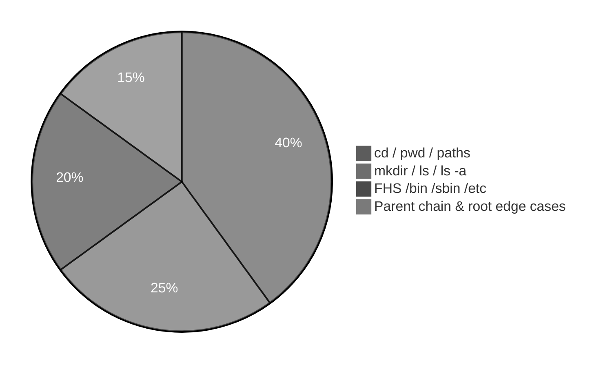

# Execution summary — `file-system-navigation-and-hierarchy/`

**Topic:** [File System Navigation Commands And Hierarchy.md](../../docs/topics/File%20System%20Navigation%20Commands%20And%20Hierarchy.md) (Video 4)  
**Scripts directory:** [`../file-system-navigation-and-hierarchy/`](../file-system-navigation-and-hierarchy/)



**Suggested study order:** navigation basics → parents → home paths → FHS tour.

---

## [`pwd-cd-navigation-demo.sh`](../file-system-navigation-and-hierarchy/pwd-cd-navigation-demo.sh)

**Purpose:** Core **`pwd`** and **`cd`** forms: relative path, `.`, `..`, home, `~`, **`cd -`**.

| Command | Meaning |
| :--- | :--- |
| `mkdir -p`, `rm -rf`, `cd` | Temp tree under `/tmp` |
| `pwd` | Print working directory |
| `cd nested/deep` | Relative descent |
| `cd .` | Stay in current directory |
| `cd ..` | Parent directory |
| `cd` / `cd ~` | User home (`$HOME`) |
| `cd -` | Previous working directory |


---

## [`mkdir-ls-navigation-demo.sh`](../file-system-navigation-and-hierarchy/mkdir-ls-navigation-demo.sh)

**Purpose:** **`mkdir`**, empty **`ls`**, **`ls -a`** for `.` and `..`.

| Command | Meaning |
| :--- | :--- |
| `mkdir dir1` | Create directory |
| `cd dir1` / `mkdir dir2` | Nested folders |
| `ls` | Visible entries only (empty dir → no output) |
| `ls -a` | All entries including `.` and `..` |

---

## [`mkdir-navigation-tree-demo.sh`](../file-system-navigation-and-hierarchy/mkdir-navigation-tree-demo.sh)

**Purpose:** Desktop → D1 → D2 → DR1 → DR2; **`cd ..`** vs **`cd -`**.

| Command | Meaning |
| :--- | :--- |
| `mkdir -p .../Desktop/D1/D2/DR1/DR2` | Class tree |
| `find ... -type d` | Show directory tree |
| `cd ..` | Parent (not “previous”) |
| `cd ~` then `cd -` | Jump home, return to prior cwd |

---

## [`ls-dot-parent-demo.sh`](../file-system-navigation-and-hierarchy/ls-dot-parent-demo.sh)

**Purpose:** Compare **`ls`** vs **`ls -a`** for dot entries.

| Command | Meaning |
| :--- | :--- |
| `ls` | Hides `.` and `..` |
| `ls -a` | Shows current (`.`) and parent (`..`) |
| `cd child` / `cd ..` | Move and return via parent |

---

## [`parent-directory-chain-demo.sh`](../file-system-navigation-and-hierarchy/parent-directory-chain-demo.sh)

**Purpose:** Parent ladder: dir2 → dir1 → desktop → user → `/home` → `/`.

| Command | Meaning |
| :--- | :--- |
| Repeated `cd ..` | Walk up one level each time |
| `basename "$(pwd)"` | Directory name only |
| `cd /` | Filesystem root |
| `ls -a \| head` | Dot entries at root |
| `cd ..` at `/` | Stays at root |

---

## [`cd-multiple-parent-demo.sh`](../file-system-navigation-and-hierarchy/cd-multiple-parent-demo.sh)

**Purpose:** Multi-level **`cd ../..`** and invalid **`cd ...`**.

| Command | Meaning |
| :--- | :--- |
| `cd ..` | One parent |
| `cd ../..` | Two parents in one path |
| `cd ../../..` | Three parents |
| `cd ...` | Invalid (only `.` and `..` exist) |
| `( cd ... && ... )` | Subshell to test failure safely |

---

## [`cd-root-edge-cases-demo.sh`](../file-system-navigation-and-hierarchy/cd-root-edge-cases-demo.sh)

**Purpose:** At **`/`**, **`cd ..`** and **`cd .`** behavior.

| Command | Meaning |
| :--- | :--- |
| `cd /` | Root directory |
| `cd ..` | No parent — remain at `/` |
| `cd .` | Current dir — remain at `/` |

---

## [`cd-home-relative-vs-absolute-demo.sh`](../file-system-navigation-and-hierarchy/cd-home-relative-vs-absolute-demo.sh)

**Purpose:** **`cd home`** fails in nested dir; **`cd /home`** works.

| Command | Meaning |
| :--- | :--- |
| `cd home` | Relative — looks for `./home` under cwd |
| `cd /home` | Absolute from root |
| `ls -la /home` | List user home directories |

---

## [`absolute-vs-relative-paths-demo.sh`](../file-system-navigation-and-hierarchy/absolute-vs-relative-paths-demo.sh)

**Purpose:** **`cd mydir`** vs **`cd $WORK`**; **`/home`** from `/` vs `/tmp`.

| Command | Meaning |
| :--- | :--- |
| `cd mydir` | Relative child |
| `cd "$WORK"` | Absolute path variable |
| `ls -ld /home` | Absolute path to homes |
| `( cd / && cd home )` | From `/`, relative `home` → `/home` |
| `( cd /tmp && cd home )` | Fails without local `home` folder |

---

## [`bin-sbin-etc-demo.sh`](../file-system-navigation-and-hierarchy/bin-sbin-etc-demo.sh)

**Purpose:** **`/bin`**, **`/sbin`**, **`/etc`** samples (Durga Sir hierarchy).

| Command | Meaning |
| :--- | :--- |
| `command -v cmd` | Path to executable for command |
| `ls -ld /bin`, `ls /bin` | User command binaries |
| `ls -ld /sbin`, `ls /sbin` | System/admin binaries |
| `head -5 /etc/passwd` | User accounts config |
| `head -5 /etc/group` | Groups config |
| `head -5 /etc/hosts` | Hostname/IP hints |

```mermaid
%%{init: {'theme': 'base', 'themeVariables': {'primaryColor': '#5c5c5c', 'primaryTextColor': '#ffffff', 'primaryBorderColor': '#3d3d3d', 'lineColor': '#b0b0b0'}}}%%
flowchart TB
    R[/] --> B[/bin normal user binaries]
    R --> S[/sbin super-user binaries]
    R --> E[/etc configuration]
    E --> P[passwd]
    E --> G[group]
    E --> H[hosts]

    classDef darkGrey fill:#5c5c5c,stroke:#3d3d3d,color:#ffffff,stroke-width:2px
    class R,B,S,E,P,G,H darkGrey
```

---

## [`fhs-root-directories-demo.sh`](../file-system-navigation-and-hierarchy/fhs-root-directories-demo.sh)

**Purpose:** Read-only **`ls -l /`** and sample listings for FHS dirs.

| Command | Meaning |
| :--- | :--- |
| `ls -l /` | Top-level hierarchy |
| `ls -ld /path` | One directory metadata |
| `ls /path \| head` | Sample entries (function in script) |
| Targets | `/bin`, `/sbin`, `/boot`, `/dev`, `/etc`, `/home`, `/usr`, `/var`, `/tmp`, `/opt`, `/mnt`, `/proc`, `/root` |

---

## Quick reference — all 11 scripts

| Script | Main commands |
| :--- | :--- |
| [`pwd-cd-navigation-demo.sh`](../file-system-navigation-and-hierarchy/pwd-cd-navigation-demo.sh) | `pwd`, `cd`, `.`, `..`, `~`, `cd -` |
| [`mkdir-ls-navigation-demo.sh`](../file-system-navigation-and-hierarchy/mkdir-ls-navigation-demo.sh) | `mkdir`, `ls`, `ls -a` |
| [`mkdir-navigation-tree-demo.sh`](../file-system-navigation-and-hierarchy/mkdir-navigation-tree-demo.sh) | `mkdir -p`, `find`, `cd ..`, `cd -` |
| [`ls-dot-parent-demo.sh`](../file-system-navigation-and-hierarchy/ls-dot-parent-demo.sh) | `ls`, `ls -a` |
| [`parent-directory-chain-demo.sh`](../file-system-navigation-and-hierarchy/parent-directory-chain-demo.sh) | `pwd`, `cd ..`, `basename`, `ls -a` |
| [`cd-multiple-parent-demo.sh`](../file-system-navigation-and-hierarchy/cd-multiple-parent-demo.sh) | `cd ../..`, `cd ...` |
| [`cd-root-edge-cases-demo.sh`](../file-system-navigation-and-hierarchy/cd-root-edge-cases-demo.sh) | `cd /`, `cd ..`, `cd .` |
| [`cd-home-relative-vs-absolute-demo.sh`](../file-system-navigation-and-hierarchy/cd-home-relative-vs-absolute-demo.sh) | `cd home`, `cd /home` |
| [`absolute-vs-relative-paths-demo.sh`](../file-system-navigation-and-hierarchy/absolute-vs-relative-paths-demo.sh) | relative `cd`, `ls -ld` |
| [`bin-sbin-etc-demo.sh`](../file-system-navigation-and-hierarchy/bin-sbin-etc-demo.sh) | `command -v`, `ls`, `head` on `/etc/*` |
| [`fhs-root-directories-demo.sh`](../file-system-navigation-and-hierarchy/fhs-root-directories-demo.sh) | `ls -l`, `ls` on system dirs |

**Run all (from repo root):**

```bash
for s in scripts/file-system-navigation-and-hierarchy/*.sh; do bash "$s"; done
```
