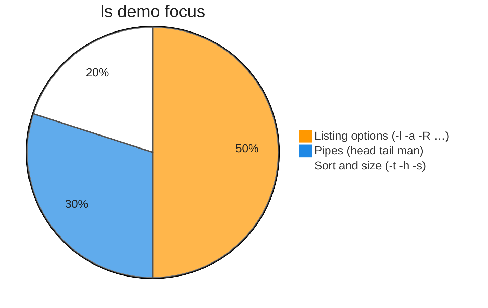

# Execution summary — `ls-command-and-its-options/`

**Topic:** [ls Command and its options.md](../docs/topics/ls%20Command%20and%20its%20options.md) (Video 7)  
**Scripts directory:** [`../scripts/ls-command-and-its-options/`](../scripts/ls-command-and-its-options/)



Each script section uses the same **four-part** model:

| # | Column in tables | Meaning |
| :---: | :--- | :--- |
| 1 | **What it is** | Command or shell feature (e.g. `echo` = print text). |
| 2 | **Added / configured** | How it appears in Linux (PATH, builtin, flag on CLI, variable in script). |
| 3 | **Execution intent** | What you are trying to do when the line runs. |
| 4 | **Output** | What you see on the **terminal (stdout/stderr)**, in a **file**, or through a **pipeline** (`|`). |

---

## [`ls-a-vs-A-hidden-demo.sh`](../scripts/ls-command-and-its-options/ls-a-vs-A-hidden-demo.sh)

**Run:** `bash scripts/ls-command-and-its-options/ls-a-vs-A-hidden-demo.sh`

### In-depth command walkthrough

| Command (as in script) | 1. What it is | 2. Added / configured | 3. Execution intent | 4. Output (terminal / file / pipeline) |
| :--- | :--- | :--- | :--- | :--- |
| `set -euo pipefail` | Bash strict-mode option bundle. | Written at top of script; not installed separately. | Tell Bash to stop on errors, treat unset variables as errors, and fail pipelines if any stage fails. | No visible output; changes how later commands affect exit status. |
| `WORK="${TMPDIR:-/tmp}/linux-ls-hidden-demo"` | Shell variable assignment. | Name=`value` in script; often under `${TMPDIR:-/tmp}`. | Store path or stamp for later commands (setup, not a user command). | No output; variable used by `cd`, `rm`, file paths. |
| `rm -rf "$WORK"` | Remove files/directories recursively, force. | Coreutils; `-r` recursive, `-f` no prompt. | Clean old demo data under `/tmp` before recreating. | Silent on success. |
| `mkdir -p "$WORK"` | Make directories. | Coreutils; `-p` creates parents as needed. | Try to **create** folder(s) for the demo tree. | Silent on success; errors on stderr if path invalid. |
| `cd "$WORK"` | Change directory — move shell’s current working directory. | Builtin; takes relative or absolute path, `~`, `-`, or no args (home). | Navigate the tree (trying to **enter** a folder); relative paths start from cwd. | Normally silent on success; failure prints `cd: ...: No such file or directory` on **stderr**. |
| `touch visible.txt` | Create empty file or update timestamps. | Coreutils on PATH. | Try to **create** a zero-byte file or refresh mtime (Durga Sir first step). | Silent; then `ls -l` shows new file with size 0. |
| `touch .hidden_rc` | Create empty file or update timestamps. | Coreutils on PATH. | Try to **create** a zero-byte file or refresh mtime (Durga Sir first step). | Silent; then `ls -l` shows new file with size 0. |
| `echo "=== ls — hidden dotfiles NOT shown ==="` | Section header for humans. | Literal string in script | **Print** section title | Title line on **stdout** before commands |
| `ls` | List directory contents. | Coreutils; options change columns, hidden files, sort. | Try to **show names** in cwd or given path. | Names on stdout; options add permissions, sizes, inodes. |
| `echo "count: $(ls \| wc -l)"` | Bash builtin that prints arguments to standard output. | Always available in Bash; no package install. | Show section titles, tips, or messages to the terminal (trying to **print** text for the user). | Lines appear on **stdout** in your terminal (or in CI logs). Not used in a pipeline unless followed by `|`. |
| `echo ""` | Bash builtin that prints arguments to standard output. | Always available in Bash; no package install. | Show section titles, tips, or messages to the terminal (trying to **print** text for the user). | Lines appear on **stdout** in your terminal (or in CI logs). Not used in a pipeline unless followed by `|`. |
| `echo "=== ls -a — all, including . .. and dotfiles ==="` | Section header for humans. | Literal string in script | **Print** section title | Title line on **stdout** before commands |
| `ls -a` | `ls` including hidden dotfiles. | Flag `-a`. | Reveal `.` and `..` and dotfiles. | Extra lines on stdout vs plain `ls`. |
| `echo "count: $(ls -a \| wc -l)"` | Bash builtin that prints arguments to standard output. | Always available in Bash; no package install. | Show section titles, tips, or messages to the terminal (trying to **print** text for the user). | Lines appear on **stdout** in your terminal (or in CI logs). Not used in a pipeline unless followed by `|`. |
| `echo ""` | Bash builtin that prints arguments to standard output. | Always available in Bash; no package install. | Show section titles, tips, or messages to the terminal (trying to **print** text for the user). | Lines appear on **stdout** in your terminal (or in CI logs). Not used in a pipeline unless followed by `|`. |
| `echo "=== ls -A — almost all (no . and ..) ==="` | Section header for humans. | Literal string in script | **Print** section title | Title line on **stdout** before commands |
| `ls -A` | List directory contents. | Coreutils; options change columns, hidden files, sort. | Try to **show names** in cwd or given path. | Names on stdout; options add permissions, sizes, inodes. |
| `echo "count: $(ls -A \| wc -l)"` | Bash builtin that prints arguments to standard output. | Always available in Bash; no package install. | Show section titles, tips, or messages to the terminal (trying to **print** text for the user). | Lines appear on **stdout** in your terminal (or in CI logs). Not used in a pipeline unless followed by `|`. |
| `echo ""` | Bash builtin that prints arguments to standard output. | Always available in Bash; no package install. | Show section titles, tips, or messages to the terminal (trying to **print** text for the user). | Lines appear on **stdout** in your terminal (or in CI logs). Not used in a pipeline unless followed by `|`. |
| `echo "Rule: name starting with '.' → hidden file (Session 7)"` | Bash builtin that prints arguments to standard output. | Always available in Bash; no package install. | Show section titles, tips, or messages to the terminal (trying to **print** text for the user). | Lines appear on **stdout** in your terminal (or in CI logs). Not used in a pipeline unless followed by `|`. |

---

## [`ls-basic-and-directory-arg-demo.sh`](../scripts/ls-command-and-its-options/ls-basic-and-directory-arg-demo.sh)

**Run:** `bash scripts/ls-command-and-its-options/ls-basic-and-directory-arg-demo.sh`

### In-depth command walkthrough

| Command (as in script) | 1. What it is | 2. Added / configured | 3. Execution intent | 4. Output (terminal / file / pipeline) |
| :--- | :--- | :--- | :--- | :--- |
| `set -euo pipefail` | Bash strict-mode option bundle. | Written at top of script; not installed separately. | Tell Bash to stop on errors, treat unset variables as errors, and fail pipelines if any stage fails. | No visible output; changes how later commands affect exit status. |
| `WORK="${TMPDIR:-/tmp}/linux-ls-basic-demo"` | Shell variable assignment. | Name=`value` in script; often under `${TMPDIR:-/tmp}`. | Store path or stamp for later commands (setup, not a user command). | No output; variable used by `cd`, `rm`, file paths. |
| `rm -rf "$WORK"` | Remove files/directories recursively, force. | Coreutils; `-r` recursive, `-f` no prompt. | Clean old demo data under `/tmp` before recreating. | Silent on success. |
| `mkdir -p "$WORK/scripts/jj"` | Make directories. | Coreutils; `-p` creates parents as needed. | Try to **create** folder(s) for the demo tree. | Silent on success; errors on stderr if path invalid. |
| `cd "$WORK"` | Change directory — move shell’s current working directory. | Builtin; takes relative or absolute path, `~`, `-`, or no args (home). | Navigate the tree (trying to **enter** a folder); relative paths start from cwd. | Normally silent on success; failure prints `cd: ...: No such file or directory` on **stderr**. |
| `echo "sample" > scripts/a.txt` | Bash builtin that prints arguments to standard output. | Always available in Bash; no package install. | Show section titles, tips, or messages to the terminal (trying to **print** text for the user). | Lines appear on **stdout** in your terminal (or in CI logs). Not used in a pipeline unless followed by `|`. |
| `echo "sample" > scripts/b.txt` | Bash builtin that prints arguments to standard output. | Always available in Bash; no package install. | Show section titles, tips, or messages to the terminal (trying to **print** text for the user). | Lines appear on **stdout** in your terminal (or in CI logs). Not used in a pipeline unless followed by `|`. |
| `echo "demo" > scripts/test.sh` | Bash builtin that prints arguments to standard output. | Always available in Bash; no package install. | Show section titles, tips, or messages to the terminal (trying to **print** text for the user). | Lines appear on **stdout** in your terminal (or in CI logs). Not used in a pipeline unless followed by `|`. |
| `chmod +x scripts/test.sh` | Change file mode (permissions). | Coreutils; e.g. `chmod u+x` adds execute for user. | Make script **executable** so `./script.sh` works. | Silent; `ls -l` then shows `x` in permission bits. |
| `echo "=== ls (no args) — current working directory, alphabetical order…` | Section header for humans. | Literal string in script | **Print** section title | Title line on **stdout** before commands |
| `ls` | List directory contents. | Coreutils; options change columns, hidden files, sort. | Try to **show names** in cwd or given path. | Names on stdout; options add permissions, sizes, inodes. |
| `echo ""` | Bash builtin that prints arguments to standard output. | Always available in Bash; no package install. | Show section titles, tips, or messages to the terminal (trying to **print** text for the user). | Lines appear on **stdout** in your terminal (or in CI logs). Not used in a pipeline unless followed by `|`. |
| `echo "=== ls scripts — list inside given directory ==="` | Section header for humans. | Literal string in script | **Print** section title | Title line on **stdout** before commands |
| `ls scripts` | List directory contents. | Coreutils; options change columns, hidden files, sort. | Try to **show names** in cwd or given path. | Names on stdout; options add permissions, sizes, inodes. |
| `echo ""` | Bash builtin that prints arguments to standard output. | Always available in Bash; no package install. | Show section titles, tips, or messages to the terminal (trying to **print** text for the user). | Lines appear on **stdout** in your terminal (or in CI logs). Not used in a pipeline unless followed by `|`. |
| `echo "=== Durga Sir: without directory arg → cwd; with arg → that fold…` | Section header for humans. | Literal string in script | **Print** section title | Title line on **stdout** before commands |

---

## [`ls-combined-options-quiz-demo.sh`](../scripts/ls-command-and-its-options/ls-combined-options-quiz-demo.sh)

**Run:** `bash scripts/ls-command-and-its-options/ls-combined-options-quiz-demo.sh`

### In-depth command walkthrough

| Command (as in script) | 1. What it is | 2. Added / configured | 3. Execution intent | 4. Output (terminal / file / pipeline) |
| :--- | :--- | :--- | :--- | :--- |
| `set -euo pipefail` | Bash strict-mode option bundle. | Written at top of script; not installed separately. | Tell Bash to stop on errors, treat unset variables as errors, and fail pipelines if any stage fails. | No visible output; changes how later commands affect exit status. |
| `WORK="${TMPDIR:-/tmp}/linux-ls-combo-demo"` | Shell variable assignment. | Name=`value` in script; often under `${TMPDIR:-/tmp}`. | Store path or stamp for later commands (setup, not a user command). | No output; variable used by `cd`, `rm`, file paths. |
| `rm -rf "$WORK"` | Remove files/directories recursively, force. | Coreutils; `-r` recursive, `-f` no prompt. | Clean old demo data under `/tmp` before recreating. | Silent on success. |
| `mkdir -p "$WORK"` | Make directories. | Coreutils; `-p` creates parents as needed. | Try to **create** folder(s) for the demo tree. | Silent on success; errors on stderr if path invalid. |
| `cd "$WORK"` | Change directory — move shell’s current working directory. | Builtin; takes relative or absolute path, `~`, `-`, or no args (home). | Navigate the tree (trying to **enter** a folder); relative paths start from cwd. | Normally silent on success; failure prints `cd: ...: No such file or directory` on **stderr**. |
| `touch .hidden` | Create empty file or update timestamps. | Coreutils on PATH. | Try to **create** a zero-byte file or refresh mtime (Durga Sir first step). | Silent; then `ls -l` shows new file with size 0. |
| `touch visible.txt` | Create empty file or update timestamps. | Coreutils on PATH. | Try to **create** a zero-byte file or refresh mtime (Durga Sir first step). | Silent; then `ls -l` shows new file with size 0. |
| `sleep 1` | Pause execution for N seconds. | Usually `/usr/bin/sleep` on PATH. | Wait briefly (e.g. after starting GUI editor). | No output; delays script. |
| `touch newer.txt` | Create empty file or update timestamps. | Coreutils on PATH. | Try to **create** a zero-byte file or refresh mtime (Durga Sir first step). | Silent; then `ls -l` shows new file with size 0. |
| `echo "=== ls -ai (all files + inode) ==="` | Section header for humans. | Literal string in script | **Print** section title | Title line on **stdout** before commands |
| `ls -ai` | List directory contents. | Coreutils; options change columns, hidden files, sort. | Try to **show names** in cwd or given path. | Names on stdout; options add permissions, sizes, inodes. |
| `echo ""` | Bash builtin that prints arguments to standard output. | Always available in Bash; no package install. | Show section titles, tips, or messages to the terminal (trying to **print** text for the user). | Lines appear on **stdout** in your terminal (or in CI logs). Not used in a pipeline unless followed by `|`. |
| `echo "=== ls -lAtr (long, almost-all, time, reverse → oldest first) ==…` | Section header for humans. | Literal string in script | **Print** section title | Title line on **stdout** before commands |
| `ls -lAtr` | List directory contents. | Coreutils; options change columns, hidden files, sort. | Try to **show names** in cwd or given path. | Names on stdout; options add permissions, sizes, inodes. |
| `echo ""` | Bash builtin that prints arguments to standard output. | Always available in Bash; no package install. | Show section titles, tips, or messages to the terminal (trying to **print** text for the user). | Lines appear on **stdout** in your terminal (or in CI logs). Not used in a pipeline unless followed by `|`. |
| `echo "=== ls -r vs ls -ltr are NOT the same (-r = name reverse, -ltr =…` | Section header for humans. | Literal string in script | **Print** section title | Title line on **stdout** before commands |
| `echo "ls -r:"; ls -r` | Bash builtin that prints arguments to standard output. | Always available in Bash; no package install. | Show section titles, tips, or messages to the terminal (trying to **print** text for the user). | Lines appear on **stdout** in your terminal (or in CI logs). Not used in a pipeline unless followed by `|`. |
| `echo "ls -ltr:"; ls -ltr` | Bash builtin that prints arguments to standard output. | Always available in Bash; no package install. | Show section titles, tips, or messages to the terminal (trying to **print** text for the user). | Lines appear on **stdout** in your terminal (or in CI logs). Not used in a pipeline unless followed by `|`. |
| `echo ""` | Bash builtin that prints arguments to standard output. | Always available in Bash; no package install. | Show section titles, tips, or messages to the terminal (trying to **print** text for the user). | Lines appear on **stdout** in your terminal (or in CI logs). Not used in a pipeline unless followed by `|`. |
| `echo "Single hyphen once: ls -ltr  (not ls -l -t -r required)"` | Bash builtin that prints arguments to standard output. | Always available in Bash; no package install. | Show section titles, tips, or messages to the terminal (trying to **print** text for the user). | Lines appear on **stdout** in your terminal (or in CI logs). Not used in a pipeline unless followed by `|`. |

---

## [`ls-F-classify-demo.sh`](../scripts/ls-command-and-its-options/ls-F-classify-demo.sh)

**Run:** `bash scripts/ls-command-and-its-options/ls-F-classify-demo.sh`

### In-depth command walkthrough

| Command (as in script) | 1. What it is | 2. Added / configured | 3. Execution intent | 4. Output (terminal / file / pipeline) |
| :--- | :--- | :--- | :--- | :--- |
| `set -euo pipefail` | Bash strict-mode option bundle. | Written at top of script; not installed separately. | Tell Bash to stop on errors, treat unset variables as errors, and fail pipelines if any stage fails. | No visible output; changes how later commands affect exit status. |
| `WORK="${TMPDIR:-/tmp}/linux-ls-F-demo"` | Shell variable assignment. | Name=`value` in script; often under `${TMPDIR:-/tmp}`. | Store path or stamp for later commands (setup, not a user command). | No output; variable used by `cd`, `rm`, file paths. |
| `rm -rf "$WORK"` | Remove files/directories recursively, force. | Coreutils; `-r` recursive, `-f` no prompt. | Clean old demo data under `/tmp` before recreating. | Silent on success. |
| `mkdir -p "$WORK/subdir"` | Make directories. | Coreutils; `-p` creates parents as needed. | Try to **create** folder(s) for the demo tree. | Silent on success; errors on stderr if path invalid. |
| `cd "$WORK"` | Change directory — move shell’s current working directory. | Builtin; takes relative or absolute path, `~`, `-`, or no args (home). | Navigate the tree (trying to **enter** a folder); relative paths start from cwd. | Normally silent on success; failure prints `cd: ...: No such file or directory` on **stderr**. |
| `echo '#!/bin/bash' > runme.sh` | Bash builtin that prints arguments to standard output. | Always available in Bash; no package install. | Show section titles, tips, or messages to the terminal (trying to **print** text for the user). | Lines appear on **stdout** in your terminal (or in CI logs). Not used in a pipeline unless followed by `|`. |
| `chmod +x runme.sh` | Change file mode (permissions). | Coreutils; e.g. `chmod u+x` adds execute for user. | Make script **executable** so `./script.sh` works. | Silent; `ls -l` then shows `x` in permission bits. |
| `ln -s runme.sh link.sh` | Create symbolic link. | Coreutils. | Create symlink entry pointing to target. | Silent; `ls -l` shows `l` type. |
| `echo "=== ls -F in demo dir ==="` | Section header for humans. | Literal string in script | **Print** section title | Title line on **stdout** before commands |
| `ls -F` | List directory contents. | Coreutils; options change columns, hidden files, sort. | Try to **show names** in cwd or given path. | Names on stdout; options add permissions, sizes, inodes. |
| `echo ""` | Bash builtin that prints arguments to standard output. | Always available in Bash; no package install. | Show section titles, tips, or messages to the terminal (trying to **print** text for the user). | Lines appear on **stdout** in your terminal (or in CI logs). Not used in a pipeline unless followed by `|`. |
| `echo "=== ls -F /bin (sample) — * = executable, @ = symlink ==="` | Section header for humans. | Literal string in script | **Print** section title | Title line on **stdout** before commands |
| `ls -F /bin 2>/dev/null \| head -15 \|\| true` | List directory contents. | Coreutils; options change columns, hidden files, sort. | Try to **show names** in cwd or given path. | Names on stdout; options add permissions, sizes, inodes. |

---

## [`ls-f-no-color-demo.sh`](../scripts/ls-command-and-its-options/ls-f-no-color-demo.sh)

**Run:** `bash scripts/ls-command-and-its-options/ls-f-no-color-demo.sh`

### In-depth command walkthrough

| Command (as in script) | 1. What it is | 2. Added / configured | 3. Execution intent | 4. Output (terminal / file / pipeline) |
| :--- | :--- | :--- | :--- | :--- |
| `set -euo pipefail` | Bash strict-mode option bundle. | Written at top of script; not installed separately. | Tell Bash to stop on errors, treat unset variables as errors, and fail pipelines if any stage fails. | No visible output; changes how later commands affect exit status. |
| `WORK="${TMPDIR:-/tmp}/linux-ls-f-demo"` | Shell variable assignment. | Name=`value` in script; often under `${TMPDIR:-/tmp}`. | Store path or stamp for later commands (setup, not a user command). | No output; variable used by `cd`, `rm`, file paths. |
| `rm -rf "$WORK"` | Remove files/directories recursively, force. | Coreutils; `-r` recursive, `-f` no prompt. | Clean old demo data under `/tmp` before recreating. | Silent on success. |
| `mkdir -p "$WORK/mydir"` | Make directories. | Coreutils; `-p` creates parents as needed. | Try to **create** folder(s) for the demo tree. | Silent on success; errors on stderr if path invalid. |
| `cd "$WORK"` | Change directory — move shell’s current working directory. | Builtin; takes relative or absolute path, `~`, `-`, or no args (home). | Navigate the tree (trying to **enter** a folder); relative paths start from cwd. | Normally silent on success; failure prints `cd: ...: No such file or directory` on **stderr**. |
| `touch file.txt` | Create empty file or update timestamps. | Coreutils on PATH. | Try to **create** a zero-byte file or refresh mtime (Durga Sir first step). | Silent; then `ls -l` shows new file with size 0. |
| `touch .dotfile` | Create empty file or update timestamps. | Coreutils on PATH. | Try to **create** a zero-byte file or refresh mtime (Durga Sir first step). | Silent; then `ls -l` shows new file with size 0. |
| `echo "=== ls (colors depend on distro/theme — not standard for exams) …` | Section header for humans. | Literal string in script | **Print** section title | Title line on **stdout** before commands |
| `ls --color=auto 2>/dev/null \|\| ls` | List directory contents. | Coreutils; options change columns, hidden files, sort. | Try to **show names** in cwd or given path. | Names on stdout; options add permissions, sizes, inodes. |
| `echo ""` | Bash builtin that prints arguments to standard output. | Always available in Bash; no package install. | Show section titles, tips, or messages to the terminal (trying to **print** text for the user). | Lines appear on **stdout** in your terminal (or in CI logs). Not used in a pipeline unless followed by `|`. |
| `echo "=== ls -f — no color; also lists entries like -a (includes dotfi…` | Section header for humans. | Literal string in script | **Print** section title | Title line on **stdout** before commands |
| `ls -f` | List directory contents. | Coreutils; options change columns, hidden files, sort. | Try to **show names** in cwd or given path. | Names on stdout; options add permissions, sizes, inodes. |
| `echo ""` | Bash builtin that prints arguments to standard output. | Always available in Bash; no package install. | Show section titles, tips, or messages to the terminal (trying to **print** text for the user). | Lines appear on **stdout** in your terminal (or in CI logs). Not used in a pipeline unless followed by `|`. |
| `echo "Prefer ls -l or ls -F for portable type info, not colors."` | Bash builtin that prints arguments to standard output. | Always available in Bash; no package install. | Show section titles, tips, or messages to the terminal (trying to **print** text for the user). | Lines appear on **stdout** in your terminal (or in CI logs). Not used in a pipeline unless followed by `|`. |

---

## [`ls-i-inode-demo.sh`](../scripts/ls-command-and-its-options/ls-i-inode-demo.sh)

**Run:** `bash scripts/ls-command-and-its-options/ls-i-inode-demo.sh`

### In-depth command walkthrough

| Command (as in script) | 1. What it is | 2. Added / configured | 3. Execution intent | 4. Output (terminal / file / pipeline) |
| :--- | :--- | :--- | :--- | :--- |
| `set -euo pipefail` | Bash strict-mode option bundle. | Written at top of script; not installed separately. | Tell Bash to stop on errors, treat unset variables as errors, and fail pipelines if any stage fails. | No visible output; changes how later commands affect exit status. |
| `WORK="${TMPDIR:-/tmp}/linux-ls-i-demo"` | Shell variable assignment. | Name=`value` in script; often under `${TMPDIR:-/tmp}`. | Store path or stamp for later commands (setup, not a user command). | No output; variable used by `cd`, `rm`, file paths. |
| `rm -rf "$WORK"` | Remove files/directories recursively, force. | Coreutils; `-r` recursive, `-f` no prompt. | Clean old demo data under `/tmp` before recreating. | Silent on success. |
| `mkdir -p "$WORK"` | Make directories. | Coreutils; `-p` creates parents as needed. | Try to **create** folder(s) for the demo tree. | Silent on success; errors on stderr if path invalid. |
| `cd "$WORK"` | Change directory — move shell’s current working directory. | Builtin; takes relative or absolute path, `~`, `-`, or no args (home). | Navigate the tree (trying to **enter** a folder); relative paths start from cwd. | Normally silent on success; failure prints `cd: ...: No such file or directory` on **stderr**. |
| `echo "data" > sample.txt` | Bash builtin that prints arguments to standard output. | Always available in Bash; no package install. | Show section titles, tips, or messages to the terminal (trying to **print** text for the user). | Lines appear on **stdout** in your terminal (or in CI logs). Not used in a pipeline unless followed by `|`. |
| `echo "=== ls -i (inode number before name) ==="` | Section header for humans. | Literal string in script | **Print** section title | Title line on **stdout** before commands |
| `ls -i` | List directory contents. | Coreutils; options change columns, hidden files, sort. | Try to **show names** in cwd or given path. | Names on stdout; options add permissions, sizes, inodes. |
| `echo ""` | Bash builtin that prints arguments to standard output. | Always available in Bash; no package install. | Show section titles, tips, or messages to the terminal (trying to **print** text for the user). | Lines appear on **stdout** in your terminal (or in CI logs). Not used in a pipeline unless followed by `|`. |
| `echo "=== ls -li (long listing + inode) ==="` | Section header for humans. | Literal string in script | **Print** section title | Title line on **stdout** before commands |
| `ls -li` | List directory contents. | Coreutils; options change columns, hidden files, sort. | Try to **show names** in cwd or given path. | Names on stdout; options add permissions, sizes, inodes. |
| `echo "Inode stores metadata: size, owner, group, times, link count, …"` | Bash builtin that prints arguments to standard output. | Always available in Bash; no package install. | Show section titles, tips, or messages to the terminal (trying to **print** text for the user). | Lines appear on **stdout** in your terminal (or in CI logs). Not used in a pipeline unless followed by `|`. |

---

## [`ls-l-long-listing-demo.sh`](../scripts/ls-command-and-its-options/ls-l-long-listing-demo.sh)

**Run:** `bash scripts/ls-command-and-its-options/ls-l-long-listing-demo.sh`

### In-depth command walkthrough

| Command (as in script) | 1. What it is | 2. Added / configured | 3. Execution intent | 4. Output (terminal / file / pipeline) |
| :--- | :--- | :--- | :--- | :--- |
| `set -euo pipefail` | Bash strict-mode option bundle. | Written at top of script; not installed separately. | Tell Bash to stop on errors, treat unset variables as errors, and fail pipelines if any stage fails. | No visible output; changes how later commands affect exit status. |
| `WORK="${TMPDIR:-/tmp}/linux-ls-l-demo"` | Shell variable assignment. | Name=`value` in script; often under `${TMPDIR:-/tmp}`. | Store path or stamp for later commands (setup, not a user command). | No output; variable used by `cd`, `rm`, file paths. |
| `rm -rf "$WORK"` | Remove files/directories recursively, force. | Coreutils; `-r` recursive, `-f` no prompt. | Clean old demo data under `/tmp` before recreating. | Silent on success. |
| `mkdir -p "$WORK/sub"` | Make directories. | Coreutils; `-p` creates parents as needed. | Try to **create** folder(s) for the demo tree. | Silent on success; errors on stderr if path invalid. |
| `cd "$WORK"` | Change directory — move shell’s current working directory. | Builtin; takes relative or absolute path, `~`, `-`, or no args (home). | Navigate the tree (trying to **enter** a folder); relative paths start from cwd. | Normally silent on success; failure prints `cd: ...: No such file or directory` on **stderr**. |
| `echo "abc" > abcdef.txt` | Bash builtin that prints arguments to standard output. | Always available in Bash; no package install. | Show section titles, tips, or messages to the terminal (trying to **print** text for the user). | Lines appear on **stdout** in your terminal (or in CI logs). Not used in a pipeline unless followed by `|`. |
| `echo "plain" > plain.txt` | Bash builtin that prints arguments to standard output. | Always available in Bash; no package install. | Show section titles, tips, or messages to the terminal (trying to **print** text for the user). | Lines appear on **stdout** in your terminal (or in CI logs). Not used in a pipeline unless followed by `|`. |
| `echo "=== ls -l (long listing) ==="` | Section header for humans. | Literal string in script | **Print** section title | Title line on **stdout** before commands |
| `ls -l` | `ls` long format. | Flag `-l` passed on command line. | Show type, permissions, owner, size, date, name. | Multiple lines on stdout. |
| `echo ""` | Bash builtin that prints arguments to standard output. | Always available in Bash; no package install. | Show section titles, tips, or messages to the terminal (trying to **print** text for the user). | Lines appear on **stdout** in your terminal (or in CI logs). Not used in a pipeline unless followed by `|`. |
| `echo "Column guide (Durga Sir):"` | Bash builtin that prints arguments to standard output. | Always available in Bash; no package install. | Show section titles, tips, or messages to the terminal (trying to **print** text for the user). | Lines appear on **stdout** in your terminal (or in CI logs). Not used in a pipeline unless followed by `|`. |
| `echo "  1st char     → file type (- file, d dir, l link, …)"` | Bash builtin that prints arguments to standard output. | Always available in Bash; no package install. | Show section titles, tips, or messages to the terminal (trying to **print** text for the user). | Lines appear on **stdout** in your terminal (or in CI logs). Not used in a pipeline unless followed by `|`. |
| `echo "  next 9 chars → permissions (detailed topic later)"` | Bash builtin that prints arguments to standard output. | Always available in Bash; no package install. | Show section titles, tips, or messages to the terminal (trying to **print** text for the user). | Lines appear on **stdout** in your terminal (or in CI logs). Not used in a pipeline unless followed by `|`. |
| `echo "  link count   → number of hard links"` | Bash builtin that prints arguments to standard output. | Always available in Bash; no package install. | Show section titles, tips, or messages to the terminal (trying to **print** text for the user). | Lines appear on **stdout** in your terminal (or in CI logs). Not used in a pipeline unless followed by `|`. |
| `echo "  owner, group → user and group name"` | Bash builtin that prints arguments to standard output. | Always available in Bash; no package install. | Show section titles, tips, or messages to the terminal (trying to **print** text for the user). | Lines appear on **stdout** in your terminal (or in CI logs). Not used in a pipeline unless followed by `|`. |
| `echo "  size         → file size in bytes"` | Bash builtin that prints arguments to standard output. | Always available in Bash; no package install. | Show section titles, tips, or messages to the terminal (trying to **print** text for the user). | Lines appear on **stdout** in your terminal (or in CI logs). Not used in a pipeline unless followed by `|`. |
| `echo "  date/time    → last modification (or metadata time)"` | Bash builtin that prints arguments to standard output. | Always available in Bash; no package install. | Show section titles, tips, or messages to the terminal (trying to **print** text for the user). | Lines appear on **stdout** in your terminal (or in CI logs). Not used in a pipeline unless followed by `|`. |
| `echo "  name         → file or directory name"` | Bash builtin that prints arguments to standard output. | Always available in Bash; no package install. | Show section titles, tips, or messages to the terminal (trying to **print** text for the user). | Lines appear on **stdout** in your terminal (or in CI logs). Not used in a pipeline unless followed by `|`. |

---

## [`ls-lt-ltr-time-sort-demo.sh`](../scripts/ls-command-and-its-options/ls-lt-ltr-time-sort-demo.sh)

**Run:** `bash scripts/ls-command-and-its-options/ls-lt-ltr-time-sort-demo.sh`

### In-depth command walkthrough

| Command (as in script) | 1. What it is | 2. Added / configured | 3. Execution intent | 4. Output (terminal / file / pipeline) |
| :--- | :--- | :--- | :--- | :--- |
| `set -euo pipefail` | Bash strict-mode option bundle. | Written at top of script; not installed separately. | Tell Bash to stop on errors, treat unset variables as errors, and fail pipelines if any stage fails. | No visible output; changes how later commands affect exit status. |
| `WORK="${TMPDIR:-/tmp}/linux-ls-time-demo"` | Shell variable assignment. | Name=`value` in script; often under `${TMPDIR:-/tmp}`. | Store path or stamp for later commands (setup, not a user command). | No output; variable used by `cd`, `rm`, file paths. |
| `rm -rf "$WORK"` | Remove files/directories recursively, force. | Coreutils; `-r` recursive, `-f` no prompt. | Clean old demo data under `/tmp` before recreating. | Silent on success. |
| `mkdir -p "$WORK"` | Make directories. | Coreutils; `-p` creates parents as needed. | Try to **create** folder(s) for the demo tree. | Silent on success; errors on stderr if path invalid. |
| `cd "$WORK"` | Change directory — move shell’s current working directory. | Builtin; takes relative or absolute path, `~`, `-`, or no args (home). | Navigate the tree (trying to **enter** a folder); relative paths start from cwd. | Normally silent on success; failure prints `cd: ...: No such file or directory` on **stderr**. |
| `touch old.txt` | Create empty file or update timestamps. | Coreutils on PATH. | Try to **create** a zero-byte file or refresh mtime (Durga Sir first step). | Silent; then `ls -l` shows new file with size 0. |
| `sleep 1` | Pause execution for N seconds. | Usually `/usr/bin/sleep` on PATH. | Wait briefly (e.g. after starting GUI editor). | No output; delays script. |
| `touch middle.txt` | Create empty file or update timestamps. | Coreutils on PATH. | Try to **create** a zero-byte file or refresh mtime (Durga Sir first step). | Silent; then `ls -l` shows new file with size 0. |
| `sleep 1` | Pause execution for N seconds. | Usually `/usr/bin/sleep` on PATH. | Wait briefly (e.g. after starting GUI editor). | No output; delays script. |
| `touch newest.txt` | Create empty file or update timestamps. | Coreutils on PATH. | Try to **create** a zero-byte file or refresh mtime (Durga Sir first step). | Silent; then `ls -l` shows new file with size 0. |
| `echo "=== ls -l (alphabetical by name, not time) ==="` | Section header for humans. | Literal string in script | **Print** section title | Title line on **stdout** before commands |
| `ls -l` | `ls` long format. | Flag `-l` passed on command line. | Show type, permissions, owner, size, date, name. | Multiple lines on stdout. |
| `echo ""` | Bash builtin that prints arguments to standard output. | Always available in Bash; no package install. | Show section titles, tips, or messages to the terminal (trying to **print** text for the user). | Lines appear on **stdout** in your terminal (or in CI logs). Not used in a pipeline unless followed by `|`. |
| `echo "=== ls -lt (long + sort by time, newest at TOP) ==="` | Section header for humans. | Literal string in script | **Print** section title | Title line on **stdout** before commands |
| `ls -lt` | List directory contents. | Coreutils; options change columns, hidden files, sort. | Try to **show names** in cwd or given path. | Names on stdout; options add permissions, sizes, inodes. |
| `echo ""` | Bash builtin that prints arguments to standard output. | Always available in Bash; no package install. | Show section titles, tips, or messages to the terminal (trying to **print** text for the user). | Lines appear on **stdout** in your terminal (or in CI logs). Not used in a pipeline unless followed by `|`. |
| `echo "=== ls -ltr (long + time + reverse → oldest at TOP) ==="` | Section header for humans. | Literal string in script | **Print** section title | Title line on **stdout** before commands |
| `ls -ltr` | List directory contents. | Coreutils; options change columns, hidden files, sort. | Try to **show names** in cwd or given path. | Names on stdout; options add permissions, sizes, inodes. |
| `echo ""` | Bash builtin that prints arguments to standard output. | Always available in Bash; no package install. | Show section titles, tips, or messages to the terminal (trying to **print** text for the user). | Lines appear on **stdout** in your terminal (or in CI logs). Not used in a pipeline unless followed by `|`. |
| `echo "Option order does not matter: ls -rtl same as ls -ltr"` | Bash builtin that prints arguments to standard output. | Always available in Bash; no package install. | Show section titles, tips, or messages to the terminal (trying to **print** text for the user). | Lines appear on **stdout** in your terminal (or in CI logs). Not used in a pipeline unless followed by `|`. |

---

## [`ls-R-recursive-demo.sh`](../scripts/ls-command-and-its-options/ls-R-recursive-demo.sh)

**Run:** `bash scripts/ls-command-and-its-options/ls-R-recursive-demo.sh`

### In-depth command walkthrough

| Command (as in script) | 1. What it is | 2. Added / configured | 3. Execution intent | 4. Output (terminal / file / pipeline) |
| :--- | :--- | :--- | :--- | :--- |
| `set -euo pipefail` | Bash strict-mode option bundle. | Written at top of script; not installed separately. | Tell Bash to stop on errors, treat unset variables as errors, and fail pipelines if any stage fails. | No visible output; changes how later commands affect exit status. |
| `WORK="${TMPDIR:-/tmp}/linux-ls-R-demo"` | Shell variable assignment. | Name=`value` in script; often under `${TMPDIR:-/tmp}`. | Store path or stamp for later commands (setup, not a user command). | No output; variable used by `cd`, `rm`, file paths. |
| `rm -rf "$WORK"` | Remove files/directories recursively, force. | Coreutils; `-r` recursive, `-f` no prompt. | Clean old demo data under `/tmp` before recreating. | Silent on success. |
| `mkdir -p "$WORK/scripts/jj"` | Make directories. | Coreutils; `-p` creates parents as needed. | Try to **create** folder(s) for the demo tree. | Silent on success; errors on stderr if path invalid. |
| `cd "$WORK"` | Change directory — move shell’s current working directory. | Builtin; takes relative or absolute path, `~`, `-`, or no args (home). | Navigate the tree (trying to **enter** a folder); relative paths start from cwd. | Normally silent on success; failure prints `cd: ...: No such file or directory` on **stderr**. |
| `echo "a" > scripts/a.txt` | Bash builtin that prints arguments to standard output. | Always available in Bash; no package install. | Show section titles, tips, or messages to the terminal (trying to **print** text for the user). | Lines appear on **stdout** in your terminal (or in CI logs). Not used in a pipeline unless followed by `|`. |
| `echo "b" > scripts/b.txt` | Bash builtin that prints arguments to standard output. | Always available in Bash; no package install. | Show section titles, tips, or messages to the terminal (trying to **print** text for the user). | Lines appear on **stdout** in your terminal (or in CI logs). Not used in a pipeline unless followed by `|`. |
| `touch scripts/jj/.keep` | Create empty file or update timestamps. | Coreutils on PATH. | Try to **create** a zero-byte file or refresh mtime (Durga Sir first step). | Silent; then `ls -l` shows new file with size 0. |
| `echo "=== ls scripts — does NOT show files inside jj/ by default ==="` | Section header for humans. | Literal string in script | **Print** section title | Title line on **stdout** before commands |
| `ls scripts` | List directory contents. | Coreutils; options change columns, hidden files, sort. | Try to **show names** in cwd or given path. | Names on stdout; options add permissions, sizes, inodes. |
| `echo ""` | Bash builtin that prints arguments to standard output. | Always available in Bash; no package install. | Show section titles, tips, or messages to the terminal (trying to **print** text for the user). | Lines appear on **stdout** in your terminal (or in CI logs). Not used in a pipeline unless followed by `|`. |
| `echo "=== ls -R — recursive: show subdirectory contents ==="` | Section header for humans. | Literal string in script | **Print** section title | Title line on **stdout** before commands |
| `ls -R` | List directory contents. | Coreutils; options change columns, hidden files, sort. | Try to **show names** in cwd or given path. | Names on stdout; options add permissions, sizes, inodes. |
| `echo ""` | Bash builtin that prints arguments to standard output. | Always available in Bash; no package install. | Show section titles, tips, or messages to the terminal (trying to **print** text for the user). | Lines appear on **stdout** in your terminal (or in CI logs). Not used in a pipeline unless followed by `|`. |
| `echo "Remember: -r = reverse alphabetical; -R = recursive"` | Bash builtin that prints arguments to standard output. | Always available in Bash; no package install. | Show section titles, tips, or messages to the terminal (trying to **print** text for the user). | Lines appear on **stdout** in your terminal (or in CI logs). Not used in a pipeline unless followed by `|`. |

---

## [`ls-r-reverse-alphabetical-demo.sh`](../scripts/ls-command-and-its-options/ls-r-reverse-alphabetical-demo.sh)

**Run:** `bash scripts/ls-command-and-its-options/ls-r-reverse-alphabetical-demo.sh`

### In-depth command walkthrough

| Command (as in script) | 1. What it is | 2. Added / configured | 3. Execution intent | 4. Output (terminal / file / pipeline) |
| :--- | :--- | :--- | :--- | :--- |
| `set -euo pipefail` | Bash strict-mode option bundle. | Written at top of script; not installed separately. | Tell Bash to stop on errors, treat unset variables as errors, and fail pipelines if any stage fails. | No visible output; changes how later commands affect exit status. |
| `WORK="${TMPDIR:-/tmp}/linux-ls-r-demo"` | Shell variable assignment. | Name=`value` in script; often under `${TMPDIR:-/tmp}`. | Store path or stamp for later commands (setup, not a user command). | No output; variable used by `cd`, `rm`, file paths. |
| `rm -rf "$WORK"` | Remove files/directories recursively, force. | Coreutils; `-r` recursive, `-f` no prompt. | Clean old demo data under `/tmp` before recreating. | Silent on success. |
| `mkdir -p "$WORK"` | Make directories. | Coreutils; `-p` creates parents as needed. | Try to **create** folder(s) for the demo tree. | Silent on success; errors on stderr if path invalid. |
| `cd "$WORK"` | Change directory — move shell’s current working directory. | Builtin; takes relative or absolute path, `~`, `-`, or no args (home). | Navigate the tree (trying to **enter** a folder); relative paths start from cwd. | Normally silent on success; failure prints `cd: ...: No such file or directory` on **stderr**. |
| `for n in desktop documents downloads music public scripts templates vide` | `for` loop over words. | Bash syntax; list after `in`. | Repeat command for each item (e.g. each utility name). | One output line per iteration on stdout. |
| `mkdir -p "$n"` | Make directories. | Coreutils; `-p` creates parents as needed. | Try to **create** folder(s) for the demo tree. | Silent on success; errors on stderr if path invalid. |
| `echo "=== ls (default alphabetical) ==="` | Section header for humans. | Literal string in script | **Print** section title | Title line on **stdout** before commands |
| `ls` | List directory contents. | Coreutils; options change columns, hidden files, sort. | Try to **show names** in cwd or given path. | Names on stdout; options add permissions, sizes, inodes. |
| `echo ""` | Bash builtin that prints arguments to standard output. | Always available in Bash; no package install. | Show section titles, tips, or messages to the terminal (trying to **print** text for the user). | Lines appear on **stdout** in your terminal (or in CI logs). Not used in a pipeline unless followed by `|`. |
| `echo "=== ls -r (reverse alphabetical) — videos first, desktop last ==…` | Section header for humans. | Literal string in script | **Print** section title | Title line on **stdout** before commands |
| `ls -r` | List directory contents. | Coreutils; options change columns, hidden files, sort. | Try to **show names** in cwd or given path. | Names on stdout; options add permissions, sizes, inodes. |

---

## [`ls-s-and-lh-size-demo.sh`](../scripts/ls-command-and-its-options/ls-s-and-lh-size-demo.sh)

**Run:** `bash scripts/ls-command-and-its-options/ls-s-and-lh-size-demo.sh`

### In-depth command walkthrough

| Command (as in script) | 1. What it is | 2. Added / configured | 3. Execution intent | 4. Output (terminal / file / pipeline) |
| :--- | :--- | :--- | :--- | :--- |
| `set -euo pipefail` | Bash strict-mode option bundle. | Written at top of script; not installed separately. | Tell Bash to stop on errors, treat unset variables as errors, and fail pipelines if any stage fails. | No visible output; changes how later commands affect exit status. |
| `WORK="${TMPDIR:-/tmp}/linux-ls-size-demo"` | Shell variable assignment. | Name=`value` in script; often under `${TMPDIR:-/tmp}`. | Store path or stamp for later commands (setup, not a user command). | No output; variable used by `cd`, `rm`, file paths. |
| `rm -rf "$WORK"` | Remove files/directories recursively, force. | Coreutils; `-r` recursive, `-f` no prompt. | Clean old demo data under `/tmp` before recreating. | Silent on success. |
| `mkdir -p "$WORK/adir"` | Make directories. | Coreutils; `-p` creates parents as needed. | Try to **create** folder(s) for the demo tree. | Silent on success; errors on stderr if path invalid. |
| `cd "$WORK"` | Change directory — move shell’s current working directory. | Builtin; takes relative or absolute path, `~`, `-`, or no args (home). | Navigate the tree (trying to **enter** a folder); relative paths start from cwd. | Normally silent on success; failure prints `cd: ...: No such file or directory` on **stderr**. |
| `echo "hello friends" > demo.txt` | Bash builtin that prints arguments to standard output. | Always available in Bash; no package install. | Show section titles, tips, or messages to the terminal (trying to **print** text for the user). | Lines appear on **stdout** in your terminal (or in CI logs). Not used in a pipeline unless followed by `|`. |
| `echo "=== ls -s (size in 1K blocks, GNU ls) ==="` | Section header for humans. | Literal string in script | **Print** section title | Title line on **stdout** before commands |
| `ls -s` | List directory contents. | Coreutils; options change columns, hidden files, sort. | Try to **show names** in cwd or given path. | Names on stdout; options add permissions, sizes, inodes. |
| `echo ""` | Bash builtin that prints arguments to standard output. | Always available in Bash; no package install. | Show section titles, tips, or messages to the terminal (trying to **print** text for the user). | Lines appear on **stdout** in your terminal (or in CI logs). Not used in a pipeline unless followed by `|`. |
| `echo "=== ls -ls (long + block counts; dirs often show 4096 = 4 blocks…` | Section header for humans. | Literal string in script | **Print** section title | Title line on **stdout** before commands |
| `ls -ls` | List directory contents. | Coreutils; options change columns, hidden files, sort. | Try to **show names** in cwd or given path. | Names on stdout; options add permissions, sizes, inodes. |
| `echo ""` | Bash builtin that prints arguments to standard output. | Always available in Bash; no package install. | Show section titles, tips, or messages to the terminal (trying to **print** text for the user). | Lines appear on **stdout** in your terminal (or in CI logs). Not used in a pipeline unless followed by `|`. |
| `echo "=== ls -lh (human-readable: K, M, G) ==="` | Section header for humans. | Literal string in script | **Print** section title | Title line on **stdout** before commands |
| `ls -lh` | List directory contents. | Coreutils; options change columns, hidden files, sort. | Try to **show names** in cwd or given path. | Names on stdout; options add permissions, sizes, inodes. |
| `echo ""` | Bash builtin that prints arguments to standard output. | Always available in Bash; no package install. | Show section titles, tips, or messages to the terminal (trying to **print** text for the user). | Lines appear on **stdout** in your terminal (or in CI logs). Not used in a pipeline unless followed by `|`. |
| `echo "=== ls -l (5th column = bytes for files) ==="` | Section header for humans. | Literal string in script | **Print** section title | Title line on **stdout** before commands |
| `ls -l demo.txt` | `ls` long format. | Flag `-l` passed on command line. | Show type, permissions, owner, size, date, name. | Multiple lines on stdout. |

---

## [`ls-with-head-tail-demo.sh`](../scripts/ls-command-and-its-options/ls-with-head-tail-demo.sh)

**Run:** `bash scripts/ls-command-and-its-options/ls-with-head-tail-demo.sh`

### In-depth command walkthrough

| Command (as in script) | 1. What it is | 2. Added / configured | 3. Execution intent | 4. Output (terminal / file / pipeline) |
| :--- | :--- | :--- | :--- | :--- |
| `set -euo pipefail` | Bash strict-mode option bundle. | Written at top of script; not installed separately. | Tell Bash to stop on errors, treat unset variables as errors, and fail pipelines if any stage fails. | No visible output; changes how later commands affect exit status. |
| `TARGET="${1:-/etc}"` | Shell syntax (variable, test, subshell, or function). | Defined in this script only. | Prepare path, branch on failure, or wrap commands. | Depends on line: may be silent or print via embedded commands. |
| `echo "=== Total lines: ls -l $TARGET \| wc -l ==="` | Section header for humans. | Literal string in script | **Print** section title | Title line on **stdout** before commands |
| `total=$(ls -l "$TARGET" 2>/dev/null \| wc -l)…` | Pipeline: connect stdout of left command to stdin of right. | Uses `|` between commands. | Send partial output to filter (e.g. only first lines). | You see only filtered output on terminal; left command may get SIGPIPE if right exits early. |
| `echo "$total"` | Bash builtin that prints arguments to standard output. | Always available in Bash; no package install. | Show section titles, tips, or messages to the terminal (trying to **print** text for the user). | Lines appear on **stdout** in your terminal (or in CI logs). Not used in a pipeline unless followed by `|`. |
| `echo ""` | Bash builtin that prints arguments to standard output. | Always available in Bash; no package install. | Show section titles, tips, or messages to the terminal (trying to **print** text for the user). | Lines appear on **stdout** in your terminal (or in CI logs). Not used in a pipeline unless followed by `|`. |
| `echo "=== ls -l $TARGET \| head (default 10 lines) ==="` | Section header for humans. | Literal string in script | **Print** section title | Title line on **stdout** before commands |
| `ls -l "$TARGET" 2>/dev/null \| head` | `ls` long format. | Flag `-l` passed on command line. | Show type, permissions, owner, size, date, name. | Multiple lines on stdout. |
| `echo ""` | Bash builtin that prints arguments to standard output. | Always available in Bash; no package install. | Show section titles, tips, or messages to the terminal (trying to **print** text for the user). | Lines appear on **stdout** in your terminal (or in CI logs). Not used in a pipeline unless followed by `|`. |
| `echo "=== ls -l $TARGET \| head -3 ==="` | Section header for humans. | Literal string in script | **Print** section title | Title line on **stdout** before commands |
| `ls -l "$TARGET" 2>/dev/null \| head -3` | `ls` long format. | Flag `-l` passed on command line. | Show type, permissions, owner, size, date, name. | Multiple lines on stdout. |
| `echo ""` | Bash builtin that prints arguments to standard output. | Always available in Bash; no package install. | Show section titles, tips, or messages to the terminal (trying to **print** text for the user). | Lines appear on **stdout** in your terminal (or in CI logs). Not used in a pipeline unless followed by `|`. |
| `echo "=== ls -l $TARGET \| tail (default last 10) ==="` | Section header for humans. | Literal string in script | **Print** section title | Title line on **stdout** before commands |
| `ls -l "$TARGET" 2>/dev/null \| tail` | `ls` long format. | Flag `-l` passed on command line. | Show type, permissions, owner, size, date, name. | Multiple lines on stdout. |
| `echo ""` | Bash builtin that prints arguments to standard output. | Always available in Bash; no package install. | Show section titles, tips, or messages to the terminal (trying to **print** text for the user). | Lines appear on **stdout** in your terminal (or in CI logs). Not used in a pipeline unless followed by `|`. |
| `echo "=== ls -l $TARGET \| tail -3 ==="` | Section header for humans. | Literal string in script | **Print** section title | Title line on **stdout** before commands |
| `ls -l "$TARGET" 2>/dev/null \| tail -3` | `ls` long format. | Flag `-l` passed on command line. | Show type, permissions, owner, size, date, name. | Multiple lines on stdout. |

---

## [`ls-with-more-less-hint-demo.sh`](../scripts/ls-command-and-its-options/ls-with-more-less-hint-demo.sh)

**Run:** `bash scripts/ls-command-and-its-options/ls-with-more-less-hint-demo.sh`

### In-depth command walkthrough

| Command (as in script) | 1. What it is | 2. Added / configured | 3. Execution intent | 4. Output (terminal / file / pipeline) |
| :--- | :--- | :--- | :--- | :--- |
| `set -euo pipefail` | Bash strict-mode option bundle. | Written at top of script; not installed separately. | Tell Bash to stop on errors, treat unset variables as errors, and fail pipelines if any stage fails. | No visible output; changes how later commands affect exit status. |
| `TARGET="${1:-/etc}"` | Shell syntax (variable, test, subshell, or function). | Defined in this script only. | Prepare path, branch on failure, or wrap commands. | Depends on line: may be silent or print via embedded commands. |
| `echo "For interactive paging (Durga Sir demo):"` | Bash builtin that prints arguments to standard output. | Always available in Bash; no package install. | Show section titles, tips, or messages to the terminal (trying to **print** text for the user). | Lines appear on **stdout** in your terminal (or in CI logs). Not used in a pipeline unless followed by `|`. |
| `echo "  ls -l $TARGET \| more    # Space = next page; q = quit"` | Bash builtin that prints arguments to standard output. | Always available in Bash; no package install. | Show section titles, tips, or messages to the terminal (trying to **print** text for the user). | Lines appear on **stdout** in your terminal (or in CI logs). Not used in a pipeline unless followed by `|`. |
| `echo "  ls -l $TARGET \| less    # Page Up/Down; q = quit (more power…` | Bash builtin that prints arguments to standard output. | Always available in Bash; no package install. | Show section titles, tips, or messages to the terminal (trying to **print** text for the user). | Lines appear on **stdout** in your terminal (or in CI logs). Not used in a pipeline unless followed by `|`. |
| `echo ""` | Bash builtin that prints arguments to standard output. | Always available in Bash; no package install. | Show section titles, tips, or messages to the terminal (trying to **print** text for the user). | Lines appear on **stdout** in your terminal (or in CI logs). Not used in a pipeline unless followed by `|`. |
| `echo "Non-interactive preview — first page via head -25:"` | Bash builtin that prints arguments to standard output. | Always available in Bash; no package install. | Show section titles, tips, or messages to the terminal (trying to **print** text for the user). | Lines appear on **stdout** in your terminal (or in CI logs). Not used in a pipeline unless followed by `|`. |
| `ls -l "$TARGET" 2>/dev/null \| head -25 \|\| true` | `ls` long format. | Flag `-l` passed on command line. | Show type, permissions, owner, size, date, name. | Multiple lines on stdout. |
| `echo "..."` | Bash builtin that prints arguments to standard output. | Always available in Bash; no package install. | Show section titles, tips, or messages to the terminal (trying to **print** text for the user). | Lines appear on **stdout** in your terminal (or in CI logs). Not used in a pipeline unless followed by `|`. |
| `echo "(Run the more/less commands above in your own terminal to pract…` | Bash builtin that prints arguments to standard output. | Always available in Bash; no package install. | Show section titles, tips, or messages to the terminal (trying to **print** text for the user). | Lines appear on **stdout** in your terminal (or in CI logs). Not used in a pipeline unless followed by `|`. |

---

## [`man-ls-redirect-wc-demo.sh`](../scripts/ls-command-and-its-options/man-ls-redirect-wc-demo.sh)

**Run:** `bash scripts/ls-command-and-its-options/man-ls-redirect-wc-demo.sh`

### In-depth command walkthrough

| Command (as in script) | 1. What it is | 2. Added / configured | 3. Execution intent | 4. Output (terminal / file / pipeline) |
| :--- | :--- | :--- | :--- | :--- |
| `set -euo pipefail` | Bash strict-mode option bundle. | Written at top of script; not installed separately. | Tell Bash to stop on errors, treat unset variables as errors, and fail pipelines if any stage fails. | No visible output; changes how later commands affect exit status. |
| `OUT="${TMPDIR:-/tmp}/ls-man-page-demo.txt"` | Shell syntax (variable, test, subshell, or function). | Defined in this script only. | Prepare path, branch on failure, or wrap commands. | Depends on line: may be silent or print via embedded commands. |
| `echo "=== man ls (first 15 lines; full manual: run 'man ls' and press …` | Section header for humans. | Literal string in script | **Print** section title | Title line on **stdout** before commands |
| `if MANWIDTH=80 man ls 2>/dev/null \| head -15; then` | Conditional test `[[ ... ]]` or `if`. | Bash syntax. | Branch: run block only when directory exists / command succeeds. | Either block runs (messages on stdout) or `else` branch. |
| `echo "(truncated — use: man ls)"` | Bash builtin that prints arguments to standard output. | Always available in Bash; no package install. | Show section titles, tips, or messages to the terminal (trying to **print** text for the user). | Lines appear on **stdout** in your terminal (or in CI logs). Not used in a pipeline unless followed by `|`. |
| `echo "man not available in this environment; try: ls --help \| head -20"` | Bash builtin that prints arguments to standard output. | Always available in Bash; no package install. | Show section titles, tips, or messages to the terminal (trying to **print** text for the user). | Lines appear on **stdout** in your terminal (or in CI logs). Not used in a pipeline unless followed by `|`. |
| `ls --help 2>/dev/null \| head -20 \|\| true` | List directory contents. | Coreutils; options change columns, hidden files, sort. | Try to **show names** in cwd or given path. | Names on stdout; options add permissions, sizes, inodes. |
| `echo ""` | Bash builtin that prints arguments to standard output. | Always available in Bash; no package install. | Show section titles, tips, or messages to the terminal (trying to **print** text for the user). | Lines appear on **stdout** in your terminal (or in CI logs). Not used in a pipeline unless followed by `|`. |
| `echo "=== man ls > file  (redirection saves documentation) ==="` | Section header for humans. | Literal string in script | **Print** section title | Title line on **stdout** before commands |
| `if MANWIDTH=80 man ls >"$OUT" 2>/dev/null; then` | Conditional test `[[ ... ]]` or `if`. | Bash syntax. | Branch: run block only when directory exists / command succeeds. | Either block runs (messages on stdout) or `else` branch. |
| `echo "Wrote: $OUT"` | Bash builtin that prints arguments to standard output. | Always available in Bash; no package install. | Show section titles, tips, or messages to the terminal (trying to **print** text for the user). | Lines appear on **stdout** in your terminal (or in CI logs). Not used in a pipeline unless followed by `|`. |
| `echo "Line count (wc -l): $(wc -l < "$OUT")"` | Bash builtin that prints arguments to standard output. | Always available in Bash; no package install. | Show section titles, tips, or messages to the terminal (trying to **print** text for the user). | Lines appear on **stdout** in your terminal (or in CI logs). Not used in a pipeline unless followed by `|`. |
| `echo "Extension not important on Linux — any filename works."` | Bash builtin that prints arguments to standard output. | Always available in Bash; no package install. | Show section titles, tips, or messages to the terminal (trying to **print** text for the user). | Lines appear on **stdout** in your terminal (or in CI logs). Not used in a pipeline unless followed by `|`. |
| `ls --help >"$OUT" 2>/dev/null \|\| echo "help text" >"$OUT"` | List directory contents. | Coreutils; options change columns, hidden files, sort. | Try to **show names** in cwd or given path. | Names on stdout; options add permissions, sizes, inodes. |
| `echo "Fallback wrote: $OUT ($(wc -l < "$OUT") lines)"` | Bash builtin that prints arguments to standard output. | Always available in Bash; no package install. | Show section titles, tips, or messages to the terminal (trying to **print** text for the user). | Lines appear on **stdout** in your terminal (or in CI logs). Not used in a pipeline unless followed by `|`. |

---

## Script index (all `.sh` in this summary)

| Script | Run |
| :--- | :--- |
| [`ls-a-vs-A-hidden-demo.sh`](../scripts/ls-command-and-its-options/ls-a-vs-A-hidden-demo.sh) | `bash scripts/ls-command-and-its-options/ls-a-vs-A-hidden-demo.sh` |
| [`ls-basic-and-directory-arg-demo.sh`](../scripts/ls-command-and-its-options/ls-basic-and-directory-arg-demo.sh) | `bash scripts/ls-command-and-its-options/ls-basic-and-directory-arg-demo.sh` |
| [`ls-combined-options-quiz-demo.sh`](../scripts/ls-command-and-its-options/ls-combined-options-quiz-demo.sh) | `bash scripts/ls-command-and-its-options/ls-combined-options-quiz-demo.sh` |
| [`ls-F-classify-demo.sh`](../scripts/ls-command-and-its-options/ls-F-classify-demo.sh) | `bash scripts/ls-command-and-its-options/ls-F-classify-demo.sh` |
| [`ls-f-no-color-demo.sh`](../scripts/ls-command-and-its-options/ls-f-no-color-demo.sh) | `bash scripts/ls-command-and-its-options/ls-f-no-color-demo.sh` |
| [`ls-i-inode-demo.sh`](../scripts/ls-command-and-its-options/ls-i-inode-demo.sh) | `bash scripts/ls-command-and-its-options/ls-i-inode-demo.sh` |
| [`ls-l-long-listing-demo.sh`](../scripts/ls-command-and-its-options/ls-l-long-listing-demo.sh) | `bash scripts/ls-command-and-its-options/ls-l-long-listing-demo.sh` |
| [`ls-lt-ltr-time-sort-demo.sh`](../scripts/ls-command-and-its-options/ls-lt-ltr-time-sort-demo.sh) | `bash scripts/ls-command-and-its-options/ls-lt-ltr-time-sort-demo.sh` |
| [`ls-R-recursive-demo.sh`](../scripts/ls-command-and-its-options/ls-R-recursive-demo.sh) | `bash scripts/ls-command-and-its-options/ls-R-recursive-demo.sh` |
| [`ls-r-reverse-alphabetical-demo.sh`](../scripts/ls-command-and-its-options/ls-r-reverse-alphabetical-demo.sh) | `bash scripts/ls-command-and-its-options/ls-r-reverse-alphabetical-demo.sh` |
| [`ls-s-and-lh-size-demo.sh`](../scripts/ls-command-and-its-options/ls-s-and-lh-size-demo.sh) | `bash scripts/ls-command-and-its-options/ls-s-and-lh-size-demo.sh` |
| [`ls-with-head-tail-demo.sh`](../scripts/ls-command-and-its-options/ls-with-head-tail-demo.sh) | `bash scripts/ls-command-and-its-options/ls-with-head-tail-demo.sh` |
| [`ls-with-more-less-hint-demo.sh`](../scripts/ls-command-and-its-options/ls-with-more-less-hint-demo.sh) | `bash scripts/ls-command-and-its-options/ls-with-more-less-hint-demo.sh` |
| [`man-ls-redirect-wc-demo.sh`](../scripts/ls-command-and-its-options/man-ls-redirect-wc-demo.sh) | `bash scripts/ls-command-and-its-options/man-ls-redirect-wc-demo.sh` |


**Run every script in this topic (from repo root):**

```bash
bash scripts/ls-command-and-its-options/ls-a-vs-A-hidden-demo.sh
bash scripts/ls-command-and-its-options/ls-basic-and-directory-arg-demo.sh
bash scripts/ls-command-and-its-options/ls-combined-options-quiz-demo.sh
bash scripts/ls-command-and-its-options/ls-F-classify-demo.sh
bash scripts/ls-command-and-its-options/ls-f-no-color-demo.sh
bash scripts/ls-command-and-its-options/ls-i-inode-demo.sh
bash scripts/ls-command-and-its-options/ls-l-long-listing-demo.sh
bash scripts/ls-command-and-its-options/ls-lt-ltr-time-sort-demo.sh
bash scripts/ls-command-and-its-options/ls-R-recursive-demo.sh
bash scripts/ls-command-and-its-options/ls-r-reverse-alphabetical-demo.sh
bash scripts/ls-command-and-its-options/ls-s-and-lh-size-demo.sh
bash scripts/ls-command-and-its-options/ls-with-head-tail-demo.sh
bash scripts/ls-command-and-its-options/ls-with-more-less-hint-demo.sh
bash scripts/ls-command-and-its-options/man-ls-redirect-wc-demo.sh
```
