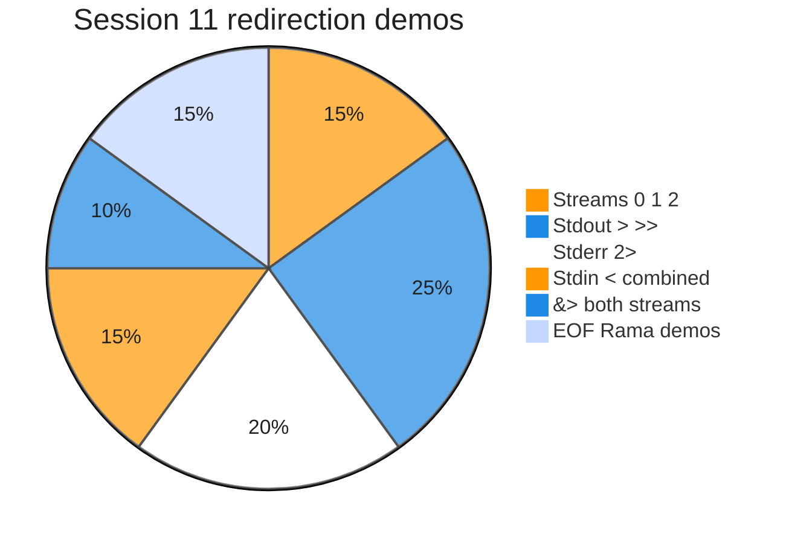
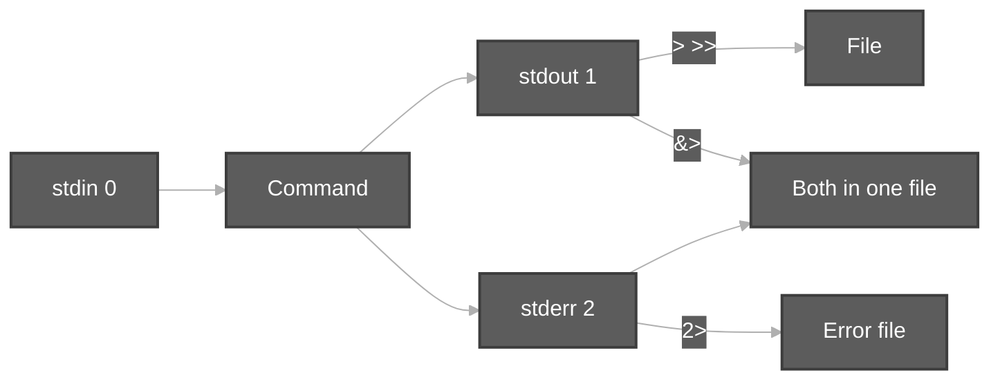

# Execution summary — Session 11 redirection

**Topic:** [redirection.md](../docs/topics/redirection.md) (Video 11)  
**Scripts:** [`../scripts/redirection.sh`](../scripts/redirection.sh) · [`../scripts/redirection/`](../scripts/redirection/) · [`../scripts/Redirection/`](../scripts/Redirection/)





Each script section uses the same **four-part** model:

| # | Column in tables | Meaning |
| :---: | :--- | :--- |
| 1 | **What it is** | Command or shell feature (e.g. `echo` = print text). |
| 2 | **Added / configured** | How it appears in Linux (PATH, builtin, flag on CLI, variable in script). |
| 3 | **Execution intent** | What you are trying to do when the line runs. |
| 4 | **Output** | What you see on the **terminal (stdout/stderr)**, in a **file**, or through a **pipeline** (`|`). |

---

## [`redirection.sh`](../scripts/redirection.sh)

**Run:** `bash scripts/redirection.sh`

### In-depth command walkthrough

| Command (as in script) | 1. What it is | 2. Added / configured | 3. Execution intent | 4. Output (terminal / file / pipeline) |
| :--- | :--- | :--- | :--- | :--- |
| `set -euo pipefail` | Bash strict-mode option bundle. | Written at top of script; not installed separately. | Tell Bash to stop on errors, treat unset variables as errors, and fail pipelines if any stage fails. | No visible output; changes how later commands affect exit status. |
| `ROOT="$(cd "$(dirname "${BASH_SOURCE[0]}")" && pwd)"` | Shell syntax (variable, test, subshell, or function). | Defined in this script only. | Prepare path, branch on failure, or wrap commands. | Depends on line: may be silent or print via embedded commands. |
| `echo ""` | Bash builtin that prints arguments to standard output. | Always available in Bash; no package install. | Show section titles, tips, or messages to the terminal (trying to **print** text for the user). | Lines appear on **stdout** in your terminal (or in CI logs). Not used in a pipeline unless followed by `|`. |
| `echo "############################################"` | Bash builtin that prints arguments to standard output. | Always available in Bash; no package install. | Show section titles, tips, or messages to the terminal (trying to **print** text for the user). | Lines appear on **stdout** in your terminal (or in CI logs). Not used in a pipeline unless followed by `|`. |
| `echo "# $(basename "$path")"` | Bash builtin that prints arguments to standard output. | Always available in Bash; no package install. | Show section titles, tips, or messages to the terminal (trying to **print** text for the user). | Lines appear on **stdout** in your terminal (or in CI logs). Not used in a pipeline unless followed by `|`. |
| `echo "############################################"` | Bash builtin that prints arguments to standard output. | Always available in Bash; no package install. | Show section titles, tips, or messages to the terminal (trying to **print** text for the user). | Lines appear on **stdout** in your terminal (or in CI logs). Not used in a pipeline unless followed by `|`. |
| `bash "$path"` | Invoke another script with Bash. | Child path built from `HERE` / `DIR` next to orchestrator. | Run one focused demo file so output maps to that file’s commands. | Child script’s stdout/stderr appear in your terminal in order; orchestrator prints `#####` banner first. |
| `for d in "$ROOT/redirection" "$ROOT/Redirection"; do` | `for` loop over words. | Bash syntax; list after `in`. | Repeat command for each item (e.g. each utility name). | One output line per iteration on stdout. |
| `if [[ -d "$d" ]]; then` | Conditional test `[[ ... ]]` or `if`. | Bash syntax. | Branch: run block only when directory exists / command succeeds. | Either block runs (messages on stdout) or `else` branch. |
| `while IFS= read -r -d '' script; do` | Shell syntax (variable, test, subshell, or function). | Defined in this script only. | Prepare path, branch on failure, or wrap commands. | Depends on line: may be silent or print via embedded commands. |
| `run_demo "$script"` | Orchestrator helper call. | Function `run_demo` in same script; takes child `.sh` filename. | Run the next focused demo so its output is grouped under a banner. | Banner on stdout, then child script output. |
| `done < <(find "$d" -maxdepth 1 -name '*-demo.sh' -print0 \| …` | Pipeline: connect stdout of left command to stdin of right. | Uses `|` between commands. | Send partial output to filter (e.g. only first lines). | You see only filtered output on terminal; left command may get SIGPIPE if right exits early. |

---

## [`append-greater-greater-demo.sh`](../scripts/Redirection/append-greater-greater-demo.sh)

**Run:** `bash scripts/Redirection/append-greater-greater-demo.sh`

### In-depth command walkthrough

| Command (as in script) | 1. What it is | 2. Added / configured | 3. Execution intent | 4. Output (terminal / file / pipeline) |
| :--- | :--- | :--- | :--- | :--- |
| `set -euo pipefail` | Bash strict-mode option bundle. | Written at top of script; not installed separately. | Tell Bash to stop on errors, treat unset variables as errors, and fail pipelines if any stage fails. | No visible output; changes how later commands affect exit status. |
| `WORK="${TMPDIR:-/tmp}/linux-redirection-demo"` | Shell variable assignment. | Name=`value` in script; often under `${TMPDIR:-/tmp}`. | Store path or stamp for later commands (setup, not a user command). | No output; variable used by `cd`, `rm`, file paths. |
| `rm -rf "$WORK"` | Remove files/directories recursively, force. | Coreutils; `-r` recursive, `-f` no prompt. | Clean old demo data under `/tmp` before recreating. | Silent on success. |
| `mkdir -p "$WORK"` | Make directories. | Coreutils; `-p` creates parents as needed. | Try to **create** folder(s) for the demo tree. | Silent on success; errors on stderr if path invalid. |
| `FILE="$WORK/appendData.sh"` | Shell variable assignment. | Name=`value` in script; often under `${TMPDIR:-/tmp}`. | Store path or stamp for later commands (setup, not a user command). | No output; variable used by `cd`, `rm`, file paths. |
| `echo Rama > "$FILE"` | Bash builtin that prints arguments to standard output. | Always available in Bash; no package install. | Show section titles, tips, or messages to the terminal (trying to **print** text for the user). | Lines appear on **stdout** in your terminal (or in CI logs). Not used in a pipeline unless followed by `|`. |
| `echo Sita >> "$FILE"` | Bash builtin that prints arguments to standard output. | Always available in Bash; no package install. | Show section titles, tips, or messages to the terminal (trying to **print** text for the user). | Lines appear on **stdout** in your terminal (or in CI logs). Not used in a pipeline unless followed by `|`. |
| `echo Lakshmana >> "$FILE"` | Bash builtin that prints arguments to standard output. | Always available in Bash; no package install. | Show section titles, tips, or messages to the terminal (trying to **print** text for the user). | Lines appear on **stdout** in your terminal (or in CI logs). Not used in a pipeline unless followed by `|`. |
| `echo "=== File built with > then >> ==="` | Section header for humans. | Literal string in script | **Print** section title | Title line on **stdout** before commands |
| `cat -n "$FILE"` | Concatenate and print files. | Coreutils. | Try to **display file contents** on terminal. | File bytes on stdout. |

---

## [`both-streams-ampersand-greater-demo.sh`](../scripts/redirection/both-streams-ampersand-greater-demo.sh)

**Run:** `bash scripts/redirection/both-streams-ampersand-greater-demo.sh`

### In-depth command walkthrough

| Command (as in script) | 1. What it is | 2. Added / configured | 3. Execution intent | 4. Output (terminal / file / pipeline) |
| :--- | :--- | :--- | :--- | :--- |
| `set -euo pipefail` | Bash strict-mode option bundle. | Written at top of script; not installed separately. | Tell Bash to stop on errors, treat unset variables as errors, and fail pipelines if any stage fails. | No visible output; changes how later commands affect exit status. |
| `WORK="${TMPDIR:-/tmp}/linux-redirection-s11"` | Shell variable assignment. | Name=`value` in script; often under `${TMPDIR:-/tmp}`. | Store path or stamp for later commands (setup, not a user command). | No output; variable used by `cd`, `rm`, file paths. |
| `rm -rf "$WORK"` | Remove files/directories recursively, force. | Coreutils; `-r` recursive, `-f` no prompt. | Clean old demo data under `/tmp` before recreating. | Silent on success. |
| `mkdir -p "$WORK"` | Make directories. | Coreutils; `-p` creates parents as needed. | Try to **create** folder(s) for the demo tree. | Silent on success; errors on stderr if path invalid. |
| `cd "$WORK"` | Change directory — move shell’s current working directory. | Builtin; takes relative or absolute path, `~`, `-`, or no args (home). | Navigate the tree (trying to **enter** a folder); relative paths start from cwd. | Normally silent on success; failure prints `cd: ...: No such file or directory` on **stderr**. |
| `echo "=== cal 2024 &> results1.txt (success output in file) ==="` | Section header for humans. | Literal string in script | **Print** section title | Title line on **stdout** before commands |
| `cal 2024 &> results1.txt` | Print ASCII calendar. | Optional package `cal` / `ncal` on some minimal images. | Display month grid (current or given month/year). | Calendar grid on stdout; missing binary → “command not found”. |
| `head -5 results1.txt` | Print first N lines of file or pipe. | Coreutils; often `head -n` or `head -20`. | Truncate long output in demos. | First lines on stdout; in pipeline: `cal -y | head -20` only first 20 lines reach terminal. |
| `echo ""` | Bash builtin that prints arguments to standard output. | Always available in Bash; no package install. | Show section titles, tips, or messages to the terminal (trying to **print** text for the user). | Lines appear on **stdout** in your terminal (or in CI logs). Not used in a pipeline unless followed by `|`. |
| `echo "=== cal 99999 &>> results1.txt (error appended to same file) ===…` | Section header for humans. | Literal string in script | **Print** section title | Title line on **stdout** before commands |
| `set +e` | Bash option: do not exit on command failure. | Shell builtin toggled inside the script. | Allow demo commands that are expected to fail without stopping the whole script. | No output; failed commands still print their error text to stderr. |
| `cal 99999 &>> results1.txt` | Print ASCII calendar. | Optional package `cal` / `ncal` on some minimal images. | Display month grid (current or given month/year). | Calendar grid on stdout; missing binary → “command not found”. |
| `set -e` | Bash option: exit immediately on failure. | Re-enabled after demos that expect errors. | Restore strict behavior for the rest of the script. | No direct output. |
| `echo "--- tail of results1.txt ---"` | Bash builtin that prints arguments to standard output. | Always available in Bash; no package install. | Show section titles, tips, or messages to the terminal (trying to **print** text for the user). | Lines appear on **stdout** in your terminal (or in CI logs). Not used in a pipeline unless followed by `|`. |
| `tail -5 results1.txt` | Print last N lines. | Coreutils. | Show end of listing or log. | Last lines on stdout; works in pipelines like `ls | tail`. |

---

## [`heredoc-eof-demo.sh`](../scripts/Redirection/heredoc-eof-demo.sh)

**Run:** `bash scripts/Redirection/heredoc-eof-demo.sh`

### In-depth command walkthrough

| Command (as in script) | 1. What it is | 2. Added / configured | 3. Execution intent | 4. Output (terminal / file / pipeline) |
| :--- | :--- | :--- | :--- | :--- |
| `set -euo pipefail` | Bash strict-mode option bundle. | Written at top of script; not installed separately. | Tell Bash to stop on errors, treat unset variables as errors, and fail pipelines if any stage fails. | No visible output; changes how later commands affect exit status. |
| `WORK="${TMPDIR:-/tmp}/linux-redirection-demo"` | Shell variable assignment. | Name=`value` in script; often under `${TMPDIR:-/tmp}`. | Store path or stamp for later commands (setup, not a user command). | No output; variable used by `cd`, `rm`, file paths. |
| `rm -rf "$WORK"` | Remove files/directories recursively, force. | Coreutils; `-r` recursive, `-f` no prompt. | Clean old demo data under `/tmp` before recreating. | Silent on success. |
| `mkdir -p "$WORK"` | Make directories. | Coreutils; `-p` creates parents as needed. | Try to **create** folder(s) for the demo tree. | Silent on success; errors on stderr if path invalid. |
| `FILE="$WORK/appendData.sh"` | Shell variable assignment. | Name=`value` in script; often under `${TMPDIR:-/tmp}`. | Store path or stamp for later commands (setup, not a user command). | No output; variable used by `cd`, `rm`, file paths. |
| `cat > "$FILE" <<EOF` | Concatenate and print files. | Coreutils. | Try to **display file contents** on terminal. | File bytes on stdout. |
| `Rama` | Shell syntax (variable, test, subshell, or function). | Defined in this script only. | Prepare path, branch on failure, or wrap commands. | Depends on line: may be silent or print via embedded commands. |
| `Sita` | Shell syntax (variable, test, subshell, or function). | Defined in this script only. | Prepare path, branch on failure, or wrap commands. | Depends on line: may be silent or print via embedded commands. |
| `EOF` | Shell syntax (variable, test, subshell, or function). | Defined in this script only. | Prepare path, branch on failure, or wrap commands. | Depends on line: may be silent or print via embedded commands. |
| `echo "=== cat > file <<EOF (overwrite with two lines) ==="` | Section header for humans. | Literal string in script | **Print** section title | Title line on **stdout** before commands |
| `cat "$FILE"` | Concatenate and print files. | Coreutils. | Try to **display file contents** on terminal. | File bytes on stdout. |
| `echo ""` | Bash builtin that prints arguments to standard output. | Always available in Bash; no package install. | Show section titles, tips, or messages to the terminal (trying to **print** text for the user). | Lines appear on **stdout** in your terminal (or in CI logs). Not used in a pipeline unless followed by `|`. |
| `cat >> "$FILE" <<EOF` | Concatenate and print files. | Coreutils. | Try to **display file contents** on terminal. | File bytes on stdout. |
| `Hanuman` | Shell syntax (variable, test, subshell, or function). | Defined in this script only. | Prepare path, branch on failure, or wrap commands. | Depends on line: may be silent or print via embedded commands. |
| `EOF` | Shell syntax (variable, test, subshell, or function). | Defined in this script only. | Prepare path, branch on failure, or wrap commands. | Depends on line: may be silent or print via embedded commands. |
| `echo "=== after cat >> file <<EOF (append block) ==="` | Section header for humans. | Literal string in script | **Print** section title | Title line on **stdout** before commands |
| `cat "$FILE"` | Concatenate and print files. | Coreutils. | Try to **display file contents** on terminal. | File bytes on stdout. |

---

## [`input-less-than-demo.sh`](../scripts/Redirection/input-less-than-demo.sh)

**Run:** `bash scripts/Redirection/input-less-than-demo.sh`

### In-depth command walkthrough

| Command (as in script) | 1. What it is | 2. Added / configured | 3. Execution intent | 4. Output (terminal / file / pipeline) |
| :--- | :--- | :--- | :--- | :--- |
| `set -euo pipefail` | Bash strict-mode option bundle. | Written at top of script; not installed separately. | Tell Bash to stop on errors, treat unset variables as errors, and fail pipelines if any stage fails. | No visible output; changes how later commands affect exit status. |
| `WORK="${TMPDIR:-/tmp}/linux-redirection-demo"` | Shell variable assignment. | Name=`value` in script; often under `${TMPDIR:-/tmp}`. | Store path or stamp for later commands (setup, not a user command). | No output; variable used by `cd`, `rm`, file paths. |
| `rm -rf "$WORK"` | Remove files/directories recursively, force. | Coreutils; `-r` recursive, `-f` no prompt. | Clean old demo data under `/tmp` before recreating. | Silent on success. |
| `mkdir -p "$WORK"` | Make directories. | Coreutils; `-p` creates parents as needed. | Try to **create** folder(s) for the demo tree. | Silent on success; errors on stderr if path invalid. |
| `FILE="$WORK/sample.txt"` | Shell variable assignment. | Name=`value` in script; often under `${TMPDIR:-/tmp}`. | Store path or stamp for later commands (setup, not a user command). | No output; variable used by `cd`, `rm`, file paths. |
| `echo "line from file" > "$FILE"` | Bash builtin that prints arguments to standard output. | Always available in Bash; no package install. | Show section titles, tips, or messages to the terminal (trying to **print** text for the user). | Lines appear on **stdout** in your terminal (or in CI logs). Not used in a pipeline unless followed by `|`. |
| `echo "=== cat < sample.txt ==="` | Section header for humans. | Literal string in script | **Print** section title | Title line on **stdout** before commands |
| `cat < "$FILE"` | Concatenate and print files. | Coreutils. | Try to **display file contents** on terminal. | File bytes on stdout. |
| `echo ""` | Bash builtin that prints arguments to standard output. | Always available in Bash; no package install. | Show section titles, tips, or messages to the terminal (trying to **print** text for the user). | Lines appear on **stdout** in your terminal (or in CI logs). Not used in a pipeline unless followed by `|`. |
| `echo "=== cat sample.txt (same idea for cat) ==="` | Section header for humans. | Literal string in script | **Print** section title | Title line on **stdout** before commands |
| `cat "$FILE"` | Concatenate and print files. | Coreutils. | Try to **display file contents** on terminal. | File bytes on stdout. |

---

## [`overwrite-greater-than-demo.sh`](../scripts/Redirection/overwrite-greater-than-demo.sh)

**Run:** `bash scripts/Redirection/overwrite-greater-than-demo.sh`

### In-depth command walkthrough

| Command (as in script) | 1. What it is | 2. Added / configured | 3. Execution intent | 4. Output (terminal / file / pipeline) |
| :--- | :--- | :--- | :--- | :--- |
| `set -euo pipefail` | Bash strict-mode option bundle. | Written at top of script; not installed separately. | Tell Bash to stop on errors, treat unset variables as errors, and fail pipelines if any stage fails. | No visible output; changes how later commands affect exit status. |
| `WORK="${TMPDIR:-/tmp}/linux-redirection-demo"` | Shell variable assignment. | Name=`value` in script; often under `${TMPDIR:-/tmp}`. | Store path or stamp for later commands (setup, not a user command). | No output; variable used by `cd`, `rm`, file paths. |
| `rm -rf "$WORK"` | Remove files/directories recursively, force. | Coreutils; `-r` recursive, `-f` no prompt. | Clean old demo data under `/tmp` before recreating. | Silent on success. |
| `mkdir -p "$WORK"` | Make directories. | Coreutils; `-p` creates parents as needed. | Try to **create** folder(s) for the demo tree. | Silent on success; errors on stderr if path invalid. |
| `FILE="$WORK/appendData.sh"` | Shell variable assignment. | Name=`value` in script; often under `${TMPDIR:-/tmp}`. | Store path or stamp for later commands (setup, not a user command). | No output; variable used by `cd`, `rm`, file paths. |
| `echo Rama > "$FILE"` | Bash builtin that prints arguments to standard output. | Always available in Bash; no package install. | Show section titles, tips, or messages to the terminal (trying to **print** text for the user). | Lines appear on **stdout** in your terminal (or in CI logs). Not used in a pipeline unless followed by `|`. |
| `echo Sita >> "$FILE"` | Bash builtin that prints arguments to standard output. | Always available in Bash; no package install. | Show section titles, tips, or messages to the terminal (trying to **print** text for the user). | Lines appear on **stdout** in your terminal (or in CI logs). Not used in a pipeline unless followed by `|`. |
| `echo "=== After Rama > and Sita >> ==="` | Section header for humans. | Literal string in script | **Print** section title | Title line on **stdout** before commands |
| `cat "$FILE"` | Concatenate and print files. | Coreutils. | Try to **display file contents** on terminal. | File bytes on stdout. |
| `echo ""` | Bash builtin that prints arguments to standard output. | Always available in Bash; no package install. | Show section titles, tips, or messages to the terminal (trying to **print** text for the user). | Lines appear on **stdout** in your terminal (or in CI logs). Not used in a pipeline unless followed by `|`. |
| `echo "=== echo Rama > file (Sita is removed) ==="` | Section header for humans. | Literal string in script | **Print** section title | Title line on **stdout** before commands |
| `echo Rama > "$FILE"` | Bash builtin that prints arguments to standard output. | Always available in Bash; no package install. | Show section titles, tips, or messages to the terminal (trying to **print** text for the user). | Lines appear on **stdout** in your terminal (or in CI logs). Not used in a pipeline unless followed by `|`. |
| `cat "$FILE"` | Concatenate and print files. | Coreutils. | Try to **display file contents** on terminal. | File bytes on stdout. |

---

## [`pipe-vs-redirect-hint-demo.sh`](../scripts/Redirection/pipe-vs-redirect-hint-demo.sh)

**Run:** `bash scripts/Redirection/pipe-vs-redirect-hint-demo.sh`

### In-depth command walkthrough

| Command (as in script) | 1. What it is | 2. Added / configured | 3. Execution intent | 4. Output (terminal / file / pipeline) |
| :--- | :--- | :--- | :--- | :--- |
| `set -euo pipefail` | Bash strict-mode option bundle. | Written at top of script; not installed separately. | Tell Bash to stop on errors, treat unset variables as errors, and fail pipelines if any stage fails. | No visible output; changes how later commands affect exit status. |
| `WORK="${TMPDIR:-/tmp}/linux-redirection-demo"` | Shell variable assignment. | Name=`value` in script; often under `${TMPDIR:-/tmp}`. | Store path or stamp for later commands (setup, not a user command). | No output; variable used by `cd`, `rm`, file paths. |
| `rm -rf "$WORK"` | Remove files/directories recursively, force. | Coreutils; `-r` recursive, `-f` no prompt. | Clean old demo data under `/tmp` before recreating. | Silent on success. |
| `mkdir -p "$WORK"` | Make directories. | Coreutils; `-p` creates parents as needed. | Try to **create** folder(s) for the demo tree. | Silent on success; errors on stderr if path invalid. |
| `OUT="$WORK/out.txt"` | Shell syntax (variable, test, subshell, or function). | Defined in this script only. | Prepare path, branch on failure, or wrap commands. | Depends on line: may be silent or print via embedded commands. |
| `echo "=== Pipe: ls \| head -3 (program to program) ==="` | Section header for humans. | Literal string in script | **Print** section title | Title line on **stdout** before commands |
| `ls /bin \| head -3` | List directory contents. | Coreutils; options change columns, hidden files, sort. | Try to **show names** in cwd or given path. | Names on stdout; options add permissions, sizes, inodes. |
| `echo ""` | Bash builtin that prints arguments to standard output. | Always available in Bash; no package install. | Show section titles, tips, or messages to the terminal (trying to **print** text for the user). | Lines appear on **stdout** in your terminal (or in CI logs). Not used in a pipeline unless followed by `|`. |
| `echo "=== Redirect: echo hello > out.txt (program to file) ==="` | Section header for humans. | Literal string in script | **Print** section title | Title line on **stdout** before commands |
| `echo hello > "$OUT"` | Bash builtin that prints arguments to standard output. | Always available in Bash; no package install. | Show section titles, tips, or messages to the terminal (trying to **print** text for the user). | Lines appear on **stdout** in your terminal (or in CI logs). Not used in a pipeline unless followed by `|`. |
| `cat "$OUT"` | Concatenate and print files. | Coreutils. | Try to **display file contents** on terminal. | File bytes on stdout. |

---

## [`stderr-2-greater-demo.sh`](../scripts/redirection/stderr-2-greater-demo.sh)

**Run:** `bash scripts/redirection/stderr-2-greater-demo.sh`

### In-depth command walkthrough

| Command (as in script) | 1. What it is | 2. Added / configured | 3. Execution intent | 4. Output (terminal / file / pipeline) |
| :--- | :--- | :--- | :--- | :--- |
| `set -euo pipefail` | Bash strict-mode option bundle. | Written at top of script; not installed separately. | Tell Bash to stop on errors, treat unset variables as errors, and fail pipelines if any stage fails. | No visible output; changes how later commands affect exit status. |
| `WORK="${TMPDIR:-/tmp}/linux-redirection-s11"` | Shell variable assignment. | Name=`value` in script; often under `${TMPDIR:-/tmp}`. | Store path or stamp for later commands (setup, not a user command). | No output; variable used by `cd`, `rm`, file paths. |
| `rm -rf "$WORK"` | Remove files/directories recursively, force. | Coreutils; `-r` recursive, `-f` no prompt. | Clean old demo data under `/tmp` before recreating. | Silent on success. |
| `mkdir -p "$WORK"` | Make directories. | Coreutils; `-p` creates parents as needed. | Try to **create** folder(s) for the demo tree. | Silent on success; errors on stderr if path invalid. |
| `cd "$WORK"` | Change directory — move shell’s current working directory. | Builtin; takes relative or absolute path, `~`, `-`, or no args (home). | Navigate the tree (trying to **enter** a folder); relative paths start from cwd. | Normally silent on success; failure prints `cd: ...: No such file or directory` on **stderr**. |
| `echo "=== cal with bad year — error on terminal if not redirected ==="` | Section header for humans. | Literal string in script | **Print** section title | Title line on **stdout** before commands |
| `set +e` | Bash option: do not exit on command failure. | Shell builtin toggled inside the script. | Allow demo commands that are expected to fail without stopping the whole script. | No output; failed commands still print their error text to stderr. |
| `cal 99999` | Print ASCII calendar. | Optional package `cal` / `ncal` on some minimal images. | Display month grid (current or given month/year). | Calendar grid on stdout; missing binary → “command not found”. |
| `set -e` | Bash option: exit immediately on failure. | Re-enabled after demos that expect errors. | Restore strict behavior for the rest of the script. | No direct output. |
| `echo ""` | Bash builtin that prints arguments to standard output. | Always available in Bash; no package install. | Show section titles, tips, or messages to the terminal (trying to **print** text for the user). | Lines appear on **stdout** in your terminal (or in CI logs). Not used in a pipeline unless followed by `|`. |
| `echo "=== cal 99999 2> error.txt — stderr in file, stdout still on scr…` | Section header for humans. | Literal string in script | **Print** section title | Title line on **stdout** before commands |
| `set +e` | Bash option: do not exit on command failure. | Shell builtin toggled inside the script. | Allow demo commands that are expected to fail without stopping the whole script. | No output; failed commands still print their error text to stderr. |
| `cal 99999 2> error.txt` | Print ASCII calendar. | Optional package `cal` / `ncal` on some minimal images. | Display month grid (current or given month/year). | Calendar grid on stdout; missing binary → “command not found”. |
| `set -e` | Bash option: exit immediately on failure. | Re-enabled after demos that expect errors. | Restore strict behavior for the rest of the script. | No direct output. |
| `echo "--- error.txt ---"` | Bash builtin that prints arguments to standard output. | Always available in Bash; no package install. | Show section titles, tips, or messages to the terminal (trying to **print** text for the user). | Lines appear on **stdout** in your terminal (or in CI logs). Not used in a pipeline unless followed by `|`. |
| `cat error.txt` | Concatenate and print files. | Coreutils. | Try to **display file contents** on terminal. | File bytes on stdout. |
| `echo ""` | Bash builtin that prints arguments to standard output. | Always available in Bash; no package install. | Show section titles, tips, or messages to the terminal (trying to **print** text for the user). | Lines appear on **stdout** in your terminal (or in CI logs). Not used in a pipeline unless followed by `|`. |
| `echo "=== ls > only.txt does NOT store cal-style errors (use 2>) ==="` | Section header for humans. | Literal string in script | **Print** section title | Title line on **stdout** before commands |
| `set +e` | Bash option: do not exit on command failure. | Shell builtin toggled inside the script. | Allow demo commands that are expected to fail without stopping the whole script. | No output; failed commands still print their error text to stderr. |
| `cal 99999 > only.txt` | Print ASCII calendar. | Optional package `cal` / `ncal` on some minimal images. | Display month grid (current or given month/year). | Calendar grid on stdout; missing binary → “command not found”. |
| `set -e` | Bash option: exit immediately on failure. | Re-enabled after demos that expect errors. | Restore strict behavior for the rest of the script. | No direct output. |
| `echo "--- only.txt (often empty) ---"` | Bash builtin that prints arguments to standard output. | Always available in Bash; no package install. | Show section titles, tips, or messages to the terminal (trying to **print** text for the user). | Lines appear on **stdout** in your terminal (or in CI logs). Not used in a pipeline unless followed by `|`. |
| `cat only.txt \|\| true` | Concatenate and print files. | Coreutils. | Try to **display file contents** on terminal. | File bytes on stdout. |

---

## [`stdin-combined-redirect-demo.sh`](../scripts/redirection/stdin-combined-redirect-demo.sh)

**Run:** `bash scripts/redirection/stdin-combined-redirect-demo.sh`

### In-depth command walkthrough

| Command (as in script) | 1. What it is | 2. Added / configured | 3. Execution intent | 4. Output (terminal / file / pipeline) |
| :--- | :--- | :--- | :--- | :--- |
| `set -euo pipefail` | Bash strict-mode option bundle. | Written at top of script; not installed separately. | Tell Bash to stop on errors, treat unset variables as errors, and fail pipelines if any stage fails. | No visible output; changes how later commands affect exit status. |
| `WORK="${TMPDIR:-/tmp}/linux-redirection-s11"` | Shell variable assignment. | Name=`value` in script; often under `${TMPDIR:-/tmp}`. | Store path or stamp for later commands (setup, not a user command). | No output; variable used by `cd`, `rm`, file paths. |
| `rm -rf "$WORK"` | Remove files/directories recursively, force. | Coreutils; `-r` recursive, `-f` no prompt. | Clean old demo data under `/tmp` before recreating. | Silent on success. |
| `mkdir -p "$WORK"` | Make directories. | Coreutils; `-p` creates parents as needed. | Try to **create** folder(s) for the demo tree. | Silent on success; errors on stderr if path invalid. |
| `cd "$WORK"` | Change directory — move shell’s current working directory. | Builtin; takes relative or absolute path, `~`, `-`, or no args (home). | Navigate the tree (trying to **enter** a folder); relative paths start from cwd. | Normally silent on success; failure prints `cd: ...: No such file or directory` on **stderr**. |
| `echo "Durga Sir sample line" > a.txt` | Bash builtin that prints arguments to standard output. | Always available in Bash; no package install. | Show section titles, tips, or messages to the terminal (trying to **print** text for the user). | Lines appear on **stdout** in your terminal (or in CI logs). Not used in a pipeline unless followed by `|`. |
| `echo "=== cat < a.txt (0< optional; same as cat a.txt for cat) ==="` | Section header for humans. | Literal string in script | **Print** section title | Title line on **stdout** before commands |
| `cat < a.txt` | Concatenate and print files. | Coreutils. | Try to **display file contents** on terminal. | File bytes on stdout. |
| `echo ""` | Bash builtin that prints arguments to standard output. | Always available in Bash; no package install. | Show section titles, tips, or messages to the terminal (trying to **print** text for the user). | Lines appear on **stdout** in your terminal (or in CI logs). Not used in a pipeline unless followed by `|`. |
| `echo "=== cat < a.txt > result.txt 2> error.txt ==="` | Section header for humans. | Literal string in script | **Print** section title | Title line on **stdout** before commands |
| `cat < a.txt > result.txt 2> error.txt` | Concatenate and print files. | Coreutils. | Try to **display file contents** on terminal. | File bytes on stdout. |
| `echo "--- result.txt ---"` | Bash builtin that prints arguments to standard output. | Always available in Bash; no package install. | Show section titles, tips, or messages to the terminal (trying to **print** text for the user). | Lines appear on **stdout** in your terminal (or in CI logs). Not used in a pipeline unless followed by `|`. |
| `cat result.txt` | Concatenate and print files. | Coreutils. | Try to **display file contents** on terminal. | File bytes on stdout. |
| `echo "--- error.txt (empty on success) ---"` | Bash builtin that prints arguments to standard output. | Always available in Bash; no package install. | Show section titles, tips, or messages to the terminal (trying to **print** text for the user). | Lines appear on **stdout** in your terminal (or in CI logs). Not used in a pipeline unless followed by `|`. |
| `wc -c error.txt` | Word/line/byte count. | Coreutils; `-l` lines, `-c` bytes. | Count entries or file size. | Number on stdout; `wc -l < file` reads file via stdin redirect. |
| `echo ""` | Bash builtin that prints arguments to standard output. | Always available in Bash; no package install. | Show section titles, tips, or messages to the terminal (trying to **print** text for the user). | Lines appear on **stdout** in your terminal (or in CI logs). Not used in a pipeline unless followed by `|`. |
| `echo "=== cat 0<a.txt >b.txt — optional 0 on stdin ==="` | Section header for humans. | Literal string in script | **Print** section title | Title line on **stdout** before commands |
| `cat 0<a.txt >b.txt` | Concatenate and print files. | Coreutils. | Try to **display file contents** on terminal. | File bytes on stdout. |
| `cat b.txt` | Concatenate and print files. | Coreutils. | Try to **display file contents** on terminal. | File bytes on stdout. |

---

## [`stdout-greater-than-demo.sh`](../scripts/redirection/stdout-greater-than-demo.sh)

**Run:** `bash scripts/redirection/stdout-greater-than-demo.sh`

### In-depth command walkthrough

| Command (as in script) | 1. What it is | 2. Added / configured | 3. Execution intent | 4. Output (terminal / file / pipeline) |
| :--- | :--- | :--- | :--- | :--- |
| `set -euo pipefail` | Bash strict-mode option bundle. | Written at top of script; not installed separately. | Tell Bash to stop on errors, treat unset variables as errors, and fail pipelines if any stage fails. | No visible output; changes how later commands affect exit status. |
| `WORK="${TMPDIR:-/tmp}/linux-redirection-s11"` | Shell variable assignment. | Name=`value` in script; often under `${TMPDIR:-/tmp}`. | Store path or stamp for later commands (setup, not a user command). | No output; variable used by `cd`, `rm`, file paths. |
| `rm -rf "$WORK"` | Remove files/directories recursively, force. | Coreutils; `-r` recursive, `-f` no prompt. | Clean old demo data under `/tmp` before recreating. | Silent on success. |
| `mkdir -p "$WORK"` | Make directories. | Coreutils; `-p` creates parents as needed. | Try to **create** folder(s) for the demo tree. | Silent on success; errors on stderr if path invalid. |
| `cd "$WORK"` | Change directory — move shell’s current working directory. | Builtin; takes relative or absolute path, `~`, `-`, or no args (home). | Navigate the tree (trying to **enter** a folder); relative paths start from cwd. | Normally silent on success; failure prints `cd: ...: No such file or directory` on **stderr**. |
| `echo "=== ls > output.txt (stdout to file; screen quiet) ==="` | Section header for humans. | Literal string in script | **Print** section title | Title line on **stdout** before commands |
| `ls -1 > output.txt` | List directory contents. | Coreutils; options change columns, hidden files, sort. | Try to **show names** in cwd or given path. | Names on stdout; options add permissions, sizes, inodes. |
| `echo "--- contents of output.txt ---"` | Bash builtin that prints arguments to standard output. | Always available in Bash; no package install. | Show section titles, tips, or messages to the terminal (trying to **print** text for the user). | Lines appear on **stdout** in your terminal (or in CI logs). Not used in a pipeline unless followed by `|`. |
| `cat output.txt` | Concatenate and print files. | Coreutils. | Try to **display file contents** on terminal. | File bytes on stdout. |
| `echo ""` | Bash builtin that prints arguments to standard output. | Always available in Bash; no package install. | Show section titles, tips, or messages to the terminal (trying to **print** text for the user). | Lines appear on **stdout** in your terminal (or in CI logs). Not used in a pipeline unless followed by `|`. |
| `echo "=== echo line >> output.txt (append) ==="` | Section header for humans. | Literal string in script | **Print** section title | Title line on **stdout** before commands |
| `echo "appended line" >> output.txt` | Bash builtin that prints arguments to standard output. | Always available in Bash; no package install. | Show section titles, tips, or messages to the terminal (trying to **print** text for the user). | Lines appear on **stdout** in your terminal (or in CI logs). Not used in a pipeline unless followed by `|`. |
| `cat output.txt` | Concatenate and print files. | Coreutils. | Try to **display file contents** on terminal. | File bytes on stdout. |
| `echo ""` | Bash builtin that prints arguments to standard output. | Always available in Bash; no package install. | Show section titles, tips, or messages to the terminal (trying to **print** text for the user). | Lines appear on **stdout** in your terminal (or in CI logs). Not used in a pipeline unless followed by `|`. |
| `echo "=== 1>same.txt — digit 1 must touch > (1>file not 1 > file) ==="` | Section header for humans. | Literal string in script | **Print** section title | Title line on **stdout** before commands |
| `echo "via explicit 1>" 1>same.txt` | Bash builtin that prints arguments to standard output. | Always available in Bash; no package install. | Show section titles, tips, or messages to the terminal (trying to **print** text for the user). | Lines appear on **stdout** in your terminal (or in CI logs). Not used in a pipeline unless followed by `|`. |
| `cat same.txt` | Concatenate and print files. | Coreutils. | Try to **display file contents** on terminal. | File bytes on stdout. |
| `echo ""` | Bash builtin that prints arguments to standard output. | Always available in Bash; no package install. | Show section titles, tips, or messages to the terminal (trying to **print** text for the user). | Lines appear on **stdout** in your terminal (or in CI logs). Not used in a pipeline unless followed by `|`. |
| `echo "=== cat > keyboard.txt then type (here: one line via printf) ===…` | Section header for humans. | Literal string in script | **Print** section title | Title line on **stdout** before commands |
| `printf 'hello from keyboard input\n' \| cat > keyboard.txt` | Formatted print (builtin). | Bash builtin. | Print with format specifiers like C. | Formatted bytes on stdout. |
| `cat keyboard.txt` | Concatenate and print files. | Coreutils. | Try to **display file contents** on terminal. | File bytes on stdout. |

---

## [`streams-0-1-2-demo.sh`](../scripts/redirection/streams-0-1-2-demo.sh)

**Run:** `bash scripts/redirection/streams-0-1-2-demo.sh`

### In-depth command walkthrough

| Command (as in script) | 1. What it is | 2. Added / configured | 3. Execution intent | 4. Output (terminal / file / pipeline) |
| :--- | :--- | :--- | :--- | :--- |
| `set -euo pipefail` | Bash strict-mode option bundle. | Written at top of script; not installed separately. | Tell Bash to stop on errors, treat unset variables as errors, and fail pipelines if any stage fails. | No visible output; changes how later commands affect exit status. |
| `echo "=== Three standard data streams (Durga Sir) ==="` | Section header for humans. | Literal string in script | **Print** section title | Title line on **stdout** before commands |
| `echo "0 = stdin  (keyboard by default)"` | Bash builtin that prints arguments to standard output. | Always available in Bash; no package install. | Show section titles, tips, or messages to the terminal (trying to **print** text for the user). | Lines appear on **stdout** in your terminal (or in CI logs). Not used in a pipeline unless followed by `|`. |
| `echo "1 = stdout (terminal by default) — normal command output"` | Bash builtin that prints arguments to standard output. | Always available in Bash; no package install. | Show section titles, tips, or messages to the terminal (trying to **print** text for the user). | Lines appear on **stdout** in your terminal (or in CI logs). Not used in a pipeline unless followed by `|`. |
| `echo "2 = stderr (terminal by default) — error messages"` | Bash builtin that prints arguments to standard output. | Always available in Bash; no package install. | Show section titles, tips, or messages to the terminal (trying to **print** text for the user). | Lines appear on **stdout** in your terminal (or in CI logs). Not used in a pipeline unless followed by `|`. |
| `echo ""` | Bash builtin that prints arguments to standard output. | Always available in Bash; no package install. | Show section titles, tips, or messages to the terminal (trying to **print** text for the user). | Lines appear on **stdout** in your terminal (or in CI logs). Not used in a pipeline unless followed by `|`. |
| `echo "=== This line goes to stdout (stream 1) ==="` | Section header for humans. | Literal string in script | **Print** section title | Title line on **stdout** before commands |
| `echo ""` | Bash builtin that prints arguments to standard output. | Always available in Bash; no package install. | Show section titles, tips, or messages to the terminal (trying to **print** text for the user). | Lines appear on **stdout** in your terminal (or in CI logs). Not used in a pipeline unless followed by `|`. |
| `echo "=== This line goes to stderr (stream 2) ===" >&2` | Section header for humans. | Literal string in script | **Print** section title | Title line on **stdout** before commands |
| `echo ""` | Bash builtin that prints arguments to standard output. | Always available in Bash; no package install. | Show section titles, tips, or messages to the terminal (trying to **print** text for the user). | Lines appear on **stdout** in your terminal (or in CI logs). Not used in a pipeline unless followed by `|`. |
| `echo "=== tty — name of your terminal device ==="` | Section header for humans. | Literal string in script | **Print** section title | Title line on **stdout** before commands |
| `tty \|\| echo "(no tty in this environment — still valid in a real la…` | Print terminal device path. | Coreutils. | Show which `/dev/pts/N` you use. | Device path on stdout. |

---

## [`tty-devpts-hint-demo.sh`](../scripts/redirection/tty-devpts-hint-demo.sh)

**Run:** `bash scripts/redirection/tty-devpts-hint-demo.sh`

### In-depth command walkthrough

| Command (as in script) | 1. What it is | 2. Added / configured | 3. Execution intent | 4. Output (terminal / file / pipeline) |
| :--- | :--- | :--- | :--- | :--- |
| `set -euo pipefail` | Bash strict-mode option bundle. | Written at top of script; not installed separately. | Tell Bash to stop on errors, treat unset variables as errors, and fail pipelines if any stage fails. | No visible output; changes how later commands affect exit status. |
| `echo "=== In class: open two terminals ==="` | Section header for humans. | Literal string in script | **Print** section title | Title line on **stdout** before commands |
| `echo "Terminal A: run  tty          → e.g. /dev/pts/1"` | Bash builtin that prints arguments to standard output. | Always available in Bash; no package install. | Show section titles, tips, or messages to the terminal (trying to **print** text for the user). | Lines appear on **stdout** in your terminal (or in CI logs). Not used in a pipeline unless followed by `|`. |
| `echo "Terminal B: run  cal > /dev/pts/1   → calendar appears on A's s…` | Bash builtin that prints arguments to standard output. | Always available in Bash; no package install. | Show section titles, tips, or messages to the terminal (trying to **print** text for the user). | Lines appear on **stdout** in your terminal (or in CI logs). Not used in a pipeline unless followed by `|`. |
| `echo ""` | Bash builtin that prints arguments to standard output. | Always available in Bash; no package install. | Show section titles, tips, or messages to the terminal (trying to **print** text for the user). | Lines appear on **stdout** in your terminal (or in CI logs). Not used in a pipeline unless followed by `|`. |
| `echo "=== This environment: current tty (if any) ==="` | Section header for humans. | Literal string in script | **Print** section title | Title line on **stdout** before commands |
| `if tty -s 2>/dev/null; then` | Conditional test `[[ ... ]]` or `if`. | Bash syntax. | Branch: run block only when directory exists / command succeeds. | Either block runs (messages on stdout) or `else` branch. |
| `TTY_DEV="$(tty)"` | Shell syntax (variable, test, subshell, or function). | Defined in this script only. | Prepare path, branch on failure, or wrap commands. | Depends on line: may be silent or print via embedded commands. |
| `echo "tty reports: $TTY_DEV"` | Bash builtin that prints arguments to standard output. | Always available in Bash; no package install. | Show section titles, tips, or messages to the terminal (trying to **print** text for the user). | Lines appear on **stdout** in your terminal (or in CI logs). Not used in a pipeline unless followed by `|`. |
| `echo "Example (same terminal): echo 'Hello from redirection' > $TTY_DEV"` | Bash builtin that prints arguments to standard output. | Always available in Bash; no package install. | Show section titles, tips, or messages to the terminal (trying to **print** text for the user). | Lines appear on **stdout** in your terminal (or in CI logs). Not used in a pipeline unless followed by `|`. |
| `echo 'Hello from redirection' > "$TTY_DEV"` | Bash builtin that prints arguments to standard output. | Always available in Bash; no package install. | Show section titles, tips, or messages to the terminal (trying to **print** text for the user). | Lines appear on **stdout** in your terminal (or in CI logs). Not used in a pipeline unless followed by `|`. |
| `echo "No controlling tty here — run the two-terminal lab on your Ubun…` | Bash builtin that prints arguments to standard output. | Always available in Bash; no package install. | Show section titles, tips, or messages to the terminal (trying to **print** text for the user). | Lines appear on **stdout** in your terminal (or in CI logs). Not used in a pipeline unless followed by `|`. |

---

## Script index (all `.sh` in this summary)

| Script | Run |
| :--- | :--- |
| [`redirection.sh`](../scripts/redirection.sh) | `bash scripts/redirection.sh` |
| [`append-greater-greater-demo.sh`](../scripts/Redirection/append-greater-greater-demo.sh) | `bash scripts/Redirection/append-greater-greater-demo.sh` |
| [`both-streams-ampersand-greater-demo.sh`](../scripts/redirection/both-streams-ampersand-greater-demo.sh) | `bash scripts/redirection/both-streams-ampersand-greater-demo.sh` |
| [`heredoc-eof-demo.sh`](../scripts/Redirection/heredoc-eof-demo.sh) | `bash scripts/Redirection/heredoc-eof-demo.sh` |
| [`input-less-than-demo.sh`](../scripts/Redirection/input-less-than-demo.sh) | `bash scripts/Redirection/input-less-than-demo.sh` |
| [`overwrite-greater-than-demo.sh`](../scripts/Redirection/overwrite-greater-than-demo.sh) | `bash scripts/Redirection/overwrite-greater-than-demo.sh` |
| [`pipe-vs-redirect-hint-demo.sh`](../scripts/Redirection/pipe-vs-redirect-hint-demo.sh) | `bash scripts/Redirection/pipe-vs-redirect-hint-demo.sh` |
| [`stderr-2-greater-demo.sh`](../scripts/redirection/stderr-2-greater-demo.sh) | `bash scripts/redirection/stderr-2-greater-demo.sh` |
| [`stdin-combined-redirect-demo.sh`](../scripts/redirection/stdin-combined-redirect-demo.sh) | `bash scripts/redirection/stdin-combined-redirect-demo.sh` |
| [`stdout-greater-than-demo.sh`](../scripts/redirection/stdout-greater-than-demo.sh) | `bash scripts/redirection/stdout-greater-than-demo.sh` |
| [`streams-0-1-2-demo.sh`](../scripts/redirection/streams-0-1-2-demo.sh) | `bash scripts/redirection/streams-0-1-2-demo.sh` |
| [`tty-devpts-hint-demo.sh`](../scripts/redirection/tty-devpts-hint-demo.sh) | `bash scripts/redirection/tty-devpts-hint-demo.sh` |


**Run every script in this topic (from repo root):**

```bash
bash scripts/redirection.sh
bash scripts/Redirection/append-greater-greater-demo.sh
bash scripts/redirection/both-streams-ampersand-greater-demo.sh
bash scripts/Redirection/heredoc-eof-demo.sh
bash scripts/Redirection/input-less-than-demo.sh
bash scripts/Redirection/overwrite-greater-than-demo.sh
bash scripts/Redirection/pipe-vs-redirect-hint-demo.sh
bash scripts/redirection/stderr-2-greater-demo.sh
bash scripts/redirection/stdin-combined-redirect-demo.sh
bash scripts/redirection/stdout-greater-than-demo.sh
bash scripts/redirection/streams-0-1-2-demo.sh
bash scripts/redirection/tty-devpts-hint-demo.sh
```
