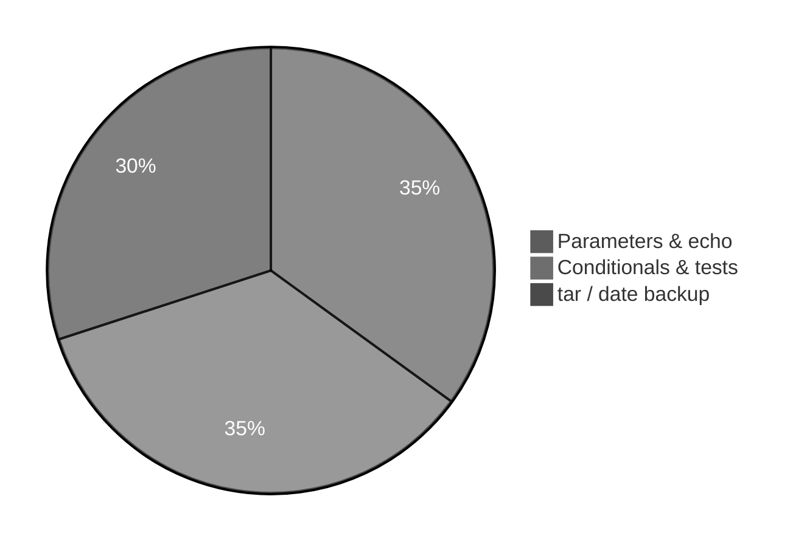
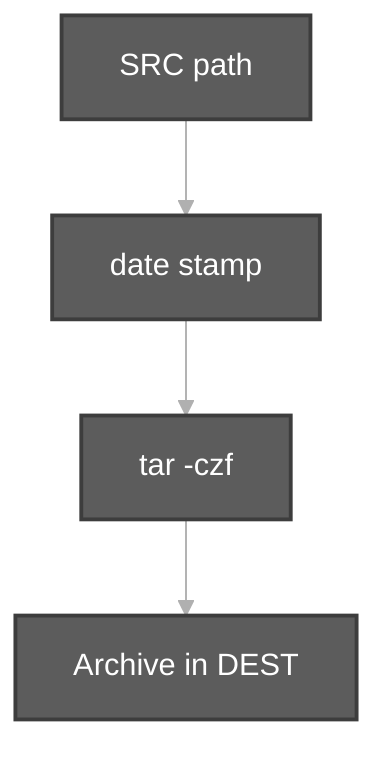

# Execution summary — `shell-scripting/`

**Topic:** Part 2 shell scripting preview (not tied to a single Durga video file in this repo)  
**Scripts directory:** [`../shell-scripting/`](../shell-scripting/)

---

## [`hello.sh`](../shell-scripting/hello.sh)

**Purpose:** Shebang, **positional parameters**, `$#`.

**Run:** `bash scripts/shell-scripting/hello.sh "Durga Sir Linux"`

| Syntax | Meaning |
| :--- | :--- |
| `#!/bin/bash` | Shebang — run with Bash |
| `${1:-Linux Basics}` | First argument or default |
| `$0` | Script path/name |
| `$#` | Number of arguments |
| `echo` | Print lines |

---

## [`check-file.sh`](../shell-scripting/check-file.sh)

**Purpose:** `if` test whether path is a regular file.

| Command | Meaning |
| :--- | :--- |
| `${1:?Usage...}` | Require first argument or exit with message |
| `[ -f "$FILE" ]` | True if file exists and is regular file |
| `wc -l < "$FILE"` | Count lines |
| `echo ... >&2` | Error message on stderr |
| `exit 1` | Failure exit code |

**Flow:** argument → test `-f` → print line count or error.

---

## [`backup-logs.sh`](../shell-scripting/backup-logs.sh)

**Purpose:** Archive folder with **tar** + timestamp.

| Command | Meaning |
| :--- | :--- |
| `set -euo pipefail` | Strict execution |
| `${1:-...}` / `${2:-/tmp}` | Source dir and destination |
| `date +%Y%m%d-%H%M%S` | Timestamp string |
| `tar -czf ARCHIVE -C dir name` | gzip-compressed tar archive |
| `dirname` / `basename` | Split path for `tar -C` |

---

## Quick reference

| Script | Main commands |
| :--- | :--- |
| [`hello.sh`](../shell-scripting/hello.sh) | `$0`, `$1`, `$#`, `echo` |
| [`check-file.sh`](../shell-scripting/check-file.sh) | `[ -f ]`, `wc -l`, `exit` |
| [`backup-logs.sh`](../shell-scripting/backup-logs.sh) | `date`, `tar -czf`, `dirname`, `basename` |
