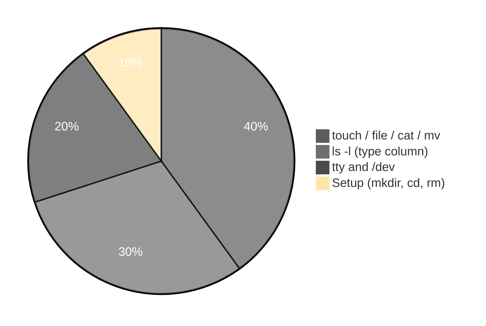

# Execution summary — `types-of-files-in-linux/`

**Topic:** [TypesOfFilesInLinux.md](../../docs/topics/TypesOfFilesInLinux.md) (Video 3)  
**Scripts directory:** [`../types-of-files-in-linux/`](../types-of-files-in-linux/)

---

## [`types-of-files-touch-file-demo.sh`](../types-of-files-in-linux/types-of-files-touch-file-demo.sh)

**Purpose:** Empty **ordinary** file with `touch` (Durga Sir `sunny.jpg` start).

**Run:** `bash scripts/types-of-files-in-linux/types-of-files-touch-file-demo.sh`

| Command | Meaning |
| :--- | :--- |
| `rm -rf`, `mkdir -p`, `cd` | Isolated temp workspace |
| `touch sunny.jpg` | Create zero-byte normal file |
| `ls -l sunny.jpg` | See permissions and size |
| `wc -c < sunny.jpg` | Byte count (0 when empty) |
| `file sunny.jpg` | Inspect type from content (may say “empty”) |

---

## [`file-command-content-demo.sh`](../types-of-files-in-linux/file-command-content-demo.sh)

**Purpose:** Extension ≠ content; `mv` renames only.

| Command | Meaning |
| :--- | :--- |
| `echo "hello friends" > sunny.jpg` | Redirect text into file (overwrites) |
| `file sunny.jpg` | Reports **ASCII text** despite `.jpg` name |
| `cat sunny.jpg` | Show contents |
| `mv sunny.jpg sunny.durga` | Rename; content unchanged |
| `file sunny.durga` | Still text by content |
| `ls -l` | List after rename |

**Flow:** `touch` → `file` (empty) → write text → `file` + `cat` → `mv` → `file` again.

---

## [`types-of-files-ls-demo.sh`](../types-of-files-in-linux/types-of-files-ls-demo.sh)

**Purpose:** First character of `ls -l` = file type.

| Command | Meaning |
| :--- | :--- |
| `echo "ordinary" > plain.txt` | Create normal file |
| `ln -s plain.txt link.txt` | Symbolic link (`l` in `ls -l`) |
| `mkdir -p .../subdir` | Directory (`d`) |
| `ls -l` | `-` ordinary, `d` directory, `l` symlink |
| `ls -l /dev/...` | Sample **device** entries (`c`, `b`, etc.) |

---

## [`tty-and-dev-demo.sh`](../types-of-files-in-linux/tty-and-dev-demo.sh)

**Purpose:** Terminal as **device file** under `/dev`.

| Command | Meaning |
| :--- | :--- |
| `tty` | Print path to current terminal device |
| `ls -l /dev/pts` | Pseudo-terminal devices |
| `echo` | Explains manual demo: `echo msg > /dev/pts/N` |

---

## Quick reference

| Script | Main commands |
| :--- | :--- |
| [`types-of-files-touch-file-demo.sh`](../types-of-files-in-linux/types-of-files-touch-file-demo.sh) | `touch`, `ls -l`, `wc -c`, `file` |
| [`file-command-content-demo.sh`](../types-of-files-in-linux/file-command-content-demo.sh) | `touch`, `echo >`, `file`, `cat`, `mv`, `ls -l` |
| [`types-of-files-ls-demo.sh`](../types-of-files-in-linux/types-of-files-ls-demo.sh) | `echo >`, `ln -s`, `ls -l`, `/dev` |
| [`tty-and-dev-demo.sh`](../types-of-files-in-linux/tty-and-dev-demo.sh) | `tty`, `ls -l /dev/pts` |
